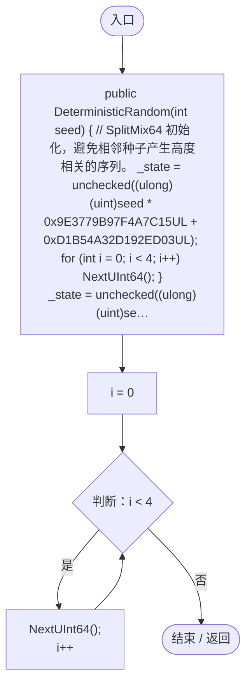
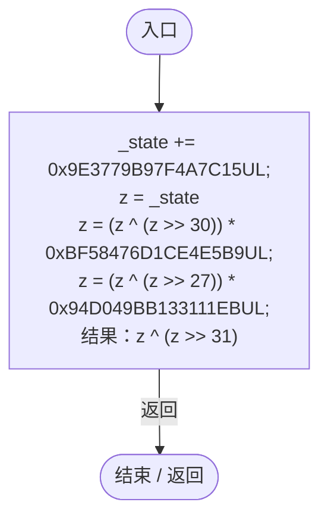
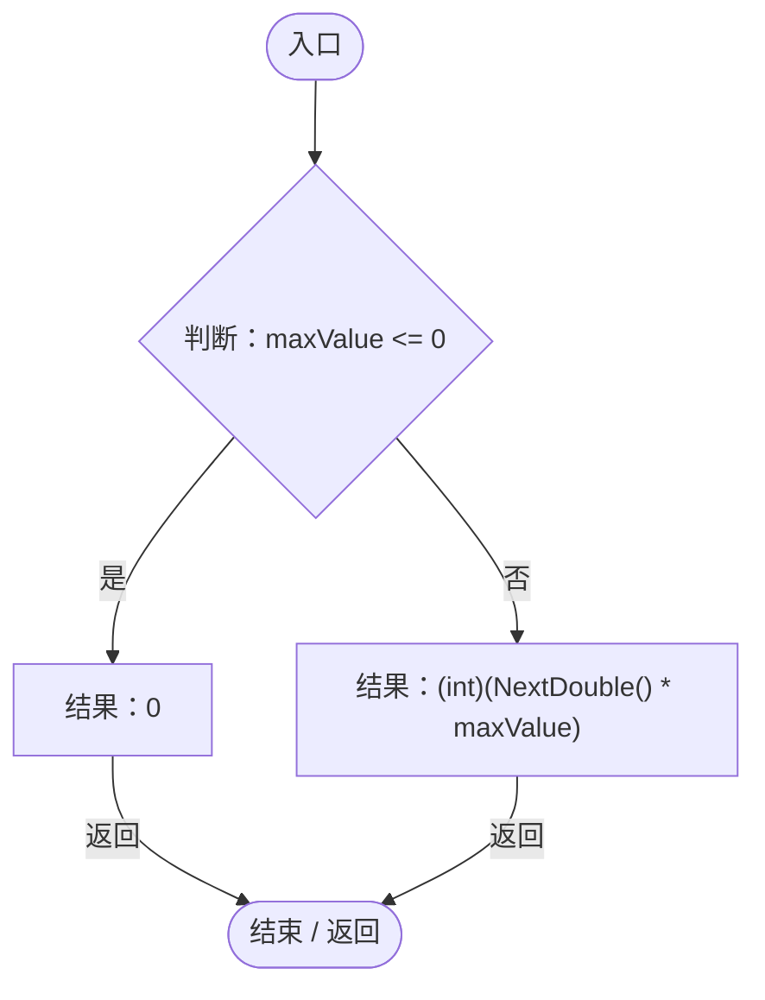
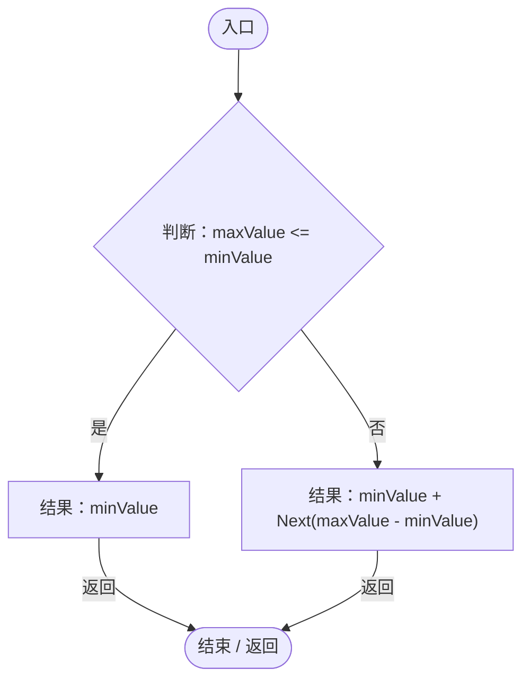
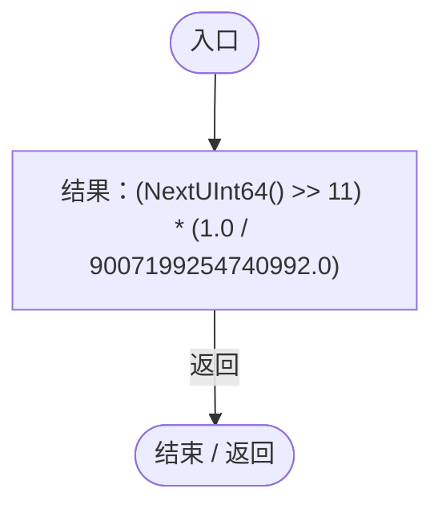
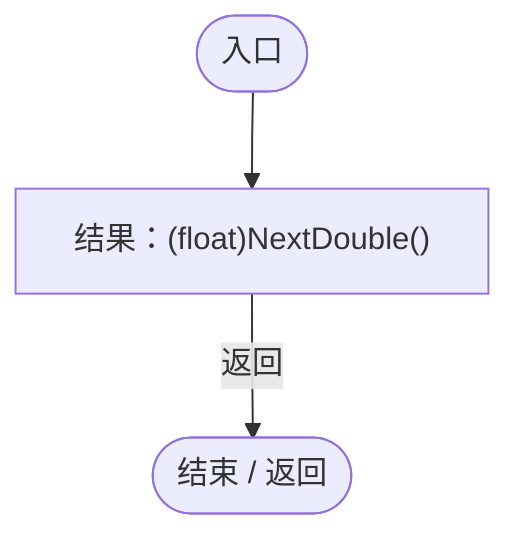

# DeterministicRandom.cs

[返回总索引](../README.md) · `Runtime` · `Assets/DarwinPark/Planet/Noise/DeterministicRandom.cs`

[源文件](../../../Assets/DarwinPark/Planet/Noise/DeterministicRandom.cs) · 源码校验：`de23ed645459f73f229e46732d1db3ed25e3b264a2e1d4f9f7fcd88e4fce6df4`

方法按源文件位置排列。事件/回调引用不表示立即执行；分支与异常说明见总索引。完整源码与可点击关系图请打开离线手册。

## DeterministicRandom.ctor · L15

`public DeterministicRandom(int seed)`

### Editor / Player · Roslyn编译器控制流

项目内调用/回调引用：

- [DeterministicRandom.NextUInt64 · L22](0c2b60ffd3650bfd.md#mb417047833c02194)（方法）

## NextUInt64 · L22

`private ulong NextUInt64()`

### Editor / Player · Roslyn编译器控制流

## Next · L32

`public int Next(int maxValue)`

返回 [0, maxValue) 的整数；maxValue &lt;= 0 时返回 0。

### Editor / Player · Roslyn编译器控制流

项目内调用/回调引用：

- [DeterministicRandom.NextDouble · L46](0c2b60ffd3650bfd.md#m7c9d5cbe73395eca)（方法）

## Next · L39

`public int Next(int minValue, int maxValue)`

返回 [minValue, maxValue) 的整数。

### Editor / Player · Roslyn编译器控制流

项目内调用/回调引用：

- [DeterministicRandom.Next · L32](0c2b60ffd3650bfd.md#m5fab9b9b1a9df9bf)（方法）

## NextDouble · L46

`public double NextDouble()`

返回 [0,1) 的浮点数。

### Editor / Player · Roslyn编译器控制流

项目内调用/回调引用：

- [DeterministicRandom.NextUInt64 · L22](0c2b60ffd3650bfd.md#mb417047833c02194)（方法）

## NextFloat · L53

`public float NextFloat()`

返回 [0,1) 的浮点数。

### Editor / Player · Roslyn编译器控制流

项目内调用/回调引用：

- [DeterministicRandom.NextDouble · L46](0c2b60ffd3650bfd.md#m7c9d5cbe73395eca)（方法）
