# RuleModesCleanupRegression.cs

[返回总索引](../README.md) · `Editor` · `Assets/DarwinPark/Editor/RuleModesCleanupRegression.cs`

[源文件](../../../Assets/DarwinPark/Editor/RuleModesCleanupRegression.cs) · 源码校验：`68dff3a197bcdcad3f9bac6c318a05c85b52c0e44acae78f37c225ca7c5351b6`

方法按源文件位置排列。事件/回调引用不表示立即执行；分支与异常说明见总索引。完整源码与可点击关系图请打开离线手册。

## Folder.get · L24

`private static string Folder`

### Editor · 语法控制结构 / 声明（非CFG）

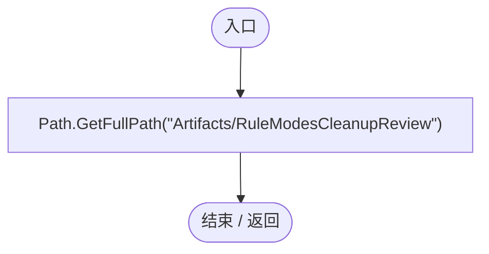

## RuleModesCleanupRegression.ctor · L25

`static RuleModesCleanupRegression()`

### Editor · Roslyn编译器控制流

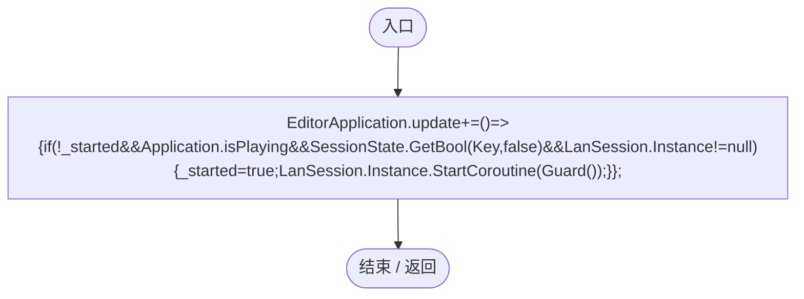

项目内调用/回调引用：

- [RuleModesCleanupRegression.回调@25 · L25](0c519783f10a24d8.md#m651c0089676ae1a0)（回调/委托）

## 回调@25 · L25

`( … => 回调`

### Editor · Roslyn编译器控制流

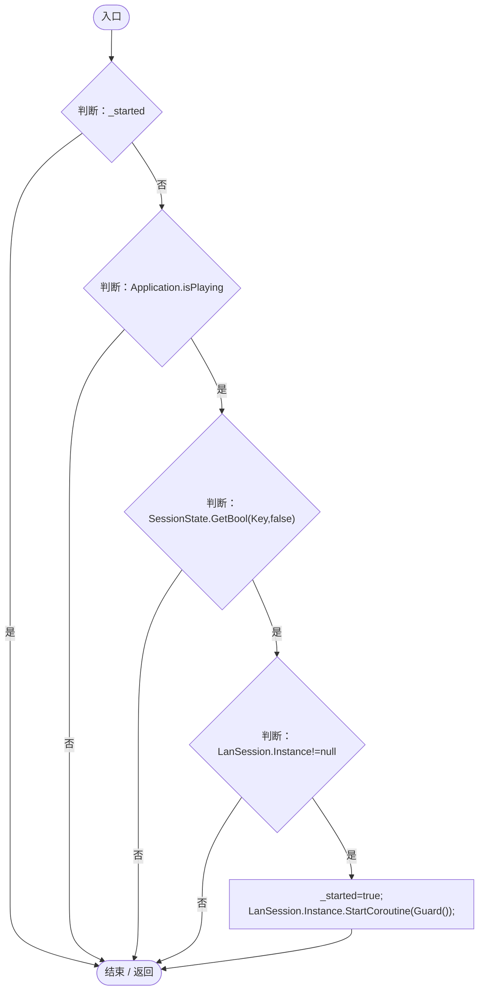

项目内调用/回调引用：

- [LanSession.Instance.get · L23](9fb633eebffe669c.md#mbf83306994878383)（访问器）
- [RuleModesCleanupRegression.Guard · L28](0c519783f10a24d8.md#medd74829bdaf5a83)（方法）

## RunBatch · L26

`public static void RunBatch()`

### Editor · Roslyn编译器控制流

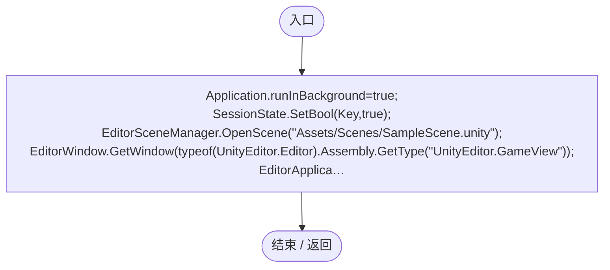

## Check · L27

`private static void Check(bool pass,string message)`

### Editor · Roslyn编译器控制流

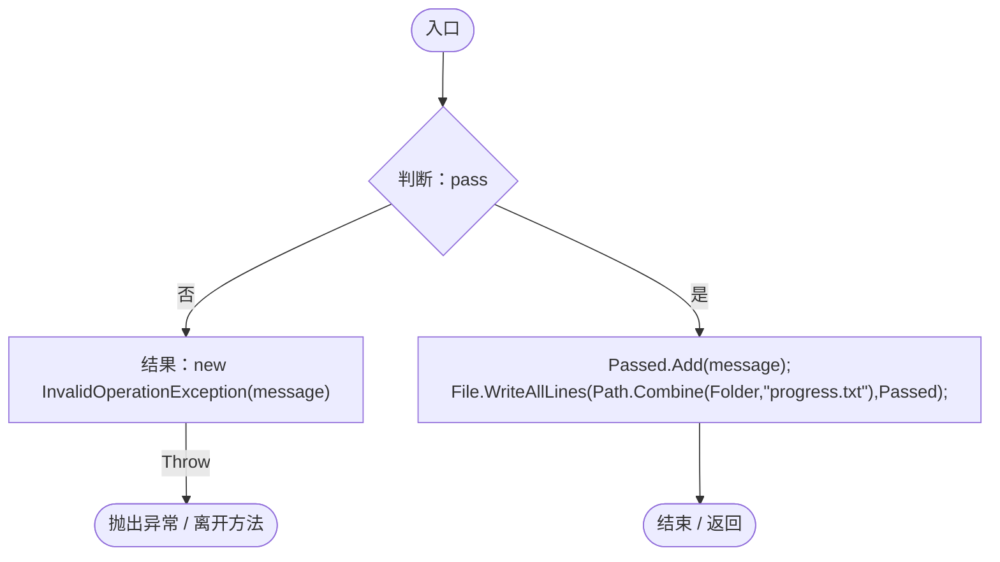

## Guard · L28

`private static IEnumerator Guard()`

### Editor · Roslyn编译器控制流

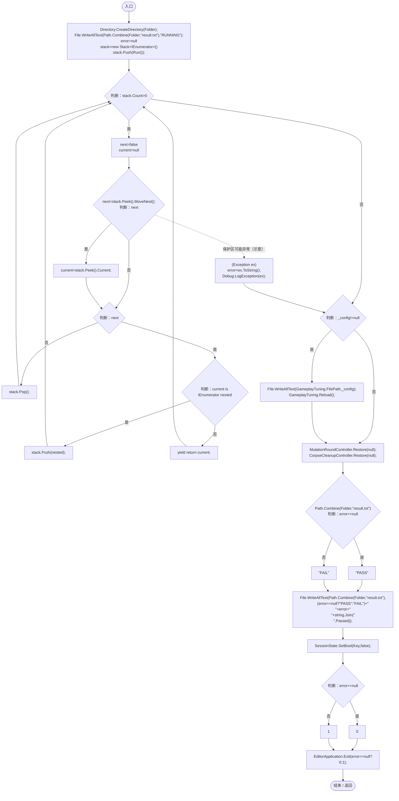

项目内调用/回调引用：

- [RuleModesCleanupRegression.Run · L41](0c519783f10a24d8.md#me054fb6d843fdbf9)（方法）
- [GameplayTuning.Reload · L61](db546e5713b32d53.md#ma781fa66f3a16705)（方法）
- [MutationRoundController.Restore · L56](3a238ee75b15c52c.md#m8fd13208bdd39731)（方法）
- [CorpseCleanupController.Restore · L38](d2cacacf25d2c28f.md#m88264fca2e08063a)（方法）

## Wait · L35

`private static IEnumerator Wait(Func<bool> ready)`

### Editor · Roslyn编译器控制流

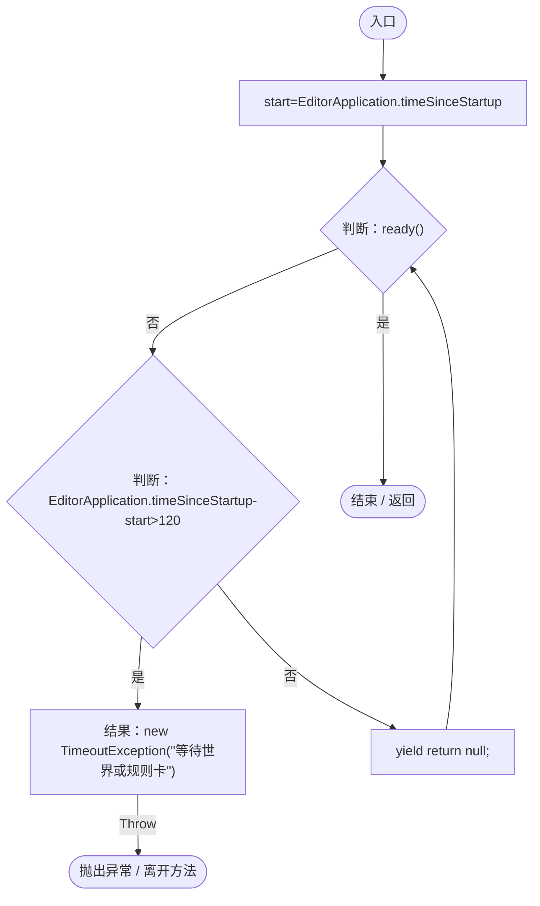

## Spawn · L36

`private static DarwinEntity Spawn(params (string,float)[] values)`

### Editor · Roslyn编译器控制流

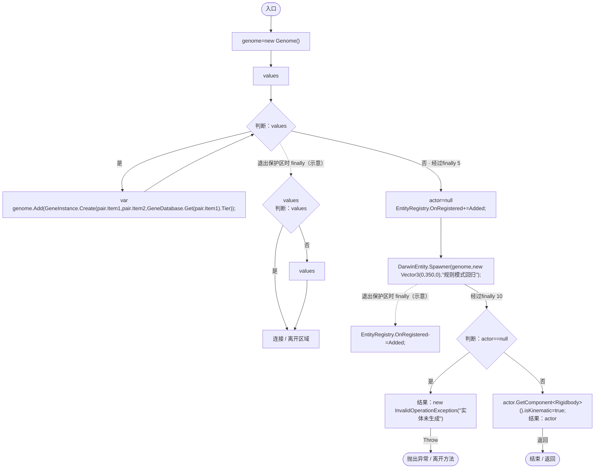

项目内调用/回调引用：

- [Genome.Add · L19](a2ef23f865bc7ee8.md#md9cfdc94b8b8d40f)（方法）
- [GeneInstance.Create · L20](f82e1498d67f5afd.md#m72e94c278de3cf8b)（方法）
- [GeneDatabase.Get · L136](ec0a03483435a863.md#me6a5fefe6c3492f9)（方法）
- [RuleModesCleanupRegression.Added · L38](0c519783f10a24d8.md#me7c92c5864e8c382)（局部函数）

## Added · L38

`void Added(DarwinEntity value)`

### Editor · Roslyn编译器控制流

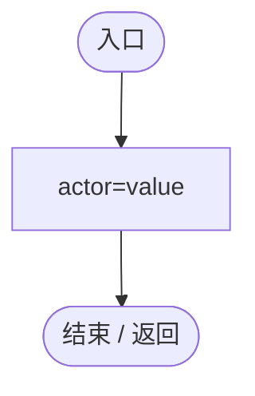

## Resource · L40

`private static ColonyResource Resource(ColonyResourceKind kind)`

### Editor · Roslyn编译器控制流

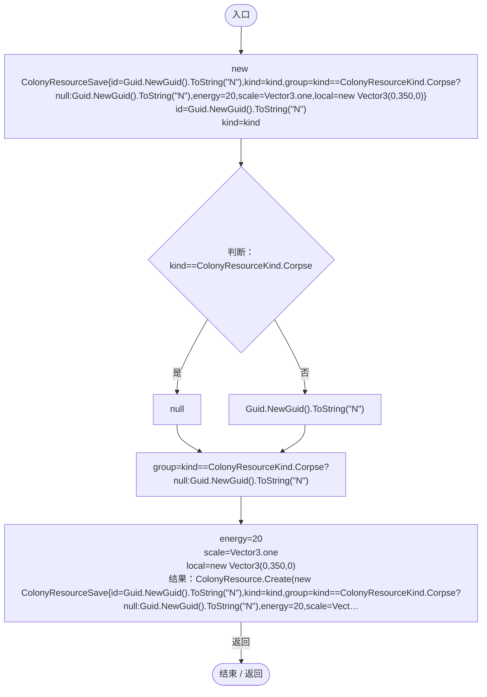

项目内调用/回调引用：

- [ColonyResource.Create · L45](293dbaecfff4b585.md#m7e8d2b0e06e1cad5)（方法）

## Run · L41

`private static IEnumerator Run()`

### Editor · Roslyn编译器控制流

```mermaid
flowchart TD
  b0(["入口"])
  b1["session=Object.FindFirstObjectByType&lt;WorldSessionManager&gt;()<br/>session.autoSaveInterval=36000;<br/>planet=Object.FindFirstObjectByType&lt;PlanetTerrainMeshBuilder&gt;()<br/>planet.subdivisions=16;<br/>typeof(WorldSessionManager).GetField(&quot;_initialTerrain&quot;,Bi…"]
  b2["EntityRegistry.All.ToArray()"]
  b3{"判断：EntityRegistry.All.ToArray()"}
  b4["var<br/>Object.DestroyImmediate(actor.gameObject);"]
  b5{"EntityRegistry.All.ToArray()<br/>判断：EntityRegistry.All.ToArray()"}
  b6["EntityRegistry.All.ToArray()"]
  b7["连接 / 离开区域"]
  b8["ColonyResource.ClearWorld();<br/>_config=File.ReadAllText(GameplayTuning.FilePath);<br/>tuning=GameplayTuning.Current<br/>tuning.mutationRoundsEnabled=false;<br/>entity=Spawn((&quot;gene_storage&quot;,50),(&quot;gene_environment&quot;,50),(&quot;gene_repair&quot;,50))<br/>entity.Genes.R…"]
  b9{"判断：StageMutationPolicy.Attempts==attempts+1"}
  b10["entity.Genes.StageMutationChecks==1"]
  b11["StageMutationPolicy.Attempts==attempts+1"]
  b12["Check(StageMutationPolicy.Attempts==attempts+1&amp;&amp;entity.Genes.StageMutationChecks==1,&quot;阶段100%出生仅抽签一次，重复阶段去重&quot;);"]
  b13["entity.Genes.TryStageMutation(AgeState.Adult);<br/>entity.Genes.TryStageMutation(AgeState.Elder);<br/>Check(StageMutationPolicy.Attempts==attempts+3,&quot;成年、老年分别触发一次&quot;);"]
  b14["new MutationRoundSave{elapsed=1,population=1,quota=1,selected=1,pending=new List&lt;string&gt;{EcologyIdentity.Of(entity)}}<br/>elapsed=1<br/>population=1<br/>quota=1<br/>selected=1"]
  b15["new List&lt;string&gt;{EcologyIdentity.Of(entity)}<br/>EcologyIdentity.Of(entity)<br/>pending=new List&lt;string&gt;{EcologyIdentity.Of(entity)}"]
  b16["MutationRoundController.Restore(new MutationRoundSave{elapsed=1,population=1,quota=1,selected=1,pending=new List&lt;string&gt;{EcologyIdentity.Of(entity)}});"]
  b17["timed=JsonUtility.ToJson(MutationRoundController.Capture())<br/>MutationRoundController.Advance(100);<br/>Check(JsonUtility.ToJson(MutationRoundController.Capture())==timed,&quot;阶段模式冻结定时轮次及待变异身份&quot;);<br/>entity.Genes.RestoreStageState(AgeState.Adult,0,0);…"]
  b18{"判断：ColonyResource.Find(firstId)!=null"}
  b19["CorpseCleanupController.Removed==0"]
  b20["ColonyResource.Find(firstId)!=null"]
  b21["Check(ColonyResource.Find(firstId)!=null&amp;&amp;CorpseCleanupController.Removed==0,&quot;到达设定模拟周期前不清尸&quot;);"]
  b22["CorpseCleanupController.Advance(1);"]
  b23{"判断：ColonyResource.Find(firstId)==null"}
  b24{"判断：ColonyResource.Find(secondId)!=null"}
  b25["CorpseCleanupController.Queued==1"]
  b26["ColonyResource.Find(firstId)==null&amp;&amp;ColonyResource.Find(secondId)!=null&amp;&amp;CorpseCleanupController.Queued==1"]
  b27["Check(ColonyResource.Find(firstId)==null&amp;&amp;ColonyResource.Find(secondId)!=null&amp;&amp;CorpseCleanupController.Queued==1,&quot;清理严格按每帧预算，不一帧销毁所有尸体&quot;);"]
  b28{"判断：ColonyResource.Find(protectedId)!=null"}
  b29["ColonyResource.Find(energyId)!=null"]
  b30["ColonyResource.Find(protectedId)!=null"]
  b31["Check(ColonyResource.Find(protectedId)!=null&amp;&amp;ColonyResource.Find(energyId)!=null,&quot;已领取尸体和能量块均保留&quot;);"]
  b32["saved=CorpseCleanupController.Capture()<br/>session.SaveNow(false);<br/>disk=WorldSaveStore.Read(WorldSaveStore.FileFor(session.Current.id))"]
  b33{"判断：disk.corpseCleanup.pending.SequenceEqual(saved.pending)"}
  b34["disk.corpseCleanup.elapsed==saved.elapsed"]
  b35["disk.corpseCleanup.pending.SequenceEqual(saved.pending)"]
  b36["Check(disk.corpseCleanup.pending.SequenceEqual(saved.pending)&amp;&amp;disk.corpseCleanup.elapsed==saved.elapsed,&quot;清理时间、计数及剩余身份实际写入磁盘&quot;);"]
  b37["session.Open(disk);<br/>yield return Wait(()=&gt;!session.Busy);<br/>clock.Pause();"]
  b38{"判断：CorpseCleanupController.Queued==1"}
  b39["CorpseCleanupController.Removed==1"]
  b40["CorpseCleanupController.Queued==1"]
  b41["Check(CorpseCleanupController.Queued==1&amp;&amp;CorpseCleanupController.Removed==1,&quot;真正读档恢复清理进度，不重新收集名单&quot;);"]
  b42["tuning=GameplayTuning.Current;<br/>tuning.corpseCleanupEnabled=true;<br/>tuning.corpseCleanupSeconds=10;<br/>tuning.corpseCleanupPerFrame=1;<br/>progress=JsonUtility.ToJson(CorpseCleanupController.Capture())<br/>CorpseCleanupController.Advance(0);<br/>WorldAuth…"]
  b43{"判断：ColonyResource.Find(secondId)!=null"}
  b44{"判断：CorpseCleanupController.Queued==0"}
  b45["CorpseCleanupController.Removed==1"]
  b46["ColonyResource.Find(secondId)!=null&amp;&amp;CorpseCleanupController.Queued==0&amp;&amp;CorpseCleanupController.Removed==1"]
  b47["Check(ColonyResource.Find(secondId)!=null&amp;&amp;CorpseCleanupController.Queued==0&amp;&amp;CorpseCleanupController.Removed==1,&quot;删除前重新检查领取，不吞工匠货物&quot;);"]
  b48["saved=CorpseCleanupController.Capture();<br/>saved.pending.Add(secondId);<br/>rejected=false"]
  b49["CorpseCleanupController.Validate(saved);"]
  b50["rejected=true;"]
  b51["Check(rejected,&quot;重复清理身份在加载清场前拒绝&quot;);<br/>CorpseCleanupController.Validate(null);"]
  b52["new CorpseCleanupSave{version=0}<br/>version=0<br/>CorpseCleanupController.Validate(new CorpseCleanupSave{version=0});"]
  b53["Check(true,&quot;旧档缺少清理快照仍可载入&quot;);<br/>mesh=planet.transform.Find(&quot;CloudVolume&quot;).GetComponent&lt;MeshFilter&gt;().sharedMesh<br/>Check(mesh.triangles.Length/3==12*SimulationOptimization.Current.weatherProxySubdivisions*SimulationOptimization.Current.weatherP…"]
  b54["i=0"]
  b55{"判断：i&lt;indices.Length"}
  b56["a=vertices[indices[i]]<br/>n=Vector3.Cross(vertices[indices[i+1]]-a,vertices[indices[i+2]]-a).normalized<br/>outward&amp;=Vector3.Dot(n,a)&gt;=radius-.001f;"]
  b57["i+=3"]
  b58{"Check(outward,&quot;所有天气代理平面外接解析球，不漏天空边缘&quot;);<br/>panel=null<br/>yield return Wait(()=&gt;{panel=Object.FindFirstObjectByType&lt;SimulationRulesPanel&gt;();return panel?.Card!=null;});<br/>panel.Reload();<br/>Check(panel.Card.sizeDelta==new Vector2(260,164),&quot;规则卡保持原尺寸&quot;)…"}
  b59["panel.Card.Find(&quot;MutationEnabled&quot;).GetComponent&lt;Button&gt;().onClick.Invoke();"]
  b60["panel.Apply();"]
  b61{"判断：GameplayTuning.Current.mutationMode==1"}
  b62["GameplayTuning.Current.stageMutationProbability==1"]
  b63["GameplayTuning.Current.mutationMode==1"]
  b64["Check(GameplayTuning.Current.mutationMode==1&amp;&amp;GameplayTuning.Current.stageMutationProbability==1,&quot;真实按钮切换并保存阶段模式与概率&quot;);"]
  b65{"yield return new WaitForEndOfFrame();<br/>ScreenCapture.CaptureScreenshot(Path.Combine(Folder,&quot;stage-rules.png&quot;));<br/>yield return null;<br/>panel.Card.Find(&quot;RuleList&quot;).GetComponent&lt;Dropdown&gt;().value=1;<br/>panel.Card.Find(&quot;Fraction&quot;).GetComponent&lt;Inpu…"}
  b66["panel.Card.Find(&quot;MutationEnabled&quot;).GetComponent&lt;Button&gt;().onClick.Invoke();"]
  b67["panel.Apply();"]
  b68{"判断：GameplayTuning.Current.corpseCleanupEnabled"}
  b69{"判断：GameplayTuning.Current.corpseCleanupSeconds==12"}
  b70["File.ReadAllText(GameplayTuning.FilePath).Contains(&quot;//&quot;)"]
  b71["GameplayTuning.Current.corpseCleanupEnabled&amp;&amp;GameplayTuning.Current.corpseCleanupSeconds==12&amp;&amp;File.ReadAllText(GameplayTuning.FilePath).Contains(&quot;//&quot;)"]
  b72["Check(GameplayTuning.Current.corpseCleanupEnabled&amp;&amp;GameplayTuning.Current.corpseCleanupSeconds==12&amp;&amp;File.ReadAllText(GameplayTuning.FilePath).Contains(&quot;//&quot;),&quot;清尸页输入不被开关覆盖，真实按钮保存周期且保留注释&quot;);"]
  b73["panel.Card.Find(&quot;Fraction&quot;).GetComponent&lt;InputField&gt;().text=&quot;15&quot;;<br/>File.WriteAllText(GameplayTuning.FilePath,RuleSelectionEdits.MutationModes(File.ReadAllText(GameplayTuning.FilePath),true,1,.1f,.42f,30));<br/>panel.Apply();"]
  b74{"判断：GameplayTuning.Current.stageMutationProbability==.42f"}
  b75["GameplayTuning.Current.corpseCleanupSeconds==15"]
  b76["GameplayTuning.Current.stageMutationProbability==.42f"]
  b77["Check(GameplayTuning.Current.stageMutationProbability==.42f&amp;&amp;GameplayTuning.Current.corpseCleanupSeconds==15,&quot;清尸页保存保留编辑期间外部更新的变异参数&quot;);"]
  b78["valid=File.ReadAllText(GameplayTuning.FilePath)<br/>panel.Card.Find(&quot;Fraction&quot;).GetComponent&lt;InputField&gt;().text=&quot;0&quot;;<br/>panel.Apply();<br/>Check(File.ReadAllText(GameplayTuning.FilePath)==valid,&quot;无效清理周期不破坏配置&quot;);<br/>panel.Reload();<br/>WorldAuthority.CanEdit…"]
  b79(["结束 / 返回"])
  b0 --> b1
  b1 --> b2
  b2 --> b3
  b3 -->|"是"| b4
  b3 -->|"否 · 经过finally 5"| b8
  b4 --> b3
  b5 -->|"否"| b6
  b5 -->|"是"| b7
  b6 --> b7
  b8 --> b9
  b9 -->|"是"| b10
  b9 -->|"否"| b11
  b10 --> b12
  b11 --> b12
  b12 --> b13
  b13 --> b14
  b14 --> b15
  b15 --> b16
  b16 --> b17
  b17 --> b18
  b18 -->|"是"| b19
  b18 -->|"否"| b20
  b19 --> b21
  b20 --> b21
  b21 --> b22
  b22 --> b23
  b23 -->|"是"| b24
  b23 -->|"否"| b26
  b24 -->|"是"| b25
  b24 -->|"否"| b26
  b25 --> b27
  b26 --> b27
  b27 --> b28
  b28 -->|"是"| b29
  b28 -->|"否"| b30
  b29 --> b31
  b30 --> b31
  b31 --> b32
  b32 --> b33
  b33 -->|"是"| b34
  b33 -->|"否"| b35
  b34 --> b36
  b35 --> b36
  b36 --> b37
  b37 --> b38
  b38 -->|"是"| b39
  b38 -->|"否"| b40
  b39 --> b41
  b40 --> b41
  b41 --> b42
  b42 --> b43
  b43 -->|"是"| b44
  b43 -->|"否"| b46
  b44 -->|"是"| b45
  b44 -->|"否"| b46
  b45 --> b47
  b46 --> b47
  b47 --> b48
  b48 --> b49
  b49 --> b51
  b50 --> b51
  b51 --> b52
  b52 --> b53
  b53 --> b54
  b54 --> b55
  b55 -->|"是"| b56
  b55 -->|"否"| b58
  b56 --> b57
  b57 --> b55
  b58 -->|"否"| b59
  b58 -->|"是"| b60
  b59 --> b60
  b60 --> b61
  b61 -->|"是"| b62
  b61 -->|"否"| b63
  b62 --> b64
  b63 --> b64
  b64 --> b65
  b65 -->|"否"| b66
  b65 -->|"是"| b67
  b66 --> b67
  b67 --> b68
  b68 -->|"是"| b69
  b68 -->|"否"| b71
  b69 -->|"是"| b70
  b69 -->|"否"| b71
  b70 --> b72
  b71 --> b72
  b72 --> b73
  b73 --> b74
  b74 -->|"是"| b75
  b74 -->|"否"| b76
  b75 --> b77
  b76 --> b77
  b77 --> b78
  b78 --> b79
  b3 -. "退出保护区时 finally（示意）" .-> b5
  b49 -. "保护区可能异常（示意）" .-> b50

```

项目内调用/回调引用：

- [PlanetClimateMap.Instance.get · L16](b4e9726c1bcf4c37.md#m3add54a419aeef9f)（访问器）
- [PlanetOreSystem.Instance.get · L8](86b3fbb4d9436121.md#m53f6a6af4b6dc252)（访问器）
- [WorldSessionManager.Create · L41](08741c7b7b9d9344.md#m6aadfeee8b90aacd)（方法）
- [RuleModesCleanupRegression.Wait · L35](0c519783f10a24d8.md#mceee1876a04d2cb8)（方法）
- [ServiceLocator.Get · L33](f2fdbe9f9ccd93cb.md#m2ae625299520c56d)（方法）
- [SimulationClock.Pause · L79](a8f444aec9614b0a.md#m30929d45a885d0f1)（方法）
- [PopulationMaintenance.Restore · L162](923ccc4e86c4786c.md#m23ae054ef57d2624)（方法）
- [ColonyResource.ClearWorld · L109](293dbaecfff4b585.md#mc969798f9562c061)（方法）
- [GameplayTuning.Current.get · L46](db546e5713b32d53.md#m4fa691bd8a3b9618)（访问器）
- [RuleModesCleanupRegression.Spawn · L36](0c519783f10a24d8.md#me223e31110bd4451)（方法）
- [EntityGeneController.RestoreStageState · L56](7494d53178552f0e.md#m37c1dbfa64e7c2ce)（方法）
- [DarwinEntity.Genes.get · L14](70798dde169f2e8b.md#m622eb1adf401d431)（访问器）
- [StageMutationPolicy.Attempts.get · L10](b7aaf6698cbc6b40.md#m2f33d8906a7fee45)（访问器）
- [EntityGeneController.TryStageMutation · L292](7494d53178552f0e.md#m558528fb545f95d5)（方法）
- [RuleModesCleanupRegression.Check · L27](0c519783f10a24d8.md#m76bd664395fe04ce)（方法）
- [EntityGeneController.StageMutationChecks.get · L53](7494d53178552f0e.md#m06f5fa66a32f7c77)（访问器）
- [MutationRoundController.Restore · L56](3a238ee75b15c52c.md#m8fd13208bdd39731)（方法）
- [EcologyIdentity.Of · L22](bdf7ccc2c9c0452f.md#mb23020fe763aafd3)（方法）
- [MutationRoundController.Capture · L54](3a238ee75b15c52c.md#mce55124f58ec6982)（方法）
- [MutationRoundController.Advance · L32](3a238ee75b15c52c.md#m61c3dd5509c871bf)（方法）
- [AntColonyMember.Assign · L63](baebd85c05598377.md#mabf4d7fac1b1ac98)（方法）
- [CorpseCleanupController.Restore · L38](d2cacacf25d2c28f.md#m88264fca2e08063a)（方法）
- [RuleModesCleanupRegression.Resource · L40](0c519783f10a24d8.md#m2a7271db6ce4b985)（方法）
- [AntColonyMember.State.get · L33](baebd85c05598377.md#ma804eb9f68138343)（访问器）
- [ColonyResource.State.get · L24](293dbaecfff4b585.md#m41824f1a0e160aa5)（访问器）
- [ColonyResource.Claim · L73](293dbaecfff4b585.md#mb3770aae779ba387)（方法）
- [CorpseCleanupController.Advance · L20](d2cacacf25d2c28f.md#m7469a7ea8c42a6cc)（方法）
- [ColonyResource.Find · L28](293dbaecfff4b585.md#m1324285ab40ac6f4)（方法）
- [CorpseCleanupController.Capture · L37](d2cacacf25d2c28f.md#m62a8c47f3240774f)（方法）
- [WorldSessionManager.SaveNow · L169](08741c7b7b9d9344.md#m43f61078d8513f73)（方法）
- [WorldSaveStore.Read · L74](d67a35e5e3814c15.md#mde52fadbe0185af1)（方法）
- [WorldSaveStore.FileFor · L50](d67a35e5e3814c15.md#mce4509883be2e47e)（方法）
- [WorldSessionManager.Current.get · L21](08741c7b7b9d9344.md#m5d26a5eb846a8504)（访问器）
- [WorldSessionManager.Open · L60](08741c7b7b9d9344.md#m7bd56ef45131b4e5)（方法）
- [CorpseCleanupController.Validate · L40](d2cacacf25d2c28f.md#m881c458a99fc0e08)（方法）
- [SimulationOptimization.Current.get · L25](11c9091e70893352.md#mde7abfdc18429e4a)（访问器）
- [PlanetTerrainMeshBuilder.WaterRadius.get · L99](415285cf043354a9.md#m76719c213b06ba56)（访问器）
- [SimulationRulesPanel.Reload · L39](dd1021765f4bd253.md#me8000d5409edac90)（方法）
- [SimulationRulesPanel.Apply · L45](dd1021765f4bd253.md#m60499461d27c81f8)（方法）
- [RuleSelectionEdits.MutationModes · L18](f1d4e0eb3e10983c.md#m0dbded335bcfafc6)（方法）
- [RuleModesCleanupRegression.回调@44 · L44](0c519783f10a24d8.md#m1ea77e7205cf5552)（回调/委托）
- [RuleModesCleanupRegression.回调@56 · L56](0c519783f10a24d8.md#m4d0bbfea5028ca64)（回调/委托）
- [RuleModesCleanupRegression.回调@58 · L58](0c519783f10a24d8.md#m7a967bad82cb21a5)（回调/委托）
- [RuleModesCleanupRegression.回调@61 · L61](0c519783f10a24d8.md#m6d5704ffaf07e282)（回调/委托）

## 回调@44 · L44

`( … => 回调`

### Editor · Roslyn编译器控制流

项目内调用/回调引用：

- [WorldSessionManager.Busy.get · L24](08741c7b7b9d9344.md#m4483e2e4f28f7c85)（访问器）

## 回调@56 · L56

`( … => 回调`

### Editor · Roslyn编译器控制流

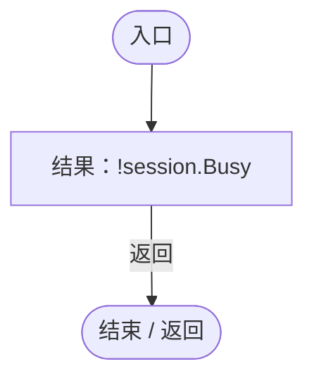

项目内调用/回调引用：

- [WorldSessionManager.Busy.get · L24](08741c7b7b9d9344.md#m4483e2e4f28f7c85)（访问器）

## 回调@58 · L58

`e … => 回调`

### Editor · Roslyn编译器控制流

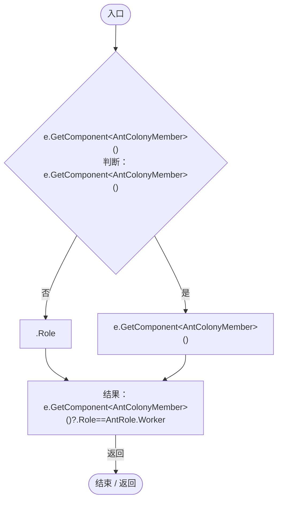

项目内调用/回调引用：

- [AntColonyMember.Role.get · L39](baebd85c05598377.md#mbe541ad55a93b0dd)（访问器）

## 回调@61 · L61

`( … => 回调`

### Editor · Roslyn编译器控制流

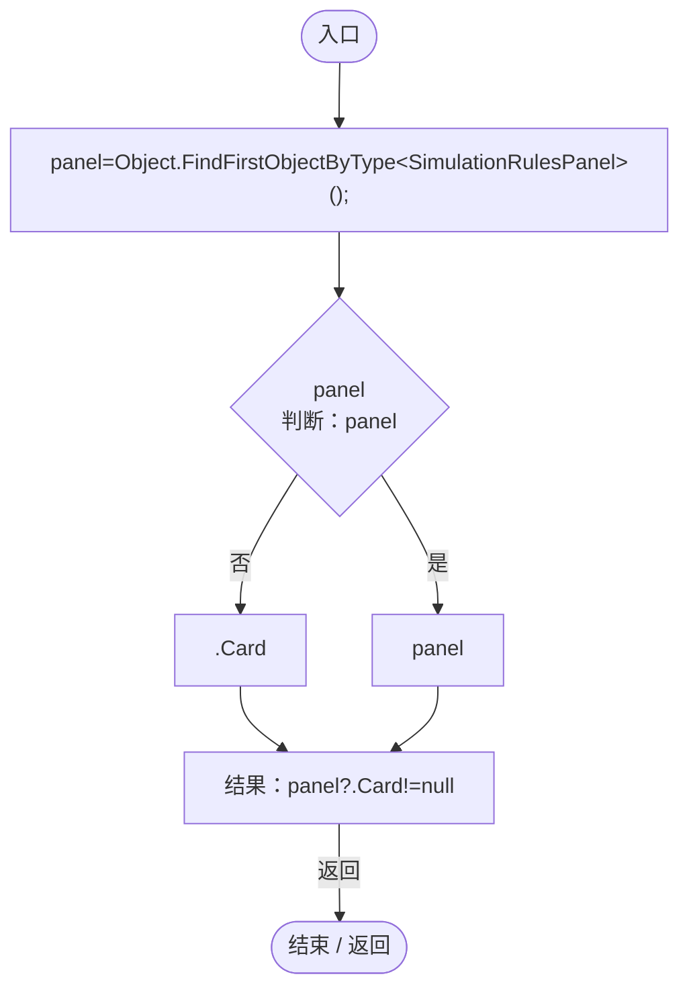
