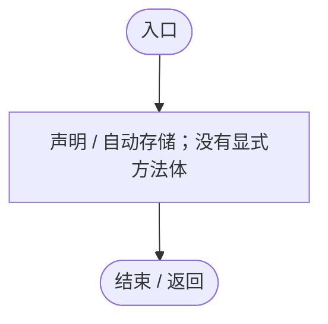
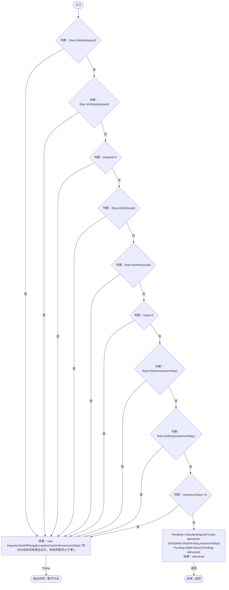
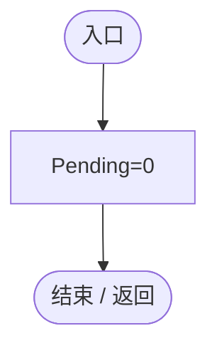

# SimulationStepBudget.cs

[返回总索引](../README.md) · `Runtime` · `Assets/DarwinPark/Core/Time/SimulationStepBudget.cs`

[源文件](../../../Assets/DarwinPark/Core/Time/SimulationStepBudget.cs) · 源码校验：`2855abe8afdca683cab72971fff5062f6214e8c22b05980fa203aa5c8dc73162`

方法按源文件位置排列。事件/回调引用不表示立即执行；分支与异常说明见总索引。完整源码与可点击关系图请打开离线手册。

## Pending.get · L8

`get`

### Editor / Player · 语法控制结构 / 声明（非CFG）

## Pending.set · L8

`private set`

### Editor / Player · 语法控制结构 / 声明（非CFG）

## Consume · L9

`public float Consume(float elapsed,float scale,float maximumStep)`

### Editor / Player · Roslyn编译器控制流

项目内调用/回调引用：

- [SimulationStepBudget.Pending.set · L8](0ec4b354aeb329c1.md#m1067098f11115252)（访问器）
- [SimulationStepBudget.Pending.get · L8](0ec4b354aeb329c1.md#mbafae1240ee9766b)（访问器）

## Clear · L16

`public void Clear()`

### Editor / Player · Roslyn编译器控制流

项目内调用/回调引用：

- [SimulationStepBudget.Pending.set · L8](0ec4b354aeb329c1.md#m1067098f11115252)（访问器）
