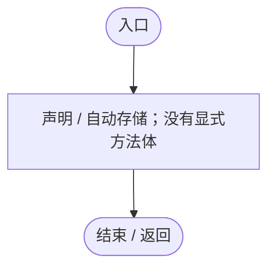
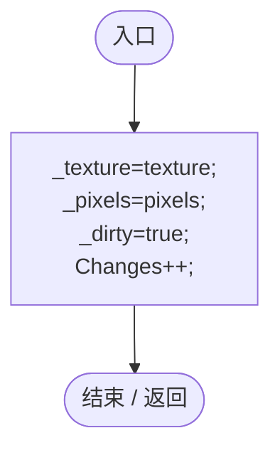
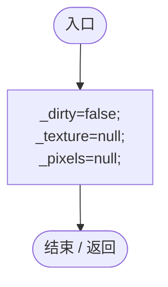
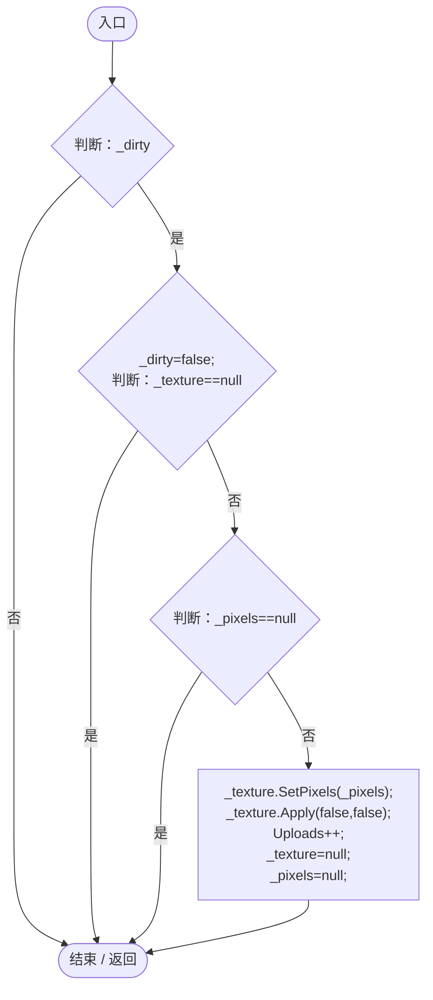
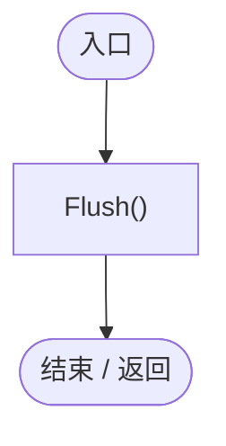

# OreTextureUploadBatch.cs

[返回总索引](../README.md) · `Runtime` · `Assets/DarwinPark/Planet/OreTextureUploadBatch.cs`

[源文件](../../../Assets/DarwinPark/Planet/OreTextureUploadBatch.cs) · 源码校验：`ea6bb35e31adebf60dc84fe9e4c850bda5260eb915bd4d981abd121bc66eebd4`

方法按源文件位置排列。事件/回调引用不表示立即执行；分支与异常说明见总索引。完整源码与可点击关系图请打开离线手册。

## Uploads.get · L8

`get`

### Editor / Player · 语法控制结构 / 声明（非CFG）

## Uploads.set · L8

`private set`

### Editor / Player · 语法控制结构 / 声明（非CFG）

## Changes.get · L8

`get`

### Editor / Player · 语法控制结构 / 声明（非CFG）

## Changes.set · L8

`private set`

### Editor / Player · 语法控制结构 / 声明（非CFG）

## Mark · L9

`public void Mark(Texture2D texture,Color[] pixels)`

### Editor / Player · Roslyn编译器控制流

项目内调用/回调引用：

- [OreTextureUploadBatch.Changes.set · L8](0ecb91fe75dc1609.md#mdef14bfad2edb734)（访问器）
- [OreTextureUploadBatch.Changes.get · L8](0ecb91fe75dc1609.md#m5f3fa4bf63001ec0)（访问器）

## Cancel · L11

`public void Cancel()`

★ 修复（防Bug回归）：切世界或恢复矿图后不能把旧像素上传到已替换的纹理。

### Editor / Player · Roslyn编译器控制流

## Flush · L12

`public void Flush()`

### Editor / Player · Roslyn编译器控制流

项目内调用/回调引用：

- [OreTextureUploadBatch.Uploads.set · L8](0ecb91fe75dc1609.md#mc792f270de9588ad)（访问器）
- [OreTextureUploadBatch.Uploads.get · L8](0ecb91fe75dc1609.md#me55be5611dfc0f2c)（访问器）

## LateUpdate · L13

`private void LateUpdate()`

### Editor / Player · Roslyn编译器控制流

项目内调用/回调引用：

- [OreTextureUploadBatch.Flush · L12](0ecb91fe75dc1609.md#m6533165daec93325)（方法）

## OnDisable · L14

`private void OnDisable()`

### Editor / Player · Roslyn编译器控制流

项目内调用/回调引用：

- [OreTextureUploadBatch.Flush · L12](0ecb91fe75dc1609.md#m6533165daec93325)（方法）
