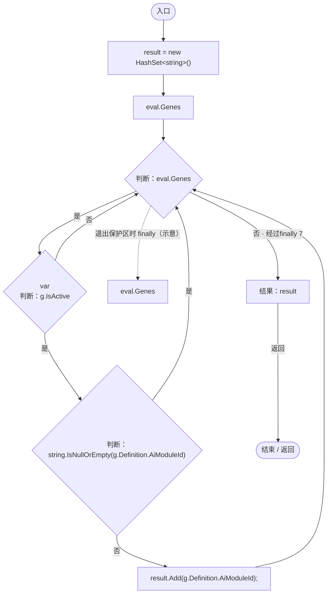

# GeneAIDecisionService.cs

[返回总索引](../README.md) · `Runtime` · `Assets/DarwinPark/AI/GeneAIDecisionService.cs`

[源文件](../../../Assets/DarwinPark/AI/GeneAIDecisionService.cs) · 源码校验：`993540455bdff3ddae8c194a403fcc077bfe673fbe16b5ac84c76ab386368a1d`

方法按源文件位置排列。事件/回调引用不表示立即执行；分支与异常说明见总索引。完整源码与可点击关系图请打开离线手册。

## DecideActiveModules · L9

`public static HashSet<string> DecideActiveModules(GenomeEvaluation eval)`

### Editor / Player · Roslyn编译器控制流

