# EntityStateController.cs

[返回总索引](../README.md) · `Runtime` · `Assets/DarwinPark/Entities/Ecology/EntityStateController.cs`

[源文件](../../../Assets/DarwinPark/Entities/Ecology/EntityStateController.cs) · 源码校验：`bfd306906d8e02955d88c63005ea326eacf4bec21f01ab5435ade7b399a6f8c8`

方法按源文件位置排列。事件/回调引用不表示立即执行；分支与异常说明见总索引。完整源码与可点击关系图请打开离线手册。

<a id="m2d23280359000fb2"></a>

## DetectedTarget.get · L16

`get`


### Editor / Player · 语法控制结构 / 声明（非CFG）


<a id="mb1b417737f0076b9"></a>

## DetectedTarget.set · L16

`private set`


### Editor / Player · 语法控制结构 / 声明（非CFG）

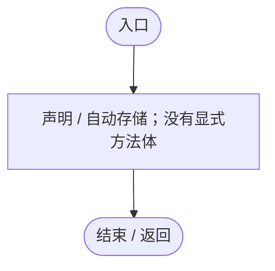

<a id="m8930cfbad73407a2"></a>

## HuntTarget.get · L17

`get`


### Editor / Player · 语法控制结构 / 声明（非CFG）


<a id="m447c608b233cf9c4"></a>

## HuntTarget.set · L17

`set`


### Editor / Player · 语法控制结构 / 声明（非CFG）


<a id="m5f6799c86f91a71f"></a>

## Current.get · L18

`public EntityStateDefinition Current`


### Editor / Player · 语法控制结构 / 声明（非CFG）

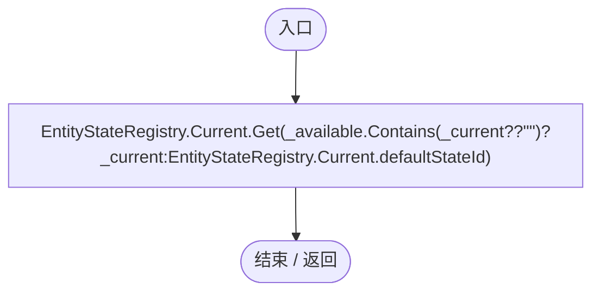

项目内调用/回调引用：

- [EntityStateDocument.Get · L32](440408d2db5c7d96.md#m52cb41ccf0c9d3c9)（方法）
- [EntityStateRegistry.Current.get · L41](440408d2db5c7d96.md#m61b7aa1a54b9a56c)（访问器）

<a id="m207b5fede72ca8a9"></a>

## Available.get · L19

`public IEnumerable<EntityStateDefinition> Available`


### Editor / Player · 语法控制结构 / 声明（非CFG）

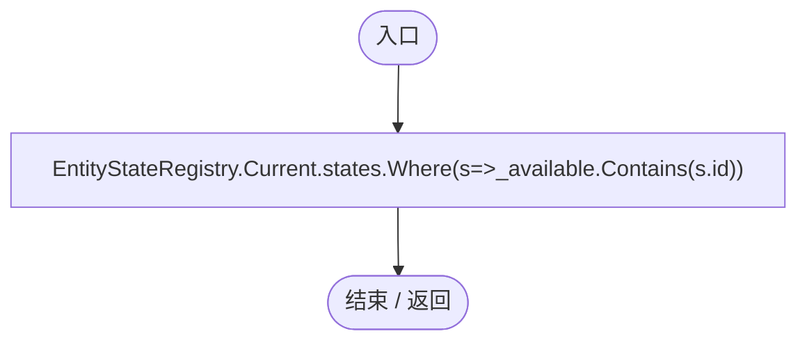

项目内调用/回调引用：

- [EntityStateRegistry.Current.get · L41](440408d2db5c7d96.md#m61b7aa1a54b9a56c)（访问器）
- [EntityStateController.回调@19 · L19](0f8869eb7018091e.md#mcaf7fa1f387c8415)（回调/委托）

<a id="mcaf7fa1f387c8415"></a>

## 回调@19 · L19

`s … => 回调`


### Editor / Player · 语法控制结构 / 声明（非CFG）

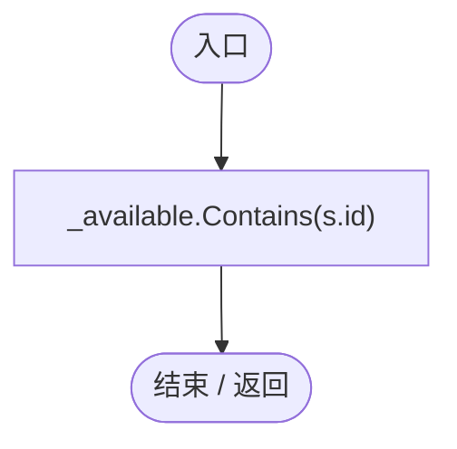

<a id="m6d41867f46aa81d7"></a>

## Awake · L20

`private void Awake()`


### Editor / Player · Roslyn编译器控制流

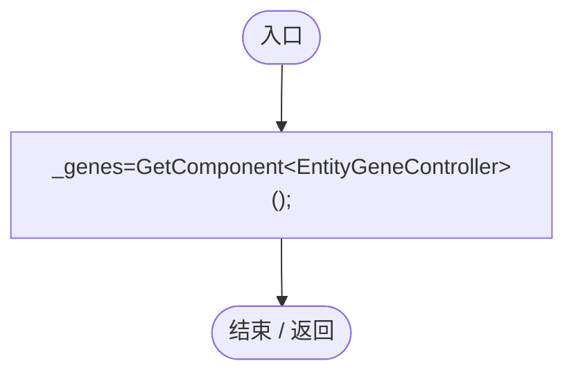

<a id="m40a5ae44229a22cf"></a>

## Rebind · L22

`public static void Rebind(EntityGeneController genes)`

★ 适配：运行时基因逻辑使用的动态组件由有效标签安装；移除/抑制基因时同步撤销状态授权。

### Editor / Player · Roslyn编译器控制流

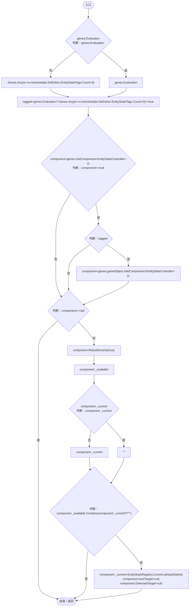

项目内调用/回调引用：

- [EntityGeneController.Evaluation.get · L18](7494d53178552f0e.md#mc0039c100a31b455)（访问器）
- [EntityStateController.RebuildGrants · L31](0f8869eb7018091e.md#m75dfdceb48d42f42)（方法）
- [EntityStateRegistry.Current.get · L41](440408d2db5c7d96.md#m61b7aa1a54b9a56c)（访问器）
- [EntityStateController.HuntTarget.set · L17](0f8869eb7018091e.md#m447c608b233cf9c4)（访问器）
- [EntityStateController.DetectedTarget.set · L16](0f8869eb7018091e.md#mb1b417737f0076b9)（访问器）
- [EntityStateController.回调@24 · L24](0f8869eb7018091e.md#m8e91293a17e1e74d)（回调/委托）

<a id="m8e91293a17e1e74d"></a>

## 回调@24 · L24

`e … => 回调`


### Editor / Player · Roslyn编译器控制流

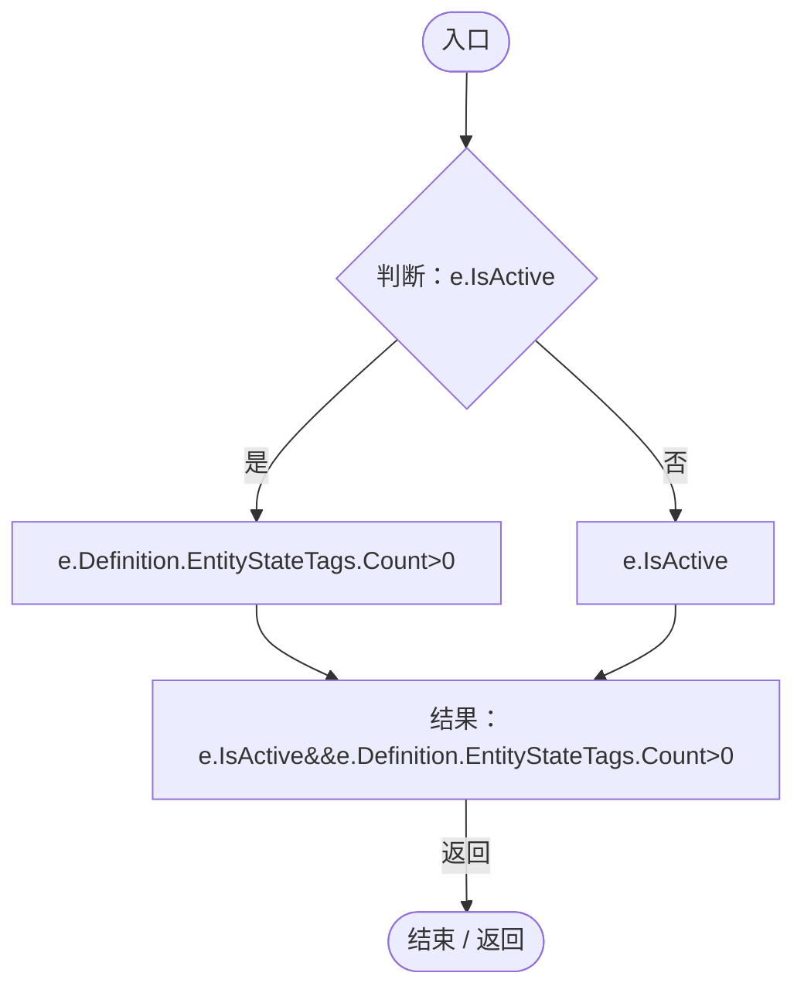

<a id="m75dfdceb48d42f42"></a>

## RebuildGrants · L31

`private void RebuildGrants(bool force=false)`


### Editor / Player · Roslyn编译器控制流

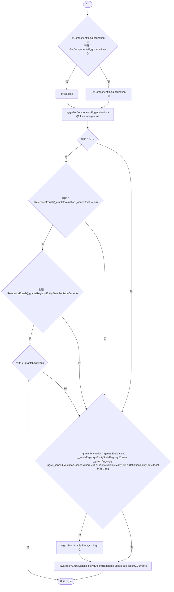

项目内调用/回调引用：

- [EntityGeneController.Evaluation.get · L18](7494d53178552f0e.md#mc0039c100a31b455)（访问器）
- [EntityStateRegistry.Current.get · L41](440408d2db5c7d96.md#m61b7aa1a54b9a56c)（访问器）
- [EntityStateRegistry.ExpandTags · L89](440408d2db5c7d96.md#m5528990748fa1dfb)（方法）
- [EntityStateController.回调@37 · L37](0f8869eb7018091e.md#m30c93f0f9887ad8e)（回调/委托）
- [EntityStateController.回调@37 · L37](0f8869eb7018091e.md#mabb5b6166eea56c1)（回调/委托）

<a id="m30c93f0f9887ad8e"></a>

## 回调@37 · L37

`e … => 回调`


### Editor / Player · Roslyn编译器控制流

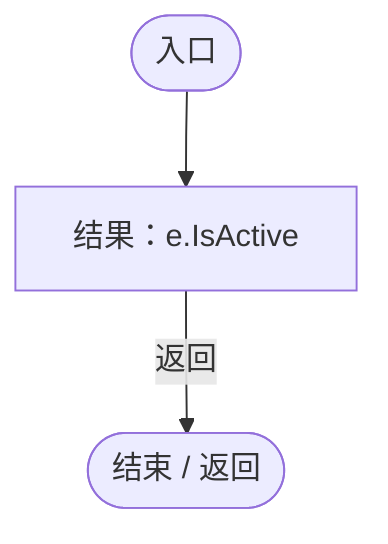

<a id="mabb5b6166eea56c1"></a>

## 回调@37 · L37

`e … => 回调`


### Editor / Player · Roslyn编译器控制流

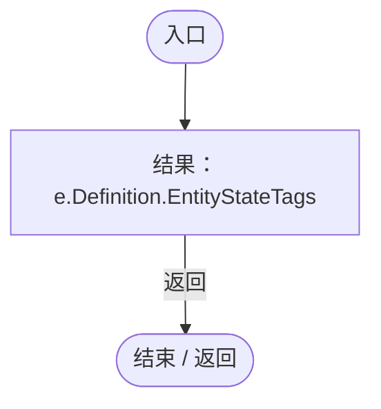

<a id="mffbdbb199029dbf3"></a>

## Advance · L41

`public void Advance(float dt)`


### Editor / Player · Roslyn编译器控制流

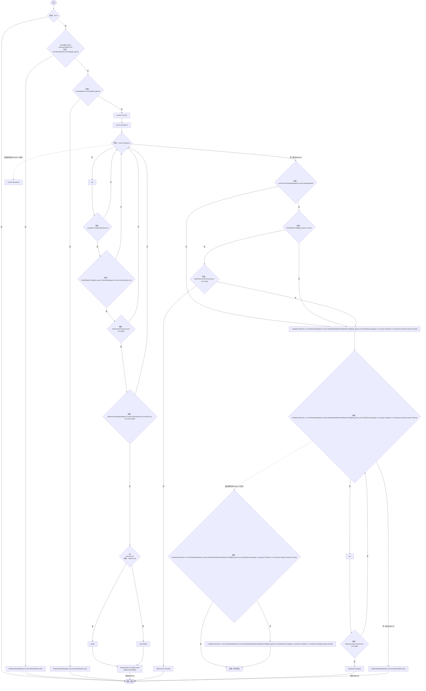

项目内调用/回调引用：

- [EntityStateController.RebuildGrants · L31](0f8869eb7018091e.md#m75dfdceb48d42f42)（方法）
- [EntityStateController.DetectedTarget.set · L16](0f8869eb7018091e.md#mb1b417737f0076b9)（访问器）
- [AntColonyMember.IsManaged · L53](baebd85c05598377.md#m2762de72909d5da5)（方法）
- [EntityStateController.Set · L57](0f8869eb7018091e.md#m10588e38be6afcb3)（方法）
- [EntityStateRegistry.Current.get · L41](440408d2db5c7d96.md#m61b7aa1a54b9a56c)（访问器）
- [EcologyMotion.Immobilized · L9](6ed9d0eedb456d32.md#mff3eeb8fb207a31e)（方法）
- [PatrolRhythm.Eligible · L24](f55940fd5773d413.md#md75b8cea2c308aca)（方法）
- [EntityStateDocument.Get · L32](440408d2db5c7d96.md#m52cb41ccf0c9d3c9)（方法）
- [EntityStateController.Matches · L59](0f8869eb7018091e.md#m9033e5a9165f2d67)（方法）
- [EntityStateController.回调@53 · L53](0f8869eb7018091e.md#m222b7d2611ae0cb6)（回调/委托）
- [EntityStateController.回调@53 · L53](0f8869eb7018091e.md#m0f3f254d8d7ba7f3)（回调/委托）
- [EntityStateController.回调@53 · L53](0f8869eb7018091e.md#mffe58ee17dc5ca37)（回调/委托）

<a id="m222b7d2611ae0cb6"></a>

## 回调@53 · L53

`s … => 回调`


### Editor / Player · Roslyn编译器控制流

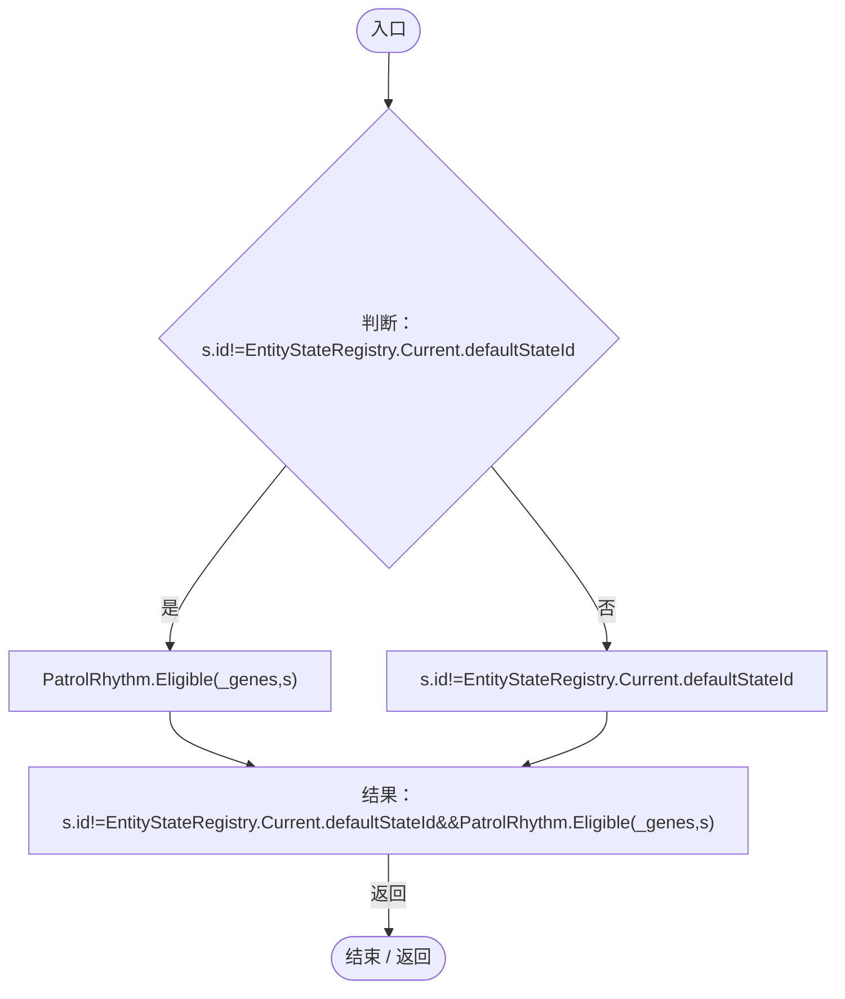

项目内调用/回调引用：

- [EntityStateRegistry.Current.get · L41](440408d2db5c7d96.md#m61b7aa1a54b9a56c)（访问器）
- [PatrolRhythm.Eligible · L24](f55940fd5773d413.md#md75b8cea2c308aca)（方法）

<a id="m0f3f254d8d7ba7f3"></a>

## 回调@53 · L53

`s … => 回调`


### Editor / Player · Roslyn编译器控制流

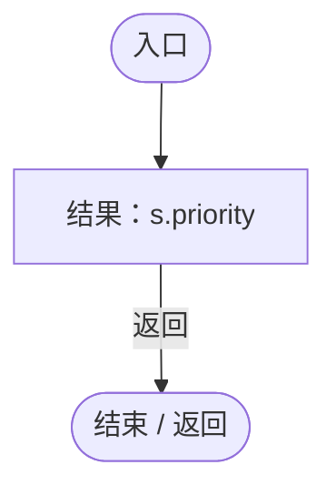

<a id="mffe58ee17dc5ca37"></a>

## 回调@53 · L53

`s … => 回调`


### Editor / Player · Roslyn编译器控制流

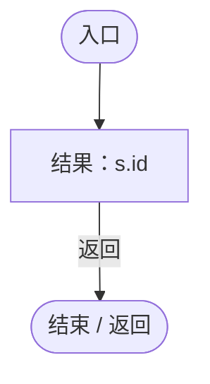

<a id="m10588e38be6afcb3"></a>

## Set · L57

`private void Set(string id,DarwinEntity detected)`


### Editor / Player · Roslyn编译器控制流

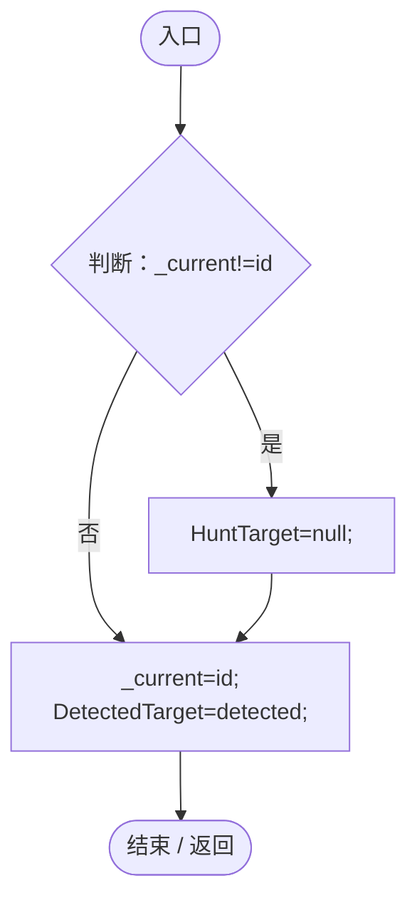

项目内调用/回调引用：

- [EntityStateController.HuntTarget.set · L17](0f8869eb7018091e.md#m447c608b233cf9c4)（访问器）
- [EntityStateController.DetectedTarget.set · L16](0f8869eb7018091e.md#mb1b417737f0076b9)（访问器）

<a id="m9033e5a9165f2d67"></a>

## Matches · L59

`private bool Matches(List<EntityStateRule> any,out DarwinEntity detected)`


### Editor / Player · Roslyn编译器控制流

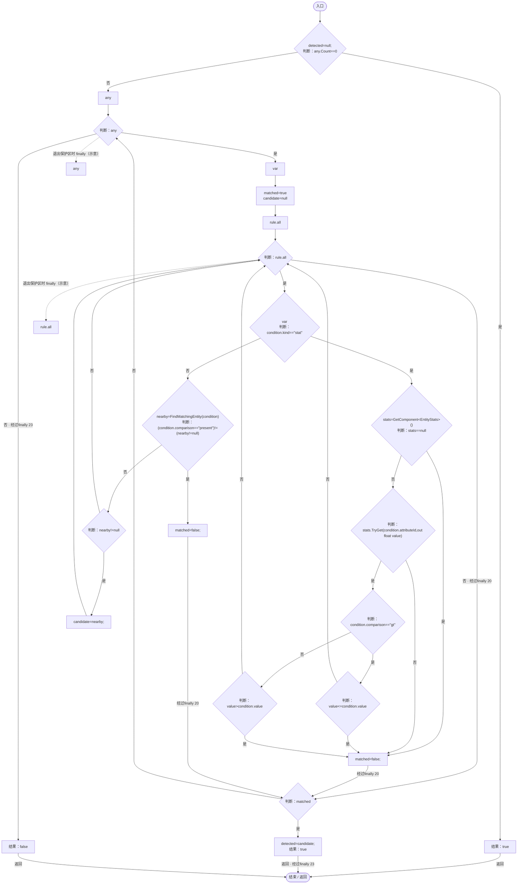

项目内调用/回调引用：

- [EntityStats.TryGet · L90](75aa86a368efdf24.md#m24ee1433e4a70d94)（方法）
- [EntityStateController.FindMatchingEntity · L83](0f8869eb7018091e.md#mccb923b38b100492)（方法）

<a id="mccb923b38b100492"></a>

## FindMatchingEntity · L83

`private DarwinEntity FindMatchingEntity(EntityStateCondition condition)`


### Editor / Player · Roslyn编译器控制流

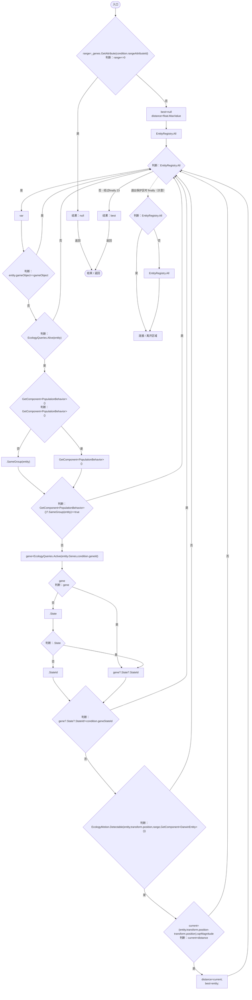

项目内调用/回调引用：

- [EntityGeneController.GetAttribute · L257](7494d53178552f0e.md#m600509f72d274f0c)（方法）
- [EcologyQueries.Alive · L38](bdf7ccc2c9c0452f.md#mb2877c487f449970)（方法）
- [PopulationBehavior.SameGroup · L123](21e4f62f75a9a80f.md#m7a9d850e1d8967d4)（方法）
- [EcologyQueries.Active · L28](bdf7ccc2c9c0452f.md#m4fb10ad424167e3b)（方法）
- [DarwinEntity.Genes.get · L14](70798dde169f2e8b.md#m622eb1adf401d431)（访问器）
- [EcologyMotion.Detectable · L61](6ed9d0eedb456d32.md#m24ba4bf4b1ca5c20)（方法）

<a id="m5c730db919104ae6"></a>

## Restore · L100

`public void Restore(string id)`

★ 适配：条件没有计时或随机副作用；读档先恢复标签与状态，下一模拟步再按恢复完整的周边环境判定。

### Editor / Player · Roslyn编译器控制流

```mermaid
flowchart TD
  b0(["入口"])
  b1["RebuildGrants();"]
  b2["Set"]
  b3["_available"]
  b4{"id<br/>判断：id"}
  b5["id"]
  b6["&quot;&quot;"]
  b7{"判断：_available.Contains(id??&quot;&quot;)"}
  b8["id"]
  b9["EntityStateRegistry.Current.defaultStateId"]
  b10["Set(_available.Contains(id??&quot;&quot;)?id:EntityStateRegistry.Current.defaultStateId,null);"]
  b11(["结束 / 返回"])
  b0 --> b1
  b1 --> b2
  b2 --> b3
  b3 --> b4
  b4 -->|"否"| b5
  b4 -->|"是"| b6
  b5 --> b7
  b6 --> b7
  b7 -->|"是"| b8
  b7 -->|"否"| b9
  b8 --> b10
  b9 --> b10
  b10 --> b11

```

项目内调用/回调引用：

- [EntityStateController.RebuildGrants · L31](0f8869eb7018091e.md#m75dfdceb48d42f42)（方法）
- [EntityStateController.Set · L57](0f8869eb7018091e.md#m10588e38be6afcb3)（方法）
- [EntityStateRegistry.Current.get · L41](440408d2db5c7d96.md#m61b7aa1a54b9a56c)（访问器）
