# EntityStateController.cs

[返回总索引](../README.md) · `Runtime` · `Assets/DarwinPark/Entities/Ecology/EntityStateController.cs`

[源文件](../../../Assets/DarwinPark/Entities/Ecology/EntityStateController.cs) · 源码校验：`eaf3b75673cb4fcddc00c0efb054acba7ab0a1211ee9d273b233ef15cb0f4df8`

方法按源文件位置排列。事件/回调引用不表示立即执行；分支与异常说明见总索引。完整源码与可点击关系图请打开离线手册。

## DetectedTarget.get · L18

`get`

### Editor / Player · 语法控制结构 / 声明（非CFG）

## DetectedTarget.set · L18

`private set`

### Editor / Player · 语法控制结构 / 声明（非CFG）

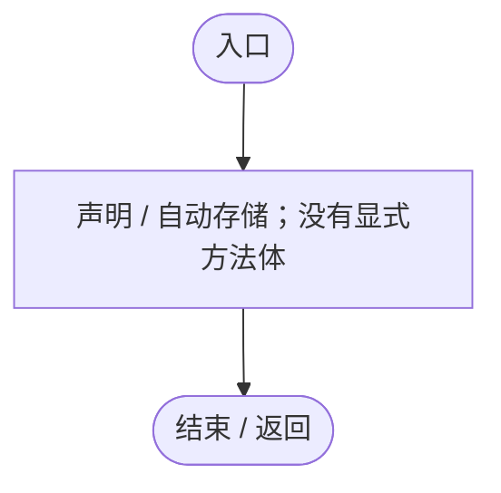

## HuntTarget.get · L19

`get`

### Editor / Player · 语法控制结构 / 声明（非CFG）

## HuntTarget.set · L19

`set`

### Editor / Player · 语法控制结构 / 声明（非CFG）

## Current.get · L20

`public EntityStateDefinition Current`

### Editor / Player · 语法控制结构 / 声明（非CFG）

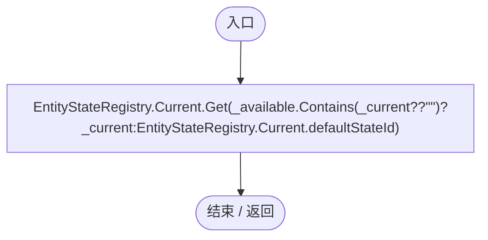

项目内调用/回调引用：

- [EntityStateDocument.Get · L32](440408d2db5c7d96.md#m52cb41ccf0c9d3c9)（方法）
- [EntityStateRegistry.Current.get · L41](440408d2db5c7d96.md#m61b7aa1a54b9a56c)（访问器）

## Available.get · L21

`public IEnumerable<EntityStateDefinition> Available`

### Editor / Player · 语法控制结构 / 声明（非CFG）

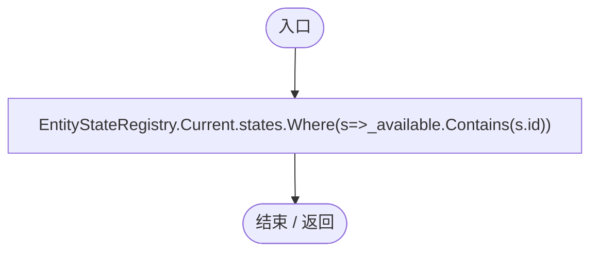

项目内调用/回调引用：

- [EntityStateRegistry.Current.get · L41](440408d2db5c7d96.md#m61b7aa1a54b9a56c)（访问器）
- [EntityStateController.回调@21 · L21](0f8869eb7018091e.md#mbb088a656891b11c)（回调/委托）

## 回调@21 · L21

`s … => 回调`

### Editor / Player · 语法控制结构 / 声明（非CFG）

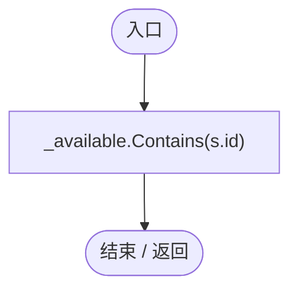

## Awake · L22

`private void Awake()`

### Editor / Player · Roslyn编译器控制流

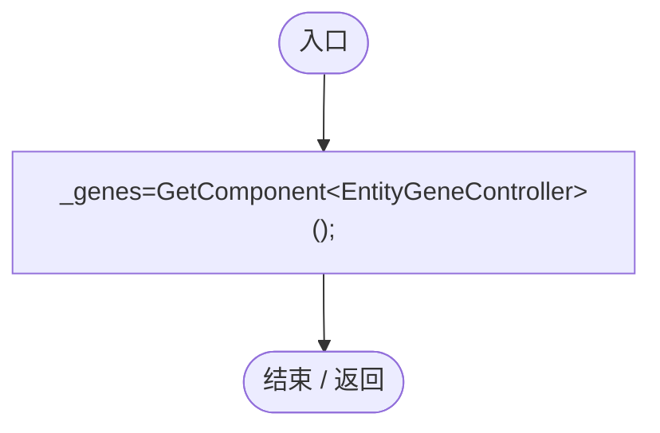

## Rebind · L24

`public static void Rebind(EntityGeneController genes)`

★ 适配：运行时基因逻辑使用的动态组件由有效标签安装；移除/抑制基因时同步撤销状态授权。

### Editor / Player · Roslyn编译器控制流

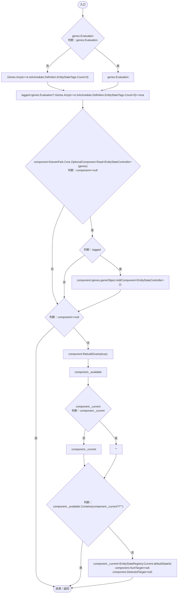

项目内调用/回调引用：

- [EntityGeneController.Evaluation.get · L20](7494d53178552f0e.md#mf275f100ea21601a)（访问器）
- [OptionalComponent.Read · L7](806c46b42ced4d36.md#m69622a4dee165c5a)（方法）
- [EntityStateController.RebuildGrants · L33](0f8869eb7018091e.md#mdefc1e3c06f6f3f5)（方法）
- [EntityStateRegistry.Current.get · L41](440408d2db5c7d96.md#m61b7aa1a54b9a56c)（访问器）
- [EntityStateController.HuntTarget.set · L19](0f8869eb7018091e.md#m6db916eeb719ccff)（访问器）
- [EntityStateController.DetectedTarget.set · L18](0f8869eb7018091e.md#m05f541a345771be5)（访问器）
- [EntityStateController.回调@26 · L26](0f8869eb7018091e.md#m8e1509583cd36387)（回调/委托）

## 回调@26 · L26

`e … => 回调`

### Editor / Player · Roslyn编译器控制流

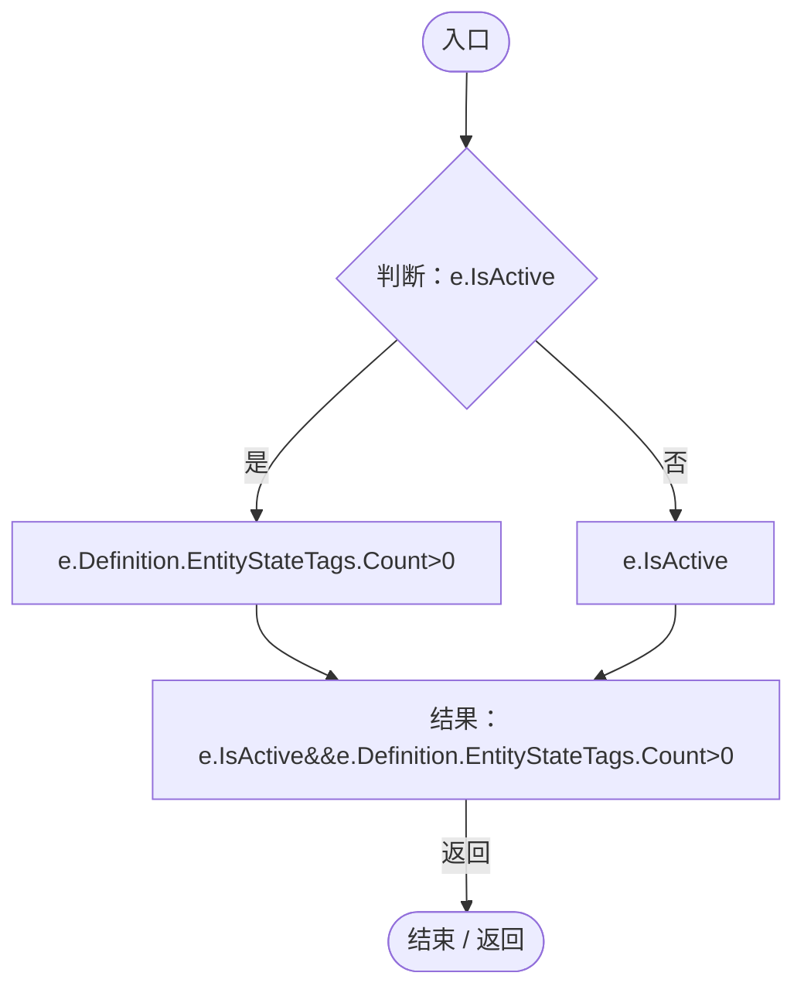

## RebuildGrants · L33

`private void RebuildGrants(bool force=false)`

### Editor / Player · Roslyn编译器控制流

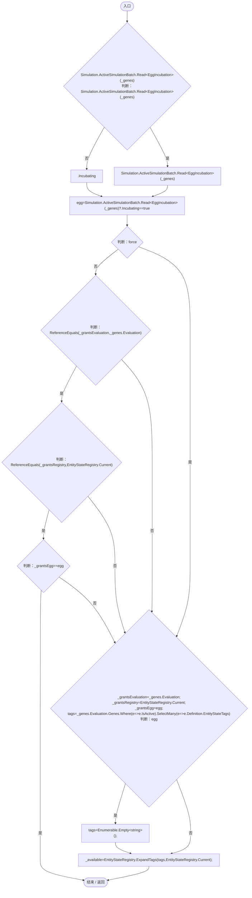

项目内调用/回调引用：

- [ActiveSimulationBatch.Read · L57](ac63422a085684a6.md#mc77e063d3598b3fd)（方法）
- [EntityGeneController.Evaluation.get · L20](7494d53178552f0e.md#mf275f100ea21601a)（访问器）
- [EntityStateRegistry.Current.get · L41](440408d2db5c7d96.md#m61b7aa1a54b9a56c)（访问器）
- [EntityStateRegistry.ExpandTags · L89](440408d2db5c7d96.md#m5528990748fa1dfb)（方法）
- [EntityStateController.回调@39 · L39](0f8869eb7018091e.md#mac93a6cbba3f1fe8)（回调/委托）
- [EntityStateController.回调@39 · L39](0f8869eb7018091e.md#m70802b59bb076061)（回调/委托）

## 回调@39 · L39

`e … => 回调`

### Editor / Player · Roslyn编译器控制流

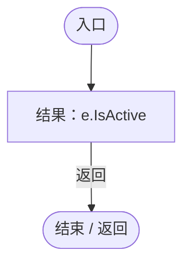

## 回调@39 · L39

`e … => 回调`

### Editor / Player · Roslyn编译器控制流

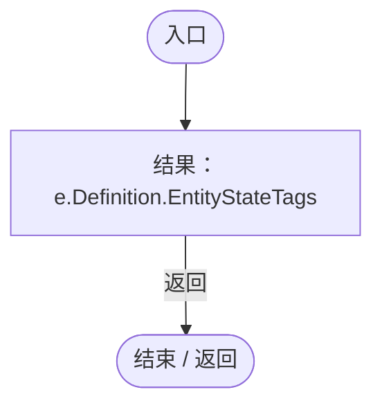

## Advance · L43

`public void Advance(float dt)`

### Editor / Player · Roslyn编译器控制流

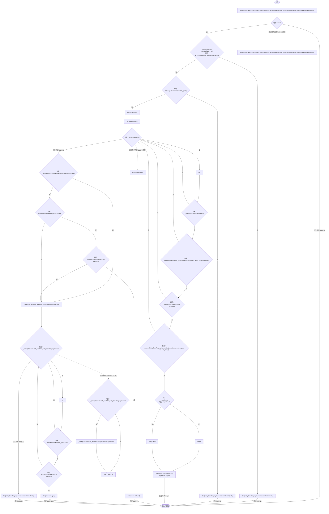

项目内调用/回调引用：

- [PerformanceTimings.Measure · L25](a8403a4c7503726d.md#m36fde3c234084192)（方法）
- [EntityStateController.RebuildGrants · L33](0f8869eb7018091e.md#mdefc1e3c06f6f3f5)（方法）
- [EntityStateController.DetectedTarget.set · L18](0f8869eb7018091e.md#m05f541a345771be5)（访问器）
- [AntColonyMember.IsManaged · L63](baebd85c05598377.md#m62a304872736f89e)（方法）
- [EntityStateController.Set · L62](0f8869eb7018091e.md#m02e5e4c22073286f)（方法）
- [EntityStateRegistry.Current.get · L41](440408d2db5c7d96.md#m61b7aa1a54b9a56c)（访问器）
- [EcologyMotion.Immobilized · L11](6ed9d0eedb456d32.md#m5ee13c6cd31e5243)（方法）
- [PatrolRhythm.Eligible · L25](f55940fd5773d413.md#mad6cf8a1dbe1afb8)（方法）
- [EntityStateDocument.Get · L32](440408d2db5c7d96.md#m52cb41ccf0c9d3c9)（方法）
- [EntityStateController.Matches · L65](0f8869eb7018091e.md#m46c7c86a99fac9e1)（方法）
- [StatePriorityCache.Read · L8](96e08a1a0ab523b5.md#ma8de838854f0a1b9)（方法）

## Set · L62

`private void Set(string id,DarwinEntity detected)`

### Editor / Player · Roslyn编译器控制流

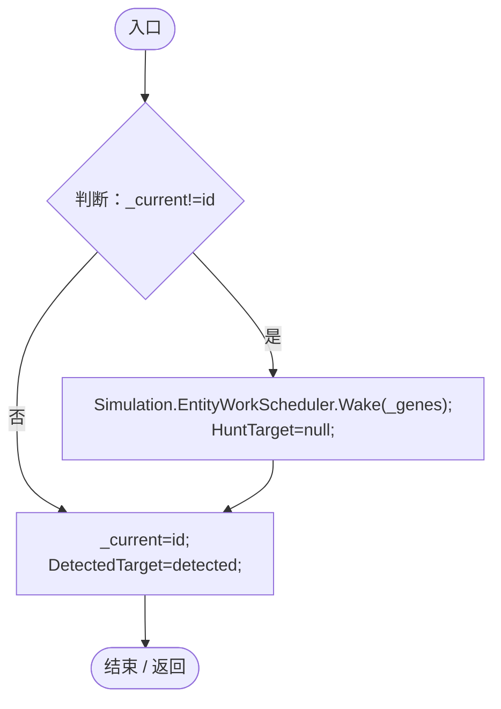

项目内调用/回调引用：

- [EntityWorkScheduler.Wake · L73](465ccdbb260bcac2.md#m681ac7b8924497e4)（方法）
- [EntityStateController.HuntTarget.set · L19](0f8869eb7018091e.md#m6db916eeb719ccff)（访问器）
- [EntityStateController.DetectedTarget.set · L18](0f8869eb7018091e.md#m05f541a345771be5)（访问器）

## Matches · L65

`private bool Matches(List<EntityStateRule> any,out DarwinEntity detected)`

### Editor / Player · Roslyn编译器控制流

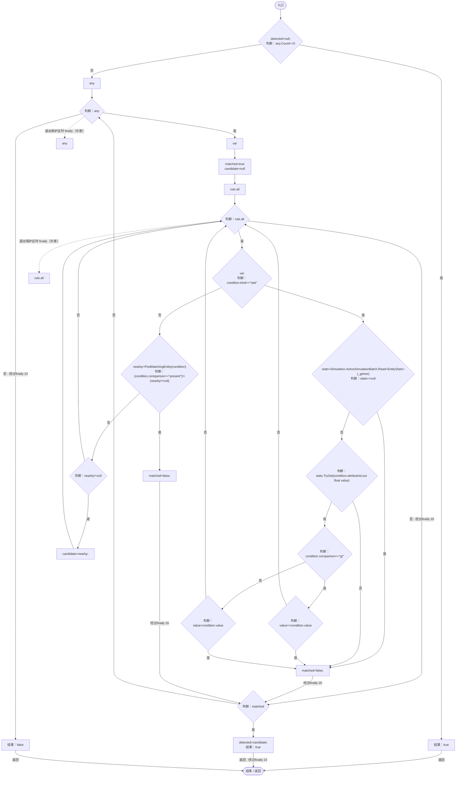

项目内调用/回调引用：

- [ActiveSimulationBatch.Read · L57](ac63422a085684a6.md#mc77e063d3598b3fd)（方法）
- [EntityStats.TryGet · L93](75aa86a368efdf24.md#m03cef847022eee28)（方法）
- [EntityStateController.FindMatchingEntity · L89](0f8869eb7018091e.md#m6224ae55833a1b7b)（方法）

## FindMatchingEntity · L89

`private DarwinEntity FindMatchingEntity(EntityStateCondition condition)`

### Editor / Player · Roslyn编译器控制流

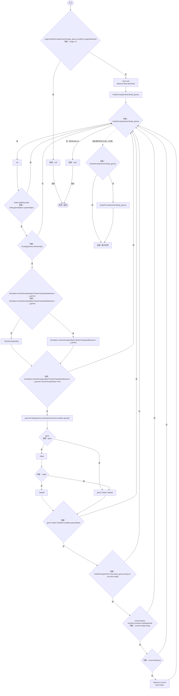

项目内调用/回调引用：

- [EntityPerceptionHub.Range · L41](aeecc36cb2c3cc24.md#m5135b5615734d39a)（方法）
- [EntityPerceptionHub.Read · L42](aeecc36cb2c3cc24.md#mbe2216b46b71081b)（方法）
- [EcologyQueries.Alive · L39](bdf7ccc2c9c0452f.md#m8352bfacbe2996a8)（方法）
- [ActiveSimulationBatch.Read · L57](ac63422a085684a6.md#mc77e063d3598b3fd)（方法）
- [PopulationBehavior.SameGroup · L127](21e4f62f75a9a80f.md#m4af6332162bb0355)（方法）
- [EcologyQueries.Active · L29](bdf7ccc2c9c0452f.md#m200839bb9db5ec55)（方法）
- [DarwinEntity.Genes.get · L14](70798dde169f2e8b.md#m622eb1adf401d431)（访问器）
- [EntityPerceptionHub.TryLocate · L57](aeecc36cb2c3cc24.md#m2cd96337ffd40bb4)（方法）

## Restore · L107

`public void Restore(string id)`

★ 适配：条件没有计时或随机副作用；读档先恢复标签与状态，下一模拟步再按恢复完整的周边环境判定。

### Editor / Player · Roslyn编译器控制流

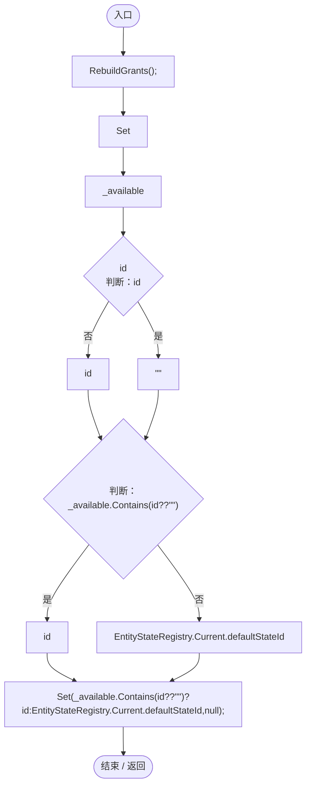

项目内调用/回调引用：

- [EntityStateController.RebuildGrants · L33](0f8869eb7018091e.md#mdefc1e3c06f6f3f5)（方法）
- [EntityStateController.Set · L62](0f8869eb7018091e.md#m02e5e4c22073286f)（方法）
- [EntityStateRegistry.Current.get · L41](440408d2db5c7d96.md#m61b7aa1a54b9a56c)（访问器）
