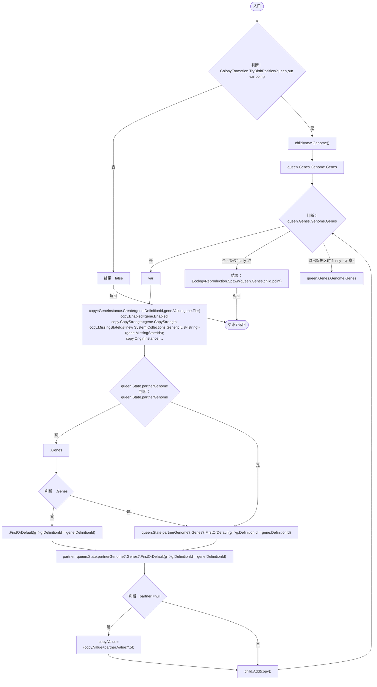
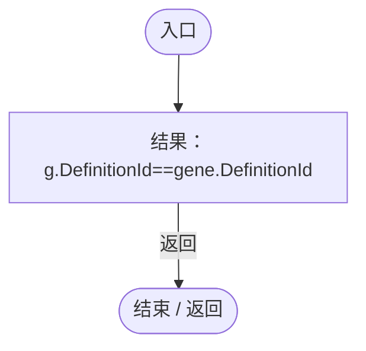

# QueenBirthDelivery.cs

[返回总索引](../README.md) · `Runtime` · `Assets/DarwinPark/Entities/Ecology/QueenBirthDelivery.cs`

[源文件](../../../Assets/DarwinPark/Entities/Ecology/QueenBirthDelivery.cs) · 源码校验：`588a63df1f81018bdf530ca187daf332fba1acbdc769cf11c2791386cc028156`

方法按源文件位置排列。事件/回调引用不表示立即执行；分支与异常说明见总索引。完整源码与可点击关系图请打开离线手册。

## TrySpawn · L9

`public static bool TrySpawn(AntColonyMember queen)`

### Editor / Player · Roslyn编译器控制流

项目内调用/回调引用：

- [ColonyFormation.TryBirthPosition · L60](c65dce2d54e43480.md#me7b708986f2564ee)（方法）
- [AntColonyMember.Genes.get · L35](baebd85c05598377.md#m32357842031ebe8d)（访问器）
- [GeneInstance.Create · L20](f82e1498d67f5afd.md#m72e94c278de3cf8b)（方法）
- [AntColonyMember.State.get · L34](baebd85c05598377.md#m64745194ab46f363)（访问器）
- [Genome.Add · L19](a2ef23f865bc7ee8.md#md9cfdc94b8b8d40f)（方法）
- [EcologyReproduction.Spawn · L10](eaaa574d7ae50e29.md#m80cc35c4a2829f3d)（方法）
- [QueenBirthDelivery.回调@17 · L17](10252933c19b3182.md#mece60d44bb0fd678)（回调/委托）

## 回调@17 · L17

`g … => 回调`

### Editor / Player · Roslyn编译器控制流

