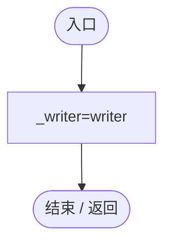
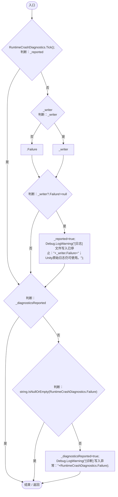
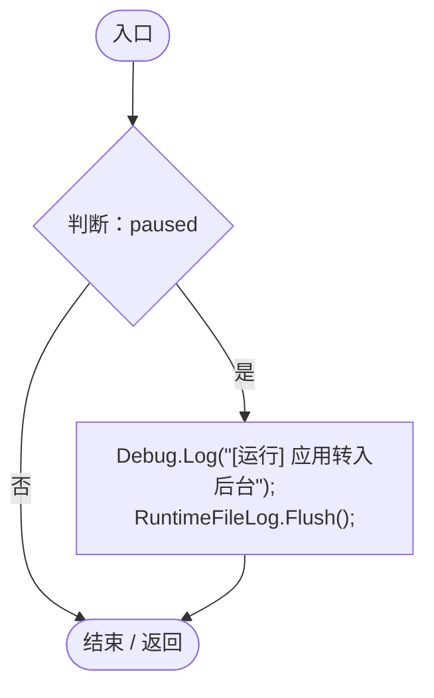
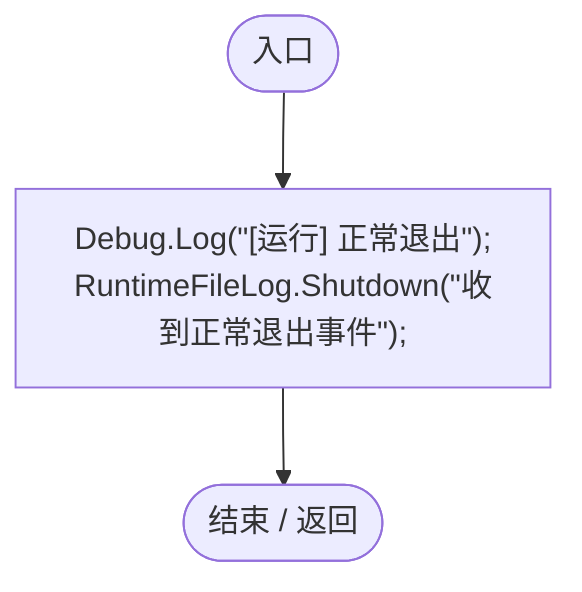
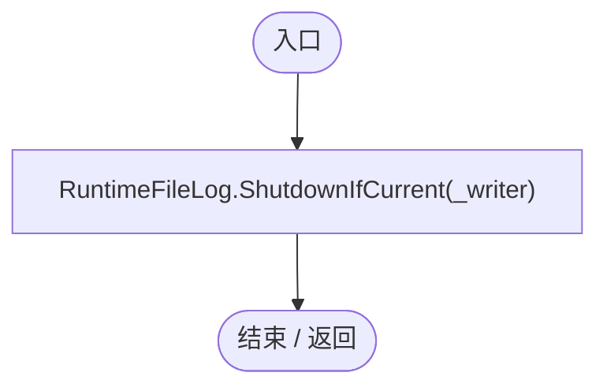

# RuntimeLogLifecycle.cs

[返回总索引](../README.md) · `Runtime` · `Assets/DarwinPark/Core/Logging/RuntimeLogLifecycle.cs`

[源文件](../../../Assets/DarwinPark/Core/Logging/RuntimeLogLifecycle.cs) · 源码校验：`226d75df481d22ef28419c0e1cbb260af93118701aa66f52bcb0b1e3155d8f89`

方法按源文件位置排列。事件/回调引用不表示立即执行；分支与异常说明见总索引。完整源码与可点击关系图请打开离线手册。

## Bind · L9

`public void Bind(SessionLogWriter writer)`

### Editor / Player · Roslyn编译器控制流

## Update · L10

`private void Update()`

### Editor / Player · Roslyn编译器控制流

项目内调用/回调引用：

- [RuntimeCrashDiagnostics.Tick · L59](b7eea720e09afd0b.md#mc5afab299d0c34ce)（方法）

## OnApplicationPause · L18

`private void OnApplicationPause(bool paused)`

### Editor / Player · Roslyn编译器控制流

项目内调用/回调引用：

- [RuntimeFileLog.Flush · L48](8080b38a7e1c5585.md#mf8cac7c8613ec3d6)（方法）

## OnApplicationQuit · L19

`private void OnApplicationQuit()`

### Editor / Player · Roslyn编译器控制流

项目内调用/回调引用：

- [RuntimeFileLog.Shutdown · L49](8080b38a7e1c5585.md#m817cce367fb66edc)（方法）

## OnDestroy · L20

`private void OnDestroy()`

### Editor / Player · Roslyn编译器控制流

项目内调用/回调引用：

- [RuntimeFileLog.ShutdownIfCurrent · L57](8080b38a7e1c5585.md#m479d9c7b3eae8ad0)（方法）
