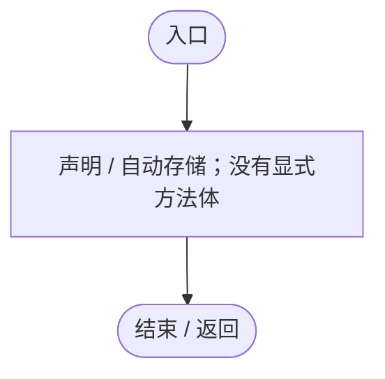
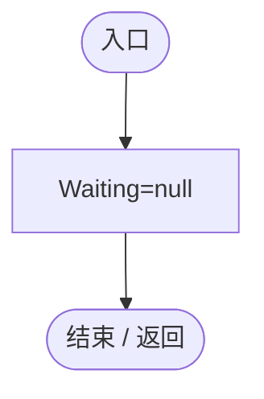
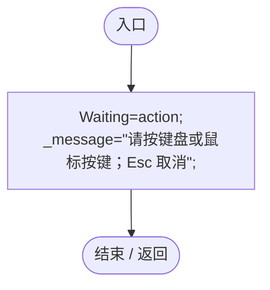
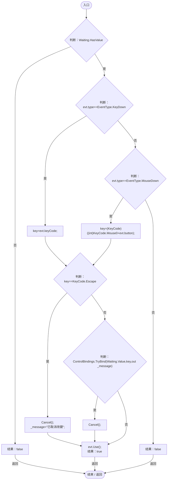
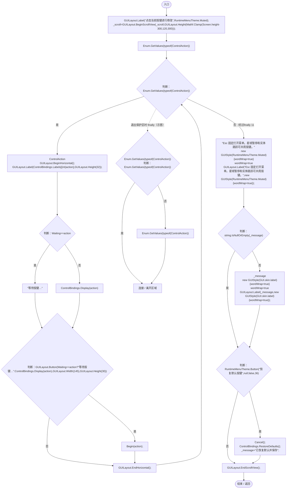

# ControlSettingsPage.cs

[返回总索引](../README.md) · `Runtime` · `Assets/DarwinPark/UI/ControlSettingsPage.cs`

[源文件](../../../Assets/DarwinPark/UI/ControlSettingsPage.cs) · 源码校验：`bbe74ae1b5ef929b87aaa4506766212e29399ef56431b119aa241bb13ab9e98b`

方法按源文件位置排列。事件/回调引用不表示立即执行；分支与异常说明见总索引。完整源码与可点击关系图请打开离线手册。

## Waiting.get · L10

`get`

### Editor / Player · 语法控制结构 / 声明（非CFG）

## Waiting.set · L10

`private set`

### Editor / Player · 语法控制结构 / 声明（非CFG）

## Cancel · L13

`public void Cancel()`

### Editor / Player · Roslyn编译器控制流

项目内调用/回调引用：

- [ControlSettingsPage.Waiting.set · L10](110505a600a95d59.md#mca0e60ec11c83dcc)（访问器）

## Begin · L14

`public void Begin(ControlAction action)`

### Editor / Player · Roslyn编译器控制流

项目内调用/回调引用：

- [ControlSettingsPage.Waiting.set · L10](110505a600a95d59.md#mca0e60ec11c83dcc)（访问器）

## HandleEvent · L15

`public bool HandleEvent(Event evt)`

### Editor / Player · Roslyn编译器控制流

项目内调用/回调引用：

- [ControlSettingsPage.Waiting.get · L10](110505a600a95d59.md#m2fe9f8e5114b53d5)（访问器）
- [ControlSettingsPage.Cancel · L13](110505a600a95d59.md#mffa6612111e4cbb5)（方法）
- [ControlBindings.TryBind · L55](b6735f8f133ee3f4.md#m2724f096eee115f2)（方法）

## Draw · L26

`public void Draw()`

### Editor / Player · Roslyn编译器控制流

项目内调用/回调引用：

- [RuntimeMenuTheme.Muted.get · L13](b9d8455882f2a532.md#meeaba271eb4ad2ed)（访问器）
- [ControlSettingsPage.Waiting.get · L10](110505a600a95d59.md#m2fe9f8e5114b53d5)（访问器）
- [ControlBindings.Display · L68](b6735f8f133ee3f4.md#m9bd4296160207463)（方法）
- [ControlSettingsPage.Begin · L14](110505a600a95d59.md#m62a5c699fcaaadd5)（方法）
- [RuntimeMenuTheme.Button · L90](b9d8455882f2a532.md#mc7e1580ab0f51b0b)（方法）
- [ControlSettingsPage.Cancel · L13](110505a600a95d59.md#mffa6612111e4cbb5)（方法）
- [ControlBindings.RestoreDefaults · L67](b6735f8f133ee3f4.md#m479d8e9c3bd1b890)（方法）
