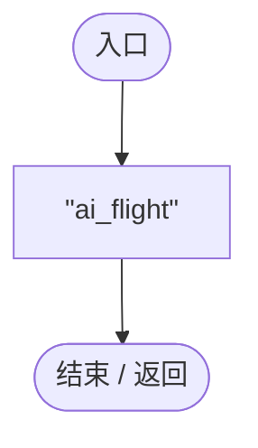
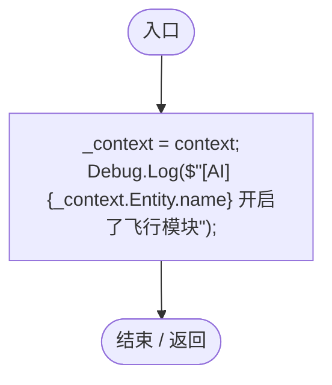
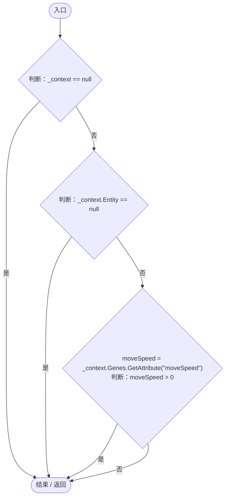
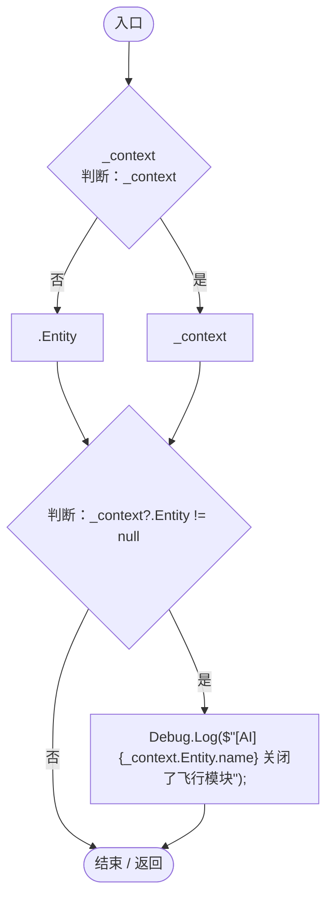

# FlightAIModule.cs

[返回总索引](../README.md) · `Runtime` · `Assets/DarwinPark/AI/Modules/FlightAIModule.cs`

[源文件](../../../Assets/DarwinPark/AI/Modules/FlightAIModule.cs) · 源码校验：`62a73270d7b5a0c559b8a63547b7cf9421c6786ff75034977d39076dd46e28ce`

方法按源文件位置排列。事件/回调引用不表示立即执行；分支与异常说明见总索引。完整源码与可点击关系图请打开离线手册。

## ModuleId.get · L7

`public string ModuleId`

### Editor / Player · 语法控制结构 / 声明（非CFG）

## Initialize · L12

`public void Initialize(EntityAIContext context)`

★ 修复 1：参数必须是 EntityAIContext

### Editor / Player · Roslyn编译器控制流

## Tick · L18

`public void Tick(float deltaTime)`

### Editor / Player · Roslyn编译器控制流

项目内调用/回调引用：

- [EntityGeneController.GetAttribute · L225](7494d53178552f0e.md#mc707943b1138a009)（方法）

## OnDisable · L32

`public void OnDisable()`

★ 修复 2：补上 OnDisable 方法

### Editor / Player · Roslyn编译器控制流

