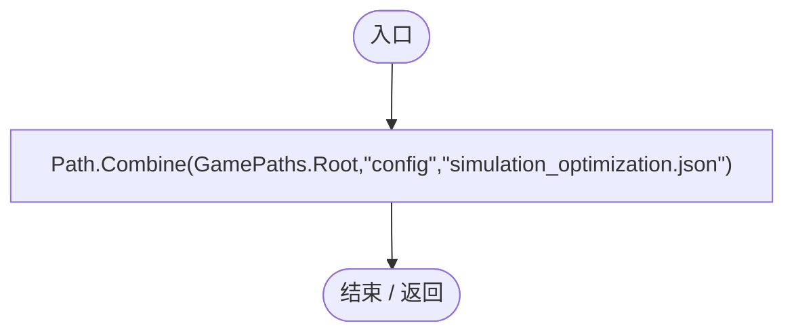

```mermaid
flowchart TD
  b0(["入口"])
  b1{"value=JsonUtility.FromJson&lt;SimulationOptimization&gt;(CommentedJson.Strip(text))<br/>判断：value!=null"}
  b2{"判断：value.weatherProxySubdivisions&lt;4"}
  b3{"判断：value.weatherProxySubdivisions&gt;128"}
  b4["结果：new InvalidDataException(&quot;天气代理细分必须为4～128&quot;)"]
  x4(["抛出异常 / 离开方法"])
  b5{"判断：value!=null"}
  b6{"判断：value.groundNormalAngleDegrees&gt;1"}
  b7{"判断：value.groundVelocityEpsilon&gt;.01f"}
  b8["结果：new InvalidDataException(&quot;接地写入阈值超出有效范围&quot;)"]
  x8(["抛出异常 / 离开方法"])
  b9{"判断：value!=null"}
  b10{"判断：value.entitySkyDensityMultiplier&lt;1"}
  b11{"判断：value.entitySkyDensityMultiplier&gt;32"}
  b12["结果：new InvalidDataException(&quot;实体视角天空散射倍率必须为1～32&quot;)"]
  x12(["抛出异常 / 离开方法"])
  b13{"判断：value==null"}
  b14{"判断：value.version!=1"}
  b15{"判断：value.localPlacementFailureLimit&lt;1"}
  b16{"判断：value.localPlacementFailureLimit&gt;1024"}
  b17{"判断：value.workerQueueLimit&lt;1"}
  b18{"判断：value.workerQueueLimit&gt;128"}
  b19{"判断：value.expressionCacheLimit&lt;1"}
  b20{"判断：value.expressionCacheLimit&gt;4096"}
  b21{"判断：value.maximumResourceCells&lt;1"}
  b22{"判断：value.maximumResourceCells&gt;1000000"}
  b23["结果：new InvalidDataException(&quot;计算优化配置版本或数量无效&quot;)"]
  x23(["抛出异常 / 离开方法"])
  b24["typeof(SimulationOptimization).GetFields()"]
  b25{"判断：typeof(SimulationOptimization).GetFields()"}
  b26{"var<br/>判断：field.FieldType==typeof(float)"}
  b27{"n=(float)field.GetValue(value)<br/>判断：float.IsFinite(n)"}
  b28{"判断：n&lt;=0"}
  b29["结果：new InvalidDataException(&quot;计算优化参数必须为正有限数：&quot;+field.Name)"]
  x29(["抛出异常 / 离开方法"])
  b30{"typeof(SimulationOptimization).GetFields()<br/>判断：typeof(SimulationOptimization).GetFields()"}
  b31["typeof(SimulationOptimization).GetFields()"]
  b32["连接 / 离开区域"]
  b33["结果：value"]
  b34(["结束 / 返回"])
  b0 --> b1
  b1 -->|"是"| b2
  b1 -->|"否"| b5
  b2 -->|"否"| b3
  b2 -->|"是"| b4
  b3 -->|"是"| b4
  b3 -->|"否"| b5
  b4 -->|"Throw"| x4
  b5 -->|"是"| b6
  b5 -->|"否"| b9
  b6 -->|"否"| b7
  b6 -->|"是"| b8
  b7 -->|"是"| b8
  b7 -->|"否"| b9
  b8 -->|"Throw"| x8
  b9 -->|"是"| b10
  b9 -->|"否"| b13
  b10 -->|"否"| b11
  b10 -->|"是"| b12
  b11 -->|"是"| b12
  b11 -->|"否"| b13
  b12 -->|"Throw"| x12
  b13 -->|"否"| b14
  b13 -->|"是"| b23
  b14 -->|"否"| b15
  b14 -->|"是"| b23
  b15 -->|"否"| b16
  b15 -->|"是"| b23
  b16 -->|"否"| b17
  b16 -->|"是"| b23
  b17 -->|"否"| b18
  b17 -->|"是"| b23
  b18 -->|"否"| b19
  b18 -->|"是"| b23
  b19 -->|"否"| b20
  b19 -->|"是"| b23
  b20 -->|"否"| b21
  b20 -->|"是"| b23
  b21 -->|"否"| b22
  b21 -->|"是"| b23
  b22 -->|"是"| b23
  b22 -->|"否"| b24
  b23 -->|"Throw"| x23
  b24 --> b25
  b25 -->|"是"| b26
  b25 -->|"否 · 经过finally 30"| b33
  b26 -->|"是"| b27
  b26 -->|"否"| b25
  b27 -->|"是"| b28
  b27 -->|"否"| b29
  b28 -->|"是"| b29
  b28 -->|"否"| b25
  b29 -->|"Throw"| x29
  b30 -->|"否"| b31
  b30 -->|"是"| b32
  b31 --> b32
  b33 -->|"返回"| b34
  b25 -. "退出保护区时 finally（示意）" .-> b30

```

# SimulationOptimization.cs

[返回总索引](../README.md) · `Runtime` · `Assets/DarwinPark/Core/SimulationOptimization.cs`

[源文件](../../../Assets/DarwinPark/Core/SimulationOptimization.cs) · 源码校验：`ffa09e1cec49d2096e8e1f1c8aa53a1e04e398ff543b43d7ddbcb1eff067d5ea`

方法按源文件位置排列。事件/回调引用不表示立即执行；分支与异常说明见总索引。完整源码与可点击关系图请打开离线手册。

## FilePath.get · L24

`public static string FilePath`

### Editor / Player · 语法控制结构 / 声明（非CFG）

## Current.get · L25

`get`

### Editor / Player · Roslyn编译器控制流

项目内调用/回调引用：

- [SimulationOptimization.Reload · L36](11c9091e70893352.md#m7806186cf2afd8b1)（方法）

## Parse · L26

`public static SimulationOptimization Parse(string text)`

### Editor / Player · Roslyn编译器控制流

项目内调用/回调引用：

- [CommentedJson.Strip · L9](f72593057d514ce3.md#mc9c02edd5a7f0a4d)（方法）

## Reload · L36

`public static void Reload()`

### Editor / Player · Roslyn编译器控制流

项目内调用/回调引用：

- [SimulationOptimization.Parse · L26](11c9091e70893352.md#m39f3706ce092b8eb)（方法）

## Poll · L44

`public static void Poll()`

★ 新增：全局菜单已有的单一轮询入口调用，不能让每名实体访问磁盘。

### Editor / Player · Roslyn编译器控制流

项目内调用/回调引用：

- [SimulationOptimization.Reload · L36](11c9091e70893352.md#m7806186cf2afd8b1)（方法）

## Reset · L50

`[RuntimeInitializeOnLoadMethod(RuntimeInitializeLoadType.SubsystemRegistration)]private static void Reset()`

### Editor / Player · Roslyn编译器控制流

