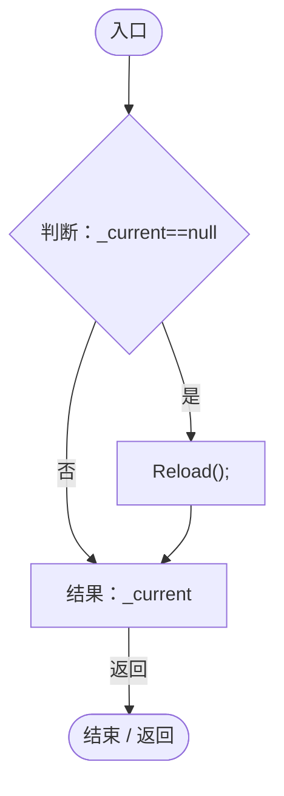
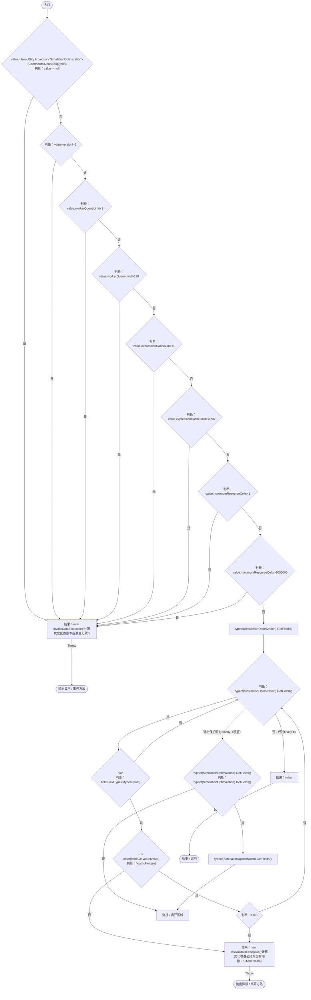
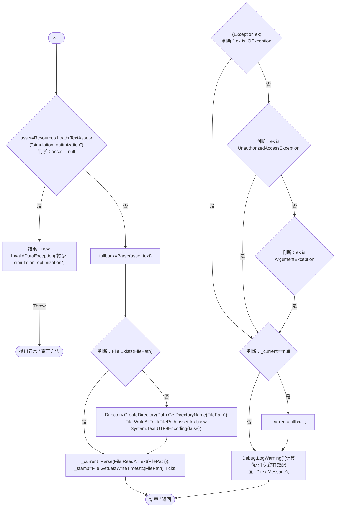
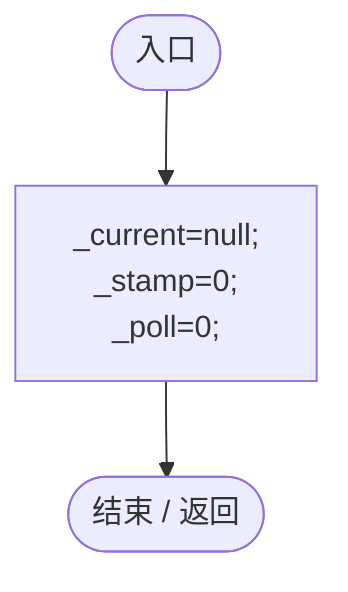

# SimulationOptimization.cs

[返回总索引](../README.md) · `Runtime` · `Assets/DarwinPark/Core/SimulationOptimization.cs`

[源文件](../../../Assets/DarwinPark/Core/SimulationOptimization.cs) · 源码校验：`a8c69a93653c9b2be82d63930f1d16534b30a6b368756572d01bd012956eeecd`

方法按源文件位置排列。事件/回调引用不表示立即执行；分支与异常说明见总索引。完整源码与可点击关系图请打开离线手册。

## FilePath.get · L15

`public static string FilePath`

### Editor / Player · 语法控制结构 / 声明（非CFG）

## Current.get · L16

`get`

### Editor / Player · Roslyn编译器控制流

项目内调用/回调引用：

- [SimulationOptimization.Reload · L24](11c9091e70893352.md#mee43c6beb70dce9d)（方法）

## Parse · L17

`public static SimulationOptimization Parse(string text)`

### Editor / Player · Roslyn编译器控制流

项目内调用/回调引用：

- [CommentedJson.Strip · L9](f72593057d514ce3.md#mc9c02edd5a7f0a4d)（方法）

## Reload · L24

`public static void Reload()`

### Editor / Player · Roslyn编译器控制流

项目内调用/回调引用：

- [SimulationOptimization.Parse · L17](11c9091e70893352.md#mf8ab7fa96aebaae7)（方法）

## Poll · L32

`public static void Poll()`

★ 新增：全局菜单已有的单一轮询入口调用，不能让每名实体访问磁盘。

### Editor / Player · Roslyn编译器控制流

项目内调用/回调引用：

- [SimulationOptimization.Reload · L24](11c9091e70893352.md#mee43c6beb70dce9d)（方法）

## Reset · L38

`[RuntimeInitializeOnLoadMethod(RuntimeInitializeLoadType.SubsystemRegistration)]private static void Reset()`

### Editor / Player · Roslyn编译器控制流

