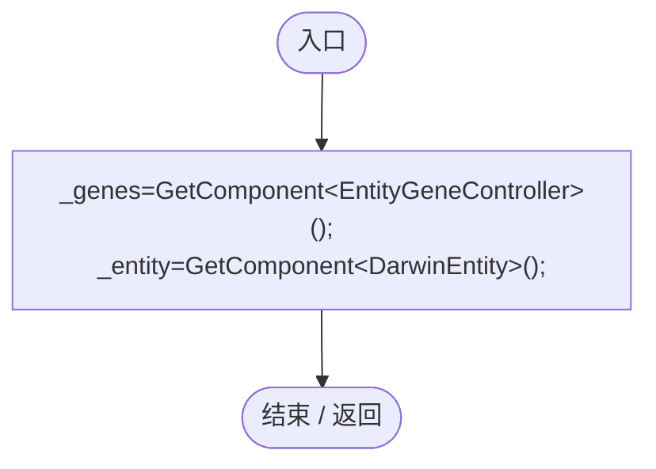
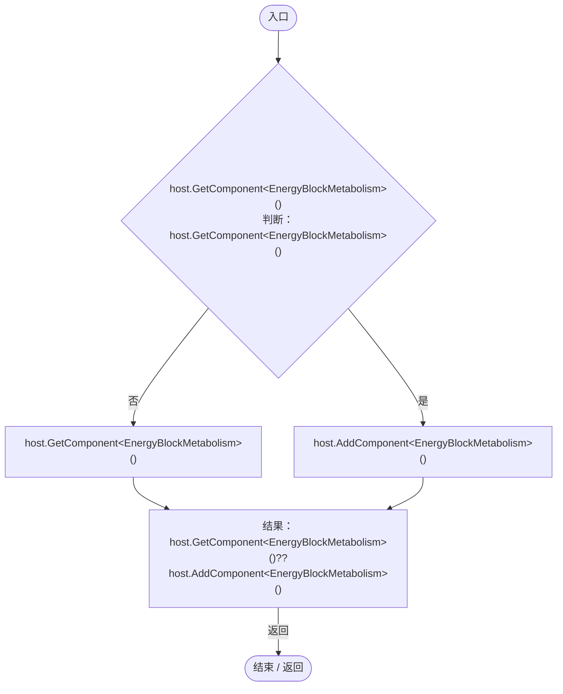
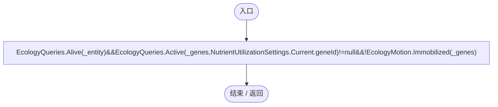
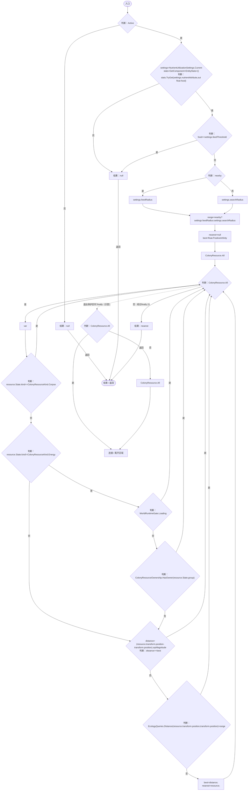
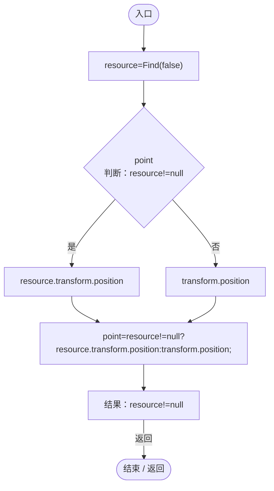
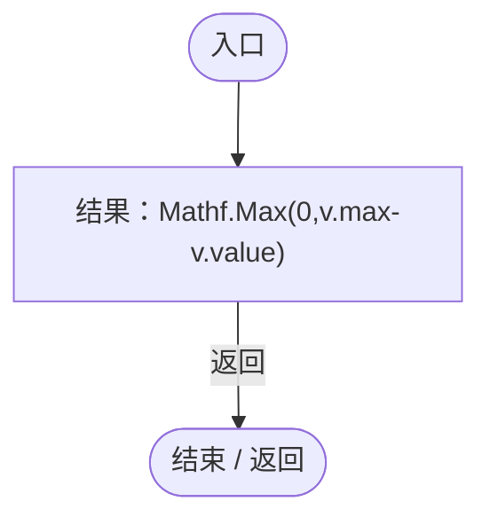
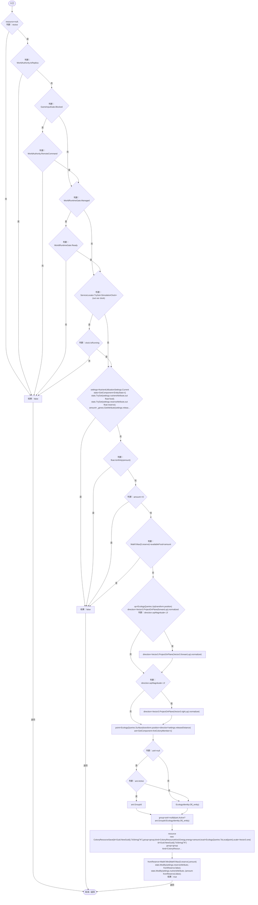

```mermaid
flowchart TD
  b0(["入口"])
  b1{"判断：dt&lt;=0"}
  b2{"判断：AntColonyMember.IsManaged(_genes)"}
  b3{"resource=Find(true)<br/>判断：resource==null"}
  b4{"stats=GetComponent&lt;EntityStats&gt;()<br/>settings=NutrientUtilizationSettings.Current<br/>room=stats.CaptureValues().Where(v=&gt;v.id==settings.nutrientAttribute&#124;&#124;v.id==settings.reserveAttribute).Sum(v=&gt;Mathf.Max(0,v.max-v.value))<br/>amount=Mathf.Min(roo…"}
  b5{"stats.Feed(amount);<br/>resource.State.energy-=amount;<br/>判断：resource.State.energy&lt;=0"}
  b6["resource.Remove();"]
  b7(["结束 / 返回"])
  b0 --> b1
  b1 -->|"否"| b2
  b1 -->|"是"| b7
  b2 -->|"是"| b7
  b2 -->|"否"| b3
  b3 -->|"是"| b7
  b3 -->|"否"| b4
  b4 -->|"是"| b7
  b4 -->|"否"| b5
  b5 -->|"是"| b6
  b5 -->|"否"| b7
  b6 --> b7

```

```mermaid
flowchart TD
  b0(["入口"])
  b1{"判断：v.id==settings.nutrientAttribute"}
  b2["v.id==settings.reserveAttribute"]
  b3["v.id==settings.nutrientAttribute"]
  b4["结果：v.id==settings.nutrientAttribute&#124;&#124;v.id==settings.reserveAttribute"]
  b5(["结束 / 返回"])
  b0 --> b1
  b1 -->|"否"| b2
  b1 -->|"是"| b3
  b2 --> b4
  b3 --> b4
  b4 -->|"返回"| b5

```

# EnergyBlockMetabolism.cs

[返回总索引](../README.md) · `Runtime` · `Assets/DarwinPark/Entities/Ecology/EnergyBlockMetabolism.cs`

[源文件](../../../Assets/DarwinPark/Entities/Ecology/EnergyBlockMetabolism.cs) · 源码校验：`ce5d2a781bd445e63c136b300592197adec912c5f73adad5a77c165b83728896`

方法按源文件位置排列。事件/回调引用不表示立即执行；分支与异常说明见总索引。完整源码与可点击关系图请打开离线手册。

## Awake · L14

`private void Awake()`

### Editor / Player · Roslyn编译器控制流

## Ensure · L15

`public static EnergyBlockMetabolism Ensure(GameObject host)`

### Editor / Player · Roslyn编译器控制流

## Active.get · L16

`public bool Active`

### Editor / Player · 语法控制结构 / 声明（非CFG）

项目内调用/回调引用：

- [EcologyQueries.Alive · L38](bdf7ccc2c9c0452f.md#mb2877c487f449970)（方法）
- [EcologyQueries.Active · L28](bdf7ccc2c9c0452f.md#m4fb10ad424167e3b)（方法）
- [NutrientUtilizationSettings.Current.get · L17](276bc943280dcfce.md#mfa1e978a0be0644c)（访问器）
- [EcologyMotion.Immobilized · L9](6ed9d0eedb456d32.md#mff3eeb8fb207a31e)（方法）

## Find · L17

`private ColonyResource Find(bool nearby)`

### Editor / Player · Roslyn编译器控制流

项目内调用/回调引用：

- [NutrientUtilizationSettings.Current.get · L17](276bc943280dcfce.md#mfa1e978a0be0644c)（访问器）
- [EntityStats.TryGet · L90](75aa86a368efdf24.md#m24ee1433e4a70d94)（方法）
- [ColonyResource.State.get · L22](293dbaecfff4b585.md#m341a1355f4d657bf)（访问器）
- [ColonyResourceOwnership.HasOwner · L14](2988679fde59fc87.md#mc9fb9c75e5ef3aa5)（方法）
- [EcologyQueries.Distance · L42](bdf7ccc2c9c0452f.md#mba9c3e3c95d0f2dd)（方法）

## Destination · L32

`public bool Destination(out Vector3 point)`

### Editor / Player · Roslyn编译器控制流

项目内调用/回调引用：

- [EnergyBlockMetabolism.Find · L17](123c1bf82bdb8ea2.md#m127426cfa0df24e0)（方法）

## Advance · L34

`public void Advance(float dt)`

### Editor / Player · Roslyn编译器控制流

项目内调用/回调引用：

- [AntColonyMember.IsManaged · L53](baebd85c05598377.md#m2762de72909d5da5)（方法）
- [EnergyBlockMetabolism.Find · L17](123c1bf82bdb8ea2.md#m127426cfa0df24e0)（方法）
- [NutrientUtilizationSettings.Current.get · L17](276bc943280dcfce.md#mfa1e978a0be0644c)（访问器）
- [EntityStats.CaptureValues · L86](75aa86a368efdf24.md#mbf54fc67f0d07a99)（方法）
- [ColonyResource.State.get · L22](293dbaecfff4b585.md#m341a1355f4d657bf)（访问器）
- [EntityGeneController.GetAttribute · L225](7494d53178552f0e.md#mc707943b1138a009)（方法）
- [EntityStats.Feed · L95](75aa86a368efdf24.md#mc025822ff1eb86a0)（方法）
- [ColonyResource.Remove · L99](293dbaecfff4b585.md#m3e346b425034ee3a)（方法）
- [EnergyBlockMetabolism.回调@40 · L40](123c1bf82bdb8ea2.md#mccbb9f354b9bc928)（回调/委托）
- [EnergyBlockMetabolism.回调@40 · L40](123c1bf82bdb8ea2.md#mf38d791af1a04d86)（回调/委托）

## 回调@40 · L40

`v … => 回调`

### Editor / Player · Roslyn编译器控制流

## 回调@40 · L40

`v … => 回调`

### Editor / Player · Roslyn编译器控制流

## TryRelease · L44

`public bool TryRelease(Vector3 forward,out ColonyResource resource)`

### Editor / Player · Roslyn编译器控制流

项目内调用/回调引用：

- [GameInputGate.Blocked.get · L8](52955daae7e592ab.md#m765763b665829633)（访问器）
- [ServiceLocator.TryGet · L26](f2fdbe9f9ccd93cb.md#m143b24e6d58471b0)（方法）
- [SimulationClock.IsRunning.get · L22](a8f444aec9614b0a.md#m10f4fe307faca0f0)（访问器）
- [NutrientUtilizationSettings.Current.get · L17](276bc943280dcfce.md#mfa1e978a0be0644c)（访问器）
- [EntityStats.TryGet · L90](75aa86a368efdf24.md#m24ee1433e4a70d94)（方法）
- [EntityGeneController.GetAttribute · L225](7494d53178552f0e.md#mc707943b1138a009)（方法）
- [EcologyQueries.Up · L41](bdf7ccc2c9c0452f.md#maca7070196f125fd)（方法）
- [EcologyQueries.Surface · L47](bdf7ccc2c9c0452f.md#m2f1f6873ee5fc8df)（方法）
- [EcologyIdentity.Of · L21](bdf7ccc2c9c0452f.md#m1143cf9570a93b72)（方法）
- [ColonyResource.Create · L42](293dbaecfff4b585.md#ma07be53c3e3fff10)（方法）
- [EcologyQueries.ToLocal · L39](bdf7ccc2c9c0452f.md#m1a07639eacf3aa47)（方法）
- [EntityStats.Modify · L111](75aa86a368efdf24.md#m9c837be197158240)（方法）
