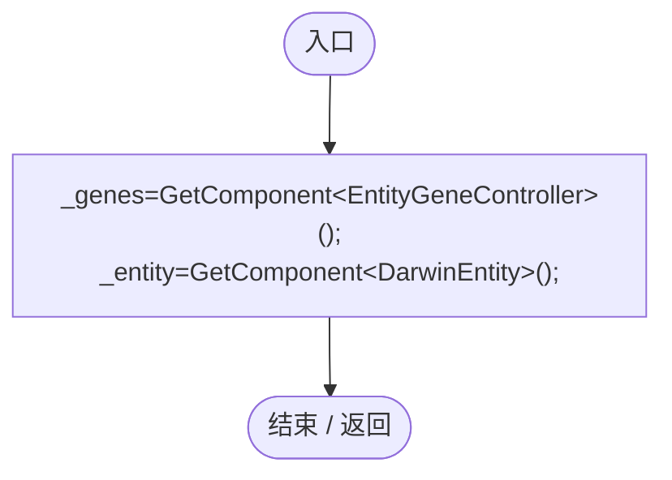
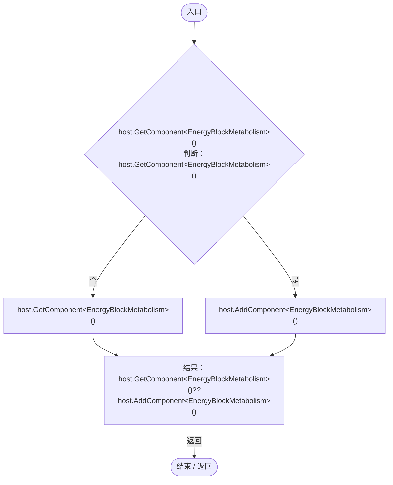
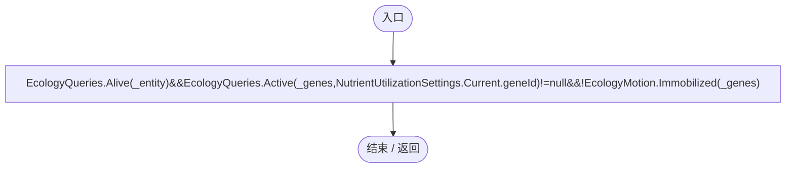
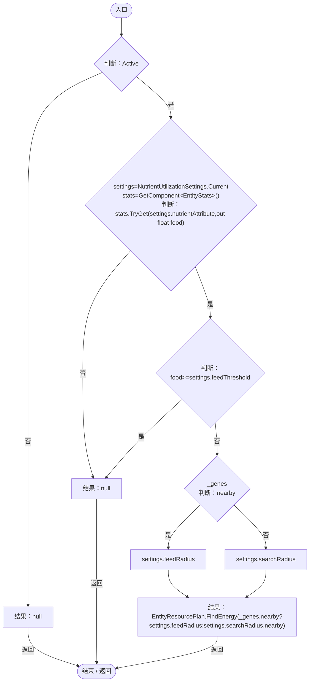
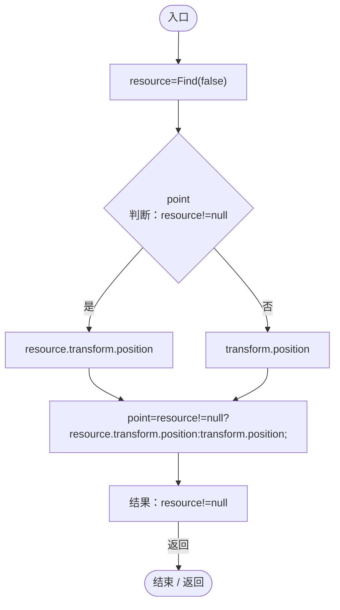
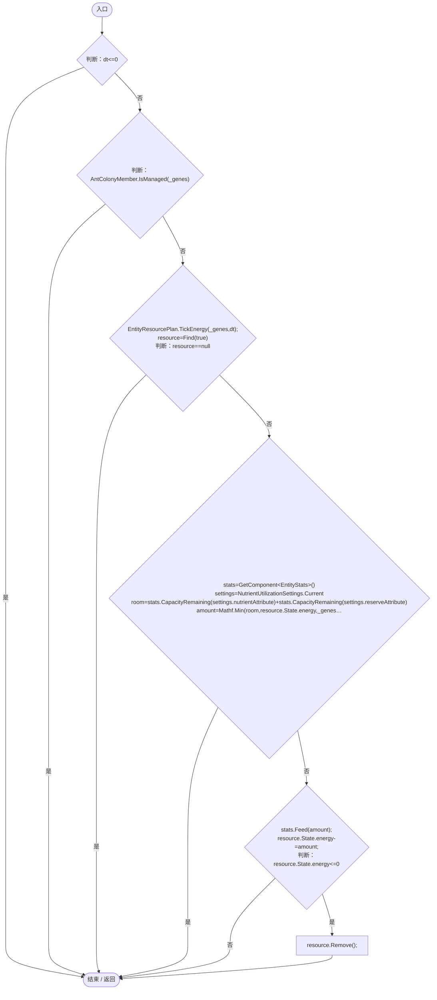
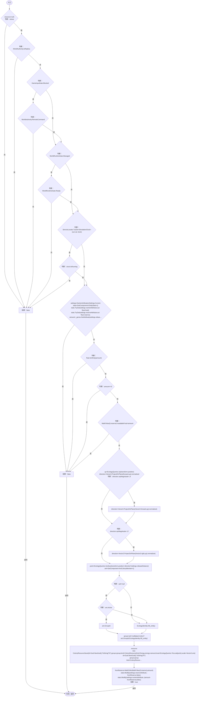

# EnergyBlockMetabolism.cs

[返回总索引](../README.md) · `Runtime` · `Assets/DarwinPark/Entities/Ecology/EnergyBlockMetabolism.cs`

[源文件](../../../Assets/DarwinPark/Entities/Ecology/EnergyBlockMetabolism.cs) · 源码校验：`9a1ab76d5f9649b042a833dc2bdf0c90c29cda840d9808da6b3937829d0e027a`

方法按源文件位置排列。事件/回调引用不表示立即执行；分支与异常说明见总索引。完整源码与可点击关系图请打开离线手册。

## Awake · L15

`private void Awake()`

### Editor / Player · Roslyn编译器控制流

## Ensure · L16

`public static EnergyBlockMetabolism Ensure(GameObject host)`

### Editor / Player · Roslyn编译器控制流

## Active.get · L17

`public bool Active`

### Editor / Player · 语法控制结构 / 声明（非CFG）

项目内调用/回调引用：

- [EcologyQueries.Alive · L39](bdf7ccc2c9c0452f.md#m8352bfacbe2996a8)（方法）
- [EcologyQueries.Active · L29](bdf7ccc2c9c0452f.md#m200839bb9db5ec55)（方法）
- [NutrientUtilizationSettings.Current.get · L17](276bc943280dcfce.md#mfa1e978a0be0644c)（访问器）
- [EcologyMotion.Immobilized · L10](6ed9d0eedb456d32.md#m0b0d6c3cabc3ae89)（方法）

## Find · L18

`private ColonyResource Find(bool nearby)`

### Editor / Player · Roslyn编译器控制流

项目内调用/回调引用：

- [NutrientUtilizationSettings.Current.get · L17](276bc943280dcfce.md#mfa1e978a0be0644c)（访问器）
- [EntityStats.TryGet · L90](75aa86a368efdf24.md#m24ee1433e4a70d94)（方法）
- [EntityResourcePlan.FindEnergy · L28](569e8e31d0634370.md#m571f35e553bb40a8)（方法）

## Destination · L26

`public bool Destination(out Vector3 point)`

### Editor / Player · Roslyn编译器控制流

项目内调用/回调引用：

- [EnergyBlockMetabolism.Find · L18](123c1bf82bdb8ea2.md#m2dcff51538f8cd0a)（方法）

## Advance · L28

`public void Advance(float dt)`

### Editor / Player · Roslyn编译器控制流

项目内调用/回调引用：

- [AntColonyMember.IsManaged · L62](baebd85c05598377.md#mc19efc26663d343c)（方法）
- [EntityResourcePlan.TickEnergy · L19](569e8e31d0634370.md#m722bfeae41676288)（方法）
- [EnergyBlockMetabolism.Find · L18](123c1bf82bdb8ea2.md#m2dcff51538f8cd0a)（方法）
- [NutrientUtilizationSettings.Current.get · L17](276bc943280dcfce.md#mfa1e978a0be0644c)（访问器）
- [EntityStats.CapacityRemaining · L92](75aa86a368efdf24.md#m574f0a6509120d00)（方法）
- [ColonyResource.State.get · L24](293dbaecfff4b585.md#m41824f1a0e160aa5)（访问器）
- [EntityGeneController.GetAttribute · L286](7494d53178552f0e.md#m18bff2b38f95b556)（方法）
- [GameplayTuning.Current.get · L46](db546e5713b32d53.md#m4fa691bd8a3b9618)（访问器）
- [EntityStats.Feed · L95](75aa86a368efdf24.md#mc025822ff1eb86a0)（方法）
- [ColonyResource.Remove · L108](293dbaecfff4b585.md#mb9333347c7434224)（方法）

## TryRelease · L40

`public bool TryRelease(Vector3 forward,out ColonyResource resource)`

### Editor / Player · Roslyn编译器控制流

项目内调用/回调引用：

- [GameInputGate.Blocked.get · L8](52955daae7e592ab.md#m765763b665829633)（访问器）
- [ServiceLocator.TryGet · L26](f2fdbe9f9ccd93cb.md#m143b24e6d58471b0)（方法）
- [SimulationClock.IsRunning.get · L22](a8f444aec9614b0a.md#m10f4fe307faca0f0)（访问器）
- [NutrientUtilizationSettings.Current.get · L17](276bc943280dcfce.md#mfa1e978a0be0644c)（访问器）
- [EntityStats.TryGet · L90](75aa86a368efdf24.md#m24ee1433e4a70d94)（方法）
- [EntityGeneController.GetAttribute · L286](7494d53178552f0e.md#m18bff2b38f95b556)（方法）
- [EcologyQueries.Up · L42](bdf7ccc2c9c0452f.md#ma73e6bbbc726282f)（方法）
- [EcologyQueries.Surface · L48](bdf7ccc2c9c0452f.md#m40ee3e975d7f5137)（方法）
- [EcologyIdentity.Of · L22](bdf7ccc2c9c0452f.md#mb23020fe763aafd3)（方法）
- [ColonyResource.Create · L45](293dbaecfff4b585.md#m7e8d2b0e06e1cad5)（方法）
- [EcologyQueries.ToLocal · L40](bdf7ccc2c9c0452f.md#mfa1ace432c73012a)（方法）
- [EntityStats.Modify · L111](75aa86a368efdf24.md#m9c837be197158240)（方法）
