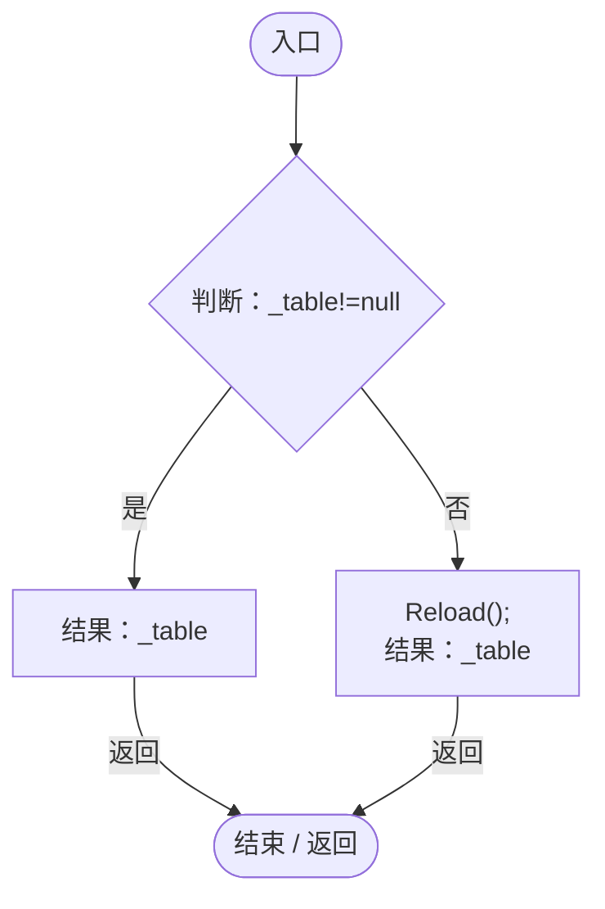
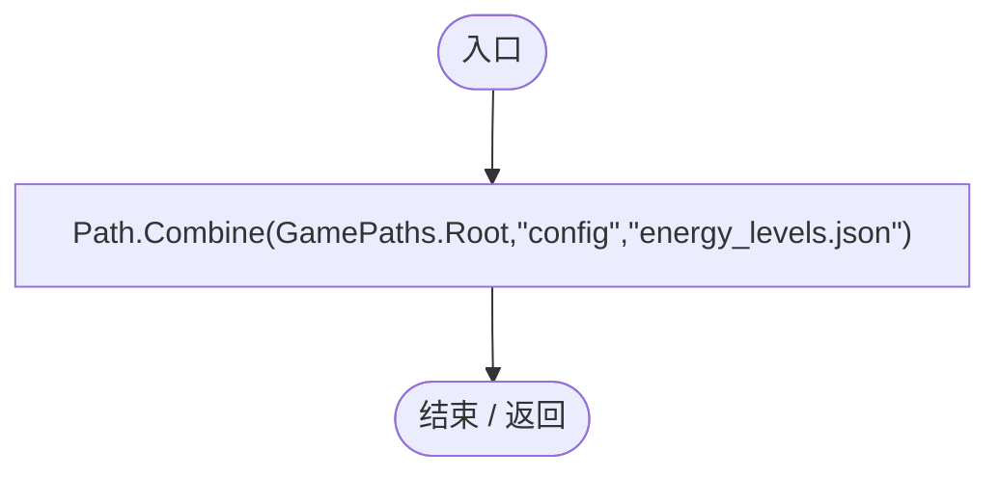
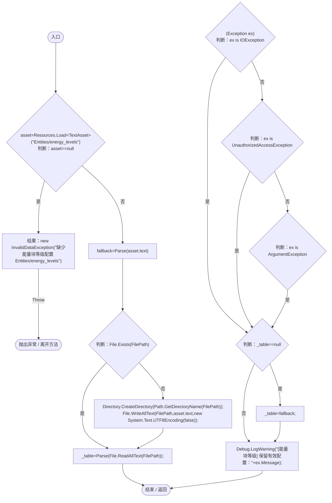
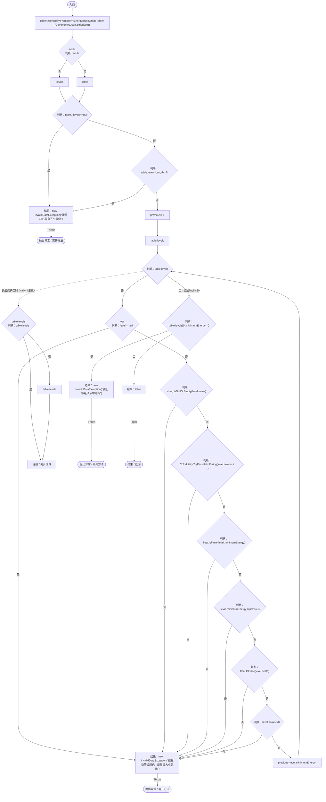
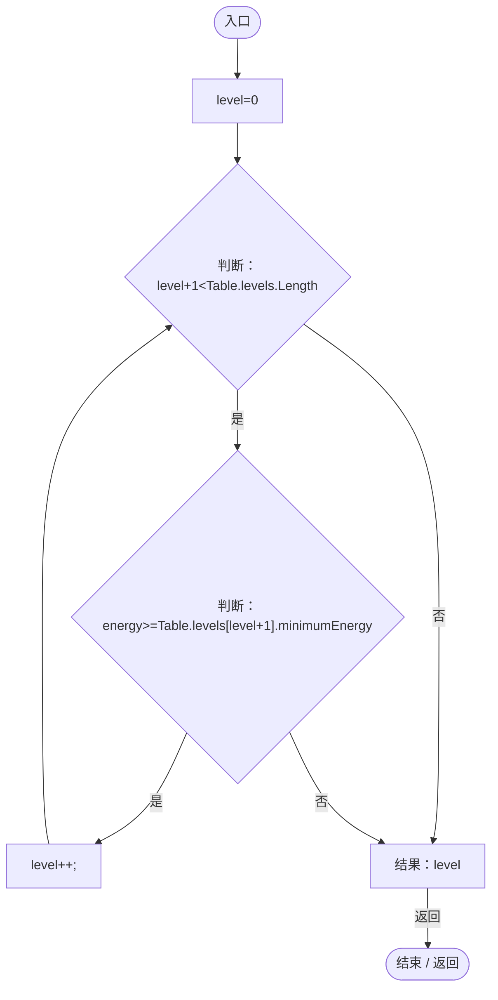
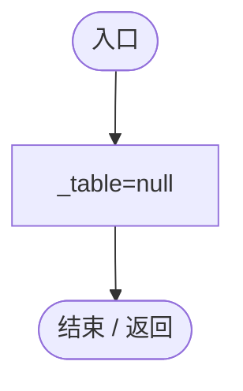

# EnergyBlockGrades.cs

[返回总索引](../README.md) · `Runtime` · `Assets/DarwinPark/Entities/Ecology/EnergyBlockGrades.cs`

[源文件](../../../Assets/DarwinPark/Entities/Ecology/EnergyBlockGrades.cs) · 源码校验：`cca1f8bdcd8fa4f8ea763cbe4285d0326d6b2b3299a24329c33f906514056721`

方法按源文件位置排列。事件/回调引用不表示立即执行；分支与异常说明见总索引。完整源码与可点击关系图请打开离线手册。

## Table.get · L16

`get`

### Editor / Player · Roslyn编译器控制流

项目内调用/回调引用：

- [EnergyBlockGrades.Reload · L23](1251b395f5845255.md#m4fe3f63c3e370e29)（方法）

## FilePath.get · L22

`public static string FilePath`

### Editor / Player · 语法控制结构 / 声明（非CFG）

## Reload · L23

`public static void Reload()`

### Editor / Player · Roslyn编译器控制流

项目内调用/回调引用：

- [EnergyBlockGrades.Parse · L37](1251b395f5845255.md#m239ab11e1030b94a)（方法）

## Parse · L37

`public static EnergyBlockGradeTable Parse(string json)`

### Editor / Player · Roslyn编译器控制流

项目内调用/回调引用：

- [CommentedJson.Strip · L9](f72593057d514ce3.md#mc9c02edd5a7f0a4d)（方法）

## Level · L50

`public static int Level(float energy)`

### Editor / Player · Roslyn编译器控制流

项目内调用/回调引用：

- [EnergyBlockGrades.Table.get · L16](1251b395f5845255.md#m5883f4b3fcdf870b)（访问器）

## Reset · L52

`[RuntimeInitializeOnLoadMethod(RuntimeInitializeLoadType.SubsystemRegistration)] private static void Reset()`

### Editor / Player · Roslyn编译器控制流

