# AntColonyRegression.cs

[返回总索引](../README.md) · `Editor` · `Assets/DarwinPark/Editor/AntColonyRegression.cs`

[源文件](../../../Assets/DarwinPark/Editor/AntColonyRegression.cs) · 源码校验：`96687b0c3d9ff23466828a3e60d9e7c37124f477348e1f8aa62f1d9a8033aaa4`

方法按源文件位置排列。事件/回调引用不表示立即执行；分支与异常说明见总索引。完整源码与可点击关系图请打开离线手册。

<a id="m0750c22cf767806d"></a>

## Folder.get · L30

`private static string Folder`


### Editor · 语法控制结构 / 声明（非CFG）

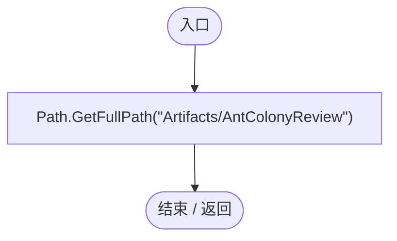

<a id="md5ebc25177244b0c"></a>

## AntColonyRegression.ctor · L34

`static AntColonyRegression()`

★ 修复（防Bug回归）：Unity搜索索引异常会打断delayCall，update幂等等待启动就绪后再跑实际回归。

### Editor · Roslyn编译器控制流

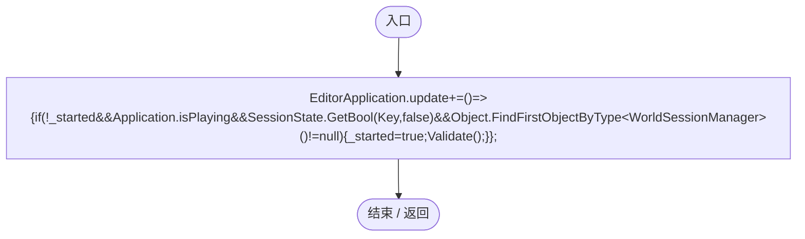

项目内调用/回调引用：

- [AntColonyRegression.回调@34 · L34](1314e8c23331e578.md#m7d9d2c31d119df8b)（回调/委托）

<a id="m7d9d2c31d119df8b"></a>

## 回调@34 · L34

`( … => 回调`


### Editor · Roslyn编译器控制流

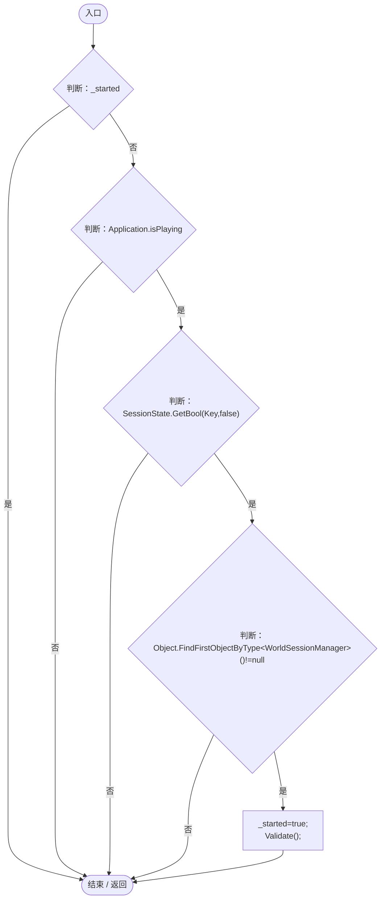

项目内调用/回调引用：

- [AntColonyRegression.Validate · L36](1314e8c23331e578.md#mae71bea88765ff0b)（方法）

<a id="m4026693f39a52dbb"></a>

## RunBatch · L35

`public static void RunBatch()`


### Editor · Roslyn编译器控制流

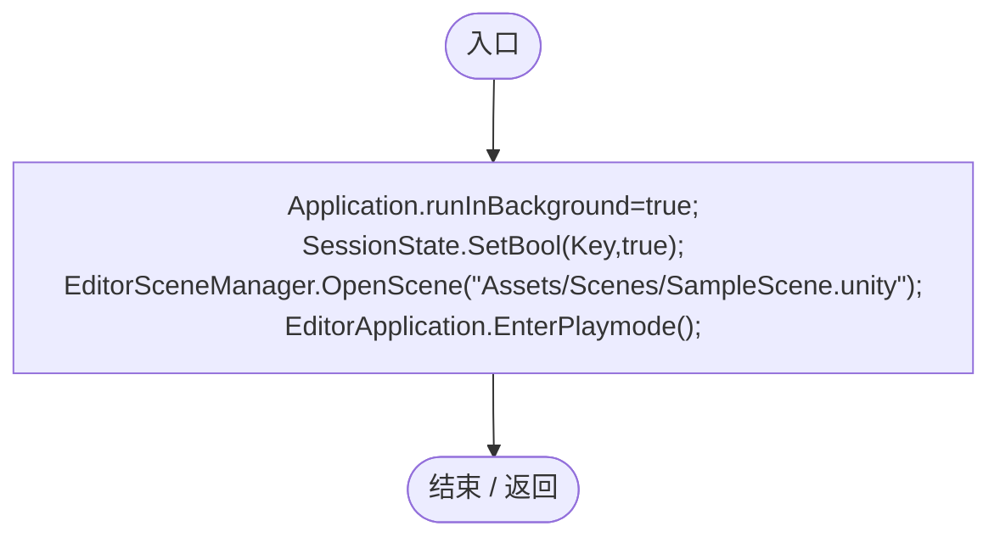

<a id="mae71bea88765ff0b"></a>

## Validate · L36

`[MenuItem("Tools/Darwin Park/Validate Ant Colony")] public static void Validate()`


### Editor · Roslyn编译器控制流

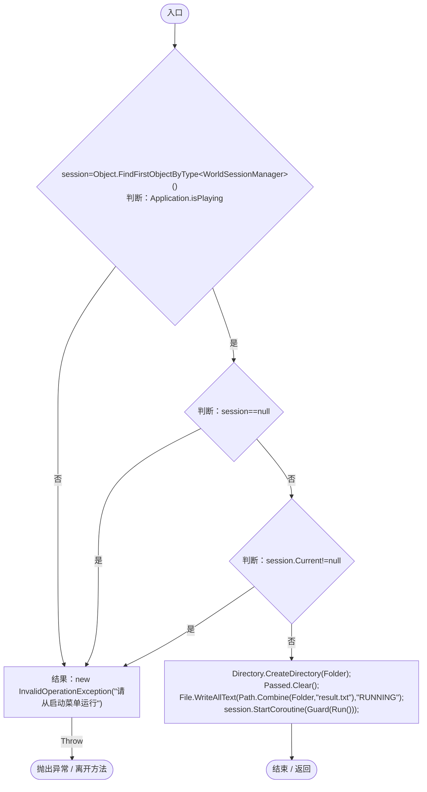

项目内调用/回调引用：

- [WorldSessionManager.Current.get · L21](08741c7b7b9d9344.md#m5d26a5eb846a8504)（访问器）
- [AntColonyRegression.Guard · L43](1314e8c23331e578.md#m48236b5750caea61)（方法）
- [AntColonyRegression.Run · L89](1314e8c23331e578.md#m511de6733aa9a9ba)（方法）

<a id="m6f5f1ec273c13816"></a>

## Check · L42

`private static void Check(bool condition,string message)`


### Editor · Roslyn编译器控制流

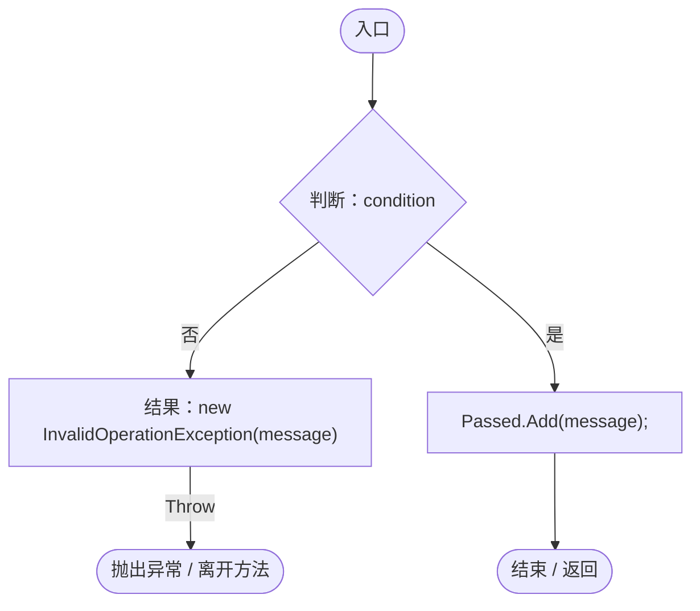

<a id="m48236b5750caea61"></a>

## Guard · L43

`private static IEnumerator Guard(IEnumerator run)`


### Editor · Roslyn编译器控制流

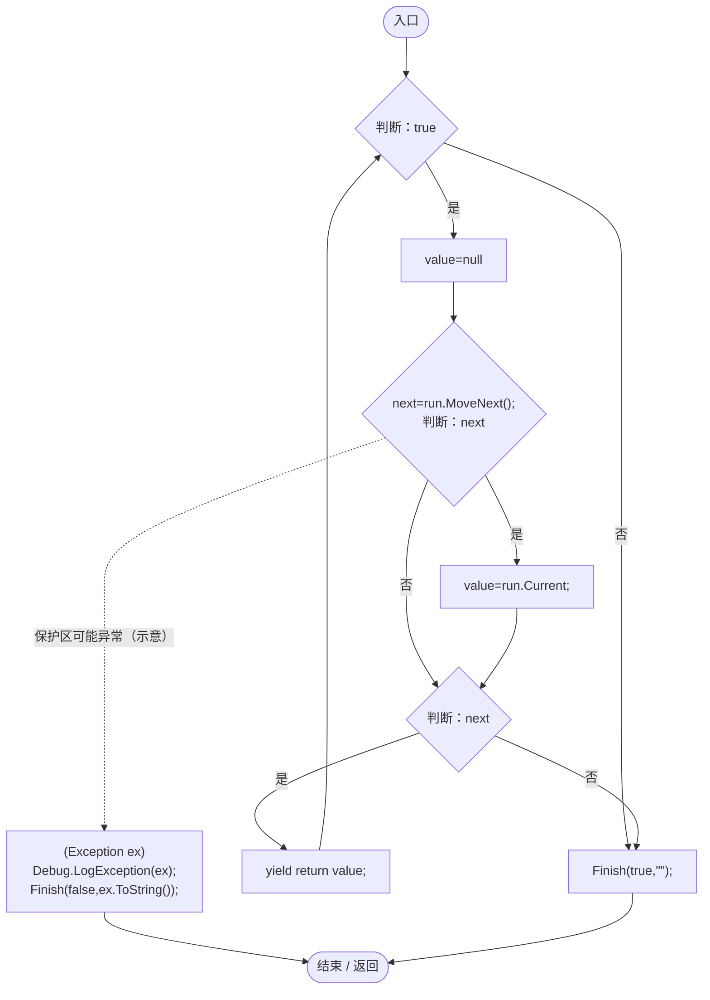

项目内调用/回调引用：

- [AntColonyRegression.Finish · L52](1314e8c23331e578.md#m76c04b45f355ab80)（方法）

<a id="m76c04b45f355ab80"></a>

## Finish · L52

`private static void Finish(bool passed,string error)`


### Editor · Roslyn编译器控制流

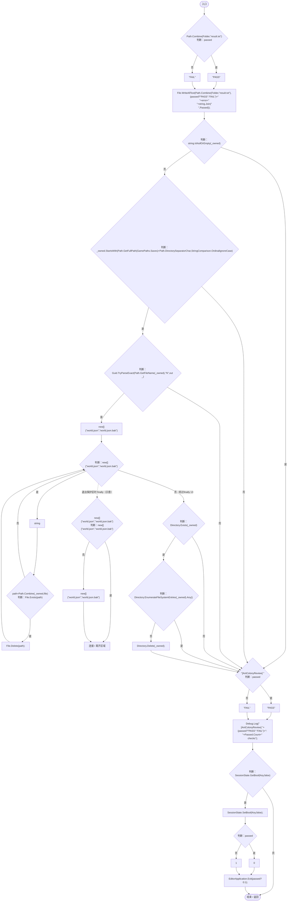

<a id="md127706ed124d4b5"></a>

## At · L64

`private static Vector3 At(float x,float z=0)`


### Editor · Roslyn编译器控制流

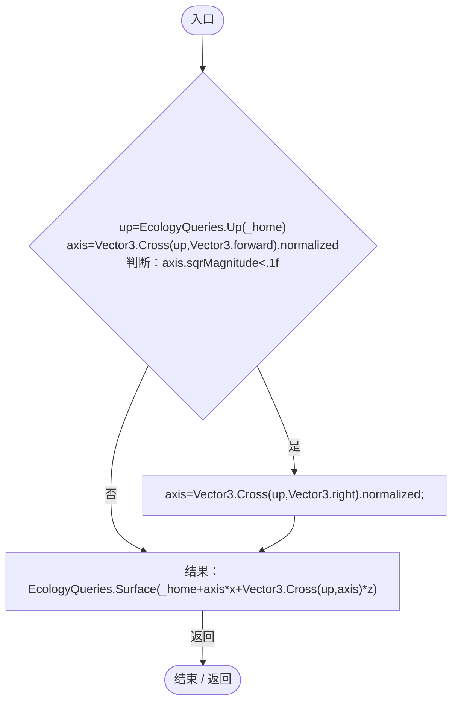

项目内调用/回调引用：

- [EcologyQueries.Up · L41](bdf7ccc2c9c0452f.md#maca7070196f125fd)（方法）
- [EcologyQueries.Surface · L47](bdf7ccc2c9c0452f.md#m2f1f6873ee5fc8df)（方法）

<a id="m56ce189af7bd11fb"></a>

## Spawn · L66

`private static DarwinEntity Spawn(Vector3 point,params (string,float)[] definitions)`


### Editor · Roslyn编译器控制流

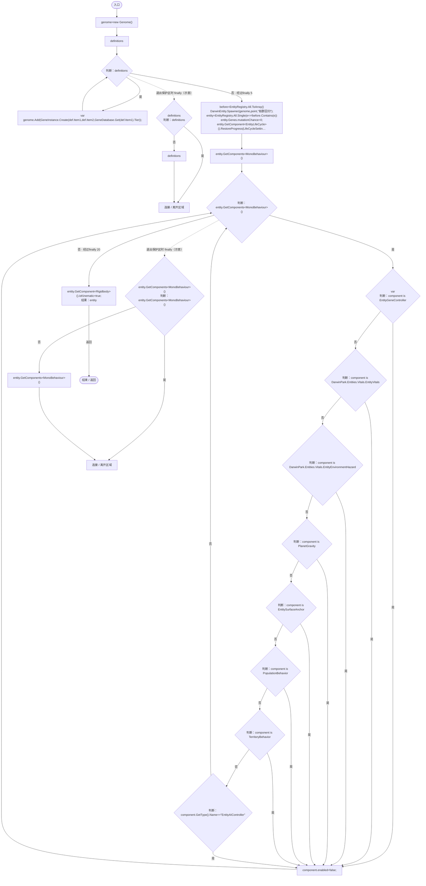

项目内调用/回调引用：

- [Genome.Add · L19](a2ef23f865bc7ee8.md#md9cfdc94b8b8d40f)（方法）
- [GeneInstance.Create · L20](f82e1498d67f5afd.md#m72e94c278de3cf8b)（方法）
- [GeneDatabase.Get · L136](ec0a03483435a863.md#me6a5fefe6c3492f9)（方法）
- [DarwinEntity.Genes.get · L14](70798dde169f2e8b.md#m622eb1adf401d431)（访问器）
- [EntityLifeCycle.RestoreProgress · L50](9f4138bfbae654b7.md#m1e9381f9a38ed7be)（方法）
- [LifeCycleSettings.Load · L16](ace76969fe8f61de.md#mbd2925785484f343)（方法）
- [EntityGeneController.RestoreStageState · L54](7494d53178552f0e.md#m41fb3375c42f6c22)（方法）
- [EntityGeneController.Recalculate · L111](7494d53178552f0e.md#mf588f8c1148316c6)（方法）
- [AntColonyRegression.回调@69 · L69](1314e8c23331e578.md#mdfd79d4e4b6998b5)（回调/委托）

<a id="mdfd79d4e4b6998b5"></a>

## 回调@69 · L69

`e … => 回调`


### Editor · Roslyn编译器控制流

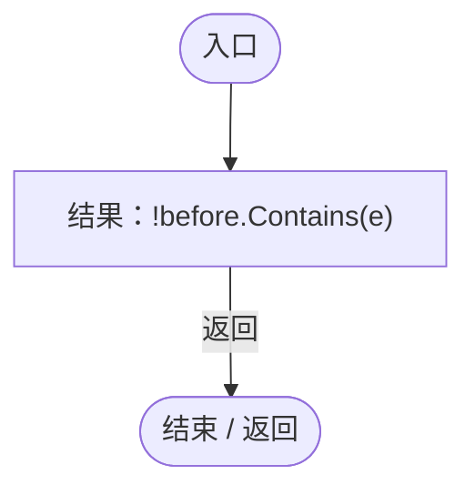

<a id="ma3e5ff5edb02cf1c"></a>

## Member · L75

`private static AntColonyMember Member(AntRole role,string group,Vector3 point,bool sexual=false)`


### Editor · Roslyn编译器控制流

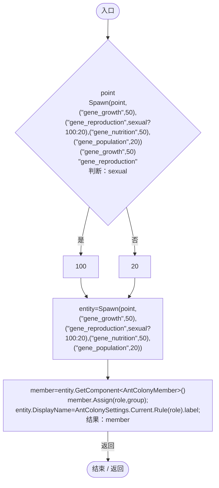

项目内调用/回调引用：

- [AntColonyRegression.Spawn · L66](1314e8c23331e578.md#m56ce189af7bd11fb)（方法）
- [AntColonyMember.Assign · L62](baebd85c05598377.md#m4841f123cc075e2c)（方法）
- [AntColonySettings.Rule · L56](cb0a937e97c8fbb3.md#m46f80f7628c118a8)（方法）
- [AntColonySettings.Current.get · L31](cb0a937e97c8fbb3.md#mcd121159f407ccdf)（访问器）

<a id="m7c58d93f1359ef76"></a>

## Food · L80

`private static float Food(DarwinEntity entity)`


### Editor · Roslyn编译器控制流

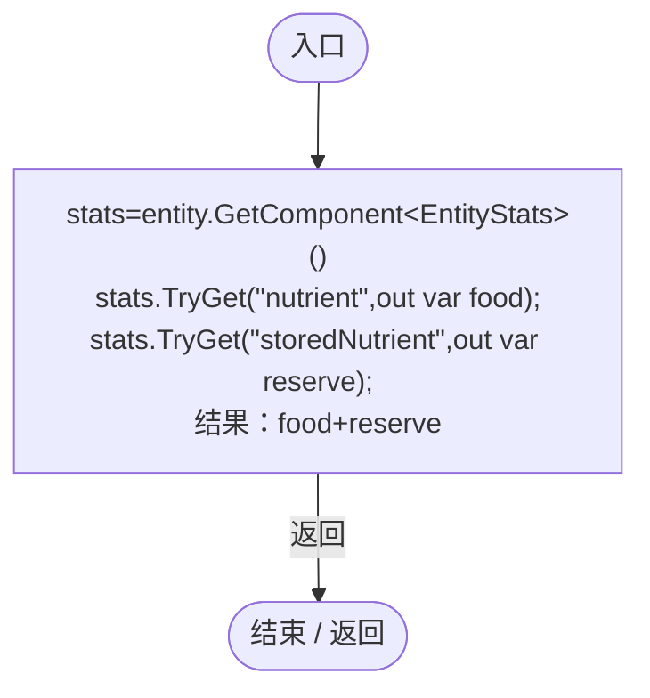

项目内调用/回调引用：

- [EntityStats.TryGet · L90](75aa86a368efdf24.md#m24ee1433e4a70d94)（方法）

<a id="md9c23acf45b3c241"></a>

## Fill · L81

`private static void Fill(DarwinEntity entity,float food,float reserve=0)`


### Editor · Roslyn编译器控制流

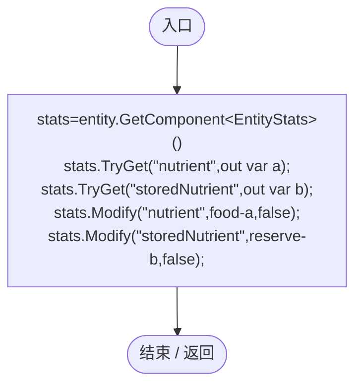

项目内调用/回调引用：

- [EntityStats.TryGet · L90](75aa86a368efdf24.md#m24ee1433e4a70d94)（方法）
- [EntityStats.Modify · L111](75aa86a368efdf24.md#m9c837be197158240)（方法）

<a id="m19718a3372c0b507"></a>

## Bite · L83

`private static void Bite(AntColonyMember soldier,DarwinEntity target)`


### Editor · Roslyn编译器控制流

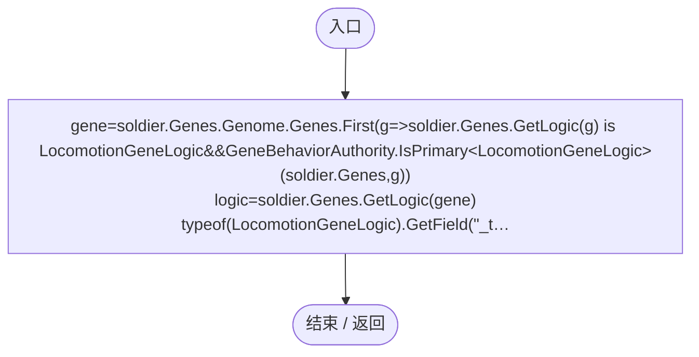

项目内调用/回调引用：

- [AntColonyMember.Genes.get · L33](baebd85c05598377.md#m7331eee1fdd98961)（访问器）
- [EntityGeneController.GetLogic · L231](7494d53178552f0e.md#mf5ee6292befedc7b)（方法）
- [AntColonyRegression.回调@85 · L85](1314e8c23331e578.md#m74fac9750c4a87ac)（回调/委托）

<a id="m74fac9750c4a87ac"></a>

## 回调@85 · L85

`g … => 回调`


### Editor · Roslyn编译器控制流

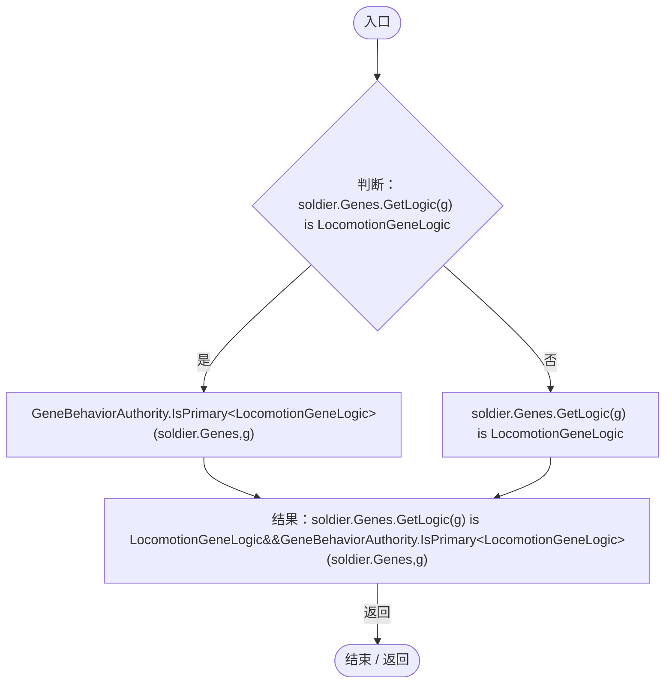

项目内调用/回调引用：

- [EntityGeneController.GetLogic · L231](7494d53178552f0e.md#mf5ee6292befedc7b)（方法）
- [AntColonyMember.Genes.get · L33](baebd85c05598377.md#m7331eee1fdd98961)（访问器）
- [GeneBehaviorAuthority.IsPrimary · L10](be83fa896bbe02ae.md#me2fc1f2e16fcd073)（方法）

<a id="m511de6733aa9a9ba"></a>

## Run · L89

`private static IEnumerator Run()`


### Editor · Roslyn编译器控制流

```mermaid
flowchart TD
  b0(["入口"])
  b1["yield return null;<br/>session=Object.FindFirstObjectByType&lt;WorldSessionManager&gt;()<br/>builder=Object.FindFirstObjectByType&lt;PlanetTerrainMeshBuilder&gt;()<br/>clock=ServiceLocator.Get&lt;SimulationClock&gt;()<br/>builder.subdivisions=32;<br/>typeof(WorldSessionManag…"]
  b2{"判断：session.Busy"}
  b3{"判断：EditorApplication.timeSinceStartup-start&gt;100"}
  b4["结果：new TimeoutException(&quot;生成世界超时&quot;)"]
  x4(["抛出异常 / 离开方法"])
  b5["yield return null;"]
  b6["Check(session.Current!=null,&quot;真实测试世界生成成功&quot;);<br/>_owned=Path.GetDirectoryName(WorldSaveStore.FileFor(session.Current.id));<br/>clock.Pause();<br/>_home=EcologyQueries.Surface(builder.transform.position+Vector3.up*(builder.radius+builder.heightScale));"]
  b7["i=0"]
  b8{"判断：i&lt;192"}
  b9{"y=1-2*(i+.5f)/192<br/>angle=i*2.399963f<br/>dir=new Vector3(Mathf.Sqrt(1-y*y)*Mathf.Cos(angle),y,Mathf.Sqrt(1-y*y)*Mathf.Sin(angle))<br/>point=EcologyQueries.Surface(builder.transform.position+dir*(builder.radius+builder.heightScale))<br/>判断：(point-buil…"}
  b10["_home=point;"]
  b11["i++"]
  b12["Check(AntColonySettings.Current.roles.Length==5,&quot;五种蚁群分工从配置加载&quot;);<br/>normal=Spawn(At(-110),(&quot;gene_territory&quot;,50))<br/>territory=normal.GetComponent&lt;TerritoryBehavior&gt;()<br/>territory.Advance(.1f);<br/>rhythm=PatrolRhythm.Ensure(normal.gameObject)"]
  b13["rhythm<br/>new PatrolRhythmSave{active=2}<br/>active=2<br/>rhythm.Restore(new PatrolRhythmSave{active=2});"]
  b14["state=normal.GetComponent&lt;EntityStateController&gt;()<br/>state.Advance(.1f);<br/>Check(state.Current.Behavior==EntityStateBehavior.TerritoryPatrol,&quot;巡逻窗口内产生巡逻状态&quot;);<br/>territory.Advance(3);"]
  b15{"判断：rhythm.Patrolling"}
  b16["state.Current.Behavior!=EntityStateBehavior.TerritoryPatrol"]
  b17["!rhythm.Patrolling"]
  b18["Check(!rhythm.Patrolling&amp;&amp;state.Current.Behavior!=EntityStateBehavior.TerritoryPatrol,&quot;巡逻结束进入休息，不能永久刷新巡逻&quot;);"]
  b19["enemy=Spawn(normal.transform.position+Vector3.right,(&quot;gene_locomotion&quot;,75))<br/>state.Advance(.1f);"]
  b20{"判断：state.Current.Behavior!=EntityStateBehavior.Hunt"}
  b21{"判断：EcologyMotion.Directive(normal.Genes,out _,out var unsolicited,out _)"}
  b22["unsolicited==null"]
  b23["state.Current.Behavior!=EntityStateBehavior.Hunt&amp;&amp;EcologyMotion.Directive(normal.Genes,out _,out var unsolicited,out _)&amp;&amp;unsolicited==null"]
  b24["Check(state.Current.Behavior!=EntityStateBehavior.Hunt&amp;&amp;EcologyMotion.Directive(normal.Genes,out _,out var unsolicited,out _)&amp;&amp;unsolicited==null,&quot;普通巡逻发现捕猎者不会主动攻击&quot;);"]
  b25["Fill(normal,0);<br/>state.Advance(.1f);"]
  b26{"判断：EcologyMotion.Directive(normal.Genes,out _,out unsolicited,out _)"}
  b27["unsolicited==null"]
  b28["EcologyMotion.Directive(normal.Genes,out _,out unsolicited,out _)"]
  b29["Check(EcologyMotion.Directive(normal.Genes,out _,out unsolicited,out _)&amp;&amp;unsolicited==null,&quot;普通巡逻饥饿时也不绕过受击策略主动攻击&quot;);"]
  b30["EntityCombat.Ensure(normal.gameObject).Receive(enemy,1);"]
  b31{"判断：CombatIntent.Destination(normal.Genes,out _,out var retaliate)"}
  b32{"判断：retaliate==enemy"}
  b33["territory.EvictionRemaining==0"]
  b34["CombatIntent.Destination(normal.Genes,out _,out var retaliate)&amp;&amp;retaliate==enemy&amp;&amp;territory.EvictionRemaining==0"]
  b35["Check(CombatIntent.Destination(normal.Genes,out _,out var retaliate)&amp;&amp;retaliate==enemy&amp;&amp;territory.EvictionRemaining==0,&quot;受击反击符合捕猎条件的攻击者&quot;);"]
  b36["normal.GetComponent&lt;CombatIntent&gt;().Advance(AntColonySettings.Current.retaliationSeconds+1);<br/>Check(!CombatIntent.Destination(normal.Genes,out _,out _),&quot;反击记忆按模拟时间过期&quot;);<br/>normal.gameObject.SetActive(false);<br/>enemy.gameObject.SetActive(false);…"]
  b37{"判断：queen.Population.IsLeader"}
  b38["queen.Population.SameGroup(worker.Entity)"]
  b39["queen.Population.IsLeader"]
  b40["Check(queen.Population.IsLeader&amp;&amp;queen.Population.SameGroup(worker.Entity),&quot;王后与成员使用同一持久种群标记&quot;);"]
  b41{"判断：queen.Genes.GetAttribute(&quot;attack&quot;)==0"}
  b42{"判断：worker.Genes.GetAttribute(&quot;attack&quot;)==0"}
  b43["queen.Genes.GetAttribute(&quot;moveSpeed&quot;)&lt;worker.Genes.GetAttribute(&quot;moveSpeed&quot;)"]
  b44["queen.Genes.GetAttribute(&quot;attack&quot;)==0&amp;&amp;worker.Genes.GetAttribute(&quot;attack&quot;)==0&amp;&amp;queen.Genes.GetAttribute(&quot;moveSpeed&quot;)&lt;worker.Genes.GetAttribute(&quot;moveSpeed&quot;)"]
  b45["Check(queen.Genes.GetAttribute(&quot;attack&quot;)==0&amp;&amp;worker.Genes.GetAttribute(&quot;attack&quot;)==0&amp;&amp;queen.Genes.GetAttribute(&quot;moveSpeed&quot;)&lt;worker.Genes.GetAttribute(&quot;moveSpeed&quot;),&quot;王后无攻击且减速，工匠战斗属性被抑制&quot;);"]
  b46["new[]{worker,soldier}"]
  b47{"判断：new[]{worker,soldier}"}
  b48["var"]
  b49["Check(member.Genes.Evaluation.Genes.Where(g=&gt;g.Definition.LogicScriptId.Contains(&quot;Reproduction&quot;)).All(g=&gt;!g.IsActive),member.Role+&quot; 繁殖表达被抑制&quot;);<br/>frozen=JsonUtility.ToJson(member.Genes.Genome)<br/>member.Genes.Genome.Genes[0].Value=1;<br/>member.Ge…"]
  b50{"new[]{worker,soldier}<br/>判断：new[]{worker,soldier}"}
  b51["new[]{worker,soldier}"]
  b52["连接 / 离开区域"]
  b53["Check(soldier.Genes.Evaluation.Genes.Where(g=&gt;g.Definition.Id==&quot;gene_nutrition&quot;).All(g=&gt;!g.IsActive),&quot;士兵营养基因被抑制&quot;);<br/>Check(EntityCombat.Ensure(queen.gameObject).Receive(soldier.Entity,20)==0,&quot;最终伤害入口拒绝同群误伤&quot;);<br/>victim=Spawn(soldier.transform.…"]
  b54{"判断：acquired==victim"}
  b55["soldier.Activity==ColonyActivity.Hunt"]
  b56["acquired==victim"]
  b57["Check(acquired==victim&amp;&amp;soldier.Activity==ColonyActivity.Hunt,&quot;士兵自主扫描并追击外群猎物&quot;);"]
  b58["beforeFood=Food(soldier.Entity)<br/>Bite(soldier,victim);<br/>corpse=ColonyResource.All.Single(r=&gt;r.State.kind==ColonyResourceKind.Corpse)"]
  b59{"判断：Food(soldier.Entity)==beforeFood"}
  b60["corpse.State.energy&gt;0"]
  b61["Food(soldier.Entity)==beforeFood"]
  b62["Check(Food(soldier.Entity)==beforeFood&amp;&amp;corpse.State.energy&gt;0,&quot;真实击杀留下尸体且士兵没有进食奖励&quot;);"]
  b63["Check(soldier.State.patrolRemaining&gt;0,&quot;击杀后启动围绕王后的圆周巡逻&quot;);<br/>energy=corpse.State.energy<br/>worker.transform.position=corpse.transform.position;<br/>worker.Advance(.1f);"]
  b64{"判断：worker.State.carriedResource==corpse.State.id"}
  b65["corpse.State.claim==worker.Id"]
  b66["worker.State.carriedResource==corpse.State.id"]
  b67["Check(worker.State.carriedResource==corpse.State.id&amp;&amp;corpse.State.claim==worker.Id,&quot;工匠独占并拾取真实尸体&quot;);"]
  b68["other=Member(AntRole.Worker,group,worker.transform.position)<br/>Check(!corpse.Claim(other),&quot;其他工匠不能重复领取同一尸体&quot;);<br/>worker.transform.position=EcologyQueries.ToWorld(worker.State.deliveryPoint);<br/>worker.Advance(.1f);<br/>nursery=ColonyResource.All.Sing…"]
  b69{"判断：ColonyResource.All.Any(r=&gt;r.State.kind==ColonyResourceKind.Corpse)"}
  b70["Mathf.Abs(nursery.State.energy-energy)&lt;.001f"]
  b71["!ColonyResource.All.Any(r=&gt;r.State.kind==ColonyResourceKind.Corpse)"]
  b72["Check(!ColonyResource.All.Any(r=&gt;r.State.kind==ColonyResourceKind.Corpse)&amp;&amp;Mathf.Abs(nursery.State.energy-energy)&lt;.001f,&quot;运达王后区后尸体只转换一次且能量守恒&quot;);"]
  b73{"判断：nursery.GetComponent&lt;Light&gt;()!=null"}
  b74["nursery.GetComponent&lt;Renderer&gt;()!=null"]
  b75["nursery.GetComponent&lt;Light&gt;()!=null"]
  b76["Check(nursery.GetComponent&lt;Light&gt;()!=null&amp;&amp;nursery.GetComponent&lt;Renderer&gt;()!=null,&quot;王后能量块有黄色发光外观&quot;);"]
  b77["Fill(soldier.Entity,1);<br/>ColonyResource.Feed(soldier,1);<br/>Check(Food(soldier.Entity)&gt;1,&quot;成年士兵缺少普通补给时可借用育幼能量块&quot;);<br/>Fill(queen.Entity,0);<br/>ColonyResource.Feed(queen,1);<br/>Check(Food(queen.Entity)&gt;0,&quot;饥饿王后自动吸收附近能量块&quot;);<br/>young=Member(AntRole.Soldier,gr…"]
  b78{"判断：worker.State.carriedLiving==EcologyIdentity.Of(plant)"}
  b79["!plant.GetComponent&lt;Rigidbody&gt;().detectCollisions"]
  b80["worker.State.carriedLiving==EcologyIdentity.Of(plant)"]
  b81["Check(worker.State.carriedLiving==EcologyIdentity.Of(plant)&amp;&amp;!plant.GetComponent&lt;Rigidbody&gt;().detectCollisions,&quot;工匠可搬运无法移动的外群活实体&quot;);"]
  b82["worker.State.deliveryNursery=false;<br/>worker.State.deliveryPoint=EcologyQueries.ToLocal(At(10));<br/>worker.transform.position=EcologyQueries.ToWorld(worker.State.deliveryPoint);<br/>worker.Advance(.1f);<br/>supply=ColonyResource.All.Single(r=&gt;r.State…"]
  b83{"判断：feedingTarget==null"}
  b84{"判断：chosenFood!=null"}
  b85{"判断：EcologyQueries.Distance(feedingPoint,chosenFood.transform.position)&lt;=AntColonySettings.Current.feedRadius"}
  b86["soldier.Activity==ColonyActivity.Feed"]
  b87["feedingTarget==null&amp;&amp;chosenFood!=null&amp;&amp;EcologyQueries.Distance(feedingPoint,chosenFood.transform.position)&lt;=AntColonySettings.Current.feedRadius&amp;&amp;soldier.Activity==ColonyActivity.Feed"]
  b88["Check(feedingTarget==null&amp;&amp;chosenFood!=null&amp;&amp;EcologyQueries.Distance(feedingPoint,chosenFood.transform.position)&lt;=AntColonySettings.Current.feedRadius&amp;&amp;soldier.Activity==ColonyActivity.Feed,&quot;饥饿士兵会实际前往可用能量块，身边备用块优先于远处专用点&quot;);"]
  b89["soldier.transform.position=supply.transform.position;<br/>Fill(soldier.Entity,0);<br/>ColonyResource.Feed(soldier,1);<br/>Check(Food(soldier.Entity)&gt;0,&quot;普通成年成员可吸收群内补给&quot;);<br/>ColonyFeedingTemplateRegression.Verify(queen,worker,soldier,young,nursery,supply…"]
  b90{"判断：cargo.GetComponent&lt;Rigidbody&gt;().detectCollisions"}
  b91["string.IsNullOrEmpty(worker.State.carriedLiving)"]
  b92["cargo.GetComponent&lt;Rigidbody&gt;().detectCollisions"]
  b93["Check(cargo.GetComponent&lt;Rigidbody&gt;().detectCollisions&amp;&amp;string.IsNullOrEmpty(worker.State.carriedLiving),&quot;搬运中断恢复活体碰撞并释放任务&quot;);"]
  b94["cargo.gameObject.SetActive(false);<br/>successor=Member(AntRole.Reproductive,group,At(2))<br/>successor.Advance(.1f);"]
  b95{"判断：successor.Role==AntRole.Queen"}
  b96{"判断：successor.GroupId!=group"}
  b97["successor.State.founding"]
  b98["successor.Role==AntRole.Queen&amp;&amp;successor.GroupId!=group&amp;&amp;successor.State.founding"]
  b99["Check(successor.Role==AntRole.Queen&amp;&amp;successor.GroupId!=group&amp;&amp;successor.State.founding,&quot;繁殖个体成年后成为独立种群王后&quot;);"]
  b100["Check(EcologyQueries.Distance(queen.transform.position,EcologyQueries.ToWorld(successor.State.foundingPoint))&gt;queen.Radius,&quot;新王后离开原种群范围建群&quot;);<br/>successor.transform.position=EcologyQueries.ToWorld(successor.State.foundingPoint);<br/>successor.Adv…"]
  b101{"判断：successor.State.founding"}
  b102["successor.State.supplyPoints.Count==0"]
  b103["!successor.State.founding"]
  b104["Check(!successor.State.founding&amp;&amp;successor.State.supplyPoints.Count==0,&quot;新王后无剩余能量时不预建空补给点&quot;);"]
  b105["i=0"]
  b106{"判断：i&lt;AntColonySettings.Current.maximumReproductives"}
  b107["reproductive=Member(AntRole.Reproductive,group,At(3+i))<br/>reproductive.Genes.CurrentAge=AgeState.Infant;"]
  b108["i++"]
  b109["Check(Enumerable.Range(0,100).All(_=&gt;queen.ChooseBirthRole()!=AntRole.Reproductive),&quot;繁殖个体达到配置上限后不再随机增加&quot;);<br/>Fill(queen.Entity,10,100);<br/>AntColonyReproduction.Advance(queen,.1f);"]
  b110{"判断：queen.Genes.IsGestating"}
  b111["queen.State.reproductionTimer&gt;0"]
  b112["queen.Genes.IsGestating"]
  b113["Check(queen.Genes.IsGestating&amp;&amp;queen.State.reproductionTimer&gt;0,&quot;王后有营养时开始持续繁殖流程&quot;);"]
  b114["beforeBirth=EntityRegistry.All.Count<br/>AntColonyReproduction.Advance(queen,queen.State.reproductionTimer+1);<br/>Check(EntityRegistry.All.Count==beforeBirth+1,&quot;王后实际生产后代&quot;);<br/>child=EntityRegistry.All.Last()"]
  b115{"child.GetComponent&lt;AntColonyMember&gt;()<br/>判断：child.GetComponent&lt;AntColonyMember&gt;()"}
  b116[".Role"]
  b117["child.GetComponent&lt;AntColonyMember&gt;()"]
  b118{"判断：child.GetComponent&lt;AntColonyMember&gt;()?.Role!=AntRole.None"}
  b119["child.GetComponent&lt;PopulationBehavior&gt;().GroupId==group"]
  b120["child.GetComponent&lt;AntColonyMember&gt;()?.Role!=AntRole.None"]
  b121["Check(child.GetComponent&lt;AntColonyMember&gt;()?.Role!=AntRole.None&amp;&amp;child.GetComponent&lt;PopulationBehavior&gt;().GroupId==group,&quot;新生后代立即获得固定分工和同群标记&quot;);"]
  b122["AntColonyReproduction.Advance(queen,AntColonySettings.Current.queenCooldownSeconds+1);<br/>queen.State.reproductionCooldown=0;<br/>AntColonyReproduction.Advance(queen,.1f);<br/>Check(queen.Genes.IsGestating,&quot;王后生产后自动进入下一轮孕育&quot;);<br/>sexual=Member(AntRole.Q…"]
  b123{"判断：mates[0].Genes.Evaluation.Genes.Where(g=&gt;g.Definition.LogicScriptId.Contains(&quot;Reproduction&quot;)).All(g=&gt;!g.IsActive)"}
  b124{"判断：sexual.Genes.IsGestating"}
  b125["sexual.State.partnerGenome!=null"]
  b126["mates[0].Genes.Evaluation.Genes.Where(g=&gt;g.Definition.LogicScriptId.Contains(&quot;Reproduction&quot;)).All(g=&gt;!g.IsActive)&amp;&amp;sexual.Genes.IsGestating&amp;&amp;sexual.State.partnerGenome!=null"]
  b127["Check(mates[0].Genes.Evaluation.Genes.Where(g=&gt;g.Definition.LogicScriptId.Contains(&quot;Reproduction&quot;)).All(g=&gt;!g.IsActive)&amp;&amp;sexual.Genes.IsGestating&amp;&amp;sexual.State.partnerGenome!=null,&quot;配偶无法自主繁殖，王后保存有性孕育的配偶遗传快照&quot;);"]
  b128["eggMember=Member(AntRole.Worker,group,queen.transform.position)<br/>eggMember.Genes.CurrentAge=AgeState.Infant;<br/>eggMember.gameObject.AddComponent&lt;EggIncubation&gt;().Begin(30);<br/>eggMember.Population.Advance(1);"]
  b129{"判断：eggMember.GroupId==group"}
  b130{"判断：queen.Population.SameGroup(eggMember.Entity)"}
  b131["!AntColonyCombat.CanAttack(soldier.Entity,eggMember.Entity)"]
  b132["eggMember.GroupId==group&amp;&amp;queen.Population.SameGroup(eggMember.Entity)&amp;&amp;!AntColonyCombat.CanAttack(soldier.Entity,eggMember.Entity)"]
  b133["Check(eggMember.GroupId==group&amp;&amp;queen.Population.SameGroup(eggMember.Entity)&amp;&amp;!AntColonyCombat.CanAttack(soldier.Entity,eggMember.Entity),&quot;孵化期保留固定分工和同群免伤身份&quot;);"]
  b134["new ColonyResourceSave{id=Guid.NewGuid().ToString(&quot;N&quot;),group=group,kind=ColonyResourceKind.Corpse,energy=13,local=EcologyQueries.ToLocal(At(12)),scale=Vector3.one}<br/>id=Guid.NewGuid().ToString(&quot;N&quot;)<br/>group=group<br/>kind=ColonyResourceKind.Corps…"]
  b135["worker.State.resourceTarget=pending.State.id;<br/>worker.State.scan=1;<br/>worker.transform.position=pending.transform.position;<br/>worker.Advance(.1f);<br/>Check(worker.State.carriedResource==pending.State.id,&quot;读档前保持正在搬运的任务&quot;);<br/>workerId=worker.Id<br/>queenI…"]
  b136{"判断：data.colony.resources.Any(r=&gt;r.id==resourceId)"}
  b137["data.entities.Single(e=&gt;e.ecology.id==workerId).ecology.ant.carriedResource==resourceId"]
  b138["data.colony.resources.Any(r=&gt;r.id==resourceId)"]
  b139["Check(data.colony.resources.Any(r=&gt;r.id==resourceId)&amp;&amp;data.entities.Single(e=&gt;e.ecology.id==workerId).ecology.ant.carriedResource==resourceId,&quot;世界存档实际写入资源、分工与运输关系&quot;);"]
  b140["invalid=JsonUtility.FromJson&lt;WorldSaveData&gt;(JsonUtility.ToJson(data))<br/>invalid.colony.resources[0].energy=float.NaN;<br/>rejected=false"]
  b141["WorldSaveStore.Validate(invalid);"]
  b142["rejected=true;"]
  b143["Check(rejected,&quot;非法能量快照在清场前拒绝&quot;);<br/>data.entities.Reverse();<br/>session.Open(data);<br/>start=EditorApplication.timeSinceStartup;"]
  b144{"判断：session.Busy"}
  b145{"判断：EditorApplication.timeSinceStartup-start&gt;100"}
  b146["结果：new TimeoutException(&quot;蚁群读档超时&quot;)"]
  x146(["抛出异常 / 离开方法"])
  b147["yield return null;"]
  b148["clock.Pause();<br/>loadedWorker=AntColonyMember.All.Single(m=&gt;m.Id==workerId)<br/>loadedQueen=AntColonyMember.All.Single(m=&gt;m.Id==queenId)<br/>loadedResource=ColonyResource.Find(resourceId)"]
  b149{"判断：loadedWorker.Role==AntRole.Worker"}
  b150{"判断：loadedWorker.State.carriedResource==resourceId"}
  b151["loadedResource.State.claim==workerId"]
  b152["loadedWorker.Role==AntRole.Worker&amp;&amp;loadedWorker.State.carriedResource==resourceId&amp;&amp;loadedResource.State.claim==workerId"]
  b153["Check(loadedWorker.Role==AntRole.Worker&amp;&amp;loadedWorker.State.carriedResource==resourceId&amp;&amp;loadedResource.State.claim==workerId,&quot;逆序读档恢复固定分工及尸体独占运输&quot;);"]
  b154{"判断：loadedWorker.Queen==loadedQueen"}
  b155{"判断：Mathf.Abs(loadedQueen.State.reproductionTimer-timer)&lt;.001f"}
  b156["loadedQueen.Genes.IsGestating"]
  b157["loadedWorker.Queen==loadedQueen&amp;&amp;Mathf.Abs(loadedQueen.State.reproductionTimer-timer)&lt;.001f&amp;&amp;loadedQueen.Genes.IsGestating"]
  b158["Check(loadedWorker.Queen==loadedQueen&amp;&amp;Mathf.Abs(loadedQueen.State.reproductionTimer-timer)&lt;.001f&amp;&amp;loadedQueen.Genes.IsGestating,&quot;逆序读档保留王后关系和孕育计时&quot;);"]
  b159["Check(loadedWorker.Genes.Evaluation.Genes.Where(g=&gt;g.Definition.LogicScriptId.Contains(&quot;Reproduction&quot;)).All(g=&gt;!g.IsActive),&quot;读档后工匠仍不可繁殖&quot;);<br/>Check(ColonyFoodSources.Count==data.colony.resources.Count(r=&gt;r.kind!=ColonyResourceKind.Corpse),&quot;…"]
  b160{"判断：feedingSource!=null"}
  b161["feedingSource.State.energy"]
  b162["0"]
  b163["foodEnergy=feedingSource!=null?feedingSource.State.energy:0"]
  b164["ColonyResource.Feed(loadedWorker,.1f);"]
  b165{"判断：feedingSource!=null"}
  b166{"判断：Food(loadedWorker.Entity)&gt;0"}
  b167{"判断：feedingSource.State.energy&lt;foodEnergy"}
  b168["loadedWorker.State.carriedResource==resourceId"]
  b169["feedingSource!=null&amp;&amp;Food(loadedWorker.Entity)&gt;0&amp;&amp;feedingSource.State.energy&lt;foodEnergy&amp;&amp;loadedWorker.State.carriedResource==resourceId"]
  b170["Check(feedingSource!=null&amp;&amp;Food(loadedWorker.Entity)&gt;0&amp;&amp;feedingSource.State.energy&lt;foodEnergy&amp;&amp;loadedWorker.State.carriedResource==resourceId,&quot;读档后工匠实际吃到能量块且保留原运输货物&quot;);"]
  b171["loadedCarrier=AntColonyMember.All.Single(m=&gt;m.Id==carrierId)<br/>loadedCargo=EcologyIdentity.Find(liveCargoId)"]
  b172{"判断：loadedCargo!=null"}
  b173{"判断：AntColonyWorker.IsCarried(loadedCargo)"}
  b174{"判断：loadedCargo.GetComponent&lt;Rigidbody&gt;().isKinematic"}
  b175["!loadedCargo.GetComponent&lt;Rigidbody&gt;().detectCollisions"]
  b176["loadedCargo!=null&amp;&amp;AntColonyWorker.IsCarried(loadedCargo)&amp;&amp;loadedCargo.GetComponent&lt;Rigidbody&gt;().isKinematic&amp;&amp;!loadedCargo.GetComponent&lt;Rigidbody&gt;().detectCollisions"]
  b177["Check(loadedCargo!=null&amp;&amp;AntColonyWorker.IsCarried(loadedCargo)&amp;&amp;loadedCargo.GetComponent&lt;Rigidbody&gt;().isKinematic&amp;&amp;!loadedCargo.GetComponent&lt;Rigidbody&gt;().detectCollisions,&quot;逆序读档重建活体运输索引与物理关系&quot;);"]
  b178["AntColonyWorker.Release(loadedCarrier);"]
  b179{"判断：AntColonyWorker.IsCarried(loadedCargo)"}
  b180["loadedCargo.GetComponent&lt;Rigidbody&gt;().detectCollisions"]
  b181["!AntColonyWorker.IsCarried(loadedCargo)"]
  b182["Check(!AntColonyWorker.IsCarried(loadedCargo)&amp;&amp;loadedCargo.GetComponent&lt;Rigidbody&gt;().detectCollisions,&quot;读档后的活体运输可正常释放并清理索引&quot;);"]
  b183["bottom=ServiceLocator.Get&lt;UIRoot&gt;().MainCanvas.transform.Find(&quot;BottomPanel/ContentArea/Page1/LayerSec&quot;)<br/>button=bottom.Find(&quot;layer_population&quot;).GetComponent&lt;Button&gt;()<br/>button.onClick.Invoke();<br/>yield return null;"]
  b184{"判断：PopulationRangeLayer.Visible"}
  b185["PopulationRangeLayer.ActiveCircleCount&gt;=2"]
  b186["PopulationRangeLayer.Visible"]
  b187["Check(PopulationRangeLayer.Visible&amp;&amp;PopulationRangeLayer.ActiveCircleCount&gt;=2,&quot;实际图层按钮显示不同种群的活动区&quot;);"]
  b188["block=new MaterialPropertyBlock()<br/>builder.GetComponent&lt;MeshRenderer&gt;().GetPropertyBlock(block);<br/>rangeData=block.GetTexture(&quot;_PopulationData&quot;) as Texture2D"]
  b189{"判断：rangeData!=null"}
  b190["rangeData.GetPixels().Any(c=&gt;Vector3.Distance(new Vector3(c.r,c.g,c.b),(Vector3)(Vector4)ColonyAppearance.ColorFor(group))&lt;.001f)"]
  b191["rangeData!=null"]
  b192["Check(rangeData!=null&amp;&amp;rangeData.GetPixels().Any(c=&gt;Vector3.Distance(new Vector3(c.r,c.g,c.b),(Vector3)(Vector4)ColonyAppearance.ColorFor(group))&lt;.001f),&quot;范围颜色实际写入地表合并数据&quot;);"]
  b193["orbit=Camera.main.GetComponent&lt;OrbitCamera&gt;()<br/>focus=loadedQueen.transform.position<br/>cameraPoint=focus+EcologyQueries.Up(focus)*160<br/>orbit.RestoreView(cameraPoint,Quaternion.LookRotation(focus-cameraPoint,Vector3.Cross(EcologyQueries.Up(foc…"]
  b194{"判断：session.Current==null"}
  b195{"判断：ColonyResource.All.Any()"}
  b196["!PopulationRangeLayer.Visible"]
  b197["session.Current==null&amp;&amp;!ColonyResource.All.Any()&amp;&amp;!PopulationRangeLayer.Visible"]
  b198["Check(session.Current==null&amp;&amp;!ColonyResource.All.Any()&amp;&amp;!PopulationRangeLayer.Visible,&quot;返回主界面清理种群资源与图层&quot;);"]
  b199(["结束 / 返回"])
  b0 --> b1
  b1 --> b2
  b2 -->|"是"| b3
  b2 -->|"否"| b6
  b3 -->|"是"| b4
  b3 -->|"否"| b5
  b4 -->|"Throw"| x4
  b5 --> b2
  b6 --> b7
  b7 --> b8
  b8 -->|"是"| b9
  b8 -->|"否"| b12
  b9 -->|"是"| b10
  b9 -->|"否"| b11
  b10 --> b12
  b11 --> b8
  b12 --> b13
  b13 --> b14
  b14 --> b15
  b15 -->|"否"| b16
  b15 -->|"是"| b17
  b16 --> b18
  b17 --> b18
  b18 --> b19
  b19 --> b20
  b20 -->|"是"| b21
  b20 -->|"否"| b23
  b21 -->|"是"| b22
  b21 -->|"否"| b23
  b22 --> b24
  b23 --> b24
  b24 --> b25
  b25 --> b26
  b26 -->|"是"| b27
  b26 -->|"否"| b28
  b27 --> b29
  b28 --> b29
  b29 --> b30
  b30 --> b31
  b31 -->|"是"| b32
  b31 -->|"否"| b34
  b32 -->|"是"| b33
  b32 -->|"否"| b34
  b33 --> b35
  b34 --> b35
  b35 --> b36
  b36 --> b37
  b37 -->|"是"| b38
  b37 -->|"否"| b39
  b38 --> b40
  b39 --> b40
  b40 --> b41
  b41 -->|"是"| b42
  b41 -->|"否"| b44
  b42 -->|"是"| b43
  b42 -->|"否"| b44
  b43 --> b45
  b44 --> b45
  b45 --> b46
  b46 --> b47
  b47 -->|"是"| b48
  b47 -->|"否 · 经过finally 50"| b53
  b48 --> b49
  b49 --> b47
  b50 -->|"否"| b51
  b50 -->|"是"| b52
  b51 --> b52
  b53 --> b54
  b54 -->|"是"| b55
  b54 -->|"否"| b56
  b55 --> b57
  b56 --> b57
  b57 --> b58
  b58 --> b59
  b59 -->|"是"| b60
  b59 -->|"否"| b61
  b60 --> b62
  b61 --> b62
  b62 --> b63
  b63 --> b64
  b64 -->|"是"| b65
  b64 -->|"否"| b66
  b65 --> b67
  b66 --> b67
  b67 --> b68
  b68 --> b69
  b69 -->|"否"| b70
  b69 -->|"是"| b71
  b70 --> b72
  b71 --> b72
  b72 --> b73
  b73 -->|"是"| b74
  b73 -->|"否"| b75
  b74 --> b76
  b75 --> b76
  b76 --> b77
  b77 --> b78
  b78 -->|"是"| b79
  b78 -->|"否"| b80
  b79 --> b81
  b80 --> b81
  b81 --> b82
  b82 --> b83
  b83 -->|"是"| b84
  b83 -->|"否"| b87
  b84 -->|"是"| b85
  b84 -->|"否"| b87
  b85 -->|"是"| b86
  b85 -->|"否"| b87
  b86 --> b88
  b87 --> b88
  b88 --> b89
  b89 --> b90
  b90 -->|"是"| b91
  b90 -->|"否"| b92
  b91 --> b93
  b92 --> b93
  b93 --> b94
  b94 --> b95
  b95 -->|"是"| b96
  b95 -->|"否"| b98
  b96 -->|"是"| b97
  b96 -->|"否"| b98
  b97 --> b99
  b98 --> b99
  b99 --> b100
  b100 --> b101
  b101 -->|"否"| b102
  b101 -->|"是"| b103
  b102 --> b104
  b103 --> b104
  b104 --> b105
  b105 --> b106
  b106 -->|"是"| b107
  b106 -->|"否"| b109
  b107 --> b108
  b108 --> b106
  b109 --> b110
  b110 -->|"是"| b111
  b110 -->|"否"| b112
  b111 --> b113
  b112 --> b113
  b113 --> b114
  b114 --> b115
  b115 -->|"否"| b116
  b115 -->|"是"| b117
  b116 --> b118
  b117 --> b118
  b118 -->|"是"| b119
  b118 -->|"否"| b120
  b119 --> b121
  b120 --> b121
  b121 --> b122
  b122 --> b123
  b123 -->|"是"| b124
  b123 -->|"否"| b126
  b124 -->|"是"| b125
  b124 -->|"否"| b126
  b125 --> b127
  b126 --> b127
  b127 --> b128
  b128 --> b129
  b129 -->|"是"| b130
  b129 -->|"否"| b132
  b130 -->|"是"| b131
  b130 -->|"否"| b132
  b131 --> b133
  b132 --> b133
  b133 --> b134
  b134 --> b135
  b135 --> b136
  b136 -->|"是"| b137
  b136 -->|"否"| b138
  b137 --> b139
  b138 --> b139
  b139 --> b140
  b140 --> b141
  b141 --> b143
  b142 --> b143
  b143 --> b144
  b144 -->|"是"| b145
  b144 -->|"否"| b148
  b145 -->|"是"| b146
  b145 -->|"否"| b147
  b146 -->|"Throw"| x146
  b147 --> b144
  b148 --> b149
  b149 -->|"是"| b150
  b149 -->|"否"| b152
  b150 -->|"是"| b151
  b150 -->|"否"| b152
  b151 --> b153
  b152 --> b153
  b153 --> b154
  b154 -->|"是"| b155
  b154 -->|"否"| b157
  b155 -->|"是"| b156
  b155 -->|"否"| b157
  b156 --> b158
  b157 --> b158
  b158 --> b159
  b159 --> b160
  b160 -->|"是"| b161
  b160 -->|"否"| b162
  b161 --> b163
  b162 --> b163
  b163 --> b164
  b164 --> b165
  b165 -->|"是"| b166
  b165 -->|"否"| b169
  b166 -->|"是"| b167
  b166 -->|"否"| b169
  b167 -->|"是"| b168
  b167 -->|"否"| b169
  b168 --> b170
  b169 --> b170
  b170 --> b171
  b171 --> b172
  b172 -->|"是"| b173
  b172 -->|"否"| b176
  b173 -->|"是"| b174
  b173 -->|"否"| b176
  b174 -->|"是"| b175
  b174 -->|"否"| b176
  b175 --> b177
  b176 --> b177
  b177 --> b178
  b178 --> b179
  b179 -->|"否"| b180
  b179 -->|"是"| b181
  b180 --> b182
  b181 --> b182
  b182 --> b183
  b183 --> b184
  b184 -->|"是"| b185
  b184 -->|"否"| b186
  b185 --> b187
  b186 --> b187
  b187 --> b188
  b188 --> b189
  b189 -->|"是"| b190
  b189 -->|"否"| b191
  b190 --> b192
  b191 --> b192
  b192 --> b193
  b193 --> b194
  b194 -->|"是"| b195
  b194 -->|"否"| b197
  b195 -->|"否"| b196
  b195 -->|"是"| b197
  b196 --> b198
  b197 --> b198
  b198 --> b199
  b47 -. "退出保护区时 finally（示意）" .-> b50
  b141 -. "保护区可能异常（示意）" .-> b142

```

项目内调用/回调引用：

- [ServiceLocator.Get · L33](f2fdbe9f9ccd93cb.md#m2ae625299520c56d)（方法）
- [PlanetClimateMap.Instance.get · L16](b4e9726c1bcf4c37.md#m3add54a419aeef9f)（访问器）
- [PlanetOreSystem.Instance.get · L8](86b3fbb4d9436121.md#m53f6a6af4b6dc252)（访问器）
- [WorldSessionManager.Create · L41](08741c7b7b9d9344.md#m6aadfeee8b90aacd)（方法）
- [WorldSessionManager.Busy.get · L24](08741c7b7b9d9344.md#m4483e2e4f28f7c85)（访问器）
- [AntColonyRegression.Check · L42](1314e8c23331e578.md#m6f5f1ec273c13816)（方法）
- [WorldSessionManager.Current.get · L21](08741c7b7b9d9344.md#m5d26a5eb846a8504)（访问器）
- [WorldSaveStore.FileFor · L50](d67a35e5e3814c15.md#mce4509883be2e47e)（方法）
- [SimulationClock.Pause · L79](a8f444aec9614b0a.md#m30929d45a885d0f1)（方法）
- [EcologyQueries.Surface · L47](bdf7ccc2c9c0452f.md#m2f1f6873ee5fc8df)（方法）
- [PlanetTerrainMeshBuilder.WaterRadius.get · L96](415285cf043354a9.md#md3a3867afb75f981)（访问器）
- [AntColonySettings.Current.get · L31](cb0a937e97c8fbb3.md#mcd121159f407ccdf)（访问器）
- [AntColonyRegression.Spawn · L66](1314e8c23331e578.md#m56ce189af7bd11fb)（方法）
- [AntColonyRegression.At · L64](1314e8c23331e578.md#md127706ed124d4b5)（方法）
- [TerritoryBehavior.Advance · L23](19d504dcdc8bc624.md#me9363af362e5c02e)（方法）
- [PatrolRhythm.Ensure · L13](f55940fd5773d413.md#m47ee8c1a397958a4)（方法）
- [PatrolRhythm.Restore · L35](f55940fd5773d413.md#md5ed7e3a5cd3b705)（方法）
- [EntityStateController.Advance · L42](0f8869eb7018091e.md#m6c706bafaee00fc7)（方法）
- [EcologyMotion.Directive · L10](6ed9d0eedb456d32.md#m1305a80f2f4f99b2)（方法）
- [DarwinEntity.Genes.get · L14](70798dde169f2e8b.md#m622eb1adf401d431)（访问器）
- [AntColonyRegression.Fill · L81](1314e8c23331e578.md#md9c23acf45b3c241)（方法）
- [EntityCombat.Receive · L12](a5b5b46ac6c197ae.md#mcdb8fa72b26b29f2)（方法）
- [EntityCombat.Ensure · L11](a5b5b46ac6c197ae.md#m1b9e5f59cedd143e)（方法）
- [CombatIntent.Destination · L20](34193b994b2c0894.md#m156073876f79e236)（方法）
- [TerritoryBehavior.EvictionRemaining.get · L11](19d504dcdc8bc624.md#m412b89a669c39b71)（访问器）
- [CombatIntent.Advance · L19](34193b994b2c0894.md#mcfb3109714c0797f)（方法）
- [AntColonyRegression.Member · L75](1314e8c23331e578.md#ma3e5ff5edb02cf1c)（方法）
- [AntColonyMember.Population.get · L35](baebd85c05598377.md#mbb8ec90c4baa2d1c)（访问器）
- [PopulationBehavior.SameGroup · L125](21e4f62f75a9a80f.md#m61a2dbb265c05d40)（方法）
- [AntColonyMember.Entity.get · L34](baebd85c05598377.md#m490b8793043471d0)（访问器）
- [EntityGeneController.GetAttribute · L277](7494d53178552f0e.md#m5ef0e4e944f0c71b)（方法）
- [AntColonyMember.Genes.get · L33](baebd85c05598377.md#m7331eee1fdd98961)（访问器）
- [EntityGeneController.Evaluation.get · L18](7494d53178552f0e.md#mc0039c100a31b455)（访问器）
- [AntColonyMember.Role.get · L38](baebd85c05598377.md#mab30d459d599e4df)（访问器）
- [EntityGeneController.Recalculate · L111](7494d53178552f0e.md#mf588f8c1148316c6)（方法）
- [EntityGeneController.TryStageMutation · L283](7494d53178552f0e.md#mdd95114fc69f9dc1)（方法）
- [EcologyQueries.Up · L41](bdf7ccc2c9c0452f.md#maca7070196f125fd)（方法）
- [EntityStats.Modify · L111](75aa86a368efdf24.md#m9c837be197158240)（方法）
- [AntColonyMember.Advance · L89](baebd85c05598377.md#md2a4dbccd9bd3897)（方法）
- [AntColonyMember.Destination · L148](baebd85c05598377.md#m030342cf009df4b1)（方法）
- [AntColonyMember.Activity.get · L50](baebd85c05598377.md#m50ece4c10946f98c)（访问器）
- [AntColonyRegression.Food · L80](1314e8c23331e578.md#m7c58d93f1359ef76)（方法）
- [AntColonyRegression.Bite · L83](1314e8c23331e578.md#m19718a3372c0b507)（方法）
- [ColonyResource.State.get · L24](293dbaecfff4b585.md#m41824f1a0e160aa5)（访问器）
- [AntColonyMember.State.get · L32](baebd85c05598377.md#m426db6a7c12dd7aa)（访问器）
- [ColonyResource.Claim · L73](293dbaecfff4b585.md#mb3770aae779ba387)（方法）
- [EcologyQueries.ToWorld · L40](bdf7ccc2c9c0452f.md#m320932c05ccecbf7)（方法）
- [ColonyResource.Feed · L94](293dbaecfff4b585.md#m173f86b0990bddd7)（方法）
- [EntityGeneController.CurrentAge.set · L37](7494d53178552f0e.md#md8993fc83a0c41da)（访问器）
- [ColonyResource.Biomass · L33](293dbaecfff4b585.md#mb051b82e4f8bb35d)（方法）
- [EcologyIdentity.Of · L21](bdf7ccc2c9c0452f.md#m1143cf9570a93b72)（方法）
- [EcologyQueries.ToLocal · L39](bdf7ccc2c9c0452f.md#m1a07639eacf3aa47)（方法）
- [ColonyFeeding.Find · L11](2cb56c08d08ff8ec.md#mfea041f7d0713775)（方法）
- [EcologyQueries.Distance · L42](bdf7ccc2c9c0452f.md#mba9c3e3c95d0f2dd)（方法）
- [ColonyFeedingTemplateRegression.Verify · L27](e3a5269cbeb35cff.md#medb93c2f9a9a0576)（方法）
- [ColonyFoodSafetyRegression.Verify · L23](15da375185c991ea.md#m4d7ffa5fa734f652)（方法）
- [AntColonyMember.Suspend · L206](baebd85c05598377.md#m7e293e84c14acc70)（方法）
- [AntColonyReproduction.Advance · L25](c22084eac4e522ed.md#mf3336413ca12a59b)（方法）
- [PopulationBehavior.GroupId.get · L20](21e4f62f75a9a80f.md#m5145936fa914ba8c)（访问器）
- [EggIncubation.Begin · L9](f5a647fca719706f.md#md45ae9ffbcf543e9)（方法）
- [PopulationBehavior.Advance · L78](21e4f62f75a9a80f.md#m3b1594d99e3bdf28)（方法）
- [AntColonyCombat.CanAttack · L8](aa858de55ec8e51a.md#mb9453f16f05e083a)（方法）
- [ColonyResource.Create · L45](293dbaecfff4b585.md#m7e8d2b0e06e1cad5)（方法）
- [AntColonyWorker.IsCarried · L132](8a0cca2020271b6f.md#m78b7b08c935b36c0)（方法）
- [WorldSessionManager.SaveNow · L169](08741c7b7b9d9344.md#mcf18d8aac368dda6)（方法）
- [WorldSaveStore.Read · L74](d67a35e5e3814c15.md#mde52fadbe0185af1)（方法）
- [WorldSaveStore.Validate · L75](d67a35e5e3814c15.md#mcb536c94654d6bb9)（方法）
- [WorldSessionManager.Open · L60](08741c7b7b9d9344.md#m7bd56ef45131b4e5)（方法）
- [ColonyResource.Find · L28](293dbaecfff4b585.md#m1324285ab40ac6f4)（方法）
- [EcologyIdentity.Find · L20](bdf7ccc2c9c0452f.md#m58f756a3ba9ec990)（方法）
- [AntColonyWorker.Release · L115](8a0cca2020271b6f.md#m554fde48cbae45dd)（方法）
- [UIRoot.MainCanvas.get · L14](9c1421378791f0e0.md#maa2cc9baf1248477)（访问器）
- [PopulationRangeLayer.ActiveCircleCount.get · L17](7ad316e94c5af908.md#mdf5ce69158592d87)（访问器）
- [OrbitCamera.RestoreView · L42](42eb429559b42bcb.md#m8ee0579d9414ca2c)（方法）
- [UIIconRegistry.Get · L38](5e97f4545b48cac2.md#m95da89c0db2bbab9)（方法）
- [GameMainMenu.ShowPause · L103](a1f1791f9e7a8035.md#m057a6734b45decd8)（方法）
- [GameMainMenu.ReturnToMainMenu · L295](a1f1791f9e7a8035.md#m96407188486b1062)（方法）
- [AntColonyRegression.回调@116 · L116](1314e8c23331e578.md#me8e5ba13397ba3a2)（回调/委托）
- [AntColonyRegression.回调@116 · L116](1314e8c23331e578.md#md759989a76e72fa1)（回调/委托）
- [AntColonyRegression.回调@120 · L120](1314e8c23331e578.md#maaf4975d7d554276)（回调/委托）
- [AntColonyRegression.回调@120 · L120](1314e8c23331e578.md#m86a756cdf39bd3c6)（回调/委托）
- [AntColonyRegression.回调@126 · L126](1314e8c23331e578.md#m28158ef7c12bdd6f)（回调/委托）
- [AntColonyRegression.回调@132 · L132](1314e8c23331e578.md#m9e57fcff825defe9)（回调/委托）
- [AntColonyRegression.回调@133 · L133](1314e8c23331e578.md#m5f1ecf230e9f45e8)（回调/委托）
- [AntColonyRegression.回调@142 · L142](1314e8c23331e578.md#m1f473c208d0c7a26)（回调/委托）
- [AntColonyRegression.回调@158 · L158](1314e8c23331e578.md#m54329ba89dc37ddd)（回调/委托）
- [AntColonyRegression.回调@164 · L164](1314e8c23331e578.md#mcc1c6a3de112b7e2)（回调/委托）
- [AntColonyRegression.回调@165 · L165](1314e8c23331e578.md#mceda4ac16f7ec528)（回调/委托）
- [AntColonyRegression.回调@165 · L165](1314e8c23331e578.md#m0cb89bb72acb2d4d)（回调/委托）
- [AntColonyRegression.回调@178 · L178](1314e8c23331e578.md#mf992b49b786e6904)（回调/委托）
- [AntColonyRegression.回调@178 · L178](1314e8c23331e578.md#mb0650e9ff4dd2b2d)（回调/委托）
- [AntColonyRegression.回调@181 · L181](1314e8c23331e578.md#mfca519d7ec87a870)（回调/委托）
- [AntColonyRegression.回调@181 · L181](1314e8c23331e578.md#m85bd4c095f31e200)（回调/委托）
- [AntColonyRegression.回调@184 · L184](1314e8c23331e578.md#m6c9eb3e9aeb6c1b6)（回调/委托）
- [AntColonyRegression.回调@184 · L184](1314e8c23331e578.md#md4c1cca4636950f7)（回调/委托）
- [AntColonyRegression.回调@186 · L186](1314e8c23331e578.md#m320afcf6f8db0ee0)（回调/委托）
- [AntColonyRegression.回调@187 · L187](1314e8c23331e578.md#m2c2a875bec91206b)（回调/委托）
- [AntColonyRegression.回调@192 · L192](1314e8c23331e578.md#md0eb2da2df6c223d)（回调/委托）
- [AntColonyRegression.回调@198 · L198](1314e8c23331e578.md#m94e04794634c64c4)（回调/委托）

<a id="me8e5ba13397ba3a2"></a>

## 回调@116 · L116

`g … => 回调`


### Editor · Roslyn编译器控制流

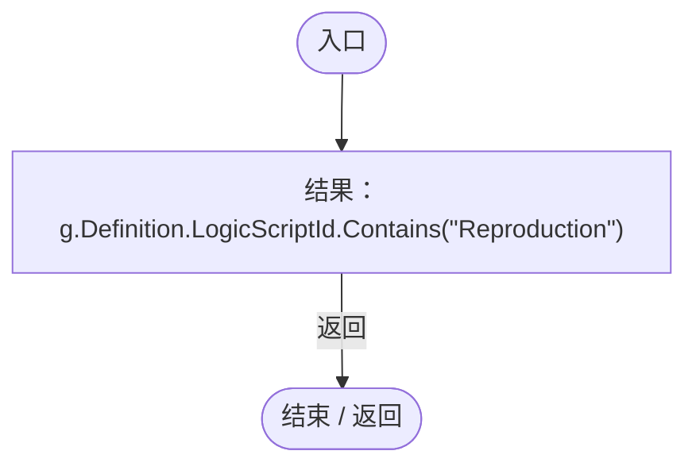

<a id="md759989a76e72fa1"></a>

## 回调@116 · L116

`g … => 回调`


### Editor · Roslyn编译器控制流

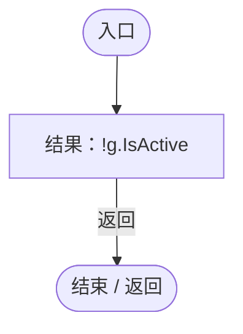

<a id="maaf4975d7d554276"></a>

## 回调@120 · L120

`g … => 回调`


### Editor · Roslyn编译器控制流

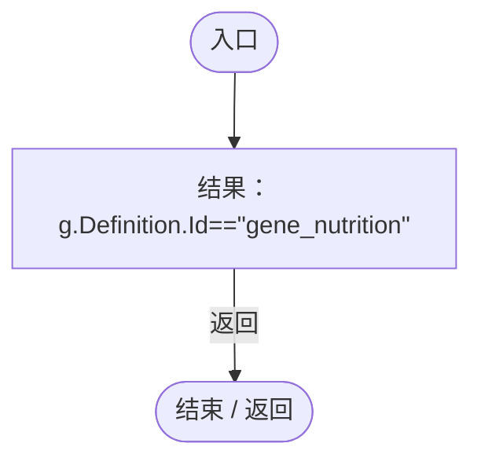

<a id="m86a756cdf39bd3c6"></a>

## 回调@120 · L120

`g … => 回调`


### Editor · Roslyn编译器控制流

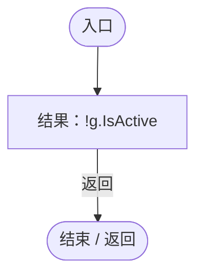

<a id="m28158ef7c12bdd6f"></a>

## 回调@126 · L126

`r … => 回调`


### Editor · Roslyn编译器控制流

```mermaid
flowchart TD
  b0(["入口"])
  b1["结果：r.State.kind==ColonyResourceKind.Corpse"]
  b2(["结束 / 返回"])
  b0 --> b1
  b1 -->|"返回"| b2

```

项目内调用/回调引用：

- [ColonyResource.State.get · L24](293dbaecfff4b585.md#m41824f1a0e160aa5)（访问器）

<a id="m9e57fcff825defe9"></a>

## 回调@132 · L132

`r … => 回调`


### Editor · Roslyn编译器控制流

```mermaid
flowchart TD
  b0(["入口"])
  b1["结果：r.State.kind==ColonyResourceKind.Nursery"]
  b2(["结束 / 返回"])
  b0 --> b1
  b1 -->|"返回"| b2

```

项目内调用/回调引用：

- [ColonyResource.State.get · L24](293dbaecfff4b585.md#m41824f1a0e160aa5)（访问器）

<a id="m5f1ecf230e9f45e8"></a>

## 回调@133 · L133

`r … => 回调`


### Editor · Roslyn编译器控制流

```mermaid
flowchart TD
  b0(["入口"])
  b1["结果：r.State.kind==ColonyResourceKind.Corpse"]
  b2(["结束 / 返回"])
  b0 --> b1
  b1 -->|"返回"| b2

```

项目内调用/回调引用：

- [ColonyResource.State.get · L24](293dbaecfff4b585.md#m41824f1a0e160aa5)（访问器）

<a id="m1f473c208d0c7a26"></a>

## 回调@142 · L142

`r … => 回调`


### Editor · Roslyn编译器控制流

```mermaid
flowchart TD
  b0(["入口"])
  b1["结果：r.State.kind==ColonyResourceKind.Supply"]
  b2(["结束 / 返回"])
  b0 --> b1
  b1 -->|"返回"| b2

```

项目内调用/回调引用：

- [ColonyResource.State.get · L24](293dbaecfff4b585.md#m41824f1a0e160aa5)（访问器）

<a id="m54329ba89dc37ddd"></a>

## 回调@158 · L158

`_ … => 回调`


### Editor · Roslyn编译器控制流

```mermaid
flowchart TD
  b0(["入口"])
  b1["结果：queen.ChooseBirthRole()!=AntRole.Reproductive"]
  b2(["结束 / 返回"])
  b0 --> b1
  b1 -->|"返回"| b2

```

项目内调用/回调引用：

- [AntColonyMember.ChooseBirthRole · L77](baebd85c05598377.md#m26eae840fc994317)（方法）

<a id="mcc1c6a3de112b7e2"></a>

## 回调@164 · L164

`m … => 回调`


### Editor · Roslyn编译器控制流

```mermaid
flowchart TD
  b0(["入口"])
  b1["结果：m.Role==AntRole.Mate"]
  b2(["结束 / 返回"])
  b0 --> b1
  b1 -->|"返回"| b2

```

项目内调用/回调引用：

- [AntColonyMember.Role.get · L38](baebd85c05598377.md#mab30d459d599e4df)（访问器）

<a id="mceda4ac16f7ec528"></a>

## 回调@165 · L165

`g … => 回调`


### Editor · Roslyn编译器控制流

```mermaid
flowchart TD
  b0(["入口"])
  b1["结果：g.Definition.LogicScriptId.Contains(&quot;Reproduction&quot;)"]
  b2(["结束 / 返回"])
  b0 --> b1
  b1 -->|"返回"| b2

```

<a id="m0cb89bb72acb2d4d"></a>

## 回调@165 · L165

`g … => 回调`


### Editor · Roslyn编译器控制流

```mermaid
flowchart TD
  b0(["入口"])
  b1["结果：!g.IsActive"]
  b2(["结束 / 返回"])
  b0 --> b1
  b1 -->|"返回"| b2

```

<a id="mf992b49b786e6904"></a>

## 回调@178 · L178

`r … => 回调`


### Editor · Roslyn编译器控制流

```mermaid
flowchart TD
  b0(["入口"])
  b1["结果：r.id==resourceId"]
  b2(["结束 / 返回"])
  b0 --> b1
  b1 -->|"返回"| b2

```

<a id="mb0650e9ff4dd2b2d"></a>

## 回调@178 · L178

`e … => 回调`


### Editor · Roslyn编译器控制流

```mermaid
flowchart TD
  b0(["入口"])
  b1["结果：e.ecology.id==workerId"]
  b2(["结束 / 返回"])
  b0 --> b1
  b1 -->|"返回"| b2

```

<a id="mfca519d7ec87a870"></a>

## 回调@181 · L181

`m … => 回调`


### Editor · Roslyn编译器控制流

```mermaid
flowchart TD
  b0(["入口"])
  b1["结果：m.Id==workerId"]
  b2(["结束 / 返回"])
  b0 --> b1
  b1 -->|"返回"| b2

```

<a id="m85bd4c095f31e200"></a>

## 回调@181 · L181

`m … => 回调`


### Editor · Roslyn编译器控制流

```mermaid
flowchart TD
  b0(["入口"])
  b1["结果：m.Id==queenId"]
  b2(["结束 / 返回"])
  b0 --> b1
  b1 -->|"返回"| b2

```

<a id="m6c9eb3e9aeb6c1b6"></a>

## 回调@184 · L184

`g … => 回调`


### Editor · Roslyn编译器控制流

```mermaid
flowchart TD
  b0(["入口"])
  b1["结果：g.Definition.LogicScriptId.Contains(&quot;Reproduction&quot;)"]
  b2(["结束 / 返回"])
  b0 --> b1
  b1 -->|"返回"| b2

```

<a id="md4c1cca4636950f7"></a>

## 回调@184 · L184

`g … => 回调`


### Editor · Roslyn编译器控制流

```mermaid
flowchart TD
  b0(["入口"])
  b1["结果：!g.IsActive"]
  b2(["结束 / 返回"])
  b0 --> b1
  b1 -->|"返回"| b2

```

<a id="m320afcf6f8db0ee0"></a>

## 回调@186 · L186

`r … => 回调`


### Editor · Roslyn编译器控制流

```mermaid
flowchart TD
  b0(["入口"])
  b1["结果：r.kind!=ColonyResourceKind.Corpse"]
  b2(["结束 / 返回"])
  b0 --> b1
  b1 -->|"返回"| b2

```

<a id="m2c2a875bec91206b"></a>

## 回调@187 · L187

`r … => 回调`


### Editor · Roslyn编译器控制流

```mermaid
flowchart TD
  b0(["入口"])
  b1{"判断：r.State.kind!=ColonyResourceKind.Corpse"}
  b2{"判断：ColonyResourceOwnership.Available(r,loadedWorker)"}
  b3["ColonyFeeding.AvailableEnergy(r,loadedWorker)&gt;0"]
  b4["r.State.kind!=ColonyResourceKind.Corpse&amp;&amp;ColonyResourceOwnership.Available(r,loadedWorker)&amp;&amp;ColonyFeeding.AvailableEnergy(r,loadedWorker)&gt;0"]
  b5["结果：r.State.kind!=ColonyResourceKind.Corpse&amp;&amp;ColonyResourceOwnership.Available(r,loadedWorker)&amp;&amp;ColonyFeeding.AvailableEnergy(r,loadedWorker)&gt;0"]
  b6(["结束 / 返回"])
  b0 --> b1
  b1 -->|"是"| b2
  b1 -->|"否"| b4
  b2 -->|"是"| b3
  b2 -->|"否"| b4
  b3 --> b5
  b4 --> b5
  b5 -->|"返回"| b6

```

项目内调用/回调引用：

- [ColonyResource.State.get · L24](293dbaecfff4b585.md#m41824f1a0e160aa5)（访问器）
- [ColonyResourceOwnership.Available · L23](2988679fde59fc87.md#ma3b7caf13a1f8423)（方法）
- [ColonyFeeding.AvailableEnergy · L29](2cb56c08d08ff8ec.md#m39bf48fc3c592882)（方法）

<a id="md0eb2da2df6c223d"></a>

## 回调@192 · L192

`m … => 回调`


### Editor · Roslyn编译器控制流

```mermaid
flowchart TD
  b0(["入口"])
  b1["结果：m.Id==carrierId"]
  b2(["结束 / 返回"])
  b0 --> b1
  b1 -->|"返回"| b2

```

<a id="m94e04794634c64c4"></a>

## 回调@198 · L198

`c … => 回调`


### Editor · Roslyn编译器控制流

```mermaid
flowchart TD
  b0(["入口"])
  b1["结果：Vector3.Distance(new Vector3(c.r,c.g,c.b),(Vector3)(Vector4)ColonyAppearance.ColorFor(group))&lt;.001f"]
  b2(["结束 / 返回"])
  b0 --> b1
  b1 -->|"返回"| b2

```

项目内调用/回调引用：

- [ColonyAppearance.ColorFor · L9](e51c7c842d87a26d.md#m0ea090c43edf8334)（方法）
