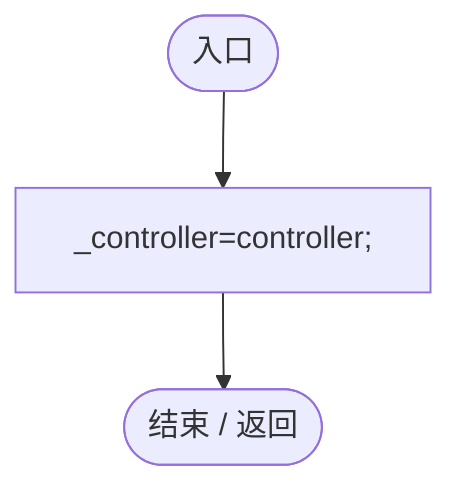
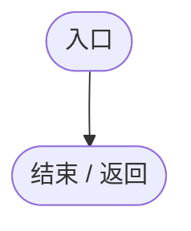
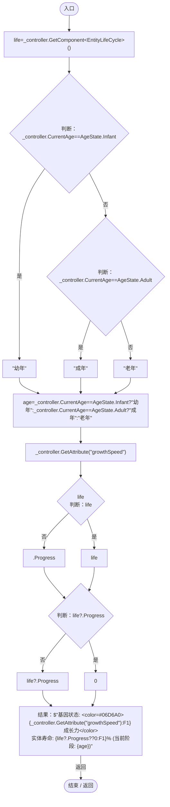

# GrowthGeneLogic.cs

[返回总索引](../README.md) · `Runtime` · `Assets/DarwinPark/Entities/Logic/GrowthGeneLogic.cs`

[源文件](../../../Assets/DarwinPark/Entities/Logic/GrowthGeneLogic.cs) · 源码校验：`eed3d0b13de06bde44ec5b121f3e5bf42292df3139d398d5778f617180ec8374`

方法按源文件位置排列。事件/回调引用不表示立即执行；分支与异常说明见总索引。完整源码与可点击关系图请打开离线手册。

## Initialize · L10

`public void Initialize(EntityGeneController controller,GeneInstance gene)`

### Editor / Player · Roslyn编译器控制流

## OnUpdate · L11

`public void OnUpdate(float dt)`

### Editor / Player · Roslyn编译器控制流

## GetTooltipInfo · L12

`public string GetTooltipInfo()`

### Editor / Player · Roslyn编译器控制流

项目内调用/回调引用：

- [EntityGeneController.CurrentAge.get · L35](7494d53178552f0e.md#mf5bc28691dd4a0f3)（访问器）
- [EntityGeneController.GetAttribute · L225](7494d53178552f0e.md#mc707943b1138a009)（方法）
- [EntityLifeCycle.Progress.get · L10](9f4138bfbae654b7.md#m178185fd5f5a0d74)（访问器）
