# EntityFilterResultsUI.cs

[返回总索引](../README.md) · `Runtime` · `Assets/DarwinPark/UI/EntityFilterResultsUI.cs`

[源文件](../../../Assets/DarwinPark/UI/EntityFilterResultsUI.cs) · 源码校验：`f0347b03ef0457d254ae0d9df9188e7fea2d15c20fa9a2bb1e638981b2608c3a`

方法按源文件位置排列。事件/回调引用不表示立即执行；分支与异常说明见总索引。完整源码与可点击关系图请打开离线手册。

<a id="m32e9a65166812869"></a>

## Page.get · L15

`get`


### Editor / Player · 语法控制结构 / 声明（非CFG）


<a id="ma785882cf0f59a47"></a>

## Page.set · L15

`private set`


### Editor / Player · 语法控制结构 / 声明（非CFG）


<a id="m961867966ccb08a5"></a>

## PageCount.get · L16

`public int PageCount`


### Editor / Player · 语法控制结构 / 声明（非CFG）

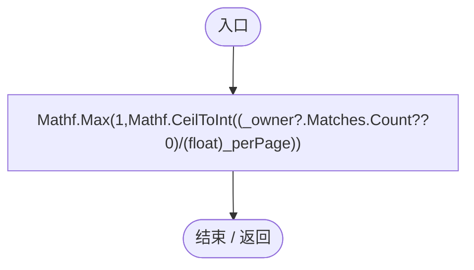

<a id="mba03fbccdafe971d"></a>

## VisibleRowCount.get · L17

`get`


### Editor / Player · 语法控制结构 / 声明（非CFG）

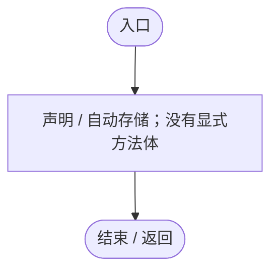

<a id="mcceb574229de2896"></a>

## VisibleRowCount.set · L17

`private set`


### Editor / Player · 语法控制结构 / 声明（非CFG）


<a id="m9797eccf7c356982"></a>

## Visible.get · L18

`public bool Visible`


### Editor / Player · 语法控制结构 / 声明（非CFG）

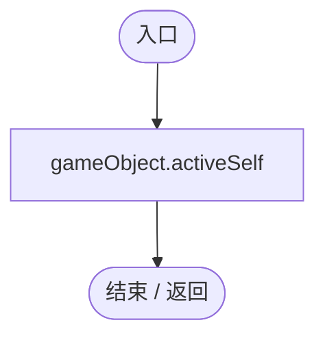

<a id="m3619466dbcbdd0b5"></a>

## Create · L19

`public static EntityFilterResultsUI Create(MapEntityGeneFilterUI owner)`


### Editor / Player · Roslyn编译器控制流

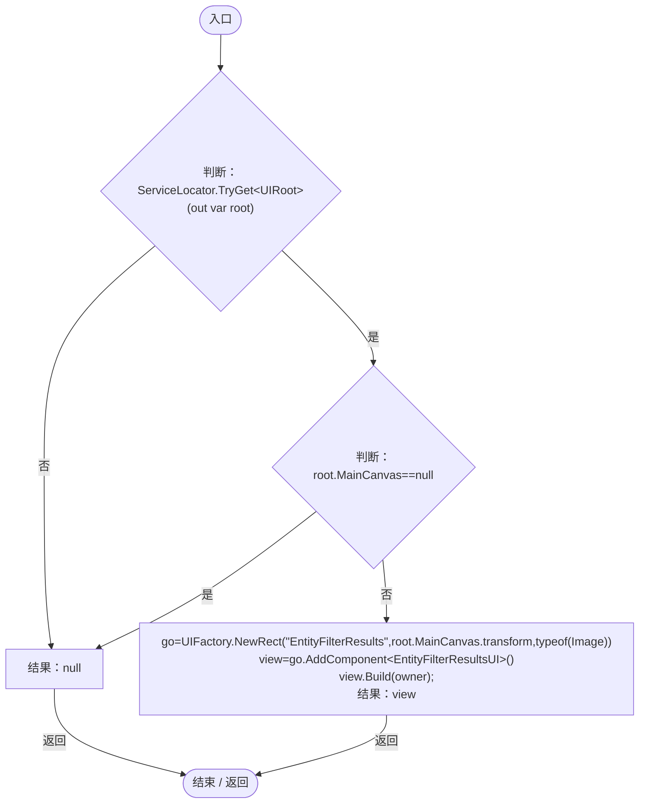

项目内调用/回调引用：

- [ServiceLocator.TryGet · L26](f2fdbe9f9ccd93cb.md#m143b24e6d58471b0)（方法）
- [UIRoot.MainCanvas.get · L14](9c1421378791f0e0.md#maa2cc9baf1248477)（访问器）
- [UIFactory.NewRect · L33](dd1096a6995423db.md#med612116f3152344)（方法）
- [EntityFilterResultsUI.Build · L25](1376ad45671e7435.md#m0afcec84dbef1d53)（方法）

<a id="m0afcec84dbef1d53"></a>

## Build · L25

`private void Build(MapEntityGeneFilterUI owner)`


### Editor / Player · Roslyn编译器控制流

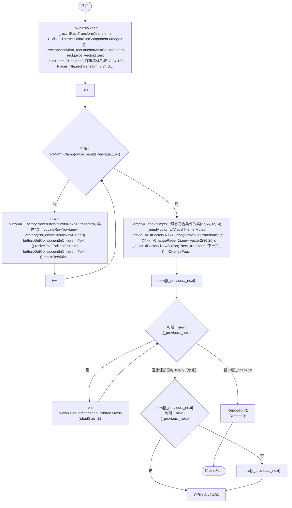

项目内调用/回调引用：

- [UIVisualTheme.Paint · L58](ca525a798a08f966.md#m2d61a6b26ab24980)（方法）
- [EntityFilterResultsUI.Label · L45](1376ad45671e7435.md#m613a4be7851b87b4)（方法）
- [EntityFilterResultsUI.Place · L47](1376ad45671e7435.md#m52652fb8f1d2783a)（方法）
- [UIFactory.NewButton · L73](dd1096a6995423db.md#m5896f1b097c8bdde)（方法）
- [EntityFilterResultsUI.Reposition · L75](1376ad45671e7435.md#m2e1594deac610fe5)（方法）
- [EntityFilterResultsUI.Refresh · L57](1376ad45671e7435.md#m9fdc9b5605562307)（方法）
- [EntityFilterResultsUI.回调@35 · L35](1376ad45671e7435.md#ma93b49d0864758c1)（回调/委托）
- [EntityFilterResultsUI.回调@37 · L37](1376ad45671e7435.md#m774ce5f8890400a1)（回调/委托）
- [EntityFilterResultsUI.回调@40 · L40](1376ad45671e7435.md#m99209e01c1ff122a)（回调/委托）
- [EntityFilterResultsUI.回调@41 · L41](1376ad45671e7435.md#m872df60dfbbfce90)（回调/委托）
- [EntityFilterResultsUI.Hide · L50](1376ad45671e7435.md#m55f0ffeb5db522f3)（方法）

<a id="ma93b49d0864758c1"></a>

## 回调@35 · L35

`( … => 回调`


### Editor / Player · Roslyn编译器控制流

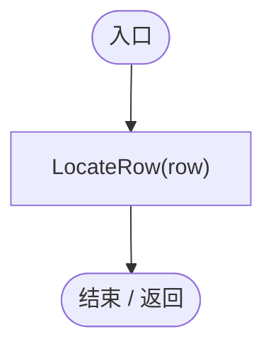

项目内调用/回调引用：

- [EntityFilterResultsUI.LocateRow · L52](1376ad45671e7435.md#m8fb9e38900bf1247)（方法）

<a id="m774ce5f8890400a1"></a>

## 回调@37 · L37

`( … => 回调`


### Editor / Player · Roslyn编译器控制流

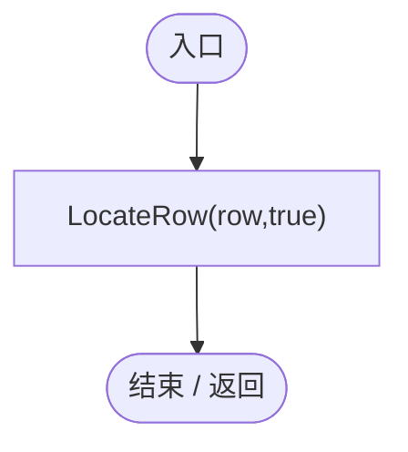

项目内调用/回调引用：

- [EntityFilterResultsUI.LocateRow · L52](1376ad45671e7435.md#m8fb9e38900bf1247)（方法）

<a id="m99209e01c1ff122a"></a>

## 回调@40 · L40

`( … => 回调`


### Editor / Player · Roslyn编译器控制流


项目内调用/回调引用：

- [EntityFilterResultsUI.ChangePage · L51](1376ad45671e7435.md#m460425c12a49288e)（方法）

<a id="m872df60dfbbfce90"></a>

## 回调@41 · L41

`( … => 回调`


### Editor / Player · Roslyn编译器控制流

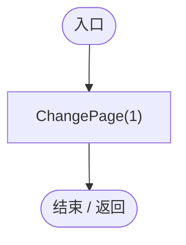

项目内调用/回调引用：

- [EntityFilterResultsUI.ChangePage · L51](1376ad45671e7435.md#m460425c12a49288e)（方法）

<a id="m613a4be7851b87b4"></a>

## Label · L45

`private Text Label(string name,string text,float y,float height,int size)`


### Editor / Player · Roslyn编译器控制流

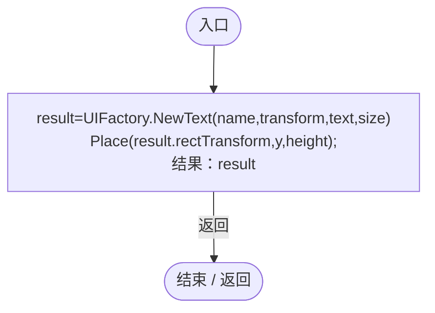

项目内调用/回调引用：

- [UIFactory.NewText · L57](dd1096a6995423db.md#m9dbccb5f0c38189e)（方法）
- [EntityFilterResultsUI.Place · L47](1376ad45671e7435.md#m52652fb8f1d2783a)（方法）

<a id="m52652fb8f1d2783a"></a>

## Place · L47

`private static void Place(RectTransform rect,float y,float height,float left=0,float right=1)`


### Editor / Player · Roslyn编译器控制流

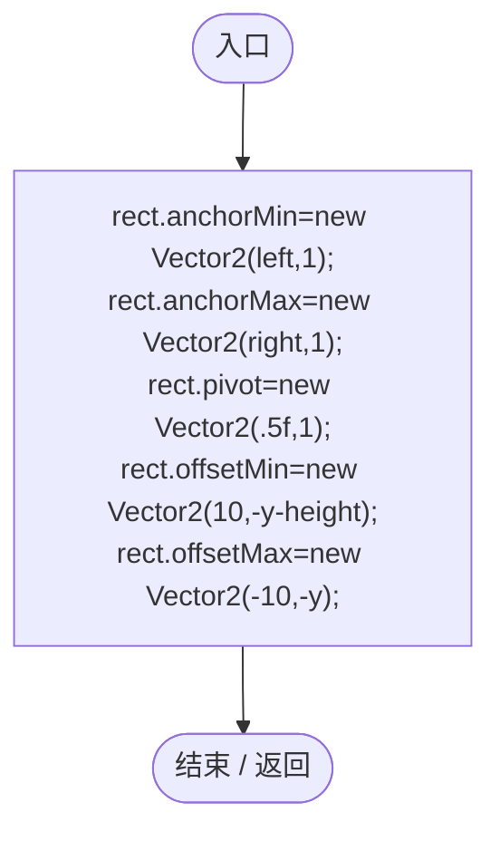

<a id="m914d9f8df129e6c5"></a>

## Show · L49

`public void Show()`


### Editor / Player · Roslyn编译器控制流

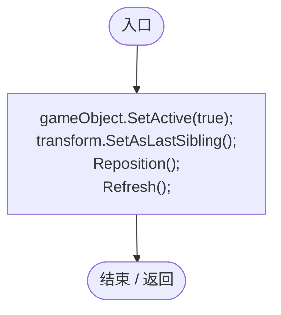

项目内调用/回调引用：

- [EntityFilterResultsUI.Reposition · L75](1376ad45671e7435.md#m2e1594deac610fe5)（方法）
- [EntityFilterResultsUI.Refresh · L57](1376ad45671e7435.md#m9fdc9b5605562307)（方法）

<a id="m55f0ffeb5db522f3"></a>

## Hide · L50

`public void Hide()`


### Editor / Player · Roslyn编译器控制流

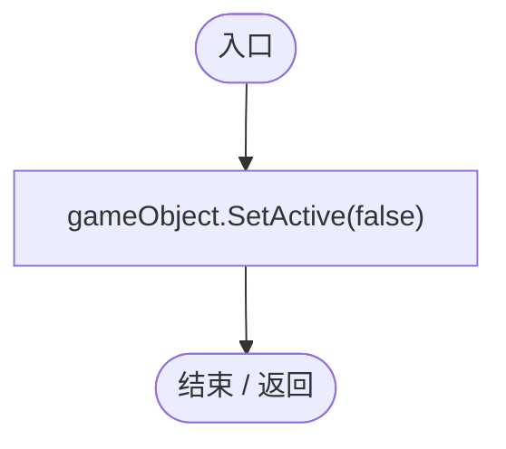

<a id="m460425c12a49288e"></a>

## ChangePage · L51

`public void ChangePage(int delta)`


### Editor / Player · Roslyn编译器控制流

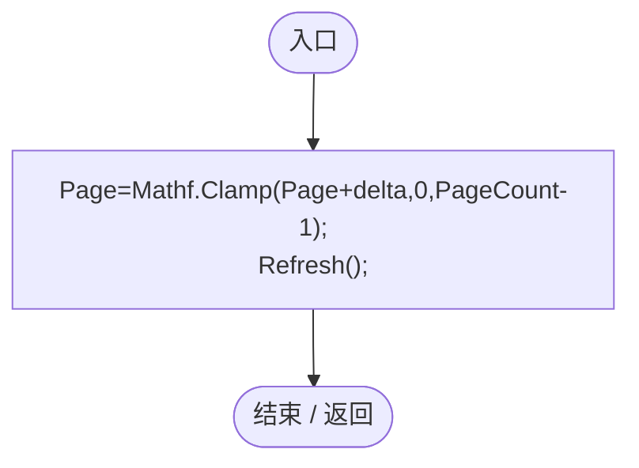

项目内调用/回调引用：

- [EntityFilterResultsUI.Page.set · L15](1376ad45671e7435.md#ma785882cf0f59a47)（访问器）
- [EntityFilterResultsUI.Page.get · L15](1376ad45671e7435.md#m32e9a65166812869)（访问器）
- [EntityFilterResultsUI.Refresh · L57](1376ad45671e7435.md#m9fdc9b5605562307)（方法）

<a id="m8fb9e38900bf1247"></a>

## LocateRow · L52

`public bool LocateRow(int row,bool inspect=false)`


### Editor / Player · Roslyn编译器控制流

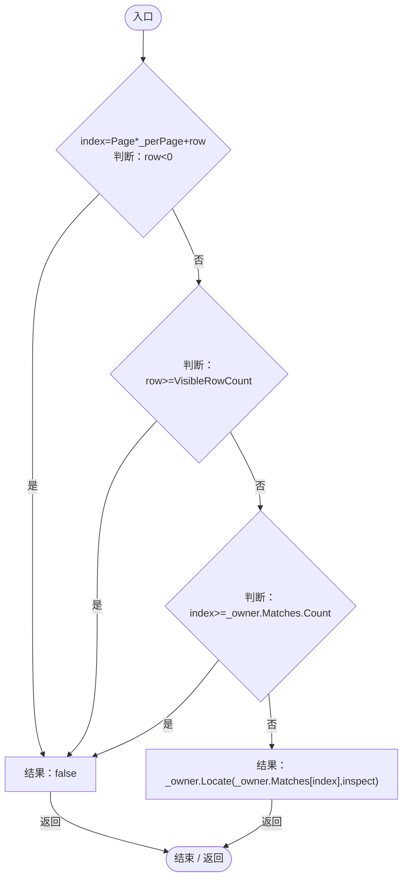

项目内调用/回调引用：

- [EntityFilterResultsUI.Page.get · L15](1376ad45671e7435.md#m32e9a65166812869)（访问器）
- [EntityFilterResultsUI.VisibleRowCount.get · L17](1376ad45671e7435.md#mba03fbccdafe971d)（访问器）
- [MapEntityGeneFilterUI.Locate · L121](c2cd33111de06171.md#me05bb48415da55d6)（方法）

<a id="m9fdc9b5605562307"></a>

## Refresh · L57

`public void Refresh()`


### Editor / Player · Roslyn编译器控制流

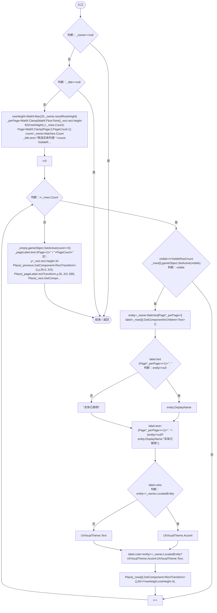

项目内调用/回调引用：

- [EntityFilterResultsUI.Page.set · L15](1376ad45671e7435.md#ma785882cf0f59a47)（访问器）
- [EntityFilterResultsUI.Page.get · L15](1376ad45671e7435.md#m32e9a65166812869)（访问器）
- [EntityFilterResultsUI.VisibleRowCount.set · L17](1376ad45671e7435.md#mcceb574229de2896)（访问器）
- [EntityFilterResultsUI.VisibleRowCount.get · L17](1376ad45671e7435.md#mba03fbccdafe971d)（访问器）
- [MapEntityGeneFilterUI.LocatedEntity.get · L23](c2cd33111de06171.md#me3f26f9663c4ac0e)（访问器）
- [EntityFilterResultsUI.Place · L47](1376ad45671e7435.md#m52652fb8f1d2783a)（方法）

<a id="m1724e3ca3271d6e1"></a>

## LateUpdate · L74

`private void LateUpdate()`


### Editor / Player · Roslyn编译器控制流

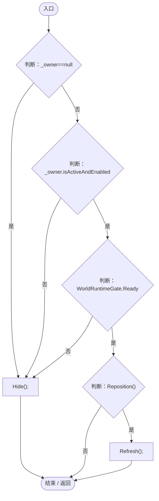

项目内调用/回调引用：

- [EntityFilterResultsUI.Hide · L50](1376ad45671e7435.md#m55f0ffeb5db522f3)（方法）
- [EntityFilterResultsUI.Reposition · L75](1376ad45671e7435.md#m2e1594deac610fe5)（方法）
- [EntityFilterResultsUI.Refresh · L57](1376ad45671e7435.md#m9fdc9b5605562307)（方法）

<a id="m2e1594deac610fe5"></a>

## Reposition · L75

`private bool Reposition()`


### Editor / Player · Roslyn编译器控制流

```mermaid
flowchart TD
  b0(["入口"])
  b1["height=Mathf.Min(_owner.resultWindowSize.y,Mathf.Max(_owner.minimumResultHeight,92+Mathf.Min(_owner.Matches.Count,_owner.resultsPerPage)*Mathf.Max(20,_owner.resultRowHeight)))<br/>canvas=(RectTransform)transform.parent<br/>size=Vector2.Min(new V…"]
  b2{"判断：_owner.WideLayout"}
  b3{"判断：_owner.Card!=null"}
  b4["_owner.Card"]
  b5["(RectTransform)_owner.transform"]
  b6["source=_owner.WideLayout&amp;&amp;_owner.Card!=null?_owner.Card:(RectTransform)_owner.transform"]
  b7{"source.GetWorldCorners(_corners);<br/>corner=(Vector2)canvas.InverseTransformPoint(_corners[1])-canvas.rect.min<br/>point=new Vector2(Mathf.Clamp(corner.x,12,Mathf.Max(12,canvas.rect.width-size.x-12)),Mathf.Clamp(corner.y+_owner.gap,12,Mathf.Max…"}
  b8["_rect.sizeDelta=size;"]
  b9{"判断：_rect.anchoredPosition!=point"}
  b10["_rect.anchoredPosition=point;"]
  b11["结果：changed"]
  b12(["结束 / 返回"])
  b0 --> b1
  b1 --> b2
  b2 -->|"是"| b3
  b2 -->|"否"| b5
  b3 -->|"是"| b4
  b3 -->|"否"| b5
  b4 --> b6
  b5 --> b6
  b6 --> b7
  b7 -->|"是"| b8
  b7 -->|"否"| b9
  b8 --> b9
  b9 -->|"是"| b10
  b9 -->|"否"| b11
  b10 --> b11
  b11 -->|"返回"| b12

```

项目内调用/回调引用：

- [MapEntityGeneFilterUI.WideLayout.get · L24](c2cd33111de06171.md#m02705633cd4835e0)（访问器）
