# LanMultiplayerRegression.cs

[返回总索引](../README.md) · `Editor` · `Assets/DarwinPark/Editor/LanMultiplayerRegression.cs`

[源文件](../../../Assets/DarwinPark/Editor/LanMultiplayerRegression.cs) · 源码校验：`a104e371473196564a25cf2c33c21f648e12719c7d1f140d25cdfb945eddce1b`

方法按源文件位置排列。事件/回调引用不表示立即执行；分支与异常说明见总索引。完整源码与可点击关系图请打开离线手册。

<a id="m62262354f8780c69"></a>

## Role.get · L28

`private static string Role`


### Editor · 语法控制结构 / 声明（非CFG）

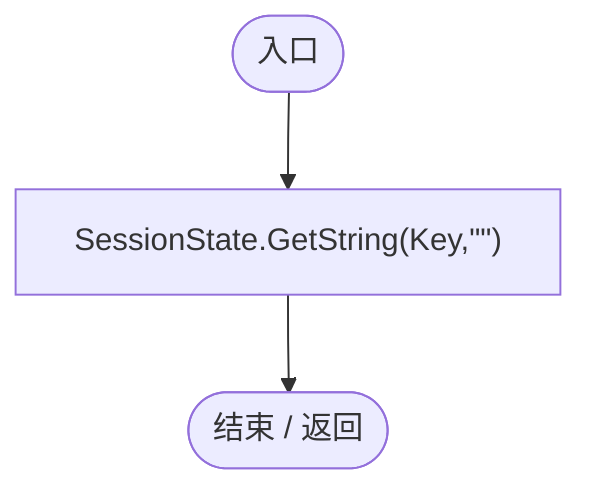

<a id="ma8b2cd24f9638fe3"></a>

## Root.get · L30

`get`


### Editor · Roslyn编译器控制流

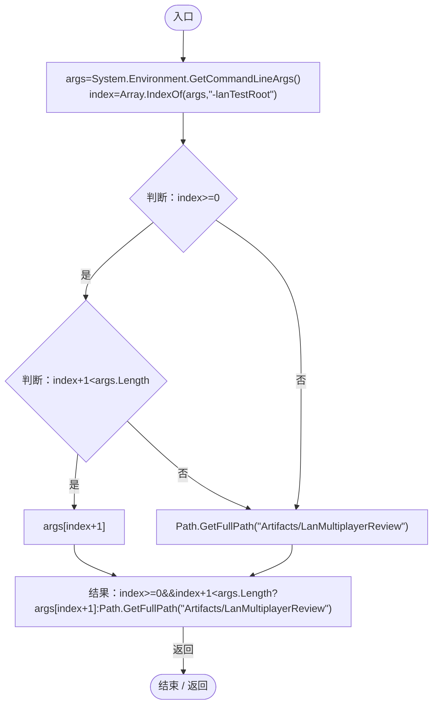

<a id="mb0d1be0e271a6c59"></a>

## LanMultiplayerRegression.ctor · L31

`static LanMultiplayerRegression()`


### Editor · Roslyn编译器控制流

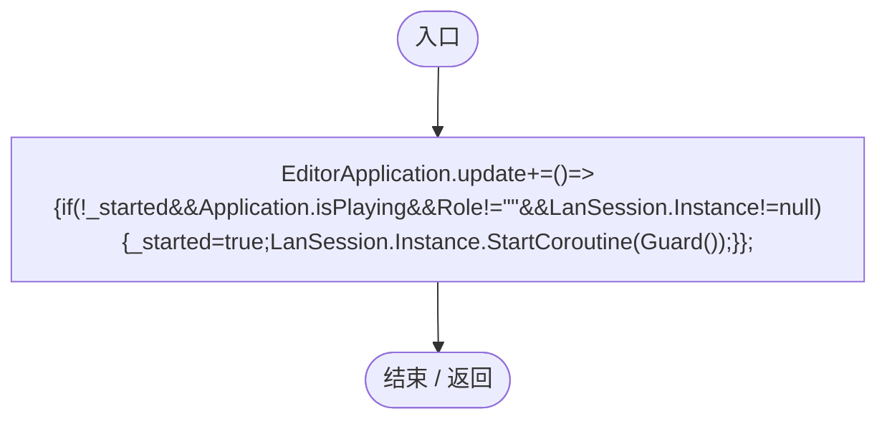

项目内调用/回调引用：

- [LanMultiplayerRegression.回调@31 · L31](140d316a72ec89d5.md#m943cecb557a2d2bd)（回调/委托）

<a id="m943cecb557a2d2bd"></a>

## 回调@31 · L31

`( … => 回调`


### Editor · Roslyn编译器控制流

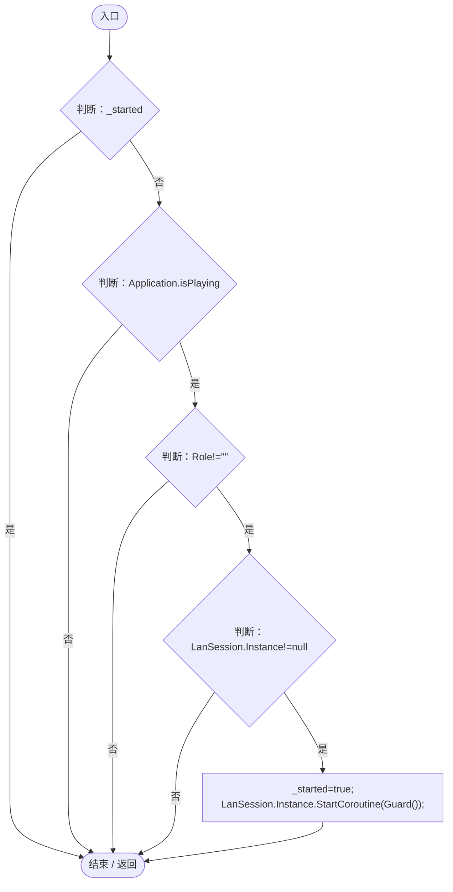

项目内调用/回调引用：

- [LanSession.Instance.get · L23](9fb633eebffe669c.md#mbf83306994878383)（访问器）
- [LanMultiplayerRegression.Guard · L37](140d316a72ec89d5.md#m5b25a075d8853e38)（方法）

<a id="m8f959d96887cd684"></a>

## RunHost · L32

`public static void RunHost()`


### Editor · Roslyn编译器控制流

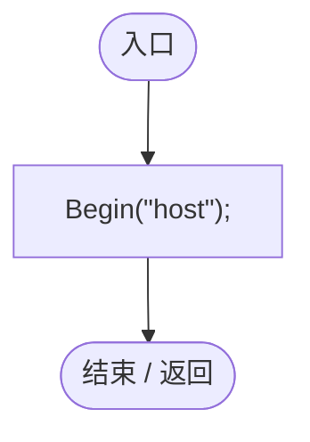

项目内调用/回调引用：

- [LanMultiplayerRegression.Begin · L33](140d316a72ec89d5.md#m18f0464344e87b09)（方法）

<a id="mfb5bde225157cf90"></a>

## RunClient · L32

`public static void RunClient()`


### Editor · Roslyn编译器控制流

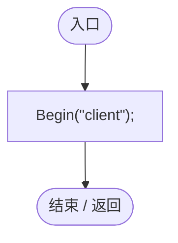

项目内调用/回调引用：

- [LanMultiplayerRegression.Begin · L33](140d316a72ec89d5.md#m18f0464344e87b09)（方法）

<a id="m18f0464344e87b09"></a>

## Begin · L33

`private static void Begin(string role)`


### Editor · Roslyn编译器控制流

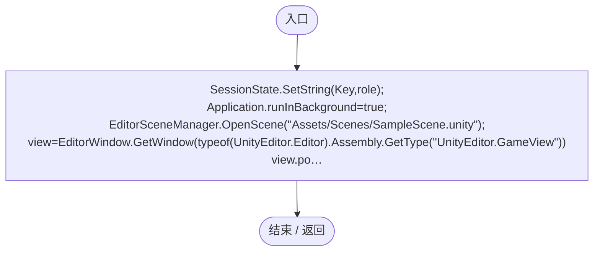

<a id="m14e3c823ac2e0561"></a>

## Check · L34

`private static void Check(bool condition,string text)`


### Editor · Roslyn编译器控制流

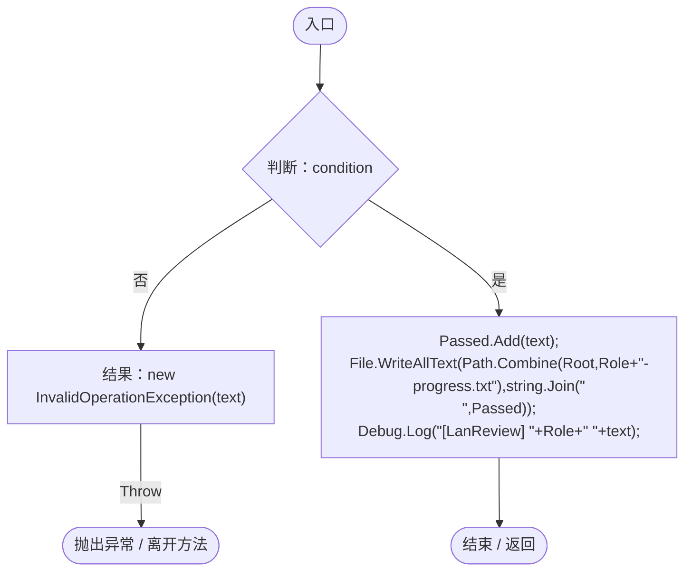

项目内调用/回调引用：

- [LanMultiplayerRegression.Root.get · L30](140d316a72ec89d5.md#ma8b2cd24f9638fe3)（访问器）

<a id="m6a4e431c3dc057c4"></a>

## Wait · L35

`private static IEnumerator Wait(Func<bool> predicate,string message,double timeout=60)`


### Editor · Roslyn编译器控制流

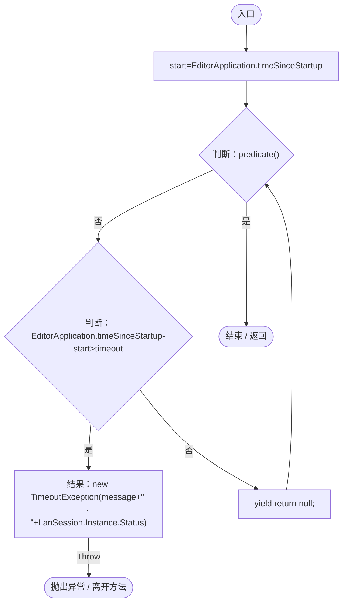

项目内调用/回调引用：

- [LanSession.Status.get · L31](9fb633eebffe669c.md#md8607b7380abb030)（访问器）
- [LanSession.Instance.get · L23](9fb633eebffe669c.md#mbf83306994878383)（访问器）

<a id="m5b25a075d8853e38"></a>

## Guard · L37

`private static IEnumerator Guard()`


### Editor · Roslyn编译器控制流

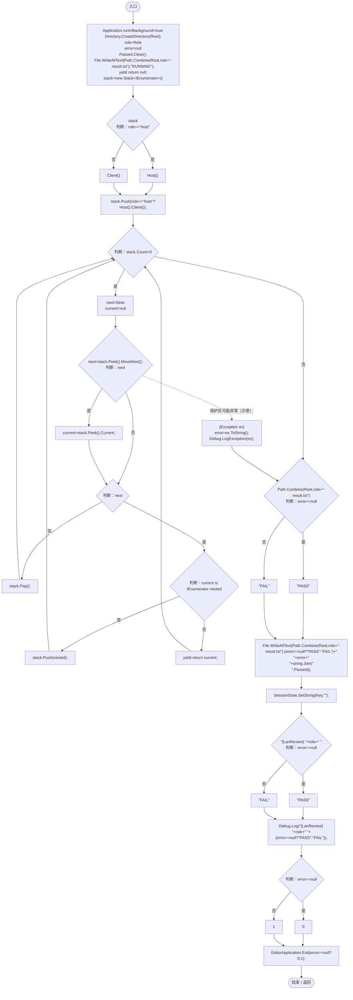

项目内调用/回调引用：

- [LanMultiplayerRegression.Root.get · L30](140d316a72ec89d5.md#ma8b2cd24f9638fe3)（访问器）
- [LanMultiplayerRegression.Host · L54](140d316a72ec89d5.md#me26d87631f686a75)（方法）
- [LanMultiplayerRegression.Client · L89](140d316a72ec89d5.md#m2a728b6ce12d4271)（方法）

<a id="ma6c255c208592795"></a>

## Spawn · L48

`private static DarwinEntity Spawn(Vector3 point,params string[] ids)`


### Editor · Roslyn编译器控制流

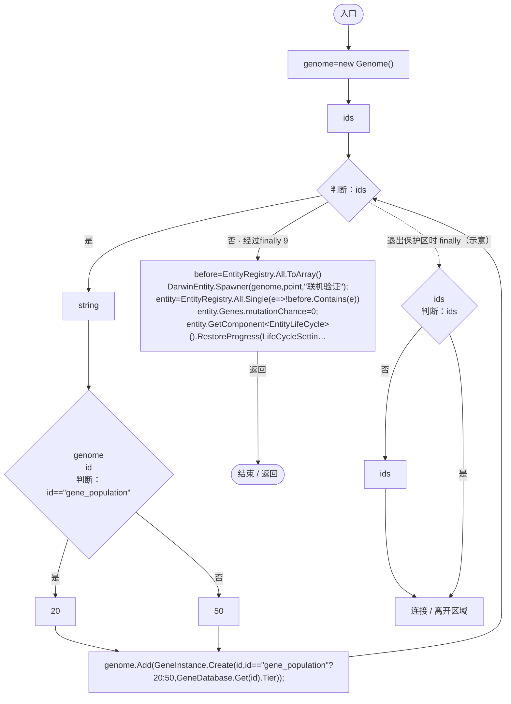

项目内调用/回调引用：

- [Genome.Add · L19](a2ef23f865bc7ee8.md#md9cfdc94b8b8d40f)（方法）
- [GeneInstance.Create · L20](f82e1498d67f5afd.md#m72e94c278de3cf8b)（方法）
- [GeneDatabase.Get · L135](ec0a03483435a863.md#m8f3bbfb35f3ca397)（方法）
- [DarwinEntity.Genes.get · L14](70798dde169f2e8b.md#m622eb1adf401d431)（访问器）
- [EntityLifeCycle.RestoreProgress · L48](9f4138bfbae654b7.md#mfc75121476d49679)（方法）
- [LifeCycleSettings.Load · L16](ace76969fe8f61de.md#mbd2925785484f343)（方法）
- [EntityGeneController.RestoreStageState · L51](7494d53178552f0e.md#m6264213de2a5ca6f)（方法）
- [EntityGeneController.Recalculate · L97](7494d53178552f0e.md#m65ea735c1e0e37a1)（方法）
- [EntityStats.Modify · L111](75aa86a368efdf24.md#m9c837be197158240)（方法）
- [LanMultiplayerRegression.回调@50 · L50](140d316a72ec89d5.md#mfe20d8e62a406f28)（回调/委托）

<a id="mfe20d8e62a406f28"></a>

## 回调@50 · L50

`e … => 回调`


### Editor · Roslyn编译器控制流

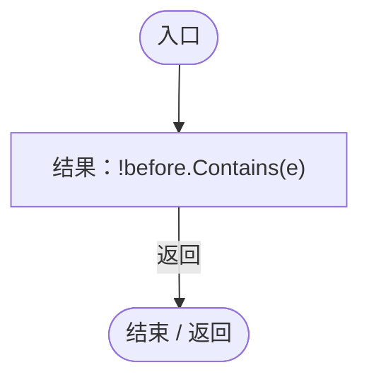

<a id="me26d87631f686a75"></a>

## Host · L54

`private static IEnumerator Host()`


### Editor · Roslyn编译器控制流

```mermaid
flowchart TD
  b0(["入口"])
  b1["world=Object.FindFirstObjectByType&lt;WorldSessionManager&gt;()<br/>planet=Object.FindFirstObjectByType&lt;PlanetTerrainMeshBuilder&gt;()<br/>clock=ServiceLocator.Get&lt;SimulationClock&gt;()<br/>net=LanSession.Instance<br/>yield return new WaitForEndOfFrame();<br/>ScreenCap…"]
  b2["i=0"]
  b3{"判断：i&lt;192"}
  b4{"y=1-2*(i+.5f)/192<br/>angle=i*2.399963f<br/>dir=new Vector3(Mathf.Sqrt(1-y*y)*Mathf.Cos(angle),y,Mathf.Sqrt(1-y*y)*Mathf.Sin(angle))<br/>point=EcologyQueries.Surface(planet.transform.position+dir*(planet.radius+planet.heightScale))<br/>判断：(point-planet.…"}
  b5["home=point;"]
  b6["i++"]
  b7{"Check(home!=Vector3.zero,&quot;房主建立真实陆地世界&quot;);<br/>up=EcologyQueries.Up(home)<br/>axis=Vector3.Cross(up,Vector3.forward).normalized<br/>判断：axis.sqrMagnitude&lt;.1f"}
  b8["axis=Vector3.Cross(up,Vector3.right).normalized;"]
  b9["at=distance=&gt;EcologyQueries.Surface(home+axis*distance)<br/>queen=Spawn(at(0),&quot;gene_growth&quot;,&quot;gene_population&quot;)<br/>soldier=Spawn(at(5),&quot;gene_growth&quot;,&quot;gene_population&quot;)<br/>worker=Spawn(at(8),&quot;gene_growth&quot;,&quot;gene_population&quot;)<br/>foreign=Spawn(at(110),&quot;ge…"]
  b10{"判断：RtsOrderController.Supports(worker,RtsOrderKind.Attack)"}
  b11{"判断：RtsOrderController.Supports(worker,RtsOrderKind.Collect)"}
  b12["!RtsOrderController.Supports(queen,RtsOrderKind.Attack)"]
  b13["!RtsOrderController.Supports(worker,RtsOrderKind.Attack)&amp;&amp;RtsOrderController.Supports(worker,RtsOrderKind.Collect)&amp;&amp;!RtsOrderController.Supports(queen,RtsOrderKind.Attack)"]
  b14["Check(!RtsOrderController.Supports(worker,RtsOrderKind.Attack)&amp;&amp;RtsOrderController.Supports(worker,RtsOrderKind.Collect)&amp;&amp;!RtsOrderController.Supports(queen,RtsOrderKind.Attack),&quot;RTS扩展能力受工匠和王后基因限制&quot;);"]
  b15["victim=Spawn(at(12),&quot;gene_growth&quot;)<br/>attack=RtsOrderController.Ensure(soldier)<br/>Check(attack.Issue(RtsOrderKind.Attack,victim.transform.position,victim),&quot;攻击指令使用真实可攻击目标&quot;);<br/>victim.GetComponent&lt;EntityStats&gt;().Modify(&quot;health&quot;,-100,false);"]
  b16{"判断：attack.Destination(out _,out _)"}
  b17["!attack.State.active"]
  b18["!attack.Destination(out _,out _)"]
  b19["Check(!attack.Destination(out _,out _)&amp;&amp;!attack.State.active,&quot;目标死亡取消RTS攻击&quot;);"]
  b20["victim.gameObject.SetActive(false);<br/>Object.Destroy(victim.gameObject);"]
  b21["new ColonyResourceSave{id=Guid.NewGuid().ToString(&quot;N&quot;),group=group,kind=ColonyResourceKind.Corpse,energy=10,scale=Vector3.one,local=EcologyQueries.ToLocal(worker.transform.position)}<br/>id=Guid.NewGuid().ToString(&quot;N&quot;)<br/>group=group<br/>kind=Colon…"]
  b22{"判断：RtsOrderController.Ensure(worker).Issue(RtsOrderKind.Collect,corpse.transform.position,null,corpse)"}
  b23["worker.GetComponent&lt;AntColonyMember&gt;().State.resourceTarget==corpse.State.id"]
  b24["RtsOrderController.Ensure(worker).Issue(RtsOrderKind.Collect,corpse.transform.position,null,corpse)"]
  b25["Check(RtsOrderController.Ensure(worker).Issue(RtsOrderKind.Collect,corpse.transform.position,null,corpse)&amp;&amp;worker.GetComponent&lt;AntColonyMember&gt;().State.resourceTarget==corpse.State.id,&quot;工匠RTS采集接入原独占搬运任务&quot;);"]
  b26["worker.GetComponent&lt;AntColonyMember&gt;().Suspend();<br/>corpse.Remove();<br/>origin=soldier.transform.position<br/>net.IssueRts(new[]{EcologyIdentity.Of(soldier)},RtsOrderKind.Move,at(16));<br/>clock.Play();<br/>yield return Wait(()=&gt;EcologyQueries.Distance(o…"]
  b27{"判断：net.StartHost(0,false)"}
  b28{"判断：net.IsHost"}
  b29["net.CanManage"]
  b30["net.StartHost(0,false)&amp;&amp;net.IsHost&amp;&amp;net.CanManage"]
  b31["Check(net.StartHost(0,false)&amp;&amp;net.IsHost&amp;&amp;net.CanManage,&quot;房主打开真实TCP服务并保有唯一管理员权限&quot;);"]
  b32["clock.Play();"]
  b33["new Fixture{port=net.Port,queen=EcologyIdentity.Of(queen),soldier=EcologyIdentity.Of(soldier),worker=EcologyIdentity.Of(worker),foreign=EcologyIdentity.Of(foreign),editor=EcologyIdentity.Of(editor),gene=editor.Genes.Genome.Genes[0].Insta…"]
  b34["File.WriteAllText(Path.Combine(Root,&quot;fixture.json&quot;),JsonUtility.ToJson(fixture));<br/>yield return Wait(()=&gt;File.Exists(Path.Combine(Root,&quot;basic-done&quot;)),&quot;等待成员权限和王后RTS验证&quot;,180);"]
  b35{"判断：net.MemberCount==1"}
  b36{"判断：net.Players.Count(p=&gt;p.administrator)==1"}
  b37["net.RejectedCommands&gt;=3"]
  b38["net.MemberCount==1&amp;&amp;net.Players.Count(p=&gt;p.administrator)==1&amp;&amp;net.RejectedCommands&gt;=3"]
  b39["Check(net.MemberCount==1&amp;&amp;net.Players.Count(p=&gt;p.administrator)==1&amp;&amp;net.RejectedCommands&gt;=3,&quot;服务端拒绝越权请求且始终只有一名管理员&quot;);"]
  b40["menu=Object.FindFirstObjectByType&lt;GameMainMenu&gt;()<br/>menu.ShowPause();<br/>time=clock.GameTime<br/>yield return new WaitForSecondsRealtime(.5f);<br/>Check(clock.GameTime&gt;time,&quot;房主打开Esc菜单不暂停其他玩家的世界&quot;);<br/>net.SetCheats(true);<br/>yield return Wait(()=&gt;File.Exist…"]
  b41{"判断：editor.Genes.Genome.Find(fixture.gene).Value==61"}
  b42["editor.Genes.Genome.HasDefinition(&quot;gene_repair&quot;)"]
  b43["editor.Genes.Genome.Find(fixture.gene).Value==61"]
  b44["Check(editor.Genes.Genome.Find(fixture.gene).Value==61&amp;&amp;editor.Genes.Genome.HasDefinition(&quot;gene_repair&quot;),&quot;作弊成员的修改和添加基因实际在房主生效&quot;);"]
  b45{"判断：EntityPopulationLimit.Maximum==60"}
  b46["WorldSaveStore.Read(WorldSaveStore.FileFor(world.Current.id)).gameSettings.entityLimit==60"]
  b47["EntityPopulationLimit.Maximum==60"]
  b48["Check(EntityPopulationLimit.Maximum==60&amp;&amp;WorldSaveStore.Read(WorldSaveStore.FileFor(world.Current.id)).gameSettings.entityLimit==60,&quot;远端实体上限由房主实际写盘&quot;);"]
  b49["net.SetCheats(false);<br/>yield return Wait(()=&gt;File.Exists(Path.Combine(Root,&quot;client-left&quot;)),&quot;等待成员退出&quot;,60);<br/>yield return Wait(()=&gt;net.MemberCount==0,&quot;释放连接&quot;,15);"]
  b50{"editor.GetComponent&lt;EntityManualControl&gt;()<br/>判断：editor.GetComponent&lt;EntityManualControl&gt;()"}
  b51[".IsControlled"]
  b52["editor.GetComponent&lt;EntityManualControl&gt;()"]
  b53["Check(editor.GetComponent&lt;EntityManualControl&gt;()?.IsControlled!=true,&quot;成员断线后服务端释放所占实体&quot;);"]
  b54["world.SaveNow(false);<br/>saved=WorldSaveStore.Read(WorldSaveStore.FileFor(world.Current.id));<br/>Check(saved.entities.Single(e=&gt;e.ecology.id==fixture.editor).genome.Find(fixture.gene).Value==61,&quot;远端编辑由房主成对保存和读取&quot;);<br/>File.WriteAllText(Path.Combine…"]
  b55{"判断：net.Online"}
  b56{"判断：WorldAuthority.IsReplica"}
  b57["WorldAuthority.CanEdit"]
  b58["!net.Online&amp;&amp;!WorldAuthority.IsReplica&amp;&amp;WorldAuthority.CanEdit"]
  b59["Check(!net.Online&amp;&amp;!WorldAuthority.IsReplica&amp;&amp;WorldAuthority.CanEdit,&quot;关闭局域网恢复单人权限&quot;);"]
  b60["Check(net.StartHost(0,false),&quot;房间关闭后可再次开放&quot;);<br/>fixture.port=net.Port;<br/>File.WriteAllText(Path.Combine(Root,&quot;reload-fixture.json&quot;),JsonUtility.ToJson(fixture));<br/>yield return Wait(()=&gt;File.Exists(Path.Combine(Root,&quot;drop-loading&quot;)),&quot;等待客户端加载中断测试…"]
  b61(["结束 / 返回"])
  b0 --> b1
  b1 --> b2
  b2 --> b3
  b3 -->|"是"| b4
  b3 -->|"否"| b7
  b4 -->|"是"| b5
  b4 -->|"否"| b6
  b5 --> b7
  b6 --> b3
  b7 -->|"是"| b8
  b7 -->|"否"| b9
  b8 --> b9
  b9 --> b10
  b10 -->|"否"| b11
  b10 -->|"是"| b13
  b11 -->|"是"| b12
  b11 -->|"否"| b13
  b12 --> b14
  b13 --> b14
  b14 --> b15
  b15 --> b16
  b16 -->|"否"| b17
  b16 -->|"是"| b18
  b17 --> b19
  b18 --> b19
  b19 --> b20
  b20 --> b21
  b21 --> b22
  b22 -->|"是"| b23
  b22 -->|"否"| b24
  b23 --> b25
  b24 --> b25
  b25 --> b26
  b26 --> b27
  b27 -->|"是"| b28
  b27 -->|"否"| b30
  b28 -->|"是"| b29
  b28 -->|"否"| b30
  b29 --> b31
  b30 --> b31
  b31 --> b32
  b32 --> b33
  b33 --> b34
  b34 --> b35
  b35 -->|"是"| b36
  b35 -->|"否"| b38
  b36 -->|"是"| b37
  b36 -->|"否"| b38
  b37 --> b39
  b38 --> b39
  b39 --> b40
  b40 --> b41
  b41 -->|"是"| b42
  b41 -->|"否"| b43
  b42 --> b44
  b43 --> b44
  b44 --> b45
  b45 -->|"是"| b46
  b45 -->|"否"| b47
  b46 --> b48
  b47 --> b48
  b48 --> b49
  b49 --> b50
  b50 -->|"否"| b51
  b50 -->|"是"| b52
  b51 --> b53
  b52 --> b53
  b53 --> b54
  b54 --> b55
  b55 -->|"否"| b56
  b55 -->|"是"| b58
  b56 -->|"否"| b57
  b56 -->|"是"| b58
  b57 --> b59
  b58 --> b59
  b59 --> b60
  b60 --> b61

```

项目内调用/回调引用：

- [ServiceLocator.Get · L33](f2fdbe9f9ccd93cb.md#m2ae625299520c56d)（方法）
- [LanSession.Instance.get · L23](9fb633eebffe669c.md#mbf83306994878383)（访问器）
- [LanMultiplayerRegression.Root.get · L30](140d316a72ec89d5.md#ma8b2cd24f9638fe3)（访问器）
- [PlanetClimateMap.Instance.get · L16](b4e9726c1bcf4c37.md#m3add54a419aeef9f)（访问器）
- [PlanetOreSystem.Instance.get · L8](86b3fbb4d9436121.md#m53f6a6af4b6dc252)（访问器）
- [WorldSessionManager.Create · L41](08741c7b7b9d9344.md#m6aadfeee8b90aacd)（方法）
- [LanMultiplayerRegression.Wait · L35](140d316a72ec89d5.md#m6a4e431c3dc057c4)（方法）
- [SimulationClock.Pause · L79](a8f444aec9614b0a.md#m30929d45a885d0f1)（方法）
- [EcologyQueries.Surface · L47](bdf7ccc2c9c0452f.md#m2f1f6873ee5fc8df)（方法）
- [PlanetTerrainMeshBuilder.WaterRadius.get · L94](415285cf043354a9.md#m28d8809083881ec1)（访问器）
- [LanMultiplayerRegression.Check · L34](140d316a72ec89d5.md#m14e3c823ac2e0561)（方法）
- [EcologyQueries.Up · L41](bdf7ccc2c9c0452f.md#maca7070196f125fd)（方法）
- [LanMultiplayerRegression.Spawn · L48](140d316a72ec89d5.md#ma6c255c208592795)（方法）
- [AntColonyMember.Assign · L54](baebd85c05598377.md#mda0fe308acecb8f2)（方法）
- [DarwinEntity.Genes.get · L14](70798dde169f2e8b.md#m622eb1adf401d431)（访问器）
- [RtsOrderController.Supports · L19](cac3b6501f41ca35.md#m2aaa5c9fb23c15de)（方法）
- [RtsOrderController.Ensure · L18](cac3b6501f41ca35.md#mcd94009017493347)（方法）
- [RtsOrderController.Issue · L28](cac3b6501f41ca35.md#m47943a6c3dea7a96)（方法）
- [EntityStats.Modify · L111](75aa86a368efdf24.md#m9c837be197158240)（方法）
- [RtsOrderController.Destination · L44](cac3b6501f41ca35.md#mcd43bb5d0e0b78ed)（方法）
- [RtsOrderController.State.get · L15](cac3b6501f41ca35.md#m04ce57391ec3040d)（访问器）
- [ColonyResource.Create · L42](293dbaecfff4b585.md#ma07be53c3e3fff10)（方法）
- [EcologyQueries.ToLocal · L39](bdf7ccc2c9c0452f.md#m1a07639eacf3aa47)（方法）
- [AntColonyMember.State.get · L27](baebd85c05598377.md#mc8282e8cc823ceeb)（访问器）
- [ColonyResource.State.get · L22](293dbaecfff4b585.md#m341a1355f4d657bf)（访问器）
- [AntColonyMember.Suspend · L190](baebd85c05598377.md#m0e44590a5c6aec92)（方法）
- [ColonyResource.Remove · L99](293dbaecfff4b585.md#m3e346b425034ee3a)（方法）
- [LanSession.IssueRts · L119](9fb633eebffe669c.md#m7bcbba11fd529ea2)（方法）
- [EcologyIdentity.Of · L21](bdf7ccc2c9c0452f.md#m1143cf9570a93b72)（方法）
- [SimulationClock.Play · L78](a8f444aec9614b0a.md#m7aa9e64b7de60ed0)（方法）
- [WorldSessionManager.SaveNow · L157](08741c7b7b9d9344.md#mbecd8b5c222ba46b)（方法）
- [WorldSaveStore.Read · L72](d67a35e5e3814c15.md#mca362c7675a5800c)（方法）
- [WorldSaveStore.FileFor · L48](d67a35e5e3814c15.md#m419a625e2bcc70f8)（方法）
- [WorldSessionManager.Current.get · L21](08741c7b7b9d9344.md#m5d26a5eb846a8504)（访问器）
- [WorldEntityActions.SetLimit · L12](afe657f09857fa47.md#md5c2fa4e19f790fe)（方法）
- [LanSession.StartHost · L54](9fb633eebffe669c.md#mb6561d391b5d5c24)（方法）
- [LanSession.RejectedCommands.get · L33](9fb633eebffe669c.md#m548d782d81b2ab74)（访问器）
- [GameMainMenu.ShowPause · L89](a1f1791f9e7a8035.md#m953d85f379a39458)（方法）
- [SimulationClock.GameTime.get · L23](a8f444aec9614b0a.md#m74adfa39a896652f)（访问器）
- [LanSession.SetCheats · L124](9fb633eebffe669c.md#mecda8c5ad1513e5b)（方法）
- [Genome.Find · L11](a2ef23f865bc7ee8.md#mfd5b2c58563def29)（方法）
- [Genome.HasDefinition · L17](a2ef23f865bc7ee8.md#mcc1574af6feb9c6a)（方法）
- [EntityManualControl.IsControlled.get · L12](a6969896da35e1f0.md#m125d8f7da7ab33bf)（访问器）
- [LanSession.CloseHost · L286](9fb633eebffe669c.md#m3103a146e52db72d)（方法）
- [LanMultiplayerRegression.回调@59 · L59](140d316a72ec89d5.md#m4b16aad577c6990e)（回调/委托）
- [LanMultiplayerRegression.回调@62 · L62](140d316a72ec89d5.md#m8740a46b74a5a0bc)（回调/委托）
- [LanMultiplayerRegression.回调@70 · L70](140d316a72ec89d5.md#mb037844e191217d1)（回调/委托）
- [LanMultiplayerRegression.回调@71 · L71](140d316a72ec89d5.md#m2d91f8b8e7adc92b)（回调/委托）
- [LanMultiplayerRegression.回调@75 · L75](140d316a72ec89d5.md#me3b798e3daa14a7d)（回调/委托）
- [LanMultiplayerRegression.回调@76 · L76](140d316a72ec89d5.md#m29baa68a3ccb7b45)（回调/委托）
- [LanMultiplayerRegression.回调@78 · L78](140d316a72ec89d5.md#me4403a9144b4caa8)（回调/委托）
- [LanMultiplayerRegression.回调@80 · L80](140d316a72ec89d5.md#m262848b8c43d0638)（回调/委托）
- [LanMultiplayerRegression.回调@80 · L80](140d316a72ec89d5.md#m5fe03f8ffd3b81bc)（回调/委托）
- [LanMultiplayerRegression.回调@82 · L82](140d316a72ec89d5.md#m35b4f096c93bee4c)（回调/委托）
- [LanMultiplayerRegression.回调@85 · L85](140d316a72ec89d5.md#m71e7fa60e0595e4d)（回调/委托）
- [LanMultiplayerRegression.回调@85 · L85](140d316a72ec89d5.md#md69840179d90b522)（回调/委托）
- [LanMultiplayerRegression.回调@87 · L87](140d316a72ec89d5.md#mdaf76628ee2d715c)（回调/委托）
- [LanMultiplayerRegression.回调@87 · L87](140d316a72ec89d5.md#mb22e964386fc4529)（回调/委托）

<a id="m4b16aad577c6990e"></a>

## 回调@59 · L59

`( … => 回调`


### Editor · Roslyn编译器控制流

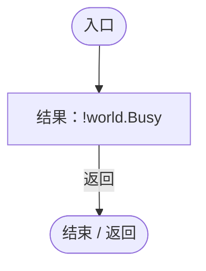

项目内调用/回调引用：

- [WorldSessionManager.Busy.get · L24](08741c7b7b9d9344.md#m4483e2e4f28f7c85)（访问器）

<a id="m8740a46b74a5a0bc"></a>

## 回调@62 · L62

`distance … => 回调`


### Editor · Roslyn编译器控制流

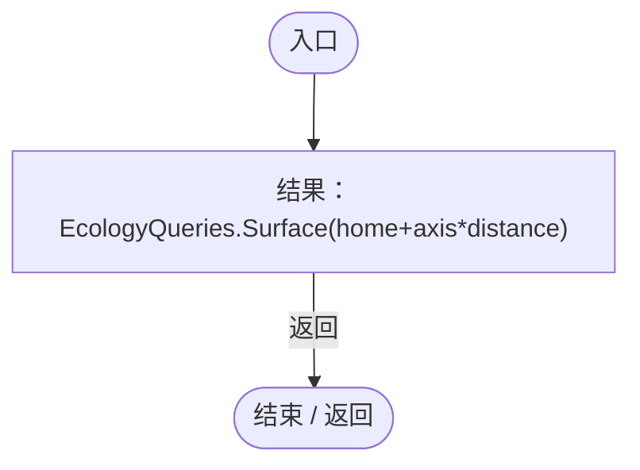

项目内调用/回调引用：

- [EcologyQueries.Surface · L47](bdf7ccc2c9c0452f.md#m2f1f6873ee5fc8df)（方法）

<a id="mb037844e191217d1"></a>

## 回调@70 · L70

`( … => 回调`


### Editor · Roslyn编译器控制流

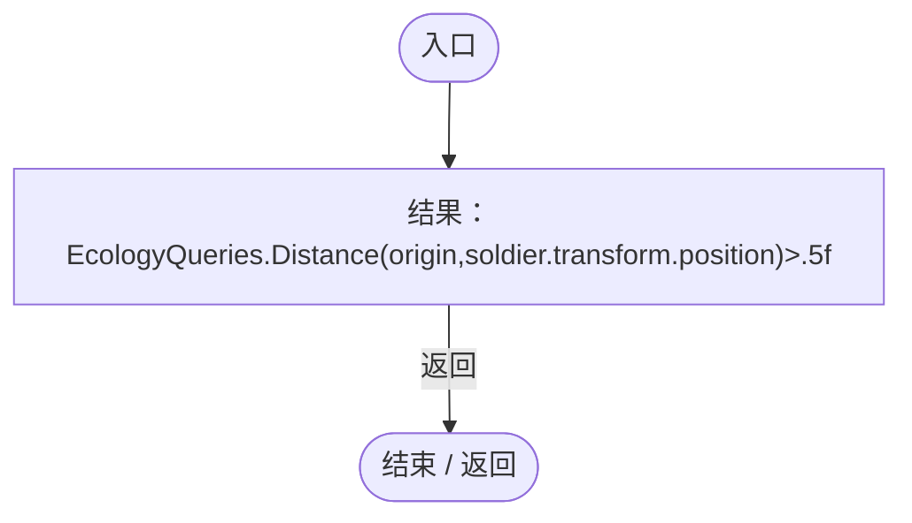

项目内调用/回调引用：

- [EcologyQueries.Distance · L42](bdf7ccc2c9c0452f.md#mba9c3e3c95d0f2dd)（方法）

<a id="m2d91f8b8e7adc92b"></a>

## 回调@71 · L71

`e … => 回调`


### Editor · Roslyn编译器控制流

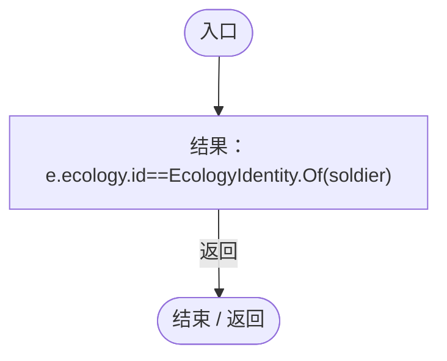

项目内调用/回调引用：

- [EcologyIdentity.Of · L21](bdf7ccc2c9c0452f.md#m1143cf9570a93b72)（方法）

<a id="me3b798e3daa14a7d"></a>

## 回调@75 · L75

`( … => 回调`


### Editor · Roslyn编译器控制流

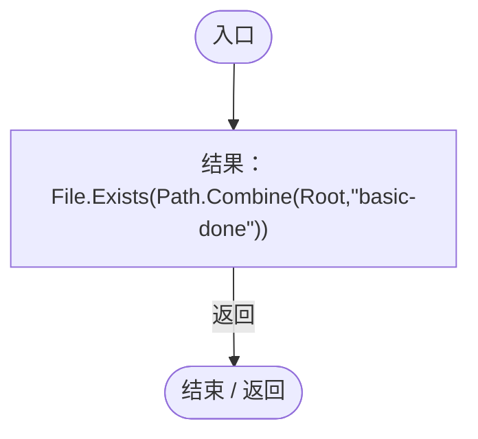

项目内调用/回调引用：

- [LanMultiplayerRegression.Root.get · L30](140d316a72ec89d5.md#ma8b2cd24f9638fe3)（访问器）

<a id="m29baa68a3ccb7b45"></a>

## 回调@76 · L76

`p … => 回调`


### Editor · Roslyn编译器控制流

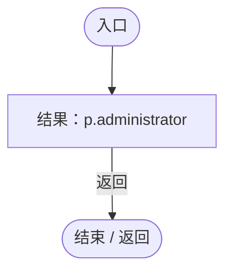

<a id="me4403a9144b4caa8"></a>

## 回调@78 · L78

`( … => 回调`


### Editor · Roslyn编译器控制流

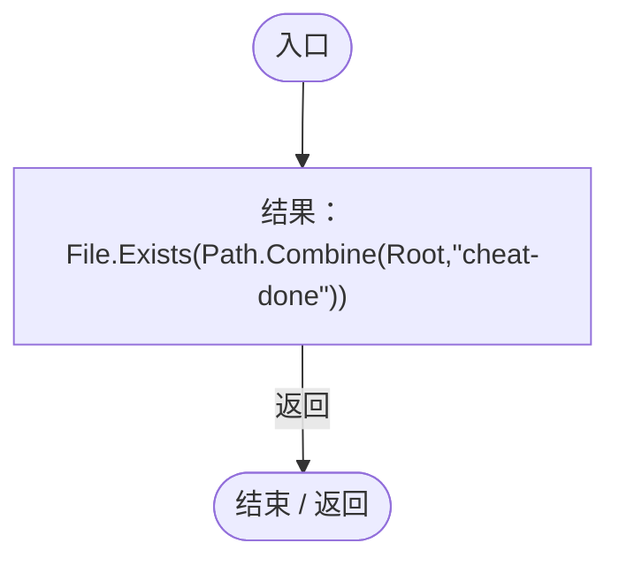

项目内调用/回调引用：

- [LanMultiplayerRegression.Root.get · L30](140d316a72ec89d5.md#ma8b2cd24f9638fe3)（访问器）

<a id="m262848b8c43d0638"></a>

## 回调@80 · L80

`( … => 回调`


### Editor · Roslyn编译器控制流

```mermaid
flowchart TD
  b0(["入口"])
  b1["结果：File.Exists(Path.Combine(Root,&quot;client-left&quot;))"]
  b2(["结束 / 返回"])
  b0 --> b1
  b1 -->|"返回"| b2

```

项目内调用/回调引用：

- [LanMultiplayerRegression.Root.get · L30](140d316a72ec89d5.md#ma8b2cd24f9638fe3)（访问器）

<a id="m5fe03f8ffd3b81bc"></a>

## 回调@80 · L80

`( … => 回调`


### Editor · Roslyn编译器控制流

```mermaid
flowchart TD
  b0(["入口"])
  b1["结果：net.MemberCount==0"]
  b2(["结束 / 返回"])
  b0 --> b1
  b1 -->|"返回"| b2

```

<a id="m35b4f096c93bee4c"></a>

## 回调@82 · L82

`e … => 回调`


### Editor · Roslyn编译器控制流

```mermaid
flowchart TD
  b0(["入口"])
  b1["结果：e.ecology.id==fixture.editor"]
  b2(["结束 / 返回"])
  b0 --> b1
  b1 -->|"返回"| b2

```

<a id="m71e7fa60e0595e4d"></a>

## 回调@85 · L85

`( … => 回调`


### Editor · Roslyn编译器控制流

```mermaid
flowchart TD
  b0(["入口"])
  b1["结果：File.Exists(Path.Combine(Root,&quot;rejoin-ready&quot;))"]
  b2(["结束 / 返回"])
  b0 --> b1
  b1 -->|"返回"| b2

```

项目内调用/回调引用：

- [LanMultiplayerRegression.Root.get · L30](140d316a72ec89d5.md#ma8b2cd24f9638fe3)（访问器）

<a id="md69840179d90b522"></a>

## 回调@85 · L85

`( … => 回调`


### Editor · Roslyn编译器控制流

```mermaid
flowchart TD
  b0(["入口"])
  b1["结果：File.Exists(Path.Combine(Root,&quot;room-closed&quot;))"]
  b2(["结束 / 返回"])
  b0 --> b1
  b1 -->|"返回"| b2

```

项目内调用/回调引用：

- [LanMultiplayerRegression.Root.get · L30](140d316a72ec89d5.md#ma8b2cd24f9638fe3)（访问器）

<a id="mdaf76628ee2d715c"></a>

## 回调@87 · L87

`( … => 回调`


### Editor · Roslyn编译器控制流

```mermaid
flowchart TD
  b0(["入口"])
  b1["结果：File.Exists(Path.Combine(Root,&quot;drop-loading&quot;))"]
  b2(["结束 / 返回"])
  b0 --> b1
  b1 -->|"返回"| b2

```

项目内调用/回调引用：

- [LanMultiplayerRegression.Root.get · L30](140d316a72ec89d5.md#ma8b2cd24f9638fe3)（访问器）

<a id="mb22e964386fc4529"></a>

## 回调@87 · L87

`( … => 回调`


### Editor · Roslyn编译器控制流

```mermaid
flowchart TD
  b0(["入口"])
  b1["结果：File.Exists(Path.Combine(Root,&quot;loading-aborted&quot;))"]
  b2(["结束 / 返回"])
  b0 --> b1
  b1 -->|"返回"| b2

```

项目内调用/回调引用：

- [LanMultiplayerRegression.Root.get · L30](140d316a72ec89d5.md#ma8b2cd24f9638fe3)（访问器）

<a id="m2a728b6ce12d4271"></a>

## Client · L89

`private static IEnumerator Client()`


### Editor · Roslyn编译器控制流

```mermaid
flowchart TD
  b0(["入口"])
  b1["PlanetClimateMap.Instance.mapResolution=128;<br/>PlanetOreSystem.Instance.mapResolution=64;<br/>yield return Wait(()=&gt;File.Exists(Path.Combine(Root,&quot;fixture.json&quot;)),&quot;等待房间信息&quot;,180);<br/>fixture=JsonUtility.FromJson&lt;Fixture&gt;(File.ReadAllText(Path.Combi…"]
  b2{"判断：net.Online"}
  b3["!WorldAuthority.IsReplica"]
  b4["!net.Online"]
  b5["Check(!net.Online&amp;&amp;!WorldAuthority.IsReplica,&quot;连接发起后可立即取消并释放权限&quot;);"]
  b6["net.Join(&quot;127.0.0.1&quot;,fixture.port,&quot;真实客户端成员&quot;);<br/>yield return Wait(()=&gt;net.IsClient&amp;&amp;WorldRuntimeGate.Ready&amp;&amp;!world.Busy&amp;&amp;net.Players.Count==2,&quot;实际TCP连接并加载房主世界&quot;,180);<br/>Check(EntityPopulationLimit.Maximum==50,&quot;成员通过世界快照获得同一存档上限&quot;);"]
  b7{"判断：WorldAuthority.IsReplica"}
  b8{"判断：WorldAuthority.CanEdit"}
  b9{"判断：net.IsHost"}
  b10["net.Players.Count(p=&gt;p.administrator)==1"]
  b11["WorldAuthority.IsReplica&amp;&amp;!WorldAuthority.CanEdit&amp;&amp;!net.IsHost&amp;&amp;net.Players.Count(p=&gt;p.administrator)==1"]
  b12["Check(WorldAuthority.IsReplica&amp;&amp;!WorldAuthority.CanEdit&amp;&amp;!net.IsHost&amp;&amp;net.Players.Count(p=&gt;p.administrator)==1,&quot;成员接收到世界且不能声明为管理员&quot;);"]
  b13["Check(!Object.FindFirstObjectByType&lt;SimulationPauseHotkey&gt;().HandlePauseKey(KeyCode.P,true,false),&quot;普通成员不能暂停所有人的世界&quot;);<br/>net.RequestEntity(fixture.queen);<br/>yield return Wait(()=&gt;net.OwnedEntityId==fixture.queen&amp;&amp;EntityViewController.Instance.…"]
  b14{"判断：LanEditActions.SetGene(editor,fixture.gene,61)"}
  b15{"判断：LanEditActions.AddGene(editor,&quot;gene_repair&quot;)"}
  b16{"判断：EntityPlacementUtility.Spawn(null,queen.transform.position)"}
  b17["!RandomPlanetSpawner.Ensure(ServiceLocator.Get&lt;SimulationClock&gt;().gameObject).StartBatch(null,10,true)"]
  b18["!LanEditActions.SetGene(editor,fixture.gene,61)&amp;&amp;!LanEditActions.AddGene(editor,&quot;gene_repair&quot;)&amp;&amp;!EntityPlacementUtility.Spawn(null,queen.transform.position)&amp;&amp;!RandomPlanetSpawner.Ensure(ServiceLocator.Get&lt;SimulationClock&gt;().gameObject).S…"]
  b19["Check(!LanEditActions.SetGene(editor,fixture.gene,61)&amp;&amp;!LanEditActions.AddGene(editor,&quot;gene_repair&quot;)&amp;&amp;!EntityPlacementUtility.Spawn(null,queen.transform.position)&amp;&amp;!RandomPlanetSpawner.Ensure(ServiceLocator.Get&lt;SimulationClock&gt;().gameObj…"]
  b20["net<br/>new LanCommand{kind=&quot;gene&quot;,entity=fixture.editor,gene=fixture.gene,value=99}<br/>kind=&quot;gene&quot;<br/>entity=fixture.editor<br/>gene=fixture.gene<br/>value=99<br/>net.SendCommand(new LanCommand{kind=&quot;gene&quot;,entity=fixture.editor,gene=fixture.gene,value=99});"]
  b21["yield return Wait(()=&gt;net.Status.Contains(&quot;权限&quot;),&quot;服务端拒绝伪造编辑&quot;,10);<br/>Check(editor.Genes.Genome.Find(fixture.gene).Value==50,&quot;伪造基因修改报文未改变权威世界&quot;);<br/>beforeManagement=EntityRegistry.All.Count"]
  b22["net<br/>new LanCommand{kind=&quot;worldSettings&quot;,count=1}<br/>kind=&quot;worldSettings&quot;<br/>count=1<br/>net.SendCommand(new LanCommand{kind=&quot;worldSettings&quot;,count=1});"]
  b23["net<br/>new LanCommand{kind=&quot;clearEntities&quot;}<br/>kind=&quot;clearEntities&quot;<br/>net.SendCommand(new LanCommand{kind=&quot;clearEntities&quot;});"]
  b24["yield return new WaitForSecondsRealtime(.5f);"]
  b25{"判断：EntityPopulationLimit.Maximum==50"}
  b26{"判断：EntityRegistry.All.Count==beforeManagement"}
  b27["EcologyQueries.Alive(queen)"]
  b28["EntityPopulationLimit.Maximum==50&amp;&amp;EntityRegistry.All.Count==beforeManagement&amp;&amp;EcologyQueries.Alive(queen)"]
  b29["Check(EntityPopulationLimit.Maximum==50&amp;&amp;EntityRegistry.All.Count==beforeManagement&amp;&amp;EcologyQueries.Alive(queen),&quot;伪造上限和一键清除报文被服务端拒绝&quot;);"]
  b30["net<br/>new LanCommand{kind=&quot;spawn&quot;,point=queen.transform.position}<br/>kind=&quot;spawn&quot;<br/>point=queen.transform.position<br/>net.SendCommand(new LanCommand{kind=&quot;spawn&quot;,point=queen.transform.position});"]
  b31["yield return new WaitForSecondsRealtime(.4f);"]
  b32["net<br/>new LanCommand{kind=&quot;cheats&quot;,enabled=true}<br/>kind=&quot;cheats&quot;<br/>enabled=true<br/>net.SendCommand(new LanCommand{kind=&quot;cheats&quot;,enabled=true});"]
  b33["yield return new WaitForSecondsRealtime(.4f);<br/>Check(!net.Cheats,&quot;成员不能自行打开作弊模式&quot;);<br/>net.RequestEntity(fixture.editor);<br/>yield return Wait(()=&gt;net.Status.Contains(&quot;进入游戏&quot;),&quot;拒绝中途切换实体&quot;,10);<br/>Check(net.OwnedEntityId==fixture.queen,&quot;普通成员不能中途换取其他实体&quot;…"]
  b34{"判断：net.CanUseRts"}
  b35["WorldAuthority.RtsMode"]
  b36["net.CanUseRts"]
  b37["Check(net.CanUseRts&amp;&amp;WorldAuthority.RtsMode,&quot;普通成员操控王后时可进入RTS&quot;);"]
  b38{"camera=Camera.main<br/>up=EcologyQueries.Up(queen.transform.position)<br/>position=queen.transform.position+up*70<br/>axis=Vector3.Cross(up,Vector3.forward).normalized<br/>判断：axis.sqrMagnitude&lt;.1f"}
  b39["axis=Vector3.right;"]
  b40["camera.GetComponent&lt;OrbitCamera&gt;().RestoreView(position,Quaternion.LookRotation(queen.transform.position-position,axis),Vector3.Distance(position,EcologyQueries.Planet.transform.position));<br/>yield return null;<br/>rts=Object.FindFirstObjectBy…"]
  b41{"判断：rts.Selected.Count&gt;0"}
  b42["rts.Selected.All(e=&gt;e.GetComponent&lt;AntColonyMember&gt;()?.GroupId==queen.GetComponent&lt;AntColonyMember&gt;().GroupId)"]
  b43["rts.Selected.Count&gt;0"]
  b44["Check(rts.Selected.Count&gt;0&amp;&amp;rts.Selected.All(e=&gt;e.GetComponent&lt;AntColonyMember&gt;()?.GroupId==queen.GetComponent&lt;AntColonyMember&gt;().GroupId),&quot;实际框选只选中王后自己的种群&quot;);"]
  b45["net.IssueRts(new[]{fixture.foreign},RtsOrderKind.Move,fixture.movePoint);<br/>yield return Wait(()=&gt;net.Status.Contains(&quot;外群&quot;),&quot;服务端拒绝指挥外群&quot;,10);"]
  b46{"EcologyIdentity.Find(fixture.foreign).GetComponent&lt;RtsOrderController&gt;()<br/>判断：EcologyIdentity.Find(fixture.foreign).GetComponent&lt;RtsOrderController&gt;()"}
  b47[".State.active"]
  b48["EcologyIdentity.Find(fixture.foreign).GetComponent&lt;RtsOrderController&gt;()"]
  b49["Check(EcologyIdentity.Find(fixture.foreign).GetComponent&lt;RtsOrderController&gt;()?.State.active!=true,&quot;伪造外群RTS命令被拒绝&quot;);"]
  b50["soldier=EcologyIdentity.Find(fixture.soldier)<br/>origin=soldier.transform.position<br/>net.IssueRts(new[]{fixture.soldier},RtsOrderKind.Move,fixture.movePoint);<br/>yield return Wait(()=&gt;EcologyQueries.Distance(origin,soldier.transform.position)&gt;.5…"]
  b51{"判断：net.Players.Count(p=&gt;p.administrator)==1"}
  b52["!net.IsHost"]
  b53["net.Players.Count(p=&gt;p.administrator)==1"]
  b54["Check(net.Players.Count(p=&gt;p.administrator)==1&amp;&amp;!net.IsHost,&quot;作弊开放能力而不增加第二名管理员&quot;);"]
  b55["LanEditActions.SetGene(editor,fixture.gene,61);<br/>yield return Wait(()=&gt;editor.Genes.Genome.Find(fixture.gene).Value==61,&quot;作弊修改基因&quot;,15);<br/>LanEditActions.AddGene(editor,&quot;gene_repair&quot;);<br/>yield return Wait(()=&gt;editor.Genes.Genome.HasDefinition(&quot;g…"]
  b56["new LanCommand{kind=&quot;worldSettings&quot;,count=60,running=true}<br/>kind=&quot;worldSettings&quot;<br/>count=60<br/>running=true<br/>Check(LanEditActions.Submit(new LanCommand{kind=&quot;worldSettings&quot;,count=60,running=true}),&quot;作弊成员可请求修改存档实体上限&quot;);"]
  b57["yield return Wait(()=&gt;EntityPopulationLimit.Maximum==60,&quot;实体上限轻量同步&quot;,15);<br/>Check(EcologyIdentity.Find(fixture.editor)==sameEditor,&quot;上限同步不重新加载或重建客户端实体&quot;);<br/>count=EntityRegistry.All.Count<br/>Check(EntityPlacementUtility.Spawn(null,EcologyQueries.Su…"]
  b58["net<br/>new LanCommand{kind=&quot;release&quot;,aim=direction}<br/>kind=&quot;release&quot;<br/>aim=direction<br/>net.SendCommand(new LanCommand{kind=&quot;release&quot;,aim=direction});"]
  b59["yield return Wait(()=&gt;Food(editor)&lt;food&amp;&amp;ColonyResource.All.Where(r=&gt;r.State.kind==ColonyResourceKind.Energy).Sum(r=&gt;r.State.energy)&gt;energy,&quot;普通成员保留自身基因Q能力&quot;,15);<br/>Check(Mathf.Abs(food-Food(editor)-(ColonyResource.All.Where(r=&gt;r.State.kind=…"]
  b60{"判断：WorldRuntimeGate.Ready"}
  b61{"判断：world.Current==null"}
  b62["!net.Online"]
  b63["!WorldRuntimeGate.Ready&amp;&amp;world.Current==null&amp;&amp;!net.Online"]
  b64["Check(!WorldRuntimeGate.Ready&amp;&amp;world.Current==null&amp;&amp;!net.Online,&quot;退出完整清理客户端世界与连接&quot;);"]
  b65["File.WriteAllText(Path.Combine(Root,&quot;client-left&quot;),&quot;PASS&quot;);<br/>yield return Wait(()=&gt;File.Exists(Path.Combine(Root,&quot;release-verified&quot;)),&quot;等待房主确认连接释放&quot;,30);<br/>net.Join(&quot;127.0.0.1&quot;,fixture.port,&quot;重连成员&quot;);<br/>yield return Wait(()=&gt;net.IsClient&amp;&amp;WorldRu…"]
  b66{"判断：world.Current==null"}
  b67["EntityRegistry.All.Count==0"]
  b68["world.Current==null"]
  b69["Check(world.Current==null&amp;&amp;EntityRegistry.All.Count==0,&quot;房主关闭房间后客户端自动清场返回主界面&quot;);"]
  b70["File.WriteAllText(Path.Combine(Root,&quot;room-closed&quot;),&quot;PASS&quot;);<br/>yield return Wait(()=&gt;File.Exists(Path.Combine(Root,&quot;reload-fixture.json&quot;)),&quot;等待再次开放&quot;,30);<br/>fixture=JsonUtility.FromJson&lt;Fixture&gt;(File.ReadAllText(Path.Combine(Root,&quot;reload-fixtur…"]
  b71{"判断：world.Current==null"}
  b72{"判断：WorldRuntimeGate.Ready"}
  b73["EntityRegistry.All.Count==0"]
  b74["world.Current==null&amp;&amp;!WorldRuntimeGate.Ready&amp;&amp;EntityRegistry.All.Count==0"]
  b75["Check(world.Current==null&amp;&amp;!WorldRuntimeGate.Ready&amp;&amp;EntityRegistry.All.Count==0,&quot;加载中断不继续变成本地世界或写盘&quot;);"]
  b76["File.WriteAllText(Path.Combine(Root,&quot;loading-aborted&quot;),&quot;PASS&quot;);"]
  b77(["结束 / 返回"])
  b0 --> b1
  b1 --> b2
  b2 -->|"否"| b3
  b2 -->|"是"| b4
  b3 --> b5
  b4 --> b5
  b5 --> b6
  b6 --> b7
  b7 -->|"是"| b8
  b7 -->|"否"| b11
  b8 -->|"否"| b9
  b8 -->|"是"| b11
  b9 -->|"否"| b10
  b9 -->|"是"| b11
  b10 --> b12
  b11 --> b12
  b12 --> b13
  b13 --> b14
  b14 -->|"否"| b15
  b14 -->|"是"| b18
  b15 -->|"否"| b16
  b15 -->|"是"| b18
  b16 -->|"否"| b17
  b16 -->|"是"| b18
  b17 --> b19
  b18 --> b19
  b19 --> b20
  b20 --> b21
  b21 --> b22
  b22 --> b23
  b23 --> b24
  b24 --> b25
  b25 -->|"是"| b26
  b25 -->|"否"| b28
  b26 -->|"是"| b27
  b26 -->|"否"| b28
  b27 --> b29
  b28 --> b29
  b29 --> b30
  b30 --> b31
  b31 --> b32
  b32 --> b33
  b33 --> b34
  b34 -->|"是"| b35
  b34 -->|"否"| b36
  b35 --> b37
  b36 --> b37
  b37 --> b38
  b38 -->|"是"| b39
  b38 -->|"否"| b40
  b39 --> b40
  b40 --> b41
  b41 -->|"是"| b42
  b41 -->|"否"| b43
  b42 --> b44
  b43 --> b44
  b44 --> b45
  b45 --> b46
  b46 -->|"否"| b47
  b46 -->|"是"| b48
  b47 --> b49
  b48 --> b49
  b49 --> b50
  b50 --> b51
  b51 -->|"是"| b52
  b51 -->|"否"| b53
  b52 --> b54
  b53 --> b54
  b54 --> b55
  b55 --> b56
  b56 --> b57
  b57 --> b58
  b58 --> b59
  b59 --> b60
  b60 -->|"否"| b61
  b60 -->|"是"| b63
  b61 -->|"是"| b62
  b61 -->|"否"| b63
  b62 --> b64
  b63 --> b64
  b64 --> b65
  b65 --> b66
  b66 -->|"是"| b67
  b66 -->|"否"| b68
  b67 --> b69
  b68 --> b69
  b69 --> b70
  b70 --> b71
  b71 -->|"是"| b72
  b71 -->|"否"| b74
  b72 -->|"否"| b73
  b72 -->|"是"| b74
  b73 --> b75
  b74 --> b75
  b75 --> b76
  b76 --> b77

```

项目内调用/回调引用：

- [PlanetClimateMap.Instance.get · L16](b4e9726c1bcf4c37.md#m3add54a419aeef9f)（访问器）
- [PlanetOreSystem.Instance.get · L8](86b3fbb4d9436121.md#m53f6a6af4b6dc252)（访问器）
- [LanMultiplayerRegression.Wait · L35](140d316a72ec89d5.md#m6a4e431c3dc057c4)（方法）
- [LanMultiplayerRegression.Root.get · L30](140d316a72ec89d5.md#ma8b2cd24f9638fe3)（访问器）
- [LanSession.Instance.get · L23](9fb633eebffe669c.md#mbf83306994878383)（访问器）
- [LanSession.Join · L66](9fb633eebffe669c.md#m24b68938916764ee)（方法）
- [LanSession.LeaveToMenu · L290](9fb633eebffe669c.md#m107974d8a60df554)（方法）
- [LanMultiplayerRegression.Check · L34](140d316a72ec89d5.md#m14e3c823ac2e0561)（方法）
- [SimulationPauseHotkey.HandlePauseKey · L37](cc79d402ad5d8117.md#m55d4ba3aff20b57d)（方法）
- [LanSession.RequestEntity · L103](9fb633eebffe669c.md#m606c5e2a01315953)（方法）
- [EcologyIdentity.Find · L20](bdf7ccc2c9c0452f.md#m58f756a3ba9ec990)（方法）
- [GeneInspectorUI.ShowEntityInfo · L385](924e27c34e7b1f0a.md#mea69a0457b885287)（方法）
- [UIRoot.MainCanvas.get · L14](9c1421378791f0e0.md#maa2cc9baf1248477)（访问器）
- [ServiceLocator.Get · L33](f2fdbe9f9ccd93cb.md#m2ae625299520c56d)（方法）
- [LanEditActions.SetGene · L18](2816321496f6360e.md#m5e154b041f4511a1)（方法）
- [LanEditActions.AddGene · L19](2816321496f6360e.md#mcc9fef1f2f3c58eb)（方法）
- [EntityPlacementUtility.Spawn · L77](6d2c32e632b9c147.md#m79ec74c5c23421cd)（方法）
- [RandomPlanetSpawner.StartBatch · L25](1c13222a547b265c.md#m0e4af90b5fa8372e)（方法）
- [RandomPlanetSpawner.Ensure · L24](1c13222a547b265c.md#mccefd1367aa9ded3)（方法）
- [LanSession.SendCommand · L90](9fb633eebffe669c.md#me286a0c67c4d8ecd)（方法）
- [Genome.Find · L11](a2ef23f865bc7ee8.md#mfd5b2c58563def29)（方法）
- [DarwinEntity.Genes.get · L14](70798dde169f2e8b.md#m622eb1adf401d431)（访问器）
- [EcologyQueries.Alive · L38](bdf7ccc2c9c0452f.md#mb2877c487f449970)（方法）
- [LanSession.Cheats.get · L27](9fb633eebffe669c.md#m570973099b8f82d5)（访问器）
- [LanSession.OwnedEntityId.get · L30](9fb633eebffe669c.md#m5adc535c48d20cbe)（访问器）
- [LanSession.SetRtsMode · L113](9fb633eebffe669c.md#md00374cca68a1203)（方法）
- [EcologyQueries.Up · L41](bdf7ccc2c9c0452f.md#maca7070196f125fd)（方法）
- [OrbitCamera.RestoreView · L42](42eb429559b42bcb.md#m8ee0579d9414ca2c)（方法）
- [RtsSelectionInput.SelectRectangle · L61](3c8b37f7bbd7a10f.md#me09460aa5540d76e)（方法）
- [LanSession.IssueRts · L119](9fb633eebffe669c.md#m7bcbba11fd529ea2)（方法）
- [RtsOrderController.State.get · L15](cac3b6501f41ca35.md#m04ce57391ec3040d)（访问器）
- [EntityViewController.EnterView · L73](0ad0345f83229ef0.md#mbd7be6d2bbd0ec83)（方法）
- [EntityViewController.Instance.get · L15](0ad0345f83229ef0.md#mb3b8144b56e80842)（访问器）
- [EntityManualControl.SetInput · L33](a6969896da35e1f0.md#m7c7f5613b3bebc74)（方法）
- [EntityViewController.ExitView · L105](0ad0345f83229ef0.md#mca8619c7f27942c9)（方法）
- [LanEditActions.Submit · L16](2816321496f6360e.md#m5411c4b97ac4c898)（方法）
- [EcologyQueries.Surface · L47](bdf7ccc2c9c0452f.md#m2f1f6873ee5fc8df)（方法）
- [SimulationClock.Pause · L79](a8f444aec9614b0a.md#m30929d45a885d0f1)（方法）
- [SimulationClock.Play · L78](a8f444aec9614b0a.md#m7aa9e64b7de60ed0)（方法）
- [LanMultiplayerRegression.Food · L130](140d316a72ec89d5.md#m0a4aa2b9e11715c3)（方法）
- [WorldSaveStore.FileFor · L48](d67a35e5e3814c15.md#m419a625e2bcc70f8)（方法）
- [WorldSessionManager.Current.get · L21](08741c7b7b9d9344.md#m5d26a5eb846a8504)（访问器）
- [WorldSessionManager.SaveNow · L157](08741c7b7b9d9344.md#mbecd8b5c222ba46b)（方法）
- [LanMultiplayerRegression.回调@91 · L91](140d316a72ec89d5.md#ma8ecfd29857bfb2e)（回调/委托）
- [LanMultiplayerRegression.回调@93 · L93](140d316a72ec89d5.md#m589e88ca45a5feb4)（回调/委托）
- [LanMultiplayerRegression.回调@95 · L95](140d316a72ec89d5.md#m28a1ebaf20bc7cf0)（回调/委托）
- [LanMultiplayerRegression.回调@97 · L97](140d316a72ec89d5.md#m2f771f74a124e24f)（回调/委托）
- [LanMultiplayerRegression.回调@99 · L99](140d316a72ec89d5.md#m1efc26936f979fd0)（回调/委托）
- [LanMultiplayerRegression.回调@101 · L101](140d316a72ec89d5.md#me90ce183dac584f4)（回调/委托）
- [LanMultiplayerRegression.回调@104 · L104](140d316a72ec89d5.md#m293de53609ddcc8c)（回调/委托）
- [LanMultiplayerRegression.回调@107 · L107](140d316a72ec89d5.md#mb459fe09f471cc97)（回调/委托）
- [LanMultiplayerRegression.回调@108 · L108](140d316a72ec89d5.md#mfc1cc9ae4f38e461)（回调/委托）
- [LanMultiplayerRegression.回调@109 · L109](140d316a72ec89d5.md#m3ea3b841a142b661)（回调/委托）
- [LanMultiplayerRegression.回调@111 · L111](140d316a72ec89d5.md#m4d550b8e9236fe41)（回调/委托）
- [LanMultiplayerRegression.回调@112 · L112](140d316a72ec89d5.md#m308af50b6b9f598b)（回调/委托）
- [LanMultiplayerRegression.回调@113 · L113](140d316a72ec89d5.md#me8a4c0f1811e6e9f)（回调/委托）
- [LanMultiplayerRegression.回调@113 · L113](140d316a72ec89d5.md#mcb308e215c28c278)（回调/委托）
- [LanMultiplayerRegression.回调@113 · L113](140d316a72ec89d5.md#mcc4badc801aa4ec7)（回调/委托）
- [LanMultiplayerRegression.回调@114 · L114](140d316a72ec89d5.md#ma9167997b991dee5)（回调/委托）
- [LanMultiplayerRegression.回调@115 · L115](140d316a72ec89d5.md#m3a875f975c4fd95b)（回调/委托）
- [LanMultiplayerRegression.回调@116 · L116](140d316a72ec89d5.md#md8cda38e724d5d31)（回调/委托）
- [LanMultiplayerRegression.回调@118 · L118](140d316a72ec89d5.md#m09fc2454ef3bc460)（回调/委托）
- [LanMultiplayerRegression.回调@118 · L118](140d316a72ec89d5.md#mb1f7d48b5c2cdfce)（回调/委托）
- [LanMultiplayerRegression.回调@119 · L119](140d316a72ec89d5.md#m9209ab79d0f03ec4)（回调/委托）
- [LanMultiplayerRegression.回调@119 · L119](140d316a72ec89d5.md#m876e0a6ab78d54cc)（回调/委托）
- [LanMultiplayerRegression.回调@120 · L120](140d316a72ec89d5.md#mdd848b2dd61fbbdd)（回调/委托）
- [LanMultiplayerRegression.回调@120 · L120](140d316a72ec89d5.md#m43fcc1f83e5ed80c)（回调/委托）
- [LanMultiplayerRegression.回调@120 · L120](140d316a72ec89d5.md#mf863f2d6d2319bd0)（回调/委托）
- [LanMultiplayerRegression.回调@120 · L120](140d316a72ec89d5.md#mf3df3cbafa50bcc4)（回调/委托）
- [LanMultiplayerRegression.回调@120 · L120](140d316a72ec89d5.md#m2b95bc3604ce794b)（回调/委托）
- [LanMultiplayerRegression.回调@123 · L123](140d316a72ec89d5.md#m5b3cb92ab942e5c5)（回调/委托）
- [LanMultiplayerRegression.回调@124 · L124](140d316a72ec89d5.md#mb2d2d185114e174f)（回调/委托）
- [LanMultiplayerRegression.回调@125 · L125](140d316a72ec89d5.md#me8073aa3d3bd30ff)（回调/委托）
- [LanMultiplayerRegression.回调@126 · L126](140d316a72ec89d5.md#m8b0e95566dfd448b)（回调/委托）
- [LanMultiplayerRegression.回调@127 · L127](140d316a72ec89d5.md#me18eff8b1e784d1d)（回调/委托）
- [LanMultiplayerRegression.回调@128 · L128](140d316a72ec89d5.md#m97b8275c273edc4a)（回调/委托）

<a id="ma8ecfd29857bfb2e"></a>

## 回调@91 · L91

`( … => 回调`


### Editor · Roslyn编译器控制流

```mermaid
flowchart TD
  b0(["入口"])
  b1["结果：File.Exists(Path.Combine(Root,&quot;fixture.json&quot;))"]
  b2(["结束 / 返回"])
  b0 --> b1
  b1 -->|"返回"| b2

```

项目内调用/回调引用：

- [LanMultiplayerRegression.Root.get · L30](140d316a72ec89d5.md#ma8b2cd24f9638fe3)（访问器）

<a id="m589e88ca45a5feb4"></a>

## 回调@93 · L93

`( … => 回调`


### Editor · Roslyn编译器控制流

```mermaid
flowchart TD
  b0(["入口"])
  b1{"判断：net.IsClient"}
  b2{"判断：WorldRuntimeGate.Ready"}
  b3{"判断：world.Busy"}
  b4["net.Players.Count==2"]
  b5["net.IsClient&amp;&amp;WorldRuntimeGate.Ready&amp;&amp;!world.Busy&amp;&amp;net.Players.Count==2"]
  b6["结果：net.IsClient&amp;&amp;WorldRuntimeGate.Ready&amp;&amp;!world.Busy&amp;&amp;net.Players.Count==2"]
  b7(["结束 / 返回"])
  b0 --> b1
  b1 -->|"是"| b2
  b1 -->|"否"| b5
  b2 -->|"是"| b3
  b2 -->|"否"| b5
  b3 -->|"否"| b4
  b3 -->|"是"| b5
  b4 --> b6
  b5 --> b6
  b6 -->|"返回"| b7

```

项目内调用/回调引用：

- [WorldSessionManager.Busy.get · L24](08741c7b7b9d9344.md#m4483e2e4f28f7c85)（访问器）

<a id="m28a1ebaf20bc7cf0"></a>

## 回调@95 · L95

`p … => 回调`


### Editor · Roslyn编译器控制流

```mermaid
flowchart TD
  b0(["入口"])
  b1["结果：p.administrator"]
  b2(["结束 / 返回"])
  b0 --> b1
  b1 -->|"返回"| b2

```

<a id="m2f771f74a124e24f"></a>

## 回调@97 · L97

`( … => 回调`


### Editor · Roslyn编译器控制流

```mermaid
flowchart TD
  b0(["入口"])
  b1{"判断：net.OwnedEntityId==fixture.queen"}
  b2["EntityViewController.Instance.Target!=null"]
  b3["net.OwnedEntityId==fixture.queen"]
  b4["结果：net.OwnedEntityId==fixture.queen&amp;&amp;EntityViewController.Instance.Target!=null"]
  b5(["结束 / 返回"])
  b0 --> b1
  b1 -->|"是"| b2
  b1 -->|"否"| b3
  b2 --> b4
  b3 --> b4
  b4 -->|"返回"| b5

```

项目内调用/回调引用：

- [LanSession.OwnedEntityId.get · L30](9fb633eebffe669c.md#m5adc535c48d20cbe)（访问器）
- [EntityViewController.Target.get · L16](0ad0345f83229ef0.md#m87ca090092a884ab)（访问器）
- [EntityViewController.Instance.get · L15](0ad0345f83229ef0.md#mb3b8144b56e80842)（访问器）

<a id="m1efc26936f979fd0"></a>

## 回调@99 · L99

`f … => 回调`


### Editor · Roslyn编译器控制流

```mermaid
flowchart TD
  b0(["入口"])
  b1["结果：!f.interactable"]
  b2(["结束 / 返回"])
  b0 --> b1
  b1 -->|"返回"| b2

```

<a id="me90ce183dac584f4"></a>

## 回调@101 · L101

`( … => 回调`


### Editor · Roslyn编译器控制流

```mermaid
flowchart TD
  b0(["入口"])
  b1["结果：net.Status.Contains(&quot;权限&quot;)"]
  b2(["结束 / 返回"])
  b0 --> b1
  b1 -->|"返回"| b2

```

项目内调用/回调引用：

- [LanSession.Status.get · L31](9fb633eebffe669c.md#md8607b7380abb030)（访问器）

<a id="m293de53609ddcc8c"></a>

## 回调@104 · L104

`( … => 回调`


### Editor · Roslyn编译器控制流

```mermaid
flowchart TD
  b0(["入口"])
  b1["结果：net.Status.Contains(&quot;进入游戏&quot;)"]
  b2(["结束 / 返回"])
  b0 --> b1
  b1 -->|"返回"| b2

```

项目内调用/回调引用：

- [LanSession.Status.get · L31](9fb633eebffe669c.md#md8607b7380abb030)（访问器）

<a id="mb459fe09f471cc97"></a>

## 回调@107 · L107

`e … => 回调`


### Editor · Roslyn编译器控制流

```mermaid
flowchart TD
  b0(["入口"])
  b1{"e.GetComponent&lt;AntColonyMember&gt;()<br/>判断：e.GetComponent&lt;AntColonyMember&gt;()"}
  b2[".GroupId"]
  b3["e.GetComponent&lt;AntColonyMember&gt;()"]
  b4["结果：e.GetComponent&lt;AntColonyMember&gt;()?.GroupId==queen.GetComponent&lt;AntColonyMember&gt;().GroupId"]
  b5(["结束 / 返回"])
  b0 --> b1
  b1 -->|"否"| b2
  b1 -->|"是"| b3
  b2 --> b4
  b3 --> b4
  b4 -->|"返回"| b5

```

<a id="mfc1cc9ae4f38e461"></a>

## 回调@108 · L108

`( … => 回调`


### Editor · Roslyn编译器控制流

```mermaid
flowchart TD
  b0(["入口"])
  b1["结果：net.Status.Contains(&quot;外群&quot;)"]
  b2(["结束 / 返回"])
  b0 --> b1
  b1 -->|"返回"| b2

```

项目内调用/回调引用：

- [LanSession.Status.get · L31](9fb633eebffe669c.md#md8607b7380abb030)（访问器）

<a id="m3ea3b841a142b661"></a>

## 回调@109 · L109

`( … => 回调`


### Editor · Roslyn编译器控制流

```mermaid
flowchart TD
  b0(["入口"])
  b1["结果：EcologyQueries.Distance(origin,soldier.transform.position)&gt;.5f"]
  b2(["结束 / 返回"])
  b0 --> b1
  b1 -->|"返回"| b2

```

项目内调用/回调引用：

- [EcologyQueries.Distance · L42](bdf7ccc2c9c0452f.md#mba9c3e3c95d0f2dd)（方法）

<a id="m4d550b8e9236fe41"></a>

## 回调@111 · L111

`( … => 回调`


### Editor · Roslyn编译器控制流

```mermaid
flowchart TD
  b0(["入口"])
  b1["结果：Vector3.Dot(queen.transform.position-origin,direction)&gt;.3f"]
  b2(["结束 / 返回"])
  b0 --> b1
  b1 -->|"返回"| b2

```

<a id="m308af50b6b9f598b"></a>

## 回调@112 · L112

`( … => 回调`


### Editor · Roslyn编译器控制流

```mermaid
flowchart TD
  b0(["入口"])
  b1{"判断：net.Cheats"}
  b2["WorldAuthority.CanEdit"]
  b3["net.Cheats"]
  b4["结果：net.Cheats&amp;&amp;WorldAuthority.CanEdit"]
  b5(["结束 / 返回"])
  b0 --> b1
  b1 -->|"是"| b2
  b1 -->|"否"| b3
  b2 --> b4
  b3 --> b4
  b4 -->|"返回"| b5

```

项目内调用/回调引用：

- [LanSession.Cheats.get · L27](9fb633eebffe669c.md#m570973099b8f82d5)（访问器）

<a id="me8a4c0f1811e6e9f"></a>

## 回调@113 · L113

`p … => 回调`


### Editor · Roslyn编译器控制流

```mermaid
flowchart TD
  b0(["入口"])
  b1["结果：p.administrator"]
  b2(["结束 / 返回"])
  b0 --> b1
  b1 -->|"返回"| b2

```

<a id="mcb308e215c28c278"></a>

## 回调@113 · L113

`( … => 回调`


### Editor · Roslyn编译器控制流

```mermaid
flowchart TD
  b0(["入口"])
  b1["结果：editor.Genes.Genome.Find(fixture.gene).Value==61"]
  b2(["结束 / 返回"])
  b0 --> b1
  b1 -->|"返回"| b2

```

项目内调用/回调引用：

- [Genome.Find · L11](a2ef23f865bc7ee8.md#mfd5b2c58563def29)（方法）
- [DarwinEntity.Genes.get · L14](70798dde169f2e8b.md#m622eb1adf401d431)（访问器）

<a id="mcc4badc801aa4ec7"></a>

## 回调@113 · L113

`( … => 回调`


### Editor · Roslyn编译器控制流

```mermaid
flowchart TD
  b0(["入口"])
  b1["结果：editor.Genes.Genome.HasDefinition(&quot;gene_repair&quot;)"]
  b2(["结束 / 返回"])
  b0 --> b1
  b1 -->|"返回"| b2

```

项目内调用/回调引用：

- [Genome.HasDefinition · L17](a2ef23f865bc7ee8.md#mcc1574af6feb9c6a)（方法）
- [DarwinEntity.Genes.get · L14](70798dde169f2e8b.md#m622eb1adf401d431)（访问器）

<a id="ma9167997b991dee5"></a>

## 回调@114 · L114

`( … => 回调`


### Editor · Roslyn编译器控制流

```mermaid
flowchart TD
  b0(["入口"])
  b1["结果：EntityPopulationLimit.Maximum==60"]
  b2(["结束 / 返回"])
  b0 --> b1
  b1 -->|"返回"| b2

```

<a id="m3a875f975c4fd95b"></a>

## 回调@115 · L115

`( … => 回调`


### Editor · Roslyn编译器控制流

```mermaid
flowchart TD
  b0(["入口"])
  b1["结果：EntityRegistry.All.Count&gt;count"]
  b2(["结束 / 返回"])
  b0 --> b1
  b1 -->|"返回"| b2

```

<a id="md8cda38e724d5d31"></a>

## 回调@116 · L116

`( … => 回调`


### Editor · Roslyn编译器控制流

```mermaid
flowchart TD
  b0(["入口"])
  b1["结果：EntityRegistry.All.Count&gt;=count+2"]
  b2(["结束 / 返回"])
  b0 --> b1
  b1 -->|"返回"| b2

```

<a id="m09fc2454ef3bc460"></a>

## 回调@118 · L118

`( … => 回调`


### Editor · Roslyn编译器控制流

```mermaid
flowchart TD
  b0(["入口"])
  b1["结果：!clock.IsRunning"]
  b2(["结束 / 返回"])
  b0 --> b1
  b1 -->|"返回"| b2

```

项目内调用/回调引用：

- [SimulationClock.IsRunning.get · L22](a8f444aec9614b0a.md#m10f4fe307faca0f0)（访问器）

<a id="mb1f7d48b5c2cdfce"></a>

## 回调@118 · L118

`( … => 回调`


### Editor · Roslyn编译器控制流

```mermaid
flowchart TD
  b0(["入口"])
  b1["结果：clock.IsRunning"]
  b2(["结束 / 返回"])
  b0 --> b1
  b1 -->|"返回"| b2

```

项目内调用/回调引用：

- [SimulationClock.IsRunning.get · L22](a8f444aec9614b0a.md#m10f4fe307faca0f0)（访问器）

<a id="m9209ab79d0f03ec4"></a>

## 回调@119 · L119

`( … => 回调`


### Editor · Roslyn编译器控制流

```mermaid
flowchart TD
  b0(["入口"])
  b1["结果：net.OwnedEntityId==fixture.editor"]
  b2(["结束 / 返回"])
  b0 --> b1
  b1 -->|"返回"| b2

```

项目内调用/回调引用：

- [LanSession.OwnedEntityId.get · L30](9fb633eebffe669c.md#m5adc535c48d20cbe)（访问器）

<a id="m876e0a6ab78d54cc"></a>

## 回调@119 · L119

`( … => 回调`


### Editor · Roslyn编译器控制流

```mermaid
flowchart TD
  b0(["入口"])
  b1{"判断：net.Cheats"}
  b2["!WorldAuthority.CanEdit"]
  b3["!net.Cheats"]
  b4["结果：!net.Cheats&amp;&amp;!WorldAuthority.CanEdit"]
  b5(["结束 / 返回"])
  b0 --> b1
  b1 -->|"否"| b2
  b1 -->|"是"| b3
  b2 --> b4
  b3 --> b4
  b4 -->|"返回"| b5

```

项目内调用/回调引用：

- [LanSession.Cheats.get · L27](9fb633eebffe669c.md#m570973099b8f82d5)（访问器）

<a id="mdd848b2dd61fbbdd"></a>

## 回调@120 · L120

`r … => 回调`


### Editor · Roslyn编译器控制流

```mermaid
flowchart TD
  b0(["入口"])
  b1["结果：r.State.kind==ColonyResourceKind.Energy"]
  b2(["结束 / 返回"])
  b0 --> b1
  b1 -->|"返回"| b2

```

项目内调用/回调引用：

- [ColonyResource.State.get · L22](293dbaecfff4b585.md#m341a1355f4d657bf)（访问器）

<a id="m43fcc1f83e5ed80c"></a>

## 回调@120 · L120

`r … => 回调`


### Editor · Roslyn编译器控制流

```mermaid
flowchart TD
  b0(["入口"])
  b1["结果：r.State.energy"]
  b2(["结束 / 返回"])
  b0 --> b1
  b1 -->|"返回"| b2

```

项目内调用/回调引用：

- [ColonyResource.State.get · L22](293dbaecfff4b585.md#m341a1355f4d657bf)（访问器）

<a id="mf863f2d6d2319bd0"></a>

## 回调@120 · L120

`( … => 回调`


### Editor · Roslyn编译器控制流

```mermaid
flowchart TD
  b0(["入口"])
  b1{"判断：Food(editor)&lt;food"}
  b2["ColonyResource.All.Where(r=&gt;r.State.kind==ColonyResourceKind.Energy).Sum(r=&gt;r.State.energy)&gt;energy"]
  b3["Food(editor)&lt;food"]
  b4["结果：Food(editor)&lt;food&amp;&amp;ColonyResource.All.Where(r=&gt;r.State.kind==ColonyResourceKind.Energy).Sum(r=&gt;r.State.energy)&gt;energy"]
  b5(["结束 / 返回"])
  b0 --> b1
  b1 -->|"是"| b2
  b1 -->|"否"| b3
  b2 --> b4
  b3 --> b4
  b4 -->|"返回"| b5

```

项目内调用/回调引用：

- [LanMultiplayerRegression.Food · L130](140d316a72ec89d5.md#m0a4aa2b9e11715c3)（方法）
- [LanMultiplayerRegression.回调@120 · L120](140d316a72ec89d5.md#m3845cf51e0ec271b)（回调/委托）
- [LanMultiplayerRegression.回调@120 · L120](140d316a72ec89d5.md#m7b244322abb060a5)（回调/委托）

<a id="m3845cf51e0ec271b"></a>

## 回调@120 · L120

`r … => 回调`


### Editor · Roslyn编译器控制流

```mermaid
flowchart TD
  b0(["入口"])
  b1["结果：r.State.kind==ColonyResourceKind.Energy"]
  b2(["结束 / 返回"])
  b0 --> b1
  b1 -->|"返回"| b2

```

项目内调用/回调引用：

- [ColonyResource.State.get · L22](293dbaecfff4b585.md#m341a1355f4d657bf)（访问器）

<a id="m7b244322abb060a5"></a>

## 回调@120 · L120

`r … => 回调`


### Editor · Roslyn编译器控制流

```mermaid
flowchart TD
  b0(["入口"])
  b1["结果：r.State.energy"]
  b2(["结束 / 返回"])
  b0 --> b1
  b1 -->|"返回"| b2

```

项目内调用/回调引用：

- [ColonyResource.State.get · L22](293dbaecfff4b585.md#m341a1355f4d657bf)（访问器）

<a id="mf3df3cbafa50bcc4"></a>

## 回调@120 · L120

`r … => 回调`


### Editor · Roslyn编译器控制流

```mermaid
flowchart TD
  b0(["入口"])
  b1["结果：r.State.kind==ColonyResourceKind.Energy"]
  b2(["结束 / 返回"])
  b0 --> b1
  b1 -->|"返回"| b2

```

项目内调用/回调引用：

- [ColonyResource.State.get · L22](293dbaecfff4b585.md#m341a1355f4d657bf)（访问器）

<a id="m2b95bc3604ce794b"></a>

## 回调@120 · L120

`r … => 回调`


### Editor · Roslyn编译器控制流

```mermaid
flowchart TD
  b0(["入口"])
  b1["结果：r.State.energy"]
  b2(["结束 / 返回"])
  b0 --> b1
  b1 -->|"返回"| b2

```

项目内调用/回调引用：

- [ColonyResource.State.get · L22](293dbaecfff4b585.md#m341a1355f4d657bf)（访问器）

<a id="m5b3cb92ab942e5c5"></a>

## 回调@123 · L123

`( … => 回调`


### Editor · Roslyn编译器控制流

```mermaid
flowchart TD
  b0(["入口"])
  b1["结果：File.Exists(Path.Combine(Root,&quot;release-verified&quot;))"]
  b2(["结束 / 返回"])
  b0 --> b1
  b1 -->|"返回"| b2

```

项目内调用/回调引用：

- [LanMultiplayerRegression.Root.get · L30](140d316a72ec89d5.md#ma8b2cd24f9638fe3)（访问器）

<a id="mb2d2d185114e174f"></a>

## 回调@124 · L124

`( … => 回调`


### Editor · Roslyn编译器控制流

```mermaid
flowchart TD
  b0(["入口"])
  b1{"判断：net.IsClient"}
  b2{"判断：WorldRuntimeGate.Ready"}
  b3["!world.Busy"]
  b4["net.IsClient&amp;&amp;WorldRuntimeGate.Ready&amp;&amp;!world.Busy"]
  b5["结果：net.IsClient&amp;&amp;WorldRuntimeGate.Ready&amp;&amp;!world.Busy"]
  b6(["结束 / 返回"])
  b0 --> b1
  b1 -->|"是"| b2
  b1 -->|"否"| b4
  b2 -->|"是"| b3
  b2 -->|"否"| b4
  b3 --> b5
  b4 --> b5
  b5 -->|"返回"| b6

```

项目内调用/回调引用：

- [WorldSessionManager.Busy.get · L24](08741c7b7b9d9344.md#m4483e2e4f28f7c85)（访问器）

<a id="me8073aa3d3bd30ff"></a>

## 回调@125 · L125

`( … => 回调`


### Editor · Roslyn编译器控制流

```mermaid
flowchart TD
  b0(["入口"])
  b1{"判断：net.Online"}
  b2["!WorldRuntimeGate.Ready"]
  b3["!net.Online"]
  b4["结果：!net.Online&amp;&amp;!WorldRuntimeGate.Ready"]
  b5(["结束 / 返回"])
  b0 --> b1
  b1 -->|"否"| b2
  b1 -->|"是"| b3
  b2 --> b4
  b3 --> b4
  b4 -->|"返回"| b5

```

<a id="m8b0e95566dfd448b"></a>

## 回调@126 · L126

`( … => 回调`


### Editor · Roslyn编译器控制流

```mermaid
flowchart TD
  b0(["入口"])
  b1["结果：File.Exists(Path.Combine(Root,&quot;reload-fixture.json&quot;))"]
  b2(["结束 / 返回"])
  b0 --> b1
  b1 -->|"返回"| b2

```

项目内调用/回调引用：

- [LanMultiplayerRegression.Root.get · L30](140d316a72ec89d5.md#ma8b2cd24f9638fe3)（访问器）

<a id="me18eff8b1e784d1d"></a>

## 回调@127 · L127

`( … => 回调`


### Editor · Roslyn编译器控制流

```mermaid
flowchart TD
  b0(["入口"])
  b1{"判断：world.Busy"}
  b2["WorldRuntimeGate.Loading"]
  b3["world.Busy"]
  b4["结果：world.Busy&amp;&amp;WorldRuntimeGate.Loading"]
  b5(["结束 / 返回"])
  b0 --> b1
  b1 -->|"是"| b2
  b1 -->|"否"| b3
  b2 --> b4
  b3 --> b4
  b4 -->|"返回"| b5

```

项目内调用/回调引用：

- [WorldSessionManager.Busy.get · L24](08741c7b7b9d9344.md#m4483e2e4f28f7c85)（访问器）

<a id="m97b8275c273edc4a"></a>

## 回调@128 · L128

`( … => 回调`


### Editor · Roslyn编译器控制流

```mermaid
flowchart TD
  b0(["入口"])
  b1{"判断：net.Online"}
  b2["!world.Busy"]
  b3["!net.Online"]
  b4["结果：!net.Online&amp;&amp;!world.Busy"]
  b5(["结束 / 返回"])
  b0 --> b1
  b1 -->|"否"| b2
  b1 -->|"是"| b3
  b2 --> b4
  b3 --> b4
  b4 -->|"返回"| b5

```

项目内调用/回调引用：

- [WorldSessionManager.Busy.get · L24](08741c7b7b9d9344.md#m4483e2e4f28f7c85)（访问器）

<a id="m0a4aa2b9e11715c3"></a>

## Food · L130

`private static float Food(DarwinEntity entity)`


### Editor · Roslyn编译器控制流

```mermaid
flowchart TD
  b0(["入口"])
  b1["stats=entity.GetComponent&lt;EntityStats&gt;()<br/>stats.TryGet(&quot;nutrient&quot;,out float food);<br/>stats.TryGet(&quot;storedNutrient&quot;,out float reserve);<br/>结果：food+reserve"]
  b2(["结束 / 返回"])
  b0 --> b1
  b1 -->|"返回"| b2

```

项目内调用/回调引用：

- [EntityStats.TryGet · L90](75aa86a368efdf24.md#m24ee1433e4a70d94)（方法）
