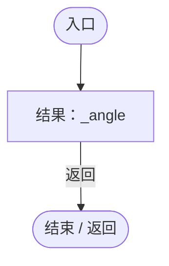
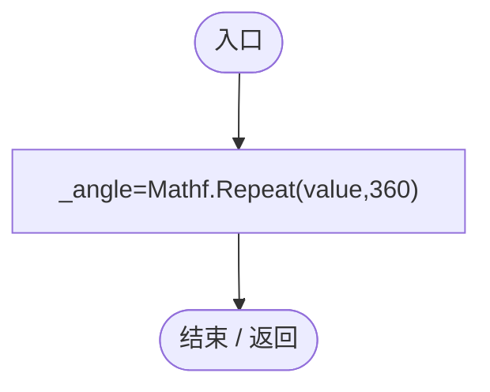
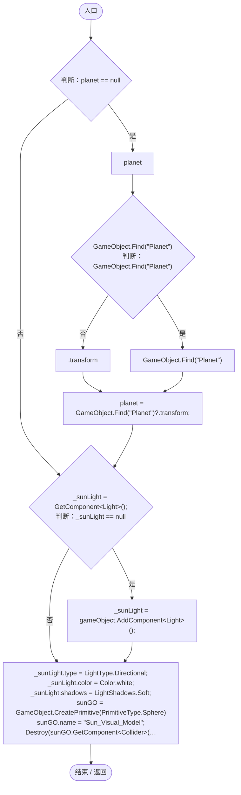
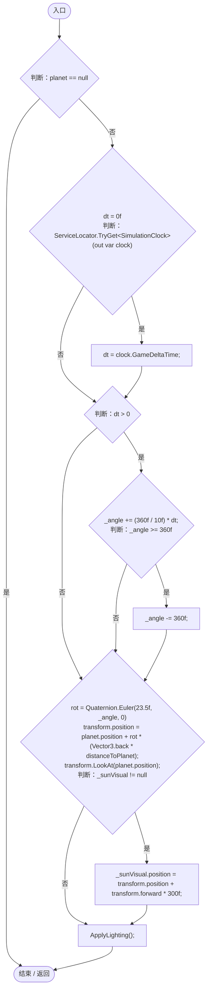
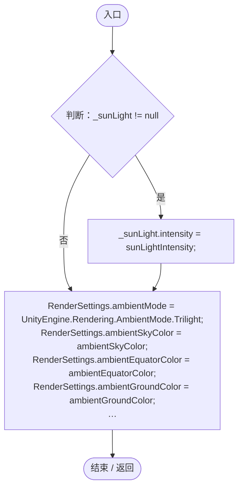

# SunSystem.cs

[返回总索引](../README.md) · `Runtime` · `Assets/DarwinPark/Planet/SunSystem.cs`

[源文件](../../../Assets/DarwinPark/Planet/SunSystem.cs) · 源码校验：`dd06aeb9224ca05c4ee23de3f7e4375c7dd5fae610c79c34dff5b22d55abca2c`

方法按源文件位置排列。事件/回调引用不表示立即执行；分支与异常说明见总索引。完整源码与可点击关系图请打开离线手册。

## OrbitAngle.get · L27

`get`

### Editor / Player · Roslyn编译器控制流

## OrbitAngle.set · L27

`set`

### Editor / Player · Roslyn编译器控制流

## Start · L29

`void Start()`

### Editor / Player · Roslyn编译器控制流

项目内调用/回调引用：

- [SunSystem.ApplyLighting · L79](15af8ca97f781b7f.md#m996371dc1cba8fbc)（方法）

## Update · L52

`void Update()`

### Editor / Player · Roslyn编译器控制流

项目内调用/回调引用：

- [ServiceLocator.TryGet · L26](f2fdbe9f9ccd93cb.md#m143b24e6d58471b0)（方法）
- [SimulationClock.GameDeltaTime.get · L26](a8f444aec9614b0a.md#me7f11abae18a4f2d)（访问器）
- [SunSystem.ApplyLighting · L79](15af8ca97f781b7f.md#m996371dc1cba8fbc)（方法）

## ApplyLighting · L79

`private void ApplyLighting()`

### Editor / Player · Roslyn编译器控制流

