# ColonyFoodSafetyRegression.cs

[返回总索引](../README.md) · `Editor` · `Assets/DarwinPark/Editor/ColonyFoodSafetyRegression.cs`

[源文件](../../../Assets/DarwinPark/Editor/ColonyFoodSafetyRegression.cs) · 源码校验：`ac4f968b60d822b5452fee0316f3945e970db1db1184ccdc92b5dc4b6ce61bda`

方法按源文件位置排列。事件/回调引用不表示立即执行；分支与异常说明见总索引。完整源码与可点击关系图请打开离线手册。

## Check · L18

`private static void Check(bool value,string text)`

### Editor · Roslyn编译器控制流

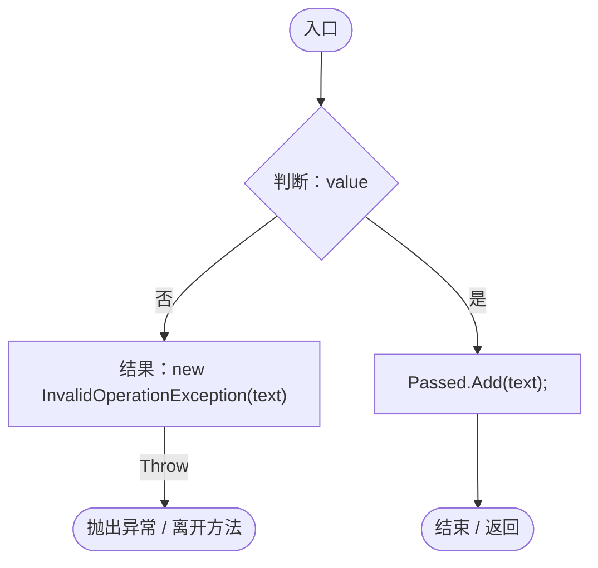

## Fill · L19

`private static void Fill(AntColonyMember member,float food,float reserve=0)`

### Editor · Roslyn编译器控制流

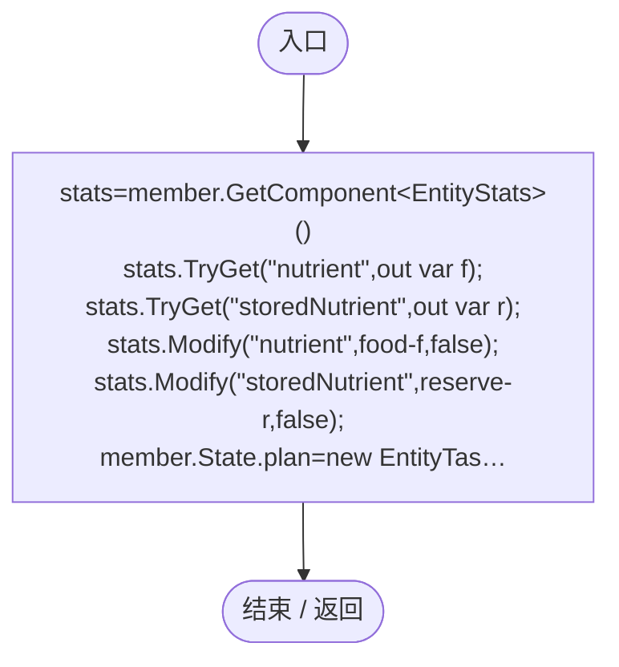

项目内调用/回调引用：

- [EntityStats.TryGet · L90](75aa86a368efdf24.md#m24ee1433e4a70d94)（方法）
- [EntityStats.Modify · L111](75aa86a368efdf24.md#m9c837be197158240)（方法）
- [AntColonyMember.State.get · L32](baebd85c05598377.md#m426db6a7c12dd7aa)（访问器）

## Food · L21

`private static float Food(AntColonyMember member)`

### Editor · Roslyn编译器控制流

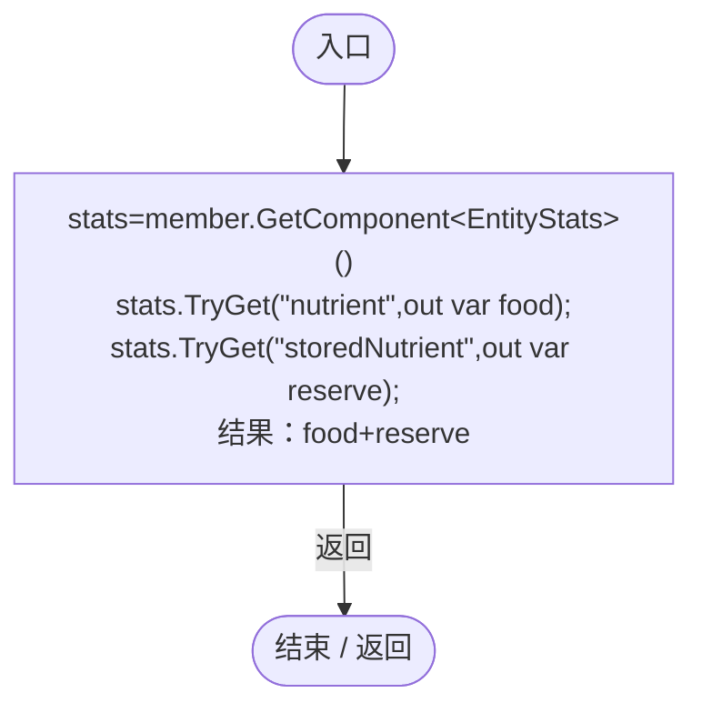

项目内调用/回调引用：

- [EntityStats.TryGet · L90](75aa86a368efdf24.md#m24ee1433e4a70d94)（方法）

## Verify · L23

`public static void Verify(AntColonyMember queen,AntColonyMember worker,AntColonyMember soldier,AntColonyMember young)`

### Editor · Roslyn编译器控制流

```mermaid
flowchart TD
  b0(["入口"])
  b1["Passed.Clear();<br/>tuning=GameplayTuning.Current<br/>backup=tuning.colonyShareBackupFood<br/>members=new[]{queen,worker,soldier,young}<br/>group=queen.GroupId<br/>positions=members.Select(m=&gt;m.transform.position).ToArray()<br/>states=members.Select(m=&gt;m.Captur…"]
  b2["originals"]
  b3{"判断：originals"}
  b4["var<br/>resource.gameObject.SetActive(false);"]
  b5{"originals<br/>判断：originals"}
  b6["originals"]
  b7["连接 / 离开区域"]
  b8["created=new List&lt;ColonyResource&gt;()<br/>here=positions[0]<br/>up=EcologyQueries.Up(here)"]
  b9{"up<br/>判断：Mathf.Abs(up.y)&gt;.9f"}
  b10["Vector3.right"]
  b11["Vector3.up"]
  b12["tangent=Vector3.Cross(up,Mathf.Abs(up.y)&gt;.9f?Vector3.right:Vector3.up).normalized"]
  b13["invalidThreshold=false"]
  b14["GameplayTuning.Parse(&quot;{\&quot;version\&quot;:1,\&quot;colonyEmergencyFeedThreshold\&quot;:11}&quot;);"]
  b15["invalidThreshold=true;"]
  b16["Check(invalidThreshold,&quot;拒绝超过饱食容量的紧急补给线&quot;);<br/>tuning.colonyShareBackupFood=true;"]
  b17["members"]
  b18{"判断：members"}
  b19["var<br/>member.transform.position=here;"]
  b20{"members<br/>判断：members"}
  b21["members"]
  b22["连接 / 离开区域"]
  b23["Fill(queen,10,100);<br/>nursery=Make(ColonyResourceKind.Nursery,100,here)<br/>Fill(soldier,0);<br/>energy=nursery.State.energy<br/>ColonyResource.Feed(soldier,1);"]
  b24{"判断：Food(soldier)&gt;0"}
  b25["Mathf.Abs(energy-nursery.State.energy-Food(soldier))&lt;.001f"]
  b26["Food(soldier)&gt;0"]
  b27["Check(Food(soldier)&gt;0&amp;&amp;Mathf.Abs(energy-nursery.State.energy-Food(soldier))&lt;.001f,&quot;成年士兵只有育幼块时实际吸收且能量守恒&quot;);"]
  b28["Fill(worker,0);<br/>ColonyResource.Feed(worker,1);<br/>Check(Food(worker)&gt;0,&quot;工匠没有成年补给点时可借用育幼块&quot;);<br/>Clear();<br/>supply=Make(ColonyResourceKind.Supply,100,here)<br/>Fill(queen,0);<br/>ColonyResource.Feed(queen,1);<br/>Check(Food(queen)&gt;0,&quot;王后只有成年补给时可以实际进食&quot;);<br/>Fill(y…"]
  b29{"判断：ColonyFeeding.Find(queen,false)==nursery"}
  b30["ColonyFeeding.Find(soldier,false)==supply"]
  b31["ColonyFeeding.Find(queen,false)==nursery"]
  b32["Check(ColonyFeeding.Find(queen,false)==nursery&amp;&amp;ColonyFeeding.Find(soldier,false)==supply,&quot;两类补给均可用时保留各分工的专用点优先&quot;);"]
  b33["Clear();<br/>supply=Make(ColonyResourceKind.Supply,100,At(35));<br/>local=Make(ColonyResourceKind.Supply,100,here)<br/>Fill(soldier,0);"]
  b34["soldier.State.plan<br/>new EntityTaskPlanSave{feeding=true,supply=supply.State.id}<br/>feeding=true<br/>supply=supply.State.id<br/>soldier.State.plan=new EntityTaskPlanSave{feeding=true,supply=supply.State.id};"]
  b35["energy=local.State.energy;<br/>ColonyResource.Feed(soldier,1);"]
  b36{"判断：Food(soldier)&gt;0"}
  b37{"判断：local.State.energy&lt;energy"}
  b38["supply.State.energy==100"]
  b39["Food(soldier)&gt;0&amp;&amp;local.State.energy&lt;energy&amp;&amp;supply.State.energy==100"]
  b40["Check(Food(soldier)&gt;0&amp;&amp;local.State.energy&lt;energy&amp;&amp;supply.State.energy==100,&quot;远处锁定补给不阻止吃身边真实能量块&quot;);"]
  b41["corpses=new List&lt;ColonyResource&gt;()"]
  b42["i=0"]
  b43{"判断：i&lt;300"}
  b44["corpses.Add(Make(ColonyResourceKind.Corpse,10,At(60)));<br/>i++"]
  b45["Check(ColonyFoodSources.Count==2,&quot;300具尸体不进入进食候选索引&quot;);<br/>local.transform.position=At(AntColonySettings.Current.feedRadius+2);<br/>local.State.kind=ColonyResourceKind.Nursery;<br/>Fill(queen,10,100);<br/>Fill(soldier,1);"]
  b46["soldier.State.plan<br/>new EntityTaskPlanSave{feeding=true,supply=supply.State.id}<br/>feeding=true<br/>supply=supply.State.id<br/>soldier.State.plan=new EntityTaskPlanSave{feeding=true,supply=supply.State.id};"]
  b47["Check(ColonyFeeding.Find(soldier,false)==local,&quot;饱食危急时解除远处计划，选择进食半径外更近的备用块&quot;);<br/>Fill(soldier,8);"]
  b48["soldier.State.plan<br/>new EntityTaskPlanSave{feeding=true,supply=supply.State.id}<br/>feeding=true<br/>supply=supply.State.id<br/>soldier.State.plan=new EntityTaskPlanSave{feeding=true,supply=supply.State.id};"]
  b49["Check(ColonyFeeding.Find(soldier,false)==supply,&quot;饱食未危急时保持有效远处计划，不反复抢占目标&quot;);<br/>local.transform.position=here;<br/>local.State.kind=ColonyResourceKind.Supply;<br/>visits=ColonyFoodSources.CandidateVisits<br/>Fill(soldier,0);<br/>ColonyFeeding.Find(soldier,fa…"]
  b50{"判断：nursery.State.energy&gt;=AntColonySettings.Current.queenFeedThreshold"}
  b51["Food(soldier)&gt;0"]
  b52["nursery.State.energy&gt;=AntColonySettings.Current.queenFeedThreshold"]
  b53["Check(nursery.State.energy&gt;=AntColonySettings.Current.queenFeedThreshold&amp;&amp;Food(soldier)&gt;0,&quot;成年成员借用育幼块仍预留饥饿王后的最低口粮&quot;);"]
  b54["ColonyResource.Feed(queen,1);<br/>Check(Food(queen)&gt;0,&quot;王后抵达后可以吃预留口粮&quot;);<br/>Clear();<br/>foreign=Guid.NewGuid().ToString(&quot;N&quot;)<br/>queen.Population.JoinColony(foreign,true);<br/>supply=Make(ColonyResourceKind.Supply,100,here,foreign);<br/>Fill(soldier,0);<br/>ColonyR…"]
  b55{"判断：Food(soldier)==0"}
  b56["supply.State.energy==100"]
  b57["Food(soldier)==0"]
  b58["Check(Food(soldier)==0&amp;&amp;supply.State.energy==100,&quot;备用进食不偷取仍有存活成员的外群补给&quot;);"]
  b59["queen.Population.JoinColony(group,true);<br/>supply.State.group=Guid.NewGuid().ToString(&quot;N&quot;);<br/>ColonyResource.Feed(soldier,1);"]
  b60{"判断：Food(soldier)&gt;0"}
  b61["supply.State.group==group"]
  b62["Food(soldier)&gt;0"]
  b63["Check(Food(soldier)&gt;0&amp;&amp;supply.State.group==group,&quot;废弃补给在真实吸收时领取并恢复归属&quot;);"]
  b64["Clear();<br/>supply=Make(ColonyResourceKind.Supply,100,At(15));<br/>Fill(queen,0);<br/>queen.State.founding=true;<br/>queen.State.foundingPoint=EcologyQueries.ToLocal(At(-45));<br/>queen.Destination(out var destination,out _,out _);"]
  b65{"判断：EcologyQueries.Distance(destination,supply.transform.position)&lt;=AntColonySettings.Current.feedRadius"}
  b66["queen.Activity==ColonyActivity.Feed"]
  b67["EcologyQueries.Distance(destination,supply.transform.position)&lt;=AntColonySettings.Current.feedRadius"]
  b68["Check(EcologyQueries.Distance(destination,supply.transform.position)&lt;=AntColonySettings.Current.feedRadius&amp;&amp;queen.Activity==ColonyActivity.Feed,&quot;迁居中王后先前往可用补给而不是继续饿着赶路&quot;);"]
  b69["Check(EntityTaskPlan.Priority(ColonyActivity.Feed)&gt;EntityTaskPlan.Priority(ColonyActivity.Founding),&quot;补给优先级高于建群迁居&quot;);<br/>founding=queen.State.foundingPoint<br/>Fill(queen,10,100);<br/>queen.Destination(out destination,out _,out _);"]
  b70{"判断：queen.State.founding"}
  b71{"判断：queen.State.foundingPoint==founding"}
  b72["destination==EcologyQueries.ToWorld(founding)"]
  b73["queen.State.founding&amp;&amp;queen.State.foundingPoint==founding&amp;&amp;destination==EcologyQueries.ToWorld(founding)"]
  b74["Check(queen.State.founding&amp;&amp;queen.State.foundingPoint==founding&amp;&amp;destination==EcologyQueries.ToWorld(founding),&quot;吃饱后恢复原建群目标，不丢失迁居计划&quot;);"]
  b75["queen.State.founding=false;<br/>Clear();<br/>supply=Make(ColonyResourceKind.Supply,10000,here);"]
  b76["members"]
  b77{"判断：members"}
  b78["var<br/>member.transform.position=here;<br/>Fill(member,0);<br/>member.State.reproductionCooldown=10000;<br/>member.State.reproductionTimer=10000;"]
  b79{"members<br/>判断：members"}
  b80["members"]
  b81["连接 / 离开区域"]
  b82["health=members.Select(m=&gt;{m.GetComponent&lt;EntityStats&gt;().TryGet(&quot;health&quot;,out var hp);return hp;}).ToArray()"]
  b83["tick=0"]
  b84{"判断：tick&lt;1200"}
  b85["members"]
  b86{"判断：members"}
  b87["var<br/>member.Advance(.1f);<br/>member.GetComponent&lt;EntityVitals&gt;().AdvanceShared(.1f);"]
  b88{"members<br/>判断：members"}
  b89["members"]
  b90["连接 / 离开区域"]
  b91["tick++"]
  b92{"判断：members.All(m=&gt;Food(m)&gt;0)"}
  b93["members.Select((m,i)=&gt;m.GetComponent&lt;EntityStats&gt;().TryGet(&quot;health&quot;,out var hp)&amp;&amp;hp&gt;=health[i]).All(ok=&gt;ok)"]
  b94["members.All(m=&gt;Food(m)&gt;0)"]
  b95["Check(members.All(m=&gt;Food(m)&gt;0)&amp;&amp;members.Select((m,i)=&gt;m.GetComponent&lt;EntityStats&gt;().TryGet(&quot;health&quot;,out var hp)&amp;&amp;hp&gt;=health[i]).All(ok=&gt;ok),&quot;王后幼体工匠士兵连续120秒真实分工和代谢更新均能吃单类补给且不饿死&quot;);"]
  b96{"判断：supply.State.energy&gt;0"}
  b97["supply.State.energy&lt;10000"]
  b98["supply.State.energy&gt;0"]
  b99["Check(supply.State.energy&gt;0&amp;&amp;supply.State.energy&lt;10000,&quot;连续补给实际扣减有限能量，没有凭空恢复饱食度&quot;);"]
  b100["Clear();<br/>Check(ColonyFoodSources.Count==0,&quot;测试资源清场后食物索引不残留&quot;);<br/>folder=Path.GetFullPath(&quot;Artifacts/ColonyFoodSafetyReview&quot;)<br/>Directory.CreateDirectory(folder);<br/>File.WriteAllText(Path.Combine(folder,&quot;result.txt&quot;),&quot;PASS\n&quot;+string.Join(&quot;\n&quot;,Pas…"]
  b101["Clear();<br/>queen.Population.JoinColony(group,true);<br/>tuning.colonyShareBackupFood=backup;"]
  b102["i=0"]
  b103{"判断：i&lt;members.Length"}
  b104["members[i].transform.position=positions[i];<br/>members[i].Genes.CurrentAge=ages[i];<br/>members[i].GetComponent&lt;EntityStats&gt;().RestoreValues(values[i]);<br/>members[i].Restore(states[i]);<br/>i++"]
  b105["originals"]
  b106{"判断：originals"}
  b107{"var<br/>判断：resource!=null"}
  b108["resource.gameObject.SetActive(true);"]
  b109{"originals<br/>判断：originals"}
  b110["originals"]
  b111["连接 / 离开区域"]
  b112["连接 / 离开区域"]
  b113(["结束 / 返回"])
  b0 --> b1
  b1 --> b2
  b2 --> b3
  b3 -->|"是"| b4
  b3 -->|"否 · 经过finally 5"| b8
  b4 --> b3
  b5 -->|"否"| b6
  b5 -->|"是"| b7
  b6 --> b7
  b8 --> b9
  b9 -->|"是"| b10
  b9 -->|"否"| b11
  b10 --> b12
  b11 --> b12
  b12 --> b13
  b13 --> b14
  b14 --> b16
  b15 --> b16
  b16 --> b17
  b17 --> b18
  b18 -->|"是"| b19
  b18 -->|"否 · 经过finally 20"| b23
  b19 --> b18
  b20 -->|"否"| b21
  b20 -->|"是"| b22
  b21 --> b22
  b23 --> b24
  b24 -->|"是"| b25
  b24 -->|"否"| b26
  b25 --> b27
  b26 --> b27
  b27 --> b28
  b28 --> b29
  b29 -->|"是"| b30
  b29 -->|"否"| b31
  b30 --> b32
  b31 --> b32
  b32 --> b33
  b33 --> b34
  b34 --> b35
  b35 --> b36
  b36 -->|"是"| b37
  b36 -->|"否"| b39
  b37 -->|"是"| b38
  b37 -->|"否"| b39
  b38 --> b40
  b39 --> b40
  b40 --> b41
  b41 --> b42
  b42 --> b43
  b43 -->|"是"| b44
  b43 -->|"否"| b45
  b44 --> b43
  b45 --> b46
  b46 --> b47
  b47 --> b48
  b48 --> b49
  b49 --> b50
  b50 -->|"是"| b51
  b50 -->|"否"| b52
  b51 --> b53
  b52 --> b53
  b53 --> b54
  b54 --> b55
  b55 -->|"是"| b56
  b55 -->|"否"| b57
  b56 --> b58
  b57 --> b58
  b58 --> b59
  b59 --> b60
  b60 -->|"是"| b61
  b60 -->|"否"| b62
  b61 --> b63
  b62 --> b63
  b63 --> b64
  b64 --> b65
  b65 -->|"是"| b66
  b65 -->|"否"| b67
  b66 --> b68
  b67 --> b68
  b68 --> b69
  b69 --> b70
  b70 -->|"是"| b71
  b70 -->|"否"| b73
  b71 -->|"是"| b72
  b71 -->|"否"| b73
  b72 --> b74
  b73 --> b74
  b74 --> b75
  b75 --> b76
  b76 --> b77
  b77 -->|"是"| b78
  b77 -->|"否 · 经过finally 79"| b82
  b78 --> b77
  b79 -->|"否"| b80
  b79 -->|"是"| b81
  b80 --> b81
  b82 --> b83
  b83 --> b84
  b84 -->|"是"| b85
  b84 -->|"否"| b92
  b85 --> b86
  b86 -->|"是"| b87
  b86 -->|"否 · 经过finally 88"| b91
  b87 --> b86
  b88 -->|"否"| b89
  b88 -->|"是"| b90
  b89 --> b90
  b91 --> b84
  b92 -->|"是"| b93
  b92 -->|"否"| b94
  b93 --> b95
  b94 --> b95
  b95 --> b96
  b96 -->|"是"| b97
  b96 -->|"否"| b98
  b97 --> b99
  b98 --> b99
  b99 --> b100
  b100 -->|"经过finally 101"| b113
  b101 --> b102
  b102 --> b103
  b103 -->|"是"| b104
  b103 -->|"否"| b105
  b104 --> b103
  b105 --> b106
  b106 -->|"是"| b107
  b106 -->|"否 · 经过finally 109"| b112
  b107 -->|"是"| b108
  b107 -->|"否"| b106
  b108 --> b106
  b109 -->|"否"| b110
  b109 -->|"是"| b111
  b110 --> b111
  b3 -. "退出保护区时 finally（示意）" .-> b5
  b14 -. "保护区可能异常（示意）" .-> b15
  b18 -. "退出保护区时 finally（示意）" .-> b20
  b77 -. "退出保护区时 finally（示意）" .-> b79
  b86 -. "退出保护区时 finally（示意）" .-> b88
  b13 -. "退出保护区时 finally（示意）" .-> b101
  b106 -. "退出保护区时 finally（示意）" .-> b109

```

项目内调用/回调引用：

- [GameplayTuning.Current.get · L44](db546e5713b32d53.md#m5713e7f86902b6fa)（访问器）
- [EcologyQueries.Up · L41](bdf7ccc2c9c0452f.md#maca7070196f125fd)（方法）
- [GameplayTuning.Parse · L45](db546e5713b32d53.md#m1c90d248aa005a56)（方法）
- [ColonyFoodSafetyRegression.Check · L18](15da375185c991ea.md#m46ff7b92076784dd)（方法）
- [ColonyFoodSafetyRegression.Fill · L19](15da375185c991ea.md#m0f5ce87f231a3a32)（方法）
- [ColonyFoodSafetyRegression.Make · L28](15da375185c991ea.md#m98b43cd0c13ad2b2)（局部函数）
- [ColonyResource.State.get · L24](293dbaecfff4b585.md#m41824f1a0e160aa5)（访问器）
- [ColonyResource.Feed · L94](293dbaecfff4b585.md#m173f86b0990bddd7)（方法）
- [ColonyFoodSafetyRegression.Food · L21](15da375185c991ea.md#me2cd6fb119bb1b47)（方法）
- [ColonyFoodSafetyRegression.Clear · L30](15da375185c991ea.md#m8a1bf35420c7ca7b)（局部函数）
- [ColonyFeeding.Find · L11](2cb56c08d08ff8ec.md#mfea041f7d0713775)（方法）
- [ColonyFoodSafetyRegression.At · L32](15da375185c991ea.md#m4c7c64e085a60b74)（局部函数）
- [AntColonyMember.State.get · L32](baebd85c05598377.md#m426db6a7c12dd7aa)（访问器）
- [AntColonySettings.Current.get · L31](cb0a937e97c8fbb3.md#mcd121159f407ccdf)（访问器）
- [ColonyFoodSources.CandidateVisits.get · L14](4c419a1a067d428c.md#m1ba5574cdb12eab4)（访问器）
- [ColonyResource.Remove · L108](293dbaecfff4b585.md#mb9333347c7434224)（方法）
- [PopulationBehavior.JoinColony · L123](21e4f62f75a9a80f.md#m570adce7c88ec55a)（方法）
- [AntColonyMember.Population.get · L35](baebd85c05598377.md#mbb8ec90c4baa2d1c)（访问器）
- [EcologyQueries.ToLocal · L39](bdf7ccc2c9c0452f.md#m1a07639eacf3aa47)（方法）
- [AntColonyMember.Destination · L148](baebd85c05598377.md#m030342cf009df4b1)（方法）
- [EcologyQueries.Distance · L42](bdf7ccc2c9c0452f.md#mba9c3e3c95d0f2dd)（方法）
- [AntColonyMember.Activity.get · L50](baebd85c05598377.md#m50ece4c10946f98c)（访问器）
- [EntityTaskPlan.Priority · L19](da041665b1125ffc.md#mf4050bd85d0733de)（方法）
- [EcologyQueries.ToWorld · L40](bdf7ccc2c9c0452f.md#m320932c05ccecbf7)（方法）
- [AntColonyMember.Advance · L89](baebd85c05598377.md#md2a4dbccd9bd3897)（方法）
- [EntityVitals.AdvanceShared · L47](7f68ee05c2ac84bc.md#m891aed9a6cea7c6d)（方法）
- [EntityGeneController.CurrentAge.set · L37](7494d53178552f0e.md#md8993fc83a0c41da)（访问器）
- [AntColonyMember.Genes.get · L33](baebd85c05598377.md#m7331eee1fdd98961)（访问器）
- [EntityStats.RestoreValues · L88](75aa86a368efdf24.md#m774f994eaa3183ca)（方法）
- [AntColonyMember.Restore · L207](baebd85c05598377.md#m68e2bc53aa043fed)（方法）
- [ColonyFoodSafetyRegression.回调@26 · L26](15da375185c991ea.md#maeee606036ff5f4b)（回调/委托）
- [ColonyFoodSafetyRegression.回调@26 · L26](15da375185c991ea.md#m64b706dec75d55bc)（回调/委托）
- [ColonyFoodSafetyRegression.回调@26 · L26](15da375185c991ea.md#m2db28a383acd79a8)（回调/委托）
- [ColonyFoodSafetyRegression.回调@26 · L26](15da375185c991ea.md#m9cb456b29663f485)（回调/委托）
- [ColonyFoodSafetyRegression.回调@70 · L70](15da375185c991ea.md#mdd600dfc57c99180)（回调/委托）
- [ColonyFoodSafetyRegression.回调@72 · L72](15da375185c991ea.md#m5aed9b27d47d7106)（回调/委托）
- [ColonyFoodSafetyRegression.回调@72 · L72](15da375185c991ea.md#m851ac3c4c87b9a58)（回调/委托）
- [ColonyFoodSafetyRegression.回调@72 · L72](15da375185c991ea.md#mfec1af0715569c35)（回调/委托）

## 回调@26 · L26

`m … => 回调`

### Editor · Roslyn编译器控制流

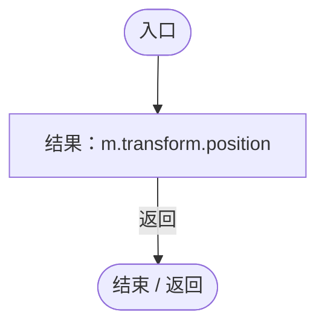

## 回调@26 · L26

`m … => 回调`

### Editor · Roslyn编译器控制流

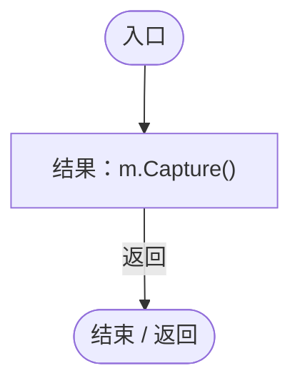

项目内调用/回调引用：

- [AntColonyMember.Capture · L205](baebd85c05598377.md#m531752838d6923c2)（方法）

## 回调@26 · L26

`m … => 回调`

### Editor · Roslyn编译器控制流

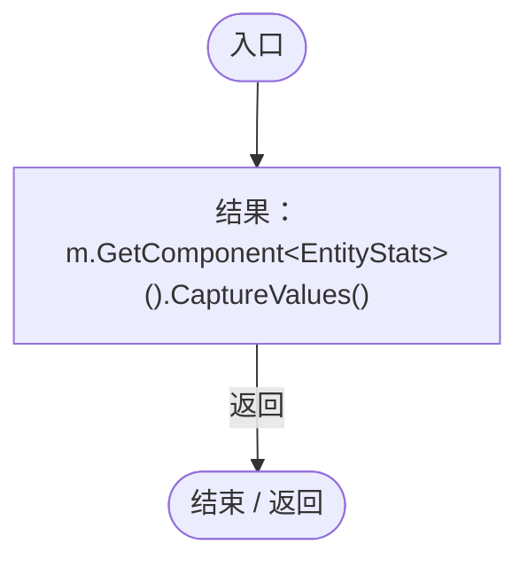

项目内调用/回调引用：

- [EntityStats.CaptureValues · L86](75aa86a368efdf24.md#mbf54fc67f0d07a99)（方法）

## 回调@26 · L26

`m … => 回调`

### Editor · Roslyn编译器控制流

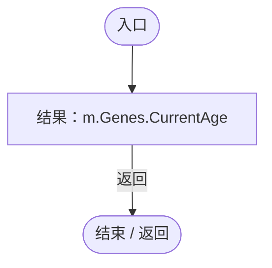

项目内调用/回调引用：

- [EntityGeneController.CurrentAge.get · L37](7494d53178552f0e.md#md08823d8f9a2fa16)（访问器）
- [AntColonyMember.Genes.get · L33](baebd85c05598377.md#m7331eee1fdd98961)（访问器）

## Make · L28

`ColonyResource Make(ColonyResourceKind kind,float energy,Vector3 point,string owner=null)`

### Editor · Roslyn编译器控制流

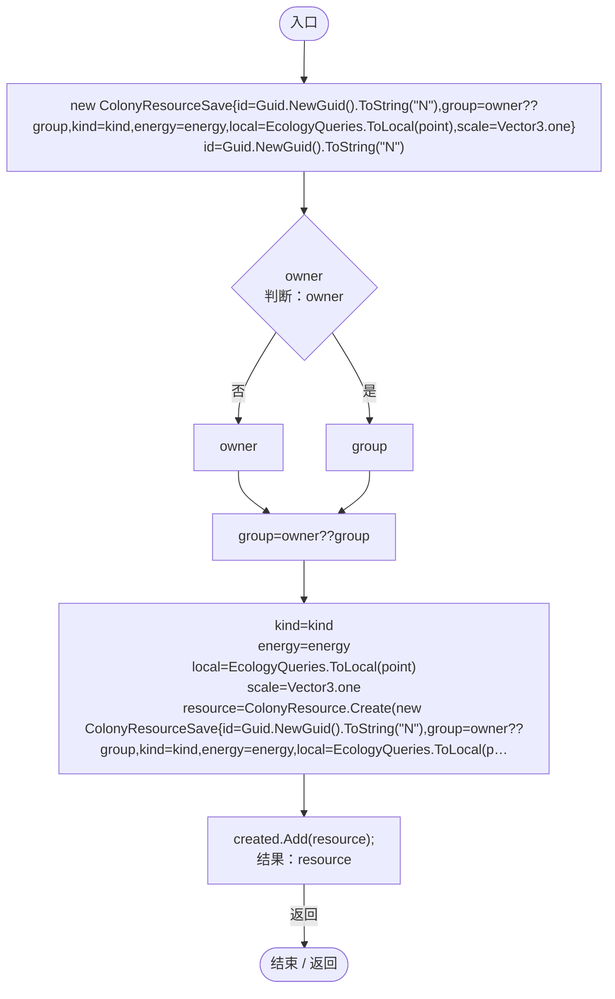

项目内调用/回调引用：

- [ColonyResource.Create · L45](293dbaecfff4b585.md#m7e8d2b0e06e1cad5)（方法）
- [EcologyQueries.ToLocal · L39](bdf7ccc2c9c0452f.md#m1a07639eacf3aa47)（方法）

## Clear · L30

`void Clear()`

### Editor · Roslyn编译器控制流

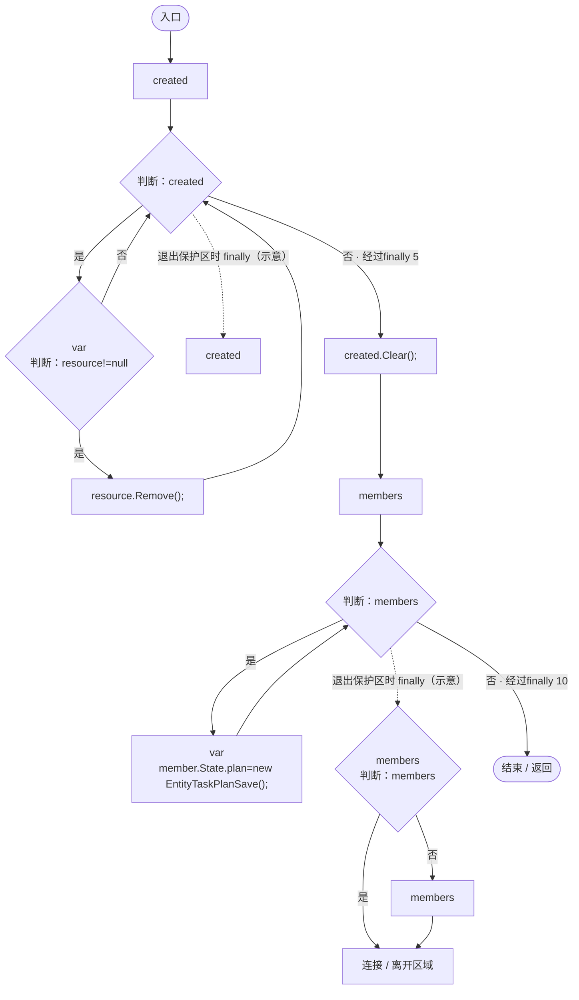

项目内调用/回调引用：

- [ColonyResource.Remove · L108](293dbaecfff4b585.md#mb9333347c7434224)（方法）
- [AntColonyMember.State.get · L32](baebd85c05598377.md#m426db6a7c12dd7aa)（访问器）

## At · L32

`Vector3 At(float distance)`

### Editor · Roslyn编译器控制流

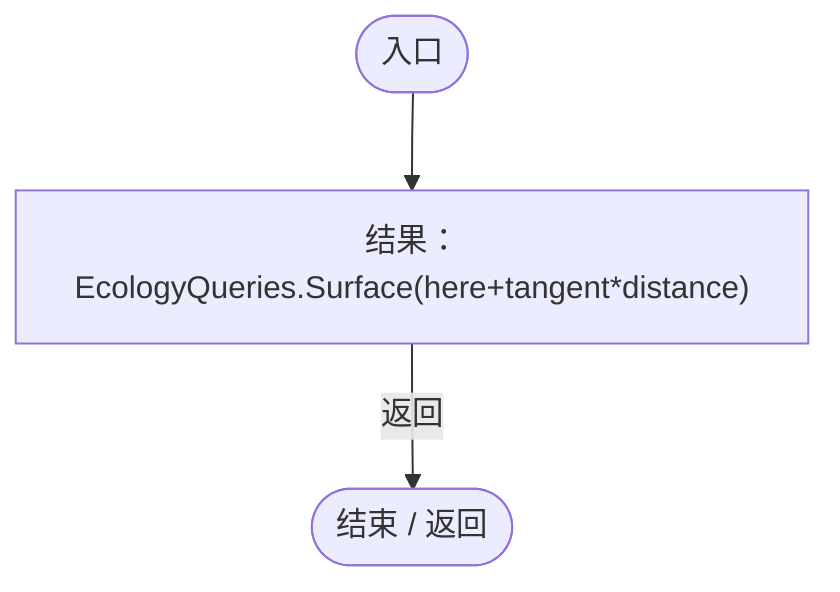

项目内调用/回调引用：

- [EcologyQueries.Surface · L47](bdf7ccc2c9c0452f.md#m2f1f6873ee5fc8df)（方法）

## 回调@70 · L70

`m … => 回调`

### Editor · Roslyn编译器控制流

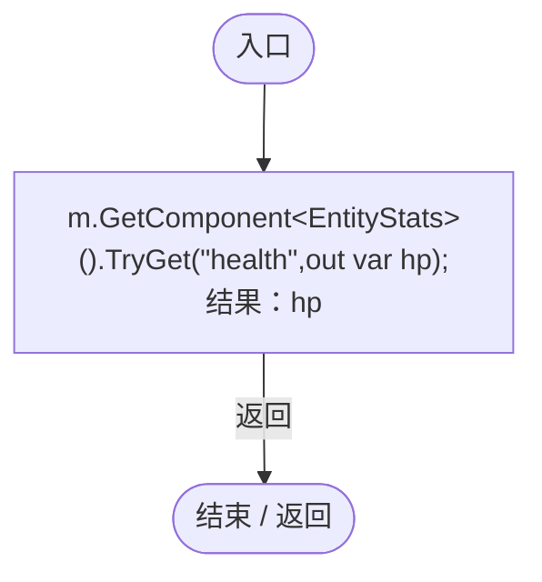

项目内调用/回调引用：

- [EntityStats.TryGet · L90](75aa86a368efdf24.md#m24ee1433e4a70d94)（方法）

## 回调@72 · L72

`m … => 回调`

### Editor · Roslyn编译器控制流

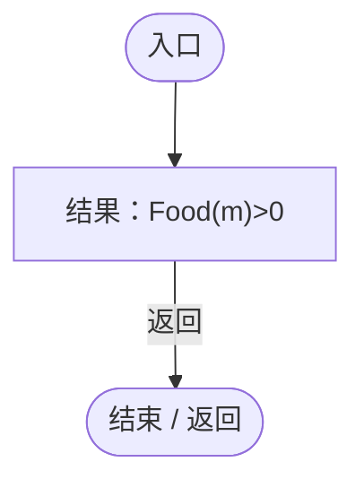

项目内调用/回调引用：

- [ColonyFoodSafetyRegression.Food · L21](15da375185c991ea.md#me2cd6fb119bb1b47)（方法）

## 回调@72 · L72

`( … => 回调`

### Editor · Roslyn编译器控制流

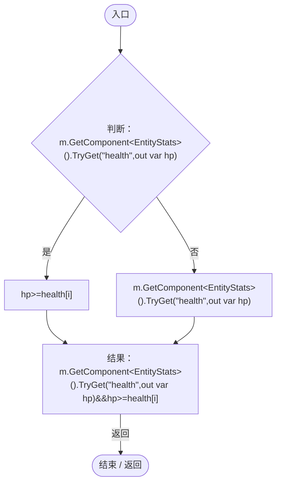

项目内调用/回调引用：

- [EntityStats.TryGet · L90](75aa86a368efdf24.md#m24ee1433e4a70d94)（方法）

## 回调@72 · L72

`ok … => 回调`

### Editor · Roslyn编译器控制流

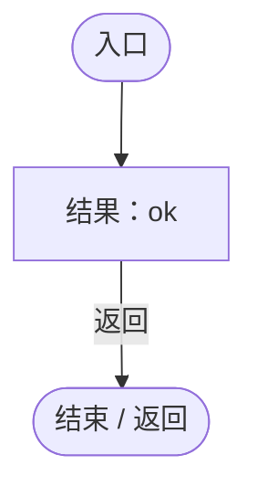
