# PopulationArchiveRegression.cs

[返回总索引](../README.md) · `Editor` · `Assets/DarwinPark/Editor/PopulationArchiveRegression.cs`

[源文件](../../../Assets/DarwinPark/Editor/PopulationArchiveRegression.cs) · 源码校验：`848f70419e08bda0ad12bb714d789042c6599f054e7f2f360ca930075cbb3b84`

方法按源文件位置排列。事件/回调引用不表示立即执行；分支与异常说明见总索引。完整源码与可点击关系图请打开离线手册。

<a id="m02c0bbeac856eb9d"></a>

## Folder.get · L28

`private static string Folder`


### Editor · 语法控制结构 / 声明（非CFG）

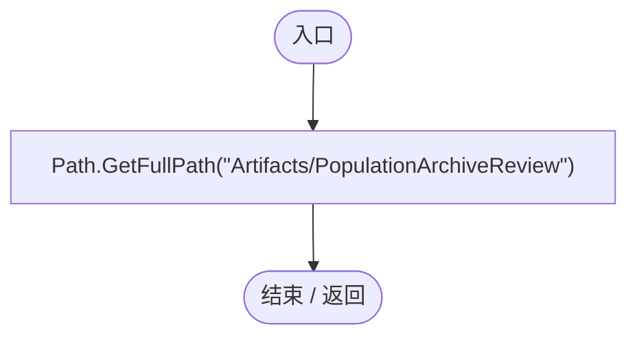

<a id="m874137c4aeb487b9"></a>

## PopulationArchiveRegression.ctor · L29

`static PopulationArchiveRegression()`


### Editor · Roslyn编译器控制流

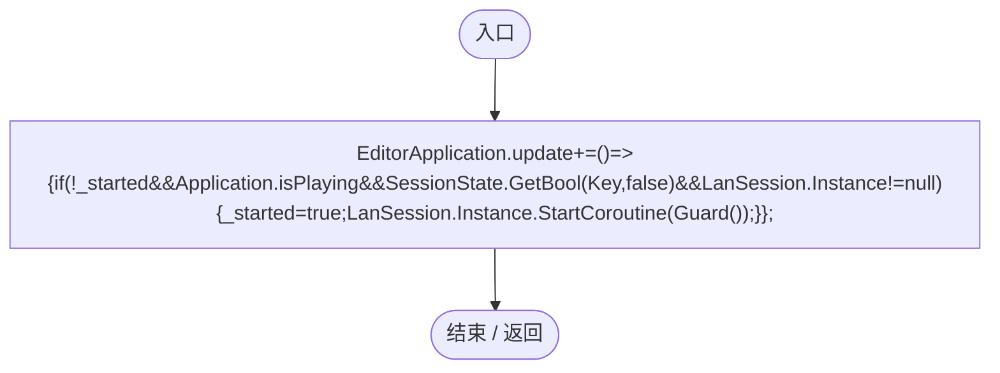

项目内调用/回调引用：

- [PopulationArchiveRegression.回调@29 · L29](17091ce4f3e6bbb1.md#mdabd02c73bd707cc)（回调/委托）

<a id="mdabd02c73bd707cc"></a>

## 回调@29 · L29

`( … => 回调`


### Editor · Roslyn编译器控制流

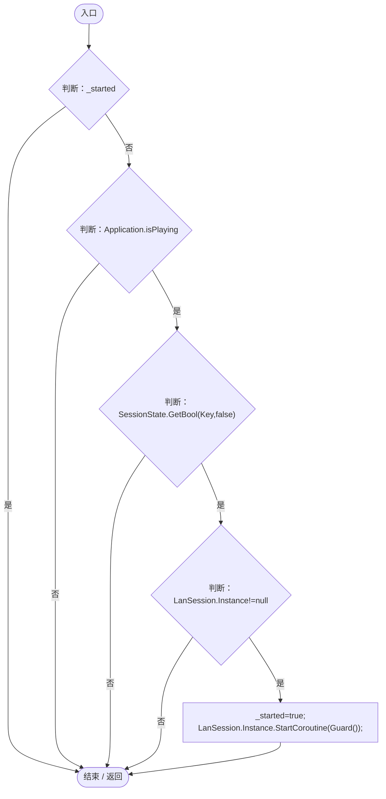

项目内调用/回调引用：

- [LanSession.Instance.get · L23](9fb633eebffe669c.md#mbf83306994878383)（访问器）
- [PopulationArchiveRegression.Guard · L32](17091ce4f3e6bbb1.md#m075e9edf8e85d096)（方法）

<a id="m4bdf87804cb1379c"></a>

## RunBatch · L30

`public static void RunBatch()`


### Editor · Roslyn编译器控制流

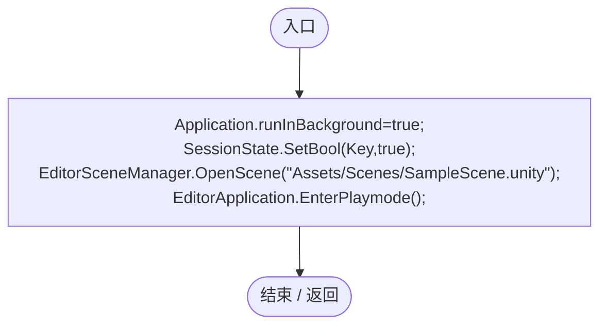

<a id="ma04f69f7d393e9b8"></a>

## Check · L31

`private static void Check(bool value,string text)`


### Editor · Roslyn编译器控制流

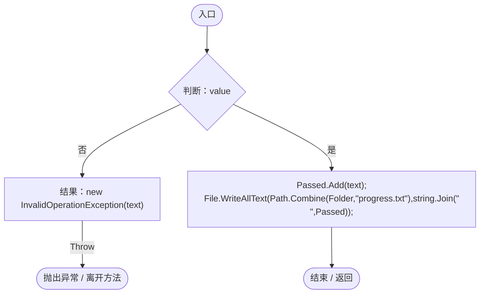

<a id="m075e9edf8e85d096"></a>

## Guard · L32

`private static IEnumerator Guard()`


### Editor · Roslyn编译器控制流

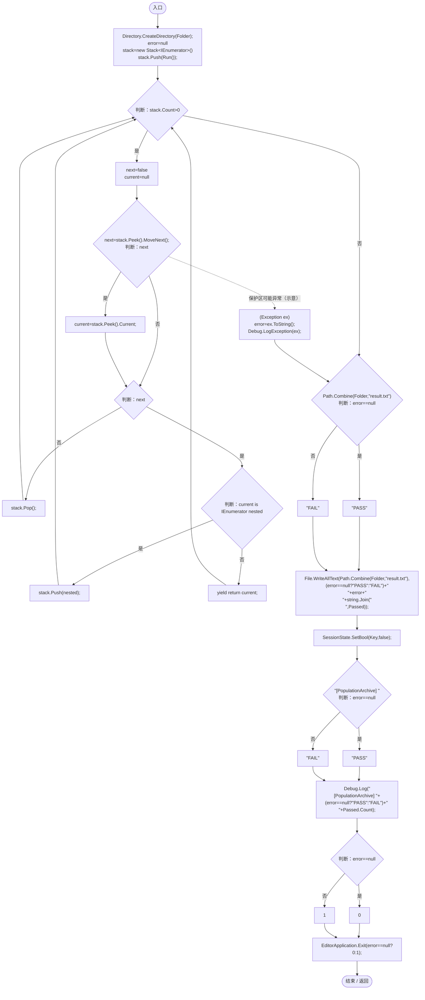

项目内调用/回调引用：

- [PopulationArchiveRegression.Run · L50](17091ce4f3e6bbb1.md#mc907a1f92f988769)（方法）

<a id="m1a507a401892b284"></a>

## Spawn · L38

`private static DarwinEntity Spawn(Vector3 point,string group,AntRole role,AgeState age=AgeState.Adult)`


### Editor · Roslyn编译器控制流

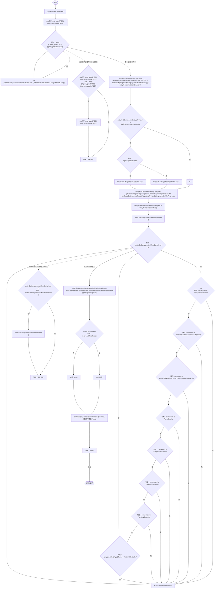

项目内调用/回调引用：

- [Genome.Add · L19](a2ef23f865bc7ee8.md#md9cfdc94b8b8d40f)（方法）
- [GeneInstance.Create · L20](f82e1498d67f5afd.md#m72e94c278de3cf8b)（方法）
- [GeneDatabase.Get · L135](ec0a03483435a863.md#m8f3bbfb35f3ca397)（方法）
- [DarwinEntity.Genes.get · L14](70798dde169f2e8b.md#m622eb1adf401d431)（访问器）
- [EntityLifeCycle.RestoreProgress · L48](9f4138bfbae654b7.md#mfc75121476d49679)（方法）
- [LifeCycleSettings.Load · L16](ace76969fe8f61de.md#mbd2925785484f343)（方法）
- [EntityGeneController.RestoreStageState · L51](7494d53178552f0e.md#m6264213de2a5ca6f)（方法）
- [EntityGeneController.Recalculate · L97](7494d53178552f0e.md#m65ea735c1e0e37a1)（方法）
- [AntColonyMember.Assign · L54](baebd85c05598377.md#mda0fe308acecb8f2)（方法）
- [AntColonyMember.Ensure · L51](baebd85c05598377.md#m408f716118716988)（方法）
- [PopulationArchiveRegression.回调@41 · L41](17091ce4f3e6bbb1.md#mdea20e3c664d8b6b)（回调/委托）

<a id="mdea20e3c664d8b6b"></a>

## 回调@41 · L41

`e … => 回调`


### Editor · Roslyn编译器控制流

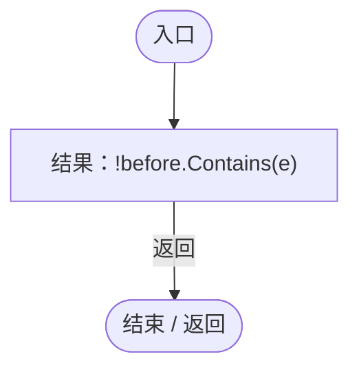

<a id="m07055f29b58eb4c4"></a>

## Capture · L45

`private static IEnumerator Capture(string file)`


### Editor · Roslyn编译器控制流

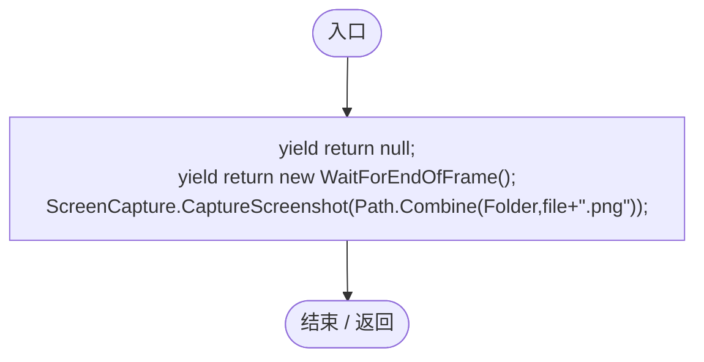

<a id="m4d2259ae038f017c"></a>

## Body · L47

`private static Renderer Body(DarwinEntity entity)`

★ 新增：检查实际身体材质槽的颜色，避免只验证配置字段却漏掉渲染或共享材质污染。

### Editor · Roslyn编译器控制流

```mermaid
flowchart TD
  b0(["入口"])
  b1["结果：entity.GetComponentsInChildren&lt;Renderer&gt;(true).First(r=&gt;r is MeshRenderer&#124;&#124;r is SkinnedMeshRenderer)"]
  b2(["结束 / 返回"])
  b0 --> b1
  b1 -->|"返回"| b2

```

项目内调用/回调引用：

- [PopulationArchiveRegression.回调@47 · L47](17091ce4f3e6bbb1.md#m25f192c2bcb40527)（回调/委托）

<a id="m25f192c2bcb40527"></a>

## 回调@47 · L47

`r … => 回调`


### Editor · Roslyn编译器控制流

```mermaid
flowchart TD
  b0(["入口"])
  b1{"判断：r is MeshRenderer"}
  b2["r is SkinnedMeshRenderer"]
  b3["r is MeshRenderer"]
  b4["结果：r is MeshRenderer&#124;&#124;r is SkinnedMeshRenderer"]
  b5(["结束 / 返回"])
  b0 --> b1
  b1 -->|"否"| b2
  b1 -->|"是"| b3
  b2 --> b4
  b3 --> b4
  b4 -->|"返回"| b5

```

<a id="mc7b507548928ae32"></a>

## BodyColor · L48

`private static Color BodyColor(Renderer renderer)`


### Editor · Roslyn编译器控制流

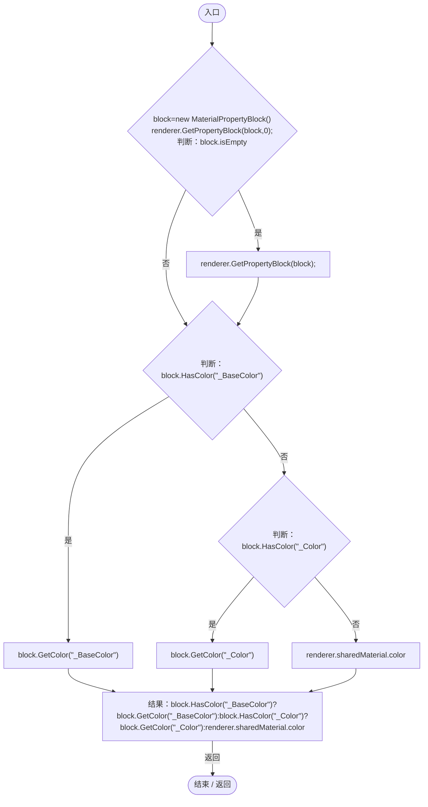

<a id="mc907a1f92f988769"></a>

## Run · L50

`private static IEnumerator Run()`


### Editor · Roslyn编译器控制流

```mermaid
flowchart TD
  b0(["入口"])
  b1["Check(PopulationWorkbench.Day(6818)==&quot;第 1 年 11 月 17 日&quot;,&quot;累计681.8天显示为游戏年月日&quot;);"]
  b2{"判断：PopulationWorkbench.Day(0)==&quot;第 0 年 1 月 1 日&quot;"}
  b3{"判断：PopulationWorkbench.Day(299.9f)==&quot;第 0 年 1 月 30 日&quot;"}
  b4{"判断：PopulationWorkbench.Day(300)==&quot;第 0 年 2 月 1 日&quot;"}
  b5["PopulationWorkbench.Day(3650)==&quot;第 1 年 1 月 1 日&quot;"]
  b6["PopulationWorkbench.Day(0)==&quot;第 0 年 1 月 1 日&quot;&amp;&amp;PopulationWorkbench.Day(299.9f)==&quot;第 0 年 1 月 30 日&quot;&amp;&amp;PopulationWorkbench.Day(300)==&quot;第 0 年 2 月 1 日&quot;&amp;&amp;PopulationWorkbench.Day(3650)==&quot;第 1 年 1 月 1 日&quot;"]
  b7["Check(PopulationWorkbench.Day(0)==&quot;第 0 年 1 月 1 日&quot;&amp;&amp;PopulationWorkbench.Day(299.9f)==&quot;第 0 年 1 月 30 日&quot;&amp;&amp;PopulationWorkbench.Day(300)==&quot;第 0 年 2 月 1 日&quot;&amp;&amp;PopulationWorkbench.Day(3650)==&quot;第 1 年 1 月 1 日&quot;,&quot;日期起点、跨月及跨年与底栏一致&quot;);"]
  b8["yield return null;<br/>session=Object.FindFirstObjectByType&lt;WorldSessionManager&gt;()<br/>builder=Object.FindFirstObjectByType&lt;PlanetTerrainMeshBuilder&gt;()<br/>builder.subdivisions=24;<br/>typeof(WorldSessionManager).GetField(&quot;_initialTerrain&quot;,Private).SetV…"]
  b9{"判断：session.Busy"}
  b10{"判断：EditorApplication.timeSinceStartup-start&gt;100"}
  b11["结果：new TimeoutException(&quot;加载超时&quot;)"]
  x11(["抛出异常 / 离开方法"])
  b12["yield return null;"]
  b13["clock=ServiceLocator.Get&lt;SimulationClock&gt;()<br/>clock.Pause();"]
  b14["EntityRegistry.All.ToArray()"]
  b15{"判断：EntityRegistry.All.ToArray()"}
  b16["var<br/>Object.DestroyImmediate(e.gameObject);"]
  b17{"EntityRegistry.All.ToArray()<br/>判断：EntityRegistry.All.ToArray()"}
  b18["EntityRegistry.All.ToArray()"]
  b19["连接 / 离开区域"]
  b20["ColonyResource.ClearWorld();<br/>PopulationArchive.Clear();<br/>root=ServiceLocator.Get&lt;UIRoot&gt;()<br/>control=Object.FindFirstObjectByType&lt;SimulationControlPanel&gt;()<br/>switchPage=typeof(SimulationControlPanel).GetMethod(&quot;SwitchPage&quot;,Private)<br/>page1=root…"]
  b21{"判断：page1.Find(&quot;PopulationList&quot;)==null"}
  b22["page1.GetComponentInChildren&lt;MapPopulationListUI&gt;(true)==null"]
  b23["page1.Find(&quot;PopulationList&quot;)==null"]
  b24["Check(page1.Find(&quot;PopulationList&quot;)==null&amp;&amp;page1.GetComponentInChildren&lt;MapPopulationListUI&gt;(true)==null,&quot;第一页不再包含种群列表或入口&quot;);"]
  b25["switchPage.Invoke(control,new object[]{1});<br/>yield return null;<br/>list=page2.GetComponentInChildren&lt;MapPopulationListUI&gt;(true)"]
  b26{"判断：list!=null"}
  b27["list.Card.gameObject.activeInHierarchy"]
  b28["list!=null"]
  b29["Check(list!=null&amp;&amp;list.Card.gameObject.activeInHierarchy,&quot;完整种群入口位于第二页&quot;);"]
  b30["WorldAuthority.CanEdit=false;<br/>yield return null;"]
  b31{"判断：list.gameObject.activeInHierarchy"}
  b32["!page2.Find(&quot;EntitySpawnPanel&quot;).gameObject.activeSelf"]
  b33["list.gameObject.activeInHierarchy"]
  b34["Check(list.gameObject.activeInHierarchy&amp;&amp;!page2.Find(&quot;EntitySpawnPanel&quot;).gameObject.activeSelf,&quot;普通成员第二页仍可查看种群档案&quot;);"]
  b35["WorldAuthority.CanEdit=true;<br/>home=EcologyQueries.Surface(builder.transform.position+Vector3.up*(builder.radius+builder.heightScale))<br/>parent=Guid.NewGuid().ToString(&quot;N&quot;)<br/>queen=Spawn(home,parent,AntRole.Queen)<br/>infant=Spawn(home,parent,AntR…"]
  b36{"判断：record!=null"}
  b37{"判断：record.current==3"}
  b38["record.peak==3"]
  b39["record!=null&amp;&amp;record.current==3&amp;&amp;record.peak==3"]
  b40["Check(record!=null&amp;&amp;record.current==3&amp;&amp;record.peak==3,&quot;真实成员生成种群统计与峰值&quot;);"]
  b41{"判断：record.originKnown"}
  b42["record.events[0].text.Contains(&quot;此前历史未记录&quot;)"]
  b43["!record.originKnown"]
  b44["Check(!record.originKnown&amp;&amp;record.events[0].text.Contains(&quot;此前历史未记录&quot;),&quot;已有种群首次建档不编造过去&quot;);"]
  b45["ages=PopulationDistributions.Ages(parent)<br/>Check(ages.Select(a=&gt;a.Count).SequenceEqual(new[]{1,1,1}),&quot;年龄阶段分布精确统计幼年成年老年&quot;);<br/>queen.Genes.Genome.Add(GeneInstance.Create(&quot;gene_growth&quot;,50,GeneDatabase.Get(&quot;gene_growth&quot;).Tier));<br/>queen.Genes.Reca…"]
  b46{"判断：list.GroupCount==1"}
  b47["list.MemberCount==3"]
  b48["list.GroupCount==1"]
  b49["Check(list.GroupCount==1&amp;&amp;list.MemberCount==3,&quot;全部种群列表包含当前群体&quot;);"]
  b50["clock.Play();<br/>list.OpenList();<br/>workbench=PopulationWorkbench.Instance"]
  b51{"判断：workbench!=null"}
  b52{"判断：workbench.Visible"}
  b53{"判断：GameInputGate.Blocked"}
  b54["!clock.IsRunning"]
  b55["workbench!=null&amp;&amp;workbench.Visible&amp;&amp;GameInputGate.Blocked&amp;&amp;!clock.IsRunning"]
  b56["Check(workbench!=null&amp;&amp;workbench.Visible&amp;&amp;GameInputGate.Blocked&amp;&amp;!clock.IsRunning,&quot;档案界面正确暂停并屏蔽游戏输入&quot;);"]
  b57["workbench.Select(parent,1);<br/>yield return Capture(&quot;genes-pie&quot;);<br/>hits=new List&lt;UnityEngine.EventSystems.RaycastResult&gt;()"]
  b58["UnityEngine.EventSystems.EventSystem.current<br/>new UnityEngine.EventSystems.PointerEventData(UnityEngine.EventSystems.EventSystem.current){position=RectTransformUtility.WorldToScreenPoint(null,list.Card.position)}<br/>position=RectTransformUti…"]
  b59{"判断：hits.Count&gt;0"}
  b60["hits[0].gameObject.name==&quot;PopulationWorkbenchInputBlocker&quot;"]
  b61["hits.Count&gt;0"]
  b62["Check(hits.Count&gt;0&amp;&amp;hits[0].gameObject.name==&quot;PopulationWorkbenchInputBlocker&quot;,&quot;详情窗口实际射线阻止点击穿透到底栏&quot;);"]
  b63["typeof(PopulationWorkbench).GetField(&quot;_pie&quot;,Private).SetValue(workbench,false);<br/>yield return Capture(&quot;genes-bars&quot;);<br/>workbench.Select(parent,2);<br/>yield return Capture(&quot;ages-bars&quot;);<br/>typeof(PopulationWorkbench).GetField(&quot;_pie&quot;,Private).SetVa…"]
  b64{"判断：PopulationArchive.Find(parent).rangeOpacity== -1"}
  b65{"判断：PopulationArchive.OpacityFor(parent)==GameplayTuning.Current.populationFillOpacity"}
  b66["JsonUtility.FromJson&lt;PopulationRecord&gt;(&quot;{}&quot;).rangeOpacity== -1"]
  b67["PopulationArchive.Find(parent).rangeOpacity== -1&amp;&amp;PopulationArchive.OpacityFor(parent)==GameplayTuning.Current.populationFillOpacity&amp;&amp;JsonUtility.FromJson&lt;PopulationRecord&gt;(&quot;{}&quot;).rangeOpacity== -1"]
  b68["Check(PopulationArchive.Find(parent).rangeOpacity== -1&amp;&amp;PopulationArchive.OpacityFor(parent)==GameplayTuning.Current.populationFillOpacity&amp;&amp;JsonUtility.FromJson&lt;PopulationRecord&gt;(&quot;{}&quot;).rangeOpacity== -1,&quot;旧档不透明度缺字段继续采用外部默认值&quot;);"]
  b69{"判断：workbench.ApplyDisplay(&quot;#D13F82&quot;,true,null,float.NaN)"}
  b70["!workbench.ApplyDisplay(&quot;#D13F82&quot;,true,null,1.1f)"]
  b71["!workbench.ApplyDisplay(&quot;#D13F82&quot;,true,null,float.NaN)"]
  b72["Check(!workbench.ApplyDisplay(&quot;#D13F82&quot;,true,null,float.NaN)&amp;&amp;!workbench.ApplyDisplay(&quot;#D13F82&quot;,true,null,1.1f),&quot;非有限和越界不透明度不修改配置&quot;);"]
  b73{"判断：workbench.ApplyDisplay(&quot;#D13F82&quot;,true,null,0)"}
  b74{"判断：PopulationArchive.OpacityFor(parent)==0"}
  b75{"判断：workbench.ApplyDisplay(&quot;#D13F82&quot;,true,null,1)"}
  b76["PopulationArchive.OpacityFor(parent)==1"]
  b77["workbench.ApplyDisplay(&quot;#D13F82&quot;,true,null,0)&amp;&amp;PopulationArchive.OpacityFor(parent)==0&amp;&amp;workbench.ApplyDisplay(&quot;#D13F82&quot;,true,null,1)&amp;&amp;PopulationArchive.OpacityFor(parent)==1"]
  b78["Check(workbench.ApplyDisplay(&quot;#D13F82&quot;,true,null,0)&amp;&amp;PopulationArchive.OpacityFor(parent)==0&amp;&amp;workbench.ApplyDisplay(&quot;#D13F82&quot;,true,null,1)&amp;&amp;PopulationArchive.OpacityFor(parent)==1,&quot;不透明度支持完全透明与完全不透明端点&quot;);"]
  b79["workbench.ApplyDisplay(&quot;#D13F82&quot;,true,null,.37f);<br/>body=Body(queen)<br/>shared=body.sharedMaterial<br/>native=BodyColor(body)<br/>sharedColor=shared.color<br/>Check(!PopulationArchive.Find(parent).syncEntityColor,&quot;旧档和未配置种群默认保留实体原色&quot;);<br/>preserved=new Materi…"]
  b80{"判断：ColorUtility.ToHtmlStringRGB(BodyColor(body))==&quot;D13F82&quot;"}
  b81["ColorUtility.ToHtmlStringRGB(BodyColor(Body(infant)))==&quot;D13F82&quot;"]
  b82["ColorUtility.ToHtmlStringRGB(BodyColor(body))==&quot;D13F82&quot;"]
  b83["Check(ColorUtility.ToHtmlStringRGB(BodyColor(body))==&quot;D13F82&quot;&amp;&amp;ColorUtility.ToHtmlStringRGB(BodyColor(Body(infant)))==&quot;D13F82&quot;,&quot;同群实体身体实际使用种群颜色&quot;);"]
  b84["body.GetPropertyBlock(preserved,0);"]
  b85{"判断：body.sharedMaterial==shared"}
  b86{"判断：shared.color==sharedColor"}
  b87["Mathf.Approximately(preserved.GetFloat(&quot;_PopulationRegressionSentinel&quot;),.42f)"]
  b88["body.sharedMaterial==shared&amp;&amp;shared.color==sharedColor&amp;&amp;Mathf.Approximately(preserved.GetFloat(&quot;_PopulationRegressionSentinel&quot;),.42f)"]
  b89["Check(body.sharedMaterial==shared&amp;&amp;shared.color==sharedColor&amp;&amp;Mathf.Approximately(preserved.GetFloat(&quot;_PopulationRegressionSentinel&quot;),.42f),&quot;同步不实例化或污染共享材质且保留其他属性&quot;);"]
  b90["queen.GetComponent&lt;EntityStats&gt;().Modify(&quot;health&quot;,-.1f);<br/>Check(ColorUtility.ToHtmlStringRGB(BodyColor(body))==&quot;FF0000&quot;,&quot;同步配色仍保留受击红色反馈&quot;);<br/>yield return new WaitForSecondsRealtime(.22f);<br/>Check(ColorUtility.ToHtmlStringRGB(BodyColor(body))==…"]
  b91{"判断：texture!=null"}
  b92["texture.GetPixels().Any(c=&gt;Mathf.Abs(c.r-209/255f)&lt;.001f&amp;&amp;Mathf.Abs(c.g-63/255f)&lt;.001f&amp;&amp;Mathf.Abs(c.b-130/255f)&lt;.001f)"]
  b93["texture!=null"]
  b94["Check(texture!=null&amp;&amp;texture.GetPixels().Any(c=&gt;Mathf.Abs(c.r-209/255f)&lt;.001f&amp;&amp;Mathf.Abs(c.g-63/255f)&lt;.001f&amp;&amp;Mathf.Abs(c.b-130/255f)&lt;.001f),&quot;真实范围Shader收到新颜色&quot;);"]
  b95{"判断：texture.width==3"}
  b96{"判断：Mathf.Approximately(texture.GetPixel(2,0).r,.37f)"}
  b97["builder.GetComponent&lt;MeshRenderer&gt;().sharedMaterial.shader.isSupported"]
  b98["texture.width==3&amp;&amp;Mathf.Approximately(texture.GetPixel(2,0).r,.37f)&amp;&amp;builder.GetComponent&lt;MeshRenderer&gt;().sharedMaterial.shader.isSupported"]
  b99["Check(texture.width==3&amp;&amp;Mathf.Approximately(texture.GetPixel(2,0).r,.37f)&amp;&amp;builder.GetComponent&lt;MeshRenderer&gt;().sharedMaterial.shader.isSupported,&quot;真实范围Shader收到每群独立不透明度且可渲染&quot;);"]
  b100["Check(workbench.ApplyDisplay(&quot;#D13F82&quot;,false),&quot;显示配置支持隐藏单个种群&quot;);<br/>yield return new WaitForSecondsRealtime(.7f);<br/>Check(PopulationRangeLayer.ActiveCircleCount==0,&quot;隐藏配置实际移除该群地图范围&quot;);<br/>workbench.ApplyDisplay(&quot;#D13F82&quot;,true);<br/>WorldAuthority.IsRepl…"]
  b101{"判断：workbench.ApplyDisplay(&quot;#FFFFFF&quot;,true)"}
  b102["ColorUtility.ToHtmlStringRGB(ColonyAppearance.ColorFor(parent))==&quot;D13F82&quot;"]
  b103["!workbench.ApplyDisplay(&quot;#FFFFFF&quot;,true)"]
  b104["Check(!workbench.ApplyDisplay(&quot;#FFFFFF&quot;,true)&amp;&amp;ColorUtility.ToHtmlStringRGB(ColonyAppearance.ColorFor(parent))==&quot;D13F82&quot;,&quot;成员副本不能越权保存颜色&quot;);"]
  b105["WorldAuthority.IsReplica=false;<br/>workbench.Close();"]
  b106{"判断：GameInputGate.Blocked"}
  b107["clock.IsRunning"]
  b108["!GameInputGate.Blocked"]
  b109["Check(!GameInputGate.Blocked&amp;&amp;clock.IsRunning,&quot;关闭档案恢复原模拟和输入状态&quot;);"]
  b110["clock.Pause();<br/>reproductive=Spawn(home,parent,AntRole.Reproductive)<br/>PopulationArchive.Observe();<br/>member=reproductive.GetComponent&lt;AntColonyMember&gt;()<br/>member.Advance(.1f);<br/>child=member.GroupId"]
  b111{"判断：child!=parent"}
  b112{"判断：member.Role==AntRole.Queen"}
  b113{"PopulationArchive.Find(child)<br/>判断：PopulationArchive.Find(child)"}
  b114[".parentId"]
  b115["PopulationArchive.Find(child)"]
  b116["PopulationArchive.Find(child)?.parentId==parent"]
  b117["child!=parent&amp;&amp;member.Role==AntRole.Queen&amp;&amp;PopulationArchive.Find(child)?.parentId==parent"]
  b118["Check(child!=parent&amp;&amp;member.Role==AntRole.Queen&amp;&amp;PopulationArchive.Find(child)?.parentId==parent,&quot;真实离群建群记录来源种群&quot;);"]
  b119["Check(PopulationArchive.Find(parent).events.Any(e=&gt;e.text.Contains(&quot;离群建立&quot;)),&quot;来源种群留下衍生事件&quot;);<br/>PopulationArchive.Observe();<br/>Check(PopulationArchive.Find(child).originKnown,&quot;新建衍生种群具有真实成立记录&quot;);<br/>yield return null;<br/>Check(BodyColor(Body(reproducti…"]
  b120{"判断：ColorUtility.ToHtmlStringRGB(BodyColor(Body(reproductive)))==&quot;3267CD&quot;"}
  b121["ColorUtility.ToHtmlStringRGB(BodyColor(body))==&quot;D13F82&quot;"]
  b122["ColorUtility.ToHtmlStringRGB(BodyColor(Body(reproductive)))==&quot;3267CD&quot;"]
  b123["Check(ColorUtility.ToHtmlStringRGB(BodyColor(Body(reproductive)))==&quot;3267CD&quot;&amp;&amp;ColorUtility.ToHtmlStringRGB(BodyColor(body))==&quot;D13F82&quot;,&quot;各个种群的实体同步配色互不影响&quot;);"]
  b124{"判断：PopulationArchive.OpacityFor(parent)==.37f"}
  b125["PopulationArchive.OpacityFor(child)==.81f"]
  b126["PopulationArchive.OpacityFor(parent)==.37f"]
  b127["Check(PopulationArchive.OpacityFor(parent)==.37f&amp;&amp;PopulationArchive.OpacityFor(child)==.81f,&quot;不同种群不透明度独立且不改变实体配色&quot;);"]
  b128["second=Spawn(home,child,AntRole.Reproductive).GetComponent&lt;AntColonyMember&gt;()<br/>second.Advance(.1f);<br/>grandchild=second.GroupId"]
  b129{"PopulationArchive.Find(grandchild)<br/>判断：PopulationArchive.Find(grandchild)"}
  b130[".parentId"]
  b131["PopulationArchive.Find(grandchild)"]
  b132["Check(PopulationArchive.Find(grandchild)?.parentId==child,&quot;多代发展链记录准确&quot;);"]
  b133["PopulationArchive.Observe();<br/>changing=queen.GetComponent&lt;PopulationBehavior&gt;()<br/>changing.Advance(.1f);<br/>queen.Genes.Genome.Genes.First(g=&gt;g.DefinitionId==&quot;gene_population&quot;).Value=80;<br/>queen.Genes.Recalculate();<br/>wolf=changing.GroupId"]
  b134{"判断：wolf!=parent"}
  b135{"PopulationArchive.Find(wolf)<br/>判断：PopulationArchive.Find(wolf)"}
  b136[".parentId"]
  b137["PopulationArchive.Find(wolf)"]
  b138["PopulationArchive.Find(wolf)?.parentId==parent"]
  b139["wolf!=parent"]
  b140["Check(wolf!=parent&amp;&amp;PopulationArchive.Find(wolf)?.parentId==parent,&quot;种群状态变化独立成群保留原来源&quot;);"]
  b141["offspring=new Genome()<br/>offspring.Add(GeneInstance.Create(&quot;gene_growth&quot;,50,GeneDatabase.Get(&quot;gene_growth&quot;).Tier));<br/>offspring.Add(GeneInstance.Create(&quot;gene_population&quot;,80,GeneDatabase.Get(&quot;gene_population&quot;).Tier));<br/>beforeBirth=new HashSet&lt;…"]
  b142["PopulationArchive.Members(parent)"]
  b143{"判断：PopulationArchive.Members(parent)"}
  b144["var<br/>Object.DestroyImmediate(entity.gameObject);"]
  b145["PopulationArchive.Members(parent)"]
  b146["PopulationArchive.Observe();<br/>list.RefreshNow();"]
  b147{"判断：PopulationArchive.Find(parent).current==0"}
  b148{"判断：list.GroupCount&gt;=3"}
  b149["list.Groups.Any(g=&gt;g.Id==parent)"]
  b150["PopulationArchive.Find(parent).current==0&amp;&amp;list.GroupCount&gt;=3&amp;&amp;list.Groups.Any(g=&gt;g.Id==parent)"]
  b151["Check(PopulationArchive.Find(parent).current==0&amp;&amp;list.GroupCount&gt;=3&amp;&amp;list.Groups.Any(g=&gt;g.Id==parent),&quot;灭绝种群仍在完整列表中保留&quot;);"]
  b152{"判断：PopulationDistributions.Ages(parent).Sum(v=&gt;v.Count)&gt;0"}
  b153["PopulationDistributions.Genes(parent,false).Count&gt;0"]
  b154["PopulationDistributions.Ages(parent).Sum(v=&gt;v.Count)&gt;0"]
  b155["Check(PopulationDistributions.Ages(parent).Sum(v=&gt;v.Count)&gt;0&amp;&amp;PopulationDistributions.Genes(parent,false).Count&gt;0,&quot;灭绝后保留最后存活分布快照&quot;);"]
  b156["session.SaveNow(false);<br/>data=WorldSaveStore.Read(WorldSaveStore.FileFor(session.Current.id))"]
  b157{"判断：data.colony.population.groups.Single(g=&gt;g.id==grandchild).parentId==child"}
  b158["data.colony.population.groups.Single(g=&gt;g.id==parent).color==&quot;#D13F82&quot;"]
  b159["data.colony.population.groups.Single(g=&gt;g.id==grandchild).parentId==child"]
  b160["Check(data.colony.population.groups.Single(g=&gt;g.id==grandchild).parentId==child&amp;&amp;data.colony.population.groups.Single(g=&gt;g.id==parent).color==&quot;#D13F82&quot;,&quot;磁盘写读成对保存谱系、历史和颜色&quot;);"]
  b161["frame=LanWorldSnapshot.Frame(1,true)"]
  b162{"判断：frame.population!=null"}
  b163{"判断：frame.population.groups.Single(r=&gt;r.id==grandchild).parentId==child"}
  b164["frame.population.groups.Single(r=&gt;r.id==parent).color==&quot;#D13F82&quot;"]
  b165["frame.population!=null&amp;&amp;frame.population.groups.Single(r=&gt;r.id==grandchild).parentId==child&amp;&amp;frame.population.groups.Single(r=&gt;r.id==parent).color==&quot;#D13F82&quot;"]
  b166["Check(frame.population!=null&amp;&amp;frame.population.groups.Single(r=&gt;r.id==grandchild).parentId==child&amp;&amp;frame.population.groups.Single(r=&gt;r.id==parent).color==&quot;#D13F82&quot;,&quot;低频联机快照包含历史、谱系和显示配置&quot;);"]
  b167{"判断：data.colony.population.groups.Single(g=&gt;g.id==child).syncEntityColor"}
  b168["frame.population.groups.Single(g=&gt;g.id==child).syncEntityColor"]
  b169["data.colony.population.groups.Single(g=&gt;g.id==child).syncEntityColor"]
  b170["Check(data.colony.population.groups.Single(g=&gt;g.id==child).syncEntityColor&amp;&amp;frame.population.groups.Single(g=&gt;g.id==child).syncEntityColor,&quot;同步实体颜色开关真实写盘并包含在联机快照&quot;);"]
  b171{"判断：data.colony.population.groups.Single(g=&gt;g.id==child).rangeOpacity==.81f"}
  b172["frame.population.groups.Single(g=&gt;g.id==child).rangeOpacity==.81f"]
  b173["data.colony.population.groups.Single(g=&gt;g.id==child).rangeOpacity==.81f"]
  b174["Check(data.colony.population.groups.Single(g=&gt;g.id==child).rangeOpacity==.81f&amp;&amp;frame.population.groups.Single(g=&gt;g.id==child).rangeOpacity==.81f,&quot;范围不透明度真实写盘并包含在联机快照&quot;);"]
  b175["invalid=JsonUtility.FromJson&lt;WorldSaveData&gt;(JsonUtility.ToJson(data))<br/>invalid.colony.population.groups.Single(g=&gt;g.id==parent).parentId=grandchild;<br/>rejected=false"]
  b176["WorldSaveStore.Validate(invalid);"]
  b177["rejected=true;"]
  b178["Check(rejected,&quot;循环谱系在清场前拒绝&quot;);<br/>invalid=JsonUtility.FromJson&lt;WorldSaveData&gt;(JsonUtility.ToJson(data));<br/>invalid.colony.population.groups[0].samples[0].time=float.NaN;<br/>rejected=false;"]
  b179["WorldSaveStore.Validate(invalid);"]
  b180["rejected=true;"]
  b181["Check(rejected,&quot;非有限历史采样在清场前拒绝&quot;);<br/>invalid=JsonUtility.FromJson&lt;WorldSaveData&gt;(JsonUtility.ToJson(data));<br/>invalid.colony.population.groups[0].rangeOpacity= -2;<br/>rejected=false;"]
  b182["WorldSaveStore.Validate(invalid);"]
  b183["rejected=true;"]
  b184["Check(rejected,&quot;损坏不透明度在清场前拒绝&quot;);<br/>session.Open(data);<br/>start=EditorApplication.timeSinceStartup;"]
  b185{"判断：session.Busy"}
  b186{"判断：EditorApplication.timeSinceStartup-start&gt;100"}
  b187["结果：new TimeoutException(&quot;读档超时&quot;)"]
  x187(["抛出异常 / 离开方法"])
  b188["yield return null;"]
  b189["clock.Pause();"]
  b190{"判断：PopulationArchive.Find(parent).current==0"}
  b191{"判断：PopulationArchive.Find(grandchild).parentId==child"}
  b192["ColorUtility.ToHtmlStringRGB(ColonyAppearance.ColorFor(parent))==&quot;D13F82&quot;"]
  b193["PopulationArchive.Find(parent).current==0&amp;&amp;PopulationArchive.Find(grandchild).parentId==child&amp;&amp;ColorUtility.ToHtmlStringRGB(ColonyAppearance.ColorFor(parent))==&quot;D13F82&quot;"]
  b194["Check(PopulationArchive.Find(parent).current==0&amp;&amp;PopulationArchive.Find(grandchild).parentId==child&amp;&amp;ColorUtility.ToHtmlStringRGB(ColonyAppearance.ColorFor(parent))==&quot;D13F82&quot;,&quot;真实重载恢复已灭绝档案、后代和颜色&quot;);"]
  b195["yield return null;"]
  b196{"判断：PopulationArchive.Find(child).syncEntityColor"}
  b197["PopulationArchive.Members(child).All(e=&gt;ColorUtility.ToHtmlStringRGB(BodyColor(Body(e)))==&quot;3267CD&quot;)"]
  b198["PopulationArchive.Find(child).syncEntityColor"]
  b199["Check(PopulationArchive.Find(child).syncEntityColor&amp;&amp;PopulationArchive.Members(child).All(e=&gt;ColorUtility.ToHtmlStringRGB(BodyColor(Body(e)))==&quot;3267CD&quot;),&quot;读档后自动恢复存活成员的同步外观&quot;);"]
  b200["Check(PopulationArchive.OpacityFor(child)==.81f,&quot;读档恢复独立种群不透明度&quot;);<br/>legacy=JsonUtility.FromJson&lt;WorldSaveData&gt;(JsonUtility.ToJson(data))<br/>legacy.colony.population=null;<br/>session.Open(legacy);"]
  b201{"判断：session.Busy"}
  b202["yield return null;"]
  b203["clock.Pause();<br/>PopulationArchive.Observe();<br/>Check(PopulationArchive.All.All(g=&gt;!g.originKnown&amp;&amp;string.IsNullOrEmpty(g.parentId)),&quot;旧存档缺档案时兼容且不伪造历史和谱系&quot;);<br/>yield return ParthenogenesisRegression.Verify(session,builder,clock,Check);<br/>menu=Obje…"]
  b204{"判断：PopulationArchive.All.Any()"}
  b205["!workbench.Visible"]
  b206["!PopulationArchive.All.Any()"]
  b207["Check(!PopulationArchive.All.Any()&amp;&amp;!workbench.Visible,&quot;卸载世界清理档案及独立窗口&quot;);"]
  b208(["结束 / 返回"])
  b0 --> b1
  b1 --> b2
  b2 -->|"是"| b3
  b2 -->|"否"| b6
  b3 -->|"是"| b4
  b3 -->|"否"| b6
  b4 -->|"是"| b5
  b4 -->|"否"| b6
  b5 --> b7
  b6 --> b7
  b7 --> b8
  b8 --> b9
  b9 -->|"是"| b10
  b9 -->|"否"| b13
  b10 -->|"是"| b11
  b10 -->|"否"| b12
  b11 -->|"Throw"| x11
  b12 --> b9
  b13 --> b14
  b14 --> b15
  b15 -->|"是"| b16
  b15 -->|"否 · 经过finally 17"| b20
  b16 --> b15
  b17 -->|"否"| b18
  b17 -->|"是"| b19
  b18 --> b19
  b20 --> b21
  b21 -->|"是"| b22
  b21 -->|"否"| b23
  b22 --> b24
  b23 --> b24
  b24 --> b25
  b25 --> b26
  b26 -->|"是"| b27
  b26 -->|"否"| b28
  b27 --> b29
  b28 --> b29
  b29 --> b30
  b30 --> b31
  b31 -->|"是"| b32
  b31 -->|"否"| b33
  b32 --> b34
  b33 --> b34
  b34 --> b35
  b35 --> b36
  b36 -->|"是"| b37
  b36 -->|"否"| b39
  b37 -->|"是"| b38
  b37 -->|"否"| b39
  b38 --> b40
  b39 --> b40
  b40 --> b41
  b41 -->|"否"| b42
  b41 -->|"是"| b43
  b42 --> b44
  b43 --> b44
  b44 --> b45
  b45 --> b46
  b46 -->|"是"| b47
  b46 -->|"否"| b48
  b47 --> b49
  b48 --> b49
  b49 --> b50
  b50 --> b51
  b51 -->|"是"| b52
  b51 -->|"否"| b55
  b52 -->|"是"| b53
  b52 -->|"否"| b55
  b53 -->|"是"| b54
  b53 -->|"否"| b55
  b54 --> b56
  b55 --> b56
  b56 --> b57
  b57 --> b58
  b58 --> b59
  b59 -->|"是"| b60
  b59 -->|"否"| b61
  b60 --> b62
  b61 --> b62
  b62 --> b63
  b63 --> b64
  b64 -->|"是"| b65
  b64 -->|"否"| b67
  b65 -->|"是"| b66
  b65 -->|"否"| b67
  b66 --> b68
  b67 --> b68
  b68 --> b69
  b69 -->|"否"| b70
  b69 -->|"是"| b71
  b70 --> b72
  b71 --> b72
  b72 --> b73
  b73 -->|"是"| b74
  b73 -->|"否"| b77
  b74 -->|"是"| b75
  b74 -->|"否"| b77
  b75 -->|"是"| b76
  b75 -->|"否"| b77
  b76 --> b78
  b77 --> b78
  b78 --> b79
  b79 --> b80
  b80 -->|"是"| b81
  b80 -->|"否"| b82
  b81 --> b83
  b82 --> b83
  b83 --> b84
  b84 --> b85
  b85 -->|"是"| b86
  b85 -->|"否"| b88
  b86 -->|"是"| b87
  b86 -->|"否"| b88
  b87 --> b89
  b88 --> b89
  b89 --> b90
  b90 --> b91
  b91 -->|"是"| b92
  b91 -->|"否"| b93
  b92 --> b94
  b93 --> b94
  b94 --> b95
  b95 -->|"是"| b96
  b95 -->|"否"| b98
  b96 -->|"是"| b97
  b96 -->|"否"| b98
  b97 --> b99
  b98 --> b99
  b99 --> b100
  b100 --> b101
  b101 -->|"否"| b102
  b101 -->|"是"| b103
  b102 --> b104
  b103 --> b104
  b104 --> b105
  b105 --> b106
  b106 -->|"否"| b107
  b106 -->|"是"| b108
  b107 --> b109
  b108 --> b109
  b109 --> b110
  b110 --> b111
  b111 -->|"是"| b112
  b111 -->|"否"| b117
  b112 -->|"是"| b113
  b112 -->|"否"| b117
  b113 -->|"否"| b114
  b113 -->|"是"| b115
  b114 --> b116
  b115 --> b116
  b116 --> b118
  b117 --> b118
  b118 --> b119
  b119 --> b120
  b120 -->|"是"| b121
  b120 -->|"否"| b122
  b121 --> b123
  b122 --> b123
  b123 --> b124
  b124 -->|"是"| b125
  b124 -->|"否"| b126
  b125 --> b127
  b126 --> b127
  b127 --> b128
  b128 --> b129
  b129 -->|"否"| b130
  b129 -->|"是"| b131
  b130 --> b132
  b131 --> b132
  b132 --> b133
  b133 --> b134
  b134 -->|"是"| b135
  b134 -->|"否"| b139
  b135 -->|"否"| b136
  b135 -->|"是"| b137
  b136 --> b138
  b137 --> b138
  b138 --> b140
  b139 --> b140
  b140 --> b141
  b141 --> b142
  b142 --> b143
  b143 -->|"是"| b144
  b143 -->|"否 · 经过finally 145"| b146
  b144 --> b143
  b146 --> b147
  b147 -->|"是"| b148
  b147 -->|"否"| b150
  b148 -->|"是"| b149
  b148 -->|"否"| b150
  b149 --> b151
  b150 --> b151
  b151 --> b152
  b152 -->|"是"| b153
  b152 -->|"否"| b154
  b153 --> b155
  b154 --> b155
  b155 --> b156
  b156 --> b157
  b157 -->|"是"| b158
  b157 -->|"否"| b159
  b158 --> b160
  b159 --> b160
  b160 --> b161
  b161 --> b162
  b162 -->|"是"| b163
  b162 -->|"否"| b165
  b163 -->|"是"| b164
  b163 -->|"否"| b165
  b164 --> b166
  b165 --> b166
  b166 --> b167
  b167 -->|"是"| b168
  b167 -->|"否"| b169
  b168 --> b170
  b169 --> b170
  b170 --> b171
  b171 -->|"是"| b172
  b171 -->|"否"| b173
  b172 --> b174
  b173 --> b174
  b174 --> b175
  b175 --> b176
  b176 --> b178
  b177 --> b178
  b178 --> b179
  b179 --> b181
  b180 --> b181
  b181 --> b182
  b182 --> b184
  b183 --> b184
  b184 --> b185
  b185 -->|"是"| b186
  b185 -->|"否"| b189
  b186 -->|"是"| b187
  b186 -->|"否"| b188
  b187 -->|"Throw"| x187
  b188 --> b185
  b189 --> b190
  b190 -->|"是"| b191
  b190 -->|"否"| b193
  b191 -->|"是"| b192
  b191 -->|"否"| b193
  b192 --> b194
  b193 --> b194
  b194 --> b195
  b195 --> b196
  b196 -->|"是"| b197
  b196 -->|"否"| b198
  b197 --> b199
  b198 --> b199
  b199 --> b200
  b200 --> b201
  b201 -->|"是"| b202
  b201 -->|"否"| b203
  b202 --> b201
  b203 --> b204
  b204 -->|"否"| b205
  b204 -->|"是"| b206
  b205 --> b207
  b206 --> b207
  b207 --> b208
  b15 -. "退出保护区时 finally（示意）" .-> b17
  b143 -. "退出保护区时 finally（示意）" .-> b145
  b176 -. "保护区可能异常（示意）" .-> b177
  b179 -. "保护区可能异常（示意）" .-> b180
  b182 -. "保护区可能异常（示意）" .-> b183

```

项目内调用/回调引用：

- [PopulationArchiveRegression.Check · L31](17091ce4f3e6bbb1.md#ma04f69f7d393e9b8)（方法）
- [PopulationWorkbench.Day · L84](6ca6fcae89e529ec.md#mb41ce087d8855c42)（方法）
- [PlanetClimateMap.Instance.get · L16](b4e9726c1bcf4c37.md#m3add54a419aeef9f)（访问器）
- [PlanetOreSystem.Instance.get · L8](86b3fbb4d9436121.md#m53f6a6af4b6dc252)（访问器）
- [WorldSessionManager.Create · L41](08741c7b7b9d9344.md#m6aadfeee8b90aacd)（方法）
- [WorldSessionManager.Busy.get · L24](08741c7b7b9d9344.md#m4483e2e4f28f7c85)（访问器）
- [ServiceLocator.Get · L33](f2fdbe9f9ccd93cb.md#m2ae625299520c56d)（方法）
- [SimulationClock.Pause · L79](a8f444aec9614b0a.md#m30929d45a885d0f1)（方法）
- [ColonyResource.ClearWorld · L100](293dbaecfff4b585.md#m634e84088b7cf78c)（方法）
- [PopulationArchive.Clear · L127](084e119b69cdd751.md#m75435a20db62d6a0)（方法）
- [UIRoot.MainCanvas.get · L14](9c1421378791f0e0.md#maa2cc9baf1248477)（访问器）
- [EcologyQueries.Surface · L47](bdf7ccc2c9c0452f.md#m2f1f6873ee5fc8df)（方法）
- [PopulationArchiveRegression.Spawn · L38](17091ce4f3e6bbb1.md#m1a507a401892b284)（方法）
- [PopulationArchive.Observe · L68](084e119b69cdd751.md#m6afd6ec6b661dad6)（方法）
- [PopulationArchive.Find · L49](084e119b69cdd751.md#mf1aef4e3d3c3efca)（方法）
- [PopulationDistributions.Ages · L26](eed554ca8394b767.md#m97f91f8b937c972c)（方法）
- [Genome.Add · L19](a2ef23f865bc7ee8.md#md9cfdc94b8b8d40f)（方法）
- [DarwinEntity.Genes.get · L14](70798dde169f2e8b.md#m622eb1adf401d431)（访问器）
- [GeneInstance.Create · L20](f82e1498d67f5afd.md#m72e94c278de3cf8b)（方法）
- [GeneDatabase.Get · L135](ec0a03483435a863.md#m8f3bbfb35f3ca397)（方法）
- [EntityGeneController.Recalculate · L97](7494d53178552f0e.md#m65ea735c1e0e37a1)（方法）
- [PopulationDistributions.Genes · L15](eed554ca8394b767.md#m35a197f85f9669ee)（方法）
- [MapPopulationListUI.RefreshNow · L34](628d691916fbb56b.md#mc66cc8403198e94e)（方法）
- [SimulationClock.Play · L78](a8f444aec9614b0a.md#m7aa9e64b7de60ed0)（方法）
- [MapPopulationListUI.OpenList · L46](628d691916fbb56b.md#m0b232c93d49869f2)（方法）
- [PopulationWorkbench.Instance.get · L14](6ca6fcae89e529ec.md#m82395c4f7e743e70)（访问器）
- [PopulationWorkbench.Visible.get · L15](6ca6fcae89e529ec.md#mbe13c2d3e85c0b85)（访问器）
- [GameInputGate.Blocked.get · L8](52955daae7e592ab.md#m765763b665829633)（访问器）
- [SimulationClock.IsRunning.get · L22](a8f444aec9614b0a.md#m10f4fe307faca0f0)（访问器）
- [PopulationWorkbench.Select · L48](6ca6fcae89e529ec.md#mc59a9aa8a225893b)（方法）
- [PopulationArchiveRegression.Capture · L45](17091ce4f3e6bbb1.md#m07055f29b58eb4c4)（方法）
- [PopulationWorkbench.SelectedTab.get · L17](6ca6fcae89e529ec.md#m2b8cb54cab37da88)（访问器）
- [PopulationWorkbench.ApplyDisplay · L59](6ca6fcae89e529ec.md#m18ac26079e999d24)（方法）
- [ColonyAppearance.ColorFor · L9](e51c7c842d87a26d.md#m0ea090c43edf8334)（方法）
- [PopulationArchive.OpacityFor · L107](084e119b69cdd751.md#m97824b788cf7f2ff)（方法）
- [GameplayTuning.Current.get · L21](db546e5713b32d53.md#m1caba89e7704d239)（访问器）
- [PopulationArchiveRegression.Body · L47](17091ce4f3e6bbb1.md#m4d2259ae038f017c)（方法）
- [PopulationArchiveRegression.BodyColor · L48](17091ce4f3e6bbb1.md#mc7b507548928ae32)（方法）
- [EntityStats.Modify · L104](75aa86a368efdf24.md#m858c2a75d852ecc1)（方法）
- [PopulationRangeLayer.SetVisible · L18](7ad316e94c5af908.md#m224360ff57b7a890)（方法）
- [PopulationRangeLayer.ActiveCircleCount.get · L17](7ad316e94c5af908.md#mdf5ce69158592d87)（访问器）
- [PopulationWorkbench.Close · L68](6ca6fcae89e529ec.md#m09bed70d853d69f9)（方法）
- [AntColonyMember.Advance · L77](baebd85c05598377.md#m29cff578dd85ff16)（方法）
- [AntColonyMember.Role.get · L33](baebd85c05598377.md#mdf6df89f7116c7a3)（访问器）
- [PopulationWorkbench.Open · L35](6ca6fcae89e529ec.md#maadc63c62a231ce0)（方法）
- [PopulationBehavior.Advance · L78](21e4f62f75a9a80f.md#m3b1594d99e3bdf28)（方法）
- [PopulationBehavior.GroupId.get · L20](21e4f62f75a9a80f.md#m5145936fa914ba8c)（访问器）
- [EcologyReproduction.Spawn · L9](eaaa574d7ae50e29.md#mc64a3524363ab773)（方法）
- [ColonyActivityRange.Boundary · L38](e8d854132f563257.md#m46a418cd54a2ba04)（方法）
- [ActivityCircle.ActivityCircle.ctor · L10](e8d854132f563257.md#m7ad6684817aa9fd4)（构造函数）
- [SimulationClock.RestoreState · L74](a8f444aec9614b0a.md#m8f617e95e1282846)（方法）
- [SimulationClock.GameTime.get · L23](a8f444aec9614b0a.md#m74adfa39a896652f)（访问器）
- [PopulationArchiveSettings.Current.get · L33](084e119b69cdd751.md#m4f74ce7c65d8f1cf)（访问器）
- [PopulationArchive.Members · L67](084e119b69cdd751.md#mdcf18c899b26b92b)（方法）
- [WorldSessionManager.SaveNow · L157](08741c7b7b9d9344.md#mbecd8b5c222ba46b)（方法）
- [WorldSaveStore.Read · L72](d67a35e5e3814c15.md#mca362c7675a5800c)（方法）
- [WorldSaveStore.FileFor · L48](d67a35e5e3814c15.md#m419a625e2bcc70f8)（方法）
- [WorldSessionManager.Current.get · L21](08741c7b7b9d9344.md#m5d26a5eb846a8504)（访问器）
- [LanWorldSnapshot.Frame · L32](02a722701106da02.md#m85d6595c09ac428c)（方法）
- [WorldSaveStore.Validate · L73](d67a35e5e3814c15.md#mb2f88d55be126f07)（方法）
- [WorldSessionManager.Open · L58](08741c7b7b9d9344.md#m0a8e69a8a4fbc512)（方法）
- [ParthenogenesisRegression.Verify · L35](8a0c679de35169a0.md#m02882dbb5eae367d)（方法）
- [GameMainMenu.ShowPause · L89](a1f1791f9e7a8035.md#m953d85f379a39458)（方法）
- [GameMainMenu.ReturnToMainMenu · L278](a1f1791f9e7a8035.md#m1fdc747e6f1c67d2)（方法）
- [PopulationArchiveRegression.回调@63 · L63](17091ce4f3e6bbb1.md#mba3b286d09e54bb4)（回调/委托）
- [PopulationArchiveRegression.回调@64 · L64](17091ce4f3e6bbb1.md#m6ce664860d22eb8e)（回调/委托）
- [PopulationArchiveRegression.回调@64 · L64](17091ce4f3e6bbb1.md#ma0e842794360b174)（回调/委托）
- [PopulationArchiveRegression.回调@83 · L83](17091ce4f3e6bbb1.md#m9e0c53a69930b460)（回调/委托）
- [PopulationArchiveRegression.回调@87 · L87](17091ce4f3e6bbb1.md#md3abe5f525ab5d64)（回调/委托）
- [PopulationArchiveRegression.回调@92 · L92](17091ce4f3e6bbb1.md#m9e826d82da5c7c6c)（回调/委托）
- [PopulationArchiveRegression.回调@95 · L95](17091ce4f3e6bbb1.md#ma1ffd78ad9e4c557)（回调/委托）
- [PopulationArchiveRegression.回调@96 · L96](17091ce4f3e6bbb1.md#m1fca4d4c3b7b5727)（回调/委托）
- [PopulationArchiveRegression.回调@99 · L99](17091ce4f3e6bbb1.md#m67d394e340d7efb8)（回调/委托）
- [PopulationArchiveRegression.回调@99 · L99](17091ce4f3e6bbb1.md#m30d90b3a818144e4)（回调/委托）
- [PopulationArchiveRegression.回调@100 · L100](17091ce4f3e6bbb1.md#md2a33bde21132dad)（回调/委托）
- [PopulationArchiveRegression.回调@100 · L100](17091ce4f3e6bbb1.md#m84157f7a70615054)（回调/委托）
- [PopulationArchiveRegression.回调@101 · L101](17091ce4f3e6bbb1.md#m154b52a07f410835)（回调/委托）
- [PopulationArchiveRegression.回调@101 · L101](17091ce4f3e6bbb1.md#mc4ffc9897527e3dd)（回调/委托）
- [PopulationArchiveRegression.回调@102 · L102](17091ce4f3e6bbb1.md#m83e69c3dc4831dc8)（回调/委托）
- [PopulationArchiveRegression.回调@102 · L102](17091ce4f3e6bbb1.md#mad163125ff1a48ba)（回调/委托）
- [PopulationArchiveRegression.回调@103 · L103](17091ce4f3e6bbb1.md#m725f6cf67e0a0c4d)（回调/委托）
- [PopulationArchiveRegression.回调@103 · L103](17091ce4f3e6bbb1.md#m9566519b92f88530)（回调/委托）
- [PopulationArchiveRegression.回调@104 · L104](17091ce4f3e6bbb1.md#m3e680321ea116038)（回调/委托）
- [PopulationArchiveRegression.回调@108 · L108](17091ce4f3e6bbb1.md#me22743c309163a77)（回调/委托）
- [PopulationArchiveRegression.回调@110 · L110](17091ce4f3e6bbb1.md#mf9c682bd382a4a3f)（回调/委托）

<a id="mba3b286d09e54bb4"></a>

## 回调@63 · L63

`a … => 回调`


### Editor · Roslyn编译器控制流

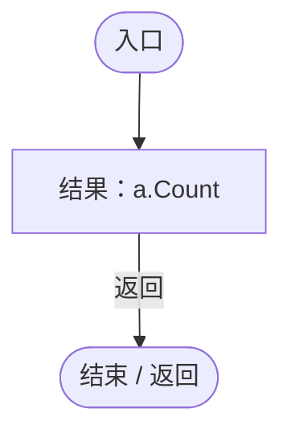

<a id="m6ce664860d22eb8e"></a>

## 回调@64 · L64

`g … => 回调`


### Editor · Roslyn编译器控制流

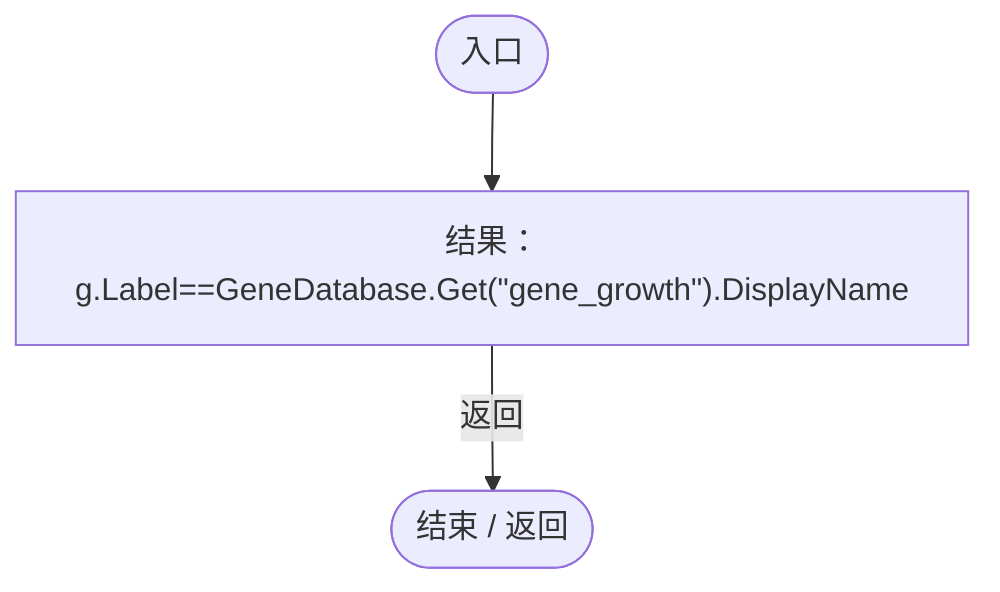

项目内调用/回调引用：

- [GeneDatabase.Get · L135](ec0a03483435a863.md#m8f3bbfb35f3ca397)（方法）

<a id="ma0e842794360b174"></a>

## 回调@64 · L64

`g … => 回调`


### Editor · Roslyn编译器控制流

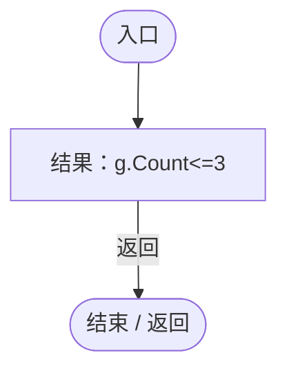

<a id="m9e0c53a69930b460"></a>

## 回调@83 · L83

`c … => 回调`


### Editor · Roslyn编译器控制流

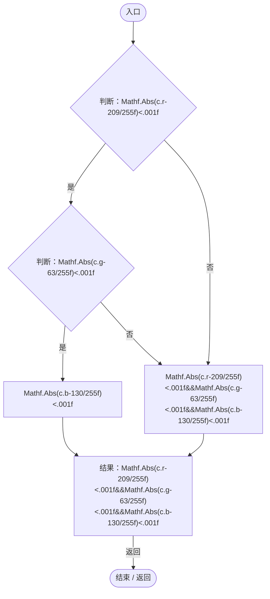

<a id="md3abe5f525ab5d64"></a>

## 回调@87 · L87

`e … => 回调`


### Editor · Roslyn编译器控制流

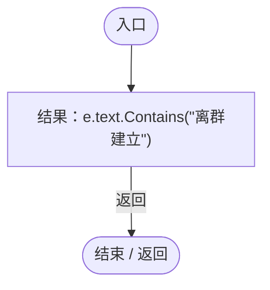

<a id="m9e826d82da5c7c6c"></a>

## 回调@92 · L92

`g … => 回调`


### Editor · Roslyn编译器控制流

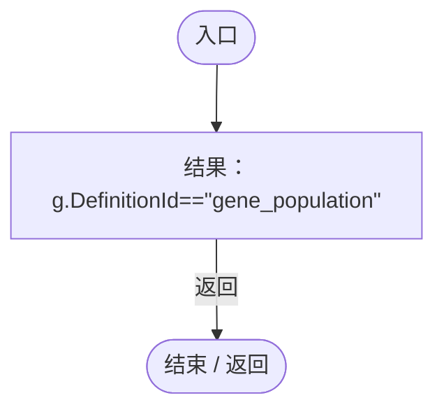

<a id="ma1ffd78ad9e4c557"></a>

## 回调@95 · L95

`r … => 回调`


### Editor · Roslyn编译器控制流

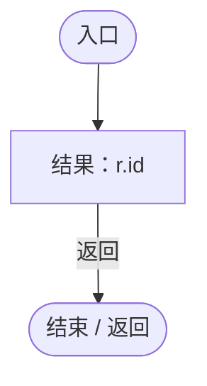

<a id="m1fca4d4c3b7b5727"></a>

## 回调@96 · L96

`r … => 回调`


### Editor · Roslyn编译器控制流

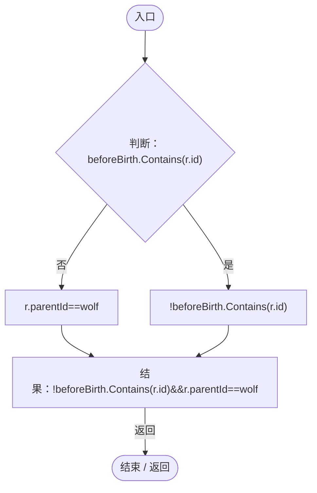

<a id="m67d394e340d7efb8"></a>

## 回调@99 · L99

`g … => 回调`


### Editor · Roslyn编译器控制流

```mermaid
flowchart TD
  b0(["入口"])
  b1["结果：g.Id==parent"]
  b2(["结束 / 返回"])
  b0 --> b1
  b1 -->|"返回"| b2

```

<a id="m30d90b3a818144e4"></a>

## 回调@99 · L99

`v … => 回调`


### Editor · Roslyn编译器控制流

```mermaid
flowchart TD
  b0(["入口"])
  b1["结果：v.Count"]
  b2(["结束 / 返回"])
  b0 --> b1
  b1 -->|"返回"| b2

```

<a id="md2a33bde21132dad"></a>

## 回调@100 · L100

`g … => 回调`


### Editor · Roslyn编译器控制流

```mermaid
flowchart TD
  b0(["入口"])
  b1["结果：g.id==grandchild"]
  b2(["结束 / 返回"])
  b0 --> b1
  b1 -->|"返回"| b2

```

<a id="m84157f7a70615054"></a>

## 回调@100 · L100

`g … => 回调`


### Editor · Roslyn编译器控制流

```mermaid
flowchart TD
  b0(["入口"])
  b1["结果：g.id==parent"]
  b2(["结束 / 返回"])
  b0 --> b1
  b1 -->|"返回"| b2

```

<a id="m154b52a07f410835"></a>

## 回调@101 · L101

`r … => 回调`


### Editor · Roslyn编译器控制流

```mermaid
flowchart TD
  b0(["入口"])
  b1["结果：r.id==grandchild"]
  b2(["结束 / 返回"])
  b0 --> b1
  b1 -->|"返回"| b2

```

<a id="mc4ffc9897527e3dd"></a>

## 回调@101 · L101

`r … => 回调`


### Editor · Roslyn编译器控制流

```mermaid
flowchart TD
  b0(["入口"])
  b1["结果：r.id==parent"]
  b2(["结束 / 返回"])
  b0 --> b1
  b1 -->|"返回"| b2

```

<a id="m83e69c3dc4831dc8"></a>

## 回调@102 · L102

`g … => 回调`


### Editor · Roslyn编译器控制流

```mermaid
flowchart TD
  b0(["入口"])
  b1["结果：g.id==child"]
  b2(["结束 / 返回"])
  b0 --> b1
  b1 -->|"返回"| b2

```

<a id="mad163125ff1a48ba"></a>

## 回调@102 · L102

`g … => 回调`


### Editor · Roslyn编译器控制流

```mermaid
flowchart TD
  b0(["入口"])
  b1["结果：g.id==child"]
  b2(["结束 / 返回"])
  b0 --> b1
  b1 -->|"返回"| b2

```

<a id="m725f6cf67e0a0c4d"></a>

## 回调@103 · L103

`g … => 回调`


### Editor · Roslyn编译器控制流

```mermaid
flowchart TD
  b0(["入口"])
  b1["结果：g.id==child"]
  b2(["结束 / 返回"])
  b0 --> b1
  b1 -->|"返回"| b2

```

<a id="m9566519b92f88530"></a>

## 回调@103 · L103

`g … => 回调`


### Editor · Roslyn编译器控制流

```mermaid
flowchart TD
  b0(["入口"])
  b1["结果：g.id==child"]
  b2(["结束 / 返回"])
  b0 --> b1
  b1 -->|"返回"| b2

```

<a id="m3e680321ea116038"></a>

## 回调@104 · L104

`g … => 回调`


### Editor · Roslyn编译器控制流

```mermaid
flowchart TD
  b0(["入口"])
  b1["结果：g.id==parent"]
  b2(["结束 / 返回"])
  b0 --> b1
  b1 -->|"返回"| b2

```

<a id="me22743c309163a77"></a>

## 回调@108 · L108

`e … => 回调`


### Editor · Roslyn编译器控制流

```mermaid
flowchart TD
  b0(["入口"])
  b1["结果：ColorUtility.ToHtmlStringRGB(BodyColor(Body(e)))==&quot;3267CD&quot;"]
  b2(["结束 / 返回"])
  b0 --> b1
  b1 -->|"返回"| b2

```

项目内调用/回调引用：

- [PopulationArchiveRegression.BodyColor · L48](17091ce4f3e6bbb1.md#mc7b507548928ae32)（方法）
- [PopulationArchiveRegression.Body · L47](17091ce4f3e6bbb1.md#m4d2259ae038f017c)（方法）

<a id="mf9c682bd382a4a3f"></a>

## 回调@110 · L110

`g … => 回调`


### Editor · Roslyn编译器控制流

```mermaid
flowchart TD
  b0(["入口"])
  b1{"判断：g.originKnown"}
  b2["string.IsNullOrEmpty(g.parentId)"]
  b3["!g.originKnown"]
  b4["结果：!g.originKnown&amp;&amp;string.IsNullOrEmpty(g.parentId)"]
  b5(["结束 / 返回"])
  b0 --> b1
  b1 -->|"否"| b2
  b1 -->|"是"| b3
  b2 --> b4
  b3 --> b4
  b4 -->|"返回"| b5

```
