# TerritoryBehavior.cs

[返回总索引](../README.md) · `Runtime` · `Assets/DarwinPark/Entities/Ecology/TerritoryBehavior.cs`

[源文件](../../../Assets/DarwinPark/Entities/Ecology/TerritoryBehavior.cs) · 源码校验：`3a54e79926565377e604c2548c5e2e065301415b549c0ee04a7c47eeb8aa8c9d`

方法按源文件位置排列。事件/回调引用不表示立即执行；分支与异常说明见总索引。完整源码与可点击关系图请打开离线手册。

<a id="m88cc30456d76375a"></a>

## CenterLocal.get · L10

`get`


### Editor / Player · 语法控制结构 / 声明（非CFG）


<a id="m721305d037d9500e"></a>

## CenterLocal.set · L10

`private set`


### Editor / Player · 语法控制结构 / 声明（非CFG）


<a id="meb62e210ced1fe2d"></a>

## HasCenter.get · L11

`get`


### Editor / Player · 语法控制结构 / 声明（非CFG）


<a id="m82357e4c9702e3e7"></a>

## HasCenter.set · L11

`private set`


### Editor / Player · 语法控制结构 / 声明（非CFG）


<a id="m737a47b8e966cdb5"></a>

## EvictionRemaining.get · L12

`get`


### Editor / Player · 语法控制结构 / 声明（非CFG）


<a id="m7c0ff6fc4b655d52"></a>

## EvictionRemaining.set · L12

`private set`


### Editor / Player · 语法控制结构 / 声明（非CFG）


<a id="m09b6b3fc491be4b7"></a>

## ThreatLocal.get · L13

`get`


### Editor / Player · 语法控制结构 / 声明（非CFG）

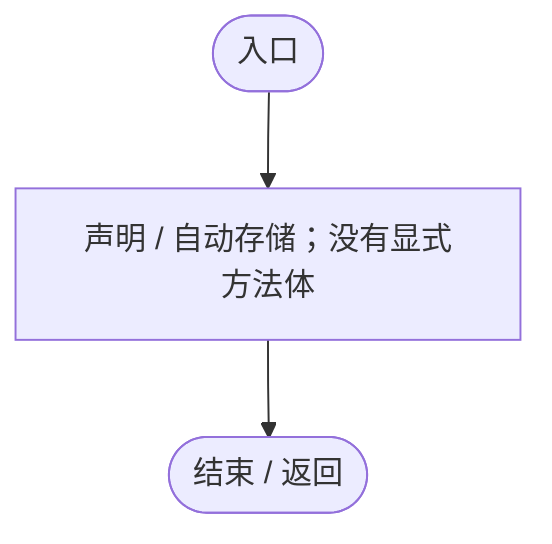

<a id="m7c6af5bea732388a"></a>

## ThreatLocal.set · L13

`private set`


### Editor / Player · 语法控制结构 / 声明（非CFG）


<a id="meed3f27c690f8e19"></a>

## Active.get · L16

`public bool Active`


### Editor / Player · 语法控制结构 / 声明（非CFG）

```mermaid
flowchart TD
  n2(["入口"])
  n1["EcologyQueries.Active(_genes,_settings.territoryGene)!=null&#124;&#124;EcologyQueries.Active(_genes,_settings.populationGene)!=null"]
  n0(["结束 / 返回"])
  n1 --> n0
  n2 --> n1

```

项目内调用/回调引用：

- [EcologyQueries.Active · L29](bdf7ccc2c9c0452f.md#m200839bb9db5ec55)（方法）

<a id="ma0c0d67154c057a9"></a>

## Center.get · L17

`public Vector3 Center`


### Editor / Player · 语法控制结构 / 声明（非CFG）

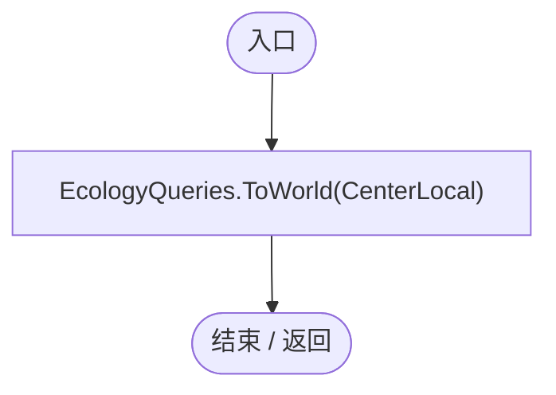

项目内调用/回调引用：

- [EcologyQueries.ToWorld · L41](bdf7ccc2c9c0452f.md#mc67423f4877c3534)（方法）
- [TerritoryBehavior.CenterLocal.get · L10](19d504dcdc8bc624.md#m88cc30456d76375a)（访问器）

<a id="md162d54387425443"></a>

## Radius.get · L18

`public float Radius`


### Editor / Player · 语法控制结构 / 声明（非CFG）

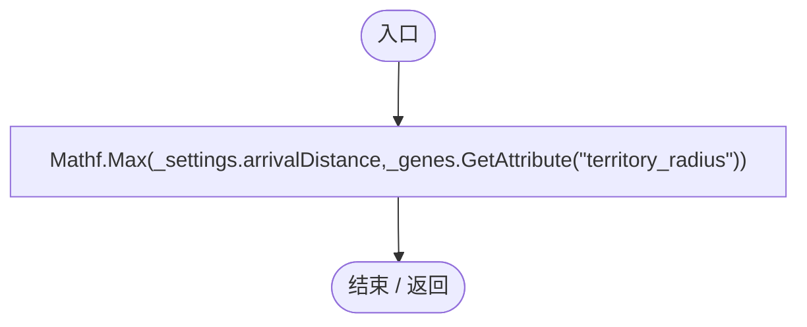

项目内调用/回调引用：

- [EntityGeneController.GetAttribute · L288](7494d53178552f0e.md#m45127bcdd833aaf5)（方法）

<a id="m46a26d602baf83f0"></a>

## Defense.get · L19

`public float Defense`


### Editor / Player · 语法控制结构 / 声明（非CFG）

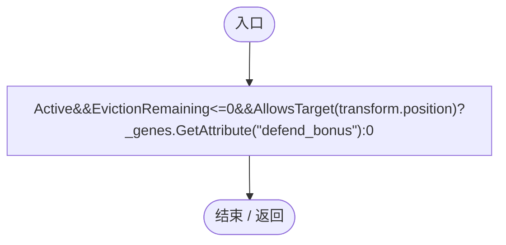

项目内调用/回调引用：

- [TerritoryBehavior.EvictionRemaining.get · L12](19d504dcdc8bc624.md#m737a47b8e966cdb5)（访问器）
- [TerritoryBehavior.AllowsTarget · L44](19d504dcdc8bc624.md#me15c2336b446d739)（方法）
- [EntityGeneController.GetAttribute · L288](7494d53178552f0e.md#m45127bcdd833aaf5)（方法）

<a id="ma8fe6ea402ce8738"></a>

## Awake · L20

`private void Awake()`


### Editor / Player · Roslyn编译器控制流

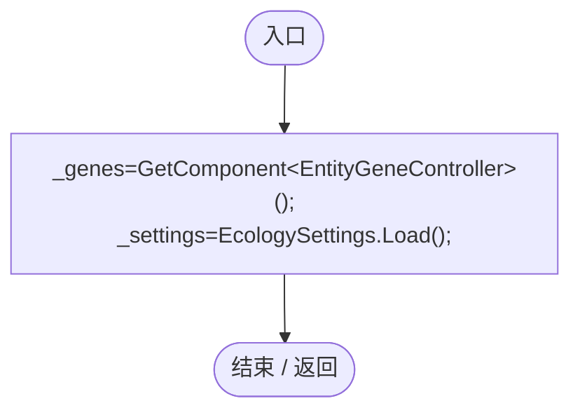

项目内调用/回调引用：

- [EcologySettings.Load · L18](90428a275d065ef6.md#mb0575490373edaf2)（方法）

<a id="m75b21d82e3071bc4"></a>

## OnEnable · L21

`private void OnEnable()`


### Editor / Player · Roslyn编译器控制流

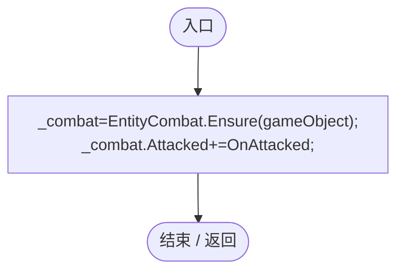

项目内调用/回调引用：

- [EntityCombat.Ensure · L12](a5b5b46ac6c197ae.md#me21fe8f31497e62f)（方法）
- [TerritoryBehavior.OnAttacked · L37](19d504dcdc8bc624.md#mb355e0d49d68cde1)（方法）

<a id="m37e664d84c11f0f8"></a>

## OnDisable · L22

`private void OnDisable()`


### Editor / Player · Roslyn编译器控制流

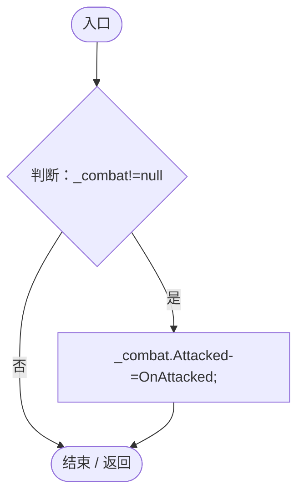

项目内调用/回调引用：

- [TerritoryBehavior.OnAttacked · L37](19d504dcdc8bc624.md#mb355e0d49d68cde1)（方法）

<a id="me912ce40a7821277"></a>

## Update · L23

`private void Update()`


### Editor / Player · Roslyn编译器控制流

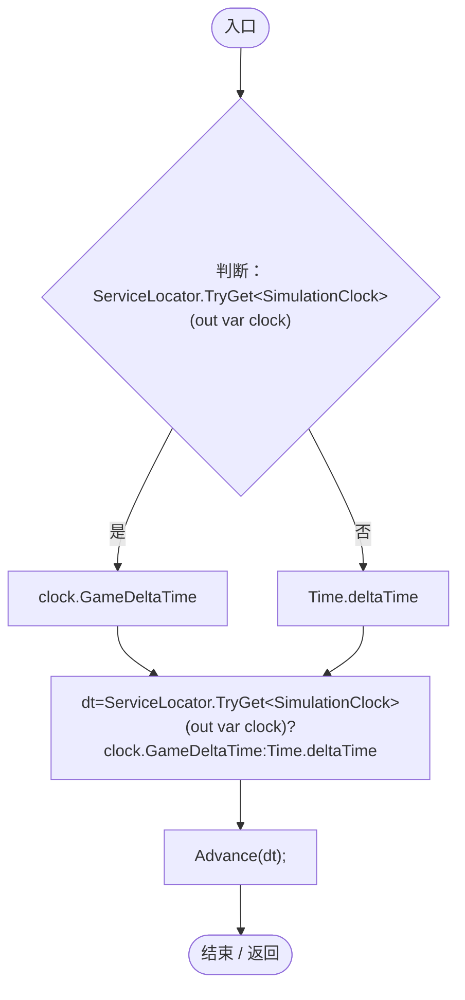

项目内调用/回调引用：

- [ServiceLocator.TryGet · L26](f2fdbe9f9ccd93cb.md#m143b24e6d58471b0)（方法）
- [SimulationClock.GameDeltaTime.get · L26](a8f444aec9614b0a.md#me7f11abae18a4f2d)（访问器）
- [TerritoryBehavior.Advance · L24](19d504dcdc8bc624.md#m08bf00c6d2c8c51a)（方法）

<a id="m08bf00c6d2c8c51a"></a>

## Advance · L24

`public void Advance(float dt)`


### Editor / Player · Roslyn编译器控制流

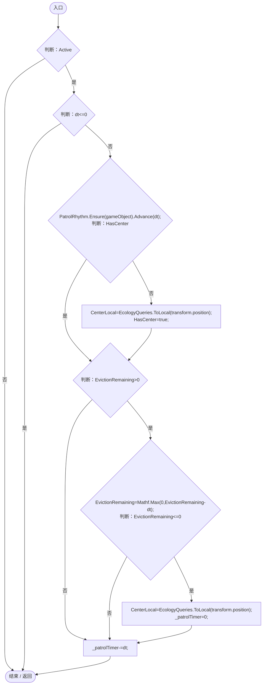

项目内调用/回调引用：

- [PatrolRhythm.Advance · L15](f55940fd5773d413.md#m3972297e3b3f0268)（方法）
- [PatrolRhythm.Ensure · L14](f55940fd5773d413.md#mfe51a369852bf3eb)（方法）
- [TerritoryBehavior.HasCenter.get · L11](19d504dcdc8bc624.md#meb62e210ced1fe2d)（访问器）
- [TerritoryBehavior.CenterLocal.set · L10](19d504dcdc8bc624.md#m721305d037d9500e)（访问器）
- [EcologyQueries.ToLocal · L40](bdf7ccc2c9c0452f.md#mfa1ace432c73012a)（方法）
- [TerritoryBehavior.HasCenter.set · L11](19d504dcdc8bc624.md#m82357e4c9702e3e7)（访问器）
- [TerritoryBehavior.EvictionRemaining.get · L12](19d504dcdc8bc624.md#m737a47b8e966cdb5)（访问器）
- [TerritoryBehavior.EvictionRemaining.set · L12](19d504dcdc8bc624.md#m7c0ff6fc4b655d52)（访问器）

<a id="mb355e0d49d68cde1"></a>

## OnAttacked · L37

`private void OnAttacked(DarwinEntity attacker,float damage)`


### Editor / Player · Roslyn编译器控制流

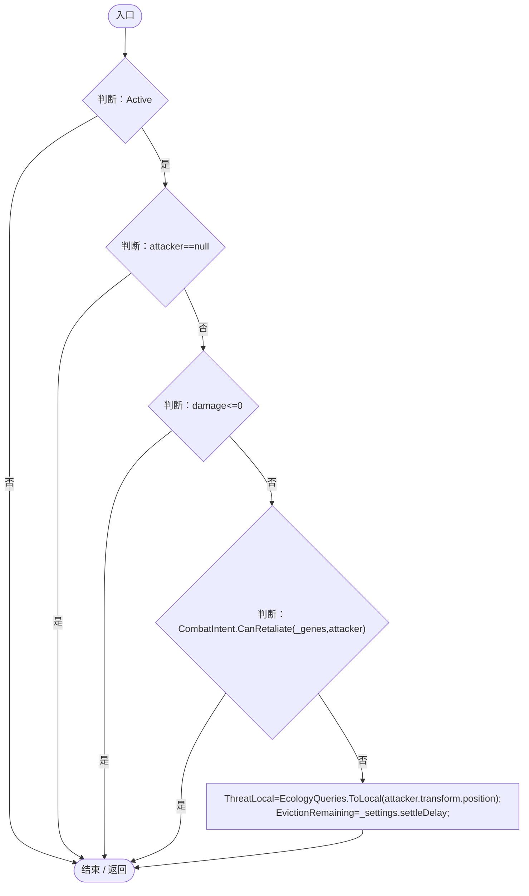

项目内调用/回调引用：

- [CombatIntent.CanRetaliate · L17](34193b994b2c0894.md#mc5a8d04d3027ce21)（方法）
- [TerritoryBehavior.ThreatLocal.set · L13](19d504dcdc8bc624.md#m7c6af5bea732388a)（访问器）
- [EcologyQueries.ToLocal · L40](bdf7ccc2c9c0452f.md#mfa1ace432c73012a)（方法）
- [TerritoryBehavior.EvictionRemaining.set · L12](19d504dcdc8bc624.md#m7c0ff6fc4b655d52)（访问器）

<a id="me15c2336b446d739"></a>

## AllowsTarget · L44

`public bool AllowsTarget(Vector3 position)`


### Editor / Player · Roslyn编译器控制流

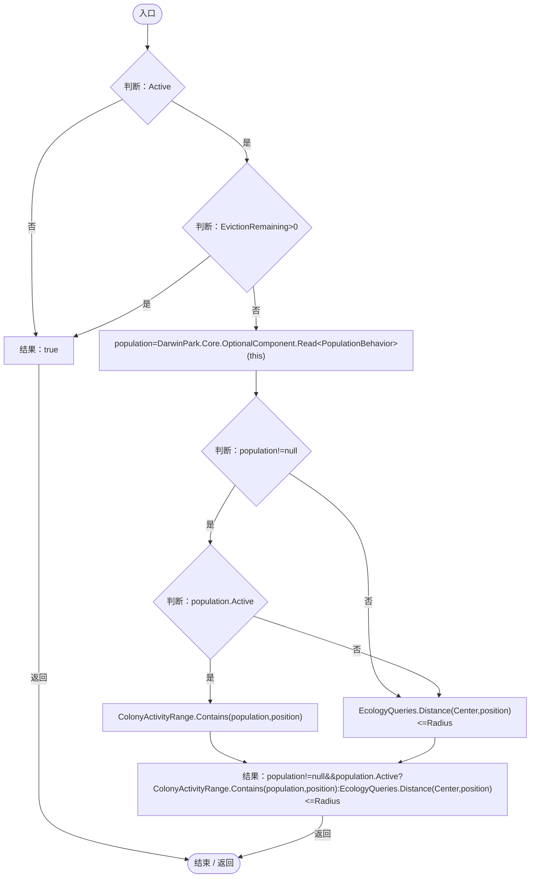

项目内调用/回调引用：

- [TerritoryBehavior.EvictionRemaining.get · L12](19d504dcdc8bc624.md#m737a47b8e966cdb5)（访问器）
- [OptionalComponent.Read · L7](806c46b42ced4d36.md#m69622a4dee165c5a)（方法）
- [ColonyActivityRange.Contains · L21](e8d854132f563257.md#m535d817473d6a256)（方法）
- [EcologyQueries.Distance · L43](bdf7ccc2c9c0452f.md#m6e395dce655ebcac)（方法）

<a id="m374e03b42ee0c515"></a>

## Destination · L51

`public bool Destination(out Vector3 point,out float speed)`


### Editor / Player · Roslyn编译器控制流

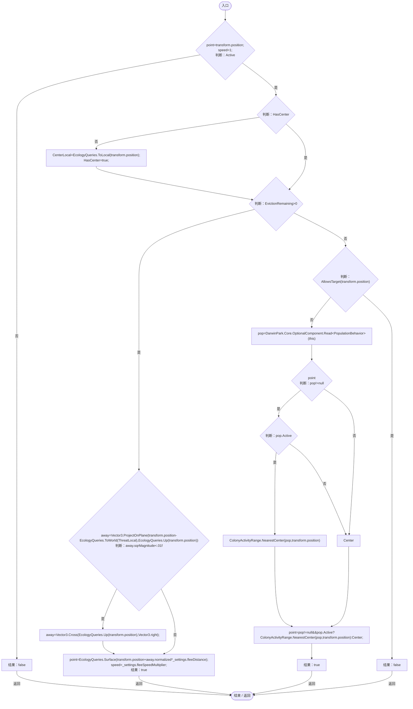

项目内调用/回调引用：

- [TerritoryBehavior.HasCenter.get · L11](19d504dcdc8bc624.md#meb62e210ced1fe2d)（访问器）
- [TerritoryBehavior.CenterLocal.set · L10](19d504dcdc8bc624.md#m721305d037d9500e)（访问器）
- [EcologyQueries.ToLocal · L40](bdf7ccc2c9c0452f.md#mfa1ace432c73012a)（方法）
- [TerritoryBehavior.HasCenter.set · L11](19d504dcdc8bc624.md#m82357e4c9702e3e7)（访问器）
- [TerritoryBehavior.EvictionRemaining.get · L12](19d504dcdc8bc624.md#m737a47b8e966cdb5)（访问器）
- [EcologyQueries.ToWorld · L41](bdf7ccc2c9c0452f.md#mc67423f4877c3534)（方法）
- [TerritoryBehavior.ThreatLocal.get · L13](19d504dcdc8bc624.md#m09b6b3fc491be4b7)（访问器）
- [EcologyQueries.Up · L42](bdf7ccc2c9c0452f.md#ma73e6bbbc726282f)（方法）
- [EcologyQueries.Surface · L48](bdf7ccc2c9c0452f.md#m40ee3e975d7f5137)（方法）
- [TerritoryBehavior.AllowsTarget · L44](19d504dcdc8bc624.md#me15c2336b446d739)（方法）
- [OptionalComponent.Read · L7](806c46b42ced4d36.md#m69622a4dee165c5a)（方法）
- [ColonyActivityRange.NearestCenter · L37](e8d854132f563257.md#mb106f1cf0d4f9a63)（方法）

<a id="m876514deba1e74d9"></a>

## PatrolDestination · L66

`public bool PatrolDestination(out Vector3 point)`

★ 适配：仅由注册表中 TerritoryPatrol 行为调用，保留基因状态与独立实体状态。

### Editor / Player · Roslyn编译器控制流

```mermaid
flowchart TD
  b0(["入口"])
  b1{"point=transform.position;<br/>判断：Active"}
  b2{"判断：PatrolRhythm.Allows(_genes)"}
  b3["结果：false"]
  b4{"判断：HasCenter"}
  b5["CenterLocal=EcologyQueries.ToLocal(transform.position);<br/>HasCenter=true;"]
  b6{"判断：_patrolTimer&lt;=0"}
  b7{"判断：EcologyQueries.Distance(transform.position,EcologyQueries.ToWorld(_destination))&lt;_settings.arrivalDistance"}
  b8["tangent=Vector3.ProjectOnPlane(Random.onUnitSphere,EcologyQueries.Up(Center))<br/>_destination=EcologyQueries.ToLocal(EcologyQueries.Surface(Center+tangent.normalized*Random.Range(0,Radius)));<br/>_patrolTimer=_settings.patrolInterval;"]
  b9["point=EcologyQueries.ToWorld(_destination);<br/>结果：true"]
  b10(["结束 / 返回"])
  b0 --> b1
  b1 -->|"是"| b2
  b1 -->|"否"| b3
  b2 -->|"否"| b3
  b2 -->|"是"| b4
  b3 -->|"返回"| b10
  b4 -->|"否"| b5
  b4 -->|"是"| b6
  b5 --> b6
  b6 -->|"否"| b7
  b6 -->|"是"| b8
  b7 -->|"是"| b8
  b7 -->|"否"| b9
  b8 --> b9
  b9 -->|"返回"| b10

```

项目内调用/回调引用：

- [PatrolRhythm.Allows · L22](f55940fd5773d413.md#m81df27ee0a3ed85c)（方法）
- [TerritoryBehavior.HasCenter.get · L11](19d504dcdc8bc624.md#meb62e210ced1fe2d)（访问器）
- [TerritoryBehavior.CenterLocal.set · L10](19d504dcdc8bc624.md#m721305d037d9500e)（访问器）
- [EcologyQueries.ToLocal · L40](bdf7ccc2c9c0452f.md#mfa1ace432c73012a)（方法）
- [TerritoryBehavior.HasCenter.set · L11](19d504dcdc8bc624.md#m82357e4c9702e3e7)（访问器）
- [EcologyQueries.Distance · L43](bdf7ccc2c9c0452f.md#m6e395dce655ebcac)（方法）
- [EcologyQueries.ToWorld · L41](bdf7ccc2c9c0452f.md#mc67423f4877c3534)（方法）
- [EcologyQueries.Up · L42](bdf7ccc2c9c0452f.md#ma73e6bbbc726282f)（方法）
- [EcologyQueries.Surface · L48](bdf7ccc2c9c0452f.md#m40ee3e975d7f5137)（方法）

<a id="mf15d2bca17e464ce"></a>

## Restore · L77

`public void Restore(Vector3 center,bool hasCenter,float eviction,Vector3 threat)`


### Editor / Player · Roslyn编译器控制流

```mermaid
flowchart TD
  b0(["入口"])
  b1["CenterLocal=center;<br/>HasCenter=hasCenter;<br/>EvictionRemaining=eviction;<br/>ThreatLocal=threat;<br/>_patrolTimer=0;"]
  b2(["结束 / 返回"])
  b0 --> b1
  b1 --> b2

```

项目内调用/回调引用：

- [TerritoryBehavior.CenterLocal.set · L10](19d504dcdc8bc624.md#m721305d037d9500e)（访问器）
- [TerritoryBehavior.HasCenter.set · L11](19d504dcdc8bc624.md#m82357e4c9702e3e7)（访问器）
- [TerritoryBehavior.EvictionRemaining.set · L12](19d504dcdc8bc624.md#m7c0ff6fc4b655d52)（访问器）
- [TerritoryBehavior.ThreatLocal.set · L13](19d504dcdc8bc624.md#m7c6af5bea732388a)（访问器）
