# TerritoryBehavior.cs

[返回总索引](../README.md) · `Runtime` · `Assets/DarwinPark/Entities/Ecology/TerritoryBehavior.cs`

[源文件](../../../Assets/DarwinPark/Entities/Ecology/TerritoryBehavior.cs) · 源码校验：`f0c8b6fbc5830814177c37fed78ab59a8560a037e1d0742baf43c8808b490f5b`

方法按源文件位置排列。事件/回调引用不表示立即执行；分支与异常说明见总索引。完整源码与可点击关系图请打开离线手册。

<a id="ma6c3ca66e73f2c95"></a>

## CenterLocal.get · L9

`get`


### Editor / Player · 语法控制结构 / 声明（非CFG）

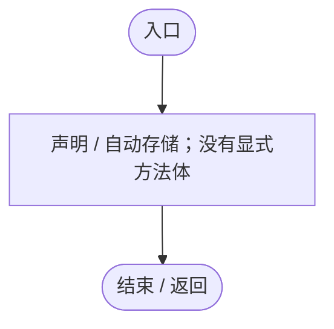

<a id="m7bf5284fa5d756fb"></a>

## CenterLocal.set · L9

`private set`


### Editor / Player · 语法控制结构 / 声明（非CFG）


<a id="m45c71ab11052b836"></a>

## HasCenter.get · L10

`get`


### Editor / Player · 语法控制结构 / 声明（非CFG）


<a id="m176662ef5ab511cb"></a>

## HasCenter.set · L10

`private set`


### Editor / Player · 语法控制结构 / 声明（非CFG）


<a id="m412b89a669c39b71"></a>

## EvictionRemaining.get · L11

`get`


### Editor / Player · 语法控制结构 / 声明（非CFG）


<a id="mf74da4f02d88ae52"></a>

## EvictionRemaining.set · L11

`private set`


### Editor / Player · 语法控制结构 / 声明（非CFG）


<a id="m76a872f994e82613"></a>

## ThreatLocal.get · L12

`get`


### Editor / Player · 语法控制结构 / 声明（非CFG）


<a id="m5a6864b69f224168"></a>

## ThreatLocal.set · L12

`private set`


### Editor / Player · 语法控制结构 / 声明（非CFG）


<a id="m64b480d0b01fb549"></a>

## Active.get · L15

`public bool Active`


### Editor / Player · 语法控制结构 / 声明（非CFG）

```mermaid
flowchart TD
  n2(["入口"])
  n1["EcologyQueries.Active(_genes,_settings.territoryGene)!=null&#124;&#124;EcologyQueries.Active(_genes,_settings.populationGene)!=null"]
  n0(["结束 / 返回"])
  n1 --> n0
  n2 --> n1

```

项目内调用/回调引用：

- [EcologyQueries.Active · L28](bdf7ccc2c9c0452f.md#m4fb10ad424167e3b)（方法）

<a id="mf27436b142add6ab"></a>

## Center.get · L16

`public Vector3 Center`


### Editor / Player · 语法控制结构 / 声明（非CFG）

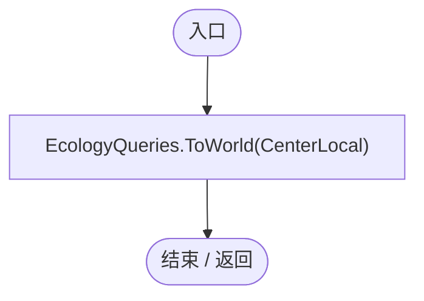

项目内调用/回调引用：

- [EcologyQueries.ToWorld · L40](bdf7ccc2c9c0452f.md#m320932c05ccecbf7)（方法）
- [TerritoryBehavior.CenterLocal.get · L9](19d504dcdc8bc624.md#ma6c3ca66e73f2c95)（访问器）

<a id="m452bb3decc5e09db"></a>

## Radius.get · L17

`public float Radius`


### Editor / Player · 语法控制结构 / 声明（非CFG）

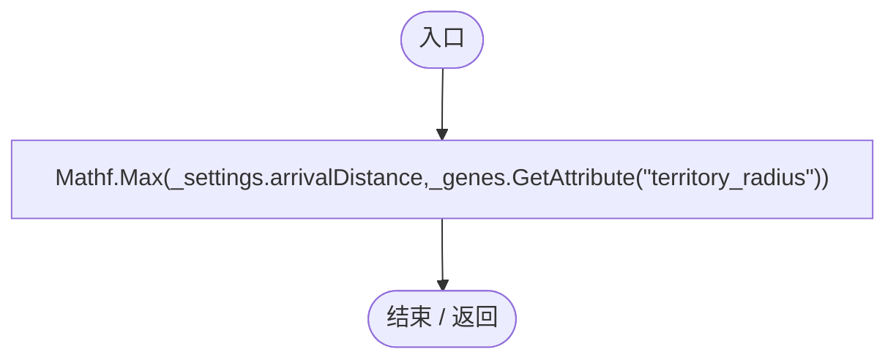

项目内调用/回调引用：

- [EntityGeneController.GetAttribute · L257](7494d53178552f0e.md#m600509f72d274f0c)（方法）

<a id="m7ad56e967feb86c4"></a>

## Defense.get · L18

`public float Defense`


### Editor / Player · 语法控制结构 / 声明（非CFG）

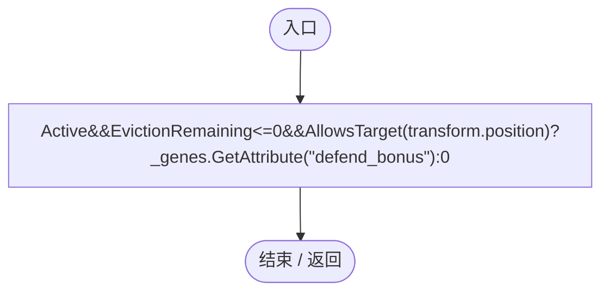

项目内调用/回调引用：

- [TerritoryBehavior.EvictionRemaining.get · L11](19d504dcdc8bc624.md#m412b89a669c39b71)（访问器）
- [TerritoryBehavior.AllowsTarget · L43](19d504dcdc8bc624.md#mc867b3c025f861d2)（方法）
- [EntityGeneController.GetAttribute · L257](7494d53178552f0e.md#m600509f72d274f0c)（方法）

<a id="m40e3851304a815b6"></a>

## Awake · L19

`private void Awake()`


### Editor / Player · Roslyn编译器控制流

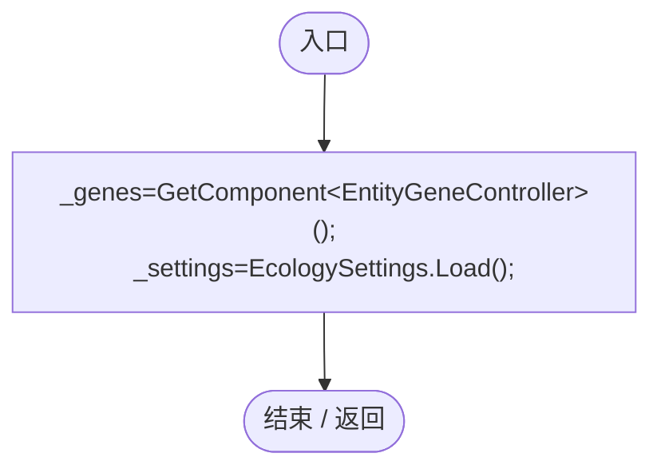

项目内调用/回调引用：

- [EcologySettings.Load · L18](90428a275d065ef6.md#mb0575490373edaf2)（方法）

<a id="m9a5f681d86b20cf7"></a>

## OnEnable · L20

`private void OnEnable()`


### Editor / Player · Roslyn编译器控制流

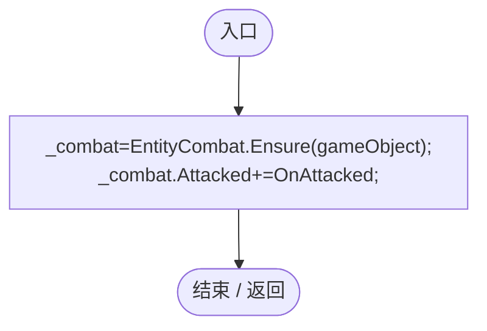

项目内调用/回调引用：

- [EntityCombat.Ensure · L11](a5b5b46ac6c197ae.md#m1b9e5f59cedd143e)（方法）
- [TerritoryBehavior.OnAttacked · L36](19d504dcdc8bc624.md#mab521c4a035da62f)（方法）

<a id="m3470586732a77cb0"></a>

## OnDisable · L21

`private void OnDisable()`


### Editor / Player · Roslyn编译器控制流

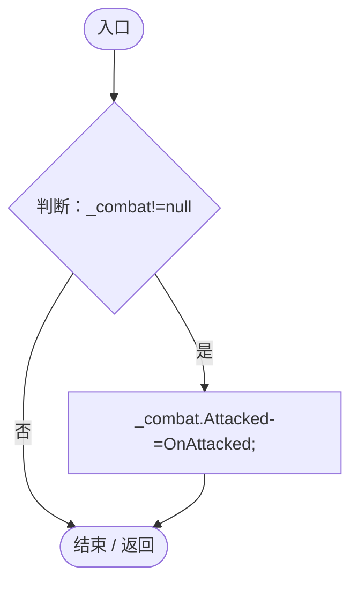

项目内调用/回调引用：

- [TerritoryBehavior.OnAttacked · L36](19d504dcdc8bc624.md#mab521c4a035da62f)（方法）

<a id="mfb7ab04a5c06d14f"></a>

## Update · L22

`private void Update()`


### Editor / Player · Roslyn编译器控制流

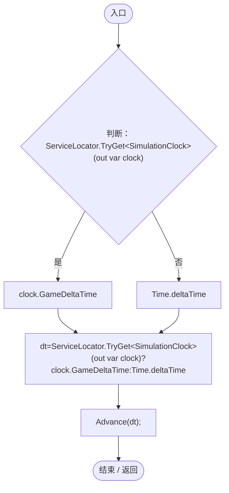

项目内调用/回调引用：

- [ServiceLocator.TryGet · L26](f2fdbe9f9ccd93cb.md#m143b24e6d58471b0)（方法）
- [SimulationClock.GameDeltaTime.get · L26](a8f444aec9614b0a.md#me7f11abae18a4f2d)（访问器）
- [TerritoryBehavior.Advance · L23](19d504dcdc8bc624.md#me9363af362e5c02e)（方法）

<a id="me9363af362e5c02e"></a>

## Advance · L23

`public void Advance(float dt)`


### Editor / Player · Roslyn编译器控制流

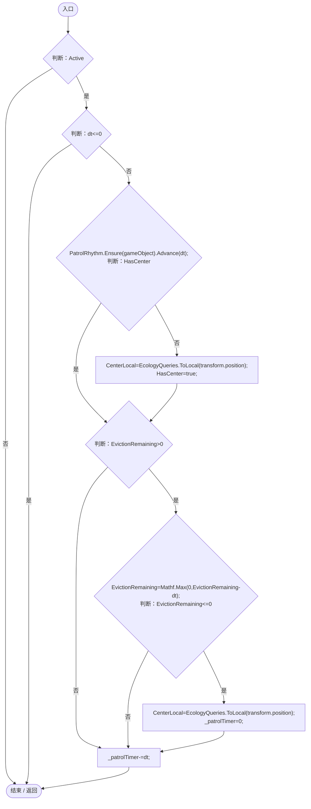

项目内调用/回调引用：

- [PatrolRhythm.Advance · L14](f55940fd5773d413.md#m59498b7b0e1a1798)（方法）
- [PatrolRhythm.Ensure · L13](f55940fd5773d413.md#m47ee8c1a397958a4)（方法）
- [TerritoryBehavior.HasCenter.get · L10](19d504dcdc8bc624.md#m45c71ab11052b836)（访问器）
- [TerritoryBehavior.CenterLocal.set · L9](19d504dcdc8bc624.md#m7bf5284fa5d756fb)（访问器）
- [EcologyQueries.ToLocal · L39](bdf7ccc2c9c0452f.md#m1a07639eacf3aa47)（方法）
- [TerritoryBehavior.HasCenter.set · L10](19d504dcdc8bc624.md#m176662ef5ab511cb)（访问器）
- [TerritoryBehavior.EvictionRemaining.get · L11](19d504dcdc8bc624.md#m412b89a669c39b71)（访问器）
- [TerritoryBehavior.EvictionRemaining.set · L11](19d504dcdc8bc624.md#mf74da4f02d88ae52)（访问器）

<a id="mab521c4a035da62f"></a>

## OnAttacked · L36

`private void OnAttacked(DarwinEntity attacker,float damage)`


### Editor / Player · Roslyn编译器控制流

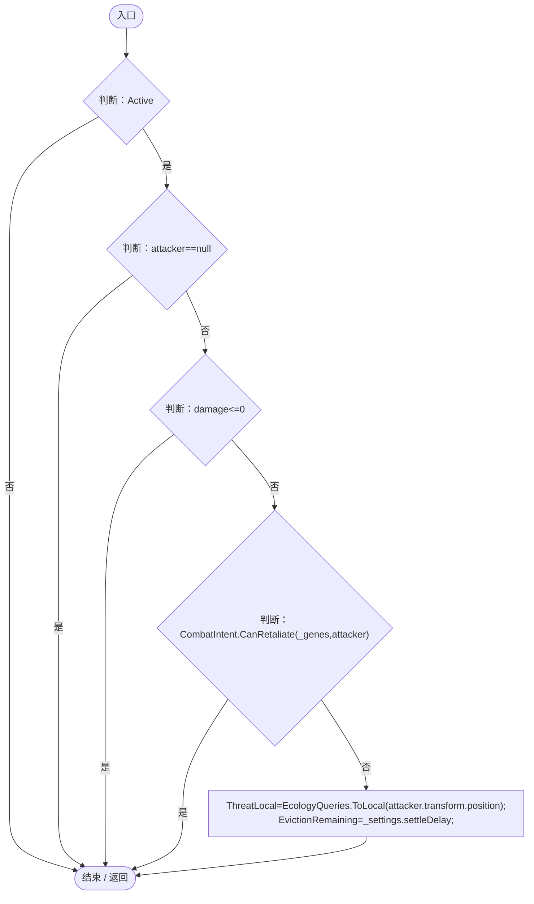

项目内调用/回调引用：

- [CombatIntent.CanRetaliate · L16](34193b994b2c0894.md#m9793f6ed16c1a5bd)（方法）
- [TerritoryBehavior.ThreatLocal.set · L12](19d504dcdc8bc624.md#m5a6864b69f224168)（访问器）
- [EcologyQueries.ToLocal · L39](bdf7ccc2c9c0452f.md#m1a07639eacf3aa47)（方法）
- [TerritoryBehavior.EvictionRemaining.set · L11](19d504dcdc8bc624.md#mf74da4f02d88ae52)（访问器）

<a id="mc867b3c025f861d2"></a>

## AllowsTarget · L43

`public bool AllowsTarget(Vector3 position)`


### Editor / Player · Roslyn编译器控制流

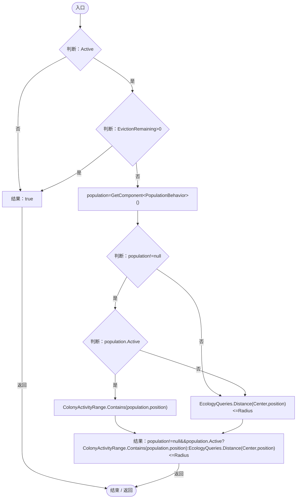

项目内调用/回调引用：

- [TerritoryBehavior.EvictionRemaining.get · L11](19d504dcdc8bc624.md#m412b89a669c39b71)（访问器）
- [ColonyActivityRange.Contains · L33](e8d854132f563257.md#m9ee9b6f17791cff5)（方法）
- [EcologyQueries.Distance · L42](bdf7ccc2c9c0452f.md#mba9c3e3c95d0f2dd)（方法）

<a id="ma85a4edc643b70c9"></a>

## Destination · L50

`public bool Destination(out Vector3 point,out float speed)`


### Editor / Player · Roslyn编译器控制流

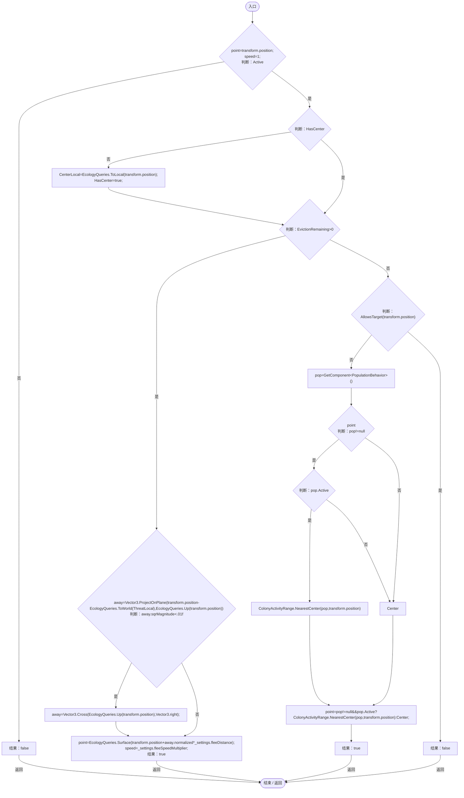

项目内调用/回调引用：

- [TerritoryBehavior.HasCenter.get · L10](19d504dcdc8bc624.md#m45c71ab11052b836)（访问器）
- [TerritoryBehavior.CenterLocal.set · L9](19d504dcdc8bc624.md#m7bf5284fa5d756fb)（访问器）
- [EcologyQueries.ToLocal · L39](bdf7ccc2c9c0452f.md#m1a07639eacf3aa47)（方法）
- [TerritoryBehavior.HasCenter.set · L10](19d504dcdc8bc624.md#m176662ef5ab511cb)（访问器）
- [TerritoryBehavior.EvictionRemaining.get · L11](19d504dcdc8bc624.md#m412b89a669c39b71)（访问器）
- [EcologyQueries.ToWorld · L40](bdf7ccc2c9c0452f.md#m320932c05ccecbf7)（方法）
- [TerritoryBehavior.ThreatLocal.get · L12](19d504dcdc8bc624.md#m76a872f994e82613)（访问器）
- [EcologyQueries.Up · L41](bdf7ccc2c9c0452f.md#maca7070196f125fd)（方法）
- [EcologyQueries.Surface · L47](bdf7ccc2c9c0452f.md#m2f1f6873ee5fc8df)（方法）
- [TerritoryBehavior.AllowsTarget · L43](19d504dcdc8bc624.md#mc867b3c025f861d2)（方法）
- [ColonyActivityRange.NearestCenter · L46](e8d854132f563257.md#m6fc56569d084b220)（方法）

<a id="m4c3ffae68a7fb8fb"></a>

## PatrolDestination · L65

`public bool PatrolDestination(out Vector3 point)`

★ 适配：仅由注册表中 TerritoryPatrol 行为调用，保留基因状态与独立实体状态。

### Editor / Player · Roslyn编译器控制流

```mermaid
flowchart TD
  b0(["入口"])
  b1{"point=transform.position;<br/>判断：Active"}
  b2{"判断：PatrolRhythm.Allows(_genes)"}
  b3["结果：false"]
  b4{"判断：HasCenter"}
  b5["CenterLocal=EcologyQueries.ToLocal(transform.position);<br/>HasCenter=true;"]
  b6{"判断：_patrolTimer&lt;=0"}
  b7{"判断：EcologyQueries.Distance(transform.position,EcologyQueries.ToWorld(_destination))&lt;_settings.arrivalDistance"}
  b8["tangent=Vector3.ProjectOnPlane(Random.onUnitSphere,EcologyQueries.Up(Center))<br/>_destination=EcologyQueries.ToLocal(EcologyQueries.Surface(Center+tangent.normalized*Random.Range(0,Radius)));<br/>_patrolTimer=_settings.patrolInterval;"]
  b9["point=EcologyQueries.ToWorld(_destination);<br/>结果：true"]
  b10(["结束 / 返回"])
  b0 --> b1
  b1 -->|"是"| b2
  b1 -->|"否"| b3
  b2 -->|"否"| b3
  b2 -->|"是"| b4
  b3 -->|"返回"| b10
  b4 -->|"否"| b5
  b4 -->|"是"| b6
  b5 --> b6
  b6 -->|"否"| b7
  b6 -->|"是"| b8
  b7 -->|"是"| b8
  b7 -->|"否"| b9
  b8 --> b9
  b9 -->|"返回"| b10

```

项目内调用/回调引用：

- [PatrolRhythm.Allows · L21](f55940fd5773d413.md#m54f51941f18cc808)（方法）
- [TerritoryBehavior.HasCenter.get · L10](19d504dcdc8bc624.md#m45c71ab11052b836)（访问器）
- [TerritoryBehavior.CenterLocal.set · L9](19d504dcdc8bc624.md#m7bf5284fa5d756fb)（访问器）
- [EcologyQueries.ToLocal · L39](bdf7ccc2c9c0452f.md#m1a07639eacf3aa47)（方法）
- [TerritoryBehavior.HasCenter.set · L10](19d504dcdc8bc624.md#m176662ef5ab511cb)（访问器）
- [EcologyQueries.Distance · L42](bdf7ccc2c9c0452f.md#mba9c3e3c95d0f2dd)（方法）
- [EcologyQueries.ToWorld · L40](bdf7ccc2c9c0452f.md#m320932c05ccecbf7)（方法）
- [EcologyQueries.Up · L41](bdf7ccc2c9c0452f.md#maca7070196f125fd)（方法）
- [EcologyQueries.Surface · L47](bdf7ccc2c9c0452f.md#m2f1f6873ee5fc8df)（方法）

<a id="m46f7e3f781d6bee3"></a>

## Restore · L76

`public void Restore(Vector3 center,bool hasCenter,float eviction,Vector3 threat)`


### Editor / Player · Roslyn编译器控制流

```mermaid
flowchart TD
  b0(["入口"])
  b1["CenterLocal=center;<br/>HasCenter=hasCenter;<br/>EvictionRemaining=eviction;<br/>ThreatLocal=threat;<br/>_patrolTimer=0;"]
  b2(["结束 / 返回"])
  b0 --> b1
  b1 --> b2

```

项目内调用/回调引用：

- [TerritoryBehavior.CenterLocal.set · L9](19d504dcdc8bc624.md#m7bf5284fa5d756fb)（访问器）
- [TerritoryBehavior.HasCenter.set · L10](19d504dcdc8bc624.md#m176662ef5ab511cb)（访问器）
- [TerritoryBehavior.EvictionRemaining.set · L11](19d504dcdc8bc624.md#mf74da4f02d88ae52)（访问器）
- [TerritoryBehavior.ThreatLocal.set · L12](19d504dcdc8bc624.md#m5a6864b69f224168)（访问器）
