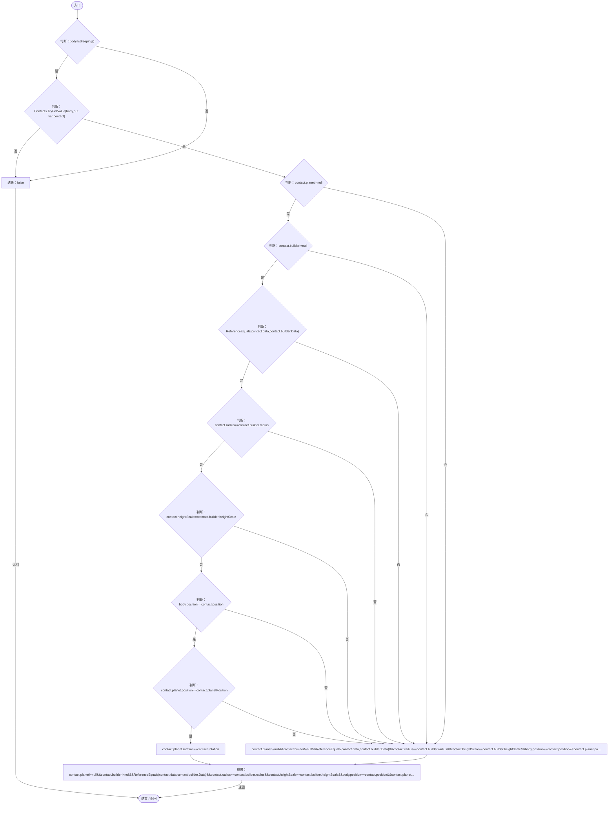
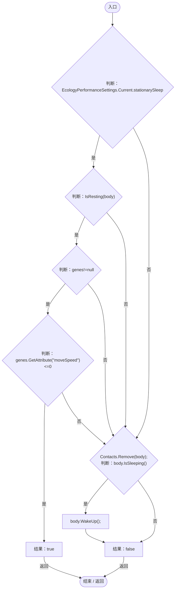
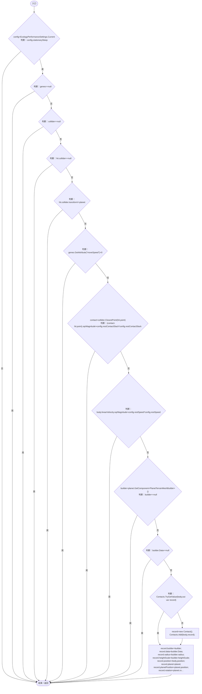
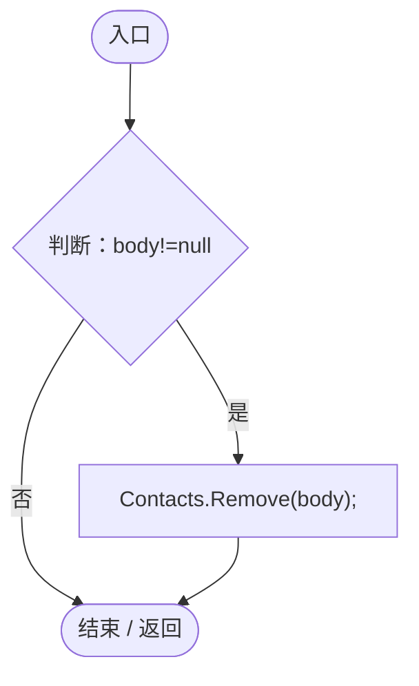
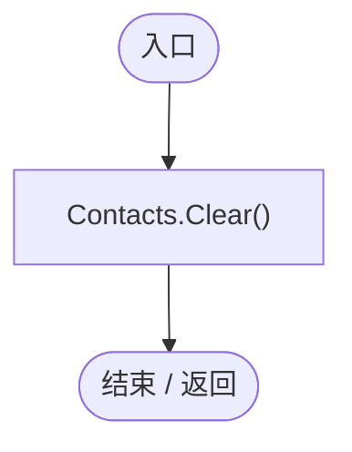

# StationaryBodyRest.cs

[返回总索引](../README.md) · `Runtime` · `Assets/DarwinPark/Entities/StationaryBodyRest.cs`

[源文件](../../../Assets/DarwinPark/Entities/StationaryBodyRest.cs) · 源码校验：`3a6e089256f9d6df60f89ff3801cc31c9c9fcf4621a53f99dbff07bb5e279de9`

方法按源文件位置排列。事件/回调引用不表示立即执行；分支与异常说明见总索引。完整源码与可点击关系图请打开离线手册。

## IsResting · L13

`public static bool IsResting(Rigidbody body)`

### Editor / Player · Roslyn编译器控制流

项目内调用/回调引用：

- [PlanetTerrainMeshBuilder.Data.get · L78](415285cf043354a9.md#m8382f579717fbc6d)（访问器）

## RemainsAsleep · L19

`public static bool RemainsAsleep(Rigidbody body,EntityGeneController genes)`

### Editor / Player · Roslyn编译器控制流

项目内调用/回调引用：

- [EcologyPerformanceSettings.Current.get · L13](d5a013a7598d7dff.md#m9b5b45c2da3c08f0)（访问器）
- [StationaryBodyRest.IsResting · L13](19e6d310d5522440.md#mfc1d49425304ae1a)（方法）
- [EntityGeneController.GetAttribute · L257](7494d53178552f0e.md#m600509f72d274f0c)（方法）

## TryRest · L24

`public static void TryRest(Rigidbody body,EntityGeneController genes,Collider collider,RaycastHit hit,Transform planet)`

### Editor / Player · Roslyn编译器控制流

项目内调用/回调引用：

- [EcologyPerformanceSettings.Current.get · L13](d5a013a7598d7dff.md#m9b5b45c2da3c08f0)（访问器）
- [EntityGeneController.GetAttribute · L257](7494d53178552f0e.md#m600509f72d274f0c)（方法）
- [PlanetTerrainMeshBuilder.Data.get · L78](415285cf043354a9.md#m8382f579717fbc6d)（访问器）

## Remove · L37

`public static void Remove(Rigidbody body)`

### Editor / Player · Roslyn编译器控制流

## Clear · L38

`[RuntimeInitializeOnLoadMethod(RuntimeInitializeLoadType.SubsystemRegistration)] public static void Clear()`

### Editor / Player · Roslyn编译器控制流

