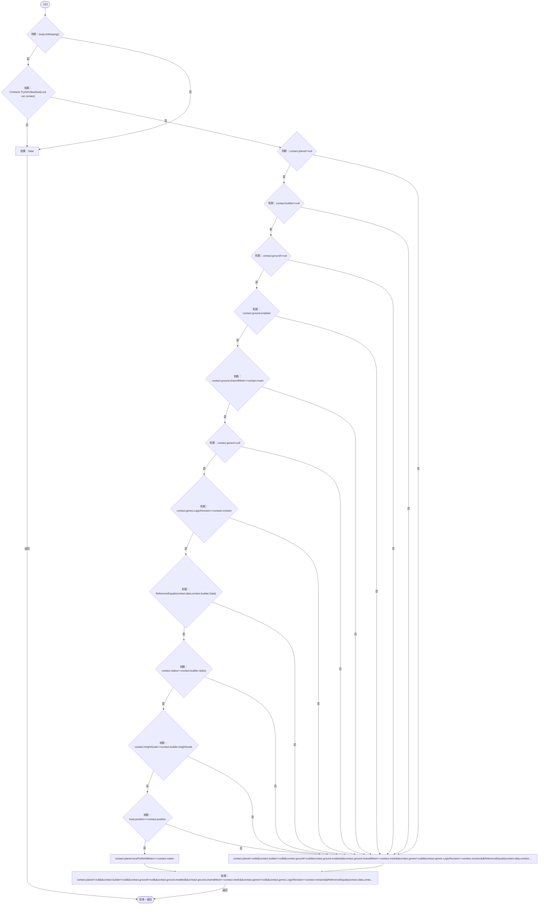
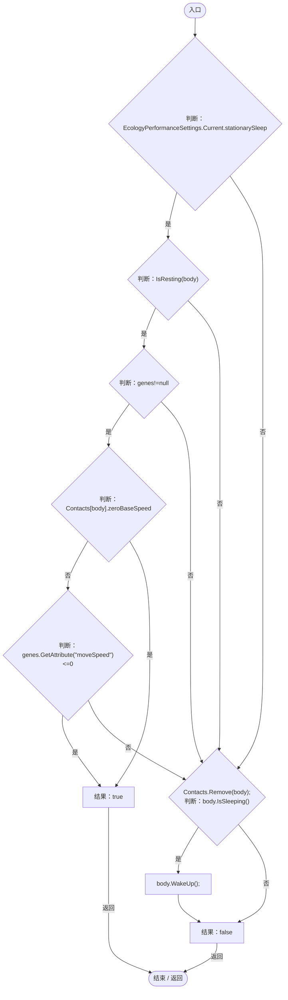
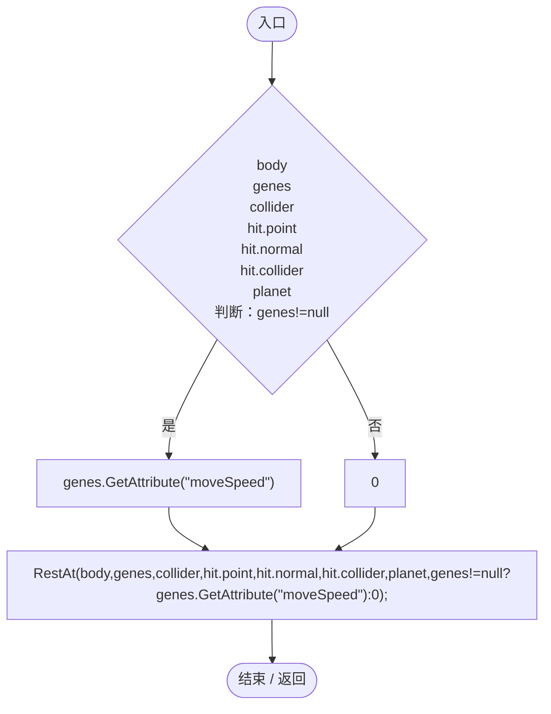
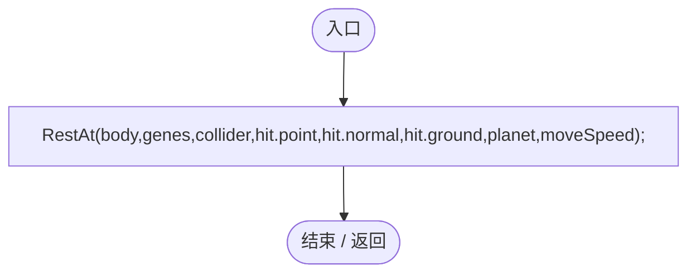
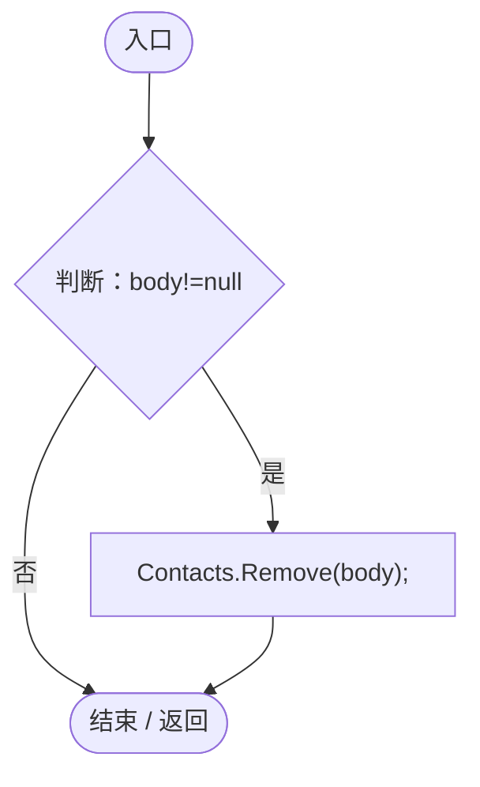
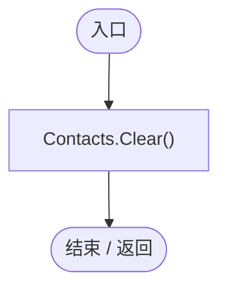

```mermaid
flowchart TD
  b0(["入口"])
  b1{"config=EcologyPerformanceSettings.Current<br/>判断：config.stationarySleep"}
  b2{"判断：genes==null"}
  b3{"判断：collider==null"}
  b4{"判断：ground==null"}
  b5{"判断：ground.transform!=planet"}
  b6{"判断：moveSpeed&gt;0"}
  b7{"判断：body.linearVelocity.sqrMagnitude&gt;config.restSpeed*config.restSpeed"}
  b8{"判断：VerifiedGroundRest.Touching(collider,ground,point,normal,config.restContactSlack)"}
  b9{"builder=planet.GetComponent&lt;PlanetTerrainMeshBuilder&gt;()<br/>判断：builder==null"}
  b10{"判断：builder.Data==null"}
  b11{"判断：Contacts.TryGetValue(body,out var record)"}
  b12["record=new Contact();<br/>Contacts.Add(body,record);"]
  b13["record.builder=builder;<br/>record.data=builder.Data;<br/>record.radius=builder.radius;<br/>record.heightScale=builder.heightScale;<br/>record.position=body.position;<br/>record.planet=planet;<br/>record.matrix=planet.localToWorldMatrix;<br/>record.ground=ground as…"]
  b14{"record.mesh<br/>判断：record.ground!=null"}
  b15["record.ground.sharedMesh"]
  b16["null"]
  b17["record.mesh=record.ground!=null?record.ground.sharedMesh:null;"]
  b18["record.genes=genes;<br/>record.revision=genes.LogicRevision;"]
  b19{"record.zeroBaseSpeed<br/>判断：genes.Evaluation==null"}
  b20{"判断：genes.Evaluation.Attributes.TryGetValue(&quot;moveSpeed&quot;,out float basic)"}
  b21["basic&lt;=0"]
  b22["genes.Evaluation==null&#124;&#124;!genes.Evaluation.Attributes.TryGetValue(&quot;moveSpeed&quot;,out float basic)&#124;&#124;basic&lt;=0"]
  b23["record.zeroBaseSpeed=genes.Evaluation==null&#124;&#124;!genes.Evaluation.Attributes.TryGetValue(&quot;moveSpeed&quot;,out float basic)&#124;&#124;basic&lt;=0;"]
  b24["body.Sleep();"]
  b25(["结束 / 返回"])
  b0 --> b1
  b1 -->|"是"| b2
  b1 -->|"否"| b25
  b2 -->|"否"| b3
  b2 -->|"是"| b25
  b3 -->|"否"| b4
  b3 -->|"是"| b25
  b4 -->|"否"| b5
  b4 -->|"是"| b25
  b5 -->|"否"| b6
  b5 -->|"是"| b25
  b6 -->|"是"| b25
  b6 -->|"否"| b7
  b7 -->|"否"| b8
  b7 -->|"是"| b25
  b8 -->|"否"| b25
  b8 -->|"是"| b9
  b9 -->|"否"| b10
  b9 -->|"是"| b25
  b10 -->|"是"| b25
  b10 -->|"否"| b11
  b11 -->|"否"| b12
  b11 -->|"是"| b13
  b12 --> b13
  b13 --> b14
  b14 -->|"是"| b15
  b14 -->|"否"| b16
  b15 --> b17
  b16 --> b17
  b17 --> b18
  b18 --> b19
  b19 -->|"否"| b20
  b19 -->|"是"| b22
  b20 -->|"是"| b21
  b20 -->|"否"| b22
  b21 --> b23
  b22 --> b23
  b23 --> b24
  b24 --> b25

```

# StationaryBodyRest.cs

[返回总索引](../README.md) · `Runtime` · `Assets/DarwinPark/Entities/StationaryBodyRest.cs`

[源文件](../../../Assets/DarwinPark/Entities/StationaryBodyRest.cs) · 源码校验：`11d89fceec3eca893c313d4484c406ff9e7229ecc2117adae3232d52bf858c72`

方法按源文件位置排列。事件/回调引用不表示立即执行；分支与异常说明见总索引。完整源码与可点击关系图请打开离线手册。

## IsResting · L13

`public static bool IsResting(Rigidbody body)`

### Editor / Player · Roslyn编译器控制流

项目内调用/回调引用：

- [EntityGeneController.LogicRevision.get · L19](7494d53178552f0e.md#me69facc1c0f1e164)（访问器）
- [PlanetTerrainMeshBuilder.Data.get · L78](415285cf043354a9.md#m8382f579717fbc6d)（访问器）

## RemainsAsleep · L20

`public static bool RemainsAsleep(Rigidbody body,EntityGeneController genes)`

### Editor / Player · Roslyn编译器控制流

项目内调用/回调引用：

- [EcologyPerformanceSettings.Current.get · L13](d5a013a7598d7dff.md#m9b5b45c2da3c08f0)（访问器）
- [StationaryBodyRest.IsResting · L13](19e6d310d5522440.md#m05a63ddbf1fcc412)（方法）
- [EntityGeneController.GetAttribute · L277](7494d53178552f0e.md#m5ef0e4e944f0c71b)（方法）

## TryRest · L26

`public static void TryRest(Rigidbody body,EntityGeneController genes,Collider collider,RaycastHit hit,Transform planet)`

### Editor / Player · Roslyn编译器控制流

项目内调用/回调引用：

- [StationaryBodyRest.RestAt · L31](19e6d310d5522440.md#m4d605e51e9c0e3ac)（方法）
- [EntityGeneController.GetAttribute · L277](7494d53178552f0e.md#m5ef0e4e944f0c71b)（方法）

## TryRest · L29

`public static void TryRest(Rigidbody body,EntityGeneController genes,Collider collider,EntityGroundSample hit,Transform planet,float moveSpeed)`

★ 适配：共享真实三角形接触点和本步已解析的移动速度，避免第二次查询角色/光环。

### Editor / Player · Roslyn编译器控制流

项目内调用/回调引用：

- [StationaryBodyRest.RestAt · L31](19e6d310d5522440.md#m4d605e51e9c0e3ac)（方法）

## RestAt · L31

`private static void RestAt(Rigidbody body,EntityGeneController genes,Collider collider,Vector3 point,Vector3 normal,Collider ground,Transform planet,float moveSpeed)`

### Editor / Player · Roslyn编译器控制流

项目内调用/回调引用：

- [EcologyPerformanceSettings.Current.get · L13](d5a013a7598d7dff.md#m9b5b45c2da3c08f0)（访问器）
- [VerifiedGroundRest.Touching · L7](98886fc65903f4d9.md#m9094eddb4799e9e9)（方法）
- [PlanetTerrainMeshBuilder.Data.get · L78](415285cf043354a9.md#m8382f579717fbc6d)（访问器）
- [EntityGeneController.LogicRevision.get · L19](7494d53178552f0e.md#me69facc1c0f1e164)（访问器）
- [EntityGeneController.Evaluation.get · L18](7494d53178552f0e.md#mc0039c100a31b455)（访问器）

## Remove · L44

`public static void Remove(Rigidbody body)`

### Editor / Player · Roslyn编译器控制流

## Clear · L45

`[RuntimeInitializeOnLoadMethod(RuntimeInitializeLoadType.SubsystemRegistration)] public static void Clear()`

### Editor / Player · Roslyn编译器控制流

