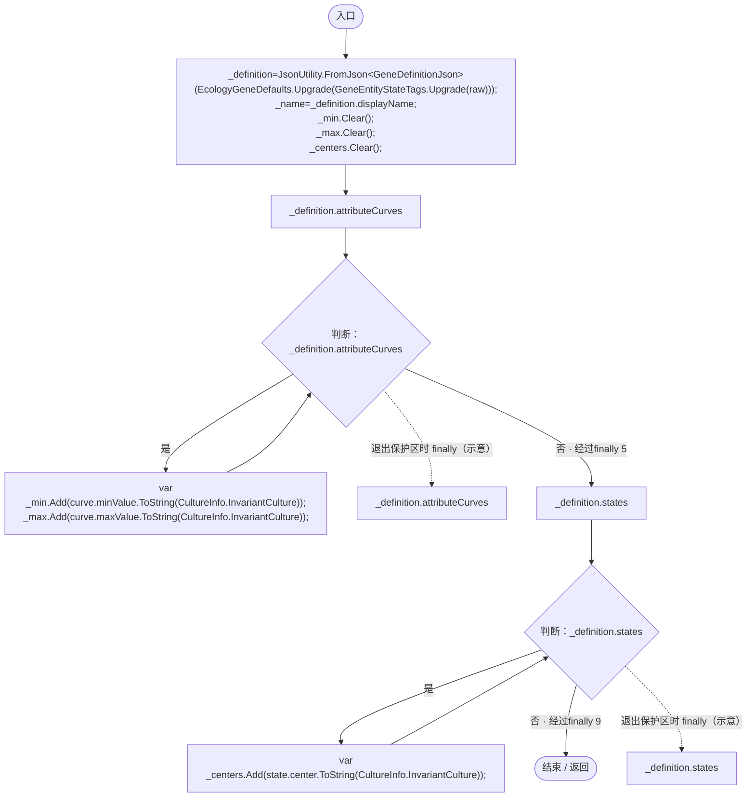
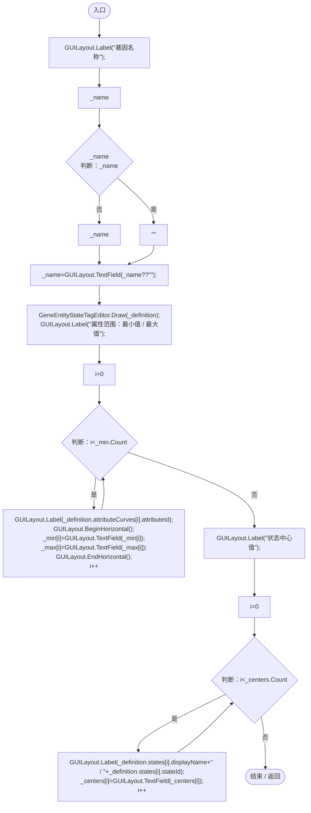
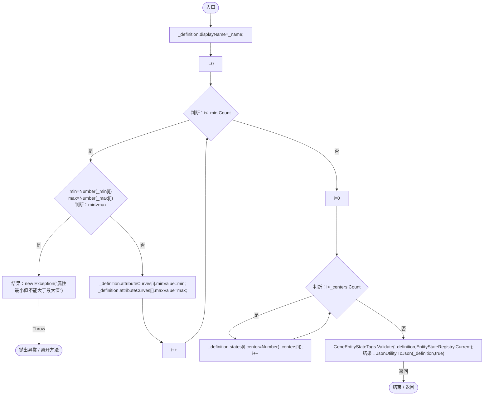
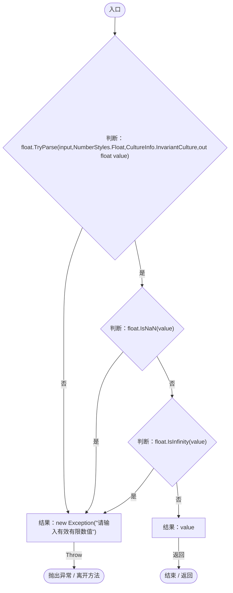

# GeneValueForm.cs

[返回总索引](../README.md) · `Runtime` · `Assets/DarwinPark/UI/GeneValueForm.cs`

[源文件](../../../Assets/DarwinPark/UI/GeneValueForm.cs) · 源码校验：`6ad7bf89e20bb2b008b2fd0c7435ad34f985d7b6513ce53cfcfb4c6597fe2811`

方法按源文件位置排列。事件/回调引用不表示立即执行；分支与异常说明见总索引。完整源码与可点击关系图请打开离线手册。

## Load · L16

`public void Load(string raw)`

### Editor / Player · Roslyn编译器控制流

项目内调用/回调引用：

- [EcologyGeneDefaults.Upgrade · L14](ce4f4683a31b001c.md#m0cb614734c6a2d00)（方法）
- [GeneEntityStateTags.Upgrade · L11](d87d75eb0b331d5c.md#m2462e83f788e9dea)（方法）

## Draw · L24

`public void Draw()`

### Editor / Player · Roslyn编译器控制流

项目内调用/回调引用：

- [GeneEntityStateTagEditor.Draw · L9](d1c0ab279fe0493c.md#m4c08ad87ded6c9da)（方法）

## Export · L38

`public string Export()`

### Editor / Player · Roslyn编译器控制流

项目内调用/回调引用：

- [GeneValueForm.Number · L46](1a57b2a63a2f76d5.md#maaff32f17992ecca)（方法）
- [GeneEntityStateTags.Validate · L24](d87d75eb0b331d5c.md#m07abded73ee4a80f)（方法）
- [EntityStateRegistry.Current.get · L41](440408d2db5c7d96.md#m61b7aa1a54b9a56c)（访问器）

## Number · L46

`private static float Number(string input)`

### Editor / Player · Roslyn编译器控制流

