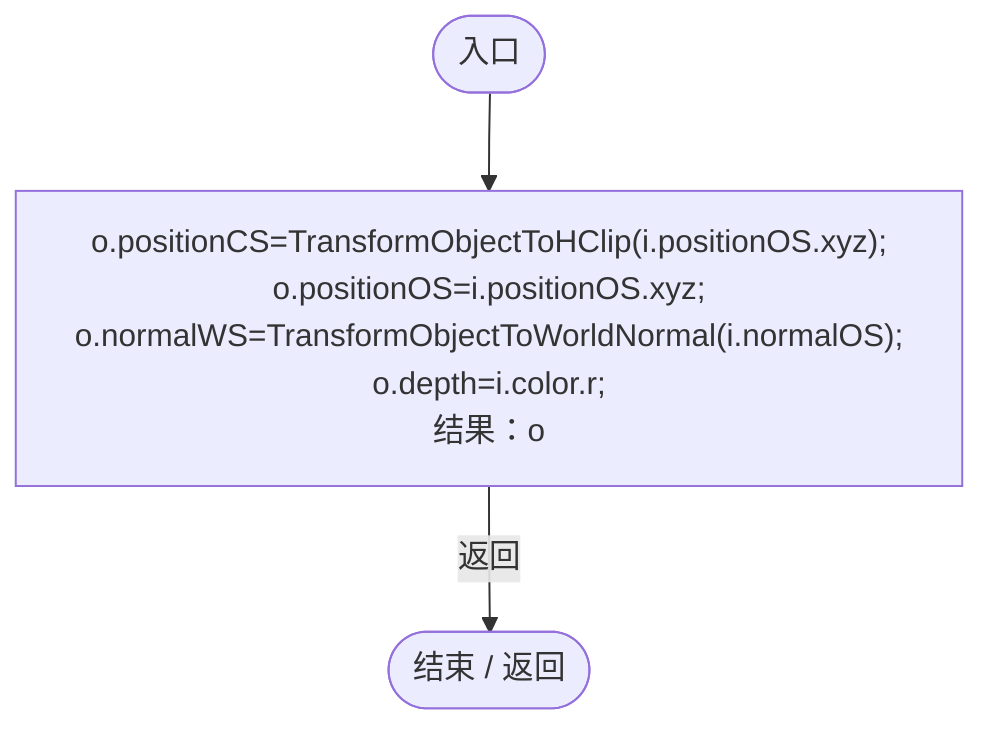
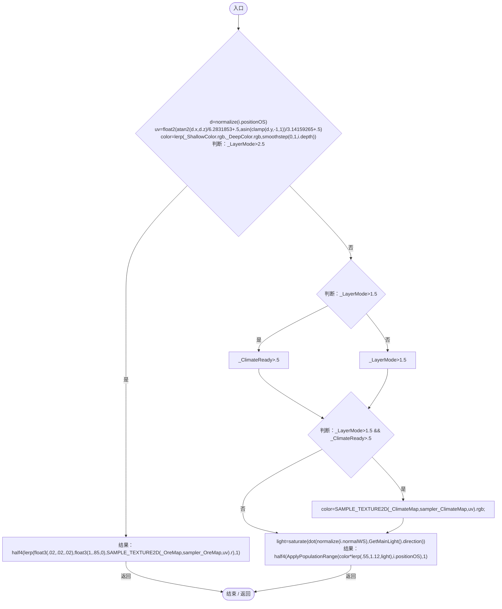

# PlanetOcean.shader

[返回总索引](../README.md) · `GPU` · `Assets/DarwinPark/Planet/PlanetOcean.shader`

[源文件](../../../Assets/DarwinPark/Planet/PlanetOcean.shader) · 源码校验：`6230680cc6513f5cc8bba715f5cdfc398d3735894287e1ffc5f6f938aefadad6`

方法按源文件位置排列。事件/回调引用不表示立即执行；分支与异常说明见总索引。完整源码与可点击关系图请打开离线手册。

## vert · L29

`V vert(A i)`

### GPU · GPU控制结构（名称链接，不作C#类型推断）

## frag · L30

`half4 frag(V i):SV_Target`

### GPU · GPU控制结构（名称链接，不作C#类型推断）

项目内调用/回调引用：

- [PopulationRangeOverlay.ApplyPopulationRange · L6](04884ff1984fea3f.md#m3763ac11c03eb812)（GPU函数）
