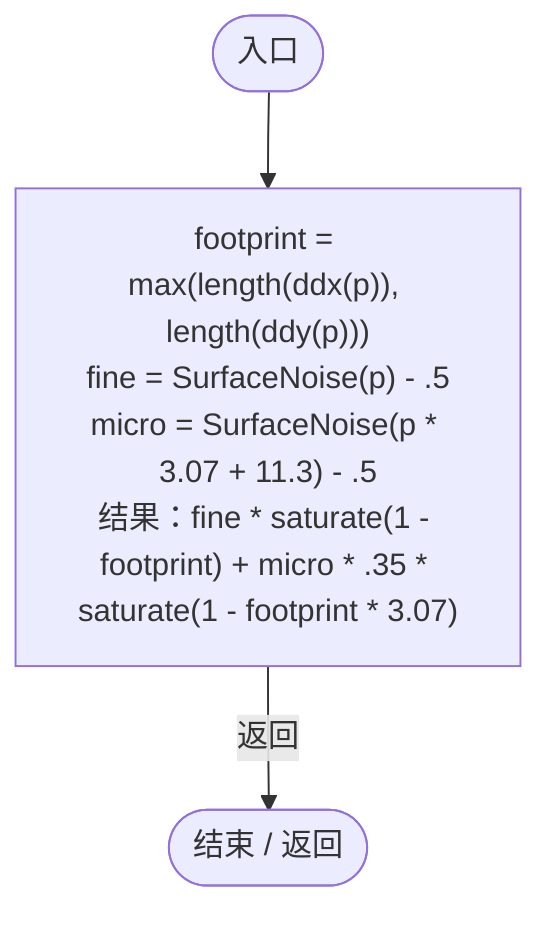
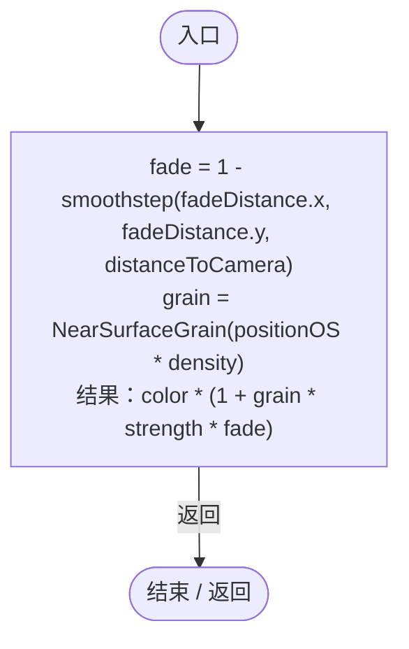

# PlanetNearSurfaceDetail.hlsl

[返回总索引](../README.md) · `GPU` · `Assets/DarwinPark/Planet/Terrain/PlanetNearSurfaceDetail.hlsl`

[源文件](../../../Assets/DarwinPark/Planet/Terrain/PlanetNearSurfaceDetail.hlsl) · 源码校验：`aee8415c8e9dfe9d15b3b7a69ff17680b2bfb4f3c3f66b8a4da4d6c9026dbfc0`

方法按源文件位置排列。事件/回调引用不表示立即执行；分支与异常说明见总索引。完整源码与可点击关系图请打开离线手册。

## NearSurfaceGrain · L4

`float NearSurfaceGrain(float3 p)`

### GPU · GPU控制结构（名称链接，不作C#类型推断）

项目内调用/回调引用：

- [PlanetSurfaceDetail.SurfaceNoise · L10](bcbe3a3de96b1f72.md#m932c128f3b0b9f2e)（GPU函数）

## ApplyNearSurfaceDetail · L11

`float3 ApplyNearSurfaceDetail(float3 color, float3 positionOS, float distanceToCamera, float density, float strength, float2 fadeDistance)`

### GPU · GPU控制结构（名称链接，不作C#类型推断）

项目内调用/回调引用：

- [PlanetNearSurfaceDetail.NearSurfaceGrain · L4](1b2299bfeb3c3590.md#md8373b249ce00fb1)（GPU函数）
