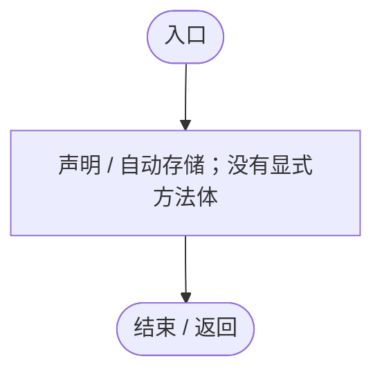
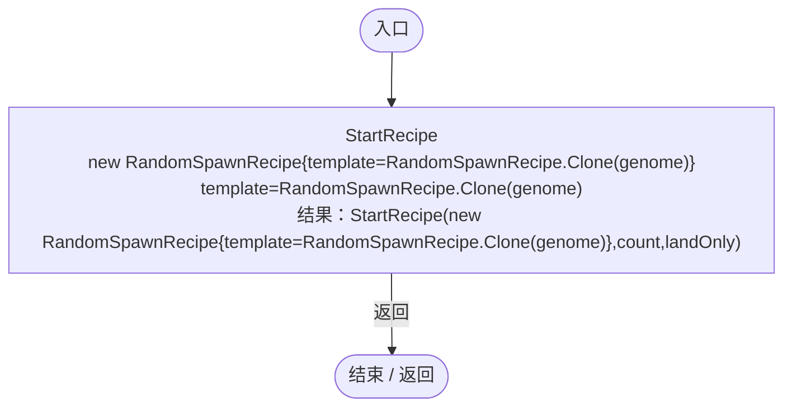
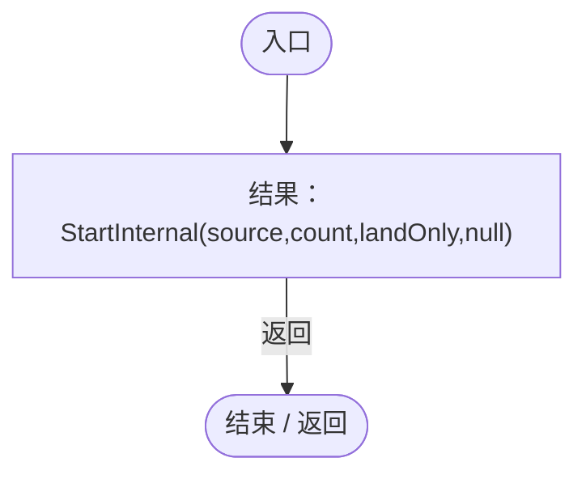

```mermaid
flowchart TD
  b0(["入口"])
  b1{"判断：automatic!=null"}
  b2["结果：false"]
  b3{"判断：IsBusy"}
  b4{"判断：WorldRuntimeGate.Ready"}
  b5{"判断：WorldRuntimeGate.Loading"}
  b6{"判断：WorldAuthority.CanEdit"}
  b7{"判断：GameInputGate.Blocked"}
  b8{"判断：WorldAuthority.RemoteCommand"}
  b9["结果：false"]
  b10{"判断：source==null"}
  b11["结果：false"]
  b12["source.Validate(GeneDatabase.All.Select(d=&gt;d.Id).ToArray());"]
  b13["(Exception ex)<br/>Status=ex.Message;<br/>结果：false"]
  b14{"判断：WorldAuthority.IsReplica"}
  b15{"判断：EntityPopulationLimit.CanSpawn"}
  b16["Status=&quot;已达到存档实体上限&quot;;<br/>结果：false"]
  b17{"LanSession.Instance<br/>判断：LanSession.Instance"}
  b18[".IsClient"]
  b19["LanSession.Instance"]
  b20{"判断：LanSession.Instance?.IsClient==true"}
  b21["Requested=Mathf.Clamp(count,1,maxCount);<br/>Spawned=0;<br/>IsBusy=true;<br/>Status=&quot;已请求管理员生成…&quot;;"]
  b22["LanSession.Instance<br/>new LanCommand{kind=&quot;randomRecipe&quot;,recipe=source,count=Requested,landOnly=landOnly}<br/>kind=&quot;randomRecipe&quot;<br/>recipe=source<br/>count=Requested<br/>landOnly=landOnly<br/>LanSession.Instance.SendCommand(new LanCommand{kind=&quot;randomRecipe…"]
  b23["结果：true"]
  b24["planet=FindFirstObjectByType&lt;PlanetTerrainMeshBuilder&gt;()"]
  b25{"判断：planet!=null"}
  b26["planet.GetComponent&lt;MeshCollider&gt;()"]
  b27["null"]
  b28["surface=planet!=null?planet.GetComponent&lt;MeshCollider&gt;():null"]
  b29{"判断：planet==null"}
  b30{"判断：planet.Data==null"}
  b31{"判断：surface==null"}
  b32["Status=&quot;地表尚未就绪&quot;;<br/>结果：false"]
  b33{"EntityViewController.Instance<br/>判断：EntityViewController.Instance"}
  b34["EntityViewController.Instance?.ExitView();"]
  b35{"EntityPlacementTool.Instance<br/>判断：EntityPlacementTool.Instance"}
  b36["EntityPlacementTool.Instance?.CancelPlacement();"]
  b37["Requested=Mathf.Clamp(count,1,maxCount);<br/>Spawned=0;<br/>PlacementAttempts=GlobalFallbacks=YieldedSlices=0;<br/>IsBusy=true;<br/>Status=&quot;随机生成中…&quot;;"]
  b38["_automaticRule"]
  b39{"automatic<br/>判断：automatic"}
  b40[".id"]
  b41["automatic"]
  b42["_automaticRule=automatic?.id;"]
  b43["Debug.Log(&quot;[生成] 全星球随机生成，数量=&quot;+Requested+&quot;，仅陆地=&quot;+landOnly);<br/>snapshot=JsonUtility.FromJson&lt;RandomSpawnRecipe&gt;(JsonUtility.ToJson(source))<br/>_job=StartCoroutine(Generate(planet,surface,snapshot,landOnly));<br/>结果：true"]
  b44(["结束 / 返回"])
  b0 --> b1
  b1 -->|"是"| b2
  b1 -->|"否"| b3
  b2 -->|"返回"| b44
  b3 -->|"否"| b4
  b3 -->|"是"| b9
  b4 -->|"是"| b5
  b4 -->|"否"| b9
  b5 -->|"否"| b6
  b5 -->|"是"| b9
  b6 -->|"是"| b7
  b6 -->|"否"| b9
  b7 -->|"是"| b8
  b7 -->|"否"| b10
  b8 -->|"否"| b9
  b8 -->|"是"| b10
  b9 -->|"返回"| b44
  b10 -->|"是"| b11
  b10 -->|"否"| b12
  b11 -->|"返回"| b44
  b12 --> b14
  b13 -->|"返回"| b44
  b14 -->|"否"| b15
  b14 -->|"是"| b17
  b15 -->|"否"| b16
  b15 -->|"是"| b17
  b16 -->|"返回"| b44
  b17 -->|"否"| b18
  b17 -->|"是"| b19
  b18 --> b20
  b19 --> b20
  b20 -->|"是"| b21
  b20 -->|"否"| b24
  b21 --> b22
  b22 --> b23
  b23 -->|"返回"| b44
  b24 --> b25
  b25 -->|"是"| b26
  b25 -->|"否"| b27
  b26 --> b28
  b27 --> b28
  b28 --> b29
  b29 -->|"否"| b30
  b29 -->|"是"| b32
  b30 -->|"否"| b31
  b30 -->|"是"| b32
  b31 -->|"是"| b32
  b31 -->|"否"| b33
  b32 -->|"返回"| b44
  b33 -->|"否"| b34
  b33 -->|"是"| b35
  b34 --> b35
  b35 -->|"否"| b36
  b35 -->|"是"| b37
  b36 --> b37
  b37 --> b38
  b38 --> b39
  b39 -->|"否"| b40
  b39 -->|"是"| b41
  b40 --> b42
  b41 --> b42
  b42 --> b43
  b43 -->|"返回"| b44
  b10 -. "保护区可能异常（示意）" .-> b13

```

```mermaid
flowchart TD
  b0(["入口"])
  b1["attempted=0<br/>budget=Requested*Mathf.Max(1,attemptsPerEntity)<br/>slice=0<br/>sliceStart=Time.realtimeSinceStartupAsDouble"]
  b2{"判断：Spawned&lt;Requested"}
  b3{"判断：attempted&lt;budget"}
  b4{"判断：EntityPopulationLimit.CanSpawn"}
  b5["Finish(&quot;已达到存档实体上限，已生成 &quot;+Spawned+&quot; 个实体&quot;);"]
  b6{"判断：WorldRuntimeGate.Ready"}
  b7{"判断：WorldRuntimeGate.Loading"}
  b8{"判断：planet==null"}
  b9{"判断：surface==null"}
  b10["Finish(&quot;已停止：世界已切换&quot;);"]
  b11{"判断：_automaticRule!=null"}
  b12["Finish(&quot;比例调节不再直接生成实体&quot;);"]
  b13{"判断：GameInputGate.Blocked"}
  b14{"判断：WorldAuthority.Online"}
  b15["yield return null;"]
  b16["PerformanceTimings.Measure(PerformanceTimings.Area.AutomaticSpawn)"]
  b17{"判断：slice==0"}
  b18["sliceStart=Time.realtimeSinceStartupAsDouble;"]
  b19{"attempted++;<br/>slice++;<br/>PlacementAttempts++;<br/>direction=Random.onUnitSphere<br/>outside=surface.bounds.extents.magnitude+spawnHeight<br/>判断：surface.Raycast(new Ray(planet.transform.position+direction*outside,-direction),out var hit,outside*2)"}
  b20{"判断：landOnly"}
  b21{"判断：(hit.point-planet.transform.position).magnitude&gt;planet.LocalWaterRadius(hit.point)+landClearance"}
  b22{"判断：Spawn(source.CreateGenome(),hit.point+direction*spawnHeight)"}
  b23["Spawned++;"]
  b24["Status=&quot;已生成 &quot;+Spawned+&quot; / &quot;+Requested;"]
  b25["PerformanceTimings.Measure(PerformanceTimings.Area.AutomaticSpawn)"]
  b26{"判断：slice&gt;=Mathf.Max(1,attemptsPerFrame)"}
  b27{"判断：(Time.realtimeSinceStartupAsDouble-sliceStart)*1000&gt;=SimulationOptimization.Current.spawnFrameBudgetMilliseconds"}
  b28["YieldedSlices++;<br/>slice=0;<br/>yield return null;"]
  b29{"Finish<br/>判断：Spawned==Requested"}
  b30["&quot;已随机生成 &quot;+Spawned+&quot; 个实体&quot;"]
  b31["&quot;合适地表不足，已生成 &quot;+Spawned+&quot; / &quot;+Requested"]
  b32["Finish(Spawned==Requested?&quot;已随机生成 &quot;+Spawned+&quot; 个实体&quot;:&quot;合适地表不足，已生成 &quot;+Spawned+&quot; / &quot;+Requested);"]
  b33(["结束 / 返回"])
  b0 --> b1
  b1 --> b2
  b2 -->|"是"| b3
  b2 -->|"否"| b29
  b3 -->|"是"| b4
  b3 -->|"否"| b29
  b4 -->|"否"| b5
  b4 -->|"是"| b6
  b5 --> b33
  b6 -->|"是"| b7
  b6 -->|"否"| b10
  b7 -->|"否"| b8
  b7 -->|"是"| b10
  b8 -->|"否"| b9
  b8 -->|"是"| b10
  b9 -->|"是"| b10
  b9 -->|"否"| b11
  b10 --> b33
  b11 -->|"是"| b12
  b11 -->|"否"| b13
  b12 --> b33
  b13 -->|"是"| b14
  b13 -->|"否"| b16
  b14 -->|"否"| b15
  b14 -->|"是"| b16
  b15 --> b2
  b16 --> b17
  b17 -->|"是"| b18
  b17 -->|"否"| b19
  b18 --> b19
  b19 -->|"是"| b20
  b19 -->|"否"| b24
  b20 -->|"是"| b21
  b20 -->|"否"| b22
  b21 -->|"是"| b22
  b21 -->|"否"| b24
  b22 -->|"是"| b23
  b22 -->|"否"| b24
  b23 --> b24
  b24 -->|"经过finally 25"| b26
  b26 -->|"否"| b27
  b26 -->|"是"| b28
  b27 -->|"是"| b28
  b27 -->|"否"| b2
  b28 --> b2
  b29 -->|"是"| b30
  b29 -->|"否"| b31
  b30 --> b32
  b31 --> b32
  b32 --> b33
  b17 -. "退出保护区时 finally（示意）" .-> b25

```

# RandomPlanetSpawner.cs

[返回总索引](../README.md) · `Runtime` · `Assets/DarwinPark/UI/RandomPlanetSpawner.cs`

[源文件](../../../Assets/DarwinPark/UI/RandomPlanetSpawner.cs) · 源码校验：`8fb4e172ad278362436c84659a99c90876e47ed47f2a6c06529071668070eb8b`

方法按源文件位置排列。事件/回调引用不表示立即执行；分支与异常说明见总索引。完整源码与可点击关系图请打开离线手册。

<a id="mfcbb58f20e164d8c"></a>

## IsBusy.get · L19

`get`


### Editor / Player · 语法控制结构 / 声明（非CFG）


<a id="m930d5021c2540b3b"></a>

## IsBusy.set · L19

`private set`


### Editor / Player · 语法控制结构 / 声明（非CFG）


<a id="m13c03b28f6d59b03"></a>

## Spawned.get · L20

`get`


### Editor / Player · 语法控制结构 / 声明（非CFG）


<a id="m2ed2c9e3056c5361"></a>

## Spawned.set · L20

`private set`


### Editor / Player · 语法控制结构 / 声明（非CFG）


<a id="m58b5953b0d655a20"></a>

## Requested.get · L21

`get`


### Editor / Player · 语法控制结构 / 声明（非CFG）


<a id="m2eb7f436fba3fc50"></a>

## Requested.set · L21

`private set`


### Editor / Player · 语法控制结构 / 声明（非CFG）


<a id="m7105c7741d0a27a1"></a>

## PlacementAttempts.get · L22

`get`


### Editor / Player · 语法控制结构 / 声明（非CFG）


<a id="m50cfba4118d798e4"></a>

## PlacementAttempts.set · L22

`private set`


### Editor / Player · 语法控制结构 / 声明（非CFG）



<a id="m088d7c36b4b1b2ed"></a>

## GlobalFallbacks.get · L22

`get`


### Editor / Player · 语法控制结构 / 声明（非CFG）


<a id="m1146074031f800d0"></a>

## GlobalFallbacks.set · L22

`private set`


### Editor / Player · 语法控制结构 / 声明（非CFG）


<a id="m333178b68c3cece9"></a>

## YieldedSlices.get · L22

`get`


### Editor / Player · 语法控制结构 / 声明（非CFG）


<a id="m86e4e7bcfd23b9b0"></a>

## YieldedSlices.set · L22

`private set`


### Editor / Player · 语法控制结构 / 声明（非CFG）


<a id="m38063d5e8e571678"></a>

## Status.get · L23

`get`


### Editor / Player · 语法控制结构 / 声明（非CFG）


<a id="m24655bce6deb3489"></a>

## Status.set · L23

`private set`


### Editor / Player · 语法控制结构 / 声明（非CFG）


<a id="m459920defc5e207e"></a>

## Ensure · L26

`public static RandomPlanetSpawner Ensure(GameObject host)`


### Editor / Player · Roslyn编译器控制流


<a id="m31c2d3856b252b84"></a>

## StartBatch · L27

`public bool StartBatch(Genome genome,int count,bool landOnly)`


### Editor / Player · Roslyn编译器控制流



项目内调用/回调引用：

- [RandomPlanetSpawner.StartRecipe · L30](1c13222a547b265c.md#m412531b3a7a7af47)（方法）
- [RandomSpawnRecipe.Clone · L23](923ccc4e86c4786c.md#me0949958df9c70e0)（方法）

<a id="m412531b3a7a7af47"></a>

## StartRecipe · L30

`public bool StartRecipe(RandomSpawnRecipe source,int count,bool landOnly)`

★ 新增：每次实际出生重新生成受约束基因组，不能把一次随机结果复制整批。

### Editor / Player · Roslyn编译器控制流



项目内调用/回调引用：

- [RandomPlanetSpawner.StartInternal · L31](1c13222a547b265c.md#m4c2915855644d5da)（方法）

<a id="m4c2915855644d5da"></a>

## StartInternal · L31

`private bool StartInternal(RandomSpawnRecipe source,int count,bool landOnly,PopulationMaintenanceRule automatic)`


### Editor / Player · Roslyn编译器控制流



项目内调用/回调引用：

- [RandomPlanetSpawner.IsBusy.get · L19](1c13222a547b265c.md#mfcbb58f20e164d8c)（访问器）
- [GameInputGate.Blocked.get · L8](52955daae7e592ab.md#m765763b665829633)（访问器）
- [RandomSpawnRecipe.Validate · L56](923ccc4e86c4786c.md#m4ac968c3ea314edb)（方法）
- [GeneDatabase.All.get · L129](ec0a03483435a863.md#m6e0bbdec8f131ed0)（访问器）
- [RandomPlanetSpawner.Status.set · L23](1c13222a547b265c.md#m24655bce6deb3489)（访问器）
- [LanSession.Instance.get · L23](9fb633eebffe669c.md#mbf83306994878383)（访问器）
- [RandomPlanetSpawner.Requested.set · L21](1c13222a547b265c.md#m2eb7f436fba3fc50)（访问器）
- [RandomPlanetSpawner.Spawned.set · L20](1c13222a547b265c.md#m2ed2c9e3056c5361)（访问器）
- [RandomPlanetSpawner.IsBusy.set · L19](1c13222a547b265c.md#m930d5021c2540b3b)（访问器）
- [LanSession.SendCommand · L90](9fb633eebffe669c.md#me286a0c67c4d8ecd)（方法）
- [RandomPlanetSpawner.Requested.get · L21](1c13222a547b265c.md#m58b5953b0d655a20)（访问器）
- [PlanetTerrainMeshBuilder.Data.get · L81](415285cf043354a9.md#m1a65abfe0f34c5d8)（访问器）
- [EntityViewController.Instance.get · L15](0ad0345f83229ef0.md#mb3b8144b56e80842)（访问器）
- [EntityViewController.ExitView · L105](0ad0345f83229ef0.md#mca8619c7f27942c9)（方法）
- [EntityPlacementTool.Instance.get · L13](2ca993947b0a7e7a.md#mafb26991c0dfcb86)（访问器）
- [EntityPlacementTool.CancelPlacement · L81](2ca993947b0a7e7a.md#m5a9374d2c71f0a2d)（方法）
- [RandomPlanetSpawner.PlacementAttempts.set · L22](1c13222a547b265c.md#m50cfba4118d798e4)（访问器）
- [RandomPlanetSpawner.GlobalFallbacks.set · L22](1c13222a547b265c.md#m1146074031f800d0)（访问器）
- [RandomPlanetSpawner.YieldedSlices.set · L22](1c13222a547b265c.md#m86e4e7bcfd23b9b0)（访问器）
- [RandomPlanetSpawner.Generate · L50](1c13222a547b265c.md#mf39103d5f9a28782)（方法）
- [RandomPlanetSpawner.回调@36 · L36](1c13222a547b265c.md#mb20b0711ff188e09)（回调/委托）

<a id="mb20b0711ff188e09"></a>

## 回调@36 · L36

`d … => 回调`


### Editor / Player · Roslyn编译器控制流


<a id="mf39103d5f9a28782"></a>

## Generate · L50

`private IEnumerator Generate(PlanetTerrainMeshBuilder planet,MeshCollider surface,RandomSpawnRecipe source,bool landOnly)`


### Editor / Player · Roslyn编译器控制流



项目内调用/回调引用：

- [RandomPlanetSpawner.Requested.get · L21](1c13222a547b265c.md#m58b5953b0d655a20)（访问器）
- [RandomPlanetSpawner.Spawned.get · L20](1c13222a547b265c.md#m13c03b28f6d59b03)（访问器）
- [RandomPlanetSpawner.Finish · L91](1c13222a547b265c.md#md4dd15b0fedb34f1)（方法）
- [GameInputGate.Blocked.get · L8](52955daae7e592ab.md#m765763b665829633)（访问器）
- [PerformanceTimings.Measure · L24](a8403a4c7503726d.md#mb452516394f3ebae)（方法）
- [RandomPlanetSpawner.PlacementAttempts.set · L22](1c13222a547b265c.md#m50cfba4118d798e4)（访问器）
- [RandomPlanetSpawner.PlacementAttempts.get · L22](1c13222a547b265c.md#m7105c7741d0a27a1)（访问器）
- [PlanetTerrainMeshBuilder.LocalWaterRadius · L113](415285cf043354a9.md#m5d141fd984c0caf8)（方法）
- [RandomPlanetSpawner.Spawn · L80](1c13222a547b265c.md#m493b48664605d65a)（方法）
- [RandomSpawnRecipe.CreateGenome · L25](923ccc4e86c4786c.md#m2612c79fe3848e08)（方法）
- [RandomPlanetSpawner.Spawned.set · L20](1c13222a547b265c.md#m2ed2c9e3056c5361)（访问器）
- [RandomPlanetSpawner.Status.set · L23](1c13222a547b265c.md#m24655bce6deb3489)（访问器）
- [SimulationOptimization.Current.get · L25](11c9091e70893352.md#mde7abfdc18429e4a)（访问器）
- [RandomPlanetSpawner.YieldedSlices.set · L22](1c13222a547b265c.md#m86e4e7bcfd23b9b0)（访问器）
- [RandomPlanetSpawner.YieldedSlices.get · L22](1c13222a547b265c.md#m333178b68c3cece9)（访问器）

<a id="m493b48664605d65a"></a>

## Spawn · L80

`private bool Spawn(Genome genome,Vector3 point)`


### Editor / Player · Roslyn编译器控制流

```mermaid
flowchart TD
  b0(["入口"])
  b1{"判断：WorldAuthority.IsReplica"}
  b2{"判断：WorldAuthority.CanEdit"}
  b3{"判断：DarwinEntity.Spawner==null"}
  b4{"判断：EntityPopulationLimit.CanSpawn"}
  b5["结果：false"]
  b6["created=null<br/>EntityRegistry.OnRegistered+=Registered;"]
  b7["DarwinEntity.Spawner(genome,point,&quot;&quot;);"]
  b8["EntityRegistry.OnRegistered-=Registered;"]
  b9{"判断：created==null"}
  b10["结果：false"]
  b11["created.GetComponent&lt;EntityLifeCycle&gt;().RestoreProgress(0);<br/>created.Genes.RestoreStageState(AgeState.Infant,1,1);<br/>created.Genes.Recalculate();<br/>结果：true"]
  b12(["结束 / 返回"])
  b0 --> b1
  b1 -->|"否"| b2
  b1 -->|"是"| b5
  b2 -->|"是"| b3
  b2 -->|"否"| b5
  b3 -->|"否"| b4
  b3 -->|"是"| b5
  b4 -->|"否"| b5
  b4 -->|"是"| b6
  b5 -->|"返回"| b12
  b6 --> b7
  b7 -->|"经过finally 8"| b9
  b9 -->|"是"| b10
  b9 -->|"否"| b11
  b10 -->|"返回"| b12
  b11 -->|"返回"| b12
  b7 -. "退出保护区时 finally（示意）" .-> b8

```

项目内调用/回调引用：

- [EntityLifeCycle.RestoreProgress · L51](9f4138bfbae654b7.md#mec34c953ece464ab)（方法）
- [EntityGeneController.RestoreStageState · L56](7494d53178552f0e.md#m37c1dbfa64e7c2ce)（方法）
- [DarwinEntity.Genes.get · L14](70798dde169f2e8b.md#m622eb1adf401d431)（访问器）
- [EntityGeneController.Recalculate · L118](7494d53178552f0e.md#m707d9a56b0c7c609)（方法）
- [RandomPlanetSpawner.Registered · L84](1c13222a547b265c.md#ma13c7fd1bc9b794d)（局部函数）

<a id="ma13c7fd1bc9b794d"></a>

## Registered · L84

`void Registered(DarwinEntity entity)`


### Editor / Player · Roslyn编译器控制流

```mermaid
flowchart TD
  b0(["入口"])
  b1["created=entity"]
  b2(["结束 / 返回"])
  b0 --> b1
  b1 --> b2

```

<a id="md4dd15b0fedb34f1"></a>

## Finish · L91

`private void Finish(string status)`

★ 修复（防Bug回归）：比例规则不再调用随机生成；仅保留显式手动生成入口。

### Editor / Player · Roslyn编译器控制流

```mermaid
flowchart TD
  b0(["入口"])
  b1["Status=status;<br/>IsBusy=false;<br/>_job=null;<br/>_automaticRule=null;<br/>Debug.Log(&quot;[生成] &quot;+status);"]
  b2(["结束 / 返回"])
  b0 --> b1
  b1 --> b2

```

项目内调用/回调引用：

- [RandomPlanetSpawner.Status.set · L23](1c13222a547b265c.md#m24655bce6deb3489)（访问器）
- [RandomPlanetSpawner.IsBusy.set · L19](1c13222a547b265c.md#m930d5021c2540b3b)（访问器）

<a id="ma34d7509b5f0cc9a"></a>

## Cancel · L92

`public void Cancel()`


### Editor / Player · Roslyn编译器控制流

```mermaid
flowchart TD
  b0(["入口"])
  b1{"LanSession.Instance<br/>判断：LanSession.Instance"}
  b2[".IsClient"]
  b3["LanSession.Instance"]
  b4{"判断：LanSession.Instance?.IsClient==true"}
  b5{"判断：WorldAuthority.CanEdit"}
  b6["LanSession.Instance<br/>new LanCommand{kind=&quot;randomCancel&quot;}<br/>kind=&quot;randomCancel&quot;<br/>LanSession.Instance.SendCommand(new LanCommand{kind=&quot;randomCancel&quot;});"]
  b7{"判断：_job!=null"}
  b8["StopCoroutine(_job);"]
  b9{"_job=null;<br/>判断：IsBusy"}
  b10["Finish(&quot;已取消，保留已生成的 &quot;+Spawned+&quot; 个实体&quot;);"]
  b11(["结束 / 返回"])
  b0 --> b1
  b1 -->|"否"| b2
  b1 -->|"是"| b3
  b2 --> b4
  b3 --> b4
  b4 -->|"是"| b5
  b4 -->|"否"| b7
  b5 -->|"是"| b6
  b5 -->|"否"| b11
  b6 --> b11
  b7 -->|"是"| b8
  b7 -->|"否"| b9
  b8 --> b9
  b9 -->|"是"| b10
  b9 -->|"否"| b11
  b10 --> b11

```

项目内调用/回调引用：

- [LanSession.Instance.get · L23](9fb633eebffe669c.md#mbf83306994878383)（访问器）
- [LanSession.SendCommand · L90](9fb633eebffe669c.md#me286a0c67c4d8ecd)（方法）
- [RandomPlanetSpawner.IsBusy.get · L19](1c13222a547b265c.md#mfcbb58f20e164d8c)（访问器）
- [RandomPlanetSpawner.Finish · L91](1c13222a547b265c.md#md4dd15b0fedb34f1)（方法）
- [RandomPlanetSpawner.Spawned.get · L20](1c13222a547b265c.md#m13c03b28f6d59b03)（访问器）

<a id="md13151c6c53f1eed"></a>

## ApplyRemoteProgress · L93

`public void ApplyRemoteProgress(bool busy,int spawned,int requested,string status)`


### Editor / Player · Roslyn编译器控制流

```mermaid
flowchart TD
  b0(["入口"])
  b1["IsBusy=busy;<br/>Spawned=spawned;<br/>Requested=requested;"]
  b2["Status"]
  b3{"status<br/>判断：status"}
  b4["status"]
  b5["&quot;&quot;"]
  b6["Status=status??&quot;&quot;;"]
  b7(["结束 / 返回"])
  b0 --> b1
  b1 --> b2
  b2 --> b3
  b3 -->|"否"| b4
  b3 -->|"是"| b5
  b4 --> b6
  b5 --> b6
  b6 --> b7

```

项目内调用/回调引用：

- [RandomPlanetSpawner.IsBusy.set · L19](1c13222a547b265c.md#m930d5021c2540b3b)（访问器）
- [RandomPlanetSpawner.Spawned.set · L20](1c13222a547b265c.md#m2ed2c9e3056c5361)（访问器）
- [RandomPlanetSpawner.Requested.set · L21](1c13222a547b265c.md#m2eb7f436fba3fc50)（访问器）
- [RandomPlanetSpawner.Status.set · L23](1c13222a547b265c.md#m24655bce6deb3489)（访问器）

<a id="mc23f190486bd1f37"></a>

## ResetWorld · L94

`public void ResetWorld()`


### Editor / Player · Roslyn编译器控制流

```mermaid
flowchart TD
  b0(["入口"])
  b1{"判断：_job!=null"}
  b2["StopCoroutine(_job);"]
  b3["_job=null;<br/>IsBusy=false;<br/>Spawned=Requested=0;<br/>_automaticRule=null;"]
  b4(["结束 / 返回"])
  b0 --> b1
  b1 -->|"是"| b2
  b1 -->|"否"| b3
  b2 --> b3
  b3 --> b4

```

项目内调用/回调引用：

- [RandomPlanetSpawner.IsBusy.set · L19](1c13222a547b265c.md#m930d5021c2540b3b)（访问器）
- [RandomPlanetSpawner.Spawned.set · L20](1c13222a547b265c.md#m2ed2c9e3056c5361)（访问器）
- [RandomPlanetSpawner.Requested.set · L21](1c13222a547b265c.md#m2eb7f436fba3fc50)（访问器）

<a id="mdbcfb78ef9aa98a5"></a>

## OnDisable · L95

`private void OnDisable()`


### Editor / Player · Roslyn编译器控制流

```mermaid
flowchart TD
  b0(["入口"])
  b1["Cancel()"]
  b2(["结束 / 返回"])
  b0 --> b1
  b1 --> b2

```

项目内调用/回调引用：

- [RandomPlanetSpawner.Cancel · L92](1c13222a547b265c.md#ma34d7509b5f0cc9a)（方法）
