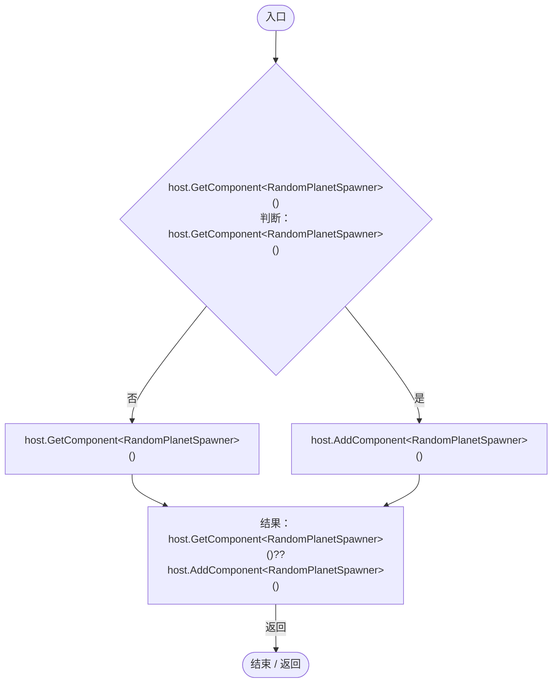
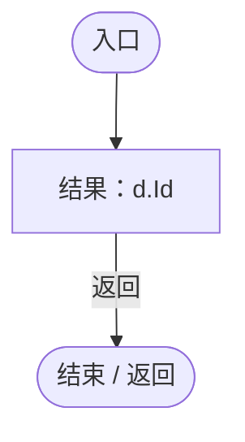
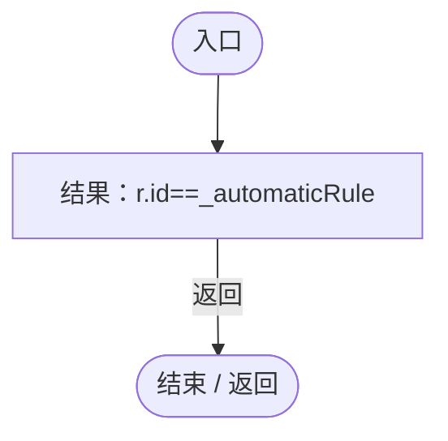
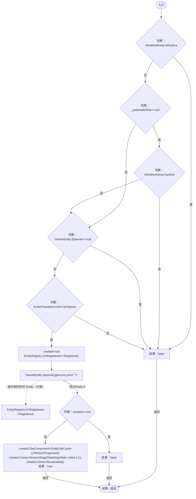
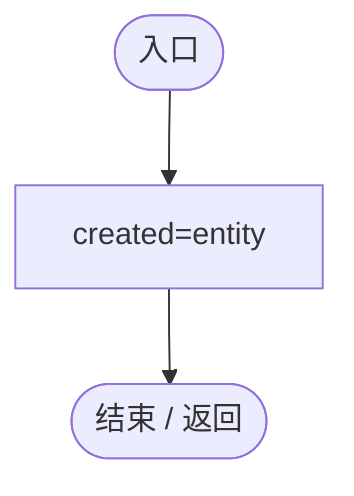
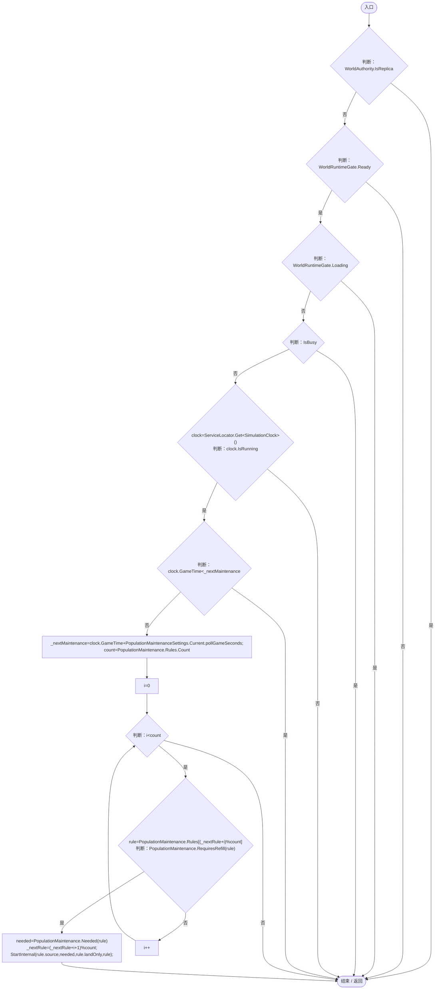
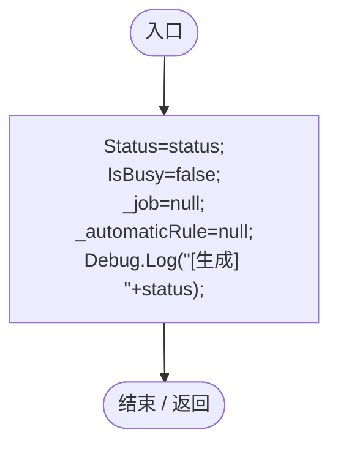

```mermaid
flowchart TD
  b0(["入口"])
  b1{"判断：IsBusy"}
  b2{"判断：WorldRuntimeGate.Ready"}
  b3{"判断：WorldRuntimeGate.Loading"}
  b4{"判断：automatic==null"}
  b5{"判断：WorldAuthority.CanEdit"}
  b6{"判断：GameInputGate.Blocked"}
  b7{"判断：WorldAuthority.RemoteCommand"}
  b8["结果：false"]
  b9{"判断：source==null"}
  b10["结果：false"]
  b11["source.Validate(GeneDatabase.All.Select(d=&gt;d.Id).ToArray());"]
  b12["(Exception ex)<br/>Status=ex.Message;<br/>结果：false"]
  b13{"判断：WorldAuthority.IsReplica"}
  b14{"判断：EntityPopulationLimit.CanSpawn"}
  b15["Status=&quot;已达到存档实体上限&quot;;<br/>结果：false"]
  b16{"LanSession.Instance<br/>判断：LanSession.Instance"}
  b17[".IsClient"]
  b18["LanSession.Instance"]
  b19{"判断：LanSession.Instance?.IsClient==true"}
  b20{"判断：automatic!=null"}
  b21["结果：false"]
  b22["Requested=Mathf.Clamp(count,1,maxCount);<br/>Spawned=0;<br/>IsBusy=true;<br/>Status=&quot;已请求管理员生成…&quot;;"]
  b23["LanSession.Instance<br/>new LanCommand{kind=&quot;randomRecipe&quot;,recipe=source,count=Requested,landOnly=landOnly}<br/>kind=&quot;randomRecipe&quot;<br/>recipe=source<br/>count=Requested<br/>landOnly=landOnly<br/>LanSession.Instance.SendCommand(new LanCommand{kind=&quot;randomRecipe…"]
  b24["结果：true"]
  b25["planet=FindFirstObjectByType&lt;PlanetTerrainMeshBuilder&gt;()"]
  b26{"判断：planet!=null"}
  b27["planet.GetComponent&lt;MeshCollider&gt;()"]
  b28["null"]
  b29["surface=planet!=null?planet.GetComponent&lt;MeshCollider&gt;():null"]
  b30{"判断：planet==null"}
  b31{"判断：planet.Data==null"}
  b32{"判断：surface==null"}
  b33["Status=&quot;地表尚未就绪&quot;;<br/>结果：false"]
  b34{"判断：automatic==null"}
  b35{"EntityViewController.Instance<br/>判断：EntityViewController.Instance"}
  b36["EntityViewController.Instance?.ExitView();"]
  b37{"EntityPlacementTool.Instance<br/>判断：EntityPlacementTool.Instance"}
  b38["EntityPlacementTool.Instance?.CancelPlacement();"]
  b39["Requested=Mathf.Clamp(count,1,maxCount);<br/>Spawned=0;<br/>IsBusy=true;<br/>Status=&quot;随机生成中…&quot;;"]
  b40["_automaticRule"]
  b41{"automatic<br/>判断：automatic"}
  b42[".id"]
  b43["automatic"]
  b44["_automaticRule=automatic?.id;"]
  b45["Debug.Log(&quot;[生成] 全星球随机生成，数量=&quot;+Requested+&quot;，仅陆地=&quot;+landOnly);<br/>snapshot=JsonUtility.FromJson&lt;RandomSpawnRecipe&gt;(JsonUtility.ToJson(source))<br/>_job=StartCoroutine(Generate(planet,surface,snapshot,landOnly));<br/>结果：true"]
  b46(["结束 / 返回"])
  b0 --> b1
  b1 -->|"否"| b2
  b1 -->|"是"| b8
  b2 -->|"是"| b3
  b2 -->|"否"| b8
  b3 -->|"否"| b4
  b3 -->|"是"| b8
  b4 -->|"是"| b5
  b4 -->|"否"| b9
  b5 -->|"是"| b6
  b5 -->|"否"| b8
  b6 -->|"是"| b7
  b6 -->|"否"| b9
  b7 -->|"否"| b8
  b7 -->|"是"| b9
  b8 -->|"返回"| b46
  b9 -->|"是"| b10
  b9 -->|"否"| b11
  b10 -->|"返回"| b46
  b11 --> b13
  b12 -->|"返回"| b46
  b13 -->|"否"| b14
  b13 -->|"是"| b16
  b14 -->|"否"| b15
  b14 -->|"是"| b16
  b15 -->|"返回"| b46
  b16 -->|"否"| b17
  b16 -->|"是"| b18
  b17 --> b19
  b18 --> b19
  b19 -->|"是"| b20
  b19 -->|"否"| b25
  b20 -->|"是"| b21
  b20 -->|"否"| b22
  b21 -->|"返回"| b46
  b22 --> b23
  b23 --> b24
  b24 -->|"返回"| b46
  b25 --> b26
  b26 -->|"是"| b27
  b26 -->|"否"| b28
  b27 --> b29
  b28 --> b29
  b29 --> b30
  b30 -->|"否"| b31
  b30 -->|"是"| b33
  b31 -->|"否"| b32
  b31 -->|"是"| b33
  b32 -->|"是"| b33
  b32 -->|"否"| b34
  b33 -->|"返回"| b46
  b34 -->|"是"| b35
  b34 -->|"否"| b39
  b35 -->|"否"| b36
  b35 -->|"是"| b37
  b36 --> b37
  b37 -->|"否"| b38
  b37 -->|"是"| b39
  b38 --> b39
  b39 --> b40
  b40 --> b41
  b41 -->|"否"| b42
  b41 -->|"是"| b43
  b42 --> b44
  b43 --> b44
  b44 --> b45
  b45 -->|"返回"| b46
  b9 -. "保护区可能异常（示意）" .-> b12

```

```mermaid
flowchart TD
  b0(["入口"])
  b1["attempted=0<br/>budget=Requested*Mathf.Max(1,attemptsPerEntity)<br/>slice=0"]
  b2{"判断：Spawned&lt;Requested"}
  b3{"判断：attempted&lt;budget"}
  b4{"判断：EntityPopulationLimit.CanSpawn"}
  b5["Finish(&quot;已达到存档实体上限，已生成 &quot;+Spawned+&quot; 个实体&quot;);"]
  b6{"判断：WorldRuntimeGate.Ready"}
  b7{"判断：WorldRuntimeGate.Loading"}
  b8{"判断：planet==null"}
  b9{"判断：surface==null"}
  b10["Finish(&quot;已停止：世界已切换&quot;);"]
  b11{"判断：_automaticRule!=null"}
  b12{"rule=PopulationMaintenance.Rules.FirstOrDefault(r=&gt;r.id==_automaticRule)<br/>判断：rule==null"}
  b13{"判断：rule.enabled"}
  b14{"判断：PopulationMaintenance.Needed(rule)&lt;=0"}
  b15["Finish(&quot;维持目标已满足或停止&quot;);"]
  b16{"判断：ServiceLocator.Get&lt;SimulationClock&gt;().IsRunning==false"}
  b17["yield return null;"]
  b18{"判断：GameInputGate.Blocked"}
  b19{"判断：WorldAuthority.Online"}
  b20["yield return null;"]
  b21["attempted++;<br/>slice++;"]
  b22{"判断：_automaticRule==null"}
  b23["null"]
  b24["PopulationMaintenance.Rules.FirstOrDefault(r=&gt;r.id==_automaticRule)"]
  b25["ruleForPlacement=_automaticRule==null?null:PopulationMaintenance.Rules.FirstOrDefault(r=&gt;r.id==_automaticRule)"]
  b26{"direction=EcologyMaintenancePolicy.SpawnDirection(ruleForPlacement,planet.transform.position)<br/>outside=surface.bounds.extents.magnitude+spawnHeight<br/>判断：surface.Raycast(new Ray(planet.transform.position+direction*outside,-direction),out var…"}
  b27{"判断：landOnly"}
  b28{"判断：(hit.point-planet.transform.position).magnitude&gt;planet.WaterRadius+landClearance"}
  b29{"判断：Spawn(source.CreateGenome(),hit.point+direction*spawnHeight)"}
  b30["Spawned++;"]
  b31{"Status=&quot;已生成 &quot;+Spawned+&quot; / &quot;+Requested;<br/>判断：slice&gt;=Mathf.Max(1,attemptsPerFrame)"}
  b32["slice=0;<br/>yield return null;"]
  b33{"Finish<br/>判断：Spawned==Requested"}
  b34["&quot;已随机生成 &quot;+Spawned+&quot; 个实体&quot;"]
  b35["&quot;合适地表不足，已生成 &quot;+Spawned+&quot; / &quot;+Requested"]
  b36["Finish(Spawned==Requested?&quot;已随机生成 &quot;+Spawned+&quot; 个实体&quot;:&quot;合适地表不足，已生成 &quot;+Spawned+&quot; / &quot;+Requested);"]
  b37(["结束 / 返回"])
  b0 --> b1
  b1 --> b2
  b2 -->|"是"| b3
  b2 -->|"否"| b33
  b3 -->|"是"| b4
  b3 -->|"否"| b33
  b4 -->|"否"| b5
  b4 -->|"是"| b6
  b5 --> b37
  b6 -->|"是"| b7
  b6 -->|"否"| b10
  b7 -->|"否"| b8
  b7 -->|"是"| b10
  b8 -->|"否"| b9
  b8 -->|"是"| b10
  b9 -->|"是"| b10
  b9 -->|"否"| b11
  b10 --> b37
  b11 -->|"是"| b12
  b11 -->|"否"| b18
  b12 -->|"否"| b13
  b12 -->|"是"| b15
  b13 -->|"是"| b14
  b13 -->|"否"| b15
  b14 -->|"是"| b15
  b14 -->|"否"| b16
  b15 --> b37
  b16 -->|"是"| b17
  b16 -->|"否"| b18
  b17 --> b2
  b18 -->|"是"| b19
  b18 -->|"否"| b21
  b19 -->|"否"| b20
  b19 -->|"是"| b21
  b20 --> b2
  b21 --> b22
  b22 -->|"是"| b23
  b22 -->|"否"| b24
  b23 --> b25
  b24 --> b25
  b25 --> b26
  b26 -->|"是"| b27
  b26 -->|"否"| b31
  b27 -->|"是"| b28
  b27 -->|"否"| b29
  b28 -->|"是"| b29
  b28 -->|"否"| b31
  b29 -->|"是"| b30
  b29 -->|"否"| b31
  b30 --> b31
  b31 -->|"是"| b32
  b31 -->|"否"| b2
  b32 --> b2
  b33 -->|"是"| b34
  b33 -->|"否"| b35
  b34 --> b36
  b35 --> b36
  b36 --> b37

```

# RandomPlanetSpawner.cs

[返回总索引](../README.md) · `Runtime` · `Assets/DarwinPark/UI/RandomPlanetSpawner.cs`

[源文件](../../../Assets/DarwinPark/UI/RandomPlanetSpawner.cs) · 源码校验：`c7b33308217e39090317a75d4e3580606cc0827d5db1bdad8d05e5a6150bee33`

方法按源文件位置排列。事件/回调引用不表示立即执行；分支与异常说明见总索引。完整源码与可点击关系图请打开离线手册。

<a id="mfcbb58f20e164d8c"></a>

## IsBusy.get · L19

`get`


### Editor / Player · 语法控制结构 / 声明（非CFG）


<a id="m930d5021c2540b3b"></a>

## IsBusy.set · L19

`private set`


### Editor / Player · 语法控制结构 / 声明（非CFG）


<a id="m13c03b28f6d59b03"></a>

## Spawned.get · L20

`get`


### Editor / Player · 语法控制结构 / 声明（非CFG）


<a id="m2ed2c9e3056c5361"></a>

## Spawned.set · L20

`private set`


### Editor / Player · 语法控制结构 / 声明（非CFG）


<a id="m58b5953b0d655a20"></a>

## Requested.get · L21

`get`


### Editor / Player · 语法控制结构 / 声明（非CFG）


<a id="m2eb7f436fba3fc50"></a>

## Requested.set · L21

`private set`


### Editor / Player · 语法控制结构 / 声明（非CFG）


<a id="m64de20c4f1700e03"></a>

## Status.get · L22

`get`


### Editor / Player · 语法控制结构 / 声明（非CFG）


<a id="m49236f586ae2373f"></a>

## Status.set · L22

`private set`


### Editor / Player · 语法控制结构 / 声明（非CFG）


<a id="m2f7496d9d5575b34"></a>

## Ensure · L25

`public static RandomPlanetSpawner Ensure(GameObject host)`


### Editor / Player · Roslyn编译器控制流



<a id="mdc9f2d6b461c868a"></a>

## StartBatch · L26

`public bool StartBatch(Genome genome,int count,bool landOnly)`


### Editor / Player · Roslyn编译器控制流


项目内调用/回调引用：

- [RandomPlanetSpawner.StartRecipe · L29](1c13222a547b265c.md#md0bfc3f365655a4d)（方法）
- [RandomSpawnRecipe.Clone · L23](923ccc4e86c4786c.md#me0949958df9c70e0)（方法）

<a id="md0bfc3f365655a4d"></a>

## StartRecipe · L29

`public bool StartRecipe(RandomSpawnRecipe source,int count,bool landOnly)`

★ 新增：每次实际出生重新生成受约束基因组，不能把一次随机结果复制整批。

### Editor / Player · Roslyn编译器控制流


项目内调用/回调引用：

- [RandomPlanetSpawner.StartInternal · L30](1c13222a547b265c.md#mabe47d337f439af8)（方法）

<a id="mabe47d337f439af8"></a>

## StartInternal · L30

`private bool StartInternal(RandomSpawnRecipe source,int count,bool landOnly,PopulationMaintenanceRule automatic)`


### Editor / Player · Roslyn编译器控制流



项目内调用/回调引用：

- [RandomPlanetSpawner.IsBusy.get · L19](1c13222a547b265c.md#mfcbb58f20e164d8c)（访问器）
- [GameInputGate.Blocked.get · L8](52955daae7e592ab.md#m765763b665829633)（访问器）
- [RandomSpawnRecipe.Validate · L56](923ccc4e86c4786c.md#m4ac968c3ea314edb)（方法）
- [GeneDatabase.All.get · L128](ec0a03483435a863.md#m0a367ed24734f426)（访问器）
- [RandomPlanetSpawner.Status.set · L22](1c13222a547b265c.md#m49236f586ae2373f)（访问器）
- [LanSession.Instance.get · L23](9fb633eebffe669c.md#mbf83306994878383)（访问器）
- [RandomPlanetSpawner.Requested.set · L21](1c13222a547b265c.md#m2eb7f436fba3fc50)（访问器）
- [RandomPlanetSpawner.Spawned.set · L20](1c13222a547b265c.md#m2ed2c9e3056c5361)（访问器）
- [RandomPlanetSpawner.IsBusy.set · L19](1c13222a547b265c.md#m930d5021c2540b3b)（访问器）
- [LanSession.SendCommand · L90](9fb633eebffe669c.md#me286a0c67c4d8ecd)（方法）
- [RandomPlanetSpawner.Requested.get · L21](1c13222a547b265c.md#m58b5953b0d655a20)（访问器）
- [PlanetTerrainMeshBuilder.Data.get · L78](415285cf043354a9.md#m8382f579717fbc6d)（访问器）
- [EntityViewController.Instance.get · L15](0ad0345f83229ef0.md#mb3b8144b56e80842)（访问器）
- [EntityViewController.ExitView · L105](0ad0345f83229ef0.md#mca8619c7f27942c9)（方法）
- [EntityPlacementTool.Instance.get · L13](2ca993947b0a7e7a.md#mafb26991c0dfcb86)（访问器）
- [EntityPlacementTool.CancelPlacement · L81](2ca993947b0a7e7a.md#m5a9374d2c71f0a2d)（方法）
- [RandomPlanetSpawner.Generate · L47](1c13222a547b265c.md#m3860ccd1889a5185)（方法）
- [RandomPlanetSpawner.回调@33 · L33](1c13222a547b265c.md#m3a96b030795fb495)（回调/委托）

<a id="m3a96b030795fb495"></a>

## 回调@33 · L33

`d … => 回调`


### Editor / Player · Roslyn编译器控制流



<a id="m3860ccd1889a5185"></a>

## Generate · L47

`private IEnumerator Generate(PlanetTerrainMeshBuilder planet,MeshCollider surface,RandomSpawnRecipe source,bool landOnly)`


### Editor / Player · Roslyn编译器控制流



项目内调用/回调引用：

- [RandomPlanetSpawner.Requested.get · L21](1c13222a547b265c.md#m58b5953b0d655a20)（访问器）
- [RandomPlanetSpawner.Spawned.get · L20](1c13222a547b265c.md#m13c03b28f6d59b03)（访问器）
- [RandomPlanetSpawner.Finish · L94](1c13222a547b265c.md#m4832fe22dcf9a76f)（方法）
- [PopulationMaintenance.Needed · L100](923ccc4e86c4786c.md#m9218b875eb51a5d3)（方法）
- [SimulationClock.IsRunning.get · L22](a8f444aec9614b0a.md#m10f4fe307faca0f0)（访问器）
- [ServiceLocator.Get · L33](f2fdbe9f9ccd93cb.md#m2ae625299520c56d)（方法）
- [GameInputGate.Blocked.get · L8](52955daae7e592ab.md#m765763b665829633)（访问器）
- [EcologyMaintenancePolicy.SpawnDirection · L33](554e3f13e11b3808.md#mcbc6c89525f81bd1)（方法）
- [PlanetTerrainMeshBuilder.WaterRadius.get · L94](415285cf043354a9.md#m28d8809083881ec1)（访问器）
- [RandomPlanetSpawner.Spawn · L73](1c13222a547b265c.md#m705fee1100714b23)（方法）
- [RandomSpawnRecipe.CreateGenome · L25](923ccc4e86c4786c.md#m2612c79fe3848e08)（方法）
- [RandomPlanetSpawner.Spawned.set · L20](1c13222a547b265c.md#m2ed2c9e3056c5361)（访问器）
- [RandomPlanetSpawner.Status.set · L22](1c13222a547b265c.md#m49236f586ae2373f)（访问器）
- [RandomPlanetSpawner.回调@56 · L56](1c13222a547b265c.md#m38ad7d16d34ad80f)（回调/委托）
- [RandomPlanetSpawner.回调@63 · L63](1c13222a547b265c.md#mc2c588b1f0368a32)（回调/委托）

<a id="m38ad7d16d34ad80f"></a>

## 回调@56 · L56

`r … => 回调`


### Editor / Player · Roslyn编译器控制流


<a id="mc2c588b1f0368a32"></a>

## 回调@63 · L63

`r … => 回调`


### Editor / Player · Roslyn编译器控制流



<a id="m705fee1100714b23"></a>

## Spawn · L73

`private bool Spawn(Genome genome,Vector3 point)`


### Editor / Player · Roslyn编译器控制流



项目内调用/回调引用：

- [EntityLifeCycle.RestoreProgress · L48](9f4138bfbae654b7.md#mfc75121476d49679)（方法）
- [EntityGeneController.RestoreStageState · L51](7494d53178552f0e.md#m6264213de2a5ca6f)（方法）
- [DarwinEntity.Genes.get · L14](70798dde169f2e8b.md#m622eb1adf401d431)（访问器）
- [EntityGeneController.Recalculate · L97](7494d53178552f0e.md#m65ea735c1e0e37a1)（方法）
- [RandomPlanetSpawner.Registered · L77](1c13222a547b265c.md#m2af731fa7adea868)（局部函数）

<a id="m2af731fa7adea868"></a>

## Registered · L77

`void Registered(DarwinEntity entity)`


### Editor / Player · Roslyn编译器控制流



<a id="ma5ef68ec8463d5eb"></a>

## Update · L83

`private void Update()`


### Editor / Player · Roslyn编译器控制流



项目内调用/回调引用：

- [RandomPlanetSpawner.IsBusy.get · L19](1c13222a547b265c.md#mfcbb58f20e164d8c)（访问器）
- [ServiceLocator.Get · L33](f2fdbe9f9ccd93cb.md#m2ae625299520c56d)（方法）
- [SimulationClock.IsRunning.get · L22](a8f444aec9614b0a.md#m10f4fe307faca0f0)（访问器）
- [SimulationClock.GameTime.get · L23](a8f444aec9614b0a.md#m74adfa39a896652f)（访问器）
- [PopulationMaintenanceSettings.Current.get · L77](923ccc4e86c4786c.md#ma2442661558e4796)（访问器）
- [PopulationMaintenance.RequiresRefill · L115](923ccc4e86c4786c.md#ma3d63afa633ccab8)（方法）
- [PopulationMaintenance.Needed · L100](923ccc4e86c4786c.md#m9218b875eb51a5d3)（方法）
- [RandomPlanetSpawner.StartInternal · L30](1c13222a547b265c.md#mabe47d337f439af8)（方法）

<a id="m4832fe22dcf9a76f"></a>

## Finish · L94

`private void Finish(string status)`


### Editor / Player · Roslyn编译器控制流



项目内调用/回调引用：

- [RandomPlanetSpawner.Status.set · L22](1c13222a547b265c.md#m49236f586ae2373f)（访问器）
- [RandomPlanetSpawner.IsBusy.set · L19](1c13222a547b265c.md#m930d5021c2540b3b)（访问器）

<a id="me4d13f12298991bb"></a>

## Cancel · L95

`public void Cancel()`


### Editor / Player · Roslyn编译器控制流

```mermaid
flowchart TD
  b0(["入口"])
  b1{"LanSession.Instance<br/>判断：LanSession.Instance"}
  b2[".IsClient"]
  b3["LanSession.Instance"]
  b4{"判断：LanSession.Instance?.IsClient==true"}
  b5{"判断：WorldAuthority.CanEdit"}
  b6["LanSession.Instance<br/>new LanCommand{kind=&quot;randomCancel&quot;}<br/>kind=&quot;randomCancel&quot;<br/>LanSession.Instance.SendCommand(new LanCommand{kind=&quot;randomCancel&quot;});"]
  b7{"判断：_job!=null"}
  b8["StopCoroutine(_job);"]
  b9{"_job=null;<br/>判断：IsBusy"}
  b10["Finish(&quot;已取消，保留已生成的 &quot;+Spawned+&quot; 个实体&quot;);"]
  b11(["结束 / 返回"])
  b0 --> b1
  b1 -->|"否"| b2
  b1 -->|"是"| b3
  b2 --> b4
  b3 --> b4
  b4 -->|"是"| b5
  b4 -->|"否"| b7
  b5 -->|"是"| b6
  b5 -->|"否"| b11
  b6 --> b11
  b7 -->|"是"| b8
  b7 -->|"否"| b9
  b8 --> b9
  b9 -->|"是"| b10
  b9 -->|"否"| b11
  b10 --> b11

```

项目内调用/回调引用：

- [LanSession.Instance.get · L23](9fb633eebffe669c.md#mbf83306994878383)（访问器）
- [LanSession.SendCommand · L90](9fb633eebffe669c.md#me286a0c67c4d8ecd)（方法）
- [RandomPlanetSpawner.IsBusy.get · L19](1c13222a547b265c.md#mfcbb58f20e164d8c)（访问器）
- [RandomPlanetSpawner.Finish · L94](1c13222a547b265c.md#m4832fe22dcf9a76f)（方法）
- [RandomPlanetSpawner.Spawned.get · L20](1c13222a547b265c.md#m13c03b28f6d59b03)（访问器）

<a id="m271ca1fe80c1758b"></a>

## ApplyRemoteProgress · L96

`public void ApplyRemoteProgress(bool busy,int spawned,int requested,string status)`


### Editor / Player · Roslyn编译器控制流

```mermaid
flowchart TD
  b0(["入口"])
  b1["IsBusy=busy;<br/>Spawned=spawned;<br/>Requested=requested;"]
  b2["Status"]
  b3{"status<br/>判断：status"}
  b4["status"]
  b5["&quot;&quot;"]
  b6["Status=status??&quot;&quot;;"]
  b7(["结束 / 返回"])
  b0 --> b1
  b1 --> b2
  b2 --> b3
  b3 -->|"否"| b4
  b3 -->|"是"| b5
  b4 --> b6
  b5 --> b6
  b6 --> b7

```

项目内调用/回调引用：

- [RandomPlanetSpawner.IsBusy.set · L19](1c13222a547b265c.md#m930d5021c2540b3b)（访问器）
- [RandomPlanetSpawner.Spawned.set · L20](1c13222a547b265c.md#m2ed2c9e3056c5361)（访问器）
- [RandomPlanetSpawner.Requested.set · L21](1c13222a547b265c.md#m2eb7f436fba3fc50)（访问器）
- [RandomPlanetSpawner.Status.set · L22](1c13222a547b265c.md#m49236f586ae2373f)（访问器）

<a id="m79132e579e80df9e"></a>

## ResetWorld · L97

`public void ResetWorld()`


### Editor / Player · Roslyn编译器控制流

```mermaid
flowchart TD
  b0(["入口"])
  b1{"判断：_job!=null"}
  b2["StopCoroutine(_job);"]
  b3["_job=null;<br/>IsBusy=false;<br/>Spawned=Requested=0;<br/>_automaticRule=null;<br/>_nextMaintenance=0;<br/>_nextRule=0;"]
  b4(["结束 / 返回"])
  b0 --> b1
  b1 -->|"是"| b2
  b1 -->|"否"| b3
  b2 --> b3
  b3 --> b4

```

项目内调用/回调引用：

- [RandomPlanetSpawner.IsBusy.set · L19](1c13222a547b265c.md#m930d5021c2540b3b)（访问器）
- [RandomPlanetSpawner.Spawned.set · L20](1c13222a547b265c.md#m2ed2c9e3056c5361)（访问器）
- [RandomPlanetSpawner.Requested.set · L21](1c13222a547b265c.md#m2eb7f436fba3fc50)（访问器）

<a id="m8814e8bb3b23759b"></a>

## OnDisable · L98

`private void OnDisable()`


### Editor / Player · Roslyn编译器控制流

```mermaid
flowchart TD
  b0(["入口"])
  b1["Cancel()"]
  b2(["结束 / 返回"])
  b0 --> b1
  b1 --> b2

```

项目内调用/回调引用：

- [RandomPlanetSpawner.Cancel · L95](1c13222a547b265c.md#me4d13f12298991bb)（方法）
