# RandomPlanetSpawner.cs

[返回总索引](../README.md) · `Runtime` · `Assets/DarwinPark/UI/RandomPlanetSpawner.cs`

[源文件](../../../Assets/DarwinPark/UI/RandomPlanetSpawner.cs) · 源码校验：`5774430f42ca46c39be7fa95c1e1616ea9a546eefe29f391d224a16d63dd12de`

方法按源文件位置排列。事件/回调引用不表示立即执行；分支与异常说明见总索引。完整源码与可点击关系图请打开离线手册。

<a id="m93511175a525fd2b"></a>

## IsBusy.get · L18

`get`


### Editor / Player · 语法控制结构 / 声明（非CFG）


<a id="m9bd4e3d270a14565"></a>

## IsBusy.set · L18

`private set`


### Editor / Player · 语法控制结构 / 声明（非CFG）


<a id="m26983b533cf25e8f"></a>

## Spawned.get · L19

`get`


### Editor / Player · 语法控制结构 / 声明（非CFG）


<a id="m19f996e70f2dc0a8"></a>

## Spawned.set · L19

`private set`


### Editor / Player · 语法控制结构 / 声明（非CFG）


<a id="m1b0e29eae25f375c"></a>

## Requested.get · L20

`get`


### Editor / Player · 语法控制结构 / 声明（非CFG）

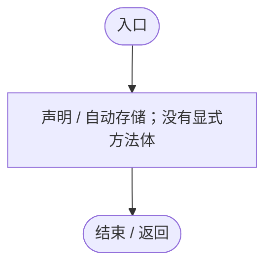

<a id="mc1afe89a4f86c9e2"></a>

## Requested.set · L20

`private set`


### Editor / Player · 语法控制结构 / 声明（非CFG）


<a id="m5c54addf33fa43b9"></a>

## Status.get · L21

`get`


### Editor / Player · 语法控制结构 / 声明（非CFG）


<a id="m94d3e66d0ccd1e6e"></a>

## Status.set · L21

`private set`


### Editor / Player · 语法控制结构 / 声明（非CFG）


<a id="mccefd1367aa9ded3"></a>

## Ensure · L24

`public static RandomPlanetSpawner Ensure(GameObject host)`


### Editor / Player · Roslyn编译器控制流

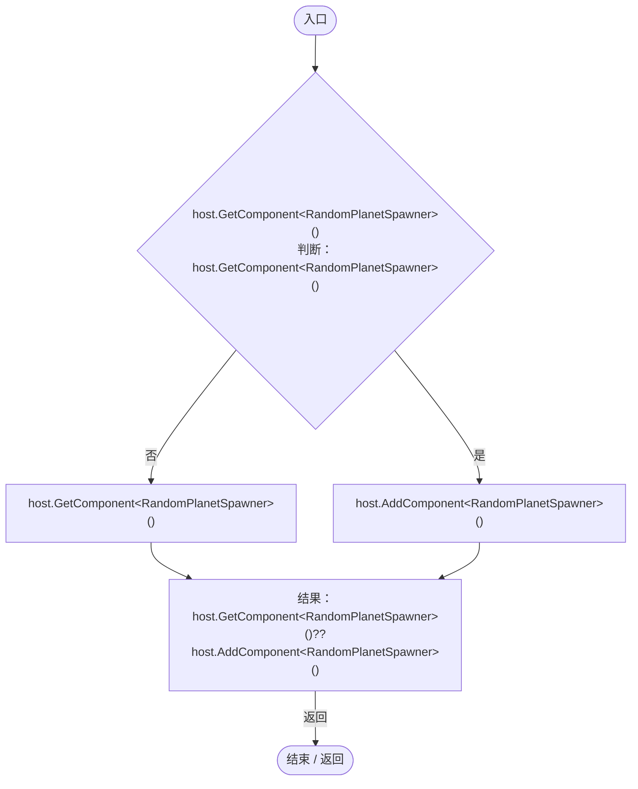

<a id="m0e4af90b5fa8372e"></a>

## StartBatch · L25

`public bool StartBatch(Genome genome,int count,bool landOnly)`


### Editor / Player · Roslyn编译器控制流

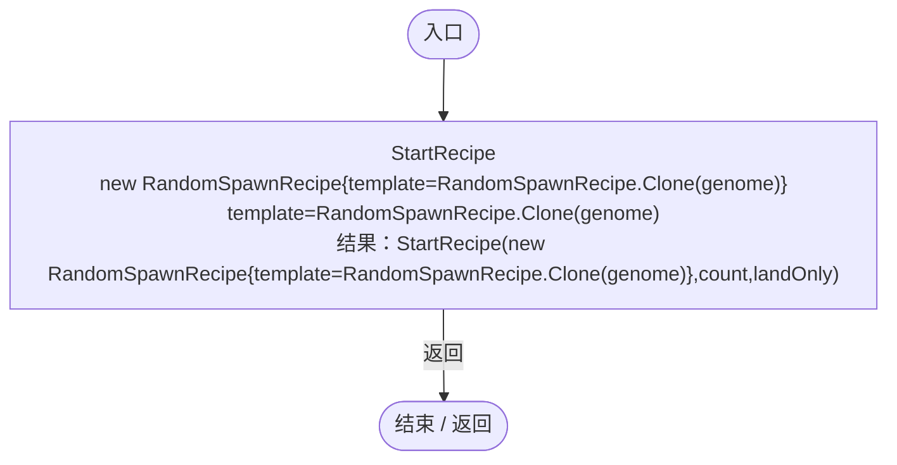

项目内调用/回调引用：

- [RandomPlanetSpawner.StartRecipe · L28](1c13222a547b265c.md#md37fb84c58dea354)（方法）
- [RandomSpawnRecipe.Clone · L23](923ccc4e86c4786c.md#me0949958df9c70e0)（方法）

<a id="md37fb84c58dea354"></a>

## StartRecipe · L28

`public bool StartRecipe(RandomSpawnRecipe source,int count,bool landOnly)`

★ 新增：每次实际出生重新生成受约束基因组，不能把一次随机结果复制整批。

### Editor / Player · Roslyn编译器控制流

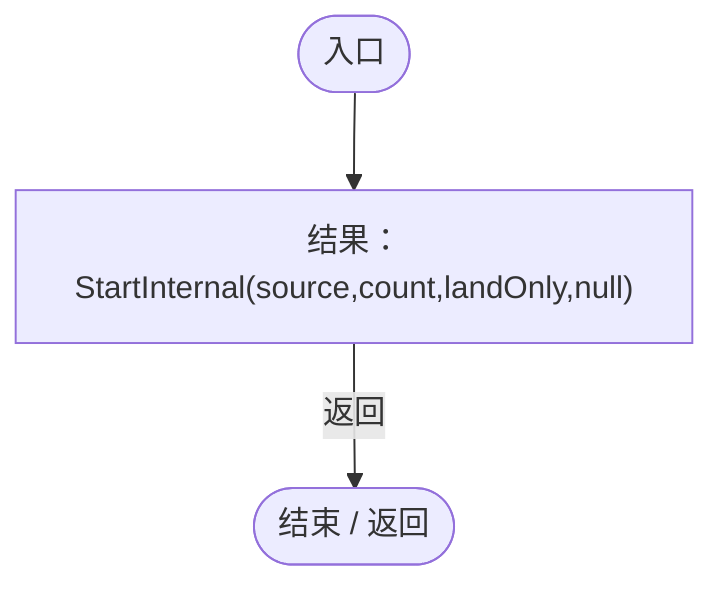

项目内调用/回调引用：

- [RandomPlanetSpawner.StartInternal · L29](1c13222a547b265c.md#m1a9a2369d4a84090)（方法）

<a id="m1a9a2369d4a84090"></a>

## StartInternal · L29

`private bool StartInternal(RandomSpawnRecipe source,int count,bool landOnly,PopulationMaintenanceRule automatic)`


### Editor / Player · Roslyn编译器控制流

```mermaid
flowchart TD
  b0(["入口"])
  b1{"判断：IsBusy"}
  b2{"判断：WorldRuntimeGate.Ready"}
  b3{"判断：WorldRuntimeGate.Loading"}
  b4{"判断：automatic==null"}
  b5{"判断：WorldAuthority.CanEdit"}
  b6{"判断：GameInputGate.Blocked"}
  b7{"判断：WorldAuthority.RemoteCommand"}
  b8["结果：false"]
  b9{"判断：source==null"}
  b10["结果：false"]
  b11["source.Validate(GeneDatabase.All.Select(d=&gt;d.Id).ToArray());"]
  b12["(Exception ex)<br/>Status=ex.Message;<br/>结果：false"]
  b13{"判断：WorldAuthority.IsReplica"}
  b14{"判断：EntityPopulationLimit.CanSpawn"}
  b15["Status=&quot;已达到存档实体上限&quot;;<br/>结果：false"]
  b16{"LanSession.Instance<br/>判断：LanSession.Instance"}
  b17[".IsClient"]
  b18["LanSession.Instance"]
  b19{"判断：LanSession.Instance?.IsClient==true"}
  b20{"判断：automatic!=null"}
  b21["结果：false"]
  b22["Requested=Mathf.Clamp(count,1,maxCount);<br/>Spawned=0;<br/>IsBusy=true;<br/>Status=&quot;已请求管理员生成…&quot;;"]
  b23["LanSession.Instance<br/>new LanCommand{kind=&quot;randomRecipe&quot;,recipe=source,count=Requested,landOnly=landOnly}<br/>kind=&quot;randomRecipe&quot;<br/>recipe=source<br/>count=Requested<br/>landOnly=landOnly<br/>LanSession.Instance.SendCommand(new LanCommand{kind=&quot;randomRecipe…"]
  b24["结果：true"]
  b25["planet=FindFirstObjectByType&lt;PlanetTerrainMeshBuilder&gt;()"]
  b26{"判断：planet!=null"}
  b27["planet.GetComponent&lt;MeshCollider&gt;()"]
  b28["null"]
  b29["surface=planet!=null?planet.GetComponent&lt;MeshCollider&gt;():null"]
  b30{"判断：planet==null"}
  b31{"判断：planet.Data==null"}
  b32{"判断：surface==null"}
  b33["Status=&quot;地表尚未就绪&quot;;<br/>结果：false"]
  b34{"EntityViewController.Instance<br/>判断：EntityViewController.Instance"}
  b35["EntityViewController.Instance?.ExitView();"]
  b36{"EntityPlacementTool.Instance<br/>判断：EntityPlacementTool.Instance"}
  b37["EntityPlacementTool.Instance?.CancelPlacement();"]
  b38["Requested=Mathf.Clamp(count,1,maxCount);<br/>Spawned=0;<br/>IsBusy=true;<br/>Status=&quot;随机生成中…&quot;;"]
  b39["_automaticRule"]
  b40{"automatic<br/>判断：automatic"}
  b41[".id"]
  b42["automatic"]
  b43["_automaticRule=automatic?.id;"]
  b44["Debug.Log(&quot;[生成] 全星球随机生成，数量=&quot;+Requested+&quot;，仅陆地=&quot;+landOnly);<br/>snapshot=JsonUtility.FromJson&lt;RandomSpawnRecipe&gt;(JsonUtility.ToJson(source))<br/>_job=StartCoroutine(Generate(planet,surface,snapshot,landOnly));<br/>结果：true"]
  b45(["结束 / 返回"])
  b0 --> b1
  b1 -->|"否"| b2
  b1 -->|"是"| b8
  b2 -->|"是"| b3
  b2 -->|"否"| b8
  b3 -->|"否"| b4
  b3 -->|"是"| b8
  b4 -->|"是"| b5
  b4 -->|"否"| b9
  b5 -->|"是"| b6
  b5 -->|"否"| b8
  b6 -->|"是"| b7
  b6 -->|"否"| b9
  b7 -->|"否"| b8
  b7 -->|"是"| b9
  b8 -->|"返回"| b45
  b9 -->|"是"| b10
  b9 -->|"否"| b11
  b10 -->|"返回"| b45
  b11 --> b13
  b12 -->|"返回"| b45
  b13 -->|"否"| b14
  b13 -->|"是"| b16
  b14 -->|"否"| b15
  b14 -->|"是"| b16
  b15 -->|"返回"| b45
  b16 -->|"否"| b17
  b16 -->|"是"| b18
  b17 --> b19
  b18 --> b19
  b19 -->|"是"| b20
  b19 -->|"否"| b25
  b20 -->|"是"| b21
  b20 -->|"否"| b22
  b21 -->|"返回"| b45
  b22 --> b23
  b23 --> b24
  b24 -->|"返回"| b45
  b25 --> b26
  b26 -->|"是"| b27
  b26 -->|"否"| b28
  b27 --> b29
  b28 --> b29
  b29 --> b30
  b30 -->|"否"| b31
  b30 -->|"是"| b33
  b31 -->|"否"| b32
  b31 -->|"是"| b33
  b32 -->|"是"| b33
  b32 -->|"否"| b34
  b33 -->|"返回"| b45
  b34 -->|"否"| b35
  b34 -->|"是"| b36
  b35 --> b36
  b36 -->|"否"| b37
  b36 -->|"是"| b38
  b37 --> b38
  b38 --> b39
  b39 --> b40
  b40 -->|"否"| b41
  b40 -->|"是"| b42
  b41 --> b43
  b42 --> b43
  b43 --> b44
  b44 -->|"返回"| b45
  b9 -. "保护区可能异常（示意）" .-> b12

```

项目内调用/回调引用：

- [RandomPlanetSpawner.IsBusy.get · L18](1c13222a547b265c.md#m93511175a525fd2b)（访问器）
- [GameInputGate.Blocked.get · L8](52955daae7e592ab.md#m765763b665829633)（访问器）
- [RandomSpawnRecipe.Validate · L48](923ccc4e86c4786c.md#m0fe74d9bb4825883)（方法）
- [GeneDatabase.All.get · L128](ec0a03483435a863.md#m0a367ed24734f426)（访问器）
- [RandomPlanetSpawner.Status.set · L21](1c13222a547b265c.md#m94d3e66d0ccd1e6e)（访问器）
- [LanSession.Instance.get · L23](9fb633eebffe669c.md#mbf83306994878383)（访问器）
- [RandomPlanetSpawner.Requested.set · L20](1c13222a547b265c.md#mc1afe89a4f86c9e2)（访问器）
- [RandomPlanetSpawner.Spawned.set · L19](1c13222a547b265c.md#m19f996e70f2dc0a8)（访问器）
- [RandomPlanetSpawner.IsBusy.set · L18](1c13222a547b265c.md#m9bd4e3d270a14565)（访问器）
- [LanSession.SendCommand · L90](9fb633eebffe669c.md#me286a0c67c4d8ecd)（方法）
- [RandomPlanetSpawner.Requested.get · L20](1c13222a547b265c.md#m1b0e29eae25f375c)（访问器）
- [PlanetTerrainMeshBuilder.Data.get · L78](415285cf043354a9.md#m8382f579717fbc6d)（访问器）
- [EntityViewController.Instance.get · L15](0ad0345f83229ef0.md#mb3b8144b56e80842)（访问器）
- [EntityViewController.ExitView · L105](0ad0345f83229ef0.md#mca8619c7f27942c9)（方法）
- [EntityPlacementTool.Instance.get · L13](2ca993947b0a7e7a.md#mafb26991c0dfcb86)（访问器）
- [EntityPlacementTool.CancelPlacement · L81](2ca993947b0a7e7a.md#m5a9374d2c71f0a2d)（方法）
- [RandomPlanetSpawner.Generate · L45](1c13222a547b265c.md#m6e3cb29e2dc359c8)（方法）
- [RandomPlanetSpawner.回调@32 · L32](1c13222a547b265c.md#mb5bf0515b997b34e)（回调/委托）

<a id="mb5bf0515b997b34e"></a>

## 回调@32 · L32

`d … => 回调`


### Editor / Player · Roslyn编译器控制流

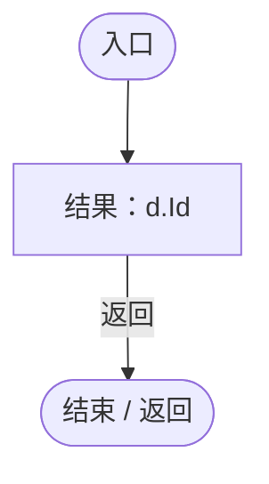

<a id="m6e3cb29e2dc359c8"></a>

## Generate · L45

`private IEnumerator Generate(PlanetTerrainMeshBuilder planet,MeshCollider surface,RandomSpawnRecipe source,bool landOnly)`


### Editor / Player · Roslyn编译器控制流

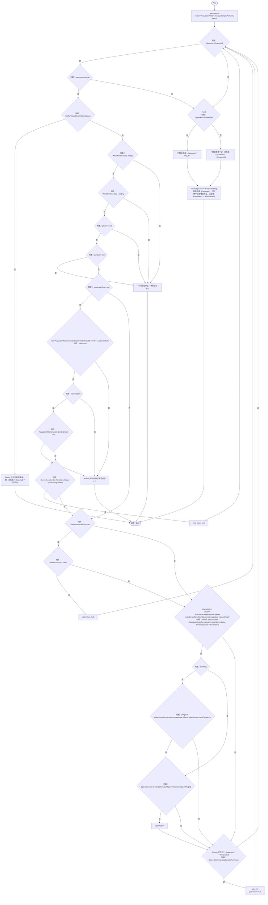

项目内调用/回调引用：

- [RandomPlanetSpawner.Requested.get · L20](1c13222a547b265c.md#m1b0e29eae25f375c)（访问器）
- [RandomPlanetSpawner.Spawned.get · L19](1c13222a547b265c.md#m26983b533cf25e8f)（访问器）
- [RandomPlanetSpawner.Finish · L90](1c13222a547b265c.md#mec99b8dce67e8140)（方法）
- [PopulationMaintenance.Needed · L85](923ccc4e86c4786c.md#m29a1a96365f74909)（方法）
- [SimulationClock.IsRunning.get · L22](a8f444aec9614b0a.md#m10f4fe307faca0f0)（访问器）
- [ServiceLocator.Get · L33](f2fdbe9f9ccd93cb.md#m2ae625299520c56d)（方法）
- [GameInputGate.Blocked.get · L8](52955daae7e592ab.md#m765763b665829633)（访问器）
- [PlanetTerrainMeshBuilder.WaterRadius.get · L94](415285cf043354a9.md#m28d8809083881ec1)（访问器）
- [RandomPlanetSpawner.Spawn · L69](1c13222a547b265c.md#m7b5dabb65e03644d)（方法）
- [RandomSpawnRecipe.CreateGenome · L25](923ccc4e86c4786c.md#m2612c79fe3848e08)（方法）
- [RandomPlanetSpawner.Spawned.set · L19](1c13222a547b265c.md#m19f996e70f2dc0a8)（访问器）
- [RandomPlanetSpawner.Status.set · L21](1c13222a547b265c.md#m94d3e66d0ccd1e6e)（访问器）
- [RandomPlanetSpawner.回调@54 · L54](1c13222a547b265c.md#m4ca3fb379a98537a)（回调/委托）

<a id="m4ca3fb379a98537a"></a>

## 回调@54 · L54

`r … => 回调`


### Editor / Player · Roslyn编译器控制流

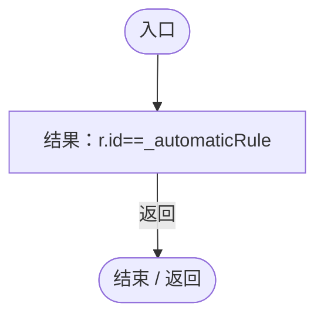

<a id="m7b5dabb65e03644d"></a>

## Spawn · L69

`private bool Spawn(Genome genome,Vector3 point)`


### Editor / Player · Roslyn编译器控制流

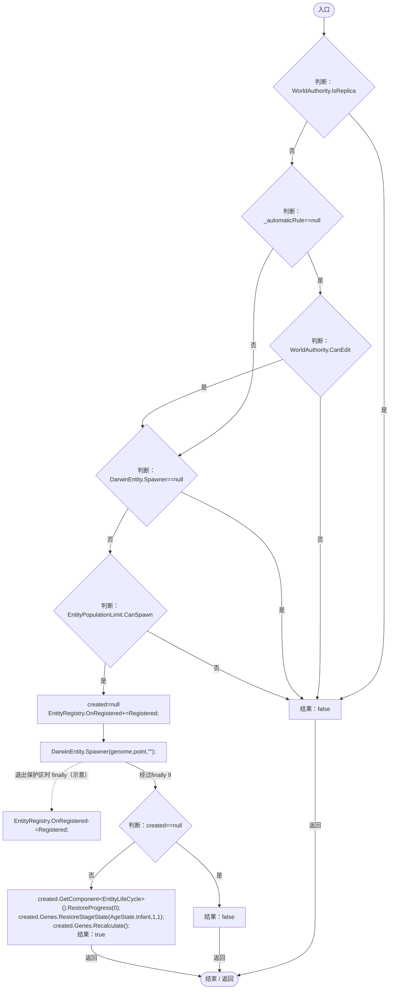

项目内调用/回调引用：

- [EntityLifeCycle.RestoreProgress · L48](9f4138bfbae654b7.md#mfc75121476d49679)（方法）
- [EntityGeneController.RestoreStageState · L45](7494d53178552f0e.md#m49489af39061f1a1)（方法）
- [DarwinEntity.Genes.get · L14](70798dde169f2e8b.md#m622eb1adf401d431)（访问器）
- [EntityGeneController.Recalculate · L90](7494d53178552f0e.md#m93744c8f3039b93c)（方法）
- [RandomPlanetSpawner.Registered · L73](1c13222a547b265c.md#m06adbb8836731c75)（局部函数）

<a id="m06adbb8836731c75"></a>

## Registered · L73

`void Registered(DarwinEntity entity)`


### Editor / Player · Roslyn编译器控制流

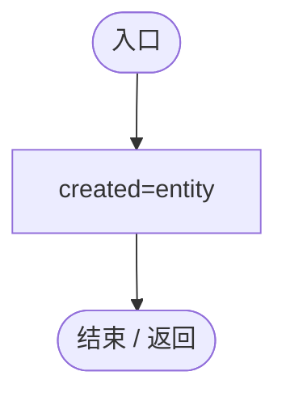

<a id="mdeb679ecc61476b7"></a>

## Update · L79

`private void Update()`


### Editor / Player · Roslyn编译器控制流

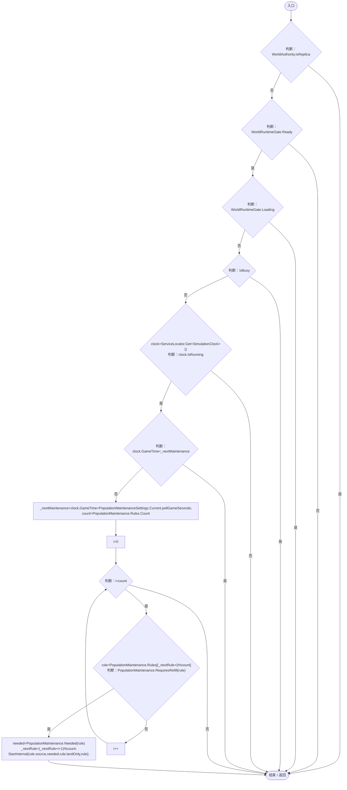

项目内调用/回调引用：

- [RandomPlanetSpawner.IsBusy.get · L18](1c13222a547b265c.md#m93511175a525fd2b)（访问器）
- [ServiceLocator.Get · L33](f2fdbe9f9ccd93cb.md#m2ae625299520c56d)（方法）
- [SimulationClock.IsRunning.get · L22](a8f444aec9614b0a.md#m10f4fe307faca0f0)（访问器）
- [SimulationClock.GameTime.get · L23](a8f444aec9614b0a.md#m74adfa39a896652f)（访问器）
- [PopulationMaintenanceSettings.Current.get · L67](923ccc4e86c4786c.md#m98032f1fd6454bb8)（访问器）
- [PopulationMaintenance.RequiresRefill · L97](923ccc4e86c4786c.md#m5bf32a4f4b44fb39)（方法）
- [PopulationMaintenance.Needed · L85](923ccc4e86c4786c.md#m29a1a96365f74909)（方法）
- [RandomPlanetSpawner.StartInternal · L29](1c13222a547b265c.md#m1a9a2369d4a84090)（方法）

<a id="mec99b8dce67e8140"></a>

## Finish · L90

`private void Finish(string status)`


### Editor / Player · Roslyn编译器控制流

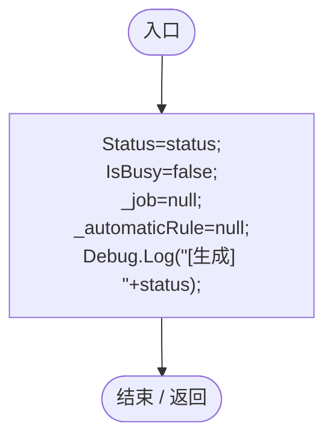

项目内调用/回调引用：

- [RandomPlanetSpawner.Status.set · L21](1c13222a547b265c.md#m94d3e66d0ccd1e6e)（访问器）
- [RandomPlanetSpawner.IsBusy.set · L18](1c13222a547b265c.md#m9bd4e3d270a14565)（访问器）

<a id="m13321aa05f521986"></a>

## Cancel · L91

`public void Cancel()`


### Editor / Player · Roslyn编译器控制流

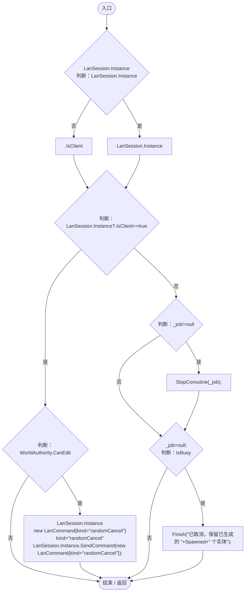

项目内调用/回调引用：

- [LanSession.Instance.get · L23](9fb633eebffe669c.md#mbf83306994878383)（访问器）
- [LanSession.SendCommand · L90](9fb633eebffe669c.md#me286a0c67c4d8ecd)（方法）
- [RandomPlanetSpawner.IsBusy.get · L18](1c13222a547b265c.md#m93511175a525fd2b)（访问器）
- [RandomPlanetSpawner.Finish · L90](1c13222a547b265c.md#mec99b8dce67e8140)（方法）
- [RandomPlanetSpawner.Spawned.get · L19](1c13222a547b265c.md#m26983b533cf25e8f)（访问器）

<a id="mf0ff742b53144e65"></a>

## ApplyRemoteProgress · L92

`public void ApplyRemoteProgress(bool busy,int spawned,int requested,string status)`


### Editor / Player · Roslyn编译器控制流

```mermaid
flowchart TD
  b0(["入口"])
  b1["IsBusy=busy;<br/>Spawned=spawned;<br/>Requested=requested;"]
  b2["Status"]
  b3{"status<br/>判断：status"}
  b4["status"]
  b5["&quot;&quot;"]
  b6["Status=status??&quot;&quot;;"]
  b7(["结束 / 返回"])
  b0 --> b1
  b1 --> b2
  b2 --> b3
  b3 -->|"否"| b4
  b3 -->|"是"| b5
  b4 --> b6
  b5 --> b6
  b6 --> b7

```

项目内调用/回调引用：

- [RandomPlanetSpawner.IsBusy.set · L18](1c13222a547b265c.md#m9bd4e3d270a14565)（访问器）
- [RandomPlanetSpawner.Spawned.set · L19](1c13222a547b265c.md#m19f996e70f2dc0a8)（访问器）
- [RandomPlanetSpawner.Requested.set · L20](1c13222a547b265c.md#mc1afe89a4f86c9e2)（访问器）
- [RandomPlanetSpawner.Status.set · L21](1c13222a547b265c.md#m94d3e66d0ccd1e6e)（访问器）

<a id="m77bda937df88d9bf"></a>

## ResetWorld · L93

`public void ResetWorld()`


### Editor / Player · Roslyn编译器控制流

```mermaid
flowchart TD
  b0(["入口"])
  b1{"判断：_job!=null"}
  b2["StopCoroutine(_job);"]
  b3["_job=null;<br/>IsBusy=false;<br/>Spawned=Requested=0;<br/>_automaticRule=null;<br/>_nextMaintenance=0;<br/>_nextRule=0;"]
  b4(["结束 / 返回"])
  b0 --> b1
  b1 -->|"是"| b2
  b1 -->|"否"| b3
  b2 --> b3
  b3 --> b4

```

项目内调用/回调引用：

- [RandomPlanetSpawner.IsBusy.set · L18](1c13222a547b265c.md#m9bd4e3d270a14565)（访问器）
- [RandomPlanetSpawner.Spawned.set · L19](1c13222a547b265c.md#m19f996e70f2dc0a8)（访问器）
- [RandomPlanetSpawner.Requested.set · L20](1c13222a547b265c.md#mc1afe89a4f86c9e2)（访问器）

<a id="mba40d48a7add2f88"></a>

## OnDisable · L94

`private void OnDisable()`


### Editor / Player · Roslyn编译器控制流

```mermaid
flowchart TD
  b0(["入口"])
  b1["Cancel()"]
  b2(["结束 / 返回"])
  b0 --> b1
  b1 --> b2

```

项目内调用/回调引用：

- [RandomPlanetSpawner.Cancel · L91](1c13222a547b265c.md#m13321aa05f521986)（方法）
