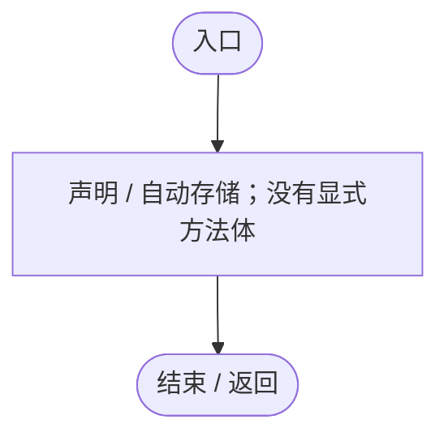

# IGeneAIModule.cs

[返回总索引](../README.md) · `Runtime` · `Assets/DarwinPark/AI/IGeneAIModule.cs`

[源文件](../../../Assets/DarwinPark/AI/IGeneAIModule.cs) · 源码校验：`bb6dfe11800f9b2d85ed5241a2aec21f3f1cf3363cc91ab328c03d2157848d0c`

方法按源文件位置排列。事件/回调引用不表示立即执行；分支与异常说明见总索引。完整源码与可点击关系图请打开离线手册。

## ModuleId.get · L5

`get`

### Editor / Player · 语法控制结构 / 声明（非CFG）

## Initialize · L6

`void Initialize(EntityAIContext context)`

### Editor / Player · 语法控制结构 / 声明（非CFG）

## Tick · L7

`void Tick(float deltaTime)`

### Editor / Player · 语法控制结构 / 声明（非CFG）

## OnDisable · L8

`void OnDisable()`

### Editor / Player · 语法控制结构 / 声明（非CFG）

