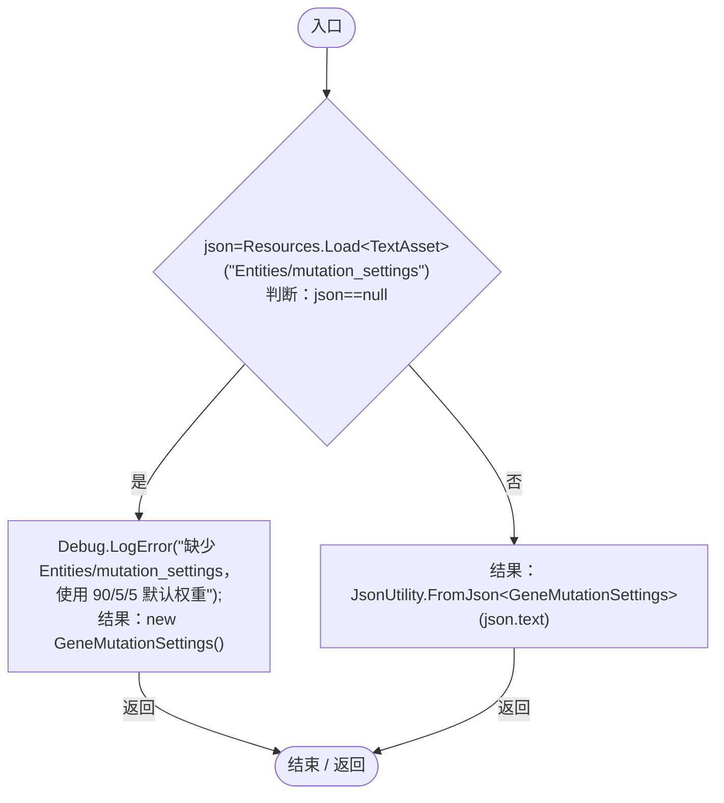

# GeneMutationSettings.cs

[返回总索引](../README.md) · `Runtime` · `Assets/DarwinPark/Genetics/Mutation/GeneMutationSettings.cs`

[源文件](../../../Assets/DarwinPark/Genetics/Mutation/GeneMutationSettings.cs) · 源码校验：`709ec45fffcb34c92837f4381057afd9c7536eeca69854b4af68e98290bdfc8b`

方法按源文件位置排列。事件/回调引用不表示立即执行；分支与异常说明见总索引。完整源码与可点击关系图请打开离线手册。

## CreateDefault · L14

`public static GeneMutationSettings CreateDefault()`

### Editor / Player · Roslyn编译器控制流

