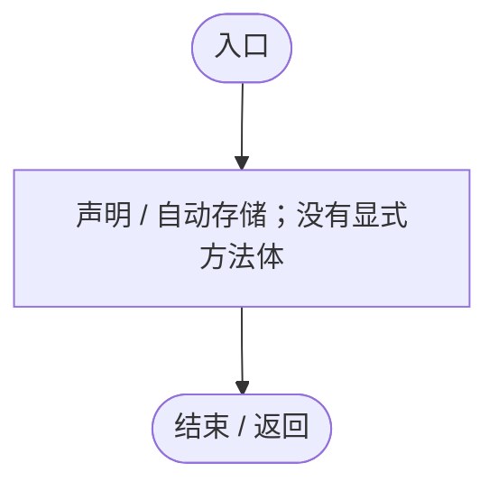
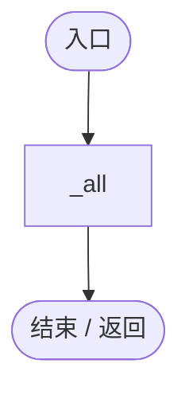
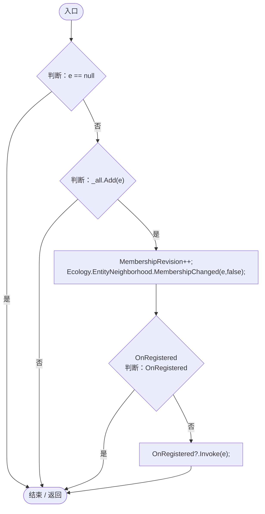
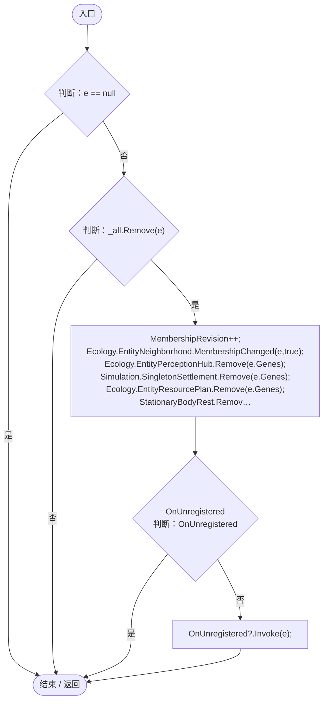
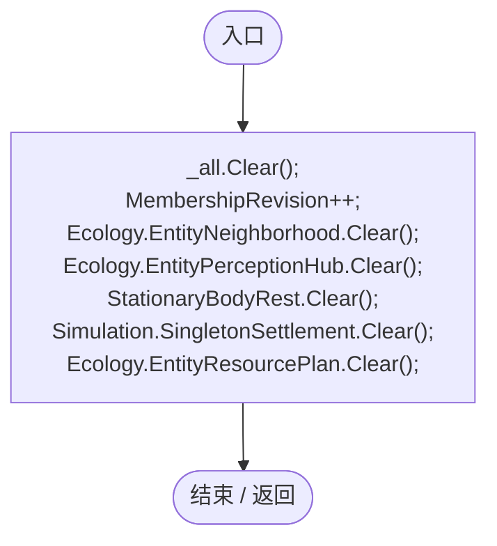

# EntityRegistry.cs

[返回总索引](../README.md) · `Runtime` · `Assets/DarwinPark/Entities/EntityRegistry.cs`

[源文件](../../../Assets/DarwinPark/Entities/EntityRegistry.cs) · 源码校验：`78a0f4d7a6299b19626f8d68d41a2ac296770f13c2e073eebff135d746181ef8`

方法按源文件位置排列。事件/回调引用不表示立即执行；分支与异常说明见总索引。完整源码与可点击关系图请打开离线手册。

## MembershipRevision.get · L15

`get`

### Editor / Player · 语法控制结构 / 声明（非CFG）

## MembershipRevision.set · L15

`private set`

### Editor / Player · 语法控制结构 / 声明（非CFG）

## All.get · L16

`public static IReadOnlyCollection<DarwinEntity> All`

### Editor / Player · 语法控制结构 / 声明（非CFG）

## Register · L20

`public static void Register(DarwinEntity e)`

### Editor / Player · Roslyn编译器控制流

项目内调用/回调引用：

- [EntityRegistry.MembershipRevision.set · L15](2093aaf08559c9f2.md#m1651d1bae508a3fb)（访问器）
- [EntityRegistry.MembershipRevision.get · L15](2093aaf08559c9f2.md#m6afb6f184d119e11)（访问器）
- [EntityNeighborhood.MembershipChanged · L66](e5e24c4aff0395b1.md#m74d51ebc4f5b83ab)（方法）

## Unregister · L28

`public static void Unregister(DarwinEntity e)`

### Editor / Player · Roslyn编译器控制流

项目内调用/回调引用：

- [EntityRegistry.MembershipRevision.set · L15](2093aaf08559c9f2.md#m1651d1bae508a3fb)（访问器）
- [EntityRegistry.MembershipRevision.get · L15](2093aaf08559c9f2.md#m6afb6f184d119e11)（访问器）
- [EntityNeighborhood.MembershipChanged · L66](e5e24c4aff0395b1.md#m74d51ebc4f5b83ab)（方法）
- [EntityPerceptionHub.Remove · L70](aeecc36cb2c3cc24.md#m54c3621eb766145b)（方法）
- [DarwinEntity.Genes.get · L14](70798dde169f2e8b.md#m622eb1adf401d431)（访问器）
- [SingletonSettlement.Remove · L39](aa60fc9f4553ae15.md#m4c06d219d67adfa7)（方法）
- [EntityResourcePlan.Remove · L67](569e8e31d0634370.md#m206d5c1694a0cdd1)（方法）
- [StationaryBodyRest.Remove · L44](19e6d310d5522440.md#m1301580938762100)（方法）

## Clear · L39

`public static void Clear()`

★ 适配：换世界同步释放空间缓存，不能保留上一局引用。

### Editor / Player · Roslyn编译器控制流

项目内调用/回调引用：

- [EntityRegistry.MembershipRevision.set · L15](2093aaf08559c9f2.md#m1651d1bae508a3fb)（访问器）
- [EntityRegistry.MembershipRevision.get · L15](2093aaf08559c9f2.md#m6afb6f184d119e11)（访问器）
- [EntityNeighborhood.Clear · L112](e5e24c4aff0395b1.md#m80c217bc59373ec6)（方法）
- [EntityPerceptionHub.Clear · L79](aeecc36cb2c3cc24.md#m31fc0fb1c51cd043)（方法）
- [StationaryBodyRest.Clear · L45](19e6d310d5522440.md#m48e94a60d1d047de)（方法）
- [SingletonSettlement.Clear · L40](aa60fc9f4553ae15.md#md37a0eec93de9957)（方法）
- [EntityResourcePlan.Clear · L68](569e8e31d0634370.md#mf44fd8d2d0ffc9f0)（方法）
