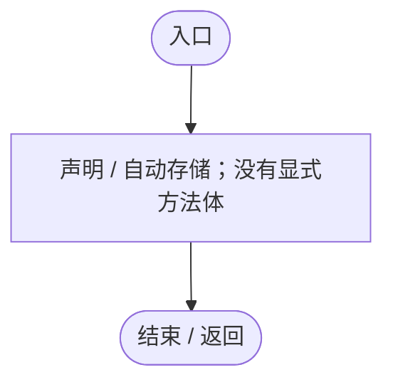
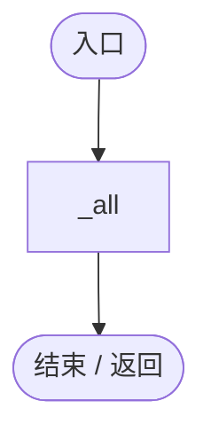
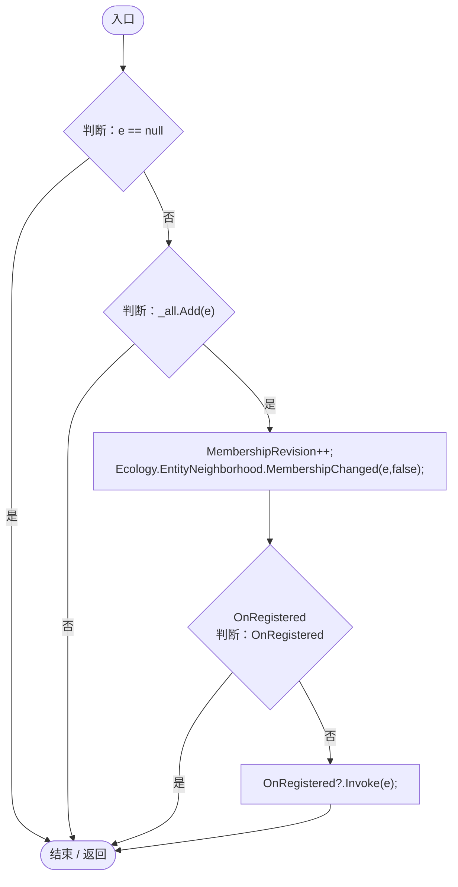
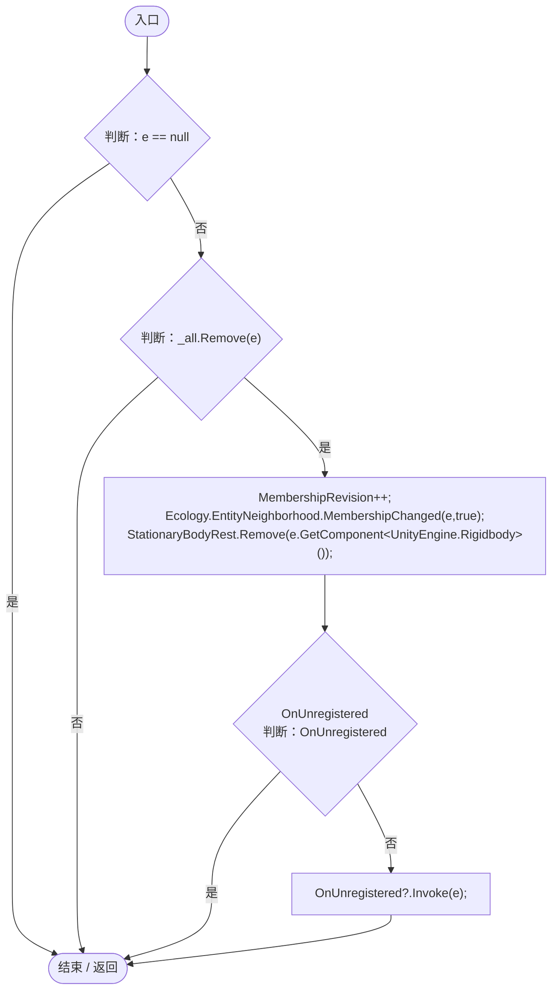
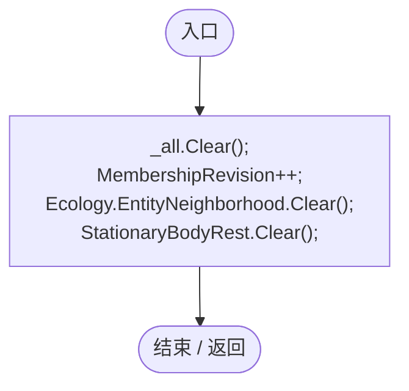

# EntityRegistry.cs

[返回总索引](../README.md) · `Runtime` · `Assets/DarwinPark/Entities/EntityRegistry.cs`

[源文件](../../../Assets/DarwinPark/Entities/EntityRegistry.cs) · 源码校验：`56eb77ddf28485fcb43360a00190e3fd815375dde18d13b82db88bf046cf76e5`

方法按源文件位置排列。事件/回调引用不表示立即执行；分支与异常说明见总索引。完整源码与可点击关系图请打开离线手册。

## MembershipRevision.get · L15

`get`

### Editor / Player · 语法控制结构 / 声明（非CFG）

## MembershipRevision.set · L15

`private set`

### Editor / Player · 语法控制结构 / 声明（非CFG）

## All.get · L16

`public static IReadOnlyCollection<DarwinEntity> All`

### Editor / Player · 语法控制结构 / 声明（非CFG）

## Register · L20

`public static void Register(DarwinEntity e)`

### Editor / Player · Roslyn编译器控制流

项目内调用/回调引用：

- [EntityRegistry.MembershipRevision.set · L15](2093aaf08559c9f2.md#m1651d1bae508a3fb)（访问器）
- [EntityRegistry.MembershipRevision.get · L15](2093aaf08559c9f2.md#m6afb6f184d119e11)（访问器）
- [EntityNeighborhood.MembershipChanged · L49](e5e24c4aff0395b1.md#m298e97ee11ff7c4e)（方法）

## Unregister · L28

`public static void Unregister(DarwinEntity e)`

### Editor / Player · Roslyn编译器控制流

项目内调用/回调引用：

- [EntityRegistry.MembershipRevision.set · L15](2093aaf08559c9f2.md#m1651d1bae508a3fb)（访问器）
- [EntityRegistry.MembershipRevision.get · L15](2093aaf08559c9f2.md#m6afb6f184d119e11)（访问器）
- [EntityNeighborhood.MembershipChanged · L49](e5e24c4aff0395b1.md#m298e97ee11ff7c4e)（方法）
- [StationaryBodyRest.Remove · L37](19e6d310d5522440.md#md1806a96c1124ab0)（方法）

## Clear · L37

`public static void Clear()`

★ 适配：换世界同步释放空间缓存，不能保留上一局引用。

### Editor / Player · Roslyn编译器控制流

项目内调用/回调引用：

- [EntityRegistry.MembershipRevision.set · L15](2093aaf08559c9f2.md#m1651d1bae508a3fb)（访问器）
- [EntityRegistry.MembershipRevision.get · L15](2093aaf08559c9f2.md#m6afb6f184d119e11)（访问器）
- [EntityNeighborhood.Clear · L90](e5e24c4aff0395b1.md#m2ab6c4a79cc1ce81)（方法）
- [StationaryBodyRest.Clear · L38](19e6d310d5522440.md#m9446711c3916bb36)（方法）
