# SocialEcologyRegression.cs

[返回总索引](../README.md) · `Editor` · `Assets/DarwinPark/Editor/SocialEcologyRegression.cs`

[源文件](../../../Assets/DarwinPark/Editor/SocialEcologyRegression.cs) · 源码校验：`68d419b4439259892d647f734711ba60210f391262cdb19b210603fdd530cb09`

方法按源文件位置排列。事件/回调引用不表示立即执行；分支与异常说明见总索引。完整源码与可点击关系图请打开离线手册。

<a id="me8776786ed1c4891"></a>

## Folder.get · L30

`private static string Folder`


### Editor · 语法控制结构 / 声明（非CFG）

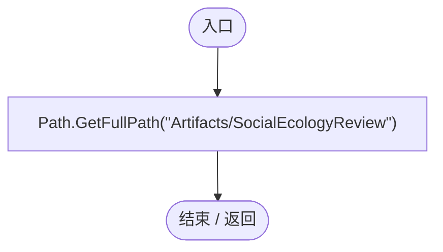

<a id="m3624ab44c0d7d963"></a>

## SocialEcologyRegression.ctor · L31

`static SocialEcologyRegression()`


### Editor · Roslyn编译器控制流

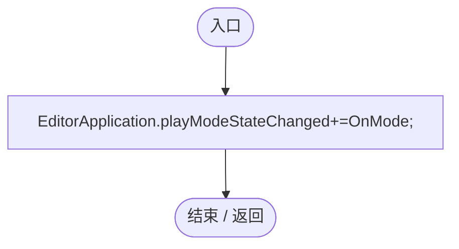

项目内调用/回调引用：

- [SocialEcologyRegression.OnMode · L36](217494895b1b18ec.md#mdb7eaa9a496b6707)（方法）

<a id="m5a9de58ee84d4d07"></a>

## RunBatch · L32

`public static void RunBatch()`


### Editor · Roslyn编译器控制流

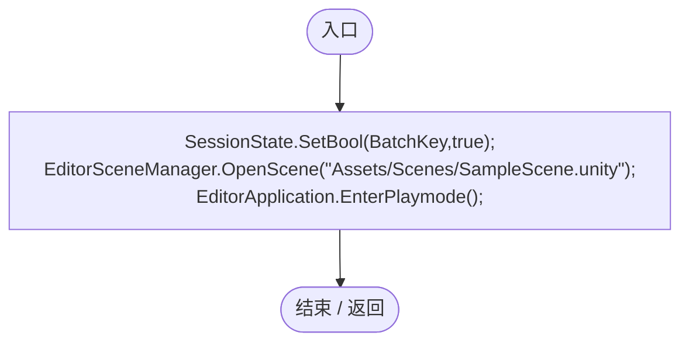

<a id="mdb7eaa9a496b6707"></a>

## OnMode · L36

`private static void OnMode(PlayModeStateChange mode)`


### Editor · Roslyn编译器控制流

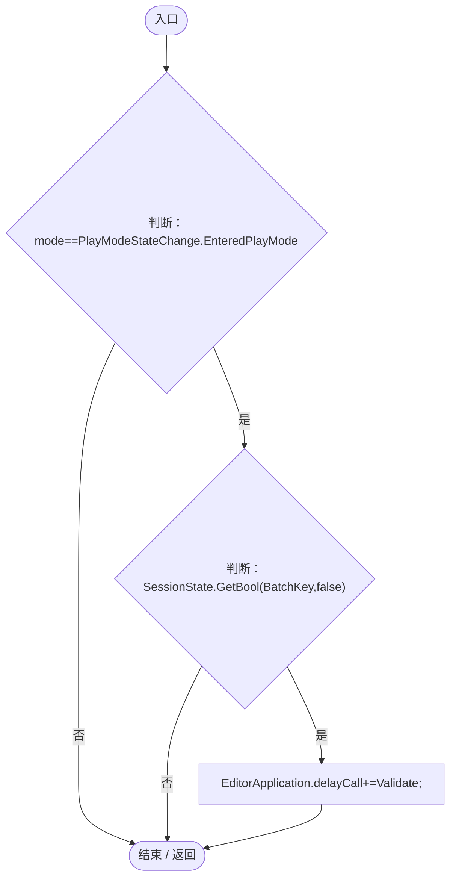

项目内调用/回调引用：

- [SocialEcologyRegression.Validate · L40](217494895b1b18ec.md#m1d3596c41e5076f1)（方法）

<a id="m1d3596c41e5076f1"></a>

## Validate · L40

`[MenuItem("Tools/Darwin Park/Validate Social Ecology")] public static void Validate()`


### Editor · Roslyn编译器控制流

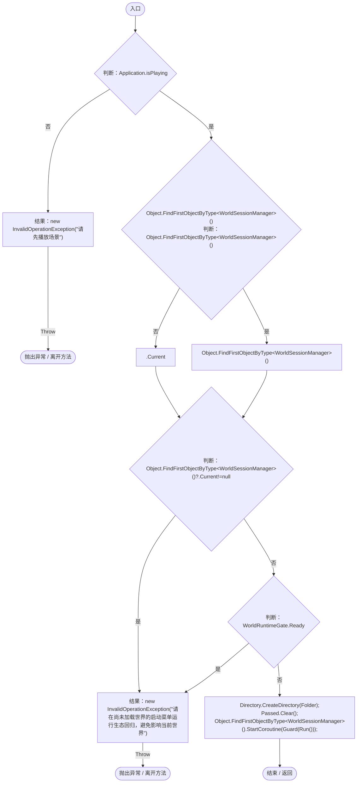

项目内调用/回调引用：

- [WorldSessionManager.Current.get · L21](08741c7b7b9d9344.md#m5d26a5eb846a8504)（访问器）
- [SocialEcologyRegression.Guard · L47](217494895b1b18ec.md#m58621590ad504aee)（方法）
- [SocialEcologyRegression.Run · L81](217494895b1b18ec.md#mfc948d72fbdee959)（方法）

<a id="m58621590ad504aee"></a>

## Guard · L47

`private static IEnumerator Guard(IEnumerator operation)`


### Editor · Roslyn编译器控制流

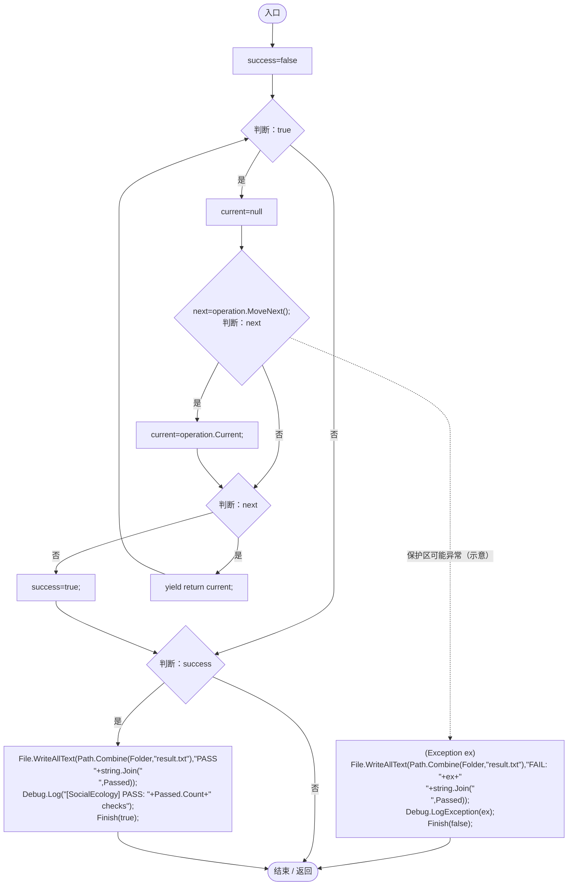

项目内调用/回调引用：

- [SocialEcologyRegression.Finish · L59](217494895b1b18ec.md#m571cce8f4b50bab0)（方法）

<a id="m571cce8f4b50bab0"></a>

## Finish · L59

`private static void Finish(bool success)`


### Editor · Roslyn编译器控制流

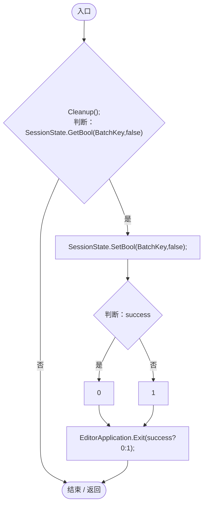

项目内调用/回调引用：

- [SocialEcologyRegression.Cleanup · L72](217494895b1b18ec.md#m0d1042ce72d6784b)（方法）

<a id="mbd659b5ff67c6318"></a>

## Check · L63

`private static void Check(bool condition,string message)`


### Editor · Roslyn编译器控制流

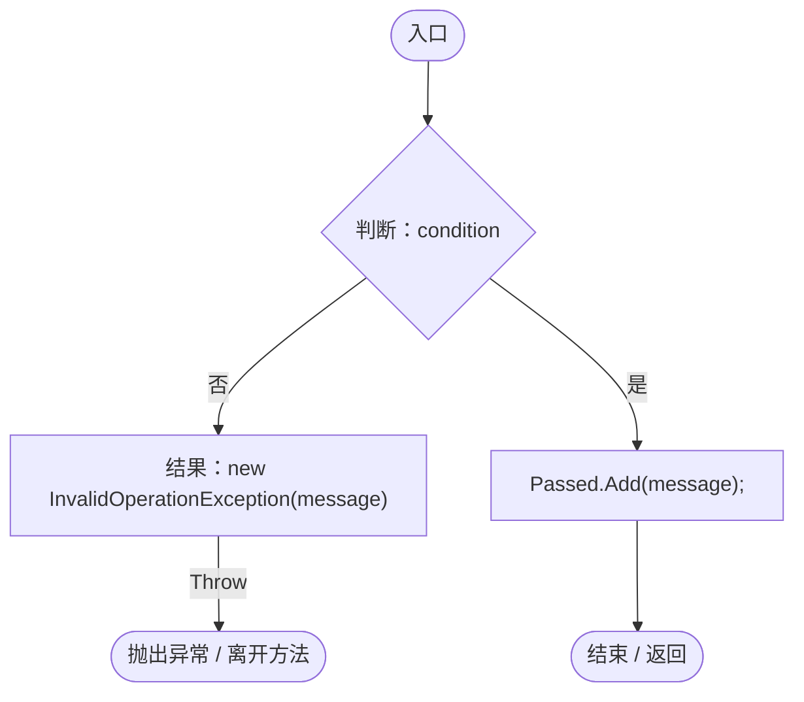

<a id="me60e1a769a89a0c6"></a>

## Genome · L65

`private static Genome Genome(params (string id,float value)[] genes)`


### Editor · Roslyn编译器控制流

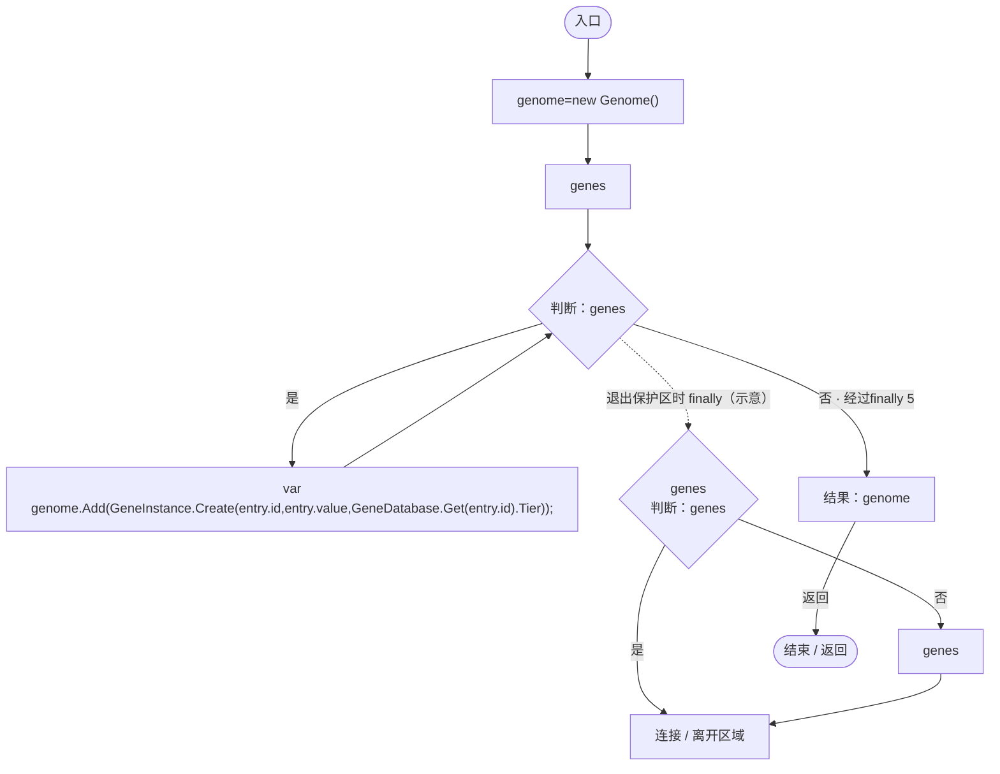

项目内调用/回调引用：

- [Genome.Add · L19](a2ef23f865bc7ee8.md#md9cfdc94b8b8d40f)（方法）
- [GeneInstance.Create · L20](f82e1498d67f5afd.md#m72e94c278de3cf8b)（方法）
- [GeneDatabase.Get · L135](ec0a03483435a863.md#m8f3bbfb35f3ca397)（方法）

<a id="m1715d2fdf0106cd4"></a>

## Spawn · L67

`private static DarwinEntity Spawn(Vector3 point,params (string id,float value)[] genes)`


### Editor · Roslyn编译器控制流

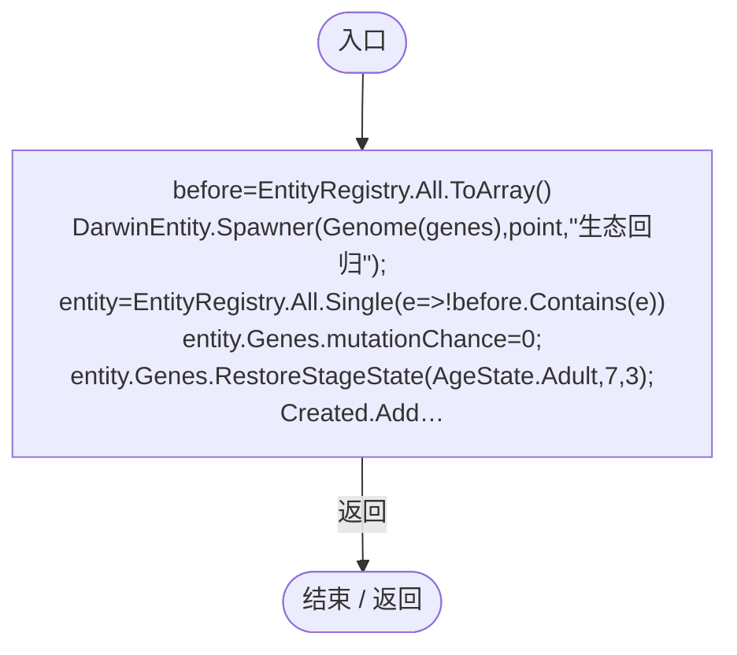

项目内调用/回调引用：

- [SocialEcologyRegression.Genome · L65](217494895b1b18ec.md#me60e1a769a89a0c6)（方法）
- [DarwinEntity.Genes.get · L14](70798dde169f2e8b.md#m622eb1adf401d431)（访问器）
- [EntityGeneController.RestoreStageState · L45](7494d53178552f0e.md#m49489af39061f1a1)（方法）
- [SocialEcologyRegression.回调@69 · L69](217494895b1b18ec.md#mae00fd4b942dea36)（回调/委托）

<a id="mae00fd4b942dea36"></a>

## 回调@69 · L69

`e … => 回调`


### Editor · Roslyn编译器控制流

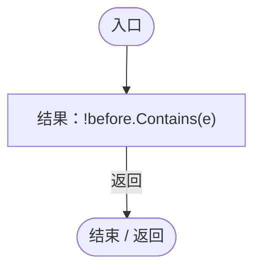

<a id="m0d1042ce72d6784b"></a>

## Cleanup · L72

`private static void Cleanup()`


### Editor · Roslyn编译器控制流

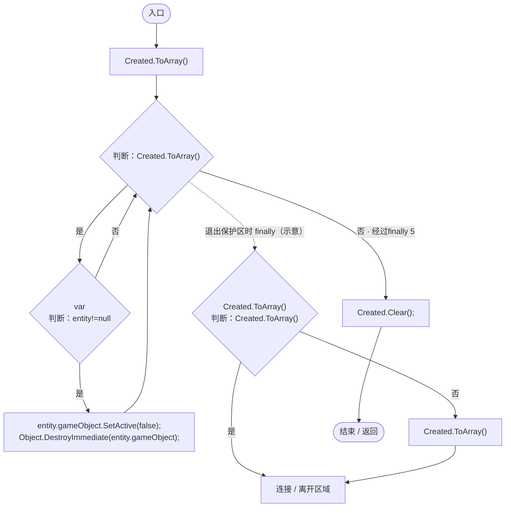

<a id="m5c10a6723f8a1a6b"></a>

## Food · L74

`private static float Food(DarwinEntity entity)`


### Editor · Roslyn编译器控制流

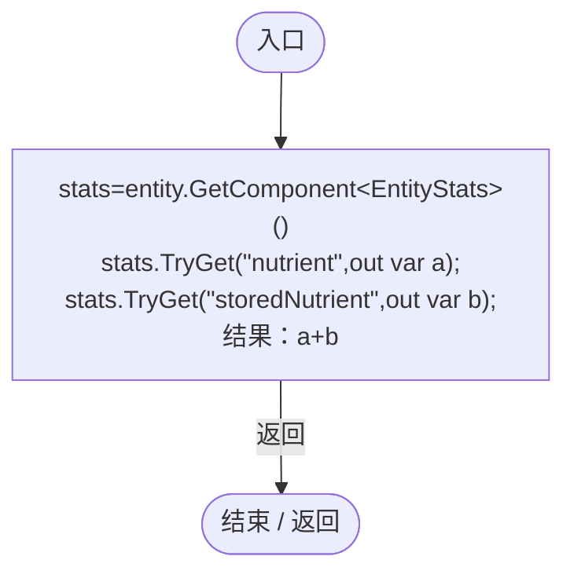

项目内调用/回调引用：

- [EntityStats.TryGet · L90](75aa86a368efdf24.md#m24ee1433e4a70d94)（方法）

<a id="mf61ad335f28df1fc"></a>

## EmptyFood · L75

`private static void EmptyFood(DarwinEntity entity)`


### Editor · Roslyn编译器控制流

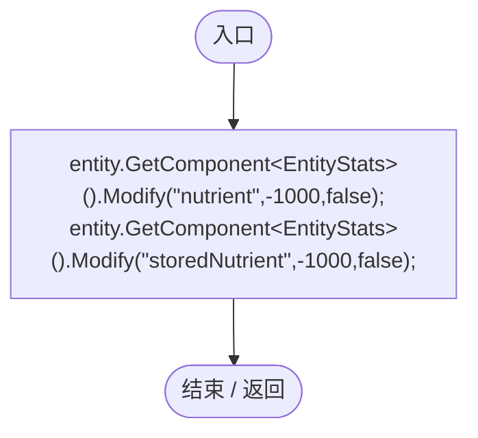

项目内调用/回调引用：

- [EntityStats.Modify · L111](75aa86a368efdf24.md#m9c837be197158240)（方法）

<a id="m34448057b23f357f"></a>

## Restore · L76

`private static DarwinEntity Restore(EntitySaveState state)`


### Editor · Roslyn编译器控制流

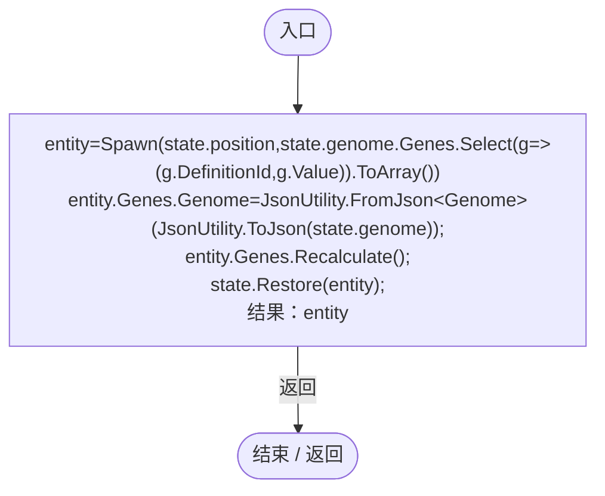

项目内调用/回调引用：

- [SocialEcologyRegression.Spawn · L67](217494895b1b18ec.md#m1715d2fdf0106cd4)（方法）
- [DarwinEntity.Genes.get · L14](70798dde169f2e8b.md#m622eb1adf401d431)（访问器）
- [EntityGeneController.Recalculate · L90](7494d53178552f0e.md#m93744c8f3039b93c)（方法）
- [EntitySaveState.Restore · L31](a1ec8fcd9d7d3ddb.md#m047b691a146deabd)（方法）
- [SocialEcologyRegression.回调@78 · L78](217494895b1b18ec.md#mb6e51f5ff441c5db)（回调/委托）

<a id="mb6e51f5ff441c5db"></a>

## 回调@78 · L78

`g … => 回调`


### Editor · Roslyn编译器控制流

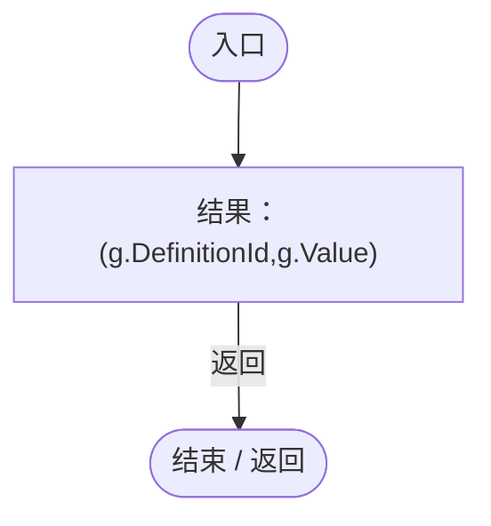

<a id="mfc948d72fbdee959"></a>

## Run · L81

`private static IEnumerator Run()`


### Editor · Roslyn编译器控制流

```mermaid
flowchart TD
  b0(["入口"])
  b1["yield return null;<br/>clock=ServiceLocator.Get&lt;SimulationClock&gt;()<br/>clock.Pause();<br/>random=UnityEngine.Random.state<br/>GeneRuntimeProfile.Clear();<br/>GeneDatabase.Reload();<br/>GeneDatabase.EnsureLoaded();<br/>catalog=GeneTreeStorage.ReadCatalog()<br/>GeneTreeS…"]
  b2["new[]{&quot;gene_territory&quot;,&quot;gene_population&quot;,&quot;gene_oviparous&quot;,&quot;gene_parasitic&quot;}"]
  b3{"判断：new[]{&quot;gene_territory&quot;,&quot;gene_population&quot;,&quot;gene_oviparous&quot;,&quot;gene_parasitic&quot;}"}
  b4["var<br/>Check(GeneLogicRegistry.CreateLogic(GeneDatabase.Get(id).LogicScriptId)!=null,&quot;逻辑已注册：&quot;+id);"]
  b5{"new[]{&quot;gene_territory&quot;,&quot;gene_population&quot;,&quot;gene_oviparous&quot;,&quot;gene_parasitic&quot;}<br/>判断：new[]{&quot;gene_territory&quot;,&quot;gene_population&quot;,&quot;gene_oviparous&quot;,&quot;gene_parasitic&quot;}"}
  b6["new[]{&quot;gene_territory&quot;,&quot;gene_population&quot;,&quot;gene_oviparous&quot;,&quot;gene_parasitic&quot;}"]
  b7["连接 / 离开区域"]
  b8{"判断：GeneEvolutionRules.Allows(&quot;gene_locomotion&quot;,&quot;gene_territory&quot;,&quot;error&quot;,40)"}
  b9{"判断：GeneEvolutionRules.Allows(&quot;gene_locomotion&quot;,&quot;gene_territory&quot;,&quot;error&quot;,60)"}
  b10["!GeneEvolutionRules.Allows(&quot;gene_locomotion&quot;,&quot;gene_territory&quot;,&quot;error&quot;,39.9f)"]
  b11["GeneEvolutionRules.Allows(&quot;gene_locomotion&quot;,&quot;gene_territory&quot;,&quot;error&quot;,40)&amp;&amp;GeneEvolutionRules.Allows(&quot;gene_locomotion&quot;,&quot;gene_territory&quot;,&quot;error&quot;,60)&amp;&amp;!GeneEvolutionRules.Allows(&quot;gene_locomotion&quot;,&quot;gene_territory&quot;,&quot;error&quot;,39.9f)"]
  b12["Check(GeneEvolutionRules.Allows(&quot;gene_locomotion&quot;,&quot;gene_territory&quot;,&quot;error&quot;,40)&amp;&amp;GeneEvolutionRules.Allows(&quot;gene_locomotion&quot;,&quot;gene_territory&quot;,&quot;error&quot;,60)&amp;&amp;!GeneEvolutionRules.Allows(&quot;gene_locomotion&quot;,&quot;gene_territory&quot;,&quot;error&quot;,39.9f),&quot;行动出错 …"]
  b13{"判断：GeneEvolutionRules.Allows(&quot;gene_territory&quot;,&quot;gene_population&quot;,&quot;evolution&quot;,80)"}
  b14["GeneEvolutionRules.Allows(&quot;gene_territory&quot;,&quot;gene_population&quot;,&quot;evolution&quot;,80.00005f)"]
  b15["!GeneEvolutionRules.Allows(&quot;gene_territory&quot;,&quot;gene_population&quot;,&quot;evolution&quot;,80)"]
  b16["Check(!GeneEvolutionRules.Allows(&quot;gene_territory&quot;,&quot;gene_population&quot;,&quot;evolution&quot;,80)&amp;&amp;GeneEvolutionRules.Allows(&quot;gene_territory&quot;,&quot;gene_population&quot;,&quot;evolution&quot;,80.00005f),&quot;种群演化严格大于 80&quot;);"]
  b17{"判断：GeneEvolutionRules.Allows(&quot;gene_oviparous&quot;,&quot;gene_parasitic&quot;,&quot;error&quot;,50)"}
  b18{"判断：GeneEvolutionRules.Allows(&quot;gene_locomotion&quot;,&quot;gene_parasitic&quot;,&quot;error&quot;,50)"}
  b19["!GeneEvolutionRules.Allows(&quot;gene_oviparous&quot;,&quot;gene_parasitic&quot;,&quot;evolution&quot;,50)"]
  b20["GeneEvolutionRules.Allows(&quot;gene_oviparous&quot;,&quot;gene_parasitic&quot;,&quot;error&quot;,50)&amp;&amp;!GeneEvolutionRules.Allows(&quot;gene_locomotion&quot;,&quot;gene_parasitic&quot;,&quot;error&quot;,50)&amp;&amp;!GeneEvolutionRules.Allows(&quot;gene_oviparous&quot;,&quot;gene_parasitic&quot;,&quot;evolution&quot;,50)"]
  b21["Check(GeneEvolutionRules.Allows(&quot;gene_oviparous&quot;,&quot;gene_parasitic&quot;,&quot;error&quot;,50)&amp;&amp;!GeneEvolutionRules.Allows(&quot;gene_locomotion&quot;,&quot;gene_parasitic&quot;,&quot;error&quot;,50)&amp;&amp;!GeneEvolutionRules.Allows(&quot;gene_oviparous&quot;,&quot;gene_parasitic&quot;,&quot;evolution&quot;,50),&quot;寄生仅允许…"]
  b22["new GeneMutationSettings{ErrorWeight=1,DuplicateWeight=0,DeletionWeight=0,MaxErrorDelta=0}<br/>ErrorWeight=1<br/>DuplicateWeight=0<br/>DeletionWeight=0<br/>MaxErrorDelta=0<br/>forceError=new GeneMutationSettings{ErrorWeight=1,DuplicateWeight=0,DeletionWeigh…"]
  b23["errorGenome=Genome((&quot;gene_locomotion&quot;,50))<br/>GeneMutator.Mutate(errorGenome,forceError);"]
  b24{"判断：errorGenome.Genes.Single().DefinitionId==&quot;gene_territory&quot;"}
  b25["errorGenome.Genes.Single().Tier==1"]
  b26["errorGenome.Genes.Single().DefinitionId==&quot;gene_territory&quot;"]
  b27["Check(errorGenome.Genes.Single().DefinitionId==&quot;gene_territory&quot;&amp;&amp;errorGenome.Genes.Single().Tier==1,&quot;实际出错迁移及 Tier 更新&quot;);"]
  b28["copyGenome=Genome((&quot;gene_territory&quot;,81))"]
  b29["copyGenome<br/>new GeneMutationSettings{ErrorWeight=0,DuplicateWeight=1,DeletionWeight=0}<br/>ErrorWeight=0<br/>DuplicateWeight=1<br/>DeletionWeight=0<br/>GeneMutator.Mutate(copyGenome,new GeneMutationSettings{ErrorWeight=0,DuplicateWeight=1,DeletionWeight=…"]
  b30{"判断：copyGenome.Genes.Any(g=&gt;g.DefinitionId==&quot;gene_territory&quot;)"}
  b31["copyGenome.Genes.Any(g=&gt;g.DefinitionId==&quot;gene_population&quot;&amp;&amp;g.Tier==2)"]
  b32["copyGenome.Genes.Any(g=&gt;g.DefinitionId==&quot;gene_territory&quot;)"]
  b33["Check(copyGenome.Genes.Any(g=&gt;g.DefinitionId==&quot;gene_territory&quot;)&amp;&amp;copyGenome.Genes.Any(g=&gt;g.DefinitionId==&quot;gene_population&quot;&amp;&amp;g.Tier==2),&quot;复制保留领地并新增种群&quot;);"]
  b34["parasiteGenome=Genome((&quot;gene_oviparous&quot;,50))<br/>GeneMutator.Mutate(parasiteGenome,forceError);<br/>Check(parasiteGenome.Genes.Single().DefinitionId==&quot;gene_parasitic&quot;,&quot;实际卵生出错产生寄生&quot;);<br/>actor=Spawn(new Vector3(0,320,0),(&quot;gene_locomotion&quot;,50))<br/>instan…"]
  b35{"判断：territory.EvictionRemaining&gt;0"}
  b36{"判断：territory.Destination(out var flee,out var speed)"}
  b37["speed&gt;1"]
  b38["territory.EvictionRemaining&gt;0&amp;&amp;territory.Destination(out var flee,out var speed)&amp;&amp;speed&gt;1"]
  b39["Check(territory.EvictionRemaining&gt;0&amp;&amp;territory.Destination(out var flee,out var speed)&amp;&amp;speed&gt;1,&quot;无法对抗的真实攻击仍触发撤离&quot;);"]
  b40["actor.transform.position=new Vector3(120,300,0);<br/>territory.Advance(0);<br/>Check(territory.CenterLocal==original,&quot;暂停不推进迁居&quot;);<br/>territory.Advance(EcologySettings.Load().settleDelay+.1f);<br/>Check(Vector3.Distance(territory.CenterLocal,original)&gt;20…"]
  b41{"判断：a.IsLeader"}
  b42{"判断：a.SameGroup(follower)"}
  b43["a.MemberCount==2"]
  b44["a.IsLeader&amp;&amp;a.SameGroup(follower)&amp;&amp;a.MemberCount==2"]
  b45["Check(a.IsLeader&amp;&amp;a.SameGroup(follower)&amp;&amp;a.MemberCount==2,&quot;首成员领袖及附近同模式聚群&quot;);"]
  b46{"判断：a.AttackMultiplier&gt;1"}
  b47["b.AttackMultiplier&gt;1"]
  b48["a.AttackMultiplier&gt;1"]
  b49["Check(a.AttackMultiplier&gt;1&amp;&amp;b.AttackMultiplier&gt;1,&quot;附近同群成员产生真实协同攻击加成&quot;);"]
  b50["Check(!b.Issue(PopulationCommand.Hunt,prey,prey.transform.position,true,out _),&quot;普通成员不能下令&quot;);"]
  b51{"判断：a.Issue(PopulationCommand.Hunt,prey,prey.transform.position,true,out _)"}
  b52{"判断：b.Target==prey"}
  b53["b.Command==PopulationCommand.Hunt"]
  b54["a.Issue(PopulationCommand.Hunt,prey,prey.transform.position,true,out _)&amp;&amp;b.Target==prey&amp;&amp;b.Command==PopulationCommand.Hunt"]
  b55["Check(a.Issue(PopulationCommand.Hunt,prey,prey.transform.position,true,out _)&amp;&amp;b.Target==prey&amp;&amp;b.Command==PopulationCommand.Hunt,&quot;同群领袖命令广播&quot;);"]
  b56["Check(!EcologyMotion.CanHunt(founder.Genes,follower),&quot;自主行动不把同群当猎物&quot;);<br/>founder.GetComponent&lt;EntityStats&gt;().Modify(&quot;health&quot;,-75,false);"]
  b57{"判断：b.ChallengeLeadership(out _)"}
  b58{"判断：b.IsLeader"}
  b59["!a.IsLeader"]
  b60["b.ChallengeLeadership(out _)&amp;&amp;b.IsLeader&amp;&amp;!a.IsLeader"]
  b61["Check(b.ChallengeLeadership(out _)&amp;&amp;b.IsLeader&amp;&amp;!a.IsLeader,&quot;更强成员决斗接任&quot;);"]
  b62{"判断：a.ChallengeLeadership(out _)"}
  b63{"判断：a.DuelRemaining&gt;0"}
  b64["b.DuelRemaining&gt;0"]
  b65["!a.ChallengeLeadership(out _)&amp;&amp;a.DuelRemaining&gt;0&amp;&amp;b.DuelRemaining&gt;0"]
  b66["Check(!a.ChallengeLeadership(out _)&amp;&amp;a.DuelRemaining&gt;0&amp;&amp;b.DuelRemaining&gt;0,&quot;决斗双方冷却防重入&quot;);"]
  b67["beforeCommand=b.CommandRemaining<br/>b.Advance(0);<br/>Check(b.CommandRemaining==beforeCommand,&quot;暂停不扣命令时长&quot;);<br/>EmptyFood(founder);<br/>EmptyFood(follower);<br/>b.ShareReward(10);<br/>Check(Mathf.Abs(Food(founder)+Food(follower)-10)&lt;.001f,&quot;击杀分享总营养守恒&quot;);<br/>leaderSt…"]
  b68["new Dictionary&lt;string,DarwinEntity&gt;{{followerState.ecology.id,newFollower},{leaderState.ecology.id,newLeader},{EcologyIdentity.Of(prey),prey}}<br/>{followerState.ecology.id,newFollower}<br/>{leaderState.ecology.id,newLeader}<br/>{EcologyIdentity.Of(…"]
  b69["followerState.ecology.Resolve(newFollower,map);<br/>leaderState.ecology.Resolve(newLeader,map);"]
  b70{"判断：newLeader.GetComponent&lt;PopulationBehavior&gt;().IsLeader"}
  b71["!newFollower.GetComponent&lt;PopulationBehavior&gt;().IsLeader"]
  b72["newLeader.GetComponent&lt;PopulationBehavior&gt;().IsLeader"]
  b73["Check(newLeader.GetComponent&lt;PopulationBehavior&gt;().IsLeader&amp;&amp;!newFollower.GetComponent&lt;PopulationBehavior&gt;().IsLeader,&quot;逆序加载仍保留决斗产生的领袖&quot;);"]
  b74["Check(newFollower.GetComponent&lt;PopulationBehavior&gt;().Target==prey,&quot;命令目标通过稳定 ID 恢复&quot;);<br/>newLeader.gameObject.SetActive(false);<br/>newFollower.GetComponent&lt;PopulationBehavior&gt;().Advance(.1f);<br/>Check(newFollower.GetComponent&lt;PopulationBehavior&gt;()…"]
  b75{"判断：antPop.Mode==&quot;ant&quot;"}
  b76{"判断：ant.GetComponent&lt;AntColonyMember&gt;().Role==AntRole.Queen"}
  b77{"判断：Food(ant)&gt;0"}
  b78["Mathf.Abs(oreBefore-ore.GetOreAmount(ant.transform.position))&lt;.001f"]
  b79["antPop.Mode==&quot;ant&quot;&amp;&amp;ant.GetComponent&lt;AntColonyMember&gt;().Role==AntRole.Queen&amp;&amp;Food(ant)&gt;0&amp;&amp;Mathf.Abs(oreBefore-ore.GetOreAmount(ant.transform.position))&lt;.001f"]
  b80["Check(antPop.Mode==&quot;ant&quot;&amp;&amp;ant.GetComponent&lt;AntColonyMember&gt;().Role==AntRole.Queen&amp;&amp;Food(ant)&gt;0&amp;&amp;Mathf.Abs(oreBefore-ore.GetOreAmount(ant.transform.position))&lt;.001f,&quot;蚁群王后使用能量块且不运行旧采矿命令&quot;);"]
  b81["Check(Mathf.Abs(block.State.energy+Food(ant)-10)&lt;.001f,&quot;能量块与王后吸收总营养守恒&quot;);<br/>ColonyResource.ClearWorld();<br/>root=ServiceLocator.Get&lt;UIRoot&gt;()<br/>PopulationCommandPanel.Build(ant,root.MainCanvas.transform);<br/>panel=Object.FindFirstObjectByType&lt;Popul…"]
  b82{"判断：panel!=null"}
  b83["panel.GetComponentsInChildren&lt;Button&gt;().Length==5"]
  b84["panel!=null"]
  b85["Check(panel!=null&amp;&amp;panel.GetComponentsInChildren&lt;Button&gt;().Length==5,&quot;命令/决斗面板完整创建&quot;);"]
  b86["Object.DestroyImmediate(panel.gameObject);<br/>Cleanup();<br/>parent=Spawn(new Vector3(0,320,0),(&quot;gene_oviparous&quot;,50))<br/>beforeEgg=EntityRegistry.All.ToArray()<br/>EcologyReproduction.Spawn(parent.Genes,Genome((&quot;gene_growth&quot;,20)),new Vector3(2,320,0))…"]
  b87{"判断：egg.GetComponent&lt;EggIncubation&gt;().Incubating"}
  b88["egg.Genes.StageMutationChecks==0"]
  b89["egg.GetComponent&lt;EggIncubation&gt;().Incubating"]
  b90["Check(egg.GetComponent&lt;EggIncubation&gt;().Incubating&amp;&amp;egg.Genes.StageMutationChecks==0,&quot;卵独立存在且未提前出生变异&quot;);"]
  b91["eggState=JsonUtility.FromJson&lt;EntitySaveState&gt;(JsonUtility.ToJson(EntitySaveState.Capture(egg)))<br/>egg.gameObject.SetActive(false);<br/>restoredEgg=Restore(eggState)<br/>socialEgg=Spawn(new Vector3(5,320,0),(&quot;gene_population&quot;,80))<br/>socialEgg.gameOb…"]
  b92{"判断：socialEgg.GetComponent&lt;PopulationBehavior&gt;().Active"}
  b93["socialEgg.GetComponent&lt;PopulationBehavior&gt;().MemberCount==0"]
  b94["!socialEgg.GetComponent&lt;PopulationBehavior&gt;().Active"]
  b95["Check(!socialEgg.GetComponent&lt;PopulationBehavior&gt;().Active&amp;&amp;socialEgg.GetComponent&lt;PopulationBehavior&gt;().MemberCount==0,&quot;孵化前不能加入种群或当领袖&quot;);"]
  b96["restoredEgg.Genes.AdvanceSimulation(eggState.ecology.incubationRemaining+1);"]
  b97{"判断：restoredEgg.GetComponent&lt;EggIncubation&gt;().Incubating"}
  b98["restoredEgg.Genes.StageMutationChecks==1"]
  b99["!restoredEgg.GetComponent&lt;EggIncubation&gt;().Incubating"]
  b100["Check(!restoredEgg.GetComponent&lt;EggIncubation&gt;().Incubating&amp;&amp;restoredEgg.Genes.StageMutationChecks==1,&quot;卵读档后孵化且出生只抽一次&quot;);"]
  b101["Cleanup();<br/>host=Spawn(new Vector3(0,320,0),(&quot;gene_growth&quot;,20))<br/>host.GetComponent&lt;EntityStats&gt;().Modify(&quot;size&quot;,3,false);<br/>parasite=Spawn(new Vector3(1,320,0),(&quot;gene_parasitic&quot;,30))<br/>behavior=parasite.GetComponent&lt;ParasiteBehavior&gt;()<br/>EmptyFo…"]
  b102{"判断：behavior.TryAttach(host)"}
  b103{"判断：parasite.GetComponent&lt;Collider&gt;().enabled"}
  b104["parasite.GetComponent&lt;Rigidbody&gt;().isKinematic"]
  b105["behavior.TryAttach(host)&amp;&amp;parasite.GetComponent&lt;Collider&gt;().enabled&amp;&amp;parasite.GetComponent&lt;Rigidbody&gt;().isKinematic"]
  b106["Check(behavior.TryAttach(host)&amp;&amp;parasite.GetComponent&lt;Collider&gt;().enabled&amp;&amp;parasite.GetComponent&lt;Rigidbody&gt;().isKinematic,&quot;体外附着保留碰撞体且交出物理控制&quot;);"]
  b107["hostFood=Food(host)<br/>behavior.Advance(1);"]
  b108{"判断：Mathf.Abs((hostFood-Food(host))-Food(parasite))&lt;.001f"}
  b109["Food(parasite)&gt;0"]
  b110["Mathf.Abs((hostFood-Food(host))-Food(parasite))&lt;.001f"]
  b111["Check(Mathf.Abs((hostFood-Food(host))-Food(parasite))&lt;.001f&amp;&amp;Food(parasite)&gt;0,&quot;寄生实际营养转移守恒&quot;);"]
  b112["parasite.Genes.Evaluation.Attributes[&quot;hide_from_host&quot;]=1;<br/>behavior.Advance(1.1f);<br/>Check(!EcologyMotion.Detectable(parasite,host.transform.position,100,host),&quot;完全隐蔽阻止宿主自主发现&quot;);<br/>parasite.Genes.Evaluation.Attributes[&quot;hide_from_host&quot;]=0;<br/>Check…"]
  b113["new Dictionary&lt;string,DarwinEntity&gt;{{parasiteState.ecology.id,loadedParasite},{hostState.ecology.id,loadedHost}}<br/>{parasiteState.ecology.id,loadedParasite}<br/>{hostState.ecology.id,loadedHost}<br/>refs=new Dictionary&lt;string,DarwinEntity&gt;{{parasi…"]
  b114["parasiteState.ecology.Resolve(loadedParasite,refs);<br/>hostState.ecology.Resolve(loadedHost,refs);<br/>behavior=loadedParasite.GetComponent&lt;ParasiteBehavior&gt;();<br/>Check(behavior.Host==loadedHost,&quot;寄生体先加载仍能恢复宿主引用&quot;);"]
  b115{"判断：behavior.DetectedByHost==parasiteState.ecology.hostDetected"}
  b116["Mathf.Approximately(behavior.DetectionRemaining,parasiteState.ecology.hostDetectionRemaining)"]
  b117["behavior.DetectedByHost==parasiteState.ecology.hostDetected"]
  b118["Check(behavior.DetectedByHost==parasiteState.ecology.hostDetected&amp;&amp;Mathf.Approximately(behavior.DetectionRemaining,parasiteState.ecology.hostDetectionRemaining),&quot;宿主发现状态与抽样计时成对恢复&quot;);"]
  b119["Object.DestroyImmediate(loadedHost.gameObject);<br/>behavior.Advance(.1f);"]
  b120{"判断：loadedParasite!=null"}
  b121{"判断：behavior.Host==null"}
  b122["!loadedParasite.GetComponent&lt;Rigidbody&gt;().isKinematic"]
  b123["loadedParasite!=null&amp;&amp;behavior.Host==null&amp;&amp;!loadedParasite.GetComponent&lt;Rigidbody&gt;().isKinematic"]
  b124["Check(loadedParasite!=null&amp;&amp;behavior.Host==null&amp;&amp;!loadedParasite.GetComponent&lt;Rigidbody&gt;().isKinematic,&quot;宿主销毁不连带寄生体且恢复动态刚体&quot;);"]
  b125["Cleanup();<br/>host=Spawn(new Vector3(0,320,0),(&quot;gene_growth&quot;,20));<br/>host.GetComponent&lt;EntityStats&gt;().Modify(&quot;size&quot;,3,false);<br/>parasite=Spawn(new Vector3(1,320,0),(&quot;gene_parasitic&quot;,70));<br/>behavior=parasite.GetComponent&lt;ParasiteBehavior&gt;();"]
  b126{"判断：behavior.TryAttach(host)"}
  b127["parasite.GetComponentsInChildren&lt;Renderer&gt;().All(r=&gt;!r.enabled)"]
  b128["behavior.TryAttach(host)"]
  b129["Check(behavior.TryAttach(host)&amp;&amp;parasite.GetComponentsInChildren&lt;Renderer&gt;().All(r=&gt;!r.enabled),&quot;体内寄生隐藏渲染但保留实体&quot;);"]
  b130["behavior.Detach();"]
  b131{"判断：parasite.GetComponent&lt;Collider&gt;().enabled"}
  b132["parasite.GetComponentsInChildren&lt;Renderer&gt;().All(r=&gt;r.enabled)"]
  b133["parasite.GetComponent&lt;Collider&gt;().enabled"]
  b134["Check(parasite.GetComponent&lt;Collider&gt;().enabled&amp;&amp;parasite.GetComponentsInChildren&lt;Renderer&gt;().All(r=&gt;r.enabled),&quot;脱离恢复渲染和碰撞&quot;);"]
  b135["new WorldSaveData{id=Guid.NewGuid().ToString(&quot;N&quot;),name=&quot;生态存档回归&quot;,terrainParameters=JsonUtility.ToJson(Object.FindFirstObjectByType&lt;PlanetTerrainMeshBuilder&gt;()),environmentParameters=JsonUtility.ToJson(ServiceLocator.Get&lt;DarwinPark.Environ…"]
  b136["data.ore=ore.CaptureAmounts();<br/>data.oreResolution=ore.mapResolution;<br/>file=Path.Combine(Folder,&quot;roundtrip.json&quot;)<br/>WorldSaveStore.Write(data,file);<br/>read=WorldSaveStore.Read(file)"]
  b137{"判断：read.entities.Count==data.entities.Count"}
  b138["read.entities.All(e=&gt;e.ecology!=null)"]
  b139["read.entities.Count==data.entities.Count"]
  b140["Check(read.entities.Count==data.entities.Count&amp;&amp;read.entities.All(e=&gt;e.ecology!=null),&quot;生态字段完整写盘与读取校验&quot;);"]
  b141["legacy=JsonUtility.ToJson(data)"]
  b142["data.entities"]
  b143{"判断：data.entities"}
  b144["var<br/>legacy=legacy.Replace(&quot;,\&quot;ecology\&quot;:&quot;+JsonUtility.ToJson(state.ecology),&quot;&quot;);"]
  b145["data.entities"]
  b146["legacyFile=Path.Combine(Folder,&quot;legacy.json&quot;)<br/>File.WriteAllText(legacyFile,legacy);"]
  b147{"判断：legacy.Contains(&quot;\&quot;ecology\&quot;&quot;)"}
  b148["WorldSaveStore.Read(legacyFile).entities.All(e=&gt;e.ecology==null)"]
  b149["!legacy.Contains(&quot;\&quot;ecology\&quot;&quot;)"]
  b150["Check(!legacy.Contains(&quot;\&quot;ecology\&quot;&quot;)&amp;&amp;WorldSaveStore.Read(legacyFile).entities.All(e=&gt;e.ecology==null),&quot;没有生态字段的旧实体存档仍能读取&quot;);"]
  b151{"UnityEngine.Random.state=random;<br/>Check(clock.GameTime==0,&quot;批量回归期间世界加载/暂停时间未推进&quot;);<br/>runtimeErrors=new List&lt;string&gt;()<br/>collect=(message,stack,type)=&gt;{if(type==LogType.Exception&#124;&#124;type==LogType.Error&#124;&#124;type==LogType.Assert)runtimeErrors.Add(messa…"}
  b152["Object.DestroyImmediate(weather);"]
  b153["planet=Object.FindFirstObjectByType&lt;PlanetTerrainMeshBuilder&gt;()<br/>planet.subdivisions=32;<br/>planet.Build();<br/>climate=Object.FindFirstObjectByType&lt;PlanetClimateMap&gt;()<br/>climate.CancelInvoke();<br/>climate.enabled=false;<br/>WorldRuntimeGate.Ready=true;<br/>…"]
  b154(["结束 / 返回"])
  b0 --> b1
  b1 --> b2
  b2 --> b3
  b3 -->|"是"| b4
  b3 -->|"否 · 经过finally 5"| b8
  b4 --> b3
  b5 -->|"否"| b6
  b5 -->|"是"| b7
  b6 --> b7
  b8 -->|"是"| b9
  b8 -->|"否"| b11
  b9 -->|"是"| b10
  b9 -->|"否"| b11
  b10 --> b12
  b11 --> b12
  b12 --> b13
  b13 -->|"否"| b14
  b13 -->|"是"| b15
  b14 --> b16
  b15 --> b16
  b16 --> b17
  b17 -->|"是"| b18
  b17 -->|"否"| b20
  b18 -->|"否"| b19
  b18 -->|"是"| b20
  b19 --> b21
  b20 --> b21
  b21 --> b22
  b22 --> b23
  b23 --> b24
  b24 -->|"是"| b25
  b24 -->|"否"| b26
  b25 --> b27
  b26 --> b27
  b27 --> b28
  b28 --> b29
  b29 --> b30
  b30 -->|"是"| b31
  b30 -->|"否"| b32
  b31 --> b33
  b32 --> b33
  b33 --> b34
  b34 --> b35
  b35 -->|"是"| b36
  b35 -->|"否"| b38
  b36 -->|"是"| b37
  b36 -->|"否"| b38
  b37 --> b39
  b38 --> b39
  b39 --> b40
  b40 --> b41
  b41 -->|"是"| b42
  b41 -->|"否"| b44
  b42 -->|"是"| b43
  b42 -->|"否"| b44
  b43 --> b45
  b44 --> b45
  b45 --> b46
  b46 -->|"是"| b47
  b46 -->|"否"| b48
  b47 --> b49
  b48 --> b49
  b49 --> b50
  b50 --> b51
  b51 -->|"是"| b52
  b51 -->|"否"| b54
  b52 -->|"是"| b53
  b52 -->|"否"| b54
  b53 --> b55
  b54 --> b55
  b55 --> b56
  b56 --> b57
  b57 -->|"是"| b58
  b57 -->|"否"| b60
  b58 -->|"是"| b59
  b58 -->|"否"| b60
  b59 --> b61
  b60 --> b61
  b61 --> b62
  b62 -->|"否"| b63
  b62 -->|"是"| b65
  b63 -->|"是"| b64
  b63 -->|"否"| b65
  b64 --> b66
  b65 --> b66
  b66 --> b67
  b67 --> b68
  b68 --> b69
  b69 --> b70
  b70 -->|"是"| b71
  b70 -->|"否"| b72
  b71 --> b73
  b72 --> b73
  b73 --> b74
  b74 --> b75
  b75 -->|"是"| b76
  b75 -->|"否"| b79
  b76 -->|"是"| b77
  b76 -->|"否"| b79
  b77 -->|"是"| b78
  b77 -->|"否"| b79
  b78 --> b80
  b79 --> b80
  b80 --> b81
  b81 --> b82
  b82 -->|"是"| b83
  b82 -->|"否"| b84
  b83 --> b85
  b84 --> b85
  b85 --> b86
  b86 --> b87
  b87 -->|"是"| b88
  b87 -->|"否"| b89
  b88 --> b90
  b89 --> b90
  b90 --> b91
  b91 --> b92
  b92 -->|"否"| b93
  b92 -->|"是"| b94
  b93 --> b95
  b94 --> b95
  b95 --> b96
  b96 --> b97
  b97 -->|"否"| b98
  b97 -->|"是"| b99
  b98 --> b100
  b99 --> b100
  b100 --> b101
  b101 --> b102
  b102 -->|"是"| b103
  b102 -->|"否"| b105
  b103 -->|"是"| b104
  b103 -->|"否"| b105
  b104 --> b106
  b105 --> b106
  b106 --> b107
  b107 --> b108
  b108 -->|"是"| b109
  b108 -->|"否"| b110
  b109 --> b111
  b110 --> b111
  b111 --> b112
  b112 --> b113
  b113 --> b114
  b114 --> b115
  b115 -->|"是"| b116
  b115 -->|"否"| b117
  b116 --> b118
  b117 --> b118
  b118 --> b119
  b119 --> b120
  b120 -->|"是"| b121
  b120 -->|"否"| b123
  b121 -->|"是"| b122
  b121 -->|"否"| b123
  b122 --> b124
  b123 --> b124
  b124 --> b125
  b125 --> b126
  b126 -->|"是"| b127
  b126 -->|"否"| b128
  b127 --> b129
  b128 --> b129
  b129 --> b130
  b130 --> b131
  b131 -->|"是"| b132
  b131 -->|"否"| b133
  b132 --> b134
  b133 --> b134
  b134 --> b135
  b135 --> b136
  b136 --> b137
  b137 -->|"是"| b138
  b137 -->|"否"| b139
  b138 --> b140
  b139 --> b140
  b140 --> b141
  b141 --> b142
  b142 --> b143
  b143 -->|"是"| b144
  b143 -->|"否 · 经过finally 145"| b146
  b144 --> b143
  b146 --> b147
  b147 -->|"否"| b148
  b147 -->|"是"| b149
  b148 --> b150
  b149 --> b150
  b150 --> b151
  b151 -->|"是"| b152
  b151 -->|"否"| b153
  b152 --> b153
  b153 --> b154
  b3 -. "退出保护区时 finally（示意）" .-> b5
  b143 -. "退出保护区时 finally（示意）" .-> b145

```

项目内调用/回调引用：

- [ServiceLocator.Get · L33](f2fdbe9f9ccd93cb.md#m2ae625299520c56d)（方法）
- [SimulationClock.Pause · L79](a8f444aec9614b0a.md#m30929d45a885d0f1)（方法）
- [GeneRuntimeProfile.Clear · L9](f1a7d6e7b41d5a91.md#m3e3a434df6550039)（方法）
- [GeneDatabase.Reload · L145](ec0a03483435a863.md#mbf775d68c402c10e)（方法）
- [GeneDatabase.EnsureLoaded · L12](ec0a03483435a863.md#mc3e6357b9ca440f5)（方法）
- [GeneTreeStorage.ReadCatalog · L27](a885bad0d7dedee8.md#m89083f320ec287c0)（方法）
- [GeneTreeStorage.Load · L53](a885bad0d7dedee8.md#m60e52e1c6f841f94)（方法）
- [SocialEcologyRegression.Check · L63](217494895b1b18ec.md#mbd659b5ff67c6318)（方法）
- [GeneTreeStorage.Validate · L67](a885bad0d7dedee8.md#m3371bf1e3c5ae267)（方法）
- [GeneTreeStorage.Active.get · L26](a885bad0d7dedee8.md#mcd6b1d82c9cf8f5c)（访问器）
- [GeneLogicRegistry.CreateLogic · L15](5304fdad773967f8.md#m3a1d09abe1b13c18)（方法）
- [GeneDatabase.Get · L135](ec0a03483435a863.md#m8f3bbfb35f3ca397)（方法）
- [GeneEvolutionRules.Allows · L25](95d3abc5e23f05d3.md#m56e7f05bb0fe9159)（方法）
- [SocialEcologyRegression.Genome · L65](217494895b1b18ec.md#me60e1a769a89a0c6)（方法）
- [GeneMutator.Mutate · L18](f297edbfb98ef475.md#m4444eb9ce9b6a55a)（方法）
- [SocialEcologyRegression.Spawn · L67](217494895b1b18ec.md#m1715d2fdf0106cd4)（方法）
- [DarwinEntity.Genes.get · L14](70798dde169f2e8b.md#m622eb1adf401d431)（访问器）
- [EntityGeneController.Recalculate · L90](7494d53178552f0e.md#m93744c8f3039b93c)（方法）
- [EntityGeneController.GetLogic · L184](7494d53178552f0e.md#m4f4e58e1a4abadfc)（方法）
- [TerritoryBehavior.Advance · L23](19d504dcdc8bc624.md#me9363af362e5c02e)（方法）
- [TerritoryBehavior.CenterLocal.get · L9](19d504dcdc8bc624.md#ma6c3ca66e73f2c95)（访问器）
- [EntityStats.Modify · L111](75aa86a368efdf24.md#m9c837be197158240)（方法）
- [TerritoryBehavior.EvictionRemaining.get · L11](19d504dcdc8bc624.md#m412b89a669c39b71)（访问器）
- [EntityCombat.Receive · L12](a5b5b46ac6c197ae.md#mcdb8fa72b26b29f2)（方法）
- [EntityCombat.Ensure · L11](a5b5b46ac6c197ae.md#m1b9e5f59cedd143e)（方法）
- [TerritoryBehavior.Destination · L50](19d504dcdc8bc624.md#ma85a4edc643b70c9)（方法）
- [EcologySettings.Load · L18](90428a275d065ef6.md#mb0575490373edaf2)（方法）
- [SocialEcologyRegression.Cleanup · L72](217494895b1b18ec.md#m0d1042ce72d6784b)（方法）
- [PopulationBehavior.Advance · L78](21e4f62f75a9a80f.md#m3b1594d99e3bdf28)（方法）
- [PopulationBehavior.AttackMultiplier.get · L62](21e4f62f75a9a80f.md#mf4276fc947175e89)（访问器）
- [PopulationBehavior.SameGroup · L123](21e4f62f75a9a80f.md#m7a9d850e1d8967d4)（方法）
- [PopulationBehavior.Issue · L138](21e4f62f75a9a80f.md#m814bead2a1a9395d)（方法）
- [PopulationBehavior.Target.get · L26](21e4f62f75a9a80f.md#m03405306fd2aca34)（访问器）
- [PopulationBehavior.Command.get · L23](21e4f62f75a9a80f.md#md6a4209cecb72885)（访问器）
- [EcologyMotion.CanHunt · L38](6ed9d0eedb456d32.md#m4271864b37a65a94)（方法）
- [PopulationBehavior.ChallengeLeadership · L125](21e4f62f75a9a80f.md#m5391b2572c2724a5)（方法）
- [PopulationBehavior.CommandRemaining.get · L24](21e4f62f75a9a80f.md#mc458143b2632d239)（访问器）
- [SocialEcologyRegression.EmptyFood · L75](217494895b1b18ec.md#mf61ad335f28df1fc)（方法）
- [PopulationBehavior.ShareReward · L193](21e4f62f75a9a80f.md#mfd3ec39d6ff69cee)（方法）
- [SocialEcologyRegression.Food · L74](217494895b1b18ec.md#m5c10a6723f8a1a6b)（方法）
- [EntitySaveState.Capture · L21](a1ec8fcd9d7d3ddb.md#mc67502b381bc2751)（方法）
- [SocialEcologyRegression.Restore · L76](217494895b1b18ec.md#m34448057b23f357f)（方法）
- [EcologyIdentity.Of · L21](bdf7ccc2c9c0452f.md#m1143cf9570a93b72)（方法）
- [EcologySaveState.Resolve · L56](dd1dde4b4c192659.md#m98c8ed891d6db10c)（方法）
- [PlanetOreSystem.Instance.get · L8](86b3fbb4d9436121.md#m53f6a6af4b6dc252)（访问器）
- [PlanetOreSystem.RestoreAmounts · L111](86b3fbb4d9436121.md#mf32079659fe75cd5)（方法）
- [PlanetOreSystem.GetOreAmount · L131](86b3fbb4d9436121.md#m97fd2ce3bdae0d03)（方法）
- [ColonyResource.Convert · L78](293dbaecfff4b585.md#m91c734732ae2bc49)（方法）
- [PopulationBehavior.GroupId.get · L20](21e4f62f75a9a80f.md#m5145936fa914ba8c)（访问器）
- [AntColonyMember.Role.get · L33](baebd85c05598377.md#mdf6df89f7116c7a3)（访问器）
- [ColonyResource.State.get · L22](293dbaecfff4b585.md#m341a1355f4d657bf)（访问器）
- [ColonyResource.ClearWorld · L100](293dbaecfff4b585.md#m634e84088b7cf78c)（方法）
- [PopulationCommandPanel.Build · L15](be52342abb2dced2.md#mf9957bd87e83f0e2)（方法）
- [UIRoot.MainCanvas.get · L14](9c1421378791f0e0.md#maa2cc9baf1248477)（访问器）
- [EcologyReproduction.Spawn · L9](eaaa574d7ae50e29.md#mc64a3524363ab773)（方法）
- [EntityGeneController.StageMutationChecks.get · L42](7494d53178552f0e.md#m7910c7079ddd1c25)（访问器）
- [EggIncubation.Begin · L9](f5a647fca719706f.md#md45ae9ffbcf543e9)（方法）
- [EntityGeneController.AdvanceSimulation · L60](7494d53178552f0e.md#m10b24df798096cab)（方法）
- [ParasiteBehavior.TryAttach · L70](ec21ecbd299caaed.md#mbdecb89dac39aa1f)（方法）
- [ParasiteBehavior.Advance · L29](ec21ecbd299caaed.md#m77af337c4ab30f62)（方法）
- [EntityGeneController.Evaluation.get · L19](7494d53178552f0e.md#m2cb74e57d810ca42)（访问器）
- [EcologyMotion.Detectable · L61](6ed9d0eedb456d32.md#m24ba4bf4b1ca5c20)（方法）
- [ParasiteBehavior.Host.get · L16](ec21ecbd299caaed.md#m854b55763184d078)（访问器）
- [ParasiteBehavior.Detach · L86](ec21ecbd299caaed.md#m858d10391da0e50c)（方法）
- [PlanetOreSystem.CaptureAmounts · L109](86b3fbb4d9436121.md#m3af5d421a609641e)（方法）
- [WorldSaveStore.Write · L117](d67a35e5e3814c15.md#m793b97a7ba7d2029)（方法）
- [WorldSaveStore.Read · L72](d67a35e5e3814c15.md#mca362c7675a5800c)（方法）
- [SimulationClock.GameTime.get · L23](a8f444aec9614b0a.md#m74adfa39a896652f)（访问器）
- [SimulationClock.Play · L78](a8f444aec9614b0a.md#m7aa9e64b7de60ed0)（方法）
- [PlanetTerrainMeshBuilder.Build · L158](415285cf043354a9.md#m3cb263b66d834f1f)（方法）
- [GeneTreeWorkbenchRegression.Validate · L17](b594bef24a5dce2b.md#m1a9e0275fe97c78f)（方法）
- [SocialEcologyRegression.回调@94 · L94](217494895b1b18ec.md#md813893e05a0acb9)（回调/委托）
- [SocialEcologyRegression.回调@94 · L94](217494895b1b18ec.md#md96de64386622aa7)（回调/委托）
- [SocialEcologyRegression.回调@133 · L133](217494895b1b18ec.md#mda63952cd0b65db4)（回调/委托）
- [SocialEcologyRegression.回调@150 · L150](217494895b1b18ec.md#m8caba7cca8644ded)（回调/委托）
- [SocialEcologyRegression.回调@150 · L150](217494895b1b18ec.md#m99e1600e1f1ad9dd)（回调/委托）
- [SocialEcologyRegression.回调@151 · L151](217494895b1b18ec.md#m88557cd56e73aca7)（回调/委托）
- [SocialEcologyRegression.回调@153 · L153](217494895b1b18ec.md#mb4359f76e6bc2792)（回调/委托）
- [SocialEcologyRegression.回调@156 · L156](217494895b1b18ec.md#me434a8a5c6a98a21)（回调/委托）
- [SocialEcologyRegression.回调@158 · L158](217494895b1b18ec.md#mf7d917b51de7538c)（回调/委托）
- [EcologyQueries.Alive · L38](bdf7ccc2c9c0452f.md#mb2877c487f449970)（方法）

<a id="md813893e05a0acb9"></a>

## 回调@94 · L94

`g … => 回调`


### Editor · Roslyn编译器控制流

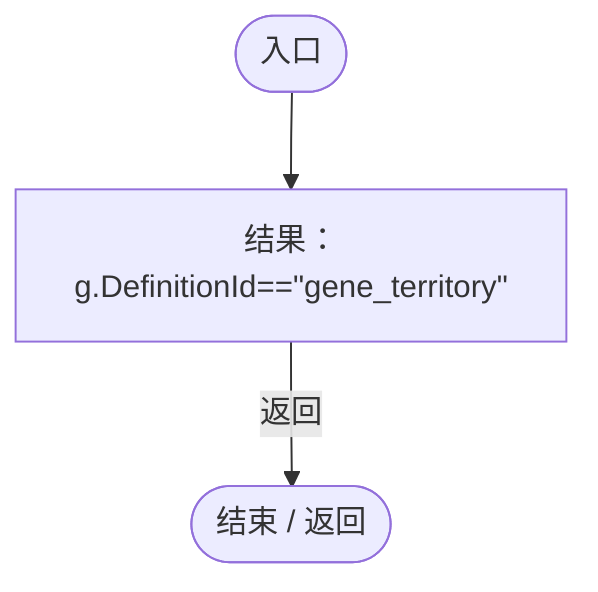

<a id="md96de64386622aa7"></a>

## 回调@94 · L94

`g … => 回调`


### Editor · Roslyn编译器控制流

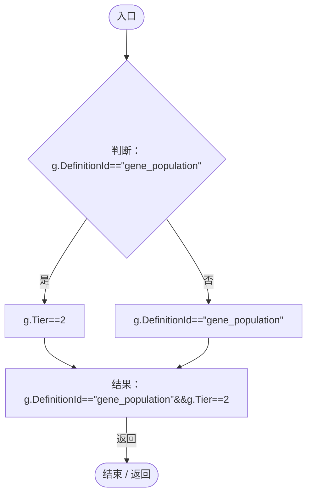

<a id="mda63952cd0b65db4"></a>

## 回调@133 · L133

`e … => 回调`


### Editor · Roslyn编译器控制流

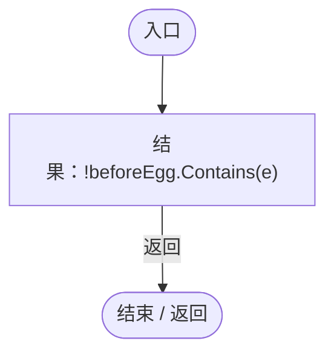

<a id="m8caba7cca8644ded"></a>

## 回调@150 · L150

`r … => 回调`


### Editor · Roslyn编译器控制流

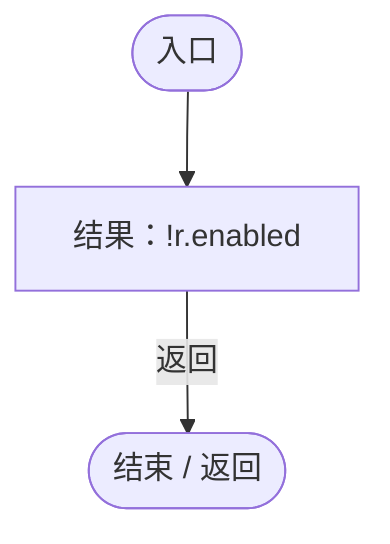

<a id="m99e1600e1f1ad9dd"></a>

## 回调@150 · L150

`r … => 回调`


### Editor · Roslyn编译器控制流

```mermaid
flowchart TD
  b0(["入口"])
  b1["结果：r.enabled"]
  b2(["结束 / 返回"])
  b0 --> b1
  b1 -->|"返回"| b2

```

<a id="m88557cd56e73aca7"></a>

## 回调@151 · L151

`p … => 回调`


### Editor · Roslyn编译器控制流

```mermaid
flowchart TD
  b0(["入口"])
  b1["new SavedGeneDefinition{id=p.Key,json=p.Value}<br/>id=p.Key<br/>json=p.Value<br/>结果：new SavedGeneDefinition{id=p.Key,json=p.Value}"]
  b2(["结束 / 返回"])
  b0 --> b1
  b1 -->|"返回"| b2

```

<a id="mb4359f76e6bc2792"></a>

## 回调@153 · L153

`e … => 回调`


### Editor · Roslyn编译器控制流

```mermaid
flowchart TD
  b0(["入口"])
  b1["结果：e.ecology!=null"]
  b2(["结束 / 返回"])
  b0 --> b1
  b1 -->|"返回"| b2

```

<a id="me434a8a5c6a98a21"></a>

## 回调@156 · L156

`e … => 回调`


### Editor · Roslyn编译器控制流

```mermaid
flowchart TD
  b0(["入口"])
  b1["结果：e.ecology==null"]
  b2(["结束 / 返回"])
  b0 --> b1
  b1 -->|"返回"| b2

```

<a id="mf7d917b51de7538c"></a>

## 回调@158 · L158

`( … => 回调`


### Editor · Roslyn编译器控制流

```mermaid
flowchart TD
  b0(["入口"])
  b1{"判断：type==LogType.Exception"}
  b2{"判断：type==LogType.Error"}
  b3{"判断：type==LogType.Assert"}
  b4["runtimeErrors.Add(message);"]
  b5(["结束 / 返回"])
  b0 --> b1
  b1 -->|"否"| b2
  b1 -->|"是"| b4
  b2 -->|"否"| b3
  b2 -->|"是"| b4
  b3 -->|"是"| b4
  b3 -->|"否"| b5
  b4 --> b5

```
