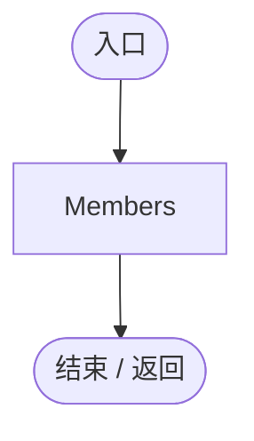
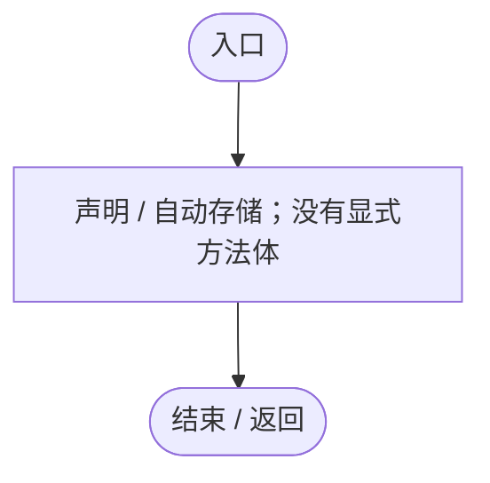
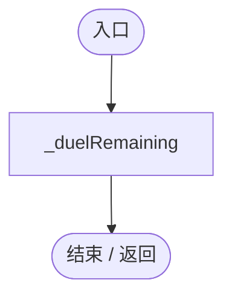
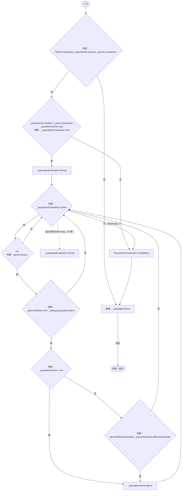
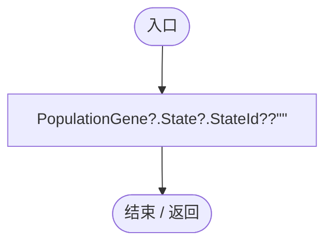
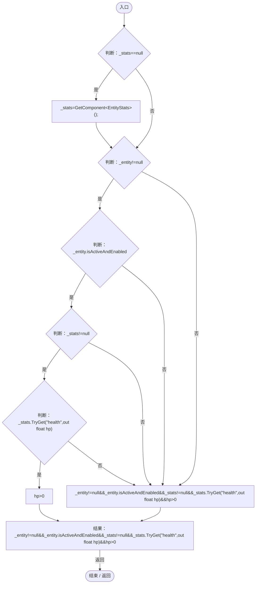

```mermaid
flowchart TD
  n2(["入口"])
  n1["PopulationGene!=null&amp;&amp;Alive&amp;&amp; (OptionalComponent.Read&lt;EggIncubation&gt;(this)?.Incubating!=true&#124;&#124; Mode==_settings.antState&amp;&amp;!string.IsNullOrEmpty(GroupId)&amp;&amp;OptionalComponent.Read&lt;AntColonyMember&gt;(this)?.Role is AntRole role&amp;&amp;role!=AntRole.N…"]
  n0(["结束 / 返回"])
  n1 --> n0
  n2 --> n1

```

# PopulationBehavior.cs

[返回总索引](../README.md) · `Runtime` · `Assets/DarwinPark/Entities/Ecology/PopulationBehavior.cs`

[源文件](../../../Assets/DarwinPark/Entities/Ecology/PopulationBehavior.cs) · 源码校验：`dd2476ce7a916b4b666dbc6c64dd1754659c0c3609b3962aed00e7cb88ca45a3`

方法按源文件位置排列。事件/回调引用不表示立即执行；分支与异常说明见总索引。完整源码与可点击关系图请打开离线手册。

<a id="mc26a81b9b5349532"></a>

## RegisteredMembers.get · L18

`internal static IReadOnlyList<PopulationBehavior> RegisteredMembers`


### Editor / Player · 语法控制结构 / 声明（非CFG）



<a id="me471d0106be463ca"></a>

## GroupId.get · L22

`get`


### Editor / Player · 语法控制结构 / 声明（非CFG）


<a id="mfd1aa9d04da3a323"></a>

## GroupId.set · L22

`private set`


### Editor / Player · 语法控制结构 / 声明（非CFG）


<a id="m3a083590c84efb2c"></a>

## JoinOrder.get · L23

`get`


### Editor / Player · 语法控制结构 / 声明（非CFG）


<a id="mbeb73b403f6da6e3"></a>

## JoinOrder.set · L23

`private set`


### Editor / Player · 语法控制结构 / 声明（非CFG）


<a id="m2972bf9eaa193643"></a>

## LeaderFlag.get · L24

`get`


### Editor / Player · 语法控制结构 / 声明（非CFG）


<a id="m4ac6646026eeede8"></a>

## LeaderFlag.set · L24

`private set`


### Editor / Player · 语法控制结构 / 声明（非CFG）



<a id="m9d9e3eebbb011253"></a>

## Command.get · L25

`get`


### Editor / Player · 语法控制结构 / 声明（非CFG）


<a id="m439f30769b491fee"></a>

## Command.set · L25

`private set`


### Editor / Player · 语法控制结构 / 声明（非CFG）


<a id="m9a62f39175293942"></a>

## CommandRemaining.get · L26

`get`


### Editor / Player · 语法控制结构 / 声明（非CFG）


<a id="mc23a46d7ac67a228"></a>

## CommandRemaining.set · L26

`private set`


### Editor / Player · 语法控制结构 / 声明（非CFG）


<a id="ma729870d83902751"></a>

## CommandPointLocal.get · L27

`get`


### Editor / Player · 语法控制结构 / 声明（非CFG）


<a id="m927e53ce86e8293f"></a>

## CommandPointLocal.set · L27

`private set`


### Editor / Player · 语法控制结构 / 声明（非CFG）


<a id="m08021e2a2a15f867"></a>

## Target.get · L28

`get`


### Editor / Player · 语法控制结构 / 声明（非CFG）


<a id="me9e95ca5055e2bca"></a>

## Target.set · L28

`private set`


### Editor / Player · 语法控制结构 / 声明（非CFG）


<a id="m264282c5c0b6cedd"></a>

## DuelRemaining.get · L29

`public float DuelRemaining`


### Editor / Player · 语法控制结构 / 声明（非CFG）



<a id="m8bce35833bed13cb"></a>

## PopulationGene.get · L35

`get`


### Editor / Player · Roslyn编译器控制流



项目内调用/回调引用：

- [EntityGeneController.Evaluation.get · L20](7494d53178552f0e.md#mf275f100ea21601a)（访问器）
- [PopulationGroupIndex.Invalidate · L21](6bb343d8be5beae5.md#m6301560c15e5621a)（方法）

<a id="m0063ba2d95ba5fd3"></a>

## Mode.get · L48

`public string Mode`


### Editor / Player · 语法控制结构 / 声明（非CFG）



项目内调用/回调引用：

- [PopulationBehavior.PopulationGene.get · L35](21e4f62f75a9a80f.md#m8bce35833bed13cb)（访问器）

<a id="m773fae8f4302731c"></a>

## Alive.get · L50

`get`


### Editor / Player · Roslyn编译器控制流



项目内调用/回调引用：

- [EntityStats.TryGet · L93](75aa86a368efdf24.md#m03cef847022eee28)（方法）

<a id="mcd01bf813ec9a0cd"></a>

## Active.get · L51

`public bool Active`


### Editor / Player · 语法控制结构 / 声明（非CFG）



项目内调用/回调引用：

- [PopulationBehavior.PopulationGene.get · L35](21e4f62f75a9a80f.md#m8bce35833bed13cb)（访问器）
- [PopulationBehavior.Alive.get · L50](21e4f62f75a9a80f.md#m773fae8f4302731c)（访问器）
- [OptionalComponent.Read · L7](806c46b42ced4d36.md#m69622a4dee165c5a)（方法）
- [PopulationBehavior.GroupId.get · L22](21e4f62f75a9a80f.md#me471d0106be463ca)（访问器）
- [AntColonyMember.Role.get · L40](baebd85c05598377.md#m382545c3d4092bf1)（访问器）

<a id="m10716093f8a78656"></a>

## Leader.get · L55

`public PopulationBehavior Leader`

★ 适配：蚁群领袖由王后分工确定，狼群仍沿用原有决斗与加入顺序。

### Editor / Player · 语法控制结构 / 声明（非CFG）

```mermaid
flowchart TD
  n2(["入口"])
  n1["PopulationGroupIndex.Leader(this)"]
  n0(["结束 / 返回"])
  n1 --> n0
  n2 --> n1

```

项目内调用/回调引用：

- [PopulationGroupIndex.Leader · L54](6bb343d8be5beae5.md#m5b7030bbfdbc610e)（方法）

<a id="m3ee78c8eaf285f95"></a>

## IsLeader.get · L56

`public bool IsLeader`


### Editor / Player · 语法控制结构 / 声明（非CFG）

```mermaid
flowchart TD
  n2(["入口"])
  n1["Active&amp;&amp;Leader==this"]
  n0(["结束 / 返回"])
  n1 --> n0
  n2 --> n1

```

<a id="m39b4c0f2012a003b"></a>

## GroupMembers.get · L57

`public IEnumerable<PopulationBehavior> GroupMembers`


### Editor / Player · 语法控制结构 / 声明（非CFG）

```mermaid
flowchart TD
  n2(["入口"])
  n1["PopulationGroupIndex.Members(this)"]
  n0(["结束 / 返回"])
  n1 --> n0
  n2 --> n1

```

项目内调用/回调引用：

- [PopulationGroupIndex.Members · L40](6bb343d8be5beae5.md#m854fb2ce08b0f47f)（方法）

<a id="m9f14e98697f1c8d7"></a>

## MemberCount.get · L58

`public int MemberCount`


### Editor / Player · 语法控制结构 / 声明（非CFG）

```mermaid
flowchart TD
  n2(["入口"])
  n1["GroupMembers.Count()"]
  n0(["结束 / 返回"])
  n1 --> n0
  n2 --> n1

```

<a id="me76bfa919ab8d511"></a>

## Aura.get · L59

`public float Aura`


### Editor / Player · 语法控制结构 / 声明（非CFG）

```mermaid
flowchart TD
  n2(["入口"])
  n1["Mathf.Max(_settings.arrivalDistance,_genes.GetAttribute(&quot;leadership_aura&quot;))"]
  n0(["结束 / 返回"])
  n1 --> n0
  n2 --> n1

```

项目内调用/回调引用：

- [EntityGeneController.GetAttribute · L288](7494d53178552f0e.md#m45127bcdd833aaf5)（方法）

<a id="m73f6bf6427752c37"></a>

## InAura.get · L60

`public bool InAura`


### Editor / Player · 语法控制结构 / 声明（非CFG）

```mermaid
flowchart TD
  n2(["入口"])
  n1["Leader is PopulationBehavior leader&amp;&amp;EcologyQueries.Distance(transform.position,leader.transform.position)&lt;=leader.Aura"]
  n0(["结束 / 返回"])
  n1 --> n0
  n2 --> n1

```

项目内调用/回调引用：

- [EcologyQueries.Distance · L43](bdf7ccc2c9c0452f.md#m6e395dce655ebcac)（方法）

<a id="mc976f7b89b8b5827"></a>

## MoveMultiplier.get · L61

`public float MoveMultiplier`


### Editor / Player · 语法控制结构 / 声明（非CFG）

```mermaid
flowchart TD
  n2(["入口"])
  n1["!Active?1:Mode==_settings.antState?_settings.antBodyMultiplier*(InAura?1+_settings.antSpeedBonus*_genes.GetAttribute(&quot;coordination&quot;):1):1"]
  n0(["结束 / 返回"])
  n1 --> n0
  n2 --> n1

```

项目内调用/回调引用：

- [EntityGeneController.GetAttribute · L288](7494d53178552f0e.md#m45127bcdd833aaf5)（方法）

<a id="mb4e81f8c8f5bc8cf"></a>

## AttackMultiplier.get · L64

`get`


### Editor / Player · Roslyn编译器控制流

```mermaid
flowchart TD
  b0(["入口"])
  b1{"判断：Active"}
  b2["结果：1"]
  b3{"判断：Mode==_settings.antState"}
  b4["结果：_settings.antBodyMultiplier"]
  b5{"判断：InAura"}
  b6["结果：1"]
  b7["helpers=Mathf.Min(_settings.maximumCoordinators,GroupMembers.Count(m=&gt;m!=this&amp;&amp;EcologyQueries.Distance(transform.position,m.transform.position)&lt;=Aura))<br/>结果：1+_settings.wolfAttackBonus*_genes.GetAttribute(&quot;coordination&quot;)*helpers"]
  b8(["结束 / 返回"])
  b0 --> b1
  b1 -->|"否"| b2
  b1 -->|"是"| b3
  b2 -->|"返回"| b8
  b3 -->|"是"| b4
  b3 -->|"否"| b5
  b4 -->|"返回"| b8
  b5 -->|"否"| b6
  b5 -->|"是"| b7
  b6 -->|"返回"| b8
  b7 -->|"返回"| b8

```

项目内调用/回调引用：

- [EntityGeneController.GetAttribute · L288](7494d53178552f0e.md#m45127bcdd833aaf5)（方法）
- [PopulationBehavior.回调@68 · L68](21e4f62f75a9a80f.md#meecb5f970db285e4)（回调/委托）

<a id="meecb5f970db285e4"></a>

## 回调@68 · L68

`m … => 回调`


### Editor / Player · Roslyn编译器控制流

```mermaid
flowchart TD
  b0(["入口"])
  b1{"判断：m!=this"}
  b2["EcologyQueries.Distance(transform.position,m.transform.position)&lt;=Aura"]
  b3["m!=this"]
  b4["结果：m!=this&amp;&amp;EcologyQueries.Distance(transform.position,m.transform.position)&lt;=Aura"]
  b5(["结束 / 返回"])
  b0 --> b1
  b1 -->|"是"| b2
  b1 -->|"否"| b3
  b2 --> b4
  b3 --> b4
  b4 -->|"返回"| b5

```

项目内调用/回调引用：

- [EcologyQueries.Distance · L43](bdf7ccc2c9c0452f.md#m6e395dce655ebcac)（方法）

<a id="mf905723c3c55e958"></a>

## Awake · L72

`private void Awake()`


### Editor / Player · Roslyn编译器控制流

```mermaid
flowchart TD
  b0(["入口"])
  b1["_genes=GetComponent&lt;EntityGeneController&gt;();<br/>_entity=GetComponent&lt;DarwinEntity&gt;();<br/>_settings=EcologySettings.Load();<br/>EcologyIdentity.Ensure(gameObject);<br/>_genes.OnEvaluationChanged+=OnGenesChanged;"]
  b2(["结束 / 返回"])
  b0 --> b1
  b1 --> b2

```

项目内调用/回调引用：

- [EcologySettings.Load · L18](90428a275d065ef6.md#mb0575490373edaf2)（方法）
- [EcologyIdentity.Ensure · L23](bdf7ccc2c9c0452f.md#m8adfd15f583f225a)（方法）
- [PopulationBehavior.OnGenesChanged · L74](21e4f62f75a9a80f.md#m5819390bcfb4ec25)（方法）

<a id="m5819390bcfb4ec25"></a>

## OnGenesChanged · L74

`private void OnGenesChanged(Genetics.GenomeEvaluation evaluation)`

★ 修复（防Bug回归）：表达变更必须立即使关系缓存失效，不能等下一帧才移除同帧禁用/变为其他模式的成员。

### Editor / Player · Roslyn编译器控制流

```mermaid
flowchart TD
  b0(["入口"])
  b1["_populationEvaluation=null;<br/>_populationGene=null;<br/>PopulationGroupIndex.Invalidate();"]
  b2(["结束 / 返回"])
  b0 --> b1
  b1 --> b2

```

项目内调用/回调引用：

- [PopulationGroupIndex.Invalidate · L21](6bb343d8be5beae5.md#m6301560c15e5621a)（方法）

<a id="mea8fbe12a9219f74"></a>

## OnDestroy · L75

`private void OnDestroy()`


### Editor / Player · Roslyn编译器控制流

```mermaid
flowchart TD
  b0(["入口"])
  b1{"判断：_genes!=null"}
  b2["_genes.OnEvaluationChanged-=OnGenesChanged;"]
  b3(["结束 / 返回"])
  b0 --> b1
  b1 -->|"是"| b2
  b1 -->|"否"| b3
  b2 --> b3

```

项目内调用/回调引用：

- [PopulationBehavior.OnGenesChanged · L74](21e4f62f75a9a80f.md#m5819390bcfb4ec25)（方法）

<a id="md0bfaf4919915bc9"></a>

## OnDisable · L76

`private void OnDisable()`


### Editor / Player · Roslyn编译器控制流

```mermaid
flowchart TD
  b0(["入口"])
  b1["Members.Remove(this);<br/>PopulationGroupIndex.Invalidate();"]
  b2(["结束 / 返回"])
  b0 --> b1
  b1 --> b2

```

项目内调用/回调引用：

- [PopulationGroupIndex.Invalidate · L21](6bb343d8be5beae5.md#m6301560c15e5621a)（方法）

<a id="m6d245f6a08f01d92"></a>

## Reset · L77

`[RuntimeInitializeOnLoadMethod(RuntimeInitializeLoadType.SubsystemRegistration)] private static void Reset()`


### Editor / Player · Roslyn编译器控制流

```mermaid
flowchart TD
  b0(["入口"])
  b1["Members.Clear();<br/>_serial=0;"]
  b2(["结束 / 返回"])
  b0 --> b1
  b1 --> b2

```

<a id="mde5ddd86ffa457f7"></a>

## Update · L79

`private void Update()`


### Editor / Player · Roslyn编译器控制流

```mermaid
flowchart TD
  b0(["入口"])
  b1{"Advance<br/>判断：ServiceLocator.TryGet&lt;SimulationClock&gt;(out var clock)"}
  b2["clock.GameDeltaTime"]
  b3["Time.deltaTime"]
  b4["Advance(ServiceLocator.TryGet&lt;SimulationClock&gt;(out var clock)?clock.GameDeltaTime:Time.deltaTime);"]
  b5(["结束 / 返回"])
  b0 --> b1
  b1 -->|"是"| b2
  b1 -->|"否"| b3
  b2 --> b4
  b3 --> b4
  b4 --> b5

```

项目内调用/回调引用：

- [PopulationBehavior.Advance · L80](21e4f62f75a9a80f.md#me39b116bdf3429fc)（方法）
- [ServiceLocator.TryGet · L26](f2fdbe9f9ccd93cb.md#m143b24e6d58471b0)（方法）
- [SimulationClock.GameDeltaTime.get · L26](a8f444aec9614b0a.md#me7f11abae18a4f2d)（访问器）

<a id="me39b116bdf3429fc"></a>

## Advance · L80

`public void Advance(float dt)`


### Editor / Player · Roslyn编译器控制流

```mermaid
flowchart TD
  b0(["入口"])
  b1["performance=DarwinPark.Core.PerformanceTimings.Measure(DarwinPark.Core.PerformanceTimings.Area.Population)"]
  b2{"判断：WorldAuthority.IsReplica"}
  b3{"判断：Active"}
  b4{"OptionalComponent.Read&lt;AntColonyMember&gt;(this)<br/>判断：OptionalComponent.Read&lt;AntColonyMember&gt;(this)"}
  b5["OptionalComponent.Read&lt;AntColonyMember&gt;(this)?.Suspend();"]
  b6{"判断：Members.Remove(this)"}
  b7{"判断：string.IsNullOrEmpty(GroupId)"}
  b8["PopulationGroupIndex.Invalidate();"]
  b9["GroupId=&quot;&quot;;<br/>LeaderFlag=false;<br/>Command=PopulationCommand.None;"]
  b10{"判断：dt&lt;=0"}
  b11{"判断：_mode!=null"}
  b12{"判断：_mode!=Mode"}
  b13["GroupId"]
  b14["null"]
  b15["previousGroup=_mode!=null&amp;&amp;_mode!=Mode?GroupId:null"]
  b16{"判断：_mode!=null"}
  b17{"判断：_mode!=Mode"}
  b18{"OptionalComponent.Read&lt;AntColonyMember&gt;(this)<br/>判断：OptionalComponent.Read&lt;AntColonyMember&gt;(this)"}
  b19["OptionalComponent.Read&lt;AntColonyMember&gt;(this)?.Suspend();"]
  b20["Members.Remove(this);<br/>PopulationGroupIndex.Invalidate();<br/>GroupId=&quot;&quot;;<br/>LeaderFlag=false;<br/>Command=PopulationCommand.None;"]
  b21{"_mode=Mode;<br/>EnsureMembership();<br/>判断：string.IsNullOrEmpty(previousGroup)"}
  b22{"判断：previousGroup!=GroupId"}
  b23{"判断：LeaderFlag"}
  b24["PopulationArchive.RecordFounding(previousGroup,GroupId,Mode,_entity.DisplayName,&quot;种群状态变化形成新种群&quot;);"]
  b25{"OptionalComponent.Read&lt;EggIncubation&gt;(this)<br/>判断：OptionalComponent.Read&lt;EggIncubation&gt;(this)"}
  b26[".Incubating"]
  b27["OptionalComponent.Read&lt;EggIncubation&gt;(this)"]
  b28{"判断：OptionalComponent.Read&lt;EggIncubation&gt;(this)?.Incubating==true"}
  b29{"判断：Mode==_settings.antState"}
  b30["AntColonyMember.Ensure(this).Advance(dt);"]
  b31{"_duelRemaining=Mathf.Max(0,_duelRemaining-dt);<br/>_manualRemaining=Mathf.Max(0,_manualRemaining-dt);<br/>CommandRemaining=Mathf.Max(0,CommandRemaining-dt);<br/>判断：CommandRemaining&lt;=0"}
  b32{"判断：Command==PopulationCommand.Hunt"}
  b33{"判断：EcologyQueries.Alive(Target)"}
  b34{"判断：SameGroup(Target)"}
  b35["Command=PopulationCommand.None;<br/>Target=null;"]
  b36{"leader=Leader<br/>判断：leader!=null"}
  b37{"判断：leader.LeaderFlag"}
  b38["leader.LeaderFlag=true;"]
  b39{"判断：IsLeader"}
  b40{"判断：leader!=null"}
  b41{"判断：_duelRemaining&lt;=0"}
  b42{"判断：leader._duelRemaining&lt;=0"}
  b43{"判断：EcologyQueries.Distance(transform.position,leader.transform.position)&lt;=_settings.arrivalDistance"}
  b44{"判断：Score()&gt;leader.Score()*_settings.duelAdvantage"}
  b45["ChallengeLeadership(out _);"]
  b46{"_scan-=dt;<br/>判断：IsLeader"}
  b47{"判断：_scan&lt;=0"}
  b48{"判断：_manualRemaining&lt;=0"}
  b49["_scan=_settings.scanInterval;<br/>AutoCommand();"]
  b50{"判断：Mode==_settings.antState"}
  b51{"判断：Command==PopulationCommand.Gather"}
  b52{"判断：EcologyQueries.Distance(transform.position,EcologyQueries.ToWorld(CommandPointLocal))&lt;=_settings.arrivalDistance"}
  b53{"判断：Planet.PlanetOreSystem.Instance!=null"}
  b54{"判断：InAura"}
  b55["1+_settings.antGatherBonus"]
  b56["1"]
  b57["auraBonus=InAura?1+_settings.antGatherBonus:1"]
  b58["extracted=Planet.PlanetOreSystem.Instance.ConsumeOre(transform.position,_settings.antGatherRate*Mathf.Max(0,_genes.GetAttribute(&quot;coordination&quot;))*auraBonus*dt)<br/>_entity.GetComponent&lt;EntityStats&gt;().Feed(extracted);"]
  b59["performance=DarwinPark.Core.PerformanceTimings.Measure(DarwinPark.Core.PerformanceTimings.Area.Population)"]
  b60(["结束 / 返回"])
  b0 --> b1
  b1 --> b2
  b2 -->|"是 · 经过finally 59"| b60
  b2 -->|"否"| b3
  b3 -->|"否"| b4
  b3 -->|"是"| b10
  b4 -->|"否"| b5
  b4 -->|"是"| b6
  b5 --> b6
  b6 -->|"否"| b7
  b6 -->|"是"| b8
  b7 -->|"否"| b8
  b7 -->|"是"| b9
  b8 --> b9
  b9 -->|"经过finally 59"| b60
  b10 -->|"是 · 经过finally 59"| b60
  b10 -->|"否"| b11
  b11 -->|"是"| b12
  b11 -->|"否"| b14
  b12 -->|"是"| b13
  b12 -->|"否"| b14
  b13 --> b15
  b14 --> b15
  b15 --> b16
  b16 -->|"是"| b17
  b16 -->|"否"| b21
  b17 -->|"是"| b18
  b17 -->|"否"| b21
  b18 -->|"否"| b19
  b18 -->|"是"| b20
  b19 --> b20
  b20 --> b21
  b21 -->|"否"| b22
  b21 -->|"是"| b25
  b22 -->|"是"| b23
  b22 -->|"否"| b25
  b23 -->|"是"| b24
  b23 -->|"否"| b25
  b24 --> b25
  b25 -->|"否"| b26
  b25 -->|"是"| b27
  b26 --> b28
  b27 --> b28
  b28 -->|"是 · 经过finally 59"| b60
  b28 -->|"否"| b29
  b29 -->|"是"| b30
  b29 -->|"否"| b31
  b30 -->|"经过finally 59"| b60
  b31 -->|"否"| b32
  b31 -->|"是"| b35
  b32 -->|"是"| b33
  b32 -->|"否"| b36
  b33 -->|"是"| b34
  b33 -->|"否"| b35
  b34 -->|"是"| b35
  b34 -->|"否"| b36
  b35 --> b36
  b36 -->|"是"| b37
  b36 -->|"否"| b39
  b37 -->|"否"| b38
  b37 -->|"是"| b39
  b38 --> b39
  b39 -->|"否"| b40
  b39 -->|"是"| b46
  b40 -->|"是"| b41
  b40 -->|"否"| b46
  b41 -->|"是"| b42
  b41 -->|"否"| b46
  b42 -->|"是"| b43
  b42 -->|"否"| b46
  b43 -->|"是"| b44
  b43 -->|"否"| b46
  b44 -->|"是"| b45
  b44 -->|"否"| b46
  b45 --> b46
  b46 -->|"是"| b47
  b46 -->|"否"| b50
  b47 -->|"是"| b48
  b47 -->|"否"| b50
  b48 -->|"是"| b49
  b48 -->|"否"| b50
  b49 --> b50
  b50 -->|"是"| b51
  b50 -->|"否 · 经过finally 59"| b60
  b51 -->|"是"| b52
  b51 -->|"否 · 经过finally 59"| b60
  b52 -->|"是"| b53
  b52 -->|"否 · 经过finally 59"| b60
  b53 -->|"是"| b54
  b53 -->|"否 · 经过finally 59"| b60
  b54 -->|"是"| b55
  b54 -->|"否"| b56
  b55 --> b57
  b56 --> b57
  b57 --> b58
  b58 -->|"经过finally 59"| b60
  b2 -. "退出保护区时 finally（示意）" .-> b59

```

项目内调用/回调引用：

- [PerformanceTimings.Measure · L25](a8403a4c7503726d.md#m36fde3c234084192)（方法）
- [OptionalComponent.Read · L7](806c46b42ced4d36.md#m69622a4dee165c5a)（方法）
- [AntColonyMember.Suspend · L208](baebd85c05598377.md#mcc19d94d7af0d641)（方法）
- [PopulationBehavior.GroupId.get · L22](21e4f62f75a9a80f.md#me471d0106be463ca)（访问器）
- [PopulationGroupIndex.Invalidate · L21](6bb343d8be5beae5.md#m6301560c15e5621a)（方法）
- [PopulationBehavior.GroupId.set · L22](21e4f62f75a9a80f.md#mfd1aa9d04da3a323)（访问器）
- [PopulationBehavior.LeaderFlag.set · L24](21e4f62f75a9a80f.md#m4ac6646026eeede8)（访问器）
- [PopulationBehavior.Command.set · L25](21e4f62f75a9a80f.md#m439f30769b491fee)（访问器）
- [PopulationBehavior.EnsureMembership · L111](21e4f62f75a9a80f.md#m0aafd394c2ef20b7)（方法）
- [PopulationBehavior.LeaderFlag.get · L24](21e4f62f75a9a80f.md#m2972bf9eaa193643)（访问器）
- [PopulationArchive.RecordFounding · L61](084e119b69cdd751.md#m4f038dbcbee72807)（方法）
- [AntColonyMember.Advance · L91](baebd85c05598377.md#m790b5145678d0ed5)（方法）
- [AntColonyMember.Ensure · L61](baebd85c05598377.md#m4e1194d3f46affcd)（方法）
- [PopulationBehavior.CommandRemaining.set · L26](21e4f62f75a9a80f.md#mc23a46d7ac67a228)（访问器）
- [PopulationBehavior.CommandRemaining.get · L26](21e4f62f75a9a80f.md#m9a62f39175293942)（访问器）
- [PopulationBehavior.Command.get · L25](21e4f62f75a9a80f.md#m9d9e3eebbb011253)（访问器）
- [EcologyQueries.Alive · L39](bdf7ccc2c9c0452f.md#m8352bfacbe2996a8)（方法）
- [PopulationBehavior.Target.get · L28](21e4f62f75a9a80f.md#m08021e2a2a15f867)（访问器）
- [PopulationBehavior.SameGroup · L127](21e4f62f75a9a80f.md#m4af6332162bb0355)（方法）
- [PopulationBehavior.Target.set · L28](21e4f62f75a9a80f.md#me9e95ca5055e2bca)（访问器）
- [EcologyQueries.Distance · L43](bdf7ccc2c9c0452f.md#m6e395dce655ebcac)（方法）
- [PopulationBehavior.Score · L128](21e4f62f75a9a80f.md#m317d9576a8bc19db)（方法）
- [PopulationBehavior.ChallengeLeadership · L129](21e4f62f75a9a80f.md#m83e7d4438bcdb891)（方法）
- [PopulationBehavior.AutoCommand · L155](21e4f62f75a9a80f.md#m9426b425745923e1)（方法）
- [EcologyQueries.ToWorld · L41](bdf7ccc2c9c0452f.md#mc67423f4877c3534)（方法）
- [PopulationBehavior.CommandPointLocal.get · L27](21e4f62f75a9a80f.md#ma729870d83902751)（访问器）
- [PlanetOreSystem.Instance.get · L8](86b3fbb4d9436121.md#m53f6a6af4b6dc252)（访问器）
- [PlanetOreSystem.ConsumeOre · L143](86b3fbb4d9436121.md#m3ea9baf2479d16a6)（方法）
- [EntityGeneController.GetAttribute · L288](7494d53178552f0e.md#m45127bcdd833aaf5)（方法）
- [EntityStats.Feed · L98](75aa86a368efdf24.md#me8ee3fa22434267a)（方法）

<a id="m0aafd394c2ef20b7"></a>

## EnsureMembership · L111

`public void EnsureMembership()`


### Editor / Player · Roslyn编译器控制流

```mermaid
flowchart TD
  b0(["入口"])
  b1{"判断：Active"}
  b2{"判断：string.IsNullOrEmpty(GroupId)"}
  b3["neighbor=Members.Where(m=&gt;m!=null&amp;&amp;m!=this&amp;&amp;m.Active&amp;&amp;m.Mode==Mode&amp;&amp;EcologyQueries.Distance(transform.position,m.transform.position)&lt;=_settings.joinRadius) .OrderBy(m=&gt;m.JoinOrder).FirstOrDefault()"]
  b4["GroupId"]
  b5{"neighbor<br/>判断：neighbor"}
  b6[".GroupId"]
  b7["neighbor"]
  b8{"判断：neighbor?.GroupId"}
  b9["neighbor?.GroupId"]
  b10["Guid.NewGuid().ToString(&quot;N&quot;)"]
  b11["GroupId=neighbor?.GroupId??Guid.NewGuid().ToString(&quot;N&quot;);"]
  b12{"JoinOrder=++_serial;<br/>LeaderFlag=neighbor==null;<br/>判断：neighbor==null"}
  b13{"判断：WorldRuntimeGate.Ready"}
  b14{"判断：WorldRuntimeGate.Loading"}
  b15{"判断：WorldAuthority.IsReplica"}
  b16["PopulationArchive.Register(GroupId,Mode,_entity.DisplayName,true);"]
  b17{"_serial=Math.Max(_serial,JoinOrder);<br/>判断：Members.Contains(this)"}
  b18["Members.Add(this);<br/>PopulationGroupIndex.Invalidate();"]
  b19(["结束 / 返回"])
  b0 --> b1
  b1 -->|"否"| b19
  b1 -->|"是"| b2
  b2 -->|"是"| b3
  b2 -->|"否"| b17
  b3 --> b4
  b4 --> b5
  b5 -->|"否"| b6
  b5 -->|"是"| b7
  b6 --> b8
  b7 --> b8
  b8 -->|"否"| b9
  b8 -->|"是"| b10
  b9 --> b11
  b10 --> b11
  b11 --> b12
  b12 -->|"是"| b13
  b12 -->|"否"| b17
  b13 -->|"是"| b14
  b13 -->|"否"| b17
  b14 -->|"否"| b15
  b14 -->|"是"| b17
  b15 -->|"否"| b16
  b15 -->|"是"| b17
  b16 --> b17
  b17 -->|"否"| b18
  b17 -->|"是"| b19
  b18 --> b19

```

项目内调用/回调引用：

- [PopulationBehavior.GroupId.get · L22](21e4f62f75a9a80f.md#me471d0106be463ca)（访问器）
- [PopulationBehavior.GroupId.set · L22](21e4f62f75a9a80f.md#mfd1aa9d04da3a323)（访问器）
- [PopulationBehavior.JoinOrder.set · L23](21e4f62f75a9a80f.md#mbeb73b403f6da6e3)（访问器）
- [PopulationBehavior.LeaderFlag.set · L24](21e4f62f75a9a80f.md#m4ac6646026eeede8)（访问器）
- [PopulationArchive.Register · L51](084e119b69cdd751.md#meb0fdfbca01ac369)（方法）
- [PopulationBehavior.JoinOrder.get · L23](21e4f62f75a9a80f.md#m3a083590c84efb2c)（访问器）
- [PopulationGroupIndex.Invalidate · L21](6bb343d8be5beae5.md#m6301560c15e5621a)（方法）
- [PopulationBehavior.回调@116 · L116](21e4f62f75a9a80f.md#m4607c92acce86883)（回调/委托）
- [PopulationBehavior.回调@117 · L117](21e4f62f75a9a80f.md#m2a4a09f68c7371d9)（回调/委托）

<a id="m4607c92acce86883"></a>

## 回调@116 · L116

`m … => 回调`


### Editor / Player · Roslyn编译器控制流

```mermaid
flowchart TD
  b0(["入口"])
  b1{"判断：m!=null"}
  b2{"判断：m!=this"}
  b3{"判断：m.Active"}
  b4{"判断：m.Mode==Mode"}
  b5["EcologyQueries.Distance(transform.position,m.transform.position)&lt;=_settings.joinRadius"]
  b6["m!=null&amp;&amp;m!=this&amp;&amp;m.Active&amp;&amp;m.Mode==Mode&amp;&amp;EcologyQueries.Distance(transform.position,m.transform.position)&lt;=_settings.joinRadius"]
  b7["结果：m!=null&amp;&amp;m!=this&amp;&amp;m.Active&amp;&amp;m.Mode==Mode&amp;&amp;EcologyQueries.Distance(transform.position,m.transform.position)&lt;=_settings.joinRadius"]
  b8(["结束 / 返回"])
  b0 --> b1
  b1 -->|"是"| b2
  b1 -->|"否"| b6
  b2 -->|"是"| b3
  b2 -->|"否"| b6
  b3 -->|"是"| b4
  b3 -->|"否"| b6
  b4 -->|"是"| b5
  b4 -->|"否"| b6
  b5 --> b7
  b6 --> b7
  b7 -->|"返回"| b8

```

项目内调用/回调引用：

- [EcologyQueries.Distance · L43](bdf7ccc2c9c0452f.md#m6e395dce655ebcac)（方法）

<a id="m2a4a09f68c7371d9"></a>

## 回调@117 · L117

`m … => 回调`


### Editor / Player · Roslyn编译器控制流

```mermaid
flowchart TD
  b0(["入口"])
  b1["结果：m.JoinOrder"]
  b2(["结束 / 返回"])
  b0 --> b1
  b1 -->|"返回"| b2

```

项目内调用/回调引用：

- [PopulationBehavior.JoinOrder.get · L23](21e4f62f75a9a80f.md#m3a083590c84efb2c)（访问器）

<a id="m297b914a6ad9e13f"></a>

## JoinColony · L125

`public void JoinColony(string group,bool queen)`

★ 适配：出生继承和新王后建群通过此接口写入持久标识，不重新按距离随机入群。

### Editor / Player · Roslyn编译器控制流

```mermaid
flowchart TD
  b0(["入口"])
  b1["PopulationGroupIndex.Invalidate();<br/>GroupId=group;<br/>JoinOrder=++_serial;<br/>LeaderFlag=queen;<br/>Command=PopulationCommand.None;<br/>Target=null;<br/>CommandRemaining=0;<br/>EnsureMembership();"]
  b2(["结束 / 返回"])
  b0 --> b1
  b1 --> b2

```

项目内调用/回调引用：

- [PopulationGroupIndex.Invalidate · L21](6bb343d8be5beae5.md#m6301560c15e5621a)（方法）
- [PopulationBehavior.GroupId.set · L22](21e4f62f75a9a80f.md#mfd1aa9d04da3a323)（访问器）
- [PopulationBehavior.JoinOrder.set · L23](21e4f62f75a9a80f.md#mbeb73b403f6da6e3)（访问器）
- [PopulationBehavior.LeaderFlag.set · L24](21e4f62f75a9a80f.md#m4ac6646026eeede8)（访问器）
- [PopulationBehavior.Command.set · L25](21e4f62f75a9a80f.md#m439f30769b491fee)（访问器）
- [PopulationBehavior.Target.set · L28](21e4f62f75a9a80f.md#me9e95ca5055e2bca)（访问器）
- [PopulationBehavior.CommandRemaining.set · L26](21e4f62f75a9a80f.md#mc23a46d7ac67a228)（访问器）
- [PopulationBehavior.EnsureMembership · L111](21e4f62f75a9a80f.md#m0aafd394c2ef20b7)（方法）

<a id="m4af6332162bb0355"></a>

## SameGroup · L127

`public bool SameGroup(DarwinEntity other)`


### Editor / Player · Roslyn编译器控制流

```mermaid
flowchart TD
  b0(["入口"])
  b1{"判断：Active"}
  b2{"判断：other!=null"}
  b3{"判断：DarwinPark.Core.OptionalComponent.Read&lt;PopulationBehavior&gt;(other) is PopulationBehavior pop"}
  b4{"判断：pop.Active"}
  b5{"判断：pop.Mode==Mode"}
  b6{"判断：string.IsNullOrEmpty(GroupId)"}
  b7["pop.GroupId==GroupId"]
  b8["Active&amp;&amp;other!=null&amp;&amp;DarwinPark.Core.OptionalComponent.Read&lt;PopulationBehavior&gt;(other) is PopulationBehavior pop&amp;&amp;pop.Active&amp;&amp;pop.Mode==Mode&amp;&amp;!string.IsNullOrEmpty(GroupId)&amp;&amp;pop.GroupId==GroupId"]
  b9["结果：Active&amp;&amp;other!=null&amp;&amp;DarwinPark.Core.OptionalComponent.Read&lt;PopulationBehavior&gt;(other) is PopulationBehavior pop&amp;&amp;pop.Active&amp;&amp;pop.Mode==Mode&amp;&amp;!string.IsNullOrEmpty(GroupId)&amp;&amp;pop.GroupId==GroupId"]
  b10(["结束 / 返回"])
  b0 --> b1
  b1 -->|"是"| b2
  b1 -->|"否"| b8
  b2 -->|"是"| b3
  b2 -->|"否"| b8
  b3 -->|"是"| b4
  b3 -->|"否"| b8
  b4 -->|"是"| b5
  b4 -->|"否"| b8
  b5 -->|"是"| b6
  b5 -->|"否"| b8
  b6 -->|"否"| b7
  b6 -->|"是"| b8
  b7 --> b9
  b8 --> b9
  b9 -->|"返回"| b10

```

项目内调用/回调引用：

- [OptionalComponent.Read · L7](806c46b42ced4d36.md#m69622a4dee165c5a)（方法）
- [PopulationBehavior.GroupId.get · L22](21e4f62f75a9a80f.md#me471d0106be463ca)（访问器）

<a id="m317d9576a8bc19db"></a>

## Score · L128

`private float Score()`


### Editor / Player · Roslyn编译器控制流

```mermaid
flowchart TD
  b0(["入口"])
  b1["_entity.GetComponent&lt;EntityStats&gt;().TryGet(&quot;health&quot;,out var health);<br/>结果：_genes.GetAttribute(&quot;attack&quot;)+health*_settings.duelHealthWeight"]
  b2(["结束 / 返回"])
  b0 --> b1
  b1 -->|"返回"| b2

```

项目内调用/回调引用：

- [EntityStats.TryGet · L93](75aa86a368efdf24.md#m03cef847022eee28)（方法）
- [EntityGeneController.GetAttribute · L288](7494d53178552f0e.md#m45127bcdd833aaf5)（方法）

<a id="m83e7d4438bcdb891"></a>

## ChallengeLeadership · L129

`public bool ChallengeLeadership(out string message)`


### Editor / Player · Roslyn编译器控制流

```mermaid
flowchart TD
  b0(["入口"])
  b1{"判断：Mode==_settings.antState"}
  b2["message=&quot;蚁群王后不能被挑战&quot;;<br/>结果：false"]
  b3{"EnsureMembership();<br/>leader=Leader<br/>判断：Active"}
  b4{"判断：leader==null"}
  b5{"判断：leader==this"}
  b6["message=&quot;当前没有可挑战的领袖&quot;;<br/>结果：false"]
  b7{"判断：_duelRemaining&gt;0"}
  b8{"判断：leader._duelRemaining&gt;0"}
  b9["message=&quot;决斗仍在冷却&quot;;<br/>结果：false"]
  b10{"判断：EcologyQueries.Distance(transform.position,leader.transform.position)&gt;_settings.joinRadius"}
  b11["message=&quot;请先靠近领袖&quot;;<br/>结果：false"]
  b12{"_duelRemaining=leader._duelRemaining=_settings.duelCooldown;<br/>won=Score()&gt;leader.Score()*_settings.duelAdvantage<br/>判断：won"}
  b13["GroupMembers"]
  b14{"判断：GroupMembers"}
  b15["var<br/>member.LeaderFlag=false;"]
  b16{"判断：GroupMembers"}
  b17["GroupMembers"]
  b18["连接 / 离开区域"]
  b19["LeaderFlag=true;<br/>PopulationGroupIndex.Invalidate();"]
  b20{"message<br/>判断：won"}
  b21["&quot;决斗获胜，成为领袖&quot;"]
  b22["&quot;决斗失败，原领袖留任&quot;"]
  b23["message=won?&quot;决斗获胜，成为领袖&quot;:&quot;决斗失败，原领袖留任&quot;;"]
  b24["结果：won"]
  b25(["结束 / 返回"])
  b0 --> b1
  b1 -->|"是"| b2
  b1 -->|"否"| b3
  b2 -->|"返回"| b25
  b3 -->|"是"| b4
  b3 -->|"否"| b6
  b4 -->|"否"| b5
  b4 -->|"是"| b6
  b5 -->|"是"| b6
  b5 -->|"否"| b7
  b6 -->|"返回"| b25
  b7 -->|"否"| b8
  b7 -->|"是"| b9
  b8 -->|"是"| b9
  b8 -->|"否"| b10
  b9 -->|"返回"| b25
  b10 -->|"是"| b11
  b10 -->|"否"| b12
  b11 -->|"返回"| b25
  b12 -->|"是"| b13
  b12 -->|"否"| b20
  b13 --> b14
  b14 -->|"是"| b15
  b14 -->|"否 · 经过finally 16"| b19
  b15 --> b14
  b16 -->|"否"| b17
  b16 -->|"是"| b18
  b17 --> b18
  b19 --> b20
  b20 -->|"是"| b21
  b20 -->|"否"| b22
  b21 --> b23
  b22 --> b23
  b23 --> b24
  b24 -->|"返回"| b25
  b14 -. "退出保护区时 finally（示意）" .-> b16

```

项目内调用/回调引用：

- [PopulationBehavior.EnsureMembership · L111](21e4f62f75a9a80f.md#m0aafd394c2ef20b7)（方法）
- [EcologyQueries.Distance · L43](bdf7ccc2c9c0452f.md#m6e395dce655ebcac)（方法）
- [PopulationBehavior.Score · L128](21e4f62f75a9a80f.md#m317d9576a8bc19db)（方法）
- [PopulationBehavior.LeaderFlag.set · L24](21e4f62f75a9a80f.md#m4ac6646026eeede8)（访问器）
- [PopulationGroupIndex.Invalidate · L21](6bb343d8be5beae5.md#m6301560c15e5621a)（方法）

<a id="m075615992050fac0"></a>

## Issue · L142

`public bool Issue(PopulationCommand command,DarwinEntity target,Vector3 point,bool manual,out string message)`


### Editor / Player · Roslyn编译器控制流

```mermaid
flowchart TD
  b0(["入口"])
  b1{"EnsureMembership();<br/>判断：IsLeader"}
  b2["message=&quot;只有领袖可以下令&quot;;<br/>结果：false"]
  b3{"判断：command==PopulationCommand.Hunt"}
  b4{"判断：EcologyQueries.Alive(target)"}
  b5{"判断：SameGroup(target)"}
  b6{"判断：PredationSizePolicy.Allows(_genes,target)"}
  b7{"判断：EcologyQueries.Distance(transform.position,target.transform.position)&gt;_settings.maximumCommandRange"}
  b8["message=&quot;需要范围内的非同群存活猎物&quot;;<br/>结果：false"]
  b9["GroupMembers"]
  b10{"判断：GroupMembers"}
  b11["var<br/>member.Command=command;<br/>member.Target=target;<br/>member.CommandPointLocal=EcologyQueries.ToLocal(point);<br/>member.CommandRemaining=_settings.commandLifetime;"]
  b12{"member._manualRemaining<br/>判断：manual"}
  b13["_settings.commandLifetime"]
  b14["0"]
  b15["member._manualRemaining=manual?_settings.commandLifetime:0;"]
  b16{"判断：GroupMembers"}
  b17["GroupMembers"]
  b18["连接 / 离开区域"]
  b19["message=&quot;已下令：&quot;+CommandLabel(command);<br/>结果：true"]
  b20(["结束 / 返回"])
  b0 --> b1
  b1 -->|"否"| b2
  b1 -->|"是"| b3
  b2 -->|"返回"| b20
  b3 -->|"是"| b4
  b3 -->|"否"| b9
  b4 -->|"是"| b5
  b4 -->|"否"| b8
  b5 -->|"否"| b6
  b5 -->|"是"| b8
  b6 -->|"是"| b7
  b6 -->|"否"| b8
  b7 -->|"是"| b8
  b7 -->|"否"| b9
  b8 -->|"返回"| b20
  b9 --> b10
  b10 -->|"是"| b11
  b10 -->|"否 · 经过finally 16"| b19
  b11 --> b12
  b12 -->|"是"| b13
  b12 -->|"否"| b14
  b13 --> b15
  b14 --> b15
  b15 --> b10
  b16 -->|"否"| b17
  b16 -->|"是"| b18
  b17 --> b18
  b19 -->|"返回"| b20
  b10 -. "退出保护区时 finally（示意）" .-> b16

```

项目内调用/回调引用：

- [PopulationBehavior.EnsureMembership · L111](21e4f62f75a9a80f.md#m0aafd394c2ef20b7)（方法）
- [EcologyQueries.Alive · L39](bdf7ccc2c9c0452f.md#m8352bfacbe2996a8)（方法）
- [PopulationBehavior.SameGroup · L127](21e4f62f75a9a80f.md#m4af6332162bb0355)（方法）
- [PredationSizePolicy.Allows · L9](80ea865fb0f12053.md#m70764380d885d2d4)（方法）
- [EcologyQueries.Distance · L43](bdf7ccc2c9c0452f.md#m6e395dce655ebcac)（方法）
- [PopulationBehavior.Command.set · L25](21e4f62f75a9a80f.md#m439f30769b491fee)（访问器）
- [PopulationBehavior.Target.set · L28](21e4f62f75a9a80f.md#me9e95ca5055e2bca)（访问器）
- [PopulationBehavior.CommandPointLocal.set · L27](21e4f62f75a9a80f.md#m927e53ce86e8293f)（访问器）
- [EcologyQueries.ToLocal · L40](bdf7ccc2c9c0452f.md#mfa1ace432c73012a)（方法）
- [PopulationBehavior.CommandRemaining.set · L26](21e4f62f75a9a80f.md#mc23a46d7ac67a228)（访问器）
- [PopulationBehavior.CommandLabel · L214](21e4f62f75a9a80f.md#mcafdcc62475a87c3)（方法）

<a id="m9426b425745923e1"></a>

## AutoCommand · L155

`private void AutoCommand()`


### Editor / Player · Roslyn编译器控制流

```mermaid
flowchart TD
  b0(["入口"])
  b1{"判断：Mode==_settings.wolfState"}
  b2{"判断：NutritionTransfer.CanHuntForFood(_genes)"}
  b3{"prey=PerceivedTargets.Nearest(_genes,false,null,out var seen,true)<br/>判断：prey!=null"}
  b4["Issue(PopulationCommand.Hunt,prey,seen,false,out _);"]
  b5{"判断：Mode==_settings.antState"}
  b6{"判断：FindOre(out var ore)"}
  b7["Issue(PopulationCommand.Gather,null,ore,false,out _);"]
  b8["territory=DarwinPark.Core.OptionalComponent.Read&lt;TerritoryBehavior&gt;(this)"]
  b9{"Issue<br/>PopulationCommand.Rally<br/>null<br/>判断：territory!=null"}
  b10["territory.Center"]
  b11["transform.position"]
  b12["Issue(PopulationCommand.Rally,null,territory!=null?territory.Center:transform.position,false,out _);"]
  b13(["结束 / 返回"])
  b0 --> b1
  b1 -->|"是"| b2
  b1 -->|"否"| b5
  b2 -->|"是"| b3
  b2 -->|"否"| b5
  b3 -->|"是"| b4
  b3 -->|"否"| b5
  b4 --> b13
  b5 -->|"是"| b6
  b5 -->|"否"| b8
  b6 -->|"是"| b7
  b6 -->|"否"| b8
  b7 --> b13
  b8 --> b9
  b9 -->|"是"| b10
  b9 -->|"否"| b11
  b10 --> b12
  b11 --> b12
  b12 --> b13

```

项目内调用/回调引用：

- [NutritionTransfer.CanHuntForFood · L28](081d3b8ff683e442.md#m2cbdf5db3ea5d5c3)（方法）
- [PerceivedTargets.Nearest · L11](b78759d0d0a172e4.md#m0b32361294d1f689)（方法）
- [PopulationBehavior.Issue · L142](21e4f62f75a9a80f.md#m075615992050fac0)（方法）
- [PopulationBehavior.FindOre · L167](21e4f62f75a9a80f.md#mab3a4d2871f5e76c)（方法）
- [OptionalComponent.Read · L7](806c46b42ced4d36.md#m69622a4dee165c5a)（方法）

<a id="mab3a4d2871f5e76c"></a>

## FindOre · L167

`public bool FindOre(out Vector3 point)`


### Editor / Player · Roslyn编译器控制流

```mermaid
flowchart TD
  b0(["入口"])
  b1{"point=transform.position;<br/>ore=Planet.PlanetOreSystem.Instance<br/>判断：ore==null"}
  b2["结果：false"]
  b3{"best=ore.GetOreAmount(point)<br/>up=EcologyQueries.Up(point)<br/>axis=Vector3.Cross(up,Vector3.forward).normalized<br/>判断：axis.sqrMagnitude&lt;.5f"}
  b4["axis=Vector3.Cross(up,Vector3.right).normalized;"]
  b5["i=0"]
  b6{"判断：i&lt;_settings.oreSearchSamples"}
  b7{"candidate=EcologyQueries.Surface(transform.position+Quaternion.AngleAxis(i*137.50776f,up)*axis*Aura*Mathf.Sqrt((i+1f)/_settings.oreSearchSamples))<br/>value=ore.GetOreAmount(candidate)<br/>判断：value&gt;best"}
  b8["best=value;<br/>point=candidate;"]
  b9["i++"]
  b10["结果：best&gt;0"]
  b11(["结束 / 返回"])
  b0 --> b1
  b1 -->|"是"| b2
  b1 -->|"否"| b3
  b2 -->|"返回"| b11
  b3 -->|"是"| b4
  b3 -->|"否"| b5
  b4 --> b5
  b5 --> b6
  b6 -->|"是"| b7
  b6 -->|"否"| b10
  b7 -->|"是"| b8
  b7 -->|"否"| b9
  b8 --> b9
  b9 --> b6
  b10 -->|"返回"| b11

```

项目内调用/回调引用：

- [PlanetOreSystem.Instance.get · L8](86b3fbb4d9436121.md#m53f6a6af4b6dc252)（访问器）
- [PlanetOreSystem.GetOreAmount · L134](86b3fbb4d9436121.md#mc06b6a6f613fc632)（方法）
- [EcologyQueries.Up · L42](bdf7ccc2c9c0452f.md#ma73e6bbbc726282f)（方法）
- [EcologyQueries.Surface · L48](bdf7ccc2c9c0452f.md#m40ee3e975d7f5137)（方法）

<a id="mbfd410e08d78bffb"></a>

## Destination · L179

`public bool Destination(out Vector3 point,out DarwinEntity target)`


### Editor / Player · Roslyn编译器控制流

```mermaid
flowchart TD
  b0(["入口"])
  b1{"point=transform.position;<br/>target=null;<br/>判断：Active"}
  b2{"判断：Command==PopulationCommand.None"}
  b3{"判断：CommandRemaining&lt;=0"}
  b4["结果：false"]
  b5{"判断：Command==PopulationCommand.Hunt"}
  b6{"判断：_manualRemaining&lt;=0"}
  b7{"判断：NutritionTransfer.FoodTargetAllowed(_genes,Target)"}
  b8["结果：false"]
  b9{"判断：EcologyQueries.Alive(Target)"}
  b10{"判断：SameGroup(Target)"}
  b11{"判断：PredationSizePolicy.Allows(_genes,Target)"}
  b12["结果：false"]
  b13{"判断：_manualRemaining&gt;0"}
  b14["target=Target;<br/>point=Target.transform.position;"]
  b15{"判断：EntityPerceptionHub.TryLocate(_genes,Target,out point)"}
  b16["target=Target;"]
  b17["point=EcologyQueries.ToWorld(CommandPointLocal);<br/>结果：true"]
  b18{"peers=GroupMembers.OrderBy(m=&gt;m.JoinOrder).ToList()<br/>index=Mathf.Max(0,peers.IndexOf(this))<br/>判断：EcologyQueries.Distance(transform.position,point)&gt;_settings.formationSpacing*2"}
  b19["up=EcologyQueries.Up(point)<br/>side=Vector3.Cross(up,transform.position-point).normalized<br/>point=EcologyQueries.Surface(point+Quaternion.AngleAxis(index*360f/Mathf.Max(1,peers.Count),up)*side*_settings.formationSpacing);"]
  b20["结果：true"]
  b21["point=EcologyQueries.ToWorld(CommandPointLocal);<br/>结果：true"]
  b22(["结束 / 返回"])
  b0 --> b1
  b1 -->|"是"| b2
  b1 -->|"否"| b4
  b2 -->|"否"| b3
  b2 -->|"是"| b4
  b3 -->|"是"| b4
  b3 -->|"否"| b5
  b4 -->|"返回"| b22
  b5 -->|"是"| b6
  b5 -->|"否"| b21
  b6 -->|"是"| b7
  b6 -->|"否"| b9
  b7 -->|"否"| b8
  b7 -->|"是"| b9
  b8 -->|"返回"| b22
  b9 -->|"是"| b10
  b9 -->|"否"| b12
  b10 -->|"否"| b11
  b10 -->|"是"| b12
  b11 -->|"否"| b12
  b11 -->|"是"| b13
  b12 -->|"返回"| b22
  b13 -->|"是"| b14
  b13 -->|"否"| b15
  b14 --> b18
  b15 -->|"是"| b16
  b15 -->|"否"| b17
  b16 --> b18
  b17 -->|"返回"| b22
  b18 -->|"是"| b19
  b18 -->|"否"| b20
  b19 --> b20
  b20 -->|"返回"| b22
  b21 -->|"返回"| b22

```

项目内调用/回调引用：

- [PopulationBehavior.Command.get · L25](21e4f62f75a9a80f.md#m9d9e3eebbb011253)（访问器）
- [PopulationBehavior.CommandRemaining.get · L26](21e4f62f75a9a80f.md#m9a62f39175293942)（访问器）
- [NutritionTransfer.FoodTargetAllowed · L33](081d3b8ff683e442.md#mcc8cbf4a29fbd47d)（方法）
- [PopulationBehavior.Target.get · L28](21e4f62f75a9a80f.md#m08021e2a2a15f867)（访问器）
- [EcologyQueries.Alive · L39](bdf7ccc2c9c0452f.md#m8352bfacbe2996a8)（方法）
- [PopulationBehavior.SameGroup · L127](21e4f62f75a9a80f.md#m4af6332162bb0355)（方法）
- [PredationSizePolicy.Allows · L9](80ea865fb0f12053.md#m70764380d885d2d4)（方法）
- [EntityPerceptionHub.TryLocate · L57](aeecc36cb2c3cc24.md#m2cd96337ffd40bb4)（方法）
- [EcologyQueries.ToWorld · L41](bdf7ccc2c9c0452f.md#mc67423f4877c3534)（方法）
- [PopulationBehavior.CommandPointLocal.get · L27](21e4f62f75a9a80f.md#ma729870d83902751)（访问器）
- [EcologyQueries.Distance · L43](bdf7ccc2c9c0452f.md#m6e395dce655ebcac)（方法）
- [EcologyQueries.Up · L42](bdf7ccc2c9c0452f.md#ma73e6bbbc726282f)（方法）
- [EcologyQueries.Surface · L48](bdf7ccc2c9c0452f.md#m40ee3e975d7f5137)（方法）
- [PopulationBehavior.回调@189 · L189](21e4f62f75a9a80f.md#md92c7038e5c58e59)（回调/委托）

<a id="md92c7038e5c58e59"></a>

## 回调@189 · L189

`m … => 回调`


### Editor / Player · Roslyn编译器控制流

```mermaid
flowchart TD
  b0(["入口"])
  b1["结果：m.JoinOrder"]
  b2(["结束 / 返回"])
  b0 --> b1
  b1 -->|"返回"| b2

```

项目内调用/回调引用：

- [PopulationBehavior.JoinOrder.get · L23](21e4f62f75a9a80f.md#m3a083590c84efb2c)（访问器）

<a id="mb467c9522cc6a567"></a>

## ShareReward · L199

`public void ShareReward(float amount)`


### Editor / Player · Roslyn编译器控制流

```mermaid
flowchart TD
  b0(["入口"])
  b1["others=GroupMembers.Where(m=&gt;m!=this&amp;&amp;EcologyQueries.Distance(transform.position,m.transform.position)&lt;=Aura).ToArray()"]
  b2{"判断：others.Length&gt;0"}
  b3["amount*Mathf.Clamp01(_settings.shareFraction)"]
  b4["0"]
  b5["shared=others.Length&gt;0?amount*Mathf.Clamp01(_settings.shareFraction):0"]
  b6["_entity.GetComponent&lt;EntityStats&gt;().Feed(amount-shared);"]
  b7["others"]
  b8{"判断：others"}
  b9["var<br/>member._entity.GetComponent&lt;EntityStats&gt;().Feed(shared/others.Length);"]
  b10{"others<br/>判断：others"}
  b11["others"]
  b12["连接 / 离开区域"]
  b13(["结束 / 返回"])
  b0 --> b1
  b1 --> b2
  b2 -->|"是"| b3
  b2 -->|"否"| b4
  b3 --> b5
  b4 --> b5
  b5 --> b6
  b6 --> b7
  b7 --> b8
  b8 -->|"是"| b9
  b8 -->|"否 · 经过finally 10"| b13
  b9 --> b8
  b10 -->|"否"| b11
  b10 -->|"是"| b12
  b11 --> b12
  b8 -. "退出保护区时 finally（示意）" .-> b10

```

项目内调用/回调引用：

- [EntityStats.Feed · L98](75aa86a368efdf24.md#me8ee3fa22434267a)（方法）
- [PopulationBehavior.回调@201 · L201](21e4f62f75a9a80f.md#mfdb5ca5940aa697f)（回调/委托）

<a id="mfdb5ca5940aa697f"></a>

## 回调@201 · L201

`m … => 回调`


### Editor / Player · Roslyn编译器控制流

```mermaid
flowchart TD
  b0(["入口"])
  b1{"判断：m!=this"}
  b2["EcologyQueries.Distance(transform.position,m.transform.position)&lt;=Aura"]
  b3["m!=this"]
  b4["结果：m!=this&amp;&amp;EcologyQueries.Distance(transform.position,m.transform.position)&lt;=Aura"]
  b5(["结束 / 返回"])
  b0 --> b1
  b1 -->|"是"| b2
  b1 -->|"否"| b3
  b2 --> b4
  b3 --> b4
  b4 -->|"返回"| b5

```

项目内调用/回调引用：

- [EcologyQueries.Distance · L43](bdf7ccc2c9c0452f.md#m6e395dce655ebcac)（方法）

<a id="mdc64033ecfe51523"></a>

## Restore · L206

`public void Restore(EcologySaveState state)`


### Editor / Player · Roslyn编译器控制流

```mermaid
flowchart TD
  b0(["入口"])
  b1["Members.Remove(this);<br/>PopulationGroupIndex.Invalidate();"]
  b2["GroupId"]
  b3{"state.groupId<br/>判断：state.groupId"}
  b4["state.groupId"]
  b5["&quot;&quot;"]
  b6["GroupId=state.groupId??&quot;&quot;;"]
  b7["JoinOrder=state.joinOrder;<br/>LeaderFlag=state.leader;<br/>_mode=state.mode;<br/>Command=state.command;<br/>CommandRemaining=state.commandRemaining;<br/>CommandPointLocal=state.commandPoint;<br/>_manualRemaining=state.manualRemaining;<br/>_duelRemaining=state.duel…"]
  b8(["结束 / 返回"])
  b0 --> b1
  b1 --> b2
  b2 --> b3
  b3 -->|"否"| b4
  b3 -->|"是"| b5
  b4 --> b6
  b5 --> b6
  b6 --> b7
  b7 --> b8

```

项目内调用/回调引用：

- [PopulationGroupIndex.Invalidate · L21](6bb343d8be5beae5.md#m6301560c15e5621a)（方法）
- [PopulationBehavior.GroupId.set · L22](21e4f62f75a9a80f.md#mfd1aa9d04da3a323)（访问器）
- [PopulationBehavior.JoinOrder.set · L23](21e4f62f75a9a80f.md#mbeb73b403f6da6e3)（访问器）
- [PopulationBehavior.LeaderFlag.set · L24](21e4f62f75a9a80f.md#m4ac6646026eeede8)（访问器）
- [PopulationBehavior.Command.set · L25](21e4f62f75a9a80f.md#m439f30769b491fee)（访问器）
- [PopulationBehavior.CommandRemaining.set · L26](21e4f62f75a9a80f.md#mc23a46d7ac67a228)（访问器）
- [PopulationBehavior.CommandPointLocal.set · L27](21e4f62f75a9a80f.md#m927e53ce86e8293f)（访问器）
- [PopulationBehavior.EnsureMembership · L111](21e4f62f75a9a80f.md#m0aafd394c2ef20b7)（方法）

<a id="m80fdb2419fc08057"></a>

## ManualRemaining.get · L212

`public float ManualRemaining`


### Editor / Player · 语法控制结构 / 声明（非CFG）

```mermaid
flowchart TD
  n2(["入口"])
  n1["_manualRemaining"]
  n0(["结束 / 返回"])
  n1 --> n0
  n2 --> n1

```

<a id="m52a6dd95238c056a"></a>

## RestoreTarget · L213

`public void RestoreTarget(DarwinEntity target)`


### Editor / Player · Roslyn编译器控制流

```mermaid
flowchart TD
  b0(["入口"])
  b1{"Target=target;<br/>判断：Command==PopulationCommand.Hunt"}
  b2{"判断：EcologyQueries.Alive(target)"}
  b3["Command=PopulationCommand.None;"]
  b4(["结束 / 返回"])
  b0 --> b1
  b1 -->|"是"| b2
  b1 -->|"否"| b4
  b2 -->|"否"| b3
  b2 -->|"是"| b4
  b3 --> b4

```

项目内调用/回调引用：

- [PopulationBehavior.Target.set · L28](21e4f62f75a9a80f.md#me9e95ca5055e2bca)（访问器）
- [PopulationBehavior.Command.get · L25](21e4f62f75a9a80f.md#m9d9e3eebbb011253)（访问器）
- [EcologyQueries.Alive · L39](bdf7ccc2c9c0452f.md#m8352bfacbe2996a8)（方法）
- [PopulationBehavior.Command.set · L25](21e4f62f75a9a80f.md#m439f30769b491fee)（访问器）

<a id="mcafdcc62475a87c3"></a>

## CommandLabel · L214

`public static string CommandLabel(PopulationCommand command)`


### Editor / Player · Roslyn编译器控制流

```mermaid
flowchart TD
  b0(["入口"])
  b1{"command<br/>判断：PopulationCommand.Hunt=&gt;&quot;捕猎&quot;"}
  b2["&quot;捕猎&quot;"]
  b3{"判断：PopulationCommand.Gather=&gt;&quot;采集&quot;"}
  b4["&quot;采集&quot;"]
  b5{"判断：PopulationCommand.Rally=&gt;&quot;集结&quot;"}
  b6["&quot;集结&quot;"]
  b7{"判断：PopulationCommand.Defend=&gt;&quot;守卫&quot;"}
  b8["&quot;守卫&quot;"]
  b9{"判断：_=&gt;&quot;自由活动&quot;"}
  b10["&quot;自由活动&quot;"]
  b11["结果：command switch {PopulationCommand.Hunt=&gt;&quot;捕猎&quot;,PopulationCommand.Gather=&gt;&quot;采集&quot;,PopulationCommand.Rally=&gt;&quot;集结&quot;,PopulationCommand.Defend=&gt;&quot;守卫&quot;,_=&gt;&quot;自由活动&quot;}"]
  x11(["抛出异常 / 离开方法"])
  b12["结果：command switch {PopulationCommand.Hunt=&gt;&quot;捕猎&quot;,PopulationCommand.Gather=&gt;&quot;采集&quot;,PopulationCommand.Rally=&gt;&quot;集结&quot;,PopulationCommand.Defend=&gt;&quot;守卫&quot;,_=&gt;&quot;自由活动&quot;}"]
  b13(["结束 / 返回"])
  b0 --> b1
  b1 -->|"是"| b2
  b1 -->|"否"| b3
  b2 --> b12
  b3 -->|"是"| b4
  b3 -->|"否"| b5
  b4 --> b12
  b5 -->|"是"| b6
  b5 -->|"否"| b7
  b6 --> b12
  b7 -->|"是"| b8
  b7 -->|"否"| b9
  b8 --> b12
  b9 -->|"是"| b10
  b9 -->|"否"| b11
  b10 --> b12
  b11 -->|"Throw"| x11
  b12 -->|"返回"| b13

```
