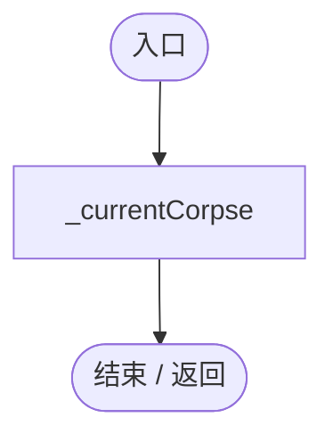
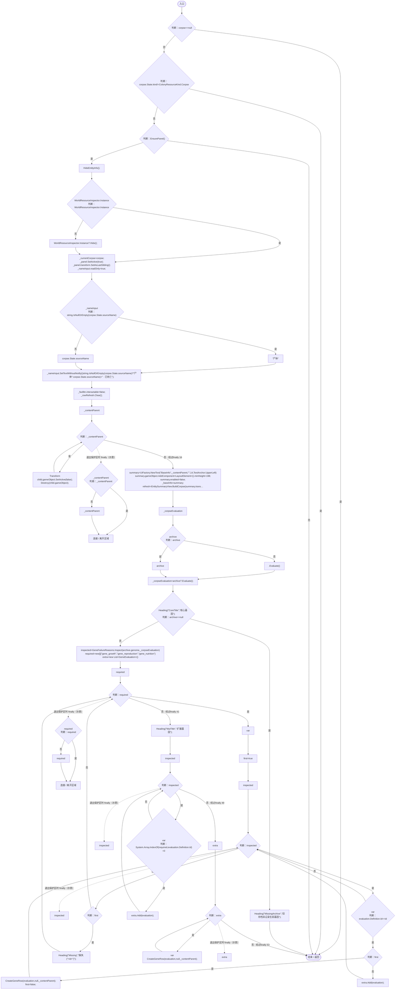
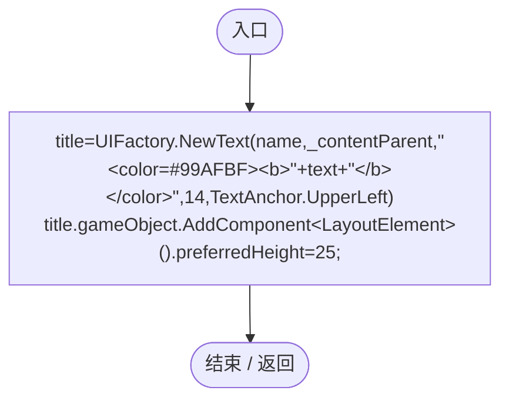
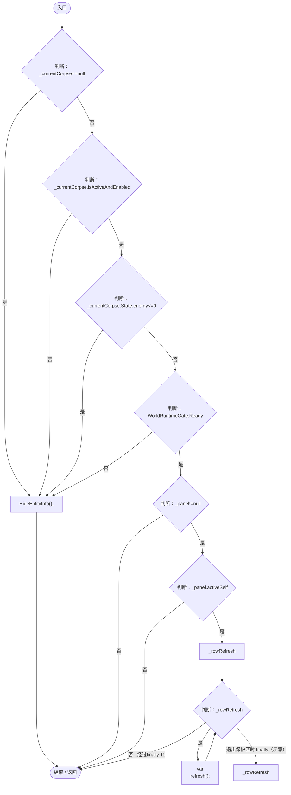

# GeneInspectorUI.Corpse.cs

[返回总索引](../README.md) · `Runtime` · `Assets/DarwinPark/UI/GeneInspectorUI.Corpse.cs`

[源文件](../../../Assets/DarwinPark/UI/GeneInspectorUI.Corpse.cs) · 源码校验：`ba51d70d73f01176c17fd5dd7ecca6c58ad1734db1ec1f56b944dda083672f49`

方法按源文件位置排列。事件/回调引用不表示立即执行；分支与异常说明见总索引。完整源码与可点击关系图请打开离线手册。

## CurrentCorpse.get · L12

`public ColonyResource CurrentCorpse`

### Editor / Player · 语法控制结构 / 声明（非CFG）

## ShowCorpseInfo · L14

`public void ShowCorpseInfo(ColonyResource corpse)`

★ 新增：使用原GenePanel、摘要、基因行与ScrollRect；不实例化带模拟组件的隐藏实体。

### Editor / Player · Roslyn编译器控制流

项目内调用/回调引用：

- [ColonyResource.State.get · L24](293dbaecfff4b585.md#m41824f1a0e160aa5)（访问器）
- [GeneInspectorUI.EnsurePanel · L71](924e27c34e7b1f0a.md#m6756f80ebc2df119)（方法）
- [GeneInspectorUI.HideEntityInfo · L317](924e27c34e7b1f0a.md#mc9346c30e59e03d7)（方法）
- [WorldResourceInspector.Instance.get · L12](044d7e948b6de8b7.md#m7d7f466d7959eb79)（访问器）
- [WorldResourceInspector.Hide · L67](044d7e948b6de8b7.md#md02dd83e5021f3a5)（方法）
- [UIFactory.NewText · L57](dd1096a6995423db.md#m9dbccb5f0c38189e)（方法）
- [EntitySummaryView.BuildCorpse · L45](64394436d1ceb729.md#mdaa0b87ba7d78492)（方法）
- [EntityEditPopup.AddEntry · L22](79ed73ecd9855f79.md#me31e71115fe5c367)（方法）
- [CorpseEntityRecord.Evaluate · L20](8a2345f1e54b1c75.md#m9ce3ef56fdd9f205)（方法）
- [GeneInspectorUI.Heading · L28](226a6835af361a0e.md#m06946aaf4507fc61)（方法）
- [GeneFailureReasons.Inspect · L9](e611915e807d8990.md#m1b46661dcda38ded)（方法）
- [GeneInspectorUI.CreateGeneRow · L491](924e27c34e7b1f0a.md#m8214fecfdc774af1)（方法）

## Heading · L28

`private void Heading(string name,string text)`

### Editor / Player · Roslyn编译器控制流

项目内调用/回调引用：

- [UIFactory.NewText · L57](dd1096a6995423db.md#m9dbccb5f0c38189e)（方法）

## RefreshCorpse · L30

`private void RefreshCorpse()`

### Editor / Player · Roslyn编译器控制流

项目内调用/回调引用：

- [ColonyResource.State.get · L24](293dbaecfff4b585.md#m41824f1a0e160aa5)（访问器）
- [GeneInspectorUI.HideEntityInfo · L317](924e27c34e7b1f0a.md#mc9346c30e59e03d7)（方法）
