# PlanetGroundPhysics.cs

[返回总索引](../README.md) · `Runtime` · `Assets/DarwinPark/Entities/PlanetGroundPhysics.cs`

[源文件](../../../Assets/DarwinPark/Entities/PlanetGroundPhysics.cs) · 源码校验：`8c0e2212d9f6741fabe54ab42a09ce38a6713b68e94ac3d7d6e16b8b2f72f0b4`

方法按源文件位置排列。事件/回调引用不表示立即执行；分支与异常说明见总索引。完整源码与可点击关系图请打开离线手册。

## Advance · L9

`public static void Advance(PlanetGravity owner,Rigidbody body,Collider collider,PhysicsMaterial material,EntityGeneController genes,EntityGroundProbe probe)`

### Editor / Player · Roslyn编译器控制流

```mermaid
flowchart TD
  b0(["入口"])
  b1["performance=PerformanceTimings.Measure(PerformanceTimings.Area.Gravity)"]
  b2{"判断：body==null"}
  b3{"判断：body.isKinematic"}
  b4{"判断：ServiceLocator.TryGet&lt;SimulationClock&gt;(out var clock)"}
  b5{"判断：clock.IsRunning"}
  b6{"EntityGroundProbe.Velocity(body,Vector3.zero);<br/>判断：body.angularVelocity!=Vector3.zero"}
  b7["body.angularVelocity=Vector3.zero;"]
  b8{"判断：owner.planet==null"}
  b9{"判断：StationaryBodyRest.RemainsAsleep(body,genes)"}
  b10{"ground=probe.Read(owner.planet)<br/>inward=-ground.up<br/>moveSpeed=GroundMotionSnapshot.Speed(genes)<br/>判断：material!=null"}
  b11["settings=LocomotionSettings.Load()"]
  b12{"判断：moveSpeed&gt;0"}
  b13["Vector3.ProjectOnPlane(body.linearVelocity,ground.up).sqrMagnitude&gt;settings.frictionMotionThreshold*settings.frictionMotionThreshold"]
  b14["moveSpeed&gt;0"]
  b15["moving=moveSpeed&gt;0&amp;&amp;Vector3.ProjectOnPlane(body.linearVelocity,ground.up).sqrMagnitude&gt;settings.frictionMotionThreshold*settings.frictionMotionThreshold"]
  b16{"probe<br/>material<br/>判断：moving"}
  b17["settings.movingFriction"]
  b18["settings.stationaryFriction"]
  b19["probe.Friction(material,moving?settings.movingFriction:settings.stationaryFriction);"]
  b20["ratio=owner.planetRadius/Mathf.Max(ground.distance,owner.planetRadius)<br/>multiplier=Mathf.Clamp(ratio*ratio,.45f,1)"]
  b21{"判断：ground.underwater"}
  b22{"判断：ground.distance&gt;owner.planetRadius+60"}
  b23["Mathf.Min(20,(ground.distance-owner.planetRadius-60)*.25f)"]
  b24["0"]
  b25["assist=!ground.underwater&amp;&amp;ground.distance&gt;owner.planetRadius+60?Mathf.Min(20,(ground.distance-owner.planetRadius-60)*.25f):0"]
  b26{"body.AddForce(inward*(owner.baseGravity*multiplier+assist),ForceMode.Acceleration);<br/>判断：ground.underwater"}
  b27["EntityGroundProbe.Velocity(body,inward*Mathf.Max(0,Vector3.Dot(body.linearVelocity,inward)));"]
  b28{"判断：ground.hasSurface"}
  b29{"判断：ground.altitude&lt;0"}
  b30{"判断：ground.altitude&gt;20"}
  b31{"判断：collider!=null"}
  b32["collider.bounds.extents.y"]
  b33["1"]
  b34["radius=collider!=null?collider.bounds.extents.y:1"]
  b35{"判断：ground.altitude&lt;=radius+.5f"}
  b36{"判断：moveSpeed&lt;=0"}
  b37{"velocity=body.linearVelocity<br/>tangent=velocity-ground.normal*Vector3.Dot(velocity,ground.normal)<br/>判断：tangent.sqrMagnitude&gt;.01f"}
  b38["EntityGroundProbe.Velocity(body,velocity-tangent*.9f);"]
  b39["EntityGroundProbe.Align(body,ground.normal,15);<br/>StationaryBodyRest.TryRest(body,genes,collider,ground,owner.planet,moveSpeed);"]
  b40["EntityGroundProbe.Align(body,ground.up,5);"]
  b41["performance=PerformanceTimings.Measure(PerformanceTimings.Area.Gravity)"]
  b42(["结束 / 返回"])
  b0 --> b1
  b1 --> b2
  b2 -->|"否"| b3
  b2 -->|"是 · 经过finally 41"| b42
  b3 -->|"是 · 经过finally 41"| b42
  b3 -->|"否"| b4
  b4 -->|"是"| b5
  b4 -->|"否"| b8
  b5 -->|"否"| b6
  b5 -->|"是"| b8
  b6 -->|"是"| b7
  b6 -->|"否 · 经过finally 41"| b42
  b7 -->|"经过finally 41"| b42
  b8 -->|"否"| b9
  b8 -->|"是 · 经过finally 41"| b42
  b9 -->|"是 · 经过finally 41"| b42
  b9 -->|"否"| b10
  b10 -->|"是"| b11
  b10 -->|"否"| b20
  b11 --> b12
  b12 -->|"是"| b13
  b12 -->|"否"| b14
  b13 --> b15
  b14 --> b15
  b15 --> b16
  b16 -->|"是"| b17
  b16 -->|"否"| b18
  b17 --> b19
  b18 --> b19
  b19 --> b20
  b20 --> b21
  b21 -->|"否"| b22
  b21 -->|"是"| b24
  b22 -->|"是"| b23
  b22 -->|"否"| b24
  b23 --> b25
  b24 --> b25
  b25 --> b26
  b26 -->|"是"| b27
  b26 -->|"否"| b28
  b27 --> b28
  b28 -->|"是"| b29
  b28 -->|"否 · 经过finally 41"| b42
  b29 -->|"否"| b30
  b29 -->|"是 · 经过finally 41"| b42
  b30 -->|"是 · 经过finally 41"| b42
  b30 -->|"否"| b31
  b31 -->|"是"| b32
  b31 -->|"否"| b33
  b32 --> b34
  b33 --> b34
  b34 --> b35
  b35 -->|"是"| b36
  b35 -->|"否"| b40
  b36 -->|"是"| b37
  b36 -->|"否"| b39
  b37 -->|"是"| b38
  b37 -->|"否"| b39
  b38 --> b39
  b39 -->|"经过finally 41"| b42
  b40 -->|"经过finally 41"| b42
  b2 -. "退出保护区时 finally（示意）" .-> b41

```

项目内调用/回调引用：

- [PerformanceTimings.Measure · L24](a8403a4c7503726d.md#m592e16f2b6513efd)（方法）
- [ServiceLocator.TryGet · L26](f2fdbe9f9ccd93cb.md#m143b24e6d58471b0)（方法）
- [SimulationClock.IsRunning.get · L22](a8f444aec9614b0a.md#m10f4fe307faca0f0)（访问器）
- [EntityGroundProbe.Velocity · L43](6cefee808441951d.md#mbd7dbf819184aded)（方法）
- [StationaryBodyRest.RemainsAsleep · L20](19e6d310d5522440.md#m53a3fec3ed119634)（方法）
- [EntityGroundProbe.Read · L20](6cefee808441951d.md#md243671db147a614)（方法）
- [GroundMotionSnapshot.Speed · L12](24903349a79c9f98.md#m93f0898ab9866968)（方法）
- [LocomotionSettings.Load · L17](8cce83c7d4563cf0.md#m06b74c04dd63fb4a)（方法）
- [EntityGroundProbe.Friction · L42](6cefee808441951d.md#mb44dc9f960199abf)（方法）
- [EntityGroundProbe.Align · L45](6cefee808441951d.md#m0101576aa9de21af)（方法）
- [StationaryBodyRest.TryRest · L29](19e6d310d5522440.md#m7eeb741a76ae0d1e)（方法）
