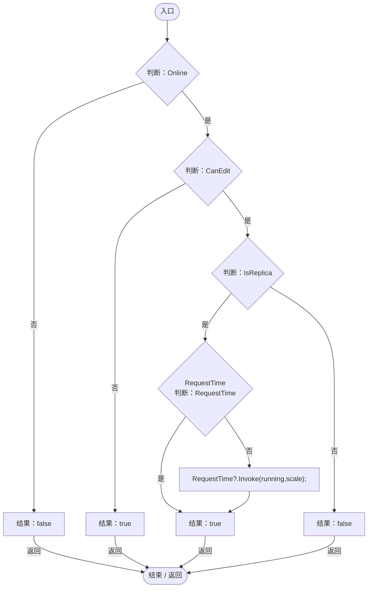
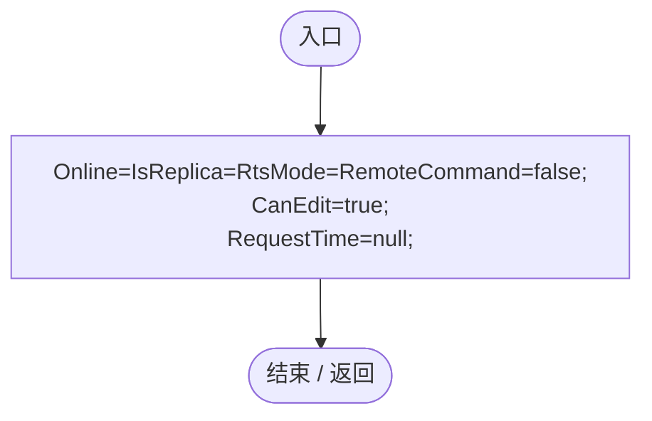

# WorldAuthority.cs

[返回总索引](../README.md) · `Runtime` · `Assets/DarwinPark/Core/WorldAuthority.cs`

[源文件](../../../Assets/DarwinPark/Core/WorldAuthority.cs) · 源码校验：`df62c2be1397ad8313485ee01fa29536d38715351c2a10406b3406580fb8fbf4`

方法按源文件位置排列。事件/回调引用不表示立即执行；分支与异常说明见总索引。完整源码与可点击关系图请打开离线手册。

## InterceptTime · L12

`public static bool InterceptTime(bool running,float scale)`

### Editor / Player · Roslyn编译器控制流

## Reset · L18

`[RuntimeInitializeOnLoadMethod(RuntimeInitializeLoadType.SubsystemRegistration)] public static void Reset()`

### Editor / Player · Roslyn编译器控制流

