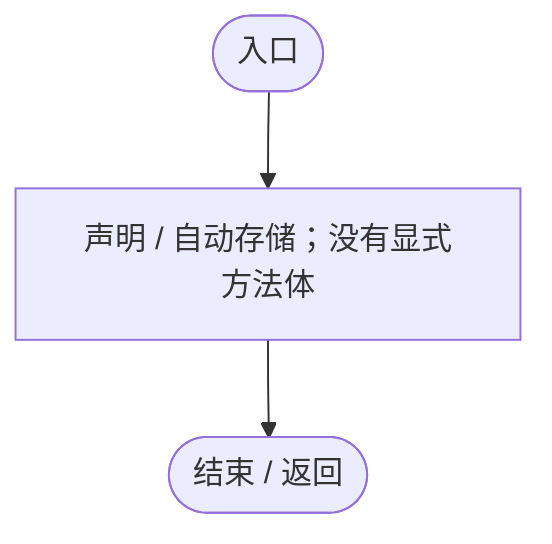
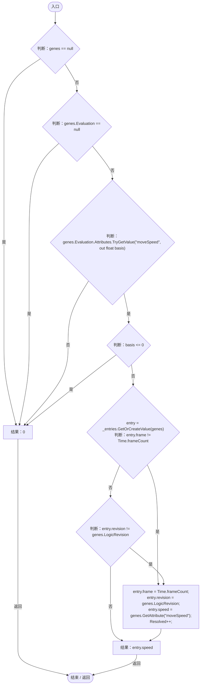
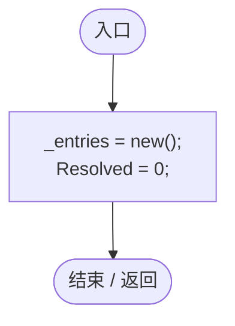

# GroundMotionSnapshot.cs

[返回总索引](../README.md) · `Runtime` · `Assets/DarwinPark/Entities/GroundMotionSnapshot.cs`

[源文件](../../../Assets/DarwinPark/Entities/GroundMotionSnapshot.cs) · 源码校验：`bf62c27ae52d4ce9018290fca03d0f5cea49ce1a4feb70a464603143e0c1eb44`

方法按源文件位置排列。事件/回调引用不表示立即执行；分支与异常说明见总索引。完整源码与可点击关系图请打开离线手册。

## Resolved.get · L11

`get`

### Editor / Player · 语法控制结构 / 声明（非CFG）

## Resolved.set · L11

`private set`

### Editor / Player · 语法控制结构 / 声明（非CFG）

## Speed · L12

`public static float Speed(EntityGeneController genes)`

### Editor / Player · Roslyn编译器控制流

项目内调用/回调引用：

- [EntityGeneController.Evaluation.get · L20](7494d53178552f0e.md#mf275f100ea21601a)（访问器）
- [EntityGeneController.LogicRevision.get · L21](7494d53178552f0e.md#m98a686d126eac5b3)（访问器）
- [EntityGeneController.GetAttribute · L288](7494d53178552f0e.md#m45127bcdd833aaf5)（方法）
- [GroundMotionSnapshot.Resolved.set · L11](24903349a79c9f98.md#mbe7d7b96140c302c)（访问器）
- [GroundMotionSnapshot.Resolved.get · L11](24903349a79c9f98.md#ma5fae5afdf04918f)（访问器）

## Reset · L23

`[RuntimeInitializeOnLoadMethod(RuntimeInitializeLoadType.SubsystemRegistration)] private static void Reset()`

### Editor / Player · Roslyn编译器控制流

项目内调用/回调引用：

- [GroundMotionSnapshot.Resolved.set · L11](24903349a79c9f98.md#mbe7d7b96140c302c)（访问器）
