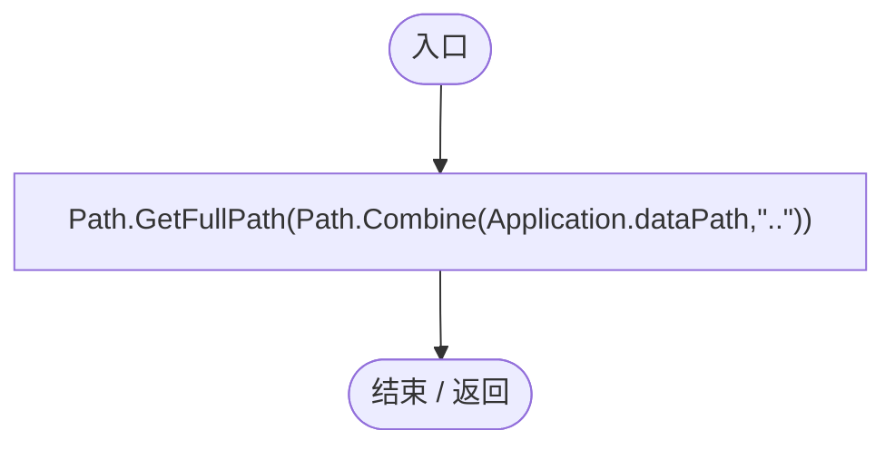
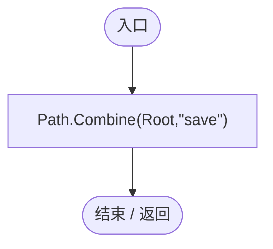
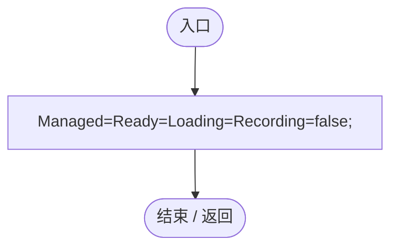

# GamePaths.cs

[返回总索引](../README.md) · `Runtime` · `Assets/DarwinPark/Core/GamePaths.cs`

[源文件](../../../Assets/DarwinPark/Core/GamePaths.cs) · 源码校验：`905c027cdb3a94439a8fcd603413f5a463c26cc6a0bca8c75d105f7cb0b44890`

方法按源文件位置排列。事件/回调引用不表示立即执行；分支与异常说明见总索引。完整源码与可点击关系图请打开离线手册。

## Root.get · L8

`public static string Root`

### Editor / Player · 语法控制结构 / 声明（非CFG）

## Saves.get · L9

`public static string Saves`

### Editor / Player · 语法控制结构 / 声明（非CFG）

## Mods.get · L10

`public static string Mods`

### Editor / Player · 语法控制结构 / 声明（非CFG）

## Reset · L15

`[RuntimeInitializeOnLoadMethod(RuntimeInitializeLoadType.SubsystemRegistration)] private static void Reset()`

### Editor / Player · Roslyn编译器控制流

