# TaskCoordinateOptimizationRegression.cs

[返回总索引](../README.md) · `Editor` · `Assets/DarwinPark/Editor/TaskCoordinateOptimizationRegression.cs`

[源文件](../../../Assets/DarwinPark/Editor/TaskCoordinateOptimizationRegression.cs) · 源码校验：`56532b04ea31abfe63233be48c2790805d8078ae0eeb1dd14ac3b1b7cdca9a64`

方法按源文件位置排列。事件/回调引用不表示立即执行；分支与异常说明见总索引。完整源码与可点击关系图请打开离线手册。

## Folder.get · L26

`private static string Folder`

### Editor · 语法控制结构 / 声明（非CFG）

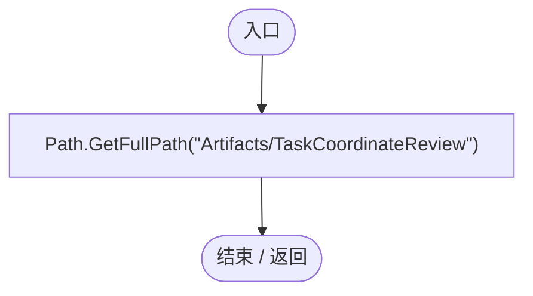

## TaskCoordinateOptimizationRegression.ctor · L27

`static TaskCoordinateOptimizationRegression()`

### Editor · Roslyn编译器控制流

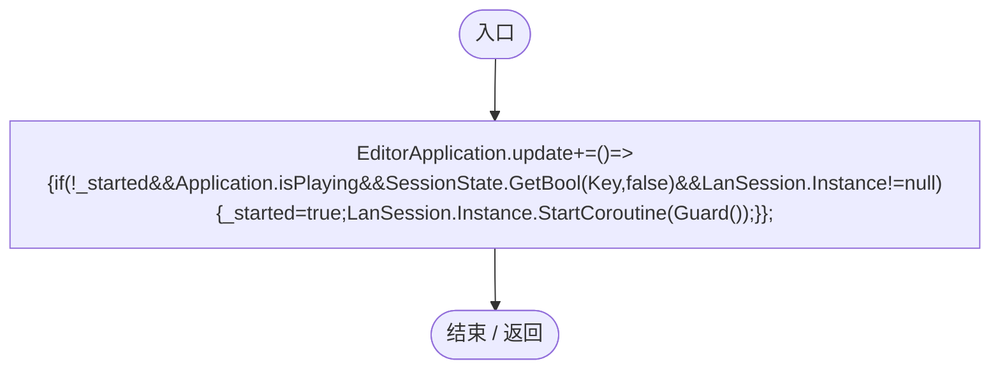

项目内调用/回调引用：

- [TaskCoordinateOptimizationRegression.回调@27 · L27](274ce3a54a3e2b5f.md#mfe801d640da7d668)（回调/委托）

## 回调@27 · L27

`( … => 回调`

### Editor · Roslyn编译器控制流

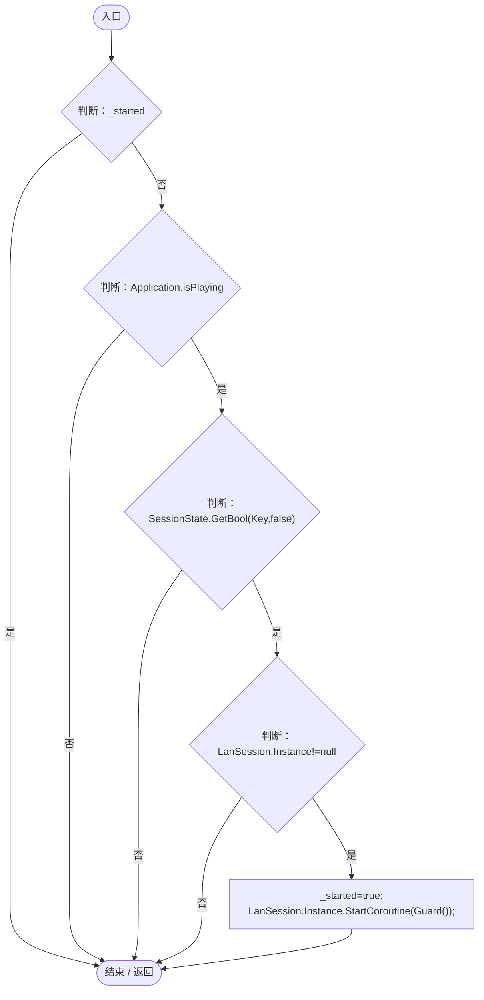

项目内调用/回调引用：

- [LanSession.Instance.get · L23](9fb633eebffe669c.md#mbf83306994878383)（访问器）
- [TaskCoordinateOptimizationRegression.Guard · L30](274ce3a54a3e2b5f.md#mdf83bccfe105d0c6)（方法）

## RunBatch · L28

`public static void RunBatch()`

### Editor · Roslyn编译器控制流

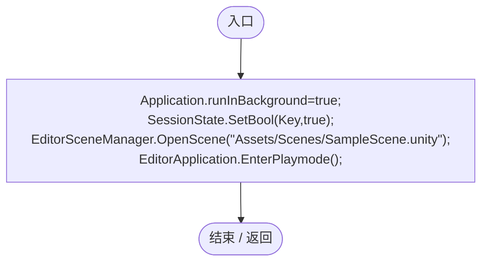

## Check · L29

`private static void Check(bool value,string text)`

### Editor · Roslyn编译器控制流

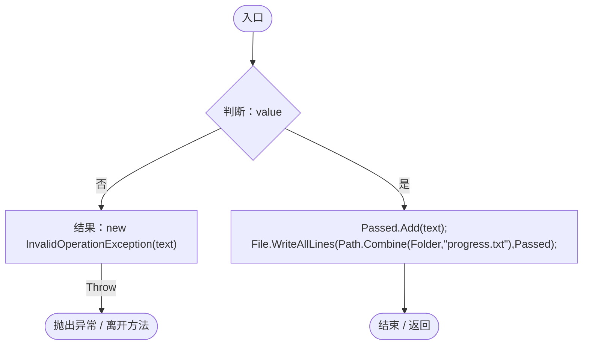

## Guard · L30

`private static IEnumerator Guard()`

### Editor · Roslyn编译器控制流

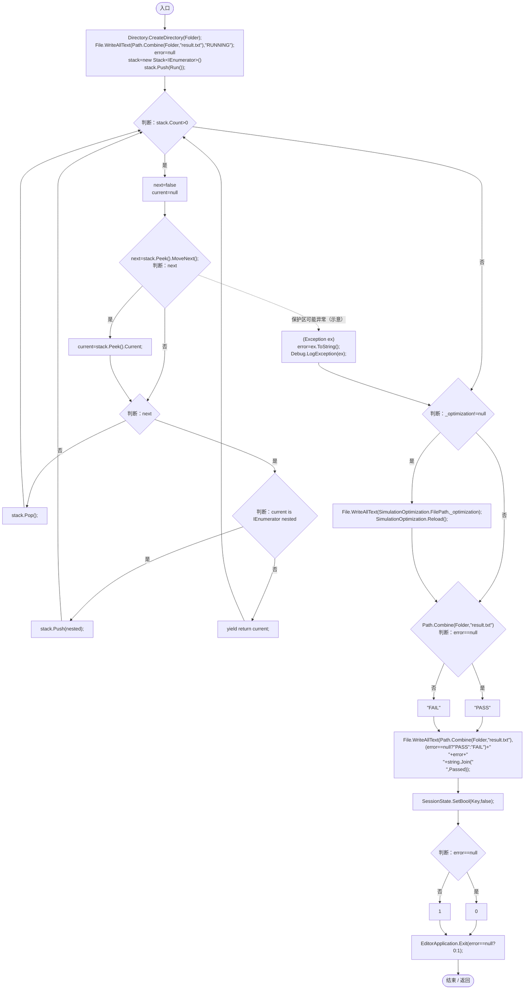

项目内调用/回调引用：

- [TaskCoordinateOptimizationRegression.Run · L54](274ce3a54a3e2b5f.md#m69ea90e0600db909)（方法）
- [SimulationOptimization.Reload · L24](11c9091e70893352.md#mee43c6beb70dce9d)（方法）

## Wait · L37

`private static IEnumerator Wait(Func<bool> ready)`

### Editor · Roslyn编译器控制流

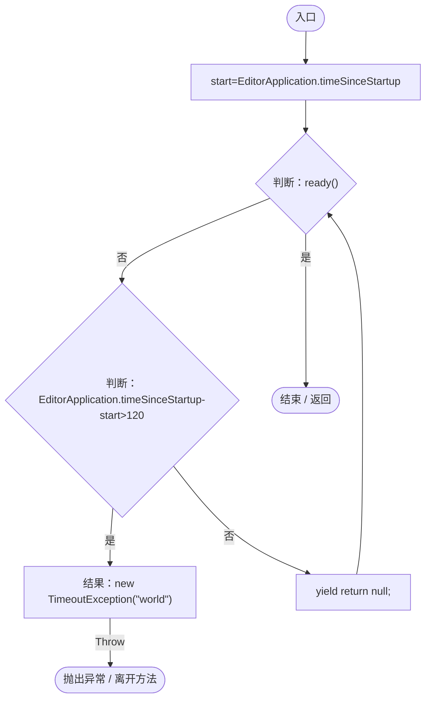

## Clear · L38

`private static void Clear()`

### Editor · Roslyn编译器控制流

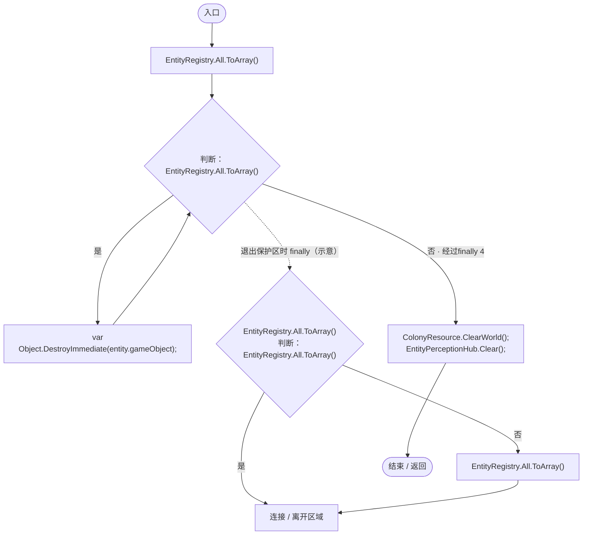

项目内调用/回调引用：

- [ColonyResource.ClearWorld · L109](293dbaecfff4b585.md#m4a3572d1077d33bd)（方法）
- [EntityPerceptionHub.Clear · L79](aeecc36cb2c3cc24.md#m31fc0fb1c51cd043)（方法）

## Spawn · L39

`private static DarwinEntity Spawn(Vector3 point,params (string,float)[] genes)`

### Editor · Roslyn编译器控制流

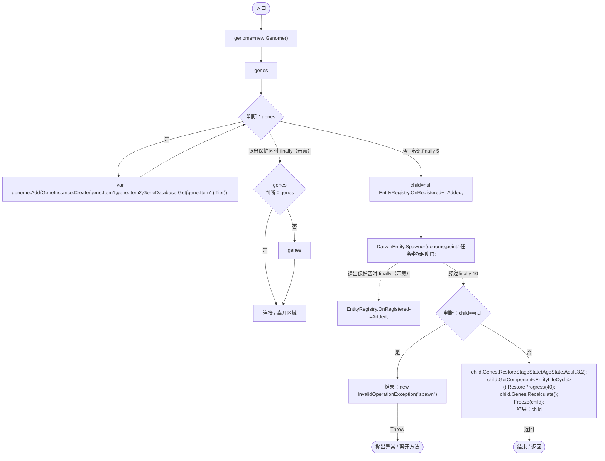

项目内调用/回调引用：

- [Genome.Add · L19](a2ef23f865bc7ee8.md#md9cfdc94b8b8d40f)（方法）
- [GeneInstance.Create · L20](f82e1498d67f5afd.md#m72e94c278de3cf8b)（方法）
- [GeneDatabase.Get · L136](ec0a03483435a863.md#me6a5fefe6c3492f9)（方法）
- [EntityGeneController.RestoreStageState · L54](7494d53178552f0e.md#m41fb3375c42f6c22)（方法）
- [DarwinEntity.Genes.get · L14](70798dde169f2e8b.md#m622eb1adf401d431)（访问器）
- [EntityLifeCycle.RestoreProgress · L50](9f4138bfbae654b7.md#m1e9381f9a38ed7be)（方法）
- [EntityGeneController.Recalculate · L111](7494d53178552f0e.md#mf588f8c1148316c6)（方法）
- [TaskCoordinateOptimizationRegression.Freeze · L45](274ce3a54a3e2b5f.md#m5b4bc1a59f19e0a3)（方法）
- [TaskCoordinateOptimizationRegression.Added · L41](274ce3a54a3e2b5f.md#m143d73263e9423e2)（局部函数）

## Added · L41

`void Added(DarwinEntity value)`

### Editor · Roslyn编译器控制流

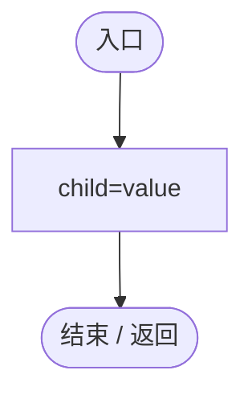

## Freeze · L45

`private static void Freeze(DarwinEntity entity)`

### Editor · Roslyn编译器控制流

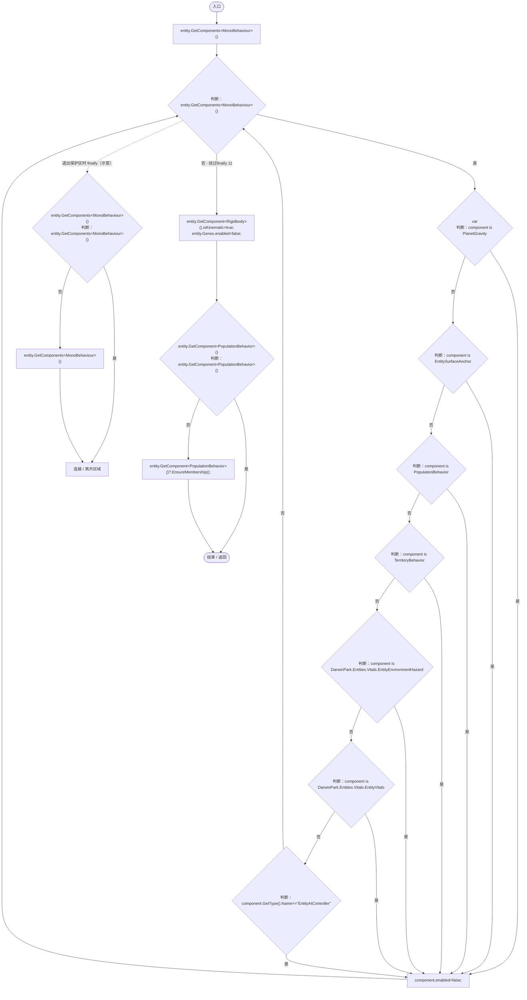

项目内调用/回调引用：

- [DarwinEntity.Genes.get · L14](70798dde169f2e8b.md#m622eb1adf401d431)（访问器）
- [PopulationBehavior.EnsureMembership · L109](21e4f62f75a9a80f.md#m23e7117c3c93e2b4)（方法）

## Food · L52

`private static void Food(DarwinEntity entity,float food,float reserve=100)`

### Editor · Roslyn编译器控制流

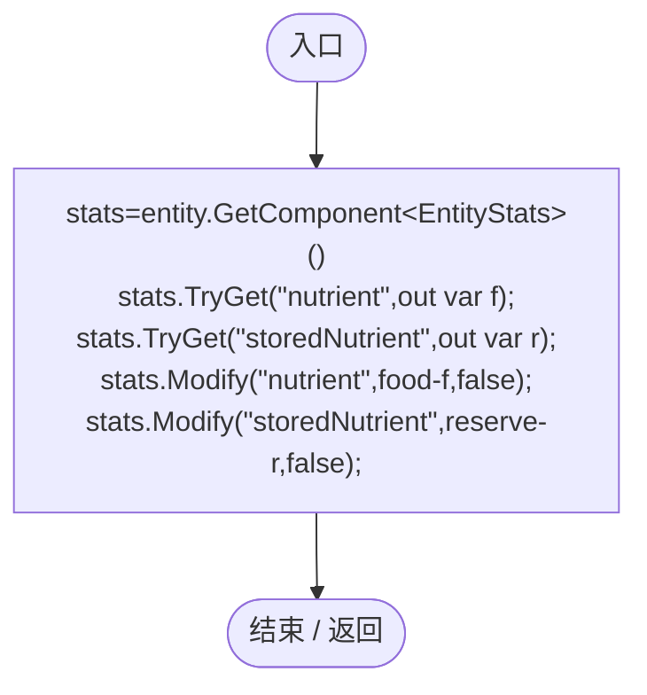

项目内调用/回调引用：

- [EntityStats.TryGet · L90](75aa86a368efdf24.md#m24ee1433e4a70d94)（方法）
- [EntityStats.Modify · L111](75aa86a368efdf24.md#m9c837be197158240)（方法）

## Resource · L53

`private static ColonyResource Resource(Vector3 point,ColonyResourceKind kind=ColonyResourceKind.Corpse,string group=null,float energy=20)`

### Editor · Roslyn编译器控制流

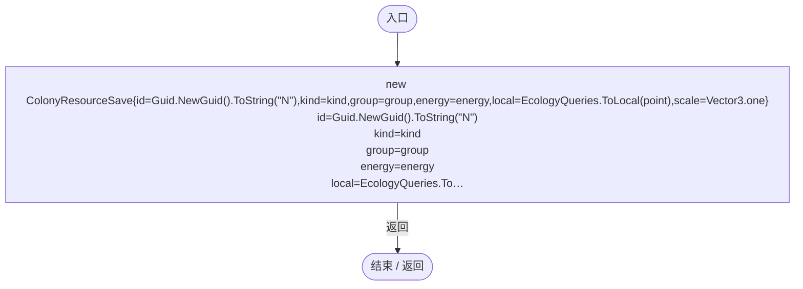

项目内调用/回调引用：

- [ColonyResource.Create · L45](293dbaecfff4b585.md#m7e8d2b0e06e1cad5)（方法）
- [EcologyQueries.ToLocal · L39](bdf7ccc2c9c0452f.md#m1a07639eacf3aa47)（方法）

## Run · L54

`private static IEnumerator Run()`

### Editor · Roslyn编译器控制流

```mermaid
flowchart TD
  b0(["入口"])
  b1["session=Object.FindFirstObjectByType&lt;WorldSessionManager&gt;()<br/>session.autoSaveInterval=36000;<br/>planet=Object.FindFirstObjectByType&lt;PlanetTerrainMeshBuilder&gt;()<br/>planet.subdivisions=16;<br/>typeof(WorldSessionManager).GetField(&quot;_initialTerrain&quot;,Bi…"]
  b2{"判断：tasks.Count==2"}
  b3{"判断：tasks[0].target==firstId"}
  b4{"判断：tasks[1].target==secondId"}
  b5["worker.State.resourceTarget==firstId"]
  b6["tasks.Count==2&amp;&amp;tasks[0].target==firstId&amp;&amp;tasks[1].target==secondId&amp;&amp;worker.State.resourceTarget==firstId"]
  b7["Check(tasks.Count==2&amp;&amp;tasks[0].target==firstId&amp;&amp;tasks[1].target==secondId&amp;&amp;worker.State.resourceTarget==firstId,&quot;工匠按全局周围坐标生成顺序任务，首先执行近处尸体 count=&quot;+tasks.Count+&quot; radius=&quot;+worker.Radius+&quot; target=&quot;+worker.State.resourceTarget);"]
  b8["Check(string.IsNullOrEmpty(second.State.claim),&quot;只独占当前目标，后续计划不锁死其他工匠资源&quot;);<br/>Resource(here,ColonyResourceKind.Supply,group,100);<br/>Food(entity,1);<br/>AntColonyWorker.Advance(worker,.1f);"]
  b9{"判断：tasks.Count==3"}
  b10{"判断：tasks[0].kind==PlannedTaskKind.Feed"}
  b11["tasks[1].target==firstId"]
  b12["tasks.Count==3&amp;&amp;tasks[0].kind==PlannedTaskKind.Feed&amp;&amp;tasks[1].target==firstId"]
  b13["Check(tasks.Count==3&amp;&amp;tasks[0].kind==PlannedTaskKind.Feed&amp;&amp;tasks[1].target==firstId,&quot;饥饿将补给插入首位，原采集计划顺延&quot;);"]
  b14["i=0"]
  b15{"判断：i&lt;8"}
  b16["AntColonyWorker.Advance(worker,.1f);<br/>i++"]
  b17["Check(tasks.Count==3,&quot;连续饥饿检查不重复插入补给任务&quot;);<br/>ColonyResource.Feed(worker,4);"]
  b18{"判断：entity.GetComponent&lt;EntityStats&gt;().TryGet(&quot;nutrient&quot;,out var eaten)"}
  b19["eaten&gt;1"]
  b20["entity.GetComponent&lt;EntityStats&gt;().TryGet(&quot;nutrient&quot;,out var eaten)"]
  b21["Check(entity.GetComponent&lt;EntityStats&gt;().TryGet(&quot;nutrient&quot;,out var eaten)&amp;&amp;eaten&gt;1,&quot;补给插队确实转移能量块营养&quot;);"]
  b22["Food(entity,10);<br/>AntColonyWorker.Advance(worker,.1f);"]
  b23{"判断：tasks.Count==2"}
  b24{"判断：tasks[0].target==firstId"}
  b25["worker.State.resourceTarget==firstId"]
  b26["tasks.Count==2&amp;&amp;tasks[0].target==firstId&amp;&amp;worker.State.resourceTarget==firstId"]
  b27["Check(tasks.Count==2&amp;&amp;tasks[0].target==firstId&amp;&amp;worker.State.resourceTarget==firstId,&quot;吃饱恢复原目标而不是重新随机选任务&quot;);"]
  b28["entity.transform.position=first.transform.position;<br/>EntityNeighborhood.ObservePosition(entity.Genes);<br/>AntColonyWorker.Advance(worker,.1f);"]
  b29{"判断：worker.State.carriedResource==firstId"}
  b30["tasks[0].kind==PlannedTaskKind.Deliver"]
  b31["worker.State.carriedResource==firstId"]
  b32["Check(worker.State.carriedResource==firstId&amp;&amp;tasks[0].kind==PlannedTaskKind.Deliver,&quot;取货后同一任务进入运输阶段&quot;);"]
  b33["Food(entity,1);<br/>AntColonyWorker.Advance(worker,.1f);"]
  b34{"判断：tasks[0].kind==PlannedTaskKind.Feed"}
  b35{"判断：tasks[1].kind==PlannedTaskKind.Deliver"}
  b36["worker.State.carriedResource==firstId"]
  b37["tasks[0].kind==PlannedTaskKind.Feed&amp;&amp;tasks[1].kind==PlannedTaskKind.Deliver&amp;&amp;worker.State.carriedResource==firstId"]
  b38["Check(tasks[0].kind==PlannedTaskKind.Feed&amp;&amp;tasks[1].kind==PlannedTaskKind.Deliver&amp;&amp;worker.State.carriedResource==firstId,&quot;运输中饥饿保留独占货物和交付任务&quot;);"]
  b39["workerId=worker.Id<br/>session.SaveNow(false);<br/>disk=WorldSaveStore.Read(WorldSaveStore.FileFor(session.Current.id))<br/>Check(disk!=null,&quot;真实世界与队列写入磁盘&quot;);<br/>session.Open(disk);<br/>yield return Wait(()=&gt;!session.Busy);<br/>clock.Pause();<br/>entity=EcologyIdent…"]
  b40{"判断：tasks.Count==3"}
  b41{"判断：tasks[0].kind==PlannedTaskKind.Feed"}
  b42{"判断：tasks[1].kind==PlannedTaskKind.Deliver"}
  b43{"判断：tasks[2].target==secondId"}
  b44["worker.State.carriedResource==firstId"]
  b45["tasks.Count==3&amp;&amp;tasks[0].kind==PlannedTaskKind.Feed&amp;&amp;tasks[1].kind==PlannedTaskKind.Deliver&amp;&amp;tasks[2].target==secondId&amp;&amp;worker.State.carriedResource==firstId"]
  b46["Check(tasks.Count==3&amp;&amp;tasks[0].kind==PlannedTaskKind.Feed&amp;&amp;tasks[1].kind==PlannedTaskKind.Deliver&amp;&amp;tasks[2].target==secondId&amp;&amp;worker.State.carriedResource==firstId,&quot;真实读档恢复补给、原运输和下一目标顺序&quot;);"]
  b47["Food(entity,10);"]
  b48{"entity.transform.position<br/>判断：worker.State.deliveryNursery"}
  b49["queen.transform.position"]
  b50["EcologyQueries.ToWorld(worker.State.deliveryPoint)"]
  b51["entity.transform.position=worker.State.deliveryNursery?queen.transform.position:EcologyQueries.ToWorld(worker.State.deliveryPoint);"]
  b52["EntityNeighborhood.ObservePosition(entity.Genes);<br/>AntColonyWorker.Advance(worker,.1f);"]
  b53{"判断：ColonyResource.Find(firstId)==null"}
  b54{"判断：string.IsNullOrEmpty(worker.State.carriedResource)"}
  b55{"判断：tasks.Count==1"}
  b56["tasks[0].target==secondId"]
  b57["ColonyResource.Find(firstId)==null&amp;&amp;string.IsNullOrEmpty(worker.State.carriedResource)&amp;&amp;tasks.Count==1&amp;&amp;tasks[0].target==secondId"]
  b58["Check(ColonyResource.Find(firstId)==null&amp;&amp;string.IsNullOrEmpty(worker.State.carriedResource)&amp;&amp;tasks.Count==1&amp;&amp;tasks[0].target==secondId,&quot;送达只转换一次，并移除已完成任务&quot;);"]
  b59["worker.State.scan=99;<br/>AntColonyWorker.Advance(worker,.1f);<br/>Check(worker.State.resourceTarget==secondId,&quot;完成后立即执行下一任务，不等待旧扫描倒计时&quot;);<br/>ColonyResource.Find(secondId).Remove();"]
  b60{"判断：tasks.Count==0"}
  b61["worker.State.resourceTarget==null"]
  b62["tasks.Count==0"]
  b63["Check(tasks.Count==0&amp;&amp;worker.State.resourceTarget==null,&quot;目标失效自动跳过并释放当前任务&quot;);"]
  b64["rejected=false"]
  b65["new List&lt;PlannedEntityTask&gt;{new(){kind=PlannedTaskKind.CollectCorpse,target=firstId},new(){kind=PlannedTaskKind.CollectCorpse,target=firstId}}"]
  b66["new(){kind=PlannedTaskKind.CollectCorpse,target=firstId}<br/>kind=PlannedTaskKind.CollectCorpse<br/>target=firstId"]
  b67["new(){kind=PlannedTaskKind.CollectCorpse,target=firstId}<br/>kind=PlannedTaskKind.CollectCorpse<br/>target=firstId"]
  b68["WorkerTaskQueue.Validate(new List&lt;PlannedEntityTask&gt;{new(){kind=PlannedTaskKind.CollectCorpse,target=firstId},new(){kind=PlannedTaskKind.CollectCorpse,target=firstId}});"]
  b69["rejected=true;"]
  b70["Check(rejected,&quot;重复任务标识在清场前拒绝&quot;);<br/>Clear();<br/>ordinary=Spawn(here,(&quot;gene_nutrient_utilization&quot;,50),(&quot;gene_storage&quot;,50))<br/>Food(ordinary,1,0);<br/>blockA=Resource(here+Vector3.right*8,ColonyResourceKind.Energy,group)<br/>blockB=Resource(here+Vector3.rig…"]
  b71{"判断：metabolism.Destination(out _)"}
  b72["EntityResourcePlan.Capture(ordinary.Genes).energy.SequenceEqual(new[]{blockA.State.id,blockB.State.id})"]
  b73["metabolism.Destination(out _)"]
  b74["Check(metabolism.Destination(out _)&amp;&amp;EntityResourcePlan.Capture(ordinary.Genes).energy.SequenceEqual(new[]{blockA.State.id,blockB.State.id}),&quot;普通实体按全局坐标排列多个能量块任务&quot;);"]
  b75["remaining=blockB.State.id<br/>blockA.Remove();"]
  b76{"判断：metabolism.Destination(out _)"}
  b77["EntityResourcePlan.Capture(ordinary.Genes).energy[0]==remaining"]
  b78["metabolism.Destination(out _)"]
  b79["Check(metabolism.Destination(out _)&amp;&amp;EntityResourcePlan.Capture(ordinary.Genes).energy[0]==remaining,&quot;普通能量块任务完成后立即接续下一项&quot;);"]
  b80["ordinaryId=EcologyIdentity.Of(ordinary)<br/>session.SaveNow(false);<br/>ordinaryDisk=WorldSaveStore.Read(WorldSaveStore.FileFor(session.Current.id))<br/>Check(ordinaryDisk.entities.Any(e=&gt;e.ecology?.resourcePlan?.energy?.Contains(remaining)==true),&quot;…"]
  b81{"判断：EntityResourcePlan.Capture(ordinary.Genes).energy[0]==remaining"}
  b82["ordinary.GetComponent&lt;EnergyBlockMetabolism&gt;().Destination(out _)"]
  b83["EntityResourcePlan.Capture(ordinary.Genes).energy[0]==remaining"]
  b84["Check(EntityResourcePlan.Capture(ordinary.Genes).energy[0]==remaining&amp;&amp;ordinary.GetComponent&lt;EnergyBlockMetabolism&gt;().Destination(out _),&quot;普通实体读档后继续原能量块计划&quot;);"]
  b85["corpseA=Resource(here+Vector3.forward*8)<br/>corpseB=Resource(here+Vector3.forward*12)<br/>scavenger=Spawn(here,(&quot;gene_scavenging&quot;,50),(&quot;gene_storage&quot;,50))<br/>Food(scavenger,1,0);<br/>corpseLogic=scavenger.GetComponent&lt;CorpseFeeding&gt;()<br/>corpseLogic.Adva…"]
  b86["i=0"]
  b87{"判断：i&lt;300"}
  b88["Resource(here+Vector3.right*(1000+i),ColonyResourceKind.Corpse);<br/>i++"]
  b89["coordinates=new List&lt;ResourceCoordinate&gt;()<br/>visits=ResourceCoordinates.CandidateVisits<br/>ResourceCoordinates.Query(here,8,true,false,coordinates);"]
  b90{"判断：coordinates.Count==1"}
  b91{"判断：coordinates[0].resource==food"}
  b92["ResourceCoordinates.CandidateVisits-visits==1"]
  b93["coordinates.Count==1&amp;&amp;coordinates[0].resource==food&amp;&amp;ResourceCoordinates.CandidateVisits-visits==1"]
  b94["Check(coordinates.Count==1&amp;&amp;coordinates[0].resource==food&amp;&amp;ResourceCoordinates.CandidateVisits-visits==1,&quot;300具尸体不增加能量块近食搜索候选&quot;);"]
  b95["food.CarryTo(here+Vector3.forward*40);<br/>ResourceCoordinates.Query(here,8,true,false,coordinates);<br/>Check(coordinates.Count==0,&quot;搬运立即更新资源全局坐标&quot;);<br/>food.gameObject.SetActive(false);<br/>ResourceCoordinates.Food(coordinates);<br/>Check(coordinates.Count…"]
  b96{"判断：GeneExpressionCache.Hits==1"}
  b97["GeneExpressionCache.Misses==1"]
  b98["GeneExpressionCache.Hits==1"]
  b99["Check(GeneExpressionCache.Hits==1&amp;&amp;GeneExpressionCache.Misses==1,&quot;相同DNA纯表达共享一次计算&quot;);"]
  b100{"判断：ReferenceEquals(a.Genes.Evaluation.Genes[0].Gene,b.Genes.Evaluation.Genes[0].Gene)"}
  b101["!ReferenceEquals(a.Genes.Evaluation.Attributes,b.Genes.Evaluation.Attributes)"]
  b102["!ReferenceEquals(a.Genes.Evaluation.Genes[0].Gene,b.Genes.Evaluation.Genes[0].Gene)"]
  b103["Check(!ReferenceEquals(a.Genes.Evaluation.Genes[0].Gene,b.Genes.Evaluation.Genes[0].Gene)&amp;&amp;!ReferenceEquals(a.Genes.Evaluation.Attributes,b.Genes.Evaluation.Attributes),&quot;命中缓存仍保留各自基因身份与属性表&quot;);"]
  b104["a.Genes.EnvironmentGeneSuppression=30;<br/>a.Genes.Recalculate();<br/>Check(GeneExpressionCache.Misses==2,&quot;环境抑制不同不得复用相同表达&quot;);<br/>a.Genes.EnvironmentGeneSuppression=0;<br/>competition=EntityNeighborhood.Competition(a.Genes)<br/>b.transform.position+=Vector3.…"]
  b105{"判断：competition&gt;1"}
  b106["Mathf.Abs(EntityNeighborhood.Competition(a.Genes)-1)&lt;.0001f"]
  b107["competition&gt;1"]
  b108["Check(competition&gt;1&amp;&amp;Mathf.Abs(EntityNeighborhood.Competition(a.Genes)-1)&lt;.0001f,&quot;生产者离开后局部竞争立即失效&quot;);"]
  b109["observation=Spawn(here,(&quot;gene_locomotion&quot;,50),(&quot;gene_observation&quot;,75))<br/>EntityPerceptionHub.Read(observation.Genes);<br/>a.gameObject.SetActive(false);<br/>Check(!EntityPerceptionHub.TryLocate(observation.Genes,a,out _),&quot;反向订阅注销死亡目标后不能继续追踪&quot;);<br/>cade…"]
  b110{"判断：cadence.Due(observation.Genes,.01f)"}
  b111["!cadence.Due(observation.Genes,.01f)"]
  b112["cadence.Due(observation.Genes,.01f)"]
  b113["Check(cadence.Due(observation.Genes,.01f)&amp;&amp;!cadence.Due(observation.Genes,.01f),&quot;决策间隔内复用意图，不重复完整搜索&quot;);"]
  b114["observation.Genes.Recalculate();<br/>Check(cadence.Due(observation.Genes,.01f),&quot;表达变化立即打断决策缓存&quot;);<br/>elapsed=.1f<br/>ActionMotionBatch.Begin(observation.Genes,.5f);<br/>ActionMotionBatch.Step(observation.Genes,false);<br/>Check(!ActionMotionBatch.Consume(obs…"]
  b115{"判断：ActionMotionBatch.Consume(observation.Genes,ref elapsed)"}
  b116["Mathf.Abs(elapsed-.5f)&lt;.0001f"]
  b117["ActionMotionBatch.Consume(observation.Genes,ref elapsed)"]
  b118["Check(ActionMotionBatch.Consume(observation.Genes,ref elapsed)&amp;&amp;Mathf.Abs(elapsed-.5f)&lt;.0001f,&quot;末尾小步使用完整累计时间转向&quot;);"]
  b119["ActionMotionBatch.End(observation.Genes);<br/>ActionMotionBatch.Begin(observation.Genes,.7f);<br/>ActionMotionBatch.Begin(b.Genes,.1f);<br/>ActionMotionBatch.End(b.Genes);<br/>ActionMotionBatch.Step(observation.Genes,true);<br/>elapsed=0;"]
  b120{"判断：ActionMotionBatch.Consume(observation.Genes,ref elapsed)"}
  b121["Mathf.Abs(elapsed-.7f)&lt;.0001f"]
  b122["ActionMotionBatch.Consume(observation.Genes,ref elapsed)"]
  b123["Check(ActionMotionBatch.Consume(observation.Genes,ref elapsed)&amp;&amp;Mathf.Abs(elapsed-.7f)&lt;.0001f,&quot;嵌套实体回调恢复原批次累计时间&quot;);"]
  b124["ActionMotionBatch.End(observation.Genes);<br/>body=observation.GetComponent&lt;Rigidbody&gt;()<br/>probe=new GravityProbeCache()<br/>dir=(planet.transform.position-body.position).normalized<br/>probe.Probe(planet.transform,body,dir,out _);<br/>rays=probe.Raycasts…"]
  b125(["结束 / 返回"])
  b0 --> b1
  b1 --> b2
  b2 -->|"是"| b3
  b2 -->|"否"| b6
  b3 -->|"是"| b4
  b3 -->|"否"| b6
  b4 -->|"是"| b5
  b4 -->|"否"| b6
  b5 --> b7
  b6 --> b7
  b7 --> b8
  b8 --> b9
  b9 -->|"是"| b10
  b9 -->|"否"| b12
  b10 -->|"是"| b11
  b10 -->|"否"| b12
  b11 --> b13
  b12 --> b13
  b13 --> b14
  b14 --> b15
  b15 -->|"是"| b16
  b15 -->|"否"| b17
  b16 --> b15
  b17 --> b18
  b18 -->|"是"| b19
  b18 -->|"否"| b20
  b19 --> b21
  b20 --> b21
  b21 --> b22
  b22 --> b23
  b23 -->|"是"| b24
  b23 -->|"否"| b26
  b24 -->|"是"| b25
  b24 -->|"否"| b26
  b25 --> b27
  b26 --> b27
  b27 --> b28
  b28 --> b29
  b29 -->|"是"| b30
  b29 -->|"否"| b31
  b30 --> b32
  b31 --> b32
  b32 --> b33
  b33 --> b34
  b34 -->|"是"| b35
  b34 -->|"否"| b37
  b35 -->|"是"| b36
  b35 -->|"否"| b37
  b36 --> b38
  b37 --> b38
  b38 --> b39
  b39 --> b40
  b40 -->|"是"| b41
  b40 -->|"否"| b45
  b41 -->|"是"| b42
  b41 -->|"否"| b45
  b42 -->|"是"| b43
  b42 -->|"否"| b45
  b43 -->|"是"| b44
  b43 -->|"否"| b45
  b44 --> b46
  b45 --> b46
  b46 --> b47
  b47 --> b48
  b48 -->|"是"| b49
  b48 -->|"否"| b50
  b49 --> b51
  b50 --> b51
  b51 --> b52
  b52 --> b53
  b53 -->|"是"| b54
  b53 -->|"否"| b57
  b54 -->|"是"| b55
  b54 -->|"否"| b57
  b55 -->|"是"| b56
  b55 -->|"否"| b57
  b56 --> b58
  b57 --> b58
  b58 --> b59
  b59 --> b60
  b60 -->|"是"| b61
  b60 -->|"否"| b62
  b61 --> b63
  b62 --> b63
  b63 --> b64
  b64 --> b65
  b65 --> b66
  b66 --> b67
  b67 --> b68
  b68 --> b70
  b69 --> b70
  b70 --> b71
  b71 -->|"是"| b72
  b71 -->|"否"| b73
  b72 --> b74
  b73 --> b74
  b74 --> b75
  b75 --> b76
  b76 -->|"是"| b77
  b76 -->|"否"| b78
  b77 --> b79
  b78 --> b79
  b79 --> b80
  b80 --> b81
  b81 -->|"是"| b82
  b81 -->|"否"| b83
  b82 --> b84
  b83 --> b84
  b84 --> b85
  b85 --> b86
  b86 --> b87
  b87 -->|"是"| b88
  b87 -->|"否"| b89
  b88 --> b87
  b89 --> b90
  b90 -->|"是"| b91
  b90 -->|"否"| b93
  b91 -->|"是"| b92
  b91 -->|"否"| b93
  b92 --> b94
  b93 --> b94
  b94 --> b95
  b95 --> b96
  b96 -->|"是"| b97
  b96 -->|"否"| b98
  b97 --> b99
  b98 --> b99
  b99 --> b100
  b100 -->|"否"| b101
  b100 -->|"是"| b102
  b101 --> b103
  b102 --> b103
  b103 --> b104
  b104 --> b105
  b105 -->|"是"| b106
  b105 -->|"否"| b107
  b106 --> b108
  b107 --> b108
  b108 --> b109
  b109 --> b110
  b110 -->|"是"| b111
  b110 -->|"否"| b112
  b111 --> b113
  b112 --> b113
  b113 --> b114
  b114 --> b115
  b115 -->|"是"| b116
  b115 -->|"否"| b117
  b116 --> b118
  b117 --> b118
  b118 --> b119
  b119 --> b120
  b120 -->|"是"| b121
  b120 -->|"否"| b122
  b121 --> b123
  b122 --> b123
  b123 --> b124
  b124 --> b125
  b65 -. "保护区可能异常（示意）" .-> b69

```

项目内调用/回调引用：

- [PlanetClimateMap.Instance.get · L16](b4e9726c1bcf4c37.md#m3add54a419aeef9f)（访问器）
- [PlanetOreSystem.Instance.get · L8](86b3fbb4d9436121.md#m53f6a6af4b6dc252)（访问器）
- [WorldSessionManager.Create · L41](08741c7b7b9d9344.md#m6aadfeee8b90aacd)（方法）
- [TaskCoordinateOptimizationRegression.Wait · L37](274ce3a54a3e2b5f.md#m073357febbf15274)（方法）
- [ServiceLocator.Get · L33](f2fdbe9f9ccd93cb.md#m2ae625299520c56d)（方法）
- [SimulationClock.Pause · L79](a8f444aec9614b0a.md#m30929d45a885d0f1)（方法）
- [PopulationMaintenance.Restore · L155](923ccc4e86c4786c.md#m239f01f9bc44dc27)（方法）
- [GameplayTuning.Current.get · L40](db546e5713b32d53.md#m1bbf27bd17853fc4)（访问器）
- [TaskCoordinateOptimizationRegression.Clear · L38](274ce3a54a3e2b5f.md#me5c73f44e892e61a)（方法）
- [TaskCoordinateOptimizationRegression.Check · L29](274ce3a54a3e2b5f.md#m7e865121836ac6d2)（方法）
- [SimulationOptimization.Parse · L17](11c9091e70893352.md#mf8ab7fa96aebaae7)（方法）
- [EcologyQueries.Surface · L47](bdf7ccc2c9c0452f.md#m2f1f6873ee5fc8df)（方法）
- [TaskCoordinateOptimizationRegression.Spawn · L39](274ce3a54a3e2b5f.md#mbe7d54b9a8d2d2f7)（方法）
- [AntColonyMember.Assign · L62](baebd85c05598377.md#m4841f123cc075e2c)（方法）
- [TaskCoordinateOptimizationRegression.Food · L52](274ce3a54a3e2b5f.md#mf5f348e6fc8841b5)（方法）
- [TaskCoordinateOptimizationRegression.Resource · L53](274ce3a54a3e2b5f.md#m4b4a5c5e33c9229f)（方法）
- [ColonyResource.State.get · L24](293dbaecfff4b585.md#m41824f1a0e160aa5)（访问器）
- [AntColonyWorker.Advance · L38](8a0cca2020271b6f.md#m50cbc0299445ba6b)（方法）
- [WorkerTaskQueue.Tasks · L16](dc0692495776be10.md#m39e1f5f7df33e56c)（方法）
- [AntColonyMember.State.get · L32](baebd85c05598377.md#m426db6a7c12dd7aa)（访问器）
- [ColonyResource.Feed · L94](293dbaecfff4b585.md#m173f86b0990bddd7)（方法）
- [EntityStats.TryGet · L90](75aa86a368efdf24.md#m24ee1433e4a70d94)（方法）
- [EntityNeighborhood.ObservePosition · L79](e5e24c4aff0395b1.md#mb9ec623f7390bded)（方法）
- [DarwinEntity.Genes.get · L14](70798dde169f2e8b.md#m622eb1adf401d431)（访问器）
- [WorldSessionManager.SaveNow · L165](08741c7b7b9d9344.md#m18bba4a94d6c04ef)（方法）
- [WorldSaveStore.Read · L73](d67a35e5e3814c15.md#ma5ea70603e428e29)（方法）
- [WorldSaveStore.FileFor · L49](d67a35e5e3814c15.md#mda16c3cf58f8d4aa)（方法）
- [WorldSessionManager.Current.get · L21](08741c7b7b9d9344.md#m5d26a5eb846a8504)（访问器）
- [WorldSessionManager.Open · L60](08741c7b7b9d9344.md#m7bd56ef45131b4e5)（方法）
- [EcologyIdentity.Find · L20](bdf7ccc2c9c0452f.md#m58f756a3ba9ec990)（方法）
- [TaskCoordinateOptimizationRegression.Freeze · L45](274ce3a54a3e2b5f.md#m5b4bc1a59f19e0a3)（方法）
- [AntColonyMember.Entity.get · L34](baebd85c05598377.md#m490b8793043471d0)（访问器）
- [EcologyQueries.ToWorld · L40](bdf7ccc2c9c0452f.md#m320932c05ccecbf7)（方法）
- [ColonyResource.Find · L28](293dbaecfff4b585.md#m1324285ab40ac6f4)（方法）
- [ColonyResource.Remove · L108](293dbaecfff4b585.md#mb9333347c7434224)（方法）
- [WorkerTaskQueue.Validate · L61](dc0692495776be10.md#mdca1e660b92076bc)（方法）
- [EnergyBlockMetabolism.Destination · L26](123c1bf82bdb8ea2.md#m2760467a0da7ccfa)（方法）
- [EntityResourcePlan.Capture · L56](569e8e31d0634370.md#m6f967e9fcb8eae5c)（方法）
- [EcologyIdentity.Of · L21](bdf7ccc2c9c0452f.md#m1143cf9570a93b72)（方法）
- [CorpseFeeding.Advance · L17](0494eed2004cafc6.md#m799528483716842b)（方法）
- [EntityResourcePlan.Restore · L57](569e8e31d0634370.md#m2acf27c18a322c5a)（方法）
- [ResourceCoordinates.CandidateVisits.get · L23](93d731ac01e3af48.md#m1fe76c4d38a8a630)（访问器）
- [ResourceCoordinates.Query · L58](93d731ac01e3af48.md#md13e92bc2b759c8f)（方法）
- [ColonyResource.CarryTo · L85](293dbaecfff4b585.md#m0524c6be86580a92)（方法）
- [ResourceCoordinates.Food · L72](93d731ac01e3af48.md#m831c8361da1ade54)（方法）
- [GeneExpressionCache.Clear · L33](769f6842770bce00.md#m3e48f1eea2844305)（方法）
- [EntityGeneController.Recalculate · L111](7494d53178552f0e.md#mf588f8c1148316c6)（方法）
- [GeneExpressionCache.Hits.get · L15](769f6842770bce00.md#mdf34091a68c3be4a)（访问器）
- [GeneExpressionCache.Misses.get · L15](769f6842770bce00.md#mc40f6efc5930c5a9)（访问器）
- [EntityGeneController.Evaluation.get · L18](7494d53178552f0e.md#mc0039c100a31b455)（访问器）
- [EntityNeighborhood.Competition · L81](e5e24c4aff0395b1.md#me8c81d89a68e9742)（方法）
- [EntityPerceptionHub.Read · L42](aeecc36cb2c3cc24.md#mbe2216b46b71081b)（方法）
- [EntityPerceptionHub.TryLocate · L57](aeecc36cb2c3cc24.md#m2cd96337ffd40bb4)（方法）
- [ActionDecisionCadence.Due · L14](9f8bb5c506593a21.md#m18f88b0a7f3b9c90)（方法）
- [ActionMotionBatch.Begin · L9](e54155ca229c2706.md#m57b66d19021e5a4e)（方法）
- [ActionMotionBatch.Step · L10](e54155ca229c2706.md#m9cfa1cc8415e98f5)（方法）
- [ActionMotionBatch.Consume · L11](e54155ca229c2706.md#m184f7ab096673914)（方法）
- [ActionMotionBatch.End · L12](e54155ca229c2706.md#m21a01c67fb20708a)（方法）
- [GravityProbeCache.Probe · L15](901cef6b99719cf7.md#m87964189a0f02fea)（方法）
- [GravityProbeCache.Raycasts.get · L11](901cef6b99719cf7.md#mcf76d70f4147b29d)（访问器）
- [SimulationOptimization.Poll · L32](11c9091e70893352.md#mac471dfea6deddea)（方法）
- [SimulationOptimization.Current.get · L16](11c9091e70893352.md#m3c7aafe98160d109)（访问器）
- [TaskCoordinateOptimizationRegression.回调@57 · L57](274ce3a54a3e2b5f.md#me7b722e1834a38db)（回调/委托）
- [TaskCoordinateOptimizationRegression.回调@76 · L76](274ce3a54a3e2b5f.md#m02337fd40e081203)（回调/委托）
- [TaskCoordinateOptimizationRegression.回调@85 · L85](274ce3a54a3e2b5f.md#ma18a3f0bef1ed3d6)（回调/委托）
- [TaskCoordinateOptimizationRegression.回调@85 · L85](274ce3a54a3e2b5f.md#me3e92dd90de85186)（回调/委托）
- [TaskCoordinateOptimizationRegression.回调@90 · L90](274ce3a54a3e2b5f.md#m01725401578a4152)（回调/委托）

## 回调@57 · L57

`( … => 回调`

### Editor · Roslyn编译器控制流

项目内调用/回调引用：

- [WorldSessionManager.Busy.get · L24](08741c7b7b9d9344.md#m4483e2e4f28f7c85)（访问器）

## 回调@76 · L76

`( … => 回调`

### Editor · Roslyn编译器控制流

项目内调用/回调引用：

- [WorldSessionManager.Busy.get · L24](08741c7b7b9d9344.md#m4483e2e4f28f7c85)（访问器）

## 回调@85 · L85

`e … => 回调`

### Editor · Roslyn编译器控制流

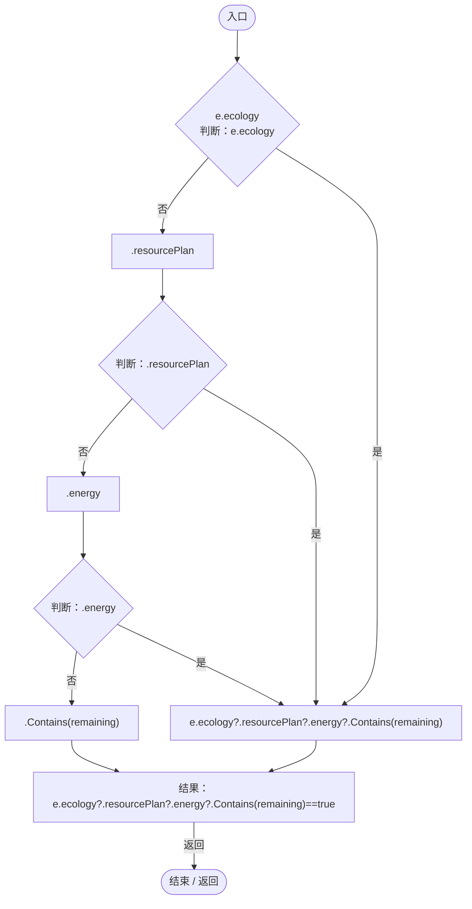

## 回调@85 · L85

`( … => 回调`

### Editor · Roslyn编译器控制流

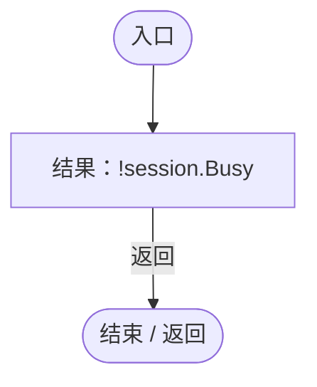

项目内调用/回调引用：

- [WorldSessionManager.Busy.get · L24](08741c7b7b9d9344.md#m4483e2e4f28f7c85)（访问器）

## 回调@90 · L90

`c … => 回调`

### Editor · Roslyn编译器控制流

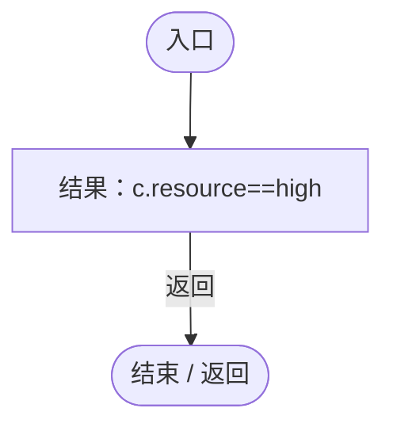
