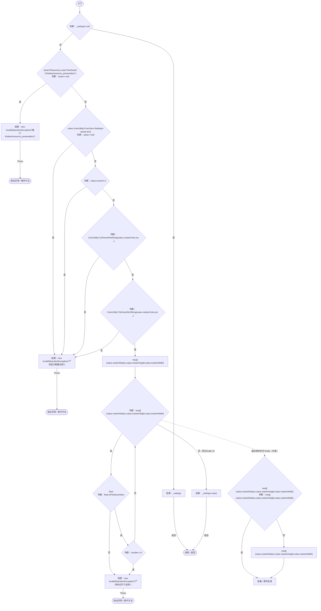
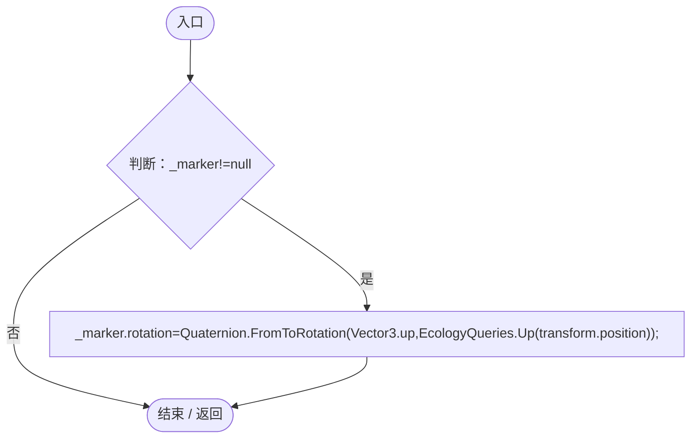
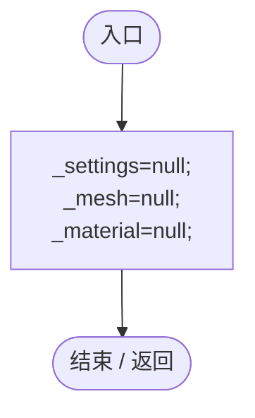

```mermaid
flowchart TD
  b0(["入口"])
  b1{"config=Load()<br/>renderer=GetComponent&lt;Renderer&gt;()<br/>block=new MaterialPropertyBlock()<br/>renderer.GetPropertyBlock(block);<br/>ColorUtility.TryParseHtmlString(config.corpseColor,out var color);<br/>block.SetColor(&quot;_BaseColor&quot;,color);<br/>block.SetColor(&quot;_C…"}
  b2["vertices=new Vector3[8]<br/>triangles=new int[12]"]
  b3["i=0"]
  b4{"判断：i&lt;2"}
  b5{"-config.markerRadius<br/>config.markerHeight<br/>判断：i==0"}
  b6["-1"]
  b7["1"]
  b8["a=new Vector3(-config.markerRadius,config.markerHeight,(i==0?-1:1)*config.markerRadius)"]
  b9{"config.markerRadius<br/>config.markerHeight<br/>判断：i==0"}
  b10["1"]
  b11["-1"]
  b12["b=new Vector3(config.markerRadius,config.markerHeight,(i==0?1:-1)*config.markerRadius)"]
  b13["side=Vector3.Cross(Vector3.up,b-a).normalized*(config.markerWidth*.5f)<br/>offset=i*4<br/>index=i*6<br/>vertices[offset]=a+side;<br/>vertices[offset+1]=a-side;<br/>vertices[offset+2]=b+side;<br/>vertices[offset+3]=b-side;<br/>triangles[index]=offset;<br/>triangles[inde…"]
  b14["i++"]
  b15["_mesh<br/>new Mesh{name=&quot;Corpse status cross&quot;}<br/>name=&quot;Corpse status cross&quot;<br/>_mesh=new Mesh{name=&quot;Corpse status cross&quot;};"]
  b16["_mesh.vertices=vertices;<br/>_mesh.triangles=triangles;<br/>_mesh.RecalculateBounds();"]
  b17{"Shader.Find(&quot;Universal Render Pipeline/Unlit&quot;)<br/>判断：Shader.Find(&quot;Universal Render Pipeline/Unlit&quot;)"}
  b18["Shader.Find(&quot;Universal Render Pipeline/Unlit&quot;)"]
  b19["Shader.Find(&quot;Unlit/Color&quot;)"]
  b20["shader=Shader.Find(&quot;Universal Render Pipeline/Unlit&quot;)??Shader.Find(&quot;Unlit/Color&quot;)"]
  b21{"判断：shader==null"}
  b22["结果：new InvalidOperationException(&quot;尸体标记缺少Unlit材质&quot;)"]
  x22(["抛出异常 / 离开方法"])
  b23["_material<br/>new Material(shader){name=&quot;Corpse status marker&quot;}<br/>name=&quot;Corpse status marker&quot;<br/>_material=new Material(shader){name=&quot;Corpse status marker&quot;};"]
  b24{"ColorUtility.TryParseHtmlString(config.markerColor,out var markerColor);<br/>判断：_material.HasProperty(&quot;_BaseColor&quot;)"}
  b25["_material.SetColor(&quot;_BaseColor&quot;,markerColor);"]
  b26{"判断：_material.HasProperty(&quot;_Color&quot;)"}
  b27["_material.SetColor(&quot;_Color&quot;,markerColor);"]
  b28["marker=new GameObject(&quot;CorpseStatusMark&quot;,typeof(MeshFilter),typeof(MeshRenderer))<br/>_marker=marker.transform;<br/>_marker.SetParent(transform,false);<br/>marker.GetComponent&lt;MeshFilter&gt;().sharedMesh=_mesh;<br/>display=marker.GetComponent&lt;MeshRenderer&gt;…"]
  b29(["结束 / 返回"])
  b0 --> b1
  b1 -->|"是"| b2
  b1 -->|"否"| b28
  b2 --> b3
  b3 --> b4
  b4 -->|"是"| b5
  b4 -->|"否"| b15
  b5 -->|"是"| b6
  b5 -->|"否"| b7
  b6 --> b8
  b7 --> b8
  b8 --> b9
  b9 -->|"是"| b10
  b9 -->|"否"| b11
  b10 --> b12
  b11 --> b12
  b12 --> b13
  b13 --> b14
  b14 --> b4
  b15 --> b16
  b16 --> b17
  b17 -->|"否"| b18
  b17 -->|"是"| b19
  b18 --> b20
  b19 --> b20
  b20 --> b21
  b21 -->|"是"| b22
  b21 -->|"否"| b23
  b22 -->|"Throw"| x22
  b23 --> b24
  b24 -->|"是"| b25
  b24 -->|"否"| b26
  b25 --> b26
  b26 -->|"是"| b27
  b26 -->|"否"| b28
  b27 --> b28
  b28 --> b29

```

# ColonyResourcePresentation.cs

[返回总索引](../README.md) · `Runtime` · `Assets/DarwinPark/Entities/Ecology/ColonyResourcePresentation.cs`

[源文件](../../../Assets/DarwinPark/Entities/Ecology/ColonyResourcePresentation.cs) · 源码校验：`a5691bd4588e156cd1eb765787798387d001d42c6cfad0f90cc0fd6940be206f`

方法按源文件位置排列。事件/回调引用不表示立即执行；分支与异常说明见总索引。完整源码与可点击关系图请打开离线手册。

## Load · L13

`private static Settings Load()`

### Editor / Player · Roslyn编译器控制流

## Build · L22

`public void Build()`

### Editor / Player · Roslyn编译器控制流

项目内调用/回调引用：

- [ColonyResourcePresentation.Load · L13](274e66c9a1d98a08.md#m11195c0bc0d8b39c)（方法）
- [ColonyResourcePresentation.Align · L40](274e66c9a1d98a08.md#m6df721bb44bea756)（方法）

## Align · L40

`public void Align()`

### Editor / Player · Roslyn编译器控制流

项目内调用/回调引用：

- [EcologyQueries.Up · L41](bdf7ccc2c9c0452f.md#maca7070196f125fd)（方法）

## Reset · L41

`[RuntimeInitializeOnLoadMethod(RuntimeInitializeLoadType.SubsystemRegistration)] private static void Reset()`

### Editor / Player · Roslyn编译器控制流

