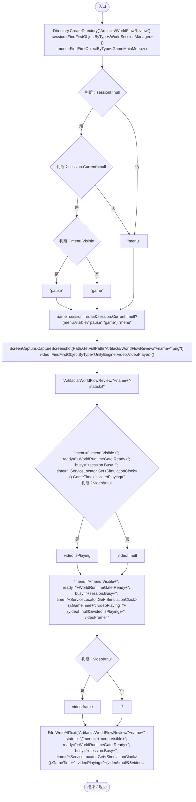
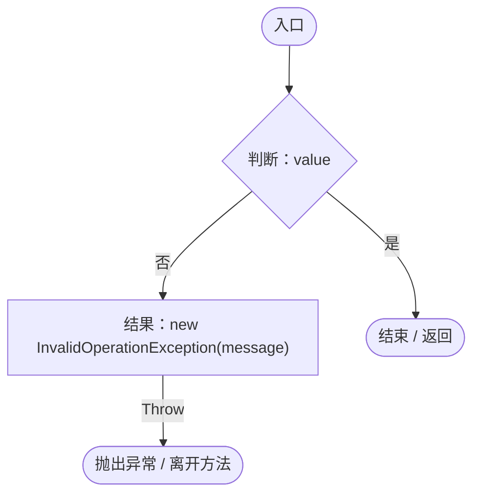
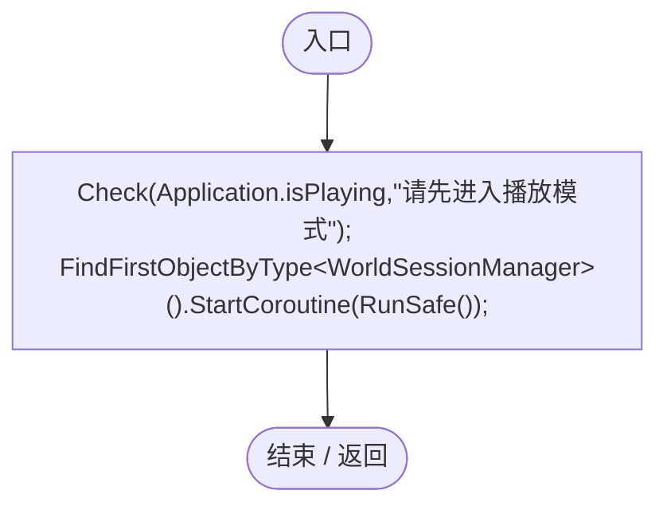
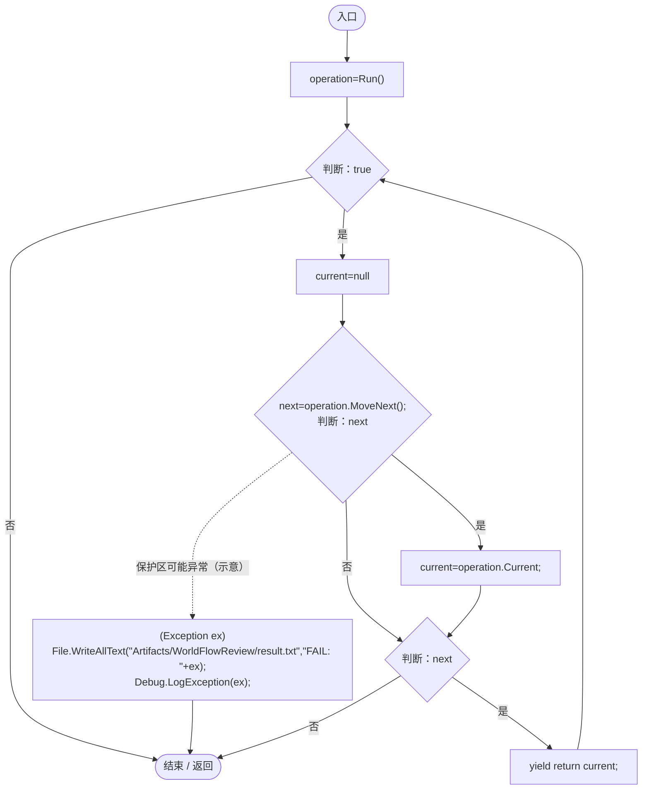
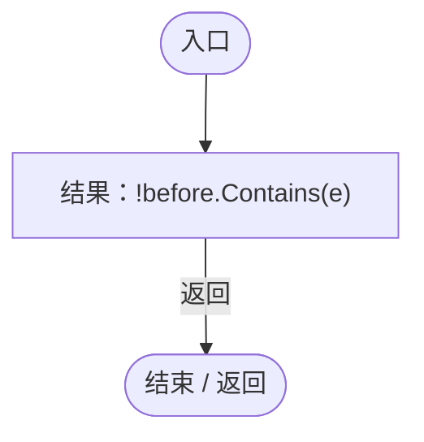

```mermaid
flowchart TD
  b0(["入口"])
  b1["Directory.CreateDirectory(&quot;Artifacts/WorldFlowReview&quot;);<br/>session=FindFirstObjectByType&lt;WorldSessionManager&gt;()<br/>menu=FindFirstObjectByType&lt;GameMainMenu&gt;()<br/>builder=FindFirstObjectByType&lt;PlanetTerrainMeshBuilder&gt;()<br/>clock=ServiceLocator.Get&lt;Si…"]
  b2{"判断：session!=null"}
  b3["menu!=null"]
  b4["session!=null"]
  b5["Check(session!=null&amp;&amp;menu!=null,&quot;场景未挂载菜单或世界会话&quot;);"]
  b6{"判断：builder.Data==null"}
  b7{"判断：clock.GameTime==0"}
  b8["menu.Visible"]
  b9["builder.Data==null&amp;&amp;clock.GameTime==0&amp;&amp;menu.Visible"]
  b10["Check(builder.Data==null&amp;&amp;clock.GameTime==0&amp;&amp;menu.Visible,&quot;启动菜单提前生成或计时&quot;);"]
  b11{"判断：Path.GetDirectoryName(GamePaths.Saves)==GamePaths.Root"}
  b12["Path.GetDirectoryName(GamePaths.Mods)==GamePaths.Root"]
  b13["Path.GetDirectoryName(GamePaths.Saves)==GamePaths.Root"]
  b14["Check(Path.GetDirectoryName(GamePaths.Saves)==GamePaths.Root&amp;&amp;Path.GetDirectoryName(GamePaths.Mods)==GamePaths.Root,&quot;默认目录不在游戏目录&quot;);"]
  b15{"判断：WorldSaveStore.SeedFromText(&quot;42&quot;)==42"}
  b16["WorldSaveStore.SeedFromText(&quot;达尔文&quot;)==WorldSaveStore.SeedFromText(&quot; 达尔文 &quot;)"]
  b17["WorldSaveStore.SeedFromText(&quot;42&quot;)==42"]
  b18["Check(WorldSaveStore.SeedFromText(&quot;42&quot;)==42&amp;&amp;WorldSaveStore.SeedFromText(&quot;达尔文&quot;)==WorldSaveStore.SeedFromText(&quot; 达尔文 &quot;),&quot;种子不稳定&quot;);"]
  b19["session.Create(&quot;&quot;,742031,.5f,20,44);<br/>previous=0"]
  b20{"判断：session.Busy"}
  b21{"判断：clock.GameTime==0"}
  b22["!clock.IsRunning"]
  b23["clock.GameTime==0"]
  b24["Check(clock.GameTime==0&amp;&amp;!clock.IsRunning,&quot;新世界加载期间计时&quot;);"]
  b25{"Check(session.Progress&gt;=previous,&quot;加载进度回退&quot;);<br/>previous=session.Progress;<br/>判断：previous&gt;.1f"}
  b26{"判断：previous&lt;.5f"}
  b27["ScreenCapture.CaptureScreenshot(Path.GetFullPath(&quot;Artifacts/WorldFlowReview/loading.png&quot;));"]
  b28["yield return null;"]
  b29{"判断：WorldRuntimeGate.Ready"}
  b30{"判断：session.Current!=null"}
  b31["!menu.Visible"]
  b32["WorldRuntimeGate.Ready&amp;&amp;session.Current!=null&amp;&amp;!menu.Visible"]
  b33["Check(WorldRuntimeGate.Ready&amp;&amp;session.Current!=null&amp;&amp;!menu.Visible,&quot;完成加载未进入游戏&quot;);"]
  b34{"判断：session.Current.name.EndsWith(&quot;_742031&quot;)"}
  b35["File.Exists(WorldSaveStore.FileFor(session.Current.id))"]
  b36["session.Current.name.EndsWith(&quot;_742031&quot;)"]
  b37["Check(session.Current.name.EndsWith(&quot;_742031&quot;)&amp;&amp;File.Exists(WorldSaveStore.FileFor(session.Current.id)),&quot;默认名字或新世界落盘失败&quot;);"]
  b38["savePath=WorldSaveStore.FileFor(session.Current.id)<br/>File.WriteAllText(&quot;Artifacts/WorldFlowReview/test-save-path.txt&quot;,savePath);<br/>yield return null;"]
  b39{"判断：clock.GameTime&gt;0"}
  b40["clock.GameTime&lt;5"]
  b41["clock.GameTime&gt;0"]
  b42["Check(clock.GameTime&gt;0&amp;&amp;clock.GameTime&lt;5,&quot;开局累计了加载时间&quot;);"]
  b43["menu.ShowPause();<br/>paused=clock.GameTime<br/>yield return new WaitForSecondsRealtime(.2f);"]
  b44{"判断：menu.Visible"}
  b45{"判断：clock.IsRunning"}
  b46{"判断：clock.GameTime==paused"}
  b47["GameInputGate.Blocked"]
  b48["menu.Visible&amp;&amp;!clock.IsRunning&amp;&amp;clock.GameTime==paused&amp;&amp;GameInputGate.Blocked"]
  b49["Check(menu.Visible&amp;&amp;!clock.IsRunning&amp;&amp;clock.GameTime==paused&amp;&amp;GameInputGate.Blocked,&quot;Esc 面板未暂停&quot;);"]
  b50["typeof(GameMainMenu).GetMethod(&quot;Resume&quot;,BindingFlags.Instance&#124;BindingFlags.NonPublic).Invoke(menu,null);"]
  b51{"判断：menu.Visible"}
  b52{"判断：GameInputGate.Blocked"}
  b53["clock.IsRunning"]
  b54["!menu.Visible&amp;&amp;!GameInputGate.Blocked&amp;&amp;clock.IsRunning"]
  b55["Check(!menu.Visible&amp;&amp;!GameInputGate.Blocked&amp;&amp;clock.IsRunning,&quot;返回游戏失败&quot;);"]
  b56["clock.RestoreState(123.5f,4);<br/>genome=new Genome()<br/>genome.Add(GeneInstance.Create(&quot;gene_growth&quot;,10,0));<br/>before=EntityRegistry.All.ToArray()<br/>DarwinEntity.Spawner(genome,builder.transform.position+Vector3.up*(builder.WaterRadius+5),&quot;存档回归实体&quot;…"]
  b57{"判断：saved.entities.Count==1"}
  b58{"判断：saved.entities[0].name==entity.DisplayName"}
  b59["saved.entities[0].favorite"]
  b60["saved.entities.Count==1&amp;&amp;saved.entities[0].name==entity.DisplayName&amp;&amp;saved.entities[0].favorite"]
  b61["Check(saved.entities.Count==1&amp;&amp;saved.entities[0].name==entity.DisplayName&amp;&amp;saved.entities[0].favorite,&quot;实体或收藏未保存&quot;);"]
  b62{"判断：saved.gameTime==123.5f"}
  b63{"判断：saved.timeScale==4"}
  b64["!saved.running"]
  b65["saved.gameTime==123.5f&amp;&amp;saved.timeScale==4&amp;&amp;!saved.running"]
  b66["Check(saved.gameTime==123.5f&amp;&amp;saved.timeScale==4&amp;&amp;!saved.running,&quot;时钟复合状态未保存&quot;);"]
  b67["saved.name=&quot;备份往返&quot;;<br/>WorldSaveStore.Write(saved);"]
  b68{"判断：File.Exists(savePath+&quot;.bak&quot;)"}
  b69["WorldSaveStore.Read(savePath+&quot;.bak&quot;).gameTime==123.5f"]
  b70["File.Exists(savePath+&quot;.bak&quot;)"]
  b71["Check(File.Exists(savePath+&quot;.bak&quot;)&amp;&amp;WorldSaveStore.Read(savePath+&quot;.bak&quot;).gameTime==123.5f,&quot;原子备份无效&quot;);"]
  b72["invalid=JsonUtility.FromJson&lt;WorldSaveData&gt;(original)<br/>invalid.definitions=null;<br/>rejected=false"]
  b73["session.Open(invalid);"]
  b74["rejected=true;"]
  b75{"判断：rejected"}
  b76{"判断：session.Busy"}
  b77["entity!=null"]
  b78["rejected&amp;&amp;!session.Busy&amp;&amp;entity!=null"]
  b79["Check(rejected&amp;&amp;!session.Busy&amp;&amp;entity!=null,&quot;损坏存档未在清场前拒绝&quot;);"]
  b80["saved=JsonUtility.FromJson&lt;WorldSaveData&gt;(original);<br/>menu.ShowPause();<br/>session.Open(saved);<br/>loadTime=clock.GameTime"]
  b81{"判断：session.Busy"}
  b82{"判断：clock.GameTime==loadTime"}
  b83["!clock.IsRunning"]
  b84["clock.GameTime==loadTime"]
  b85["Check(clock.GameTime==loadTime&amp;&amp;!clock.IsRunning,&quot;读档期间计时&quot;);"]
  b86["yield return null;"]
  b87{"判断：WorldRuntimeGate.Ready"}
  b88{"判断：clock.GameTime==123.5f"}
  b89{"判断：clock.ConfiguredTimeScale==4"}
  b90["!clock.IsRunning"]
  b91["WorldRuntimeGate.Ready&amp;&amp;clock.GameTime==123.5f&amp;&amp;clock.ConfiguredTimeScale==4&amp;&amp;!clock.IsRunning"]
  b92["Check(WorldRuntimeGate.Ready&amp;&amp;clock.GameTime==123.5f&amp;&amp;clock.ConfiguredTimeScale==4&amp;&amp;!clock.IsRunning,&quot;读档时钟/暂停恢复失败&quot;);"]
  b93["entity=EntityRegistry.All.Single();"]
  b94{"判断：entity.DisplayName==&quot;存档回归实体&quot;"}
  b95["Vector3.Distance(entity.transform.position,position)&lt;.01f"]
  b96["entity.DisplayName==&quot;存档回归实体&quot;"]
  b97["Check(entity.DisplayName==&quot;存档回归实体&quot;&amp;&amp;Vector3.Distance(entity.transform.position,position)&lt;.01f,&quot;实体位置或名字未恢复&quot;);"]
  b98{"判断：EntityFavoritesManager.Instance.IsFavorite(entity)"}
  b99["Mathf.Abs(ore.GetOreAmount(position)-amount)&lt;.001f"]
  b100["EntityFavoritesManager.Instance.IsFavorite(entity)"]
  b101["Check(EntityFavoritesManager.Instance.IsFavorite(entity)&amp;&amp;Mathf.Abs(ore.GetOreAmount(position)-amount)&lt;.001f,&quot;收藏或矿量未恢复&quot;);"]
  b102["Check(menu.Visible==false,&quot;暂停状态存档不应停在加载屏&quot;);<br/>ScreenCapture.CaptureScreenshot(Path.GetFullPath(&quot;Artifacts/WorldFlowReview/loaded.png&quot;));<br/>File.WriteAllText(&quot;Artifacts/WorldFlowReview/result.txt&quot;,&quot;PASS: deferred initial world; local save/mod…"]
  b103(["结束 / 返回"])
  b0 --> b1
  b1 --> b2
  b2 -->|"是"| b3
  b2 -->|"否"| b4
  b3 --> b5
  b4 --> b5
  b5 --> b6
  b6 -->|"是"| b7
  b6 -->|"否"| b9
  b7 -->|"是"| b8
  b7 -->|"否"| b9
  b8 --> b10
  b9 --> b10
  b10 --> b11
  b11 -->|"是"| b12
  b11 -->|"否"| b13
  b12 --> b14
  b13 --> b14
  b14 --> b15
  b15 -->|"是"| b16
  b15 -->|"否"| b17
  b16 --> b18
  b17 --> b18
  b18 --> b19
  b19 --> b20
  b20 -->|"是"| b21
  b20 -->|"否"| b29
  b21 -->|"是"| b22
  b21 -->|"否"| b23
  b22 --> b24
  b23 --> b24
  b24 --> b25
  b25 -->|"是"| b26
  b25 -->|"否"| b28
  b26 -->|"是"| b27
  b26 -->|"否"| b28
  b27 --> b28
  b28 --> b20
  b29 -->|"是"| b30
  b29 -->|"否"| b32
  b30 -->|"是"| b31
  b30 -->|"否"| b32
  b31 --> b33
  b32 --> b33
  b33 --> b34
  b34 -->|"是"| b35
  b34 -->|"否"| b36
  b35 --> b37
  b36 --> b37
  b37 --> b38
  b38 --> b39
  b39 -->|"是"| b40
  b39 -->|"否"| b41
  b40 --> b42
  b41 --> b42
  b42 --> b43
  b43 --> b44
  b44 -->|"是"| b45
  b44 -->|"否"| b48
  b45 -->|"否"| b46
  b45 -->|"是"| b48
  b46 -->|"是"| b47
  b46 -->|"否"| b48
  b47 --> b49
  b48 --> b49
  b49 --> b50
  b50 --> b51
  b51 -->|"否"| b52
  b51 -->|"是"| b54
  b52 -->|"否"| b53
  b52 -->|"是"| b54
  b53 --> b55
  b54 --> b55
  b55 --> b56
  b56 --> b57
  b57 -->|"是"| b58
  b57 -->|"否"| b60
  b58 -->|"是"| b59
  b58 -->|"否"| b60
  b59 --> b61
  b60 --> b61
  b61 --> b62
  b62 -->|"是"| b63
  b62 -->|"否"| b65
  b63 -->|"是"| b64
  b63 -->|"否"| b65
  b64 --> b66
  b65 --> b66
  b66 --> b67
  b67 --> b68
  b68 -->|"是"| b69
  b68 -->|"否"| b70
  b69 --> b71
  b70 --> b71
  b71 --> b72
  b72 --> b73
  b73 --> b75
  b74 --> b75
  b75 -->|"是"| b76
  b75 -->|"否"| b78
  b76 -->|"否"| b77
  b76 -->|"是"| b78
  b77 --> b79
  b78 --> b79
  b79 --> b80
  b80 --> b81
  b81 -->|"是"| b82
  b81 -->|"否"| b87
  b82 -->|"是"| b83
  b82 -->|"否"| b84
  b83 --> b85
  b84 --> b85
  b85 --> b86
  b86 --> b81
  b87 -->|"是"| b88
  b87 -->|"否"| b91
  b88 -->|"是"| b89
  b88 -->|"否"| b91
  b89 -->|"是"| b90
  b89 -->|"否"| b91
  b90 --> b92
  b91 --> b92
  b92 --> b93
  b93 --> b94
  b94 -->|"是"| b95
  b94 -->|"否"| b96
  b95 --> b97
  b96 --> b97
  b97 --> b98
  b98 -->|"是"| b99
  b98 -->|"否"| b100
  b99 --> b101
  b100 --> b101
  b101 --> b102
  b102 --> b103
  b73 -. "保护区可能异常（示意）" .-> b74

```

# WorldFlowRegression.cs

[返回总索引](../README.md) · `Editor` · `Assets/DarwinPark/Editor/WorldFlowRegression.cs`

[源文件](../../../Assets/DarwinPark/Editor/WorldFlowRegression.cs) · 源码校验：`fe76f159fce7320f8032fec90d5acfe21bae7a3359b3bae1fe4bf6ee4d020256`

方法按源文件位置排列。事件/回调引用不表示立即执行；分支与异常说明见总索引。完整源码与可点击关系图请打开离线手册。

## Capture · L21

`[MenuItem("Tools/Darwin Park/Capture World Flow %&F8")] public static void Capture()`

★ 新增：保留实际画面和状态证据，供 Esc/F10 与背景视频人工操作后复核。

### Editor · Roslyn编译器控制流

项目内调用/回调引用：

- [WorldSessionManager.Current.get · L21](08741c7b7b9d9344.md#m5d26a5eb846a8504)（访问器）
- [WorldSessionManager.Busy.get · L24](08741c7b7b9d9344.md#m4483e2e4f28f7c85)（访问器）
- [SimulationClock.GameTime.get · L23](a8f444aec9614b0a.md#m74adfa39a896652f)（访问器）
- [ServiceLocator.Get · L33](f2fdbe9f9ccd93cb.md#m2ae625299520c56d)（方法）

## Check · L31

`private static void Check(bool value,string message)`

### Editor · Roslyn编译器控制流

## Validate · L32

`[MenuItem("Tools/Darwin Park/Validate World Flow %&F6")] public static void Validate()`

### Editor · Roslyn编译器控制流

项目内调用/回调引用：

- [WorldFlowRegression.Check · L31](27d8b89659be5bc3.md#m98190e7c83629a71)（方法）
- [WorldFlowRegression.RunSafe · L39](27d8b89659be5bc3.md#m8154cf622682bd01)（方法）

## RunSafe · L39

`private static IEnumerator RunSafe()`

### Editor · Roslyn编译器控制流

项目内调用/回调引用：

- [WorldFlowRegression.Run · L50](27d8b89659be5bc3.md#m587b3c82b02856d6)（方法）

## Run · L50

`private static IEnumerator Run()`

### Editor · Roslyn编译器控制流

项目内调用/回调引用：

- [ServiceLocator.Get · L33](f2fdbe9f9ccd93cb.md#m2ae625299520c56d)（方法）
- [WorldFlowRegression.Check · L31](27d8b89659be5bc3.md#m98190e7c83629a71)（方法）
- [PlanetTerrainMeshBuilder.Data.get · L78](415285cf043354a9.md#m8382f579717fbc6d)（访问器）
- [SimulationClock.GameTime.get · L23](a8f444aec9614b0a.md#m74adfa39a896652f)（访问器）
- [WorldSaveStore.SeedFromText · L42](d67a35e5e3814c15.md#mb9cb09992ef718a3)（方法）
- [WorldSessionManager.Create · L41](08741c7b7b9d9344.md#m6aadfeee8b90aacd)（方法）
- [WorldSessionManager.Busy.get · L24](08741c7b7b9d9344.md#m4483e2e4f28f7c85)（访问器）
- [SimulationClock.IsRunning.get · L22](a8f444aec9614b0a.md#m10f4fe307faca0f0)（访问器）
- [WorldSessionManager.Progress.get · L22](08741c7b7b9d9344.md#mba9a7bc60b0d1863)（访问器）
- [WorldSessionManager.Current.get · L21](08741c7b7b9d9344.md#m5d26a5eb846a8504)（访问器）
- [WorldSaveStore.FileFor · L48](d67a35e5e3814c15.md#m419a625e2bcc70f8)（方法）
- [GameMainMenu.ShowPause · L89](a1f1791f9e7a8035.md#m953d85f379a39458)（方法）
- [GameInputGate.Blocked.get · L8](52955daae7e592ab.md#m765763b665829633)（访问器）
- [SimulationClock.RestoreState · L74](a8f444aec9614b0a.md#m8f617e95e1282846)（方法）
- [Genome.Add · L19](a2ef23f865bc7ee8.md#md9cfdc94b8b8d40f)（方法）
- [GeneInstance.Create · L20](f82e1498d67f5afd.md#m72e94c278de3cf8b)（方法）
- [PlanetTerrainMeshBuilder.WaterRadius.get · L94](415285cf043354a9.md#m28d8809083881ec1)（访问器）
- [EntityFavoritesManager.ToggleFavorite · L55](b60fb973e9d3815a.md#m20d366a69a0f5fdd)（方法）
- [EntityFavoritesManager.Instance.get · L10](b60fb973e9d3815a.md#m0dac2feb106bac97)（访问器）
- [PlanetOreSystem.Instance.get · L8](86b3fbb4d9436121.md#m53f6a6af4b6dc252)（访问器）
- [PlanetOreSystem.ConsumeOre · L140](86b3fbb4d9436121.md#m932f90bbc5b3ca70)（方法）
- [PlanetOreSystem.GetOreAmount · L131](86b3fbb4d9436121.md#m97fd2ce3bdae0d03)（方法）
- [WorldSessionManager.SaveNow · L157](08741c7b7b9d9344.md#mbecd8b5c222ba46b)（方法）
- [WorldSaveStore.Read · L72](d67a35e5e3814c15.md#mca362c7675a5800c)（方法）
- [WorldSaveStore.Write · L117](d67a35e5e3814c15.md#m793b97a7ba7d2029)（方法）
- [WorldSessionManager.Open · L58](08741c7b7b9d9344.md#m0a8e69a8a4fbc512)（方法）
- [EntityFavoritesManager.IsFavorite · L46](b60fb973e9d3815a.md#m441337ce7ee05333)（方法）
- [WorldFlowRegression.回调@76 · L76](27d8b89659be5bc3.md#mea6f9242c058ef3c)（回调/委托）

## 回调@76 · L76

`e … => 回调`

### Editor · Roslyn编译器控制流

