# LanEditActions.cs

[返回总索引](../README.md) · `Runtime` · `Assets/DarwinPark/UI/LanEditActions.cs`

[源文件](../../../Assets/DarwinPark/UI/LanEditActions.cs) · 源码校验：`ba34ecd440a3e294d80594d634e2ba7359f37276b61433b7e3a9cab551c606e6`

方法按源文件位置排列。事件/回调引用不表示立即执行；分支与异常说明见总索引。完整源码与可点击关系图请打开离线手册。

## Submit · L16

`public static bool Submit(LanCommand command)`

### Editor / Player · Roslyn编译器控制流

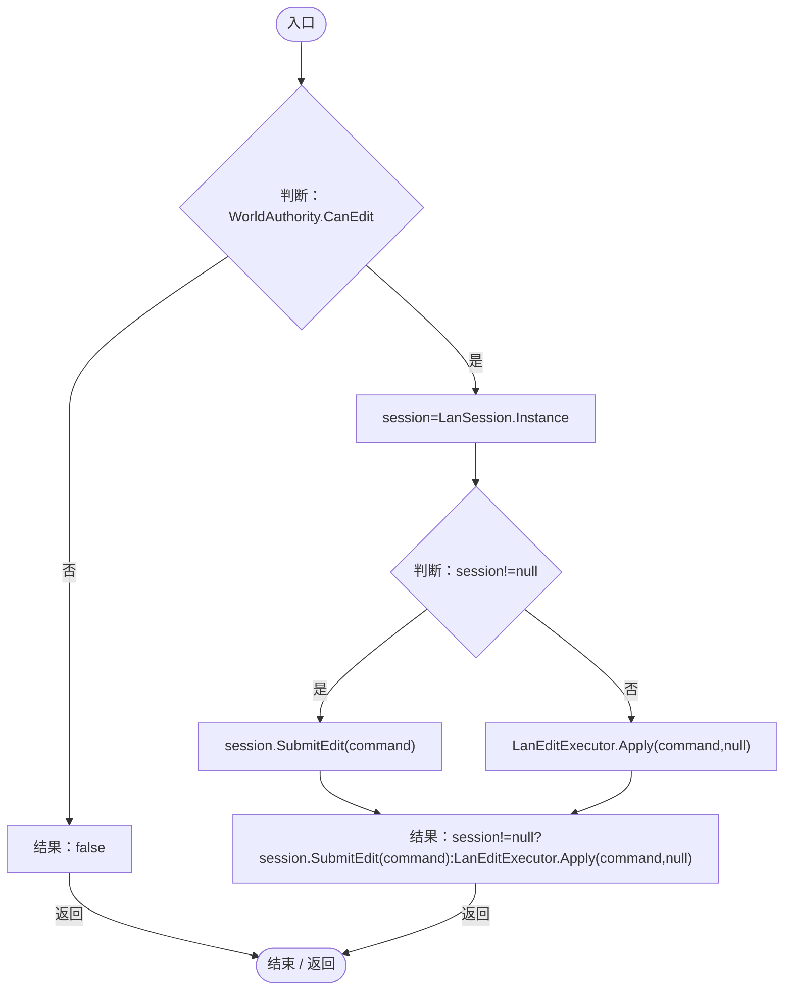

项目内调用/回调引用：

- [LanSession.Instance.get · L23](9fb633eebffe669c.md#mbf83306994878383)（访问器）
- [LanSession.SubmitEdit · L92](9fb633eebffe669c.md#mf20f22f787288df0)（方法）
- [LanEditExecutor.Apply · L27](2816321496f6360e.md#m1f827c7e486ff073)（方法）

## SetGene · L18

`public static bool SetGene(DarwinEntity entity,string instance,float value)`

### Editor / Player · Roslyn编译器控制流

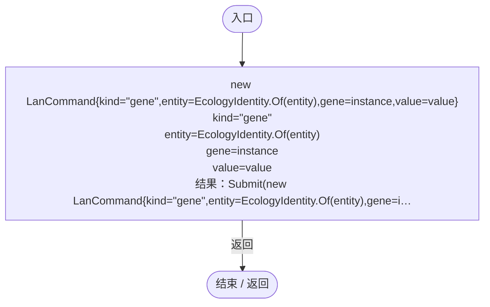

项目内调用/回调引用：

- [LanEditActions.Submit · L16](2816321496f6360e.md#m5411c4b97ac4c898)（方法）
- [EcologyIdentity.Of · L21](bdf7ccc2c9c0452f.md#m1143cf9570a93b72)（方法）

## AddGene · L19

`public static bool AddGene(DarwinEntity entity,string definition)`

### Editor / Player · Roslyn编译器控制流

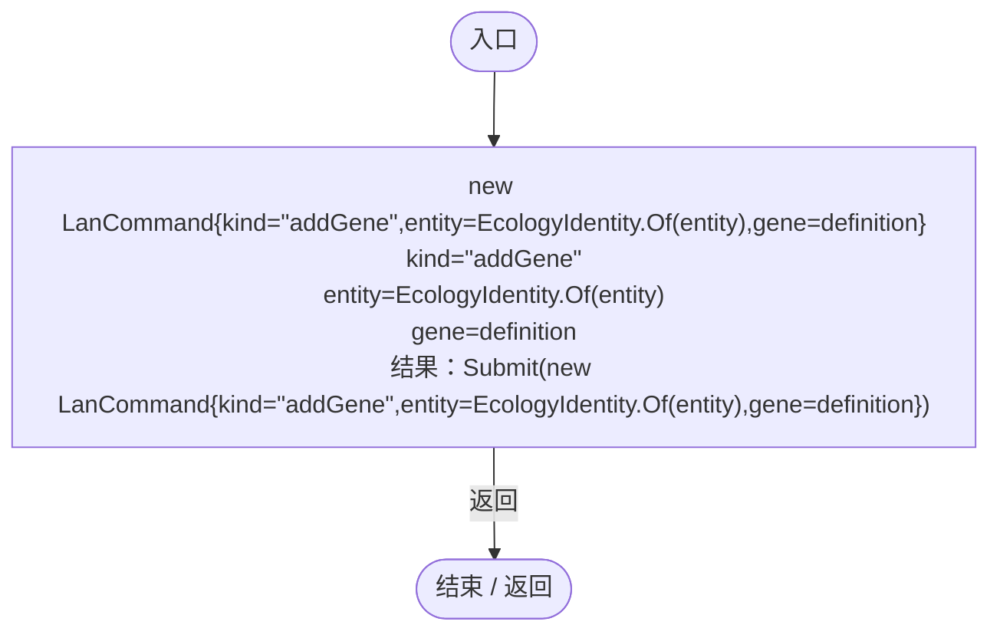

项目内调用/回调引用：

- [LanEditActions.Submit · L16](2816321496f6360e.md#m5411c4b97ac4c898)（方法）
- [EcologyIdentity.Of · L21](bdf7ccc2c9c0452f.md#m1143cf9570a93b72)（方法）

## Rename · L20

`public static bool Rename(DarwinEntity entity,string name)`

### Editor / Player · Roslyn编译器控制流

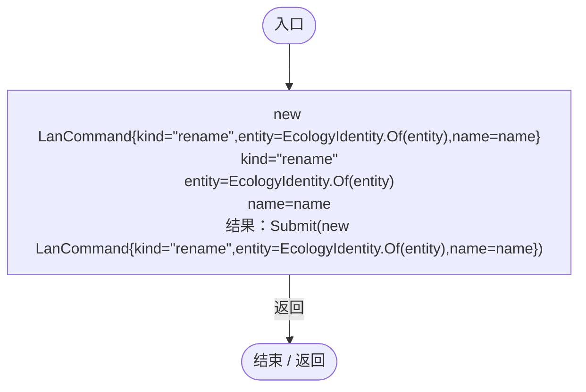

项目内调用/回调引用：

- [LanEditActions.Submit · L16](2816321496f6360e.md#m5411c4b97ac4c898)（方法）
- [EcologyIdentity.Of · L21](bdf7ccc2c9c0452f.md#m1143cf9570a93b72)（方法）

## Spawn · L21

`public static bool Spawn(Genome genome,Vector3 point)`

### Editor / Player · Roslyn编译器控制流

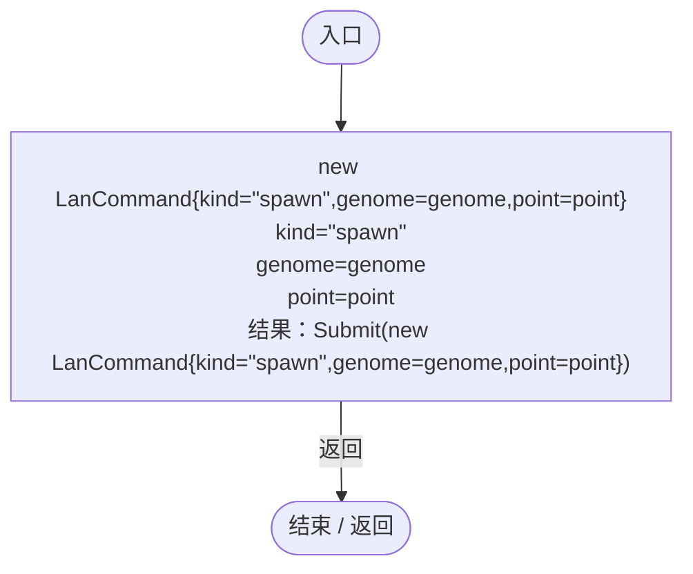

项目内调用/回调引用：

- [LanEditActions.Submit · L16](2816321496f6360e.md#m5411c4b97ac4c898)（方法）

## Parameter · L22

`public static bool Parameter(string id,float value)`

### Editor / Player · Roslyn编译器控制流

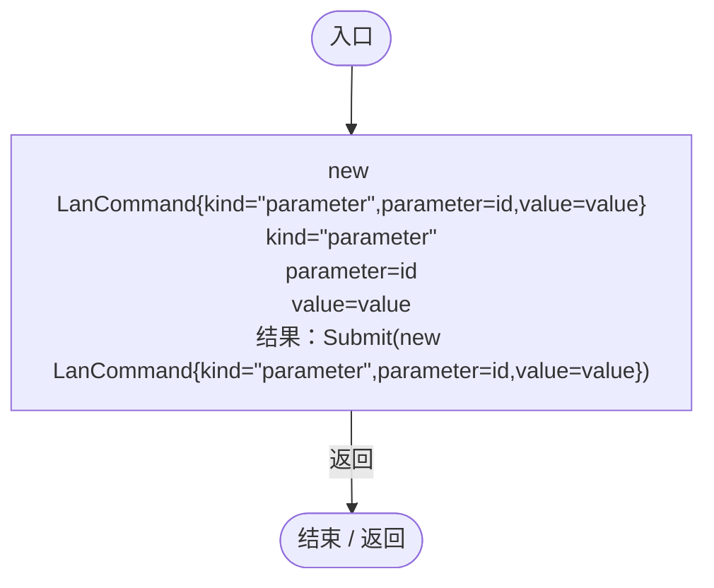

项目内调用/回调引用：

- [LanEditActions.Submit · L16](2816321496f6360e.md#m5411c4b97ac4c898)（方法）

## Profile · L23

`public static bool Profile(Dictionary<string,string> catalog,GeneTreeDocument tree)`

### Editor / Player · Roslyn编译器控制流

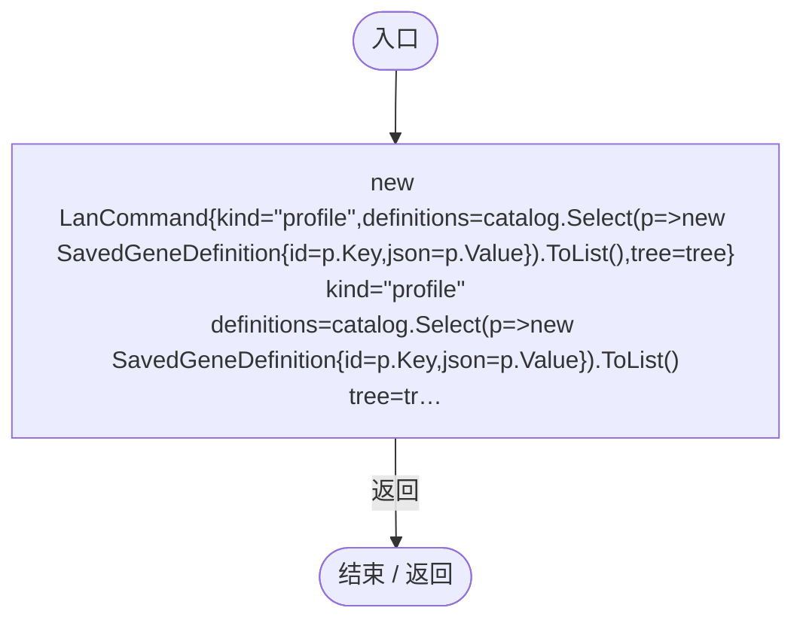

项目内调用/回调引用：

- [LanEditActions.Submit · L16](2816321496f6360e.md#m5411c4b97ac4c898)（方法）
- [LanEditActions.回调@23 · L23](2816321496f6360e.md#m1a67915eb1124065)（回调/委托）

## 回调@23 · L23

`p … => 回调`

### Editor / Player · Roslyn编译器控制流

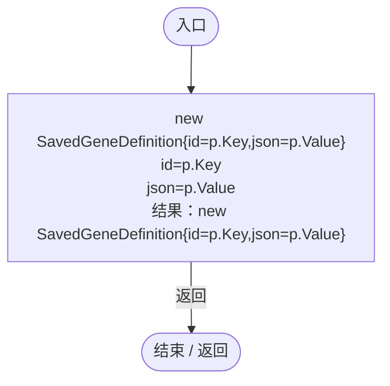

## Apply · L27

`public static bool Apply(LanCommand command,LanSession session)`

### Editor / Player · Roslyn编译器控制流

```mermaid
flowchart TD
  b0(["入口"])
  b1{"判断：command==null"}
  b2{"判断：WorldRuntimeGate.Loading"}
  b3["结果：false"]
  b4["entity=EcologyIdentity.Find(command.entity)"]
  b5["command.kind"]
  b6{"判断：&quot;worldSettings&quot;"}
  b7["结果：WorldEntityActions.SetLimit(command.count,command.running)"]
  b8{"判断：&quot;clearEntities&quot;"}
  b9["结果：WorldEntityActions.ClearAll()"]
  b10{"判断：&quot;gene&quot;"}
  b11{"判断：EcologyQueries.Alive(entity)"}
  b12{"判断：LanSession.Finite(command.value)"}
  b13["结果：false"]
  b14{"gene=entity.Genes.Genome.Find(command.gene)<br/>判断：gene==null"}
  b15["结果：false"]
  b16["gene.Value=Mathf.Clamp(command.value,0,100);<br/>entity.Genes.Recalculate();<br/>结果：true"]
  b17{"判断：&quot;addGene&quot;"}
  b18{"判断：EcologyQueries.Alive(entity)"}
  b19{"判断：entity.Genes.Genome.Genes.Count&gt;=LanSettings.Current.maximumGenomeGenes"}
  b20["结果：false"]
  b21{"definition=GeneDatabase.All.FirstOrDefault(g=&gt;g.Id==command.gene)<br/>判断：definition==null"}
  b22["结果：false"]
  b23["entity.Genes.Genome.Add(GeneInstance.Create(definition.Id,50,definition.Tier));<br/>entity.Genes.Recalculate();<br/>结果：true"]
  b24{"判断：&quot;rename&quot;"}
  b25{"判断：EcologyQueries.Alive(entity)"}
  b26["结果：false"]
  b27{"entity.DisplayName<br/>判断：string.IsNullOrWhiteSpace(command.name)"}
  b28["entity.Genes.GetRandomName()"]
  b29["command.name.Trim().Substring(0,Mathf.Min(command.name.Trim().Length,64))"]
  b30["entity.DisplayName=string.IsNullOrWhiteSpace(command.name)?entity.Genes.GetRandomName():command.name.Trim().Substring(0,Mathf.Min(command.name.Trim().Length,64));"]
  b31["结果：true"]
  b32{"判断：&quot;spawn&quot;"}
  b33{"判断：EntityPopulationLimit.CanSpawn"}
  b34{"判断：LanSession.Finite(command.point)"}
  b35{"判断：ValidGenome(command.genome)"}
  b36{"判断：DarwinEntity.Spawner==null"}
  b37["结果：false"]
  b38{"surfacePoint=EcologyQueries.Surface(command.point)<br/>altitude=Vector3.Dot(command.point-surfacePoint,EcologyQueries.Up(surfacePoint))<br/>判断：LanSession.Finite(altitude)"}
  b39["结果：false"]
  b40["DarwinEntity.Spawner(EntityPlacementUtility.CopyGenome(command.genome),surfacePoint+EcologyQueries.Up(surfacePoint)*Mathf.Clamp(altitude,0,EcologyQueries.Planet.heightScale),&quot;&quot;);<br/>结果：true"]
  b41{"判断：&quot;batch&quot;"}
  b42{"判断：LanSession.Finite(command.point)"}
  b43{"判断：LanSession.Finite(command.value)"}
  b44{"判断：LanSession.Finite(command.scale)"}
  b45{"判断：ValidGenome(command.genome)"}
  b46["结果：false"]
  b47{"planet=Object.FindFirstObjectByType&lt;PlanetTerrainMeshBuilder&gt;()<br/>判断：planet==null"}
  b48["结果：false"]
  b49["point=EcologyQueries.Surface(command.point)<br/>结果：EntityPlacementUtility.SpawnBatch(command.genome,point,EcologyQueries.Up(point),Mathf.Clamp(command.value,0,planet.heightScale),Mathf.Clamp(command.count,1,RandomPlanetSpawner.Ensure(Service…"]
  b50{"判断：&quot;random&quot;"}
  b51{"判断：ValidGenome(command.genome)"}
  b52["RandomPlanetSpawner.Ensure(ServiceLocator.Get&lt;SimulationClock&gt;().gameObject).StartBatch(command.genome,command.count,command.landOnly)"]
  b53["ValidGenome(command.genome)"]
  b54["结果：ValidGenome(command.genome)&amp;&amp;RandomPlanetSpawner.Ensure(ServiceLocator.Get&lt;SimulationClock&gt;().gameObject).StartBatch(command.genome,command.count,command.landOnly)"]
  b55{"判断：&quot;randomRecipe&quot;"}
  b56["结果：RandomPlanetSpawner.Ensure(ServiceLocator.Get&lt;SimulationClock&gt;().gameObject).StartRecipe(command.recipe,command.count,command.landOnly)"]
  b57{"判断：&quot;maintenanceSet&quot;"}
  b58["结果：PopulationMaintenance.Set(command.maintenanceRule)"]
  b59{"判断：&quot;maintenanceRemove&quot;"}
  b60["结果：PopulationMaintenance.Remove(command.target)"]
  b61{"判断：&quot;randomCancel&quot;"}
  b62["RandomPlanetSpawner.Ensure(ServiceLocator.Get&lt;SimulationClock&gt;().gameObject).Cancel();<br/>结果：true"]
  b63{"判断：&quot;time&quot;"}
  b64{"判断：LanSession.Finite(command.scale)"}
  b65{"判断：command.scale&lt;0"}
  b66{"判断：command.scale&gt;LanSettings.Current.maximumTimeScale"}
  b67["结果：false"]
  b68{"clock=ServiceLocator.Get&lt;SimulationClock&gt;()<br/>clock.SetTimeScale(command.scale);<br/>判断：command.running"}
  b69["clock.Play();"]
  b70["clock.Pause();"]
  b71["结果：true"]
  b72{"判断：&quot;parameter&quot;"}
  b73{"判断：command.name==null"}
  b74{"判断：LanSession.Finite(command.value)"}
  b75["结果：false"]
  b76["WorldParameterUpdate.Ensure()<br/>command.parameter"]
  b77{"command.name<br/>判断：command.name"}
  b78["command.name"]
  b79["command.value.ToString(&quot;R&quot;,System.Globalization.CultureInfo.InvariantCulture)"]
  b80["结果：WorldParameterUpdate.Ensure().Request(command.parameter,command.name??command.value.ToString(&quot;R&quot;,System.Globalization.CultureInfo.InvariantCulture),out _)"]
  b81{"判断：&quot;profile&quot;"}
  b82{"判断：command.definitions==null"}
  b83{"判断：command.definitions.Count&gt;LanSettings.Current.maximumGeneDefinitions"}
  b84{"判断：command.tree==null"}
  b85["结果：false"]
  b86["catalog=command.definitions.ToDictionary(d=&gt;d.id,d=&gt;d.json)"]
  b87["catalog"]
  b88{"判断：catalog"}
  b89["var"]
  b90{"parsed=JsonUtility.FromJson&lt;GeneDefinitionJson&gt;(pair.Value)<br/>判断：System.Text.RegularExpressions.Regex.IsMatch(pair.Key,&quot;^[A-Za-z0-9_-]+$&quot;)"}
  b91{"判断：parsed==null"}
  b92{"判断：parsed.id!=pair.Key"}
  b93{"判断：System.Enum.TryParse&lt;GeneCategory&gt;(parsed.category,true,out _)"}
  b94["结果：false"]
  b95["catalog"]
  b96{"判断：catalog.Count==0"}
  b97{"判断：EntityRegistry.All.Any(e=&gt;e.Genes.Genome.Genes.Any(g=&gt;!catalog.ContainsKey(g.DefinitionId)))"}
  b98["结果：false"]
  b99["GeneTreeStorage.Validate(command.tree,catalog);<br/>PopulationMaintenance.Validate(PopulationMaintenance.Capture(),catalog.Keys);<br/>GeneRuntimeProfile.Catalog=catalog;<br/>GeneRuntimeProfile.Tree=command.tree;<br/>GeneDatabase.Reload();<br/>GeneDatabase.E…"]
  b100["EntityRegistry.All"]
  b101{"判断：EntityRegistry.All"}
  b102["var<br/>current.Genes.Recalculate();"]
  b103{"判断：EntityRegistry.All"}
  b104["EntityRegistry.All"]
  b105["连接 / 离开区域"]
  b106["结果：true"]
  b107{"判断：&quot;save&quot;"}
  b108["Object.FindFirstObjectByType&lt;WorldSessionManager&gt;().SaveNow();<br/>结果：true"]
  b109["结果：false"]
  b110(["结束 / 返回"])
  b0 --> b1
  b1 -->|"否"| b2
  b1 -->|"是"| b3
  b2 -->|"是"| b3
  b2 -->|"否"| b4
  b3 -->|"返回"| b110
  b4 --> b5
  b5 --> b6
  b6 -->|"是"| b7
  b6 -->|"否"| b8
  b7 -->|"返回"| b110
  b8 -->|"是"| b9
  b8 -->|"否"| b10
  b9 -->|"返回"| b110
  b10 -->|"是"| b11
  b10 -->|"否"| b17
  b11 -->|"是"| b12
  b11 -->|"否"| b13
  b12 -->|"否"| b13
  b12 -->|"是"| b14
  b13 -->|"返回"| b110
  b14 -->|"是"| b15
  b14 -->|"否"| b16
  b15 -->|"返回"| b110
  b16 -->|"返回"| b110
  b17 -->|"是"| b18
  b17 -->|"否"| b24
  b18 -->|"是"| b19
  b18 -->|"否"| b20
  b19 -->|"是"| b20
  b19 -->|"否"| b21
  b20 -->|"返回"| b110
  b21 -->|"是"| b22
  b21 -->|"否"| b23
  b22 -->|"返回"| b110
  b23 -->|"返回"| b110
  b24 -->|"是"| b25
  b24 -->|"否"| b32
  b25 -->|"否"| b26
  b25 -->|"是"| b27
  b26 -->|"返回"| b110
  b27 -->|"是"| b28
  b27 -->|"否"| b29
  b28 --> b30
  b29 --> b30
  b30 --> b31
  b31 -->|"返回"| b110
  b32 -->|"是"| b33
  b32 -->|"否"| b41
  b33 -->|"是"| b34
  b33 -->|"否"| b37
  b34 -->|"是"| b35
  b34 -->|"否"| b37
  b35 -->|"是"| b36
  b35 -->|"否"| b37
  b36 -->|"是"| b37
  b36 -->|"否"| b38
  b37 -->|"返回"| b110
  b38 -->|"否"| b39
  b38 -->|"是"| b40
  b39 -->|"返回"| b110
  b40 -->|"返回"| b110
  b41 -->|"是"| b42
  b41 -->|"否"| b50
  b42 -->|"是"| b43
  b42 -->|"否"| b46
  b43 -->|"是"| b44
  b43 -->|"否"| b46
  b44 -->|"是"| b45
  b44 -->|"否"| b46
  b45 -->|"否"| b46
  b45 -->|"是"| b47
  b46 -->|"返回"| b110
  b47 -->|"是"| b48
  b47 -->|"否"| b49
  b48 -->|"返回"| b110
  b49 -->|"返回"| b110
  b50 -->|"是"| b51
  b50 -->|"否"| b55
  b51 -->|"是"| b52
  b51 -->|"否"| b53
  b52 --> b54
  b53 --> b54
  b54 -->|"返回"| b110
  b55 -->|"是"| b56
  b55 -->|"否"| b57
  b56 -->|"返回"| b110
  b57 -->|"是"| b58
  b57 -->|"否"| b59
  b58 -->|"返回"| b110
  b59 -->|"是"| b60
  b59 -->|"否"| b61
  b60 -->|"返回"| b110
  b61 -->|"是"| b62
  b61 -->|"否"| b63
  b62 -->|"返回"| b110
  b63 -->|"是"| b64
  b63 -->|"否"| b72
  b64 -->|"是"| b65
  b64 -->|"否"| b67
  b65 -->|"否"| b66
  b65 -->|"是"| b67
  b66 -->|"是"| b67
  b66 -->|"否"| b68
  b67 -->|"返回"| b110
  b68 -->|"是"| b69
  b68 -->|"否"| b70
  b69 --> b71
  b70 --> b71
  b71 -->|"返回"| b110
  b72 -->|"是"| b73
  b72 -->|"否"| b81
  b73 -->|"是"| b74
  b73 -->|"否"| b76
  b74 -->|"否"| b75
  b74 -->|"是"| b76
  b75 -->|"返回"| b110
  b76 --> b77
  b77 -->|"否"| b78
  b77 -->|"是"| b79
  b78 --> b80
  b79 --> b80
  b80 -->|"返回"| b110
  b81 -->|"是"| b82
  b81 -->|"否"| b107
  b82 -->|"否"| b83
  b82 -->|"是"| b85
  b83 -->|"否"| b84
  b83 -->|"是"| b85
  b84 -->|"是"| b85
  b84 -->|"否"| b86
  b85 -->|"返回"| b110
  b86 --> b87
  b87 --> b88
  b88 -->|"是"| b89
  b88 -->|"否 · 经过finally 95"| b96
  b89 --> b90
  b90 -->|"是"| b91
  b90 -->|"否"| b94
  b91 -->|"否"| b92
  b91 -->|"是"| b94
  b92 -->|"否"| b93
  b92 -->|"是"| b94
  b93 -->|"否"| b94
  b93 -->|"是"| b88
  b94 -->|"返回 · 经过finally 95"| b110
  b96 -->|"否"| b97
  b96 -->|"是"| b98
  b97 -->|"是"| b98
  b97 -->|"否"| b99
  b98 -->|"返回"| b110
  b99 --> b100
  b100 --> b101
  b101 -->|"是"| b102
  b101 -->|"否 · 经过finally 103"| b106
  b102 --> b101
  b103 -->|"否"| b104
  b103 -->|"是"| b105
  b104 --> b105
  b106 -->|"返回"| b110
  b107 -->|"是"| b108
  b107 -->|"否"| b109
  b108 -->|"返回"| b110
  b109 -->|"返回"| b110
  b88 -. "退出保护区时 finally（示意）" .-> b95
  b101 -. "退出保护区时 finally（示意）" .-> b103

```

项目内调用/回调引用：

- [EcologyIdentity.Find · L20](bdf7ccc2c9c0452f.md#m58f756a3ba9ec990)（方法）
- [WorldEntityActions.SetLimit · L12](afe657f09857fa47.md#md5c2fa4e19f790fe)（方法）
- [WorldEntityActions.ClearAll · L23](afe657f09857fa47.md#m6f4e8f1fb05f5b38)（方法）
- [EcologyQueries.Alive · L38](bdf7ccc2c9c0452f.md#mb2877c487f449970)（方法）
- [LanSession.Finite · L183](9fb633eebffe669c.md#m293432d1eccb9c1e)（方法）
- [Genome.Find · L11](a2ef23f865bc7ee8.md#mfd5b2c58563def29)（方法）
- [DarwinEntity.Genes.get · L14](70798dde169f2e8b.md#m622eb1adf401d431)（访问器）
- [EntityGeneController.Recalculate · L97](7494d53178552f0e.md#m65ea735c1e0e37a1)（方法）
- [LanSettings.Current.get · L15](b87827166724b44d.md#m237a85bb88e296ff)（访问器）
- [GeneDatabase.All.get · L128](ec0a03483435a863.md#m0a367ed24734f426)（访问器）
- [Genome.Add · L19](a2ef23f865bc7ee8.md#md9cfdc94b8b8d40f)（方法）
- [GeneInstance.Create · L20](f82e1498d67f5afd.md#m72e94c278de3cf8b)（方法）
- [EntityGeneController.GetRandomName · L242](7494d53178552f0e.md#meef08ed0f4b99e2d)（方法）
- [LanSession.Finite · L182](9fb633eebffe669c.md#m751b2ad72d2d10c5)（方法）
- [LanEditExecutor.ValidGenome · L73](2816321496f6360e.md#mfc6f10bf8945fd87)（方法）
- [EcologyQueries.Surface · L47](bdf7ccc2c9c0452f.md#m2f1f6873ee5fc8df)（方法）
- [EcologyQueries.Up · L41](bdf7ccc2c9c0452f.md#maca7070196f125fd)（方法）
- [EntityPlacementUtility.CopyGenome · L62](6d2c32e632b9c147.md#m17e8d293d8491a41)（方法）
- [EntityPlacementUtility.SpawnBatch · L41](6d2c32e632b9c147.md#m19dfca56b6218af1)（方法）
- [RandomPlanetSpawner.Ensure · L24](1c13222a547b265c.md#mccefd1367aa9ded3)（方法）
- [ServiceLocator.Get · L33](f2fdbe9f9ccd93cb.md#m2ae625299520c56d)（方法）
- [RandomPlanetSpawner.StartBatch · L25](1c13222a547b265c.md#m0e4af90b5fa8372e)（方法）
- [RandomPlanetSpawner.StartRecipe · L28](1c13222a547b265c.md#md37fb84c58dea354)（方法）
- [PopulationMaintenance.Set · L124](923ccc4e86c4786c.md#m76f5780ca04e07ce)（方法）
- [PopulationMaintenance.Remove · L130](923ccc4e86c4786c.md#me38b5a7ea83f1a10)（方法）
- [RandomPlanetSpawner.Cancel · L91](1c13222a547b265c.md#m13321aa05f521986)（方法）
- [SimulationClock.SetTimeScale · L81](a8f444aec9614b0a.md#mecaa463a0561aca3)（方法）
- [SimulationClock.Play · L78](a8f444aec9614b0a.md#m7aa9e64b7de60ed0)（方法）
- [SimulationClock.Pause · L79](a8f444aec9614b0a.md#m30929d45a885d0f1)（方法）
- [WorldParameterUpdate.Request · L28](4087d9be2a65e96f.md#m942de54d110fe265)（方法）
- [WorldParameterUpdate.Ensure · L27](4087d9be2a65e96f.md#mcefc896cc38899a6)（方法）
- [GeneTreeStorage.Validate · L67](a885bad0d7dedee8.md#m3371bf1e3c5ae267)（方法）
- [PopulationMaintenance.Validate · L133](923ccc4e86c4786c.md#m8367991a7f865d40)（方法）
- [PopulationMaintenance.Capture · L132](923ccc4e86c4786c.md#m0b1ea634533e8898)（方法）
- [GeneDatabase.Reload · L145](ec0a03483435a863.md#mbf775d68c402c10e)（方法）
- [GeneDatabase.EnsureLoaded · L12](ec0a03483435a863.md#mc3e6357b9ca440f5)（方法）
- [WorldSessionManager.SaveNow · L157](08741c7b7b9d9344.md#mbecd8b5c222ba46b)（方法）
- [LanEditExecutor.回调@39 · L39](2816321496f6360e.md#m93daff292c72f48f)（回调/委托）
- [LanEditExecutor.回调@63 · L63](2816321496f6360e.md#m73e9a3d7cb4d4046)（回调/委托）
- [LanEditExecutor.回调@63 · L63](2816321496f6360e.md#m6076b630fb91d639)（回调/委托）
- [LanEditExecutor.回调@65 · L65](2816321496f6360e.md#mf6ed5921b7e4ef43)（回调/委托）

## 回调@39 · L39

`g … => 回调`

### Editor / Player · Roslyn编译器控制流

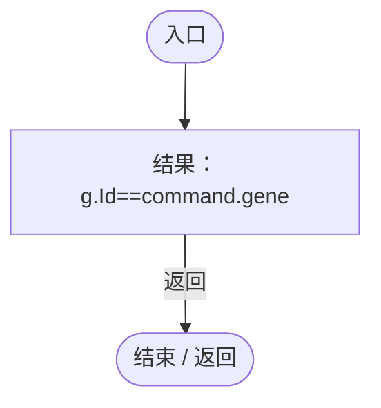

## 回调@63 · L63

`d … => 回调`

### Editor / Player · Roslyn编译器控制流

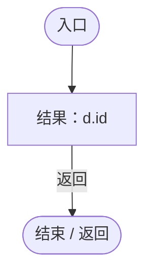

## 回调@63 · L63

`d … => 回调`

### Editor / Player · Roslyn编译器控制流

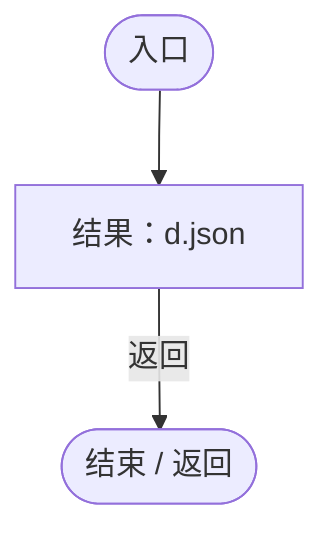

## 回调@65 · L65

`e … => 回调`

### Editor / Player · Roslyn编译器控制流

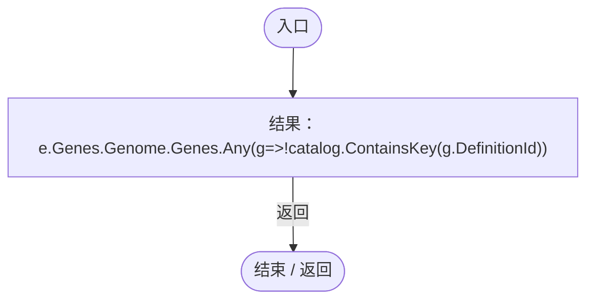

项目内调用/回调引用：

- [DarwinEntity.Genes.get · L14](70798dde169f2e8b.md#m622eb1adf401d431)（访问器）
- [LanEditExecutor.回调@65 · L65](2816321496f6360e.md#m3445042b6ae9d923)（回调/委托）

## 回调@65 · L65

`g … => 回调`

### Editor / Player · Roslyn编译器控制流

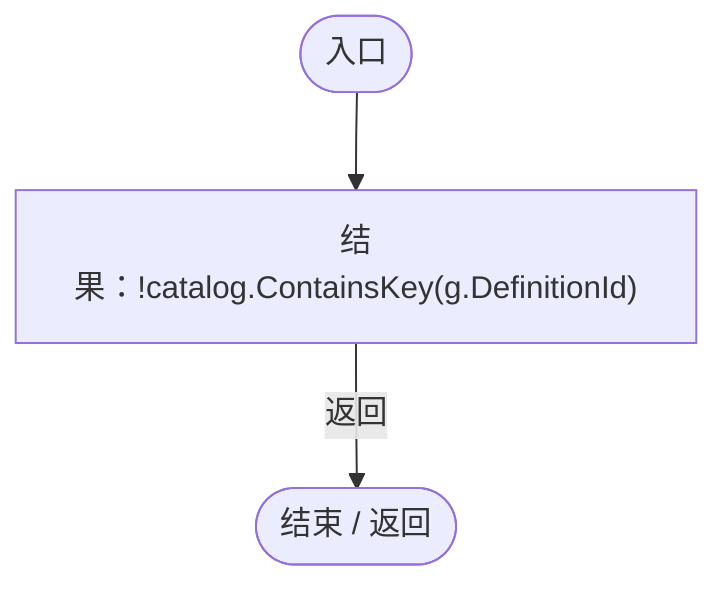

## ValidGenome · L73

`private static bool ValidGenome(Genome genome)`

### Editor / Player · Roslyn编译器控制流

```mermaid
flowchart TD
  b0(["入口"])
  b1{"判断：genome==null"}
  b2{"判断：genome.Genes!=null"}
  b3{"判断：genome.Genes.Count&lt;=LanSettings.Current.maximumGenomeGenes"}
  b4["genome.Genes.All(g=&gt;g!=null&amp;&amp;g.MissingStateIds!=null&amp;&amp;LanSession.Finite(g.CopyStrength)&amp;&amp;g.CopyStrength&gt;=0&amp;&amp;LanSession.Finite(g.Value)&amp;&amp;g.Value&gt;=0&amp;&amp;g.Value&lt;=100&amp;&amp;GeneDatabase.All.Any(d=&gt;d.Id==g.DefinitionId))"]
  b5["genome.Genes!=null&amp;&amp;genome.Genes.Count&lt;=LanSettings.Current.maximumGenomeGenes&amp;&amp;genome.Genes.All(g=&gt;g!=null&amp;&amp;g.MissingStateIds!=null&amp;&amp;LanSession.Finite(g.CopyStrength)&amp;&amp;g.CopyStrength&gt;=0&amp;&amp;LanSession.Finite(g.Value)&amp;&amp;g.Value&gt;=0&amp;&amp;g.Value&lt;=…"]
  b6["genome==null"]
  b7["结果：genome==null&#124;&#124;genome.Genes!=null&amp;&amp;genome.Genes.Count&lt;=LanSettings.Current.maximumGenomeGenes&amp;&amp;genome.Genes.All(g=&gt;g!=null&amp;&amp;g.MissingStateIds!=null&amp;&amp;LanSession.Finite(g.CopyStrength)&amp;&amp;g.CopyStrength&gt;=0&amp;&amp;LanSession.Finite(g.Value)&amp;&amp;g.Va…"]
  b8(["结束 / 返回"])
  b0 --> b1
  b1 -->|"否"| b2
  b1 -->|"是"| b6
  b2 -->|"是"| b3
  b2 -->|"否"| b5
  b3 -->|"是"| b4
  b3 -->|"否"| b5
  b4 --> b7
  b5 --> b7
  b6 --> b7
  b7 -->|"返回"| b8

```

项目内调用/回调引用：

- [LanSettings.Current.get · L15](b87827166724b44d.md#m237a85bb88e296ff)（访问器）
- [LanEditExecutor.回调@74 · L74](2816321496f6360e.md#m8305f53b05118e49)（回调/委托）

## 回调@74 · L74

`g … => 回调`

### Editor / Player · Roslyn编译器控制流

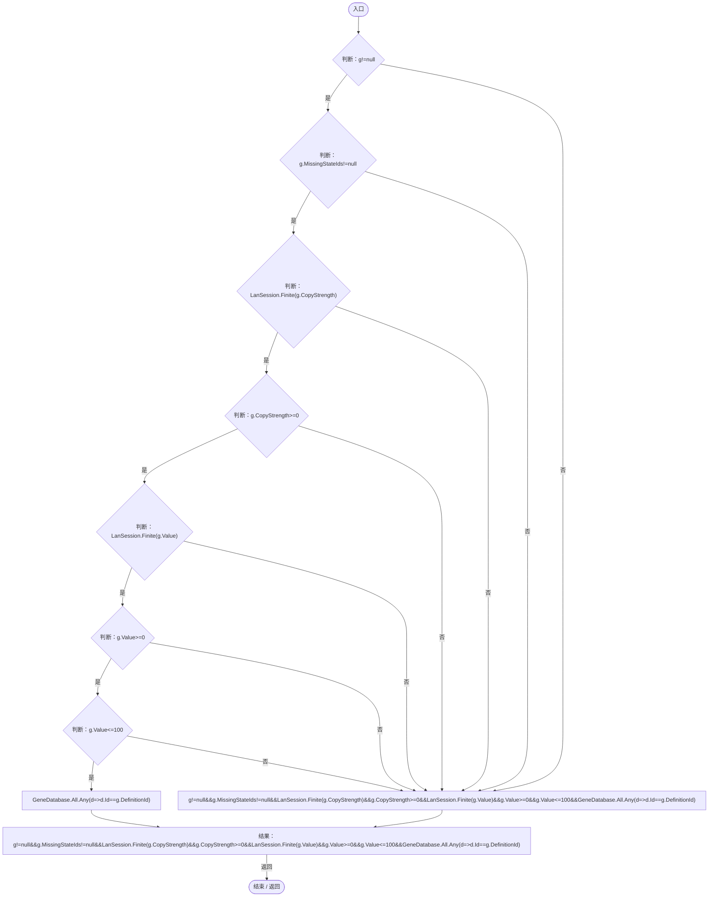

项目内调用/回调引用：

- [LanSession.Finite · L183](9fb633eebffe669c.md#m293432d1eccb9c1e)（方法）
- [GeneDatabase.All.get · L128](ec0a03483435a863.md#m0a367ed24734f426)（访问器）
- [LanEditExecutor.回调@74 · L74](2816321496f6360e.md#m074402ae9deea0e2)（回调/委托）

## 回调@74 · L74

`d … => 回调`

### Editor / Player · Roslyn编译器控制流

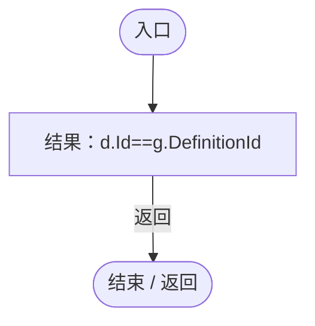
