# PlanetHydrology.cs

[返回总索引](../README.md) · `Runtime` · `Assets/DarwinPark/Planet/Terrain/PlanetHydrology.cs`

[源文件](../../../Assets/DarwinPark/Planet/Terrain/PlanetHydrology.cs) · 源码校验：`e151ef8628ec70c363c3abe02679fd1aff0a651a8231496c61deaef4e296d6e1`

方法按源文件位置排列。事件/回调引用不表示立即执行；分支与异常说明见总索引。完整源码与可点击关系图请打开离线手册。

## RiverCells.get · L12

`get`

### Editor / Player · 语法控制结构 / 声明（非CFG）

## RiverCells.set · L12

`private set`

### Editor / Player · 语法控制结构 / 声明（非CFG）

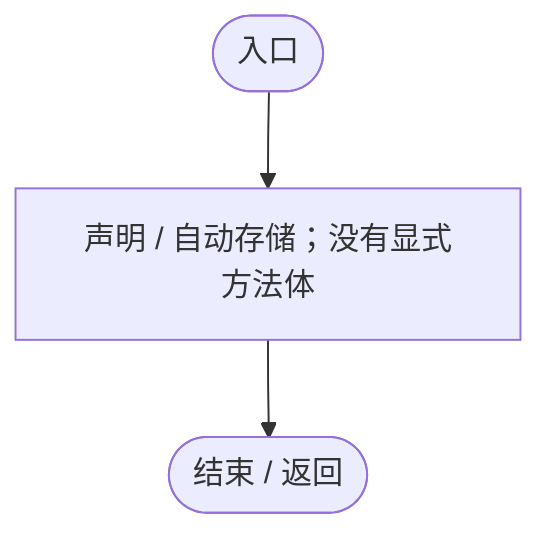

## LakeCells.get · L12

`get`

### Editor / Player · 语法控制结构 / 声明（非CFG）

## LakeCells.set · L12

`private set`

### Editor / Player · 语法控制结构 / 声明（非CFG）

## PlanetHydrology.ctor · L13

`private PlanetHydrology(PlanetTerrainData data,LandformSettings settings)`

### Editor / Player · Roslyn编译器控制流

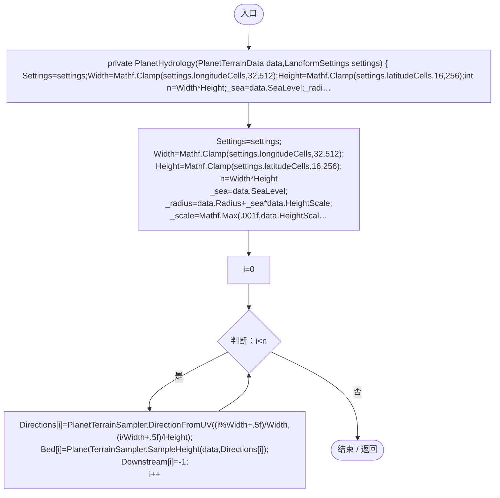

项目内调用/回调引用：

- [PlanetTerrainSampler.DirectionFromUV · L13](fd5c1d83b88a7c8b.md#mbb90aecec23f2a42)（方法）
- [PlanetTerrainSampler.SampleHeight · L32](fd5c1d83b88a7c8b.md#m759508f0c5a04b21)（方法）

## Build · L19

`public static PlanetHydrology Build(PlanetTerrainData data,LandformSettings settings)`

### Editor / Player · Roslyn编译器控制流

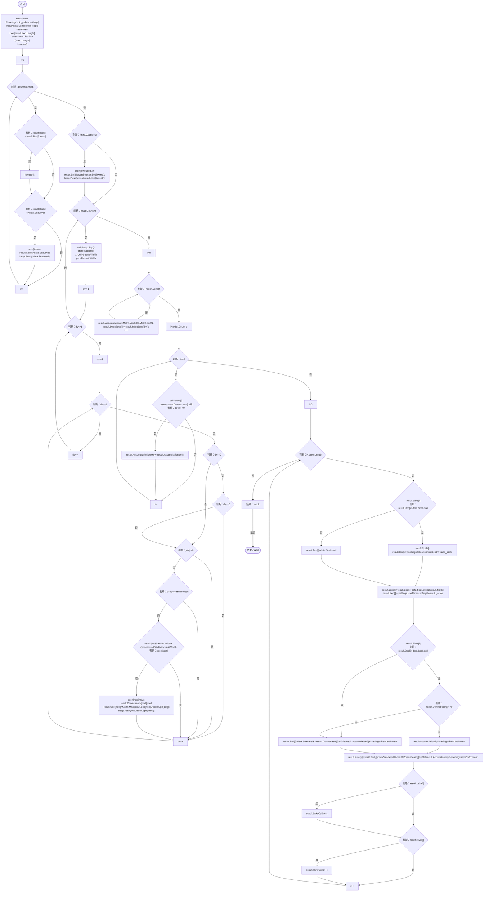

项目内调用/回调引用：

- [PlanetHydrology.PlanetHydrology.ctor · L13](282937bf06cb5f2a.md#md0f859e865fb84cd)（构造函数）
- [SurfaceMinHeap.Push · L11](958cbffd86775bce.md#mffe915cc449c4148)（方法）
- [SurfaceMinHeap.Pop · L12](958cbffd86775bce.md#m70941e2003a2c395)（方法）
- [PlanetHydrology.LakeCells.set · L12](282937bf06cb5f2a.md#mec71a491731b3bbe)（访问器）
- [PlanetHydrology.LakeCells.get · L12](282937bf06cb5f2a.md#m7813eb616b319fd2)（访问器）
- [PlanetHydrology.RiverCells.set · L12](282937bf06cb5f2a.md#m5befc1e1e23dd9db)（访问器）
- [PlanetHydrology.RiverCells.get · L12](282937bf06cb5f2a.md#m4f00628f0d856b73)（访问器）

## Cell · L33

`public int Cell(Vector3 dir)`

### Editor / Player · Roslyn编译器控制流

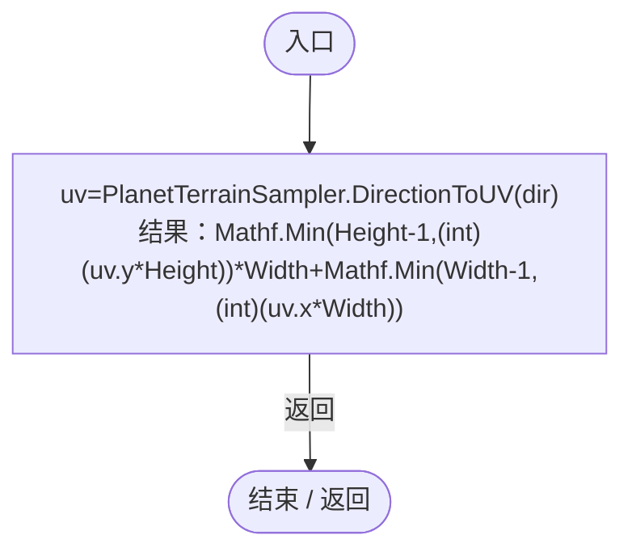

项目内调用/回调引用：

- [PlanetTerrainSampler.DirectionToUV · L24](fd5c1d83b88a7c8b.md#m3ef2b43aabed9098)（方法）

## Water · L34

`public float Water(Vector3 dir)`

### Editor / Player · Roslyn编译器控制流

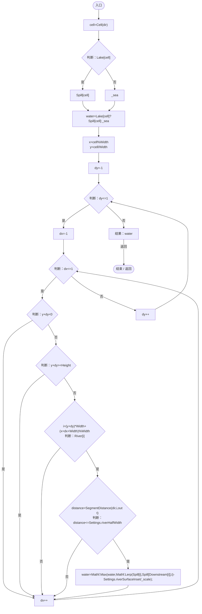

项目内调用/回调引用：

- [PlanetHydrology.Cell · L33](282937bf06cb5f2a.md#m84d3ac3310fc6a5f)（方法）
- [PlanetHydrology.SegmentDistance · L41](282937bf06cb5f2a.md#m32ed8a33f5126a5a)（方法）

## SegmentDistance · L41

`public float SegmentDistance(Vector3 direction,int river,out float t)`

### Editor / Player · Roslyn编译器控制流

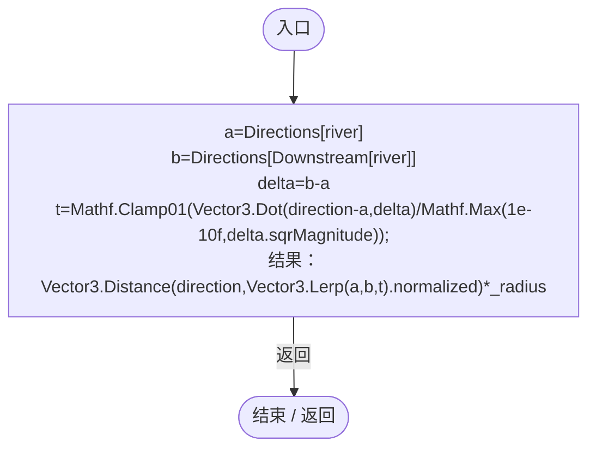

## Carved · L43

`public float Carved(Vector3 dir,float original)`

### Editor / Player · Roslyn编译器控制流

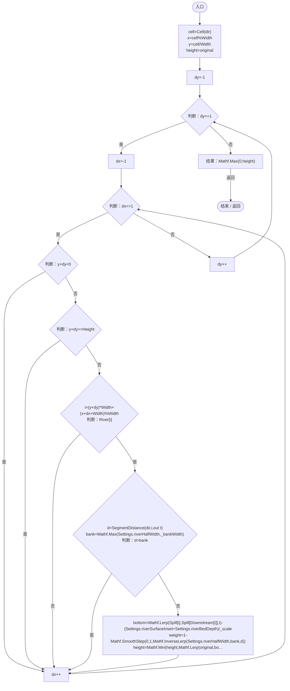

项目内调用/回调引用：

- [PlanetHydrology.Cell · L33](282937bf06cb5f2a.md#m84d3ac3310fc6a5f)（方法）
- [PlanetHydrology.SegmentDistance · L41](282937bf06cb5f2a.md#m32ed8a33f5126a5a)（方法）

## Moisture · L52

`public float Moisture(Vector3 dir)`

### Editor / Player · Roslyn编译器控制流

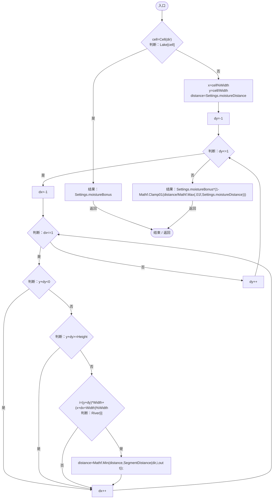

项目内调用/回调引用：

- [PlanetHydrology.Cell · L33](282937bf06cb5f2a.md#m84d3ac3310fc6a5f)（方法）
- [PlanetHydrology.SegmentDistance · L41](282937bf06cb5f2a.md#m32ed8a33f5126a5a)（方法）

## Carve · L54

`public void Carve(PlanetTerrainData data)`

### Editor / Player · Roslyn编译器控制流

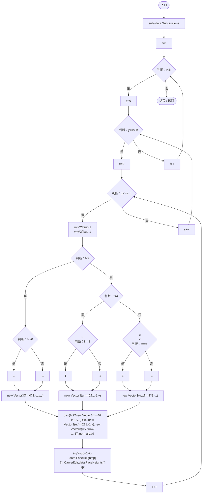

项目内调用/回调引用：

- [PlanetHydrology.Carved · L43](282937bf06cb5f2a.md#m420249d1554fe037)（方法）

## PlanetLandformField.ctor · L64

`public PlanetLandformField(LandformSettings settings,int seed)`

### Editor / Player · Roslyn编译器控制流

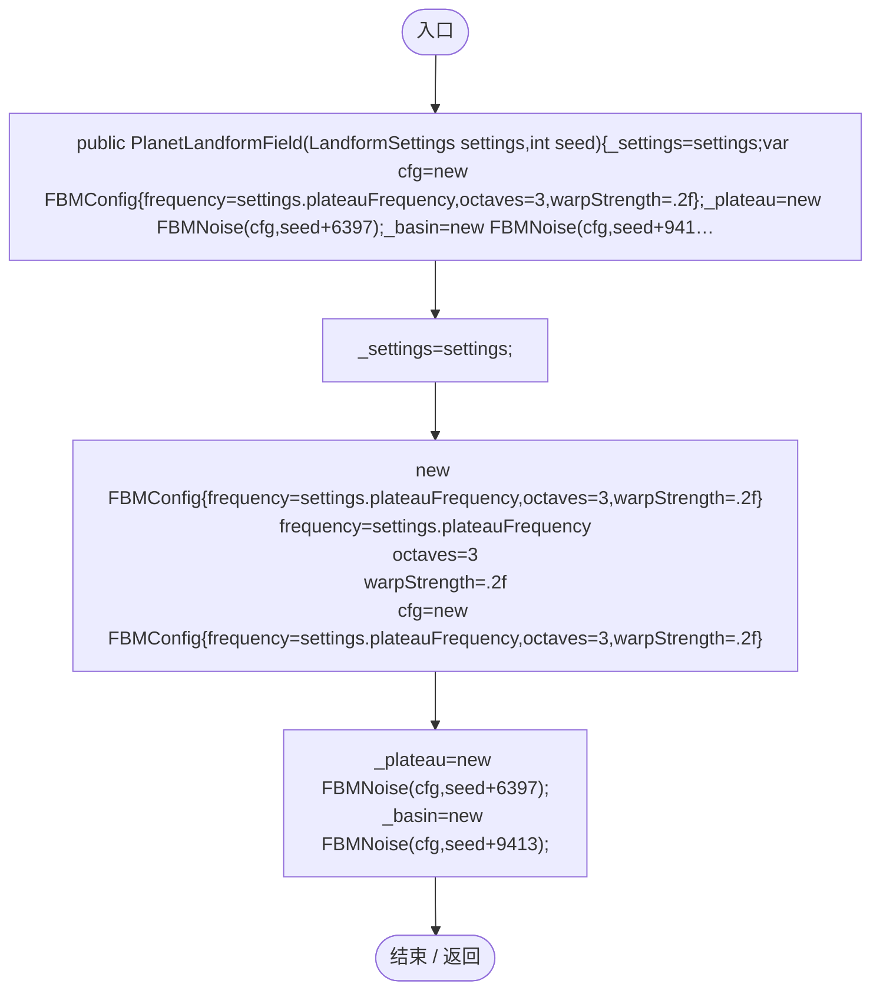

项目内调用/回调引用：

- [FBMNoise.FBMNoise.ctor · L12](8e4c1118f3935129.md#m008bcd375f95dd84)（构造函数）

## Shape · L65

`public float Shape(float height,Vector3 dir,float sea)`

### Editor / Player · Roslyn编译器控制流

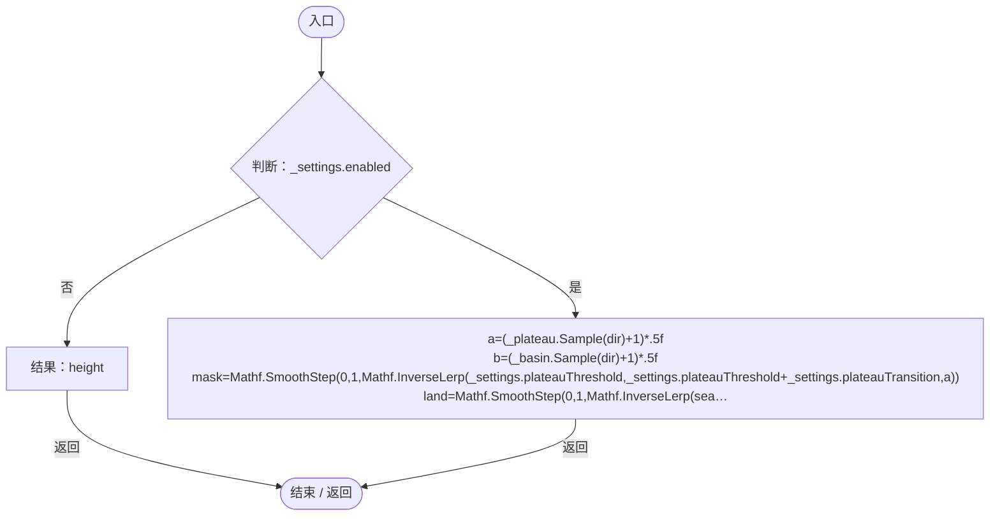

项目内调用/回调引用：

- [FBMNoise.Sample · L24](8e4c1118f3935129.md#m3997a25fbe63e25e)（方法）
