# ColonyResource.cs

[返回总索引](../README.md) · `Runtime` · `Assets/DarwinPark/Entities/Ecology/ColonyResource.cs`

[源文件](../../../Assets/DarwinPark/Entities/Ecology/ColonyResource.cs) · 源码校验：`e16ca31c44a84cd1eee1da711a51960ca9964a6991435feaa2188bb8ce529139`

方法按源文件位置排列。事件/回调引用不表示立即执行；分支与异常说明见总索引。完整源码与可点击关系图请打开离线手册。

<a id="m341a1355f4d657bf"></a>

## State.get · L22

`get`


### Editor / Player · 语法控制结构 / 声明（非CFG）

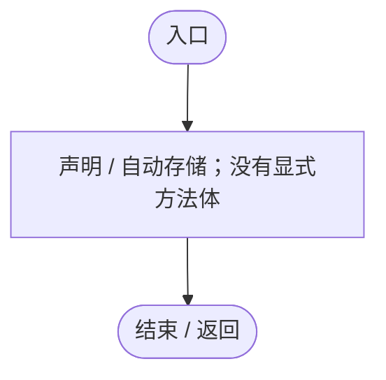

<a id="m25b5d0e12d32c1ba"></a>

## State.set · L22

`private set`


### Editor / Player · 语法控制结构 / 声明（非CFG）


<a id="me8d6540abd445f2d"></a>

## HasLiveClaim.get · L24

`public bool HasLiveClaim`

★ 适配：食腐只读领取状态；资源归属与独占状态共用同一判断。

### Editor / Player · 语法控制结构 / 声明（非CFG）

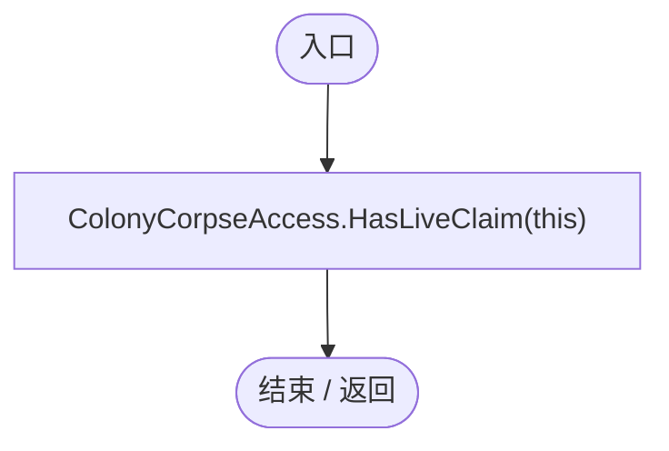

项目内调用/回调引用：

- [ColonyCorpseAccess.HasLiveClaim · L8](f6ef68cc68f39eea.md#me2731e09d1347ff7)（方法）

<a id="mcab4eda63a2c88f7"></a>

## All.get · L25

`public static IEnumerable<ColonyResource> All`


### Editor / Player · 语法控制结构 / 声明（非CFG）

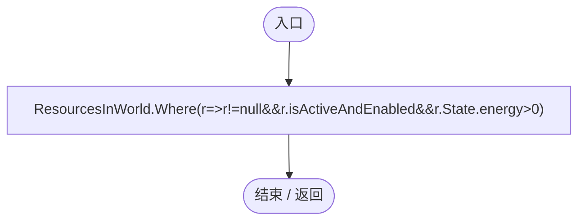

项目内调用/回调引用：

- [ColonyResource.回调@25 · L25](293dbaecfff4b585.md#maa41c6232a7fc5f2)（回调/委托）

<a id="maa41c6232a7fc5f2"></a>

## 回调@25 · L25

`r … => 回调`


### Editor / Player · 语法控制结构 / 声明（非CFG）

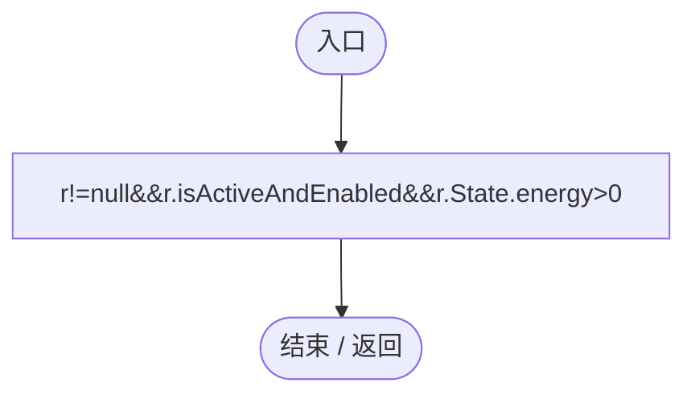

项目内调用/回调引用：

- [ColonyResource.State.get · L22](293dbaecfff4b585.md#m341a1355f4d657bf)（访问器）

<a id="m8e52e678f4038a50"></a>

## Find · L26

`public static ColonyResource Find(string id)`


### Editor / Player · Roslyn编译器控制流

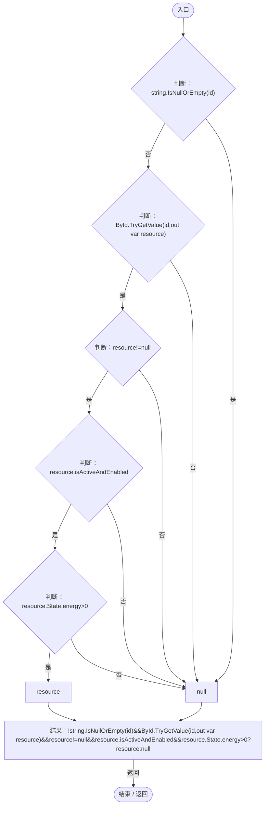

项目内调用/回调引用：

- [ColonyResource.State.get · L22](293dbaecfff4b585.md#m341a1355f4d657bf)（访问器）

<a id="m34511c47f9c43fc2"></a>

## OnEnable · L27

`private void OnEnable()`


### Editor / Player · Roslyn编译器控制流

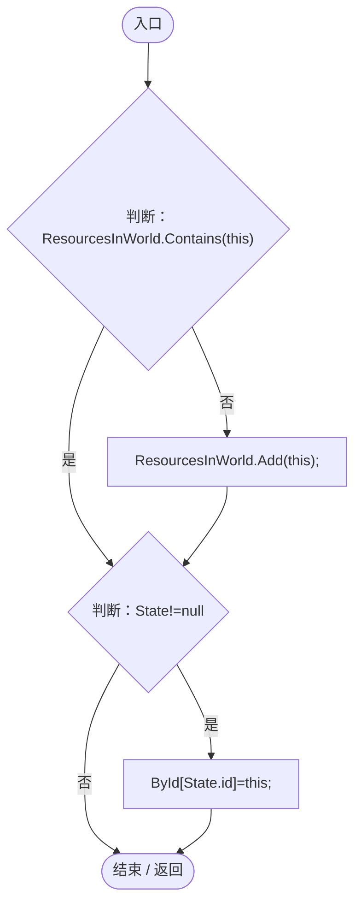

项目内调用/回调引用：

- [ColonyResource.State.get · L22](293dbaecfff4b585.md#m341a1355f4d657bf)（访问器）

<a id="m3845d54bbcdde6dd"></a>

## OnDisable · L28

`private void OnDisable()`


### Editor / Player · Roslyn编译器控制流

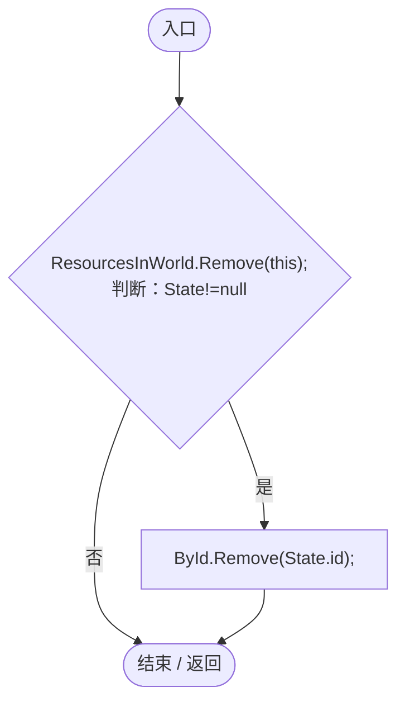

项目内调用/回调引用：

- [ColonyResource.State.get · L22](293dbaecfff4b585.md#m341a1355f4d657bf)（访问器）

<a id="md6f17aa97d6d4e3a"></a>

## Reset · L29

`[RuntimeInitializeOnLoadMethod(RuntimeInitializeLoadType.SubsystemRegistration)] private static void Reset()`


### Editor / Player · Roslyn编译器控制流

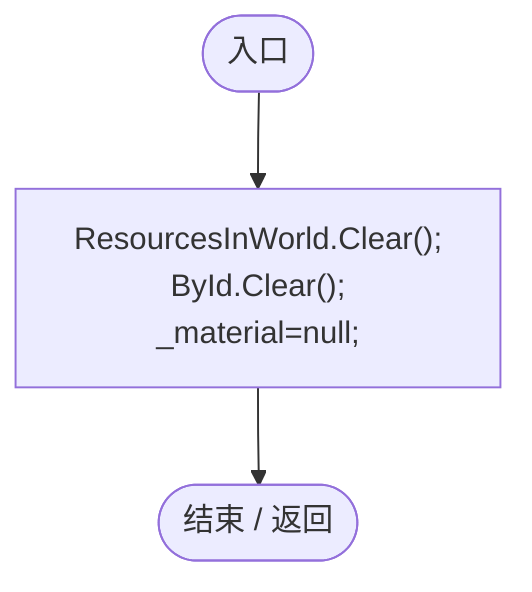

<a id="m98b1ac7eb3c22aaf"></a>

## Biomass · L30

`public static float Biomass(DarwinEntity entity)`


### Editor / Player · Roslyn编译器控制流

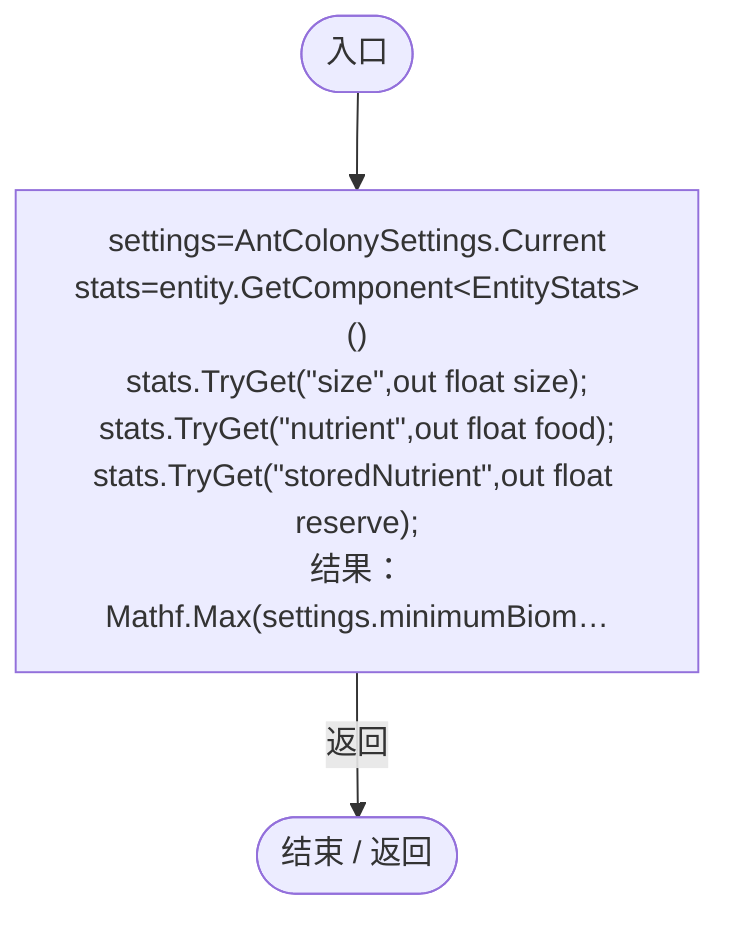

项目内调用/回调引用：

- [AntColonySettings.Current.get · L31](cb0a937e97c8fbb3.md#mcd121159f407ccdf)（访问器）
- [EntityStats.TryGet · L90](75aa86a368efdf24.md#m24ee1433e4a70d94)（方法）

<a id="m4c4f8f3dd2ed1198"></a>

## LeaveCorpse · L35

`public static ColonyResource LeaveCorpse(DarwinEntity victim,string group)`


### Editor / Player · Roslyn编译器控制流

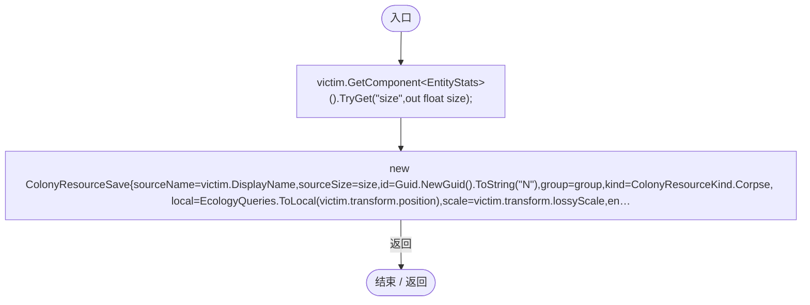

项目内调用/回调引用：

- [EntityStats.TryGet · L90](75aa86a368efdf24.md#m24ee1433e4a70d94)（方法）
- [ColonyResource.Create · L42](293dbaecfff4b585.md#ma07be53c3e3fff10)（方法）
- [EcologyQueries.ToLocal · L39](bdf7ccc2c9c0452f.md#m1a07639eacf3aa47)（方法）
- [ColonyResource.Biomass · L30](293dbaecfff4b585.md#m98b1ac7eb3c22aaf)（方法）

<a id="ma07be53c3e3fff10"></a>

## Create · L42

`public static ColonyResource Create(ColonyResourceSave data)`


### Editor / Player · Roslyn编译器控制流

```mermaid
flowchart TD
  b0(["入口"])
  b1{"判断：data.kind==ColonyResourceKind.Corpse"}
  b2["PrimitiveType.Sphere"]
  b3["PrimitiveType.Cube"]
  b4["obj=GameObject.CreatePrimitive(data.kind==ColonyResourceKind.Corpse?PrimitiveType.Sphere:PrimitiveType.Cube)"]
  b5{"obj.name<br/>判断：data.kind==ColonyResourceKind.Corpse"}
  b6["&quot;可搬运尸体&quot;"]
  b7{"判断：data.kind==ColonyResourceKind.Energy"}
  b8["&quot;能量块&quot;"]
  b9["&quot;种群能量块&quot;"]
  b10["obj.name=data.kind==ColonyResourceKind.Corpse?&quot;可搬运尸体&quot;:data.kind==ColonyResourceKind.Energy?&quot;能量块&quot;:&quot;种群能量块&quot;;"]
  b11{"collider=obj.GetComponent&lt;Collider&gt;()<br/>collider.enabled=false;<br/>Destroy(collider);<br/>判断：EcologyQueries.Planet!=null"}
  b12["obj.transform.SetParent(EcologyQueries.Planet.transform,false);"]
  b13["obj.transform.position=EcologyQueries.ToWorld(data.local);"]
  b14{"obj.transform.localScale<br/>判断：data.kind==ColonyResourceKind.Corpse"}
  b15["data.scale"]
  b16["Vector3.one*AntColonySettings.Current.energyBlockSize"]
  b17["obj.transform.localScale=data.kind==ColonyResourceKind.Corpse?data.scale:Vector3.one*AntColonySettings.Current.energyBlockSize;"]
  b18{"判断：_material==null"}
  b19{"Shader.Find(&quot;Universal Render Pipeline/Lit&quot;)<br/>判断：Shader.Find(&quot;Universal Render Pipeline/Lit&quot;)"}
  b20["Shader.Find(&quot;Universal Render Pipeline/Lit&quot;)"]
  b21["Shader.Find(&quot;Standard&quot;)"]
  b22["shader=Shader.Find(&quot;Universal Render Pipeline/Lit&quot;)??Shader.Find(&quot;Standard&quot;)"]
  b23{"判断：shader==null"}
  b24["结果：new InvalidOperationException(&quot;能量块缺少可用材质 Shader&quot;)"]
  x24(["抛出异常 / 离开方法"])
  b25["_material<br/>new Material(shader){name=&quot;Colony Resource&quot;}<br/>name=&quot;Colony Resource&quot;<br/>_material=new Material(shader){name=&quot;Colony Resource&quot;};"]
  b26["_material.EnableKeyword(&quot;_EMISSION&quot;);"]
  b27["renderer=obj.GetComponent&lt;Renderer&gt;()<br/>renderer.sharedMaterial=_material;<br/>block=new MaterialPropertyBlock()<br/>ColorUtility.TryParseHtmlString(AntColonySettings.Current.energyColor,out var energy);"]
  b28{"判断：data.kind==ColonyResourceKind.Corpse"}
  b29["new Color(.28f,.25f,.2f)"]
  b30["energy"]
  b31["color=data.kind==ColonyResourceKind.Corpse?new Color(.28f,.25f,.2f):energy"]
  b32["block.SetColor(&quot;_BaseColor&quot;,color);<br/>block.SetColor(&quot;_Color&quot;,color);"]
  b33{"block<br/>&quot;_EmissionColor&quot;<br/>判断：data.kind==ColonyResourceKind.Corpse"}
  b34["Color.black"]
  b35["energy*AntColonySettings.Current.glowIntensity"]
  b36["block.SetColor(&quot;_EmissionColor&quot;,data.kind==ColonyResourceKind.Corpse?Color.black:energy*AntColonySettings.Current.glowIntensity);"]
  b37{"renderer.SetPropertyBlock(block);<br/>判断：data.kind!=ColonyResourceKind.Corpse"}
  b38["light=obj.AddComponent&lt;Light&gt;()<br/>light.type=LightType.Point;<br/>light.color=energy;<br/>light.intensity=AntColonySettings.Current.glowIntensity;<br/>light.range=AntColonySettings.Current.glowRange;<br/>light.shadows=LightShadows.None;"]
  b39{"resource=obj.AddComponent&lt;ColonyResource&gt;()<br/>resource.State=data;<br/>ById[data.id]=resource;<br/>判断：data.kind==ColonyResourceKind.Corpse"}
  b40["resource._presentation=obj.AddComponent&lt;ColonyResourcePresentation&gt;();<br/>resource._presentation.Build();"]
  b41["结果：resource"]
  b42(["结束 / 返回"])
  b0 --> b1
  b1 -->|"是"| b2
  b1 -->|"否"| b3
  b2 --> b4
  b3 --> b4
  b4 --> b5
  b5 -->|"是"| b6
  b5 -->|"否"| b7
  b6 --> b10
  b7 -->|"是"| b8
  b7 -->|"否"| b9
  b8 --> b10
  b9 --> b10
  b10 --> b11
  b11 -->|"是"| b12
  b11 -->|"否"| b13
  b12 --> b13
  b13 --> b14
  b14 -->|"是"| b15
  b14 -->|"否"| b16
  b15 --> b17
  b16 --> b17
  b17 --> b18
  b18 -->|"是"| b19
  b18 -->|"否"| b27
  b19 -->|"否"| b20
  b19 -->|"是"| b21
  b20 --> b22
  b21 --> b22
  b22 --> b23
  b23 -->|"是"| b24
  b23 -->|"否"| b25
  b24 -->|"Throw"| x24
  b25 --> b26
  b26 --> b27
  b27 --> b28
  b28 -->|"是"| b29
  b28 -->|"否"| b30
  b29 --> b31
  b30 --> b31
  b31 --> b32
  b32 --> b33
  b33 -->|"是"| b34
  b33 -->|"否"| b35
  b34 --> b36
  b35 --> b36
  b36 --> b37
  b37 -->|"是"| b38
  b37 -->|"否"| b39
  b38 --> b39
  b39 -->|"是"| b40
  b39 -->|"否"| b41
  b40 --> b41
  b41 -->|"返回"| b42

```

项目内调用/回调引用：

- [EcologyQueries.ToWorld · L40](bdf7ccc2c9c0452f.md#m320932c05ccecbf7)（方法）
- [AntColonySettings.Current.get · L31](cb0a937e97c8fbb3.md#mcd121159f407ccdf)（访问器）
- [ColonyResource.State.set · L22](293dbaecfff4b585.md#m25b5d0e12d32c1ba)（访问器）
- [ColonyResourcePresentation.Build · L22](274e66c9a1d98a08.md#madeb13553cf40472)（方法）

<a id="mdee42e4bd6fb5563"></a>

## Claim · L65

`public bool Claim(AntColonyMember worker)`


### Editor / Player · Roslyn编译器控制流

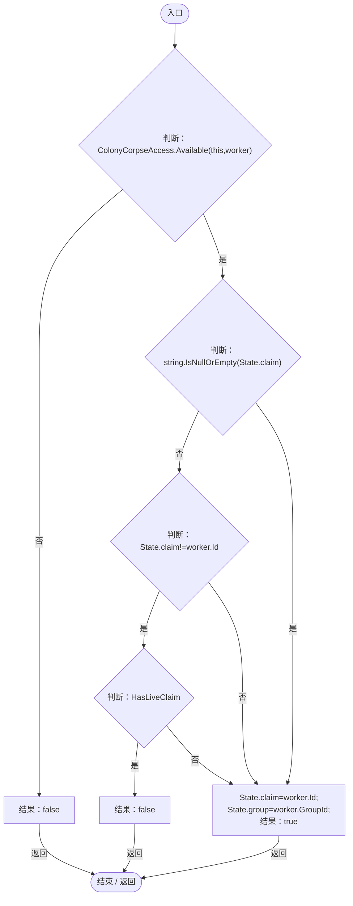

项目内调用/回调引用：

- [ColonyCorpseAccess.Available · L6](f6ef68cc68f39eea.md#m8ffa84bc06beaed6)（方法）
- [ColonyResource.State.get · L22](293dbaecfff4b585.md#m341a1355f4d657bf)（访问器）

<a id="m8e4d3a531b8701e8"></a>

## Release · L76

`public void Release(string owner)`


### Editor / Player · Roslyn编译器控制流

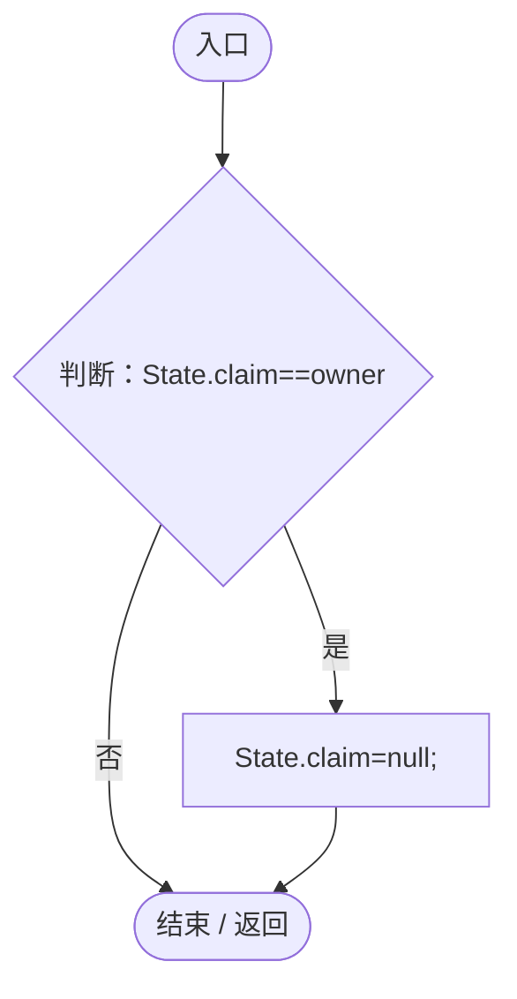

项目内调用/回调引用：

- [ColonyResource.State.get · L22](293dbaecfff4b585.md#m341a1355f4d657bf)（访问器）

<a id="mf1b53d872114d3a5"></a>

## CarryTo · L77

`public void CarryTo(Vector3 point)`


### Editor / Player · Roslyn编译器控制流

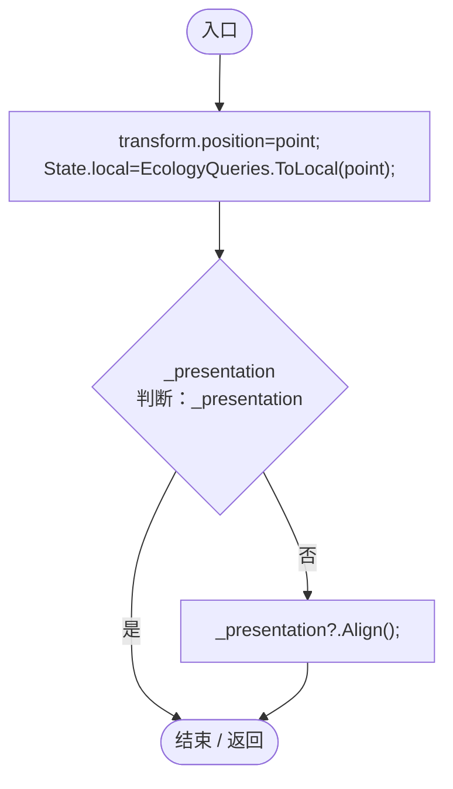

项目内调用/回调引用：

- [ColonyResource.State.get · L22](293dbaecfff4b585.md#m341a1355f4d657bf)（访问器）
- [EcologyQueries.ToLocal · L39](bdf7ccc2c9c0452f.md#m1a07639eacf3aa47)（方法）
- [ColonyResourcePresentation.Align · L40](274e66c9a1d98a08.md#m6df721bb44bea756)（方法）

<a id="m91c734732ae2bc49"></a>

## Convert · L78

`public static ColonyResource Convert(string group,Vector3 point,float energy,bool nursery)`


### Editor / Player · Roslyn编译器控制流

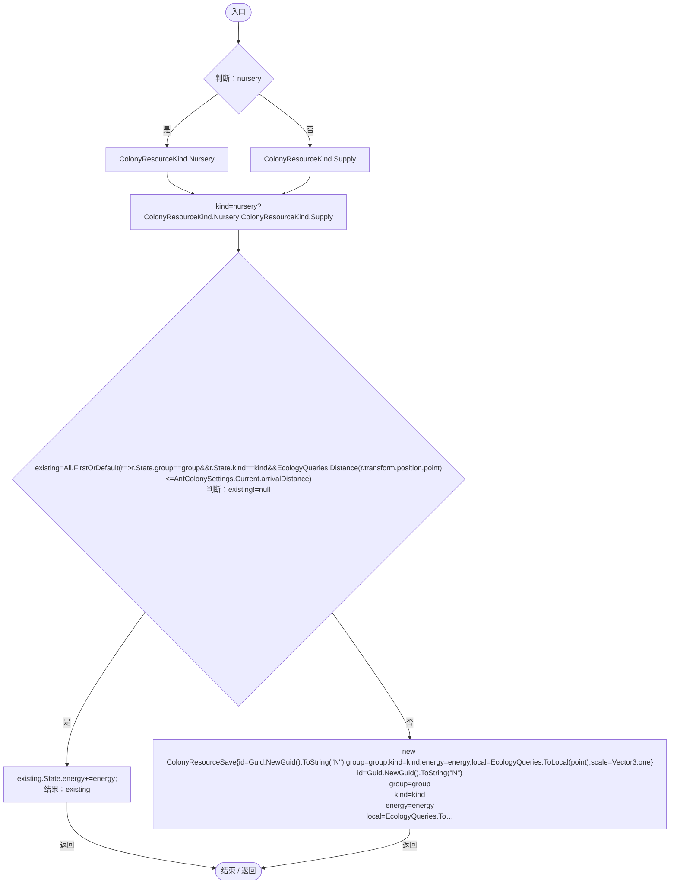

项目内调用/回调引用：

- [ColonyResource.State.get · L22](293dbaecfff4b585.md#m341a1355f4d657bf)（访问器）
- [ColonyResource.Create · L42](293dbaecfff4b585.md#ma07be53c3e3fff10)（方法）
- [EcologyQueries.ToLocal · L39](bdf7ccc2c9c0452f.md#m1a07639eacf3aa47)（方法）
- [ColonyResource.回调@81 · L81](293dbaecfff4b585.md#m533d154b40c6d544)（回调/委托）

<a id="m533d154b40c6d544"></a>

## 回调@81 · L81

`r … => 回调`


### Editor / Player · Roslyn编译器控制流

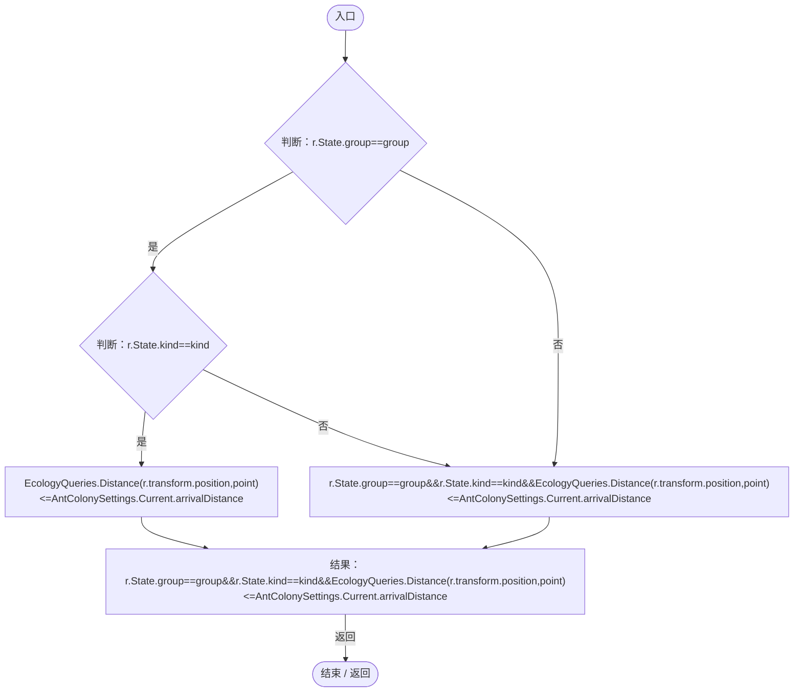

项目内调用/回调引用：

- [ColonyResource.State.get · L22](293dbaecfff4b585.md#m341a1355f4d657bf)（访问器）
- [EcologyQueries.Distance · L42](bdf7ccc2c9c0452f.md#mba9c3e3c95d0f2dd)（方法）
- [AntColonySettings.Current.get · L31](cb0a937e97c8fbb3.md#mcd121159f407ccdf)（访问器）

<a id="m1ed7b62042c6dda6"></a>

## Feed · L85

`public static void Feed(AntColonyMember member,float dt)`


### Editor / Player · Roslyn编译器控制流

```mermaid
flowchart TD
  b0(["入口"])
  b1{"判断：dt&lt;=0"}
  b2{"resource=ColonyFeeding.Find(member,true)<br/>判断：resource==null"}
  b3{"stats=member.GetComponent&lt;EntityStats&gt;()<br/>settings=AntColonySettings.Current<br/>capacity=stats.CaptureValues()<br/>room=capacity.Where(v=&gt;v.id==&quot;nutrient&quot;&#124;&#124;v.id==&quot;storedNutrient&quot;).Sum(v=&gt;Mathf.Max(0,v.max-v.value))<br/>amount=Mathf.Min(ColonyFeeding…"}
  b4{"resource.State.group=member.GroupId;<br/>resource.State.energy-=amount;<br/>stats.Feed(amount);<br/>判断：resource.State.energy&lt;=0"}
  b5["resource.Remove();"]
  b6(["结束 / 返回"])
  b0 --> b1
  b1 -->|"是"| b6
  b1 -->|"否"| b2
  b2 -->|"是"| b6
  b2 -->|"否"| b3
  b3 -->|"是"| b6
  b3 -->|"否"| b4
  b4 -->|"是"| b5
  b4 -->|"否"| b6
  b5 --> b6

```

项目内调用/回调引用：

- [ColonyFeeding.Find · L18](2cb56c08d08ff8ec.md#me471fba86317bbb2)（方法）
- [AntColonySettings.Current.get · L31](cb0a937e97c8fbb3.md#mcd121159f407ccdf)（访问器）
- [EntityStats.CaptureValues · L86](75aa86a368efdf24.md#mbf54fc67f0d07a99)（方法）
- [ColonyFeeding.AvailableEnergy · L33](2cb56c08d08ff8ec.md#m0406d84fec349ad9)（方法）
- [ColonyResource.State.get · L22](293dbaecfff4b585.md#m341a1355f4d657bf)（访问器）
- [EntityStats.Feed · L95](75aa86a368efdf24.md#mc025822ff1eb86a0)（方法）
- [ColonyResource.Remove · L99](293dbaecfff4b585.md#m3e346b425034ee3a)（方法）
- [ColonyResource.回调@93 · L93](293dbaecfff4b585.md#mcdd6d6019f1e17dc)（回调/委托）
- [ColonyResource.回调@93 · L93](293dbaecfff4b585.md#m17122f03c949c392)（回调/委托）

<a id="mcdd6d6019f1e17dc"></a>

## 回调@93 · L93

`v … => 回调`


### Editor / Player · Roslyn编译器控制流

```mermaid
flowchart TD
  b0(["入口"])
  b1{"判断：v.id==&quot;nutrient&quot;"}
  b2["v.id==&quot;storedNutrient&quot;"]
  b3["v.id==&quot;nutrient&quot;"]
  b4["结果：v.id==&quot;nutrient&quot;&#124;&#124;v.id==&quot;storedNutrient&quot;"]
  b5(["结束 / 返回"])
  b0 --> b1
  b1 -->|"否"| b2
  b1 -->|"是"| b3
  b2 --> b4
  b3 --> b4
  b4 -->|"返回"| b5

```

<a id="m17122f03c949c392"></a>

## 回调@93 · L93

`v … => 回调`


### Editor / Player · Roslyn编译器控制流

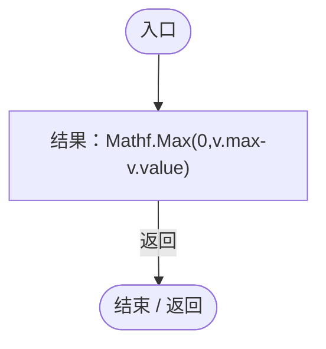

<a id="m3e346b425034ee3a"></a>

## Remove · L99

`public void Remove()`


### Editor / Player · Roslyn编译器控制流

```mermaid
flowchart TD
  b0(["入口"])
  b1["gameObject.SetActive(false);<br/>Destroy(gameObject);"]
  b2(["结束 / 返回"])
  b0 --> b1
  b1 --> b2

```

<a id="m634e84088b7cf78c"></a>

## ClearWorld · L100

`public static void ClearWorld()`


### Editor / Player · Roslyn编译器控制流

```mermaid
flowchart TD
  b0(["入口"])
  b1["All.ToArray()"]
  b2{"判断：All.ToArray()"}
  b3["var<br/>resource.Remove();"]
  b4{"All.ToArray()<br/>判断：All.ToArray()"}
  b5["All.ToArray()"]
  b6["连接 / 离开区域"]
  b7["ResourcesInWorld.Clear();<br/>ById.Clear();"]
  b8(["结束 / 返回"])
  b0 --> b1
  b1 --> b2
  b2 -->|"是"| b3
  b2 -->|"否 · 经过finally 4"| b7
  b3 --> b2
  b4 -->|"否"| b5
  b4 -->|"是"| b6
  b5 --> b6
  b7 --> b8
  b2 -. "退出保护区时 finally（示意）" .-> b4

```

项目内调用/回调引用：

- [ColonyResource.Remove · L99](293dbaecfff4b585.md#m3e346b425034ee3a)（方法）

<a id="m001b2604d9e5f3ee"></a>

## Capture · L101

`public ColonyResourceSave Capture()`


### Editor / Player · Roslyn编译器控制流

```mermaid
flowchart TD
  b0(["入口"])
  b1["State.local=EcologyQueries.ToLocal(transform.position);<br/>结果：JsonUtility.FromJson&lt;ColonyResourceSave&gt;(JsonUtility.ToJson(State))"]
  b2(["结束 / 返回"])
  b0 --> b1
  b1 -->|"返回"| b2

```

项目内调用/回调引用：

- [ColonyResource.State.get · L22](293dbaecfff4b585.md#m341a1355f4d657bf)（访问器）
- [EcologyQueries.ToLocal · L39](bdf7ccc2c9c0452f.md#m1a07639eacf3aa47)（方法）
